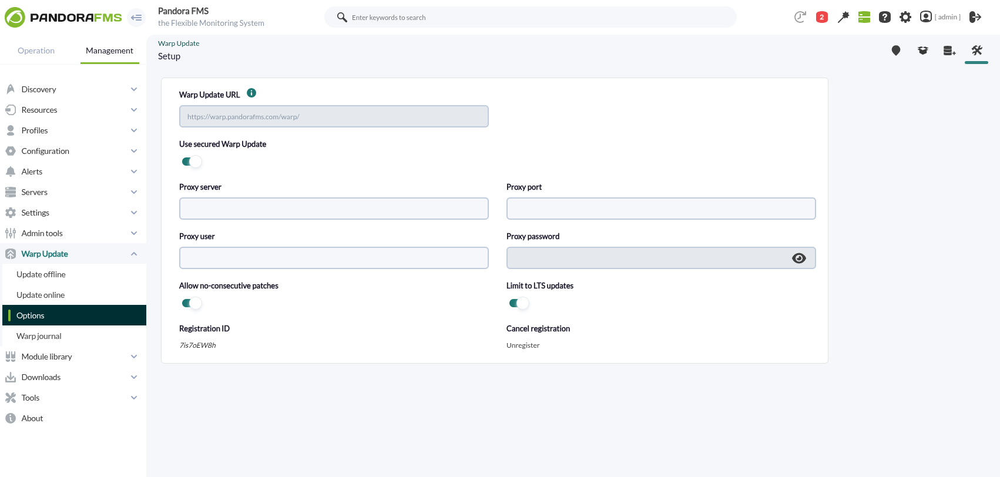
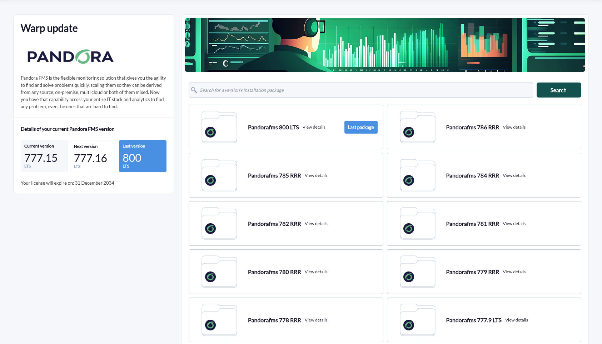
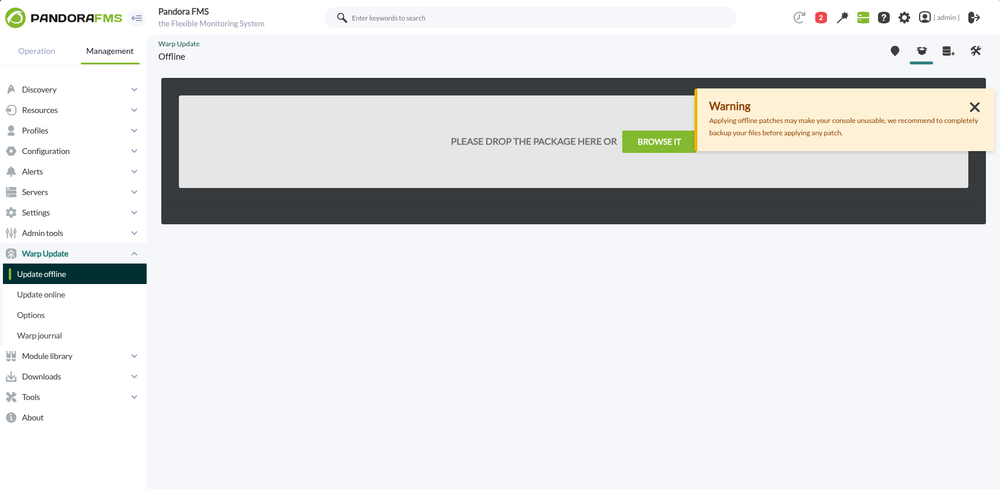
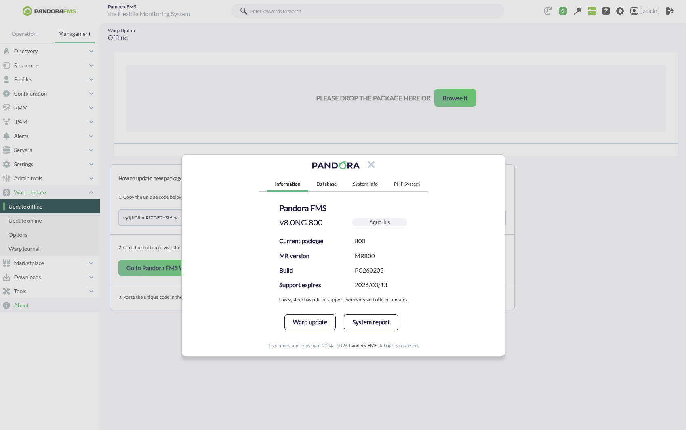
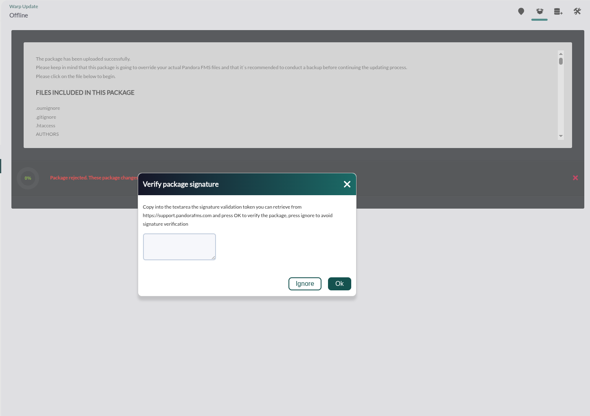
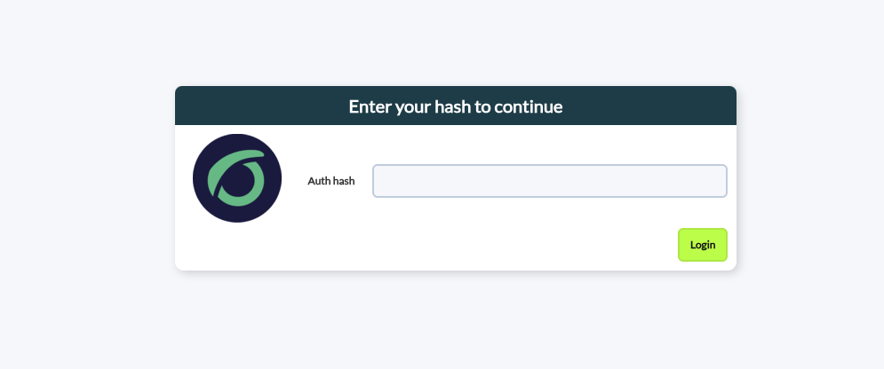
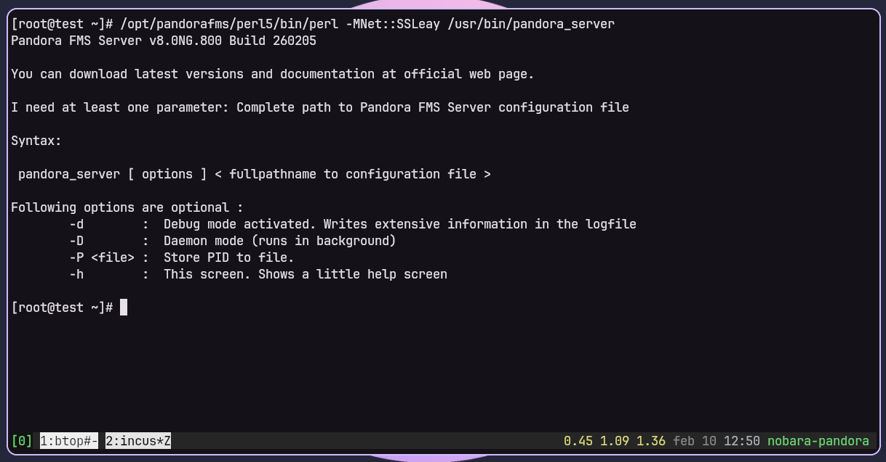
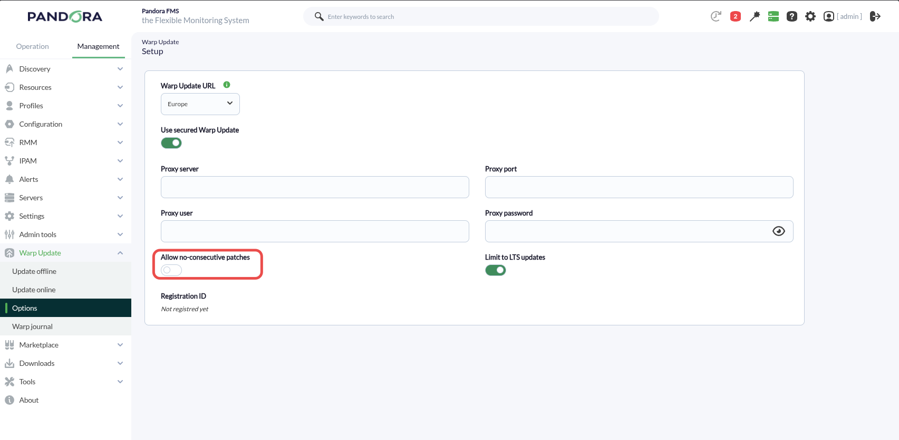
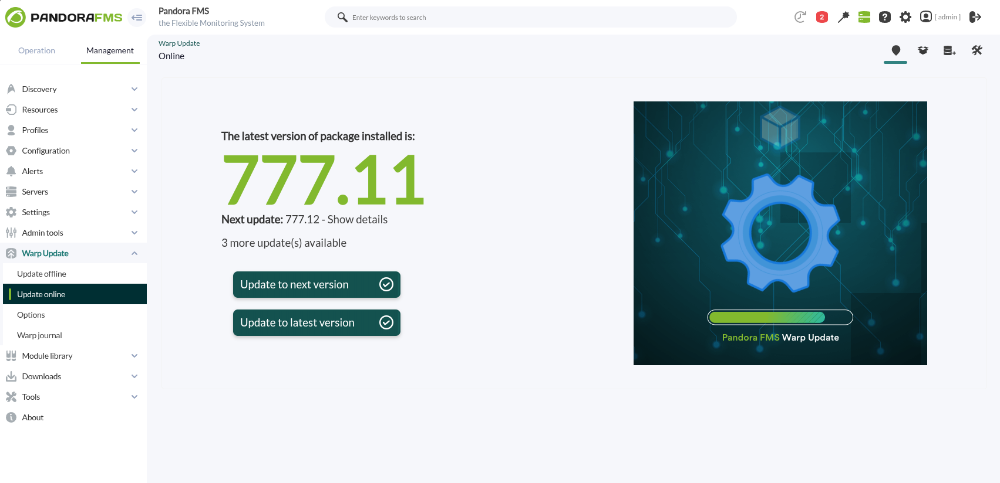
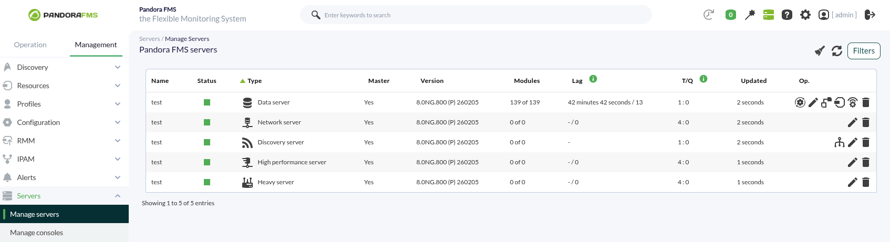

# Actualización de la LTS 777 a la 800

Actualizar desde la LTS 777 no es una actualización corriente: es un salto. La
consola no pasa de la 777 a la 800 de una vez, y el camino tiene un orden que no
conviene alterar. Este anexo cuenta ese camino concreto. El procedimiento general
de Warp Update y la actualización manual están en
[Actualizaciones](../parte-1/1.4-actualizaciones.md); aquí solo se añade lo que
cambia cuando el punto de partida es la 777.

La LTS 800 es la versión de soporte vigente y la 777 ya no lo es
([Política de versiones y soporte](../parte-1/1.3-versiones-y-estabilidad.md)).
Quien siga en la 777 tiene dos opciones: quedarse con una instalación que ya no
recibe parches o hacer el salto. Esto es lo segundo.

## Cuándo usar este anexo

Este anexo es para instalaciones que están en la 777.x, con parches o sin ellos,
y quieren llegar a la 800 LTS. No es la guía de Warp Update, que ya está en
[Actualizaciones](../parte-1/1.4-actualizaciones.md), ni la política de
versiones, que está en
[Política de versiones y soporte](../parte-1/1.3-versiones-y-estabilidad.md).

Hay tres caminos y no sirven para lo mismo:

| Camino | Cuándo usarlo | Qué conviene saber |
|---|---|---|
| Warp Update Offline | Siempre. Es el método recomendado | Permite aplicar los paquetes uno a uno y controlar el orden. Es la base de este anexo |
| Warp Update Online | Solo si estás a un salto de la 800, por ejemplo en la 777.15 o la 785 | Con muchas versiones en medio es más lento y acumula más puntos de fallo. No se usa en un Command Center |
| Actualización por paquetes | Último recurso, después de hablar con soporte | Es el mismo procedimiento para cualquier versión y está en [Actualizaciones](../parte-1/1.4-actualizaciones.md) |

Hay una condición que manda sobre las demás: si la instalación está por debajo
de la 777.3, primero hay que llegar a la 777.3 por el método offline. Los
paquetes intermedios se aplican en orden y no se pueden saltar.

## Requisitos y punto de partida

Antes de descargar nada, conviene saber de dónde se sale. La versión instalada,
el paquete actual, la versión del MR y el *build* se leen en **Management →
Acerca de** (**About**).

| Requisito | Detalle |
|---|---|
| Versión de partida | 777.x, con o sin parches. Anotar la versión y el paquete que muestra **Acerca de** antes de tocar nada |
| Sistema operativo, base de datos y PHP | Los de la versión 800. La matriz vigente está en [Requisitos del servidor](../parte-1/1.1-instalacion.md#requisitos-del-servidor) y en [Política de versiones y soporte](../parte-1/1.3-versiones-y-estabilidad.md) |
| Espacio en disco | Al menos 15 GB libres para el proceso de actualización |
| Acceso a la consola | Usuario administrador |
| Acceso al servidor | SSH o terminal local en la máquina de Pandora FMS |
| Equipo con internet | Para descargar los paquetes desde el portal de Warp |
| Copia de seguridad | *Snapshot* de la máquina o copia completa de todos los componentes antes de aplicar el primer paquete |

Las versiones de sistema operativo, base de datos y PHP dependen de la LTS de
destino y cambian con la matriz de soporte. Por eso se enlazan aquí en vez de
copiarse: un número suelto en un anexo envejece peor que un enlace a la matriz.

El propio asistente de actualización avisa de la copia de seguridad antes de
aplicar un parche. No es una formalidad: si el salto se tuerce, volver atrás es
la diferencia entre una tarde y una semana.

## El camino de paquetes: de 777.x a 777.16 y a 800

La 777 no salta directamente a la 800. La guía pasa primero por la **777.16**,
el parche que sirve de puente en la rama, y desde ahí aplica la **800**. Ese salto no
consecutivo es precisamente lo que permite la opción **Permitir parches no
consecutivos** de Warp Update, que viene desactivada de fábrica y que hay que
activar a mano.

Los tres ficheros que se descargan son estos:

| Fichero | Qué actualiza |
|---|---|
| `package_777.16.LTS.fms` | Consola y esquema de la base de datos, hasta la 777.16 |
| `package_800.LTS.fms` | Consola y esquema de la base de datos, hasta la 800 LTS |
| `pandorafms_server-780NG.800.tar.gz` | El servidor |

Si la instalación está en una versión anterior a la 777.3, el primer tramo se
hace con paquetes `.oum`:

| Fichero | Qué actualiza |
|---|---|
| `package_777.1.oum` | Primer parche de la rama 777 |
| `package_777.2.oum` | Segundo parche |
| `package_777.3.oum` | Tercer parche. Deja la consola en disposición de aplicar el resto |

Se aplican uno a uno, en ese orden, y solo después se continúa con la 777.16 y
la 800.

## Warp Update Offline

Es el método recomendado para cualquier entorno y el más rápido cuando hay que
cruzar varias versiones. La diferencia con el resto de actualizaciones está en
el orden y en un par de pasos que solo existen en este salto.

### Preparar los paquetes

El primer paso es activar **Permitir parches no consecutivos** (**Allow
no-consecutive patches**) en **Management → Warp Update → Opciones** y guardar
el cambio.



Los paquetes se descargan del portal de Warp. La consola indica la versión
instalada, la siguiente y la última, y ofrece los ficheros de cada versión.



Si la consola no está registrada, pedirá una dirección de correo antes de dar
acceso a las descargas.

### Aplicar los paquetes en orden

Desde **Management → Warp Update → Actualizar sin conexión** (**Update offline**)
se arrastra el fichero a la zona de carga o se usa **Navegue hasta él**
(**Browse it**).



Se aplica primero `package_777.16.LTS.fms` y después `package_800.LTS.fms`. Si
todo ha ido bien, se aplica el paquete del servidor,
`pandorafms_server-780NG.800.tar.gz`.

En saltos grandes como el de 777.3 a 777.15 o a 800 la consola cambia mucho.
Si alguna pantalla se ve mal o no termina de refrescar, se borra la caché del
navegador y se recarga antes de dar por roto el proceso.

Al terminar, **Acerca de** debe mostrar el paquete 800 y el MR correspondiente.



### La firma del paquete 777.3

La actualización de 777.2 a 777.3 tiene dos pasos extra. Al aplicar
`package_777.3.oum`, la consola pide una firma. Se pulsa la opción de ignorar y
se espera a que termine.



Es un paso heredado de la rama 777. Ignorar la comprobación aquí no es una
costumbre que se deba repetir en los demás paquetes: si la firma falla en un
paquete posterior, el problema es otro y conviene consultar con soporte antes de
seguir.

Si la aplicación fue bien, al recargar aparece una pantalla distinta con un
*hash* de autenticación y un enlace al nuevo Warp Update. Se copia el código, se
sigue el enlace y se pega en el portal.



Ese código es de un solo uso y da acceso a las descargas de la licencia. No se
comparte ni se deja en una captura publicada.

### Terminar el servidor por SSH

Warp Update actualiza la consola y el esquema, pero el servidor necesita un
último paso manual. Se ejecuta, como usuario `root`:

```bash
/opt/pandorafms/perl5/bin/perl -MNet::SSLeay /usr/bin/pandora_server
```

El comando arranca el binario con el Perl del producto sin fichero de
configuración. No es una opción `--version`: el servidor imprime su banner y la
ayuda, y termina.



La salida debe empezar por `Pandora FMS Server v8.0NG.800 Build …`. Si todavía
no aparece, el paquete puede estar terminando de instalarse: espera entre uno y
cinco minutos y vuelve a comprobarlo.

Con la versión confirmada, se para el servidor antiguo, se comprueba que está
parado, se levanta el nuevo y se comprueba otra vez:

```bash
systemctl stop pandora_server
systemctl status pandora_server
systemctl start pandora_server
systemctl status pandora_server
```

### Devolver Warp a su estado normal

El último paso es desactivar **Permitir parches no consecutivos** en las
opciones de Warp Update.



Mientras esa opción está activa, cualquier operador puede saltarse la secuencia
de parches. Dejarla puesta «por si acaso» es dejar abierta una puerta que no
hace falta.

## Warp Update Online

El método en línea es viable cuando la instalación está cerca de la 800, por
ejemplo en la 777.15 o la 785. Con muchas versiones en medio es más lento y
tiene más variables que pueden fallar.

Hay dos avisos que no se pueden perder:

- En un **Command Center** no se usa este método. Se actualiza con Warp Update
  Offline.
- Por debajo de la 777.3 hay que llegar antes a esa versión por el método
  offline.

En **Management → Warp Update → Actualizar en línea** (**Update online**) la
consola muestra la versión instalada, la siguiente actualización y cuántas
quedan.



Se puede ir versión a versión con **Actualizar a la siguiente versión**
(**Update to next version**) o pedir el salto completo con **Actualizar a la
última versión** (**Update to latest version**). Algunas actualizaciones están marcadas
como obligatorias y detienen el proceso: hay que volver a pulsar el botón. Es el
comportamiento previsto, no un error.

La vista de actualizaciones puede quedarse sin refrescar mientras recibe
cambios. Si no avanza durante un rato, se recarga la página.

El cierre del servidor es el mismo que en el método offline: se hace por SSH con
los comandos del apartado [Terminar el servidor por SSH](#terminar-el-servidor-por-ssh).

## Instalación por paquetes

Si fallan los dos métodos anteriores, queda la actualización manual por
paquetes. Antes de intentarlo, conviene hablar con soporte: es el camino con más
pasos y el que menos avisa cuando algo no encaja.

El procedimiento no se copia aquí porque es el mismo para cualquier versión y ya
está en [Actualizaciones](../parte-1/1.4-actualizaciones.md), en el apartado de
actualización manual. El orden no cambia: consola, esquema de la base de datos y
servidor.

## Actualizar a PHP 8.4 (opcional)

Después de migrar no es obligatorio cambiar de PHP, pero sí recomendable. El
procedimiento por distribución está en
[Actualización de versiones de PHP](a1-actualizacion-de-versiones-de-php.md), con
los bloques de comandos completos para Rocky Linux / RHEL y para Ubuntu Server
22.04.

## Comprobar que la migración ha terminado

Quedan tres comprobaciones y ninguna sobra:

- **Acerca de**: el paquete y el MR son los de la 800.
- **Servidores** (**Servers**): la columna **Versión** de todos los servidores
dice 800.
- **Warp journal**: el registro de lo aplicado, en qué orden, quién lo lanzó y
  cuándo.



Si las tres piezas no coinciden, la actualización no ha terminado. La
comprobación general está en
[Actualizaciones](../parte-1/1.4-actualizaciones.md), y para cualquier duda que
no resuelva el registro, el siguiente paso es soporte.
