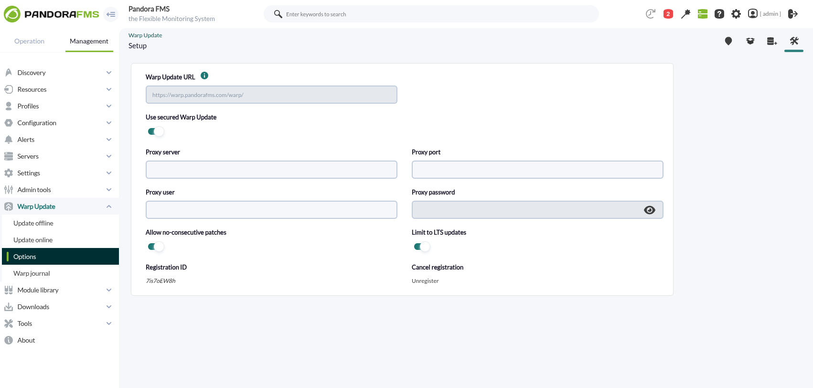
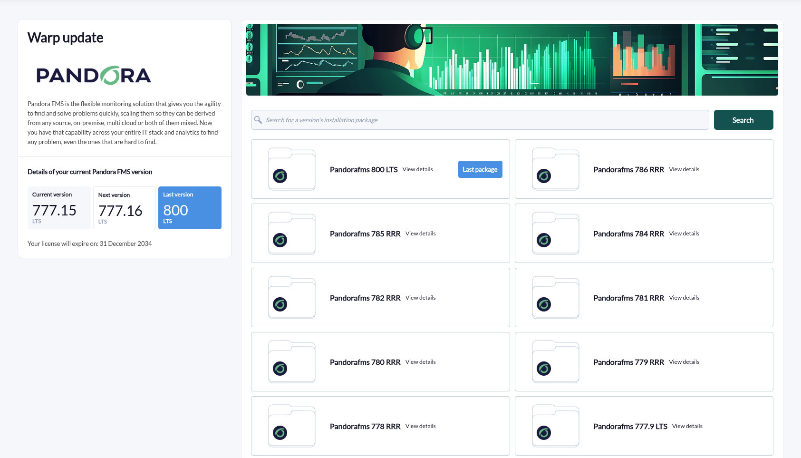
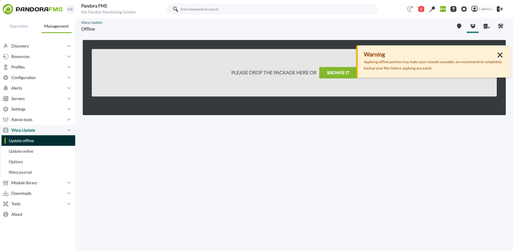
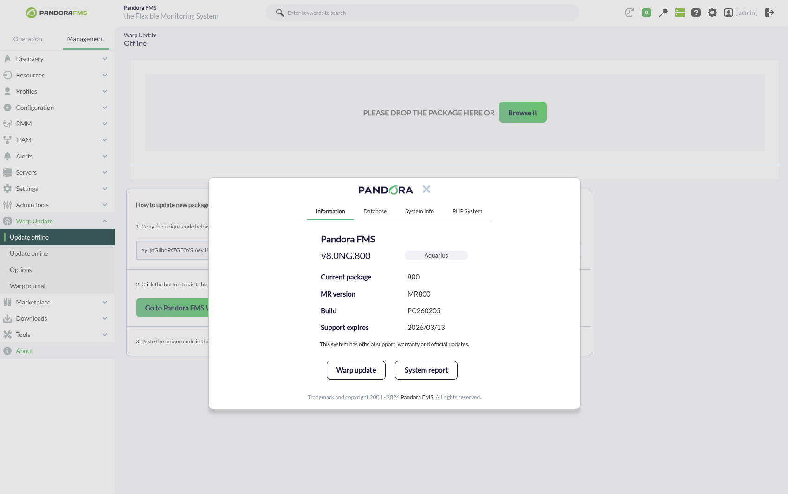
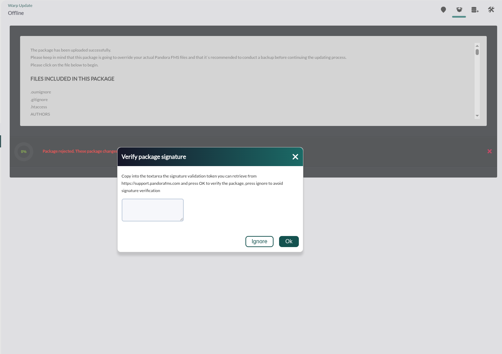
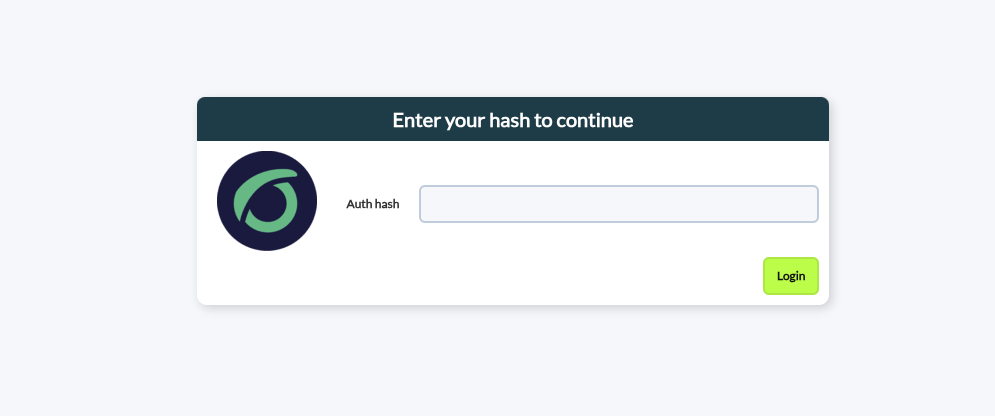
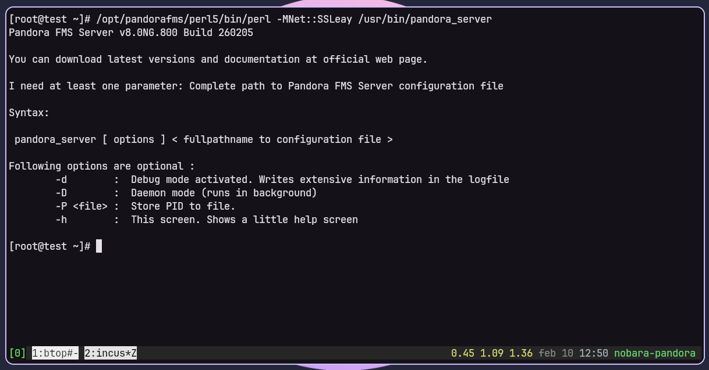
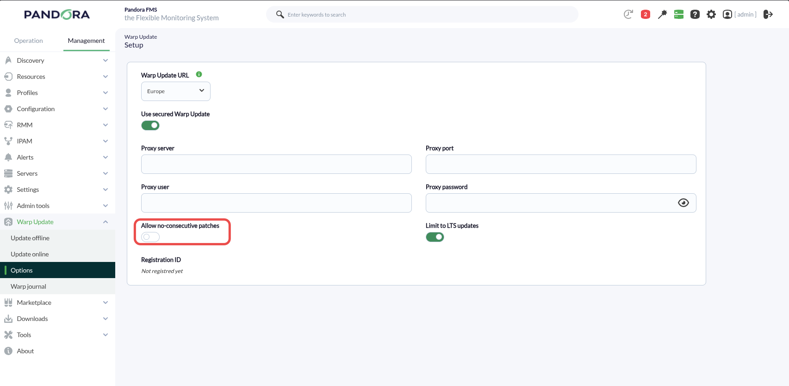
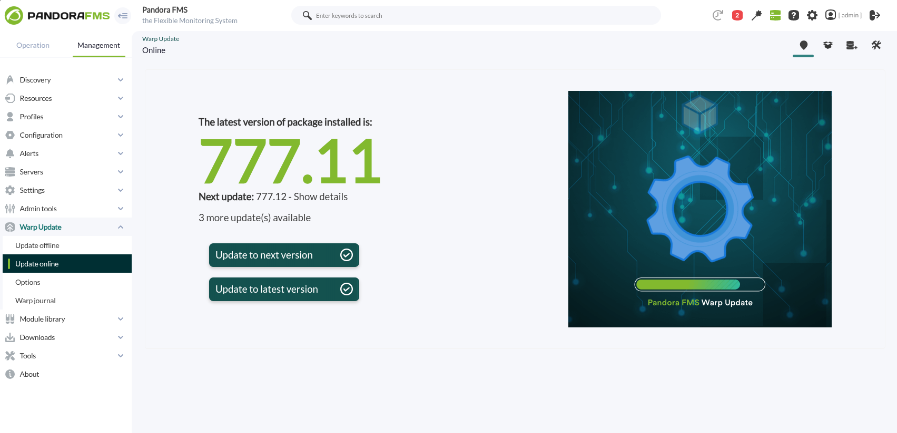
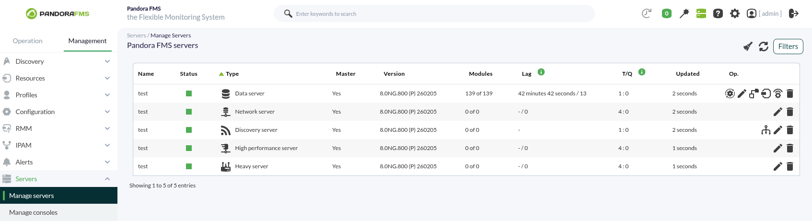

# Upgrading from LTS 777 to 800

Upgrading from LTS 777 is not a routine update: it is a jump. The console does
not go from 777 to 800 in one step, and the path has an order you should not
alter. This annex covers that specific path. The general Warp Update procedure
and the manual update are in [Updates](../parte-1/1.4-actualizaciones.md); only
what changes when the starting point is 777 is added here.

LTS 800 is the current supported version; 777 is no longer
([Version policy and support](../parte-1/1.3-versiones-y-estabilidad.md)).
Anyone still on 777 has two options: keep an installation that no longer
receives patches, or take the jump. This is the second one.

## When to use this annex

This annex is for installations on 777.x, with or without patches, that want to
reach LTS 800. It is not the Warp Update guide, which is already in
[Updates](../parte-1/1.4-actualizaciones.md), nor the version policy, which is in
[Version policy and support](../parte-1/1.3-versiones-y-estabilidad.md).

There are three paths and they are not interchangeable:

| Path | When to use it | What you should know |
|---|---|---|
| Warp Update Offline | Always. It is the recommended method | It lets you apply the packages one by one and control the order. It is the basis of this annex |
| Warp Update Online | Only if you are one jump away from 800, for example on 777.15 or 785 | With many versions in between it is slower and accumulates more failure points. It is not used in a Command Center |
| Package update | Last resort, after talking to support | It is the same procedure for any version and it is in [Updates](../parte-1/1.4-actualizaciones.md) |

One condition overrides the rest: if the installation is below 777.3, you must
first reach 777.3 through the offline method. The intermediate packages are
applied in order and cannot be skipped.

## Requirements and starting point

Before downloading anything, you should know where you are starting from. The
installed version, the current package, the MR version and the *build* are read
in **Management → About**.

| Requirement | Detail |
|---|---|
| Starting version | 777.x, with or without patches. Note down the version and the package shown in **About** before touching anything |
| Operating system, database and PHP | Those of version 800. The current matrix is in [Server requirements](../parte-1/1.1-instalacion.md#server-requirements) and in [Version policy and support](../parte-1/1.3-versiones-y-estabilidad.md) |
| Disk space | At least 15 GB free for the update process |
| Console access | Administrator user |
| Server access | SSH or a local terminal on the Pandora FMS machine |
| A computer with internet | To download the packages from the Warp portal |
| Backup | A machine snapshot or a full backup of all components before applying the first package |

Operating system, database and PHP versions depend on the target LTS and change
with the support matrix. That is why they are linked here instead of copied: a
stray number in an annex ages worse than a link to the matrix.

The update wizard itself warns about the backup before applying a patch. It is
not a formality: if the jump goes wrong, going back is the difference between an
afternoon and a week.

## The package path: from 777.x to 777.16 and to 800

777 does not jump straight to 800. The guide goes through **777.16** first, the
patch that acts as a bridge in the branch, and from there it applies **800**.
That non-consecutive jump is exactly what the **Allow no-consecutive patches**
option in Warp Update allows, and it is off by default, so you have to turn it on
by hand.

These are the three files you download:

| File | What it updates |
|---|---|
| `package_777.16.LTS.fms` | Web console and database schema, up to 777.16 |
| `package_800.LTS.fms` | Web console and database schema, up to LTS 800 |
| `pandorafms_server-780NG.800.tar.gz` | The server |

If the installation is on a version below 777.3, the first stretch is done with
`.oum` packages:

| File | What it updates |
|---|---|
| `package_777.1.oum` | First patch in the 777 branch |
| `package_777.2.oum` | Second patch |
| `package_777.3.oum` | Third patch. It leaves the console ready to apply the rest |

They are applied one by one, in that order, and only then do you continue with
777.16 and 800.

## Warp Update Offline

It is the recommended method for any environment and the fastest one when
several versions have to be crossed. What sets it apart from other updates is
the order and a couple of steps that only exist in this jump.

### Preparing the packages

The first step is to turn on **Allow no-consecutive patches** in **Management →
Warp Update → Options** and save the change.



The packages are downloaded from the Warp portal. The console shows the
installed version, the next one and the latest one, and offers the files for
each version.



If the console is not registered, it will ask for an email address before
granting access to the downloads.

### Applying the packages in order

From **Management → Warp Update → Update offline**, drag the file onto the
upload area or use **Browse it**.



Apply `package_777.16.LTS.fms` first and then `package_800.LTS.fms`. If all has
gone well, apply the server package, `pandorafms_server-780NG.800.tar.gz`.

In big jumps such as 777.3 to 777.15 or to 800 the console changes a lot. If a
screen looks wrong or does not finish refreshing, clear the browser cache and
reload before assuming the process is broken.

When it finishes, **About** must show package 800 and the corresponding MR.



### The 777.3 package signature

The update from 777.2 to 777.3 has two extra steps. When applying
`package_777.3.oum`, the console asks for a signature. Press the option to
ignore it and wait for it to finish.



It is a step inherited from the 777 branch. Ignoring the check here is not a
habit to repeat with the other packages: if the signature fails on a later
package, the problem is a different one and you should check with support before
carrying on.

If the application went well, reloading shows a different screen with an
authentication *hash* and a link to the new Warp Update. Copy the code, follow
the link and paste it into the portal.



That code is single-use and grants access to the licence downloads. Do not share
it and do not leave it in a published screenshot.

### Finishing the server over SSH

Warp Update updates the console and the schema, but the server needs a final
manual step. Run it as `root`:

```bash
/opt/pandorafms/perl5/bin/perl -MNet::SSLeay /usr/bin/pandora_server
```

The command starts the binary with the product's Perl without a configuration
file. It is not a `--version` option: the server prints its banner and the help,
and exits.



The output must start with `Pandora FMS Server v8.0NG.800 Build …`. If it does
not appear yet, the package may still be finishing its installation: wait
between one and five minutes and check again.

With the version confirmed, stop the old server, check that it is stopped, start
the new one and check again:

```bash
systemctl stop pandora_server
systemctl status pandora_server
systemctl start pandora_server
systemctl status pandora_server
```

### Returning Warp to its normal state

The last step is to turn off **Allow no-consecutive patches** in the Warp Update
options.



While that option is on, any operator can skip the patch sequence. Leaving it on
"just in case" is leaving a door open that nobody needs.

## Warp Update Online

The online method is viable when the installation is close to 800, for example
on 777.15 or 785. With many versions in between it is slower and has more
variables that can fail.

There are two warnings you cannot miss:

- In a **Command Center** this method is not used. It is updated with Warp
  Update Offline.
- Below 777.3 you must first reach that version through the offline method.

In **Management → Warp Update → Update online** the console shows the installed
version, the next update and how many are left.



You can go version by version with **Update to next version** or ask for the
whole jump with **Update to latest version**. Some updates are marked as
mandatory and stop the process: you have to press the button again. That is the
intended behaviour, not an error.

The update view may stop refreshing while it receives changes. If it does not
move for a while, reload the page.

Stopping and starting the server is the same as in the offline method: it is
done over SSH with the commands in the
[Finishing the server over SSH](#finishing-the-server-over-ssh) section.

## Package update

If both previous methods fail, the manual package update remains. Before trying
it, talk to support: it is the path with the most steps and the one that warns
least when something does not fit.

The procedure is not copied here because it is the same for any version and it
is already in [Updates](../parte-1/1.4-actualizaciones.md), in the manual update
section. The order does not change: console, database schema and server.

## Upgrading to PHP 8.4 (optional)

After migrating, changing PHP is not mandatory, but it is recommended. The
procedure by distribution is in
[Upgrading PHP versions](a1-actualizacion-de-versiones-de-php.md), with the
complete command blocks for Rocky Linux / RHEL and for Ubuntu Server 22.04.

## Checking that the migration has finished

Three checks remain and none is superfluous:

- **About**: the package and the MR are those of 800.
- **Servers**: the **Version** column of every server says 800.
- **Warp journal**: the record of what was applied, in what order, who launched
  it and when.



If the three pieces do not match, the update has not finished. The general check
is in [Updates](../parte-1/1.4-actualizaciones.md), and for any doubt the record
does not resolve, the next step is support.
