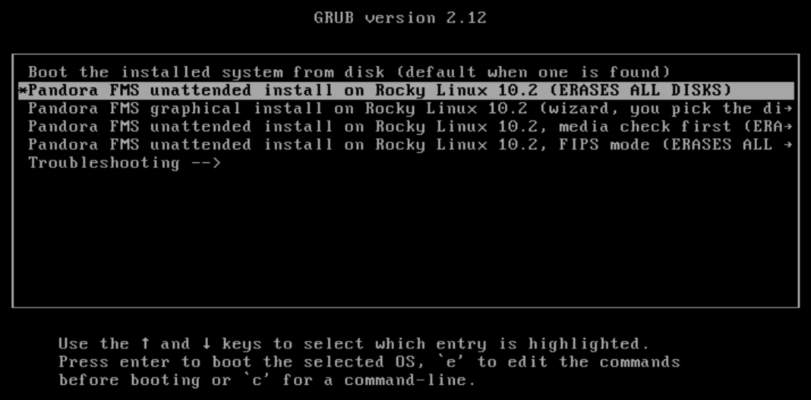
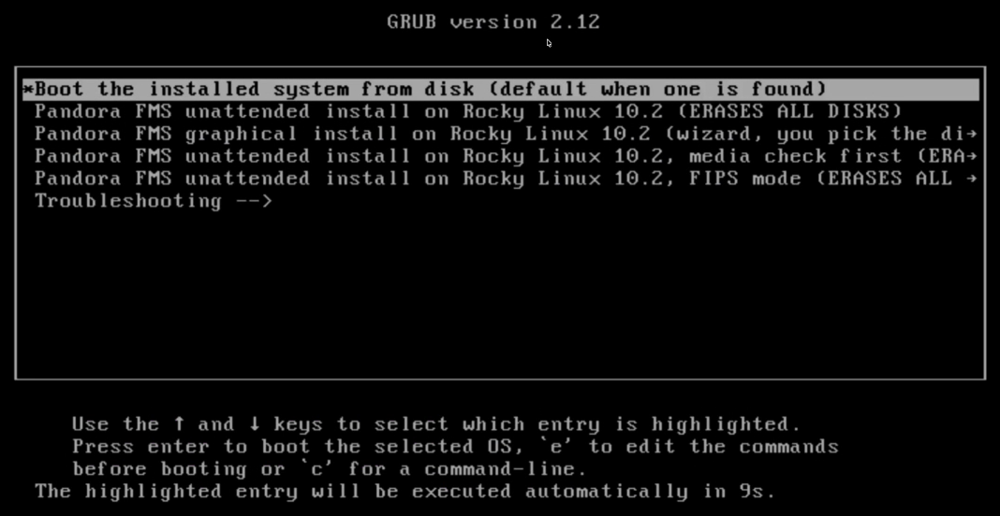
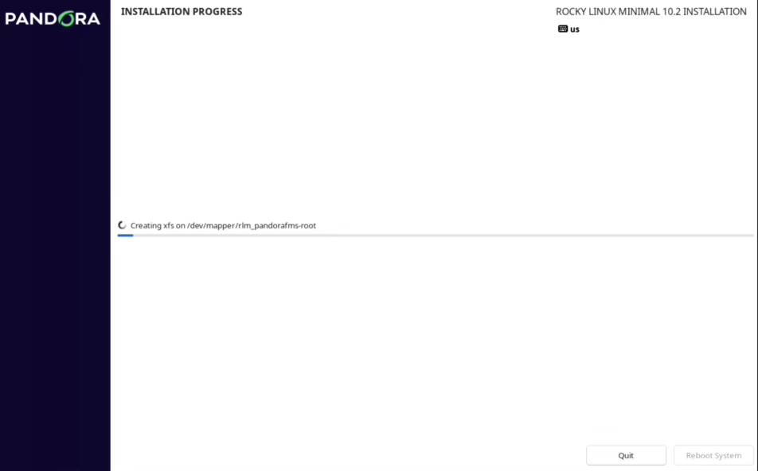
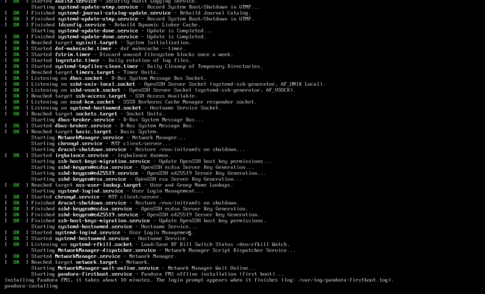
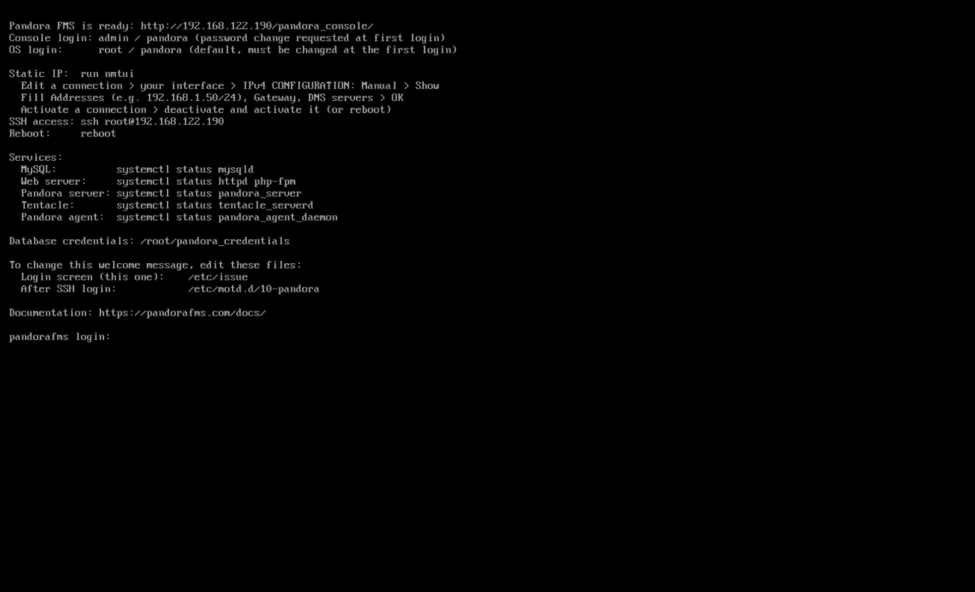

# Installation

Installing Pandora FMS is the easy part of the project. The hard part is deciding
what it runs on, what is left out and who remembers all this in two years. This
chapter covers the installation of the product, its requirements and the
decisions worth making before running the first command, not after.

## What will be installed

The Pandora FMS online installer sets up the **server**, the **Web console**, the
**database** and, optionally, a **local EndPoint** to monitor the server itself,
all on a single machine. It is the *monolith* environment and it covers most
cases.

The components do not have to live together, and each piece is installed
separately afterwards to adapt the architecture: a database on a dedicated server,
OpenSearch aside, one or several satellites for remote networks, or several nodes
coordinated from the Command Center. This section explains the standard
installation, and the variants are in
[Personalisation of the automatic installation](#personalisation-of-the-automatic-installation).

The installable components of Pandora FMS are:

- **Server** (`pandora_server`), with its database and the Tentacle server.
- **Web console** (`pandora_console`).
- **EndPoint** (`pandora_agent` and associated agents), on the machine to be
  monitored.
- **Satellite Server**, a standalone server for remote networks.
- **OpenSearch**, a log storage engine, optional.
- **Command Center**, for distributed environments.

The full requirements for each component are further down, in
[Minimum requirements](#minimum-requirements). Read them before you start, because
they are the difference between an installation that lasts for years and one that
gives its first scare after three months.

## Prerequisites

Before launching the online installation:

| Requirement | Detail |
|---|---|
| Internet | Access to the internet and to the official repositories of the distribution (RHEL / Rocky Linux / Ubuntu Server). |
| `curl` | Installed (it comes by default in almost every distribution). |
| User | **root** (or the equivalent with `sudo`). |
| Operating system | RHEL, Rocky Linux and AlmaLinux 9 or 10, or Ubuntu Server 22.04 or 24.04. More detail in [Server requirements](#server-requirements). |
| Hardware | Meet the [minimum hardware requirements](#server-requirements). |
| RHEL | Licensed machine, subscribed to the standard repositories. |

## Online installation of the server

If the machine has internet, this is the recommended path, and the online installer
sets up the full server environment in a single step.

```bash
curl -SsL https://pfms.me/deploy_pandora_one | PANDORA_LTS=1 bash
```

The script detects the distribution, downloads the matching installer, and works with **RHEL**,
**Rocky Linux**, **AlmaLinux** and **Ubuntu Server**. Red Hat is the recommended
option, and the rest are supported with the versions given in the
[operating system table](#server-requirements).

The command above performs a full installation, and the installer also accepts
environment variables to customise it (database passwords, MySQL and PHP version,
LTS or Feature Release channel, specific packages, and so on). They are all listed
further down, in
[Personalisation of the automatic installation](#personalisation-of-the-automatic-installation).

## Online installation of the EndPoint

The EndPoint is the program that lives inside the monitored machine and it is not
mandatory (remote monitoring exists), but it is the only way to obtain maximum
detail: processes, inventory, local logs.

### Linux

The online installer works with Red Hat distributions (RHEL, Fedora, Rocky),
SUSE/OpenSUSE and Debian/Ubuntu. It **always installs from a TAR**, never from an
RPM, and it verifies that the downloaded package is an authentic EndPoint before
configuring it against your server.

Minimum installation (GO EndPoint, LTS version):

```bash
export PANDORA_SERVER_IP='10.0.0.1'
curl -sSL https://pfms.me/agent-deploy | bash
```

The installer accepts environment variables to automate the installation or choose
the package. They are all listed further down, in
[Personalisation of the automatic installation](#personalisation-of-the-automatic-installation).

Supported architectures: `x86_64` with binaries, while on `x86`, `armv7l` and
`aarch64` the script switches automatically to building from sources
(`PERL_SOURCES`). On other architectures the process stops.

### MS Windows

The EndPoint is delivered as a `.exe` self-installer, so for the online
installation, run PowerShell as administrator:

```powershell
Invoke-WebRequest -Uri https://marketplace.pandorafms.com/pandorafms/LTS/PandoraFMS_One_Agent_Windows-lts.x86_64.exe -OutFile ${env:tmp}\pandora-agent-windows.exe; & ${env:tmp}\pandora-agent-windows.exe /S --ip <SERVER_IP> --group <GROUP> --remote_config 1
```

And start the service:

```powershell
NET START PandoraFMSAgent
```

The details of the manual and unattended installation are in
[Offline installation of the EndPoint](#offline-installation-of-the-endpoint).

## Installation of the satellite

The **Satellite Server** is a *headless* server (no web interface) designed to
discover and monitor remote networks that the Pandora FMS server cannot reach and
where EndPoints cannot be installed either: network elements through SNMP/ICMP,
Windows servers through WMI and Linux through SNMP. It runs up to 500 checks per
second, it does not need a connection to the Pandora FMS database, and it sends
the data as XML.

### Online installation

Supported operating systems: **EL8, EL9 and EL10** (RHEL / Rocky Linux, with
EL10 as the recommended option; packages exist for x86_64 and ARM64), **Ubuntu
Server 22.04** (Ubuntu 24.04 is not supported yet) and **Raspberry Pi OS**
(Debian 12+, ARM64, with the specific package for Raspberry).

```bash
export PANDORA_SERVER_IP='<IP or FQDN of the Pandora FMS Server>'
curl -Ls https://pfms.me/satellite-ent-deploy | bash
```

The installer accepts environment variables (release channel, default group,
remote configuration, agent installation, and so on), listed further down in
[Personalisation of the automatic installation](#personalisation-of-the-automatic-installation).

!!! info "Compatibility"
    Satellite Server 785 is not compatible with earlier versions of Pandora FMS,
    so install it alongside a 785 or later environment, or you will have features
    that appear but do not operate.

## Installation of OpenSearch

Log collection is optional, and activating it requires an **OpenSearch** instance.
It is **not installed by default** with the server: it is a separate deployment,
and the recommendation is that it lives on a server independent from the Pandora
FMS one.

```bash
curl -SsL https://pfms.me/pandorafms-opensearch-el | bash
```

The installer creates a node ready to use, with HTTPS and password authentication,
and it is compatible with **EL8 or later and Ubuntu 22.04 Server**, and it accepts
environment variables for the cluster name and the password, listed further down
in [Personalisation of the automatic installation](#personalisation-of-the-automatic-installation).

Check that the node responds:

```bash
curl -X GET https://127.0.0.1:9200 -ku 'admin:<password>'
```

Change this password too, and apply the same rule as with the database: what is
published protects nothing.

## Minimum requirements

### Server requirements

**Hardware.** The values are minimums, calculated assuming that 80% of the modules
store historical data and an average sampling of five minutes, with server,
console and database on the same machine:

| Hardware | Small (≤ 1,000 modules) | Medium (≤ 10,000) | Large (≤ 30,000) | Extra large (≤ 80,000) |
|---|---|---|---|---|
| CPU | 2 cores at 2 GHz | 4 cores at 2.5 GHz | 6 cores at 3 GHz | 10 cores at 3 GHz |
| RAM | 4 GB | 8 GB | 16 GB | 32 GB |
| Storage | 15K rpm or SSD ≥ 300 MB/s | 15K rpm or SSD ≥ 300 MB/s | SSD ≥ 300 MB/s | SSD ≥ 300 MB/s |
| Disk (minimum / recommended) | 40 / 60 GB | 60 / 150 GB | 120 / 250 GB | 250 / 400 GB |

If information is stored for more than one month, a
[historical database](#external-database-installation-for-historical-data) has to
be deployed.

!!! warning "Virtualisation"
    In virtual environments, assign the machine an independent disk with reserved
    space and high speed. Putting the database on a shared, thin volume is the most
    reliable way to get a bottleneck that nobody will locate for weeks.

Above 80,000 modules, a single node stops making sense, and it is time for
distributed monitoring with multiple nodes (**Command Center**).

**Software.**

| Software | Requirements |
|---|---|
| Operating system | RHEL 10, Rocky Linux 10, AlmaLinux 10, RHEL 9 (recommended), Rocky Linux 9 (recommended), AlmaLinux 9 (recommended), Ubuntu Server 22.04 and 24.04. |
| Console | PHP 8.4 from version 785, PHP 8.2 from 776 to 784, PHP 8 from 760 to 775, PHP 7.4 from 759 to 767 and PHP 7.2 from 729 to 758. |
| Database | Percona Server for MySQL 8 (recommended, especially above 4,000 agents), MySQL 8 or MySQL 8.4 from version 785. |
| Browsers | Chrome, Firefox, Opera and Edge. For interactive graphs and network maps, Firefox or Chrome. |
| systemd | Required since version 779. It comes installed and enabled on the supported OSs. |

!!! info "EL10 and Ubuntu"
    **EL10** denotes the set of recommended systems: Rocky Linux 10, AlmaLinux 10
    and Red Hat 10. **Offline installation is not supported on Ubuntu Server**, so
    do not choose it for a server without a connection, and for Command Center,
    avoiding Ubuntu is recommended.

Each LTS version of Pandora FMS supports specific operating system versions, so
consult the OS version support policy before deciding.

**Permissions.**

| Requirement | Detail |
|---|---|
| Installation user | The server is installed as **root**. During the installation a `pandora` user is created and assigned to the `root` group, and it can be changed afterwards, bearing in mind that the Tentacle server will have to be reconfigured. There is also the installation with an unprivileged user, with a separate procedure. |
| Console | Apache needs read and execute permissions on the console files. `config.php` must have `600` permissions. |
| Server | Write permissions on `/var/spool/pandora/`. |

### EndPoint requirements

The EndPoint can run on any machine with the minimum required operating system:

| Component | Operating system |
|---|---|
| Pandora EndPoint 4.0 or later | RHEL 10 / Rocky Linux 10, RHEL 6.x, 8 and 9, Fedora 34, CentOS 6.x, 7 and 8, AlmaLinux, SLES 11 SP1 or later, OpenSUSE 11.x or later, Debian 5.x or later, Ubuntu Server or Desktop 11 or later, Linux Mint, Elementary OS, Manjaro, HPUX B.11.11 or later with Perl 5.8, AIX 4.3.3 or later with Perl 5.8, AIX 7.1 and 7.2, BSD (NetBSD, OpenBSD, FreeBSD) with Perl 5.8, MacOS X 10.6 or later, Solaris 8 or later with Perl 5.8, Windows NT4, XP, 2000, 2003, 2008, 7, 8, 10, 11, 2012, Server 2016 and Server 2019. |
| Pandora Android EndPoint 2.0 or later | Android 6 or later. |
| Pandora Embedded EndPoint 4.0 or later | *Embedded* devices, requires compilation. |

On `*nix`-type systems, **systemd** must be installed and started, and on UNIX
environments, in addition:

| Requirement | Detail |
|---|---|
| Perl | 5.8 or later. |
| Dependencies | `perl-YAML-Tiny-1.73-2`, `perl-Sys-Syslog` and `unzip`. |
| logrotate | Configured for the EndPoint (next block). |

```bash
cat> /etc/logrotate.d/pandora_agent <<EO_LRA
/var/log/pandora/pandora_agent.log {
        su root apache
        weekly
        missingok
        size 300000
        rotate 3
        maxage 90
        compress
        notifempty
        copytruncate
}
EO_LRA
chmod 0644 /etc/logrotate.d/pandora_agent
```

On Linux, the EndPoint runs as **root** to have all the features, and on Windows it
runs with administrator permissions.

### Satellite requirements

| Satellite | Details |
|---|---|
| Hardware (Windows) | x64, minimum 2 cores at 2 GHz (4 recommended), minimum 6 GB of RAM (8 recommended), minimum disk 5 GB (10 recommended). |
| Hardware (Linux) | x64, minimum 2 cores at 2 GHz (4 recommended), minimum 4 GB of RAM (6 recommended), minimum disk 5 GB (10 recommended). |
| Operating systems | 64-bit Linux, 64-bit MS Windows. |
| Dependencies | `fping`, `nmap`, `perl`, `pandorawmic` (version NG 762 or later) and `libnsl`, plus `snmp` for SNMP. |

On Rocky Linux 8 or later the EPEL repository has to be configured first, and on
Windows, depending on the system version, Microsoft Visual C++ Redistributable has
to be installed.

### OpenSearch requirements

| Requirement | Detail |
|---|---|
| Operating system | RHEL, Rocky Linux or AlmaLinux 8 or later; Ubuntu Server 22.04. |
| RAM | Minimum 4 GB (dev/testing), 8 GB per instance recommended, although it has to be estimated according to the volume of data. |
| CPU | Minimum 4 cores. |
| SWAP | Disabled on the OpenSearch node or nodes. |
| Storage | 50 GB of system disk and 100 GB for OpenSearch. |
| Connectivity | From the Pandora FMS server and console to the OpenSearch API (`9200/TCP`) and between cluster nodes (`9300/TCP`). |

A single node with these characteristics stores up to 1 GB of daily data for 30
days. For greater redundancy and capacity, a **cluster** is configured (minimum 3
nodes to guarantee data integrity) and the load is spread with a load balancer
such as **Keepalived**.

### SIEM requirements

| Requirement | Detail |
|---|---|
| OpenSearch | **OpenSearch database on a dedicated instance**. |
| Log collection | Activated. |
| Node resources | Minimum **4 cores, 8 GB of RAM and 100 GB of SSD disk**. |
| SIEM instance | A dedicated server is recommended for `siemserver` and `siemevents`. |
| Licence | With the SIEM feature enabled. |

Once the requirements are met, SIEM is activated from the console in
**Management → Settings → System Settings → SIEM → Activate SIEM**. On saving, the
normalisation templates are created in OpenSearch and `siemserver` and
`siemevents` are enabled on the corresponding servers.

### Security and network requirements

If the machine has security applications (EDR, XDR, antivirus), the Pandora FMS
processes and paths have to be allowed, or you will see components dying with no
explanation. Hand this list to the EDR administrator, exactly as it is.

For the **server**:

```
/var/spool/pandora
/usr/share/pandora_server
/etc/pandora
/var/log/pandora
/etc/tentacle
/usr/bin/pandora_server
/usr/bin/pandora_exec
/usr/bin/tentacle_server
/usr/bin/tentacle_client
/usr/bin/pandora_ha
/usr/bin/pandora_db
/usr/bin/pandora_manage
/usr/bin/pandora_revent
/usr/bin/pandora_encrypt_db
/usr/bin/pandorafsnmp
/usr/bin/pandorawmic
/usr/bin/clean_pandora_server
/usr/bin/clean_tentacle_serverd
/usr/bin/clean_tentacle_rmm
```

For the **EndPoints**:

```
/usr/share/pandora_agent
/usr/bin/pandora_agent
/usr/bin/pandora_agent_exec
/usr/bin/pandora_revent
/var/spool/pandora
/etc/pandora
/var/log/pandora
/usr/bin/tentacle_server
/usr/bin/tentacle_client
/usr/bin/clean_pandora_agent_daemon
```

For the **Satellite Server**:

```
/usr/bin/satellite_server
/etc/pandora
/var/spool/pandora
/usr/sbin/fping
/usr/sbin/wmic
/usr/bin/tentacle_server
/usr/bin/tentacle_client
/usr/bin/pandorafsnmp
/usr/bin/pandorawmic
/usr/bin/clean_satellite_serverd
```

In custom installations, the directory where it was installed has to be prepended
to each path.

**Ports.** The complete table. When the network team asks what to open, this is
the list:

| Port | Protocol | Service | Description | Direction |
|---|---|---|---|---|
| 80 | TCP | Console | Web administration and API | Browser → Console |
| 80 | TCP | Console (API) | API/CLI use | Client → Console |
| 80 | TCP | Command Center | Command Center ↔ Nodes communication | Command Center ↔ Node |
| 162 | UDP | Server | Trap reception | Device → Server |
| 443 | TCP | Console (API) | API/CLI use | Client → Console |
| 443 | TCP | Command Center | Command Center ↔ Nodes communication | Command Center ↔ Node |
| 3306 | TCP | Console and Server | Database connection | Server → DB |
| 3306 | TCP | Command Center | Node DB | Command Center ↔ DB |
| 4444 | TCP | Server | Connection with Selenium GRID | Server → Selenium |
| 9995 | UDP | Server | NetFlow probes | nfcapd → Server |
| 9200 | TCP | Console and Server | OpenSearch (logs) | Server → OpenSearch |
| 9300 | TCP | OpenSearch | Communication between cluster nodes | Node ↔ Node |
| 41121 | TCP | Agents | Tentacle communication | EndPoint → Server |
| 41122 | UDP | Agents | Remote actions over UDP | EndPoint ↔ Server |
| 41123 | TCP | Agents | RMM feature | EndPoint ↔ Server |

For standard monitoring, the server also needs outbound access to what it
monitors: `80/TCP` and `443/TCP` for web monitoring (WUX), `161/UDP` for SNMP
polling and ICMP for network checks.

## Personalisation of the automatic installation

### Server and console

#### Values for the online installer

The basic run installs the full environment, and these environment variables
customise it (values for RHEL and Rocky Linux):

| Variable | Function | Default |
|---|---|---|
| `TZ` | Machine time zone; if unset, it is left unchanged | Unchanged |
| `DBHOST` | Database host | `127.0.0.1` |
| `DBNAME` | Name of the database to create | `pandora` |
| `DBUSER` | Database user | `pandora` |
| `DBPASS` | User password | `Pandor4!` |
| `DBPORT` | Database port | `3306` |
| `DBROOTPASS` | Database root password | `Pandor4!` |
| `SKIP_PRECHECK` | Skip the previous installation check | `0` |
| `SKIP_DATABASE_INSTALL` | Do not install the database (use an external one) | `0` |
| `SKIP_KERNEL_OPTIMIZATIONS` | Skip kernel optimisation | `0` |
| `SKIP_DOCKER_INSTALL` | Do not install Docker (it is installed, and left disabled, for debugging) | `0` |
| `POOL_SIZE` | MySQL memory (buffer pool) | Automatic |
| `MYVER` | MySQL version (`80` or `84`; on EL10, only `84`) | `84` |
| `PHPVER` | PHP version (`8.2` or `8.4`) | `8.4` |
| `PANDORA_SERVER_PACKAGE` | URL of the server tarball | latest available |
| `PANDORA_CONSOLE_PACKAGE` | URL of the console package (RPM on EL, source tarball on Ubuntu) | latest available |
| `PANDORA_AGENT_PACKAGE` | URL of the agent tarball | latest available |
| `PANDORA_BETA` | Install beta (`1`) | `0` |
| `PANDORA_LTS` | Install the LTS branch instead of Feature Release | `1` |

The list is the same on RHEL, Rocky Linux, AlmaLinux and Ubuntu Server. On EL10
the installer only supports MySQL 8.4 (`MYVER=84`). `POOL_SIZE` is calculated
automatically from the machine memory (25 % below 7.5 GB and 40 % above); set it
only if you want a different split. Docker is installed, and left disabled, only
for debugging tasks: with `SKIP_DOCKER_INSTALL=1` it is not installed.

Example on EL10 with explicit values:

```bash
env TZ='Europe/Madrid' \
    DBHOST='127.0.0.1' \
    DBNAME='pandora' \
    DBUSER='pandora' \
    DBPASS='ChangeThisPassword' \
    DBPORT='3306' \
    DBROOTPASS='ChangeThisRootPassword' \
    MYVER=84 \
    PHPVER=8.4 \
    SKIP_PRECHECK=0 \
    SKIP_DATABASE_INSTALL=0 \
    SKIP_KERNEL_OPTIMIZATIONS=0 \
    PANDORA_BETA=0 \
    PANDORA_LTS=1 \
    bash -c "$(curl -fsSL https://pfms.me/deploy_pandora_one)"
```

!!! warning "Change the default passwords"
    `Pandor4!` is written in the public documentation. It is the first one anyone
    who knows the way in will try. Leaving it in place is not an oversight. It is
    leaving the door open and putting out the doormat.

#### Kernel optimisation values

The online installer adjusts some kernel parameters. With
`SKIP_KERNEL_OPTIMIZATIONS=1` it does not touch them, but it is worth knowing what
is lost: they are settings designed to let the server withstand many simultaneous
connections without the operating system becoming the bottleneck.

| Parameter | Default | Set by Pandora | What it does |
|---|---|---|---|
| `net.ipv4.tcp_syn_retries` | 5 | 3 | Retries when sending a TCP connection request before giving it up as failed. |
| `net.ipv4.tcp_synack_retries` | 5 | 3 | Retries when receiving the acknowledgement of a TCP connection. |
| `net.ipv4.tcp_max_syn_backlog` | 1024 | 65536 | Maximum size of the queue of TCP connections pending acceptance. |
| `net.core.wmem_max` | 124928 | 8388608 | Maximum send buffer for data per network connection. |
| `net.core.rmem_max` | 131071 | 8388608 | Maximum receive buffer for data per network connection. |
| `net.core.somaxconn` | 128 | 1024 | Pending connections in the socket listening queue. |
| `net.core.optmem_max` | 20480 | 81920 | Maximum buffer for socket options. |

Do not touch them by hand unless you know exactly what you are doing, and leave
`SKIP_KERNEL_OPTIMIZATIONS=0` so the installer does its work.

#### Installation on an external database

If there is a dedicated server for the database, the path is: create the database
and the user, give it all permissions on that database and install with
`SKIP_DATABASE_INSTALL=1` and the connection values. Before installing, test the
connection from the future Pandora FMS server, because discovering the firewall at
two in the morning is avoidable with five minutes of checking.

```bash
env DBHOST='192.168.1.107' \
    DBNAME='pandora' \
    DBUSER='pandora' \
    DBPASS='ChangeThisPassword' \
    DBPORT='3306' \
    SKIP_DATABASE_INSTALL=1 \
    bash -c "$(curl -fsSL https://pfms.me/deploy_pandora_one)"
```

Restrict the database user to the IP of the Pandora FMS server, so that if the
password is compromised it does not work from anywhere else.

#### External database installation for historical data

To deploy a dedicated database (historical data included) there is an online
installer of its own. It only requires `curl` and a compatible system:

- **EL9**: Rocky Linux 9.x or RHEL 9.x.
- **EL10**: Rocky Linux 10 or RHEL 10.
- **Ubuntu**: 22.04.

```bash
curl -fsSL https://pfms.me/db-deploy-el9 | bash
```

On Ubuntu:

```bash
curl -fsSL https://pfms.me/db-deploy-u2204 | bash
```

Supported variables:

| Variable | Description | Default |
|---|---|---|
| `TZ` | Machine time zone; if unset, it is left unchanged | Unchanged |
| `MYVER` | MySQL version (8.0 or 8.4) | `84` |
| `DBNAME` | Name of the database to create | `pandora` |
| `DBUSER` | Database user | `pandora` |
| `DBPASS` | User password | `Pandor4!` |
| `DBROOTPASS` | Root user password | `Pandor4!` |
| `SKIP_KERNEL_OPTIMIZATIONS` | Skip kernel optimisations | `0` |
| `POOL_SIZE` | Memory for MySQL (buffer pool) | Automatic |

```bash
env TZ='Europe/Madrid' \
    MYVER=84 \
    DBNAME='pandora' \
    DBUSER='pandora' \
    DBPASS='ChangeThisPassword' \
    DBROOTPASS='ChangeThisRootPassword' \
    POOL_SIZE=4G \
    bash -c "$(curl -fsSL https://pfms.me/db-deploy-el9)"
```

#### Installation in a different path

To install the server in another path, the installer accepts `--destdir`:

```bash
./pandora_server_installer --install --destdir <destdir>
```

Then automatic start-up and the `pandora_db` maintenance script have to be
configured in cron:

```bash
echo "\"<destdir>/usr/share/pandora_server/util/pandora_db\" \
 \"<destdir>/etc/pandora/pandora_server.conf\">/dev/null 2>&1"> /etc/cron.hourly/pandora_db
```

#### Installation with an unprivileged user

The installer can run with an unprivileged user:

```bash
./pandora_server_installer --install --no-root --destdir /opt/pandora
```

That user must have write permissions on the path given in `--destdir`.

### EndPoint

#### Values for the online installer

The basic run installs the agent and points it at the server. These environment
variables customise it.

```bash
export PANDORA_SERVER_IP='10.0.0.1' \
       PANDORA_AGENT_PACKAGE=GO \
       PANDORA_AGENT_RELEASE=STABLE \
       PANDORA_SKIP_CONFIRMATION=1
curl -sSL https://pfms.me/agent-deploy | bash
```

**Package selection.**

| Variable | Function | Default |
|---|---|---|
| `PANDORA_SERVER_IP` | IP or FQDN of the Pandora FMS server. The script stops without it. | — |
| `PANDORA_AGENT_PACKAGE` | Package: `GO`, `PERL` or `PERL_SOURCES`, or the direct URL of a tarball | `GO` |
| `PANDORA_AGENT_PACKAGE_TYPE` | Dependencies to install when `PANDORA_AGENT_PACKAGE` is a URL | `GO` |
| `PANDORA_AGENT_RELEASE` | Channel: `STABLE` (latest) or `BETA` (`nightlies`) | `STABLE` |
| `PANDORA_SKIP_CONFIRMATION` | `1` removes the interactive confirmations | `0` |

**Agent configuration.** Applied to `/etc/pandora/pandora_agent.conf` after the
installer finishes. If a variable is not set, the line is left untouched.

| Variable | Key | Effect |
|---|---|---|
| `PANDORA_REMOTE_CONFIG` | `remote_config` | Enables or disables remote configuration |
| `PANDORA_GROUP` | `group` | Agent group |
| `PANDORA_GROUP_PASSWORD` | `group_password` | Group password |
| `PANDORA_SERVER_PWD` | `server_pwd` | Server password for Tentacle or FTP |
| `PANDORA_DEBUG` | `debug` | Debug mode |
| `PANDORA_AGENT_NAME` | `agent_name` | Agent name |
| `PANDORA_AGENT_ALIAS` | `agent_alias` | Agent alias |
| `PANDORA_SECONDARY_GROUPS` | `secondary_groups` | Secondary groups |
| `PANDORA_AGENT_SSL` | `server_ssl` | Encrypts the Tentacle connection |

**Free-form options.** `PANDORA_INSTALLER_PARAMS` passes any
`pandora_agent_installer` option through, including the ones the script does not
model:

```bash
export PANDORA_SERVER_IP='10.0.0.1' \
       PANDORA_INSTALLER_PARAMS='--group-password MyGroupPass --server-pwd MyTentaclePass --set "s/^interval .*/interval 240/"'
```

It is split into arguments honouring quotes and is never evaluated as shell code.
The `PANDORA_*` variables are applied afterwards, so they win on collisions. Only
the GO package understands these options: with `PERL` or `PERL_SOURCES` they are
ignored with a warning, and an option the installed version does not support makes
the installation fail instead of being silently dropped.

**Operating system.** `TIMEZONE` sets the machine time zone (the
`/etc/localtime` link), for example `Europe/Madrid`. `RHEL_CHECK_SUBSCRIPTION`
(`1` by default) checks the RHEL subscription before installing;
`PANDORA_SKIP_DEPENDENCIES=1` skips the system dependencies, for when they are
already in place.

If the machine already has an agent, the script updates it instead of stopping.
The full output is left in `/tmp/pandora-agent-deploy-YYYY-MM-DD.log`.

#### Installation in a different path

The EndPoint can be installed entirely in a defined directory: logs,
configuration, binaries and `man` pages are left there.

```bash
./pandora_agent_installer --install /opt/pandora
```

#### Installation with an unprivileged user

It can also run with a user other than `root`, for example with the `pandora`
user:

```bash
./pandora_agent_installer --install /home/pandora pandora
```

When specifying a custom user, the installation must go to a location where that
user has write permissions. The `pandora` user is disabled by default, so to use
it, it has to be given a valid *shell* in `/etc/passwd`.

### Satellite

#### Values for the online installer

| Variable | Default | Description |
|---|---|---|
| `PANDORA_SERVER_IP` | — | **Mandatory.** IP or FQDN of the server the satellite points to. |
| `VERSION` | `LATEST` | Installation channel: `LATEST` or `LEGACY`. `LEGACY` is not compatible with Pandora FMS 785 or later (the installer warns and asks for confirmation) and only exists for x86_64. |
| `TZ` | — | Time zone in IANA format; if unset, it is left unchanged. |
| `REMOTE_CONFIG` | `1` | Configuration management from the console (`1`=yes). |
| `INSTALL_AGENT` | `1` | Installs the EndPoint on the satellite itself (`1`=yes). |
| `PANDORA_GROUP` | `Servers` | Default group of the satellite agents. |
| `SKIP_KERNEL_OPTIMIZATIONS` | `0` | Omits the kernel performance settings (`1`=omit). |
| `RHEL_CHECK_SUBSCRIPTION` | `1` | Verifies active subscriptions on RHEL (`1`=yes). |
| `PANDORA_SKIP_CONFIRMATION` | `0` | Unattended installation with no confirmations (`1`=yes). |
| `PANDORA_BETA` | `0` | Installs the development beta version (`1`=yes). |
| `SATELLITE_SERVER_PACKAGE` | Auto-selection | Custom URL of the Satellite Server tarball. |

```bash
env TZ='Europe/Madrid' \
    PANDORA_SERVER_IP='192.168.10.10' \
    VERSION='LATEST' \
    bash -c "$(curl -fsSL https://pfms.me/satellite-ent-deploy)"
```

In addition, the manual installation requires setting the `server_ip` token in
`/etc/pandora/satellite_server.conf` pointing to the Pandora FMS Server, and
starting `satellite_serverd`. In Windows installations, the path must be given
**without quotes**, because with quotes the installer does not interpret it
correctly.

### OpenSearch

#### Values for the online installer

| Variable | Default |
|---|---|
| `CLUSTER_NAME` | `pandora_opensearch` |
| `OPENSEARCH_PASS` | `P4nd0r4!FMS` |

```bash
env CLUSTER_NAME='pandora_opensearch' \
    OPENSEARCH_PASS='ChangeThisPassword' \
    bash -c "$(curl -SsL https://pfms.me/pandorafms-opensearch-el)"
```

For advanced configurations (nodes, templates, user management and cluster) there
is specific OpenSearch documentation, and the installer only sets up a basic
working node.

## Offline installation

For environments without an internet connection, and **it is not supported on
Ubuntu**. The first path sets up the operating system and the product on the
same machine from an ISO; the rest assume a system that is already installed.

### Installation of the server from the unattended Rocky Linux 10 ISO

There is a way to install Pandora FMS that does not ask a single question: an ISO
image boots, installs Rocky Linux 10 and, on the first boot, sets up the full
product. It is not an installer that runs inside a system that is already up; it
is the whole system, with the package inside. The target machine needs no
internet access, because the ISO carries it.

It is useful to deploy several identical machines without repeating the ritual,
and to bring up a test environment in the time a long coffee takes. In exchange,
the small print has to be accepted: the machine belongs to the ISO and to nobody
else.

!!! warning "It erases every disk"
    The unattended entry in the menu wipes every disk the installer sees. Do not
    boot it on a computer with data you care about, or with one disk too many
    attached. It is an image for dedicated virtual machines.

#### What the image does

The image carries three things: a minimal Rocky Linux 10, the Pandora FMS offline
installation package and the product branding on the screens. With that it works
in two stages separated by a reboot:

1. **Rocky Linux**, without questions. The installer partitions, formats and
   leaves the minimal system running.
2. **Pandora FMS**, on the first boot. A system service unpacks the offline
   package and runs its installer, the same one as in
   [Offline installation of the server](#offline-installation-of-the-server-package).

The result is the usual monolith environment: server, console, database and local
EndPoint, with the console answering at `http://<ip>/pandora_console/`.

The package travels inside the ISO: there is nothing to download or choose during
the installation. The image is tied to a Rocky Linux version and to a specific
package (the one tested carries LTS 800 on Rocky 10.2); mixing them fails halfway
through the installation, with no fix from the boot menu.

#### Requirements

| Requirement | Detail |
|---|---|
| Machine | Dedicated. The installation erases every disk. |
| CPU | 2 vCPU. |
| Memory | 4 GB of RAM. |
| Disk | 60 GB. |
| Network | DHCP during the installation. The static IP is set afterwards, with `nmtui`. |
| Video | Graphics device: the Rocky installer runs in graphical mode. |
| Firmware | UEFI or BIOS, with secure boot disabled. |
| Internet on the target | Not needed. |

!!! note "What has been tested"
    The complete unattended installation has been tested on KVM (4 vCPU, 8 GB of
    RAM and a 60 GB disk) with UEFI and secure boot disabled: console answering
    and services running, plus SSH access and the final message. BIOS boot with this menu, secure boot enabled, the
    graphical wizard end to end and machines with a serial console only have not
    been tested.

#### Boot and menu

Boot the machine from the ISO and wait for the menu. If the disk is empty, the
menu **has no countdown**: it stays there until a choice is made. That is
deliberate, because the first entry erases everything it finds, and three seconds
of carelessness is not a good way to lose a machine.

{ .captura }

| Entry | What it does |
|---|---|
| `Pandora FMS unattended install on Rocky Linux 10.2 (ERASES ALL DISKS)` | The complete unattended installation. It only needs Enter. |
| Variants with `media check` or `FIPS mode` | The same installation, with a media check or in FIPS mode. They also erase the disks. |
| `Pandora FMS graphical install on Rocky Linux 10.2 (wizard, you pick the disks)` | Opens the Anaconda wizard to choose language, keyboard, time zone, disks and root password. Pandora FMS is installed on the first boot all the same. |
| `Troubleshooting -->` | Submenu with the rescue system and the installation variant with basic graphics (the latter also erases the disks). The rescue does not run the kickstart. |
| `Boot the installed system from disk (default when one is found)` | Boots the installed system. |

The entries that erase the disk carry the warning at the end of the name, so what
they do is read first and the damage afterwards. The media check is not used with
this image: once its content is modified, the original checksum no longer
matches.

When the machine already holds an installation, the kickstart leaves a marker in
`/boot/pandora-installed`. If the ISO is still attached on the next boot, the menu
finds it and boots the disk by default, with ten seconds to spare. That keeps it
from reinstalling itself when the hypervisor does not eject the DVD on reboot,
which happens more often than one would like.

{ .captura }

#### Stage 1: Rocky Linux installation

The kickstart answers everything the installer would ask:

- It erases every disk and creates the partitions with LVM.
- It installs the minimal environment, plus `tar`, `gzip` and `nmtui`.
- It sets the host name `pandorafms`, the `Europe/Madrid` time zone and the `us`
  keyboard.
- It leaves the root password expired: it must be changed at the first login.
- It disables SELinux and `firewalld`, and enables `sshd` and `chronyd`.
- It requests the address over DHCP.
- It copies the offline package and the first-boot script to the disk, then
  reboots asking the hypervisor to eject the ISO.

There is nothing to answer: the only keystroke in the whole installation is Enter
in the menu. Anaconda is shown in graphical mode, with the sidebar and the top bar
carrying the Pandora FMS branding; the rest of the screen is its own.

{ .captura }

These values come from the image. If it was generated with a different host name,
time zone, keyboard or root password, those are the ones shown here.

#### Stage 2: Pandora FMS installation

The first boot is not a normal boot. `pandora-firstboot.service` runs before the
login services and does not let them through until it finishes or fails: there is
no console or SSH during the installation. It takes about ten minutes.

While it works, the screen shows the logo, an animated spinner, the current step
(`Step 2 of 2`) and a warning not to power off the machine.

{ .captura }

`Esc` switches the boot messages to text: it shows the services starting and the
first-boot status line, not the installer output. That output goes to
`/var/log/pandora-firstboot.log`.

{ .captura }

- On success, it shows the welcome message and deletes the package from
  `/opt/pandora-offline` (about 5 GB are recovered). The service is disabled and
  never runs again.
- On failure, it releases the login and leaves on screen what failed and where to
  look: `/var/log/pandora-firstboot.log` and `/var/log/pandorafms-deploy-*.log`.
- If it hangs, a two-hour timeout releases the machine.

#### Credentials and first access

| What | Value |
|---|---|
| Operating system `root` | `pandora`, expired: the first login forces a change, on the console or over SSH. |
| Console `admin` | `pandora`. The console asks for a new password on the first access. |
| MySQL, `root` and user `pandora` | One random password per installation, the same for both. |
| Where the MySQL one is | `/root/pandora_credentials` (permissions `0600`). Also in `/etc/pandora/pandora_server.conf` and `/var/www/html/pandora_console/include/config.php`. |

The MySQL password is generated while installing and appears neither in the ISO
nor in the installer logs, and the welcome message does not show it either. It is
read from the file, as root, the first time it is needed.

!!! warning
    The root password change and the console password change are not optional. If
    the installation is left reachable with `pandora`/`pandora`, the problem is
    not the ISO: it is that nobody has logged in yet.

#### SSH access

In the unattended installation, `root` can log in over SSH with its password. The
first login forces a change, so whoever logs in first owns the machine. It is
handy to finish the configuration and a bad idea on any network you do not
control: install on trusted networks, or change the password before exposing the
port.

In the installation with the graphical wizard, the wizard decides: the box that
allows `root` SSH login with a password has to be ticked on the root password
screen.

The banner the offline installer shows before the SSH login (`/etc/issue.net`) is
left untouched: it keeps the addresses from installation time and the public IP
the installer tried to find out. The product's own welcome message lives in
`/etc/issue` and `/etc/motd.d/10-pandora`.

#### Welcome message

When it finishes, the message on the login screen and the one shown after logging
in over SSH summarise what is needed to start: the console URL, the credentials,
how to set a static IP with `nmtui`, how to log in over SSH, how to reboot, how to
check the services, where to read the database password and the link to this
documentation. The IP in the capture is an example.

{ .captura }

It is edited in two files:

| File | Where it is seen |
|---|---|
| `/etc/issue` | Console login screen. `\4` is replaced by the current IP address. |
| `/etc/motd.d/10-pandora` | After logging in over SSH. It does not accept `\4`, so it explains how to see the address. |

#### Static IP with nmtui

The installation requests the address over DHCP. To make it static, log in as
root and run `nmtui`:

1. **Edit a connection** and choose the network interface.
2. **IPv4 CONFIGURATION**: change `Automatic` to `Manual` and press **Show**.
3. Fill in **Addresses** (for example, `192.168.1.50/24`), **Gateway** and
   **DNS servers**.
4. Accept with **OK** and exit.
5. **Activate a connection**: deactivate the connection and activate it again, or
   reboot the machine.

Check the address with `ip -4 addr` and open the console at the new IP. If the
console does not answer after the change, the problem is usually the gateway or
the DNS, not Pandora FMS.

#### Service check

The first-boot service already checks, before considering itself finished, that
`mysqld`, `httpd` and `pandora_server` are running and that the console answers
with a `200` or a `302`. The complete check, by hand:

```bash
systemctl status mysqld httpd php-fpm pandora_server tentacle_serverd pandora_agent_daemon
```

All six must be `active (running)`. Then open
`http://<ip>/pandora_console/` and confirm that the login screen loads. The rest
of the checks, the same for any installation, are in
[Verification](#verification).

#### Updating the installed system

The installer leaves the Rocky Linux, EPEL, Remi and Percona repositories
configured, so the machine updates like any Rocky:

```bash
dnf update
```

With internet access, the process has been tested on a freshly made installation:
it moved the system from Rocky 10.2 to 10.3 with 315 packages, new kernel
included, and after rebooting everything came up the same and the console kept
answering. If the kernel changes, reboot; the other services do not need it, but
it does no harm either.

### Offline installation of the server (package)

The compatible systems are **RHEL 9 / Rocky Linux 9** and **RHEL 10 / Rocky Linux
10**.

Steps:

1. Have a clean instance with the hardware requirements and the supported
   operating system.
2. Download the *offline* package for the operating system from the support portal
   (available for LTS and previous LTS versions).
3. Upload the tarball to the server.
4. Unpack it and run the installer:

```bash
tar xvzf <offline_package>.tar.gz
cd pandora_packages/
./pandora_deploy_enterprise_local_el9.sh
```

On EL10 the script is `pandora_deploy_enterprise_local_el10.sh`, and when the
process finishes, the Web console is accessed with the `admin` user and the
`pandora` password.

### Offline installation of the satellite

#### Manual installation on Linux

Once the dependencies are installed and the package downloaded, it is unpacked and
the installer is run:

```bash
tar -xvzf pandorafms_satellite_server_X.XNG.XXX_x86_64.tar.gz
cd satellite_server/
./satellite_server_installer --install
```

Then `/etc/pandora/satellite_server.conf` has to be edited and the `server_ip`
token set with the address of the Pandora FMS Server, and the service is started
with:

```bash
systemctl start satellite_serverd
```

The log is in `/var/log/satellite_server.log`.

#### Installation on MS Windows

The installer (signed since version 762) includes Nmap and the Visual C++
Redistributable from MS Visual Studio 2015-2022. It is run with administrator
rights, the licence is entered, the server address and the scanning rules are
configured, and the machine is restarted. If WMI queries fail, the Satellite
Server service has to be run with an Administrator account.

### Offline installation of the EndPoint

The EndPoint is installed from the tarball package, valid for any
Unix/Linux/macOS, and it does not require compilation.

```bash
tar xvzf pandorafms_one_agent_linux-latest.tar.gz
cd unix
./pandora_agent_installer --install
systemctl start pandora_agent_daemon
```

`libnsl` may have to be installed manually, and if the sources are used
(`.src.tar.gz`), there are additional Perl dependencies, among them `YAML::Tiny`
and `Thread::Semaphore`. On FreeBSD and NetBSD the file location and the start-up
script change: the EndPoint stays in `/usr/local/bin/pandora_agent`, its script in
`/usr/local/etc/rc.d/pandora_agent`, the configuration in
`/usr/local/etc/pandora/pandora_agent.conf`, and `pandora_agent_enable="YES"` has
to be added to `/etc/rc.conf`.

After the installation, `/etc/pandora/pandora_agent.conf` has to be edited to point
to the server and, as a recommendation, to activate remote configuration:

```bash
sed -i "s/^remote_config.*$/remote_config 1/g" /etc/pandora/pandora_agent.conf
systemctl enable pandora_agent_daemon
```

#### Unattended Windows

The Windows installer supports unattended mode since EndPoint version 5.1:

```
"PandoraFMS_One_Agent_Windows-lts.x86_64.exe" /S
```

Custom path:

```
"PandoraFMS_One_Agent_Windows-lts.x86_64.exe" /S /D=C:\PFMS_agent
```

Parameters written to the EndPoint configuration: `--ip` (`server_ip`), `--group`
(`group`), `--alias` (`agent_alias`) and `--remote_config` (`remote_config`).
Example:

```
"PandoraFMS_One_Agent_Windows-lts.x86_64.exe" /S --ip 192.168.0.59 --group Applications --alias Mifunne --remote_config 1
```

## Verification

Once the installation is finished, open the console at
`http://<server>/pandora_console/` and confirm that it loads the login screen,
where the initial user is `admin` with the `pandora` password.

Then check that the services of the installed component are active:

| Component | Services | Log |
|---|---|---|
| Server | `pandora_server` and `tentacle_serverd` | `/var/log/pandora/pandora_server.log` |
| Satellite | `satellite_serverd` | `/var/log/satellite_server.log` |
| EndPoint (Linux) | `pandora_agent_daemon` | `/var/log/pandora/pandora_agent.log` |

```bash
systemctl status pandora_server tentacle_serverd
```

A service in `failed` state almost always explains why in its log: read it before
reinstalling anything. If the EndPoint was installed against a server, within a few
minutes it should show up as a new agent in **Monitoring → Views → Agent detail**.

!!! warning
    Change the password on the first login, and if you installed with a custom user
    or a different path, check that the services start before you call it done. The
    fault that is not reviewed today turns into an incident on Monday.

## Uninstallation

The installers are **not copied** during the installation, so their `--uninstall`
cannot be used afterwards. Uninstallation has to be done by hand: these are the
files and folders each component leaves behind and the commands to remove them (as
**root**). If several components live together on the same machine, do not delete
the shared directories until they have all been removed.

### Server

- Binaries in `/usr/bin`: `pandora_server`, `pandora_exec`, `pandora_supervisor`,
  `pandora_db`, `pandora_ha`, `pandora_manage`, `pandora_revent`,
  `pandora_encrypt_db`, `braa`, `pandorafsnmp`, `pandorawmic`,
  `pandora_iot_server`, `pandora_netflow_server`, `tentacle_server`,
  `tentacle_client`, `clean_pandora_server`, `clean_tentacle_serverd` and
  `clean_tentacle_rmm`.
- Libraries and utilities: `/usr/share/pandora_server`.
- Services: `/etc/systemd/system/pandora_server.service`, `pandora_ha.service`,
  `tentacle_serverd.service`, `tentacle_rmm.service`,
  `pandora_iot_server.service` and `pandora_netflow_server.service`.
- Tasks and rotation: `/etc/cron.hourly/pandora_db` and
  `/etc/logrotate.d/pandora_server`.
- Configuration: `/etc/pandora/pandora_server.conf`, `pandora_server.env`,
  `pandora_server_extra.env`, `/etc/pandora/conf.d` and `/etc/tentacle`.
- Data, logs and PID: `/var/spool/pandora`, `/var/log/pandora` and
  `/var/run/pandora_supervisor.pid`.

```bash
systemctl stop pandora_server pandora_ha tentacle_serverd tentacle_rmm \
  pandora_iot_server pandora_netflow_server
systemctl disable pandora_server pandora_ha tentacle_serverd tentacle_rmm \
  pandora_iot_server pandora_netflow_server
rm -f /etc/systemd/system/{pandora_server,pandora_ha,tentacle_serverd,tentacle_rmm,pandora_iot_server,pandora_netflow_server}.service
systemctl daemon-reload
rm -f /usr/bin/{pandora_server,pandora_exec,pandora_supervisor,pandora_db,pandora_ha,pandora_manage,pandora_revent,pandora_encrypt_db,braa,pandorafsnmp,pandorawmic,pandora_iot_server,pandora_netflow_server,tentacle_server,tentacle_client,clean_pandora_server,clean_tentacle_serverd,clean_tentacle_rmm}
rm -Rf /usr/share/pandora_server
rm -f /etc/cron.hourly/pandora_db /etc/logrotate.d/pandora_server
```

And, if no other component remains, the shared configuration and data:

```bash
rm -Rf /etc/pandora /etc/tentacle /var/spool/pandora /var/log/pandora
```

### Console

It depends on how it was installed:

- **RPM (RHEL / Rocky Linux)**: it is removed with the package manager.

```bash
dnf remove pandorafms_console
```

- **Tarball (Ubuntu)**: it was copied to `/var/www/html/pandora_console` and it
  left its log rotation behind.

```bash
rm -Rf /var/www/html/pandora_console
rm -f /etc/logrotate.d/pandora_console
```

The console shares the `/var/spool/pandora/data_in` directory with the server
(`collections`, `conf`, `md5`, `netflow`). Do not delete it if there is a server,
and it does not touch the database, which goes separately.

### Database

The installation creates the `pandora` database and the `pandora` user, and if
MySQL or Percona only served Pandora FMS:

```bash
systemctl stop mysqld
mysql -u root -p -e "DROP DATABASE pandora; DROP USER 'pandora'@'localhost';"
dnf remove 'Percona-Server*'        # RHEL/Rocky. On Ubuntu, apt remove percona-server-server or mysql-server
rm -Rf /var/lib/mysql /etc/my.cnf /etc/my.cnf.d
```

If the database is on another server or holds data from other applications, limit
the operation to `DROP DATABASE` and `DROP USER`.

### Satellite

- Binaries in `/usr/bin`: `satellite_server`, `tentacle_client`,
  `pandorafsnmp`, `wmic`, `pandorawmic` and `clean_satellite_serverd`.
- Configuration: `/etc/pandora/satellite_server.conf`,
  `satellite_server.env`, `satellite_server_extra.env`,
  `/etc/pandora/satellite_plugins` and the agents directory `/etc/pandora/conf`.
- Start-up: `/etc/init.d/satellite_serverd` (with its link in `/etc/rc.d`) and
  `/etc/systemd/system/satellite_serverd.service`.
- Rotation, logs and temporary files: `/etc/logrotate.d/pandora_satellite`,
  `/var/log/satellite_server.log` and `/var/spool/pandora/tmp/satellite_server`.

```bash
systemctl stop satellite_serverd
systemctl disable satellite_serverd
rm -f /etc/systemd/system/satellite_serverd.service
systemctl daemon-reload
rm -f /etc/init.d/satellite_serverd
rm -f /etc/rc.d/rc?.d/S90satellite_server
rm -f /usr/bin/{satellite_server,tentacle_client,pandorafsnmp,wmic,pandorawmic,clean_satellite_serverd}
rm -Rf /etc/pandora/satellite_plugins /etc/pandora/conf /var/spool/pandora/tmp/satellite_server
rm -f /etc/pandora/satellite_server.conf /etc/pandora/satellite_server.env /etc/pandora/satellite_server_extra.env
rm -f /etc/logrotate.d/pandora_satellite /var/log/satellite_server.log
```

The `/opt/pandorafms/perl5` directory of the satellite is shared with other
components, so delete it only if none remains installed.

### EndPoint

On Linux and Unix it leaves:

- Binaries in `/usr/bin`: `pandora_agent`, `pandora_agent_exec`,
  `pandora_revent`, `tentacle_client` and `clean_pandora_agent_daemon`.
- EndPoint home: `/usr/share/pandora_agent` (`plugins`, `collections`, `commands`,
  `ref`).
- Configuration: `/etc/pandora/pandora_agent.conf` and `pandora_agent.env`.
- Start-up: `/etc/systemd/system/pandora_agent_daemon.service` (or the script in
  `/etc/init.d`).
- Rotation, logs and `man` pages: `/etc/logrotate.d/pandora_agent`,
  `/var/log/pandora/pandora_agent.log`,
  `/usr/share/man/man1/pandora_agent.1.gz` and `tentacle_client.1.gz`.

```bash
systemctl stop pandora_agent_daemon
systemctl disable pandora_agent_daemon
rm -f /etc/systemd/system/pandora_agent_daemon.service
systemctl daemon-reload
rm -f /usr/bin/{pandora_agent,pandora_agent_exec,pandora_revent,tentacle_client,clean_pandora_agent_daemon}
rm -Rf /usr/share/pandora_agent
rm -f /etc/pandora/pandora_agent.conf /etc/pandora/pandora_agent.env
rm -f /etc/logrotate.d/pandora_agent /var/log/pandora/pandora_agent.log
rm -f /usr/share/man/man1/pandora_agent.1.gz /usr/share/man/man1/tentacle_client.1.gz
```

If there is a server or satellite on the same machine, do not delete
`/etc/pandora` or `/var/spool/pandora` entirely.

**MS Windows** does include an uninstaller, which in unattended mode runs like
this:

```
"%ProgramFiles%\pandora_agent\uninst.exe" /S
```

Or from the EndPoint binary:

```
pandoraagent.exe --uninstall
```
