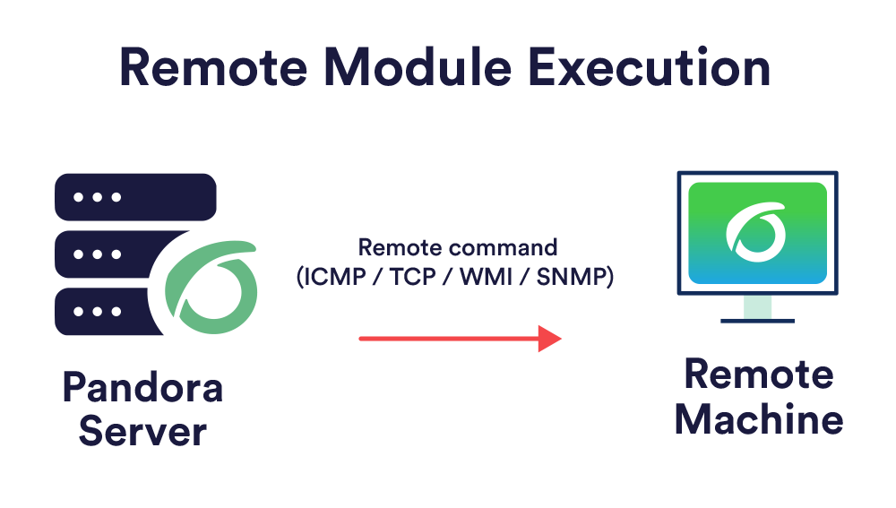
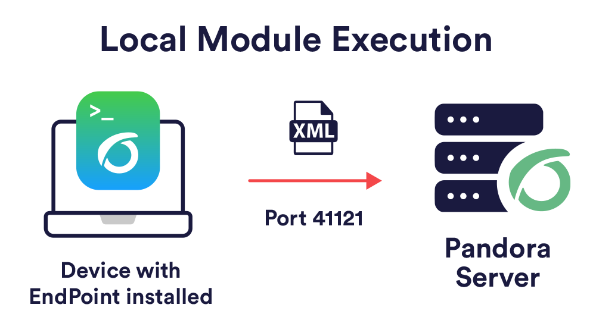
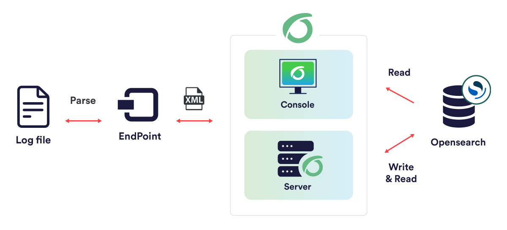
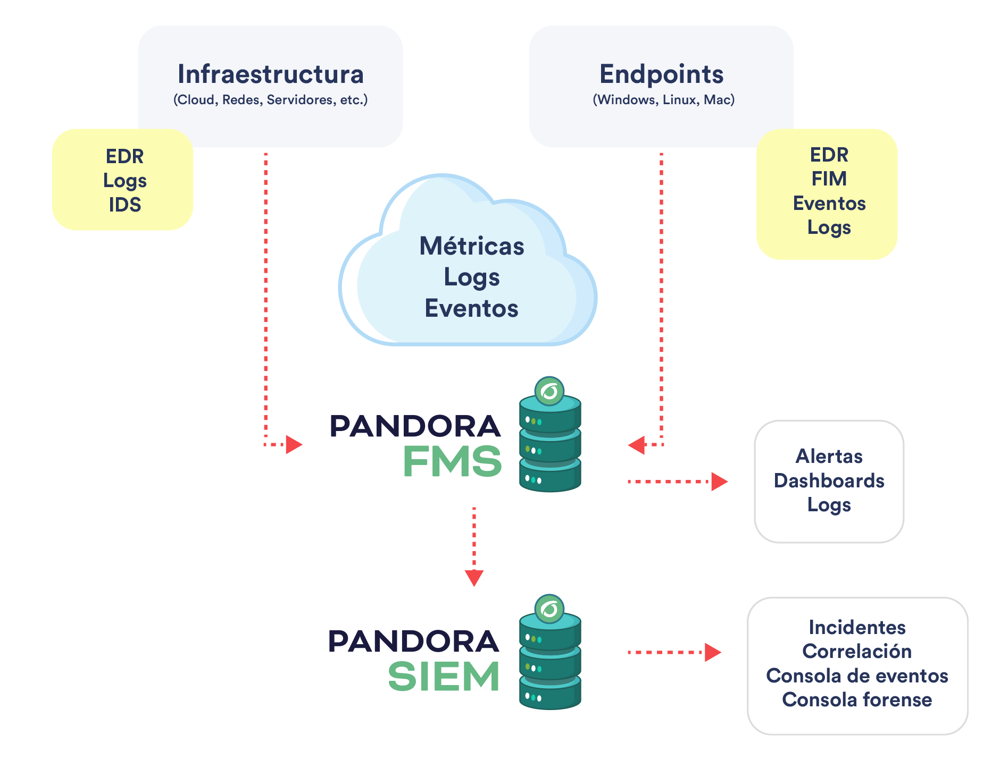
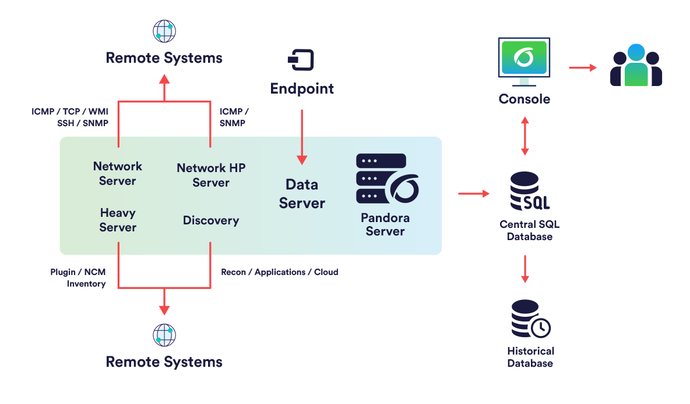
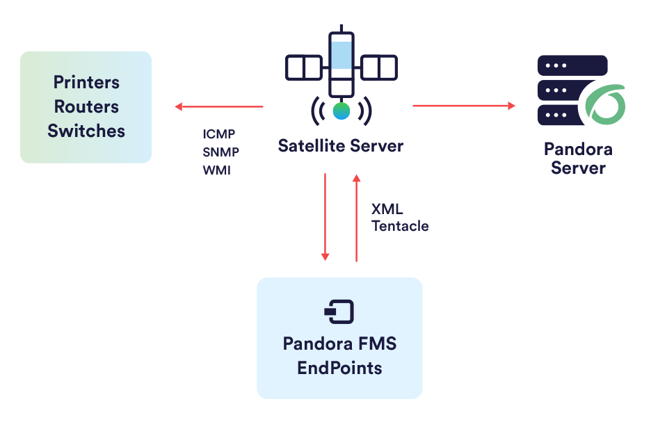
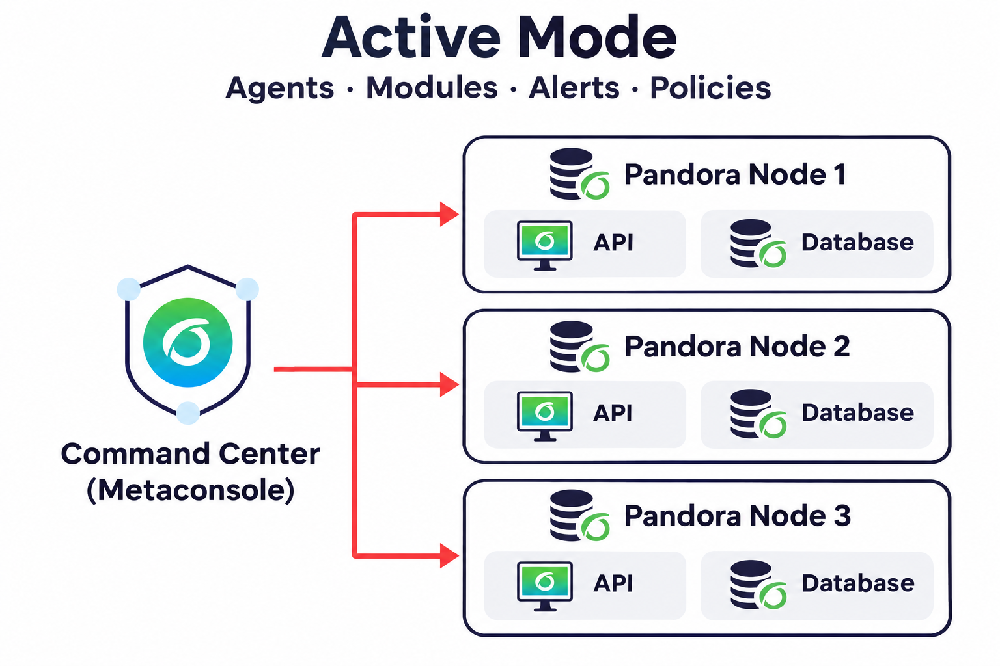
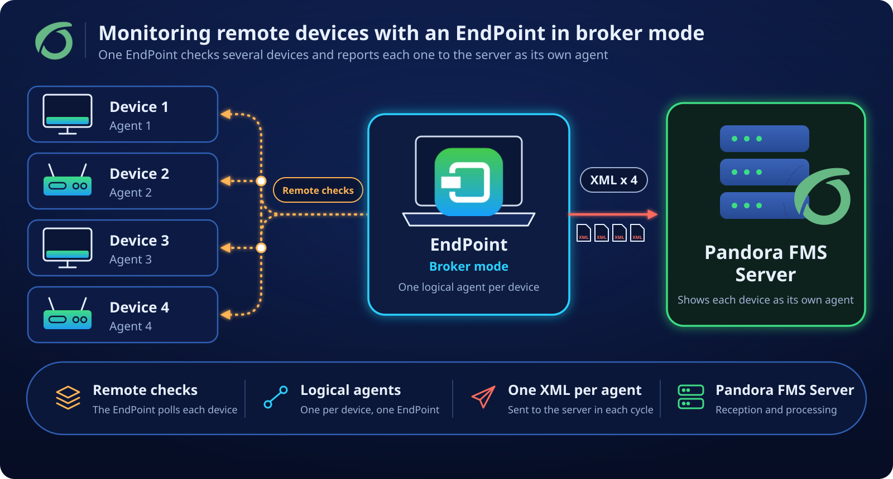
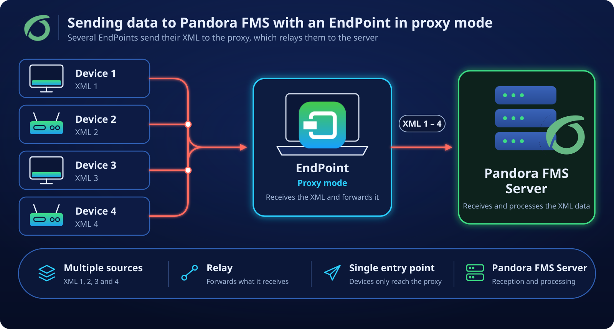

# Introduction and architecture

Pandora FMS is not something you understand by looking at a screenshot of the
console. You understand it when you know where every piece of data comes from,
who brings it in and where it is stored. This chapter walks that path: what can be
monitored, with which piece, and which topology is needed for the data to arrive.
The following parts cover each topic in depth. This is the map.

## Introducing Pandora

Pandora FMS monitors systems, networks, applications and services. The unit it
works with is not the machine, it is the **agent**: a logical container of
modules. It is attached to a group and, optionally, to one or more IP addresses.
An agent can receive local data (from an EndPoint installed on the machine) or
remote data (from a network check), and the usual thing is that it receives both.

Every module stores a single metric, with a unique name inside its agent. Its
value is interpreted through **thresholds**: that is where the `NORMAL`,
`WARNING` and `CRITICAL` states come from, plus the `UNKNOWN` state when a module
stops receiving data. Those states generate events and trigger alerts. Everything
else in this chapter is a way of feeding that mechanism.

### Remote monitoring

The server does it: it goes out and asks. Nothing is installed on the device, you
only need network visibility towards it. It is the natural route for network
devices and for anything that will not take software on top.

With SNMP you query the OIDs the vendor exposes. And you listen to the *traps*
the device sends on its own, without anyone asking for them. On MS Windows
machines remote checks are done through WMI, with credentials. And for everything
else there are the classic network checks: ICMP (ping, latency, jitter), TCP with
challenge and response to confirm a port is answering, and static web checks,
which verify availability and content, not a full user transaction.

{ .diagrama }

One difference worth being clear about from the start: a remote check lives or
dies by the network. If there is no path to the device, there is no data, and no
amount of retries from the console will fix it. The topologies further down exist
for those cases.

### Monitoring with EndPoints

The EndPoint is the program installed on the machine that runs the checks from
the inside. That is where the real power is. Any data you can obtain with a
command or a script is within reach, inventory included: installed software,
disks, services. And it can act on the system when asked to: start a service,
delete a temporary file.

The EndPoint packs everything from the interval into a single XML file and sends
it to the server with Tentacle, on port `41121/TCP`. The default interval is `300`
seconds. Since version 784 some checks accept much shorter intervals, down to `15`
seconds: ICMP (latency and ping) and numeric SNMP ones. Asynchronous modules
never go below five minutes, and the console warns you if you try to force it.

{ .diagrama }

With EndPoints there are three working modes for the modules that arrive in the
XML. In **learning** they are created on their own. In **normal** they are only
created if they are declared in the console. In **self-disabled** it works like
learning, but the agent shuts down if everything turns unknown. Choosing one or
the other is an operations decision, not a configuration detail: it defines who
is in charge of what gets monitored, the machine or the console.

### Monitoring cloud environments and APIs

Cloud providers and external services will not let you put an EndPoint inside, and
often they will not let you probe them over ICMP either. The way in is the API
they publish, and for that Pandora FMS uses its module and plugin library: there
are plugins for specific cloud platforms and a generic API request plugin
(`ApiRequest`) for whatever does not have one. The result is stored as one more
module, so it inherits thresholds, alerts and everything above. If the service has
an API, it can be monitored. If it does not, what gets checked is the availability
of the access point.

### Application monitoring (Discovery)

Discovery is the leap from monitoring what you already know to finding out what is
out there. The wizard explores the network, finds machines and devices, identifies
the operating system and applies a monitoring template to whatever it finds,
which starts reporting without going through the creation form. Beyond the
network, Discovery is used to inventory virtual environments, databases and
applications before monitoring them.

The value is in the start: on a large network, creating hundreds of devices by
hand is weeks of work with guaranteed oversights. Discovery turns that into a
short review and a list of exceptions.

### Reporting

Monitoring without presenting the data is collecting for its own sake. Reports,
dashboards and visual consoles are the part that turns information into
decisions: trends, SLA compliance and capacity planning.

Every user can build their own dashboard with widgets: graphs, status summaries,
maps. Reports group data from several agents and modules, with different
calculations and formats. For what has not happened yet there are prediction
modules: capacity, trending and arithmetic operations on other modules. The
capacity one answers the useful question: how many days until the disk fills up,
if everything stays the same. They are there to warn before the incident, not to
explain it afterwards.

### The event console

The event console shows, in real time, what is happening. It is a snapshot, not a
history. Events are classified by severity (from maintenance and informative up to
critical, through warning) and they are the raw material of alerts, which add
notification and escalation.

It may look like an old feature in a modern tool, and it is. It is also still the
fastest way to answer the question "what has broken?" without opening twenty
graphs. Many tools in the market do not have an event console like this one, and
you notice it exactly when you are in a hurry.

### Logs

Pandora FMS collects logs from multiple sources in a single console, sorted by the
timestamp at which they were processed, keeping the original timestamp from the
file as well. The text is stored as it is, with no structure, in OpenSearch, which
is what supports the volume.

{ .diagrama }

The syslog server analyses the system log of the machine where it is installed and
the log server lets you correlate logs and fire alerts on them. It is the raw
material for SIEM and the troubleshooting tool for when the problem is not in the
state of a module, but in what the system was saying while it was failing.

### Network topics (Netflow, SNMP, IPAM, NCM, remote shell)

This groups what looks at the network as the subject, not as the medium:

- **NetFlow and sFlow** analyse traffic in real time from the data the devices
  send (or from a probe with *port-mirroring*). The collector listens on
  `9995/UDP`. It is the way to know who is talking to whom and how much, when SNMP
  only tells you how many packets cross an interface.
- **SNMP** is the query protocol and the one that receives *traps* (`162/UDP`) for
  all network equipment.
- **IPAM** (version 731 or later) manages the IP addresses of your networks: it
  discovers the *hosts* of a subnet, detects when they stop answering, resolves
  their names and makes a guess at the operating system. It works whether or not
  those machines are monitored.
- **NCM** (Network Config Management) goes into devices over Telnet or SSH to back
  up their configuration, restore it and run commands, with templates per vendor
  and model. It needs the Heavy server running.
- The **remote shell** covers manual access: a web terminal for equipment managed
  over Telnet or SSH, and graphical remote control with Pandora RC for Windows,
  Linux and macOS.

### SIEM

A SIEM collects, filters, normalises, correlates and presents security events.
What Pandora FMS adds to the concept is that collection is already done. The logs
that feed the SIEM are the same ones the platform already gathers. The security
event engine builds on that previous work, in place of setting up a second system
alongside it.

{ .diagrama }

For the installation it is recommended that EndPoints are at least on version 783
to make the most of all the features. The SIEM is activated from the console and
enables its own servers. With it come the normalisation templates, the security
events and their correlation.

### RMM

RMM stands for *Remote Monitoring and Management*. In Pandora FMS it is the
piece that allows scheduling tasks from the console and having the agents run them
locally, reporting the result afterwards. It comes into play from version 778 and
relies on three components: the RMM agent, the RMM server (which stores the
scripts and the executions) and the Tentacle RMM service, which connects the two
over port `41123/TCP`.

It is the basis for the remote management of many machines at once: distributing
software, applying changes and keeping a record of what was executed on each
machine, without going into them one by one.

## Architecture

Pandora FMS started as a monolith (server, console and database on the same
machine) and that is still the most sensible way to begin. But no component is
condemned to live next to the others: they are separated when the network, the
volume or the organisation ask for it. The architecture decision is not made by
the product, it is made by your infrastructure.

### Console

The web console is the visible face and also the door to automation: the same
console you use by hand is the one that exposes the API for scripts to work with.
Permissions live there (groups, profiles and tags) and decide who sees and who
administers what. And it can be deployed on several servers, to spread the load or
to serve different groups of users.

### Server

The Pandora FMS server is a single application with several specialised servers
inside, running as concurrent processes and with their own number of threads.
Their configuration lives in `pandora_server.conf`, in `/etc/pandora`.

{ .diagrama }

These come **enabled by default**:

- **Data Server**: processes the XML packages sent by EndPoints and turns them
  into data, events and alerts.
- **Network Server**: runs remote checks: ICMP, TCP, SNMP, WMI, web checks and
  prediction modules.
- **Heavy Server**: takes care of the tasks that need more muscle: plugins, NCM
  and inventory.
- **Network High Performance Server**: moves ICMP and SNMP in bulk, designed for
  high volumes.
- **Discovery Server**: explores the network and runs scheduled discovery tasks.

These come **disabled**, to be switched on only when needed:

- **SNMP Console**: receives SNMP *traps* through `snmptrapd` and processes them.
- **Event Server**: relates events and fires the associated alerts.
- **Alert Server**: runs all monitoring alerts, so that a slow alert does not hold
  up the checks.
- **Log Server**: the one that allows generating alerts from logs.
- **Syslog Server**: analyses the syslog of the machine where it is installed and
  stores it in OpenSearch.
- **NetFlow Server**: collects and processes NetFlow and sFlow flows.
- **WUX Server**: runs complex web transactions in a real browser, with Selenium
  Grid.
- **SIEM Server** and **SIEM Event Server**: normalise logs and generate security
  events.
- **MADE Server**: the anomaly detection engine (*Monitoring Anomaly Detection
  Engine*).
- **RMM Server**: hosts the scripts and the executions that RMM agents download.
- **Mainframe Server**: monitoring of *mainframe* environments (z/OS).
- **Sync Server**: goes out to fetch data from isolated networks, as explained in
  the topologies below.

There is a third group, the servers that **depend on the master server**:

- **Policy Manager**: applies policies to agents. When a change affects hundreds
  of agents at once, the work goes into a queue of operations and this server is
  the one that serves it.
- **Migration Server**: moves agents between the nodes of a Command Center,
  taking the tasks from a prioritised queue. It only exists in Command Center
  environments.
- **Autoprovision Server**: the auto-provisioning server. It receives agents that
  arrive with no destination and decides which node they are created in,
  according to the configured strategy: round-robin, the least loaded node, or
  custom rules (by alias, by subnet…).

All three start alongside the master of a node or of a Command Center, which is
where their work makes sense.

The list has been getting shorter with the versions. Since 784 several servers
were grouped into others to stop wasting memory on processes that were no longer
needed. Prediction, WMI and web checks went into the Network Server. Plugins,
NCM, inventory and export went into the Heavy Server. And ICMP and SNMP went into
the Network High Performance Server.

On load distribution: there can be several servers of the same type working at the
same time. Within each type one is the primary and the rest are secondary, but
they all work. If a secondary goes down, the primary absorbs what it had assigned.
High availability acts on another layer: with two nodes in active/passive, the one
still alive takes on all the work. The status and load of every server are visible
from the console itself, because the system monitors itself like it monitors
anything else.

### EndPoint

The EndPoint is the program running on the monitored machine. We have already seen
it in the first half of the chapter: it collects data locally, packs it into an
XML and sends it to the server over Tentacle at every interval. When it has no
direct path to the server, it can send its data through a satellite server or
through another EndPoint acting as a *proxy*.

It is the piece you have to install, update and, now and then, uninstall without
leaving a trace. The installation part is in [Installation](1.1-instalacion.md).
What matters here is that its presence is the border between local and remote
monitoring.

### Satellite server

The satellite server is an autonomous server installed close to the remote
network. It does not need to connect to the database: it runs the checks and sends
the results as XML over Tentacle, just like an EndPoint would. It is the answer
when you cannot reach some devices over the network and cannot install anything on
them either.

It has two virtues worth knowing. The first is speed: it can run up to 500 checks
per second, and although it only sends data to the server every so often, if it
detects a state change it reports it immediately. The second is that it discovers
itself: it finds devices over SNMP or WMI, creates the corresponding agents and
generates interface, traffic, CPU, memory and disk modules with no intervention.

{ .diagrama }

And it is managed remotely. The satellite asks the server every few seconds
(every 30 by default) whether there are changes in its configuration or in that
of the agents it has discovered. It applies what arrives from the console. It is
the satellite that starts the connection, so **no port has to be exposed** in the
remote network. And when it needs to be reached from the server, for instance for
the SNMP wizard, it is also the satellite that opens a reverse SSH tunnel.

### Database

Everything the platform collects ends up in the database, the component
everything else depends on. Pandora FMS works with MySQL, MariaDB or Percona, and
in practice two of them are used: the real-time one and the historical one, to
which data is moved once it no longer needs to be queried by the second.

The database can be replicated for high availability in active/passive or set up
in an active/active cluster with load balancing. Together with the historical
database, this is where you decide how much detail you keep and for how long:
cheap on disks, expensive in slow queries.

### Command Center

The Command Center is the layer above all of the previous. It
manages several Pandora FMS installations (the **nodes** or instances) from a
single interface: seeing them together, synchronising their configuration and
operating on all of them. Every node keeps its own database and its own server.
The Command Center does not replace them: it coordinates them. That is how you reach
hundreds of thousands of devices without looking at them node by node. And how you
can provide multi-company service from a single access point.

{ .diagrama .diagrama-ancho }

Synchronisation goes in two directions. The Command Center queries the database or
the API of each node for what it administers: agents, modules, alerts, policies.
And it receives by replication what is continuously generated, such as events.

{ .diagrama .diagrama-ancho }

Users, groups, templates and tags live on both sides, because they have to be
where they are used. That said, it is an advanced environment with its own
requirements: it runs on the same operating systems as the rest of the product
(RHEL, Rocky Linux, AlmaLinux and Ubuntu Server, in their supported versions);
the details are in [Installation](1.1-instalacion.md).

## Topologies, diagrams and monitoring models

We have reached the point that decides everything else. The topology is not
chosen out of taste. It follows from a single question: in which direction can the
connection be established. The rest of the chapter is the answer, case by case.

### Accessible networks

This is the comfortable case and the one covering most installations. There are
two variants, and they can live together:

- The Pandora FMS server reaches what it monitors, so it can do centralised
  remote monitoring.
- Or the EndPoints installed on the machines reach the server, so they report
  without a problem.

If your network meets one of the two (or both), you need nothing else from this
section.

### Networks that are hard to reach

Here the connection exists, but not in the direction that would suit you. It is
solved with an intermediate piece. Which one depends on where the break is:

- If the server **cannot reach** the network, a **broker agent** is deployed on a
  machine with access to both sides.
- If the EndPoints **cannot reach** the server, the *proxy* mode of the EndPoints
  is used, or a satellite server acting as an intermediary.
- If what you have is **several networks the server cannot poll at the same
  time**, the answer is more than one satellite server, or several Pandora FMS
  servers connected to the same database.
- When the satellite can go out but cannot be reached, it supports a **reverse SSH
  tunnel** (since version 785). It is the satellite that opens the port on the
  server and redirects it to its own SSH. That way the console can reach it to
  launch the SNMP wizard or the SNMP console.

{ .diagrama-oscuro }

{ .diagrama-oscuro }

### Unreachable networks

When the remote network cannot start communication towards the server, the
approach is turned around with the **Sync Server**. The main server takes the
initiative and goes to fetch the data from a Tentacle server deployed in the
isolated network, which acts as a temporary store. Information accumulates there
until the main server downloads it. What has been downloaded disappears from the
store.

The difference from the satellite is exactly that: the satellite **sends**, the
Sync Server **fetches**. If neither direction is possible, there is no monitoring
to be had, and it is worth knowing that before promising it.

### Large environments

Volume breaks small solutions, and it is not fixed with a single trick. The first
thing is to spread the work across several Pandora FMS servers, all against the
same database, and to count on high availability so the platform stays up when a
node fails: the one still alive relocates the work of the fallen one
automatically.

From there, every problem has its shape. The Command Center solves the large cases:

- **Command Center with several nodes**: every installation keeps its database
  and its capacity, and the Command Center presents and manages them as one. It is
  the answer to several teams, several customers or several sites with different
  administration.
- **Remote networks that require local polling**: a network of satellite servers
  reports to a node living in that same network. The node does not need to reach
  every device, only the satellite next to it.
- **High-speed polling with filtering**: the satellite runs the checks very fast
  and does not send every reading. It filters at the source and reports to the
  node only state changes. That is how you monitor in detail where the data flow
  would not allow it any other way.

### Other organisational cases

Not everything that complicates a deployment is the network, and it is worth not
confusing the two:

- **Dual reporting**: an agent can send its data to two different Pandora FMS
  servers, even though only one of them manages it. Useful in migrations and in
  environments with two houses.
- **Fragmented management**: sharing the administration of part of the equipment
  among different staff. It is not an architecture problem, it is a permissions
  problem, and it is solved with groups, tags and profiles.
- **Distributed polling**: several servers running remote checks against the same
  database, to spread the work without duplicating the installation.

The useful summary of the whole chapter fits in one sentence: before designing
anything, draw how Pandora FMS reaches every network and how the information comes
back. If that drawing is clear, the architecture chooses itself. If it is not,
whatever scheme you copy from a manual will last you until the first firewall
change.
