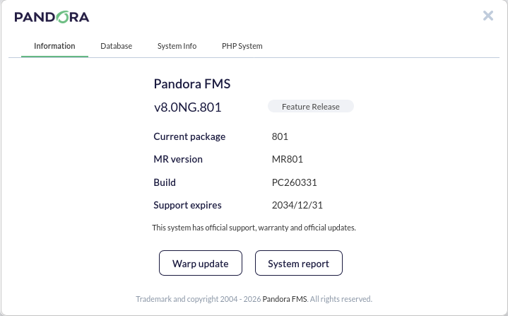
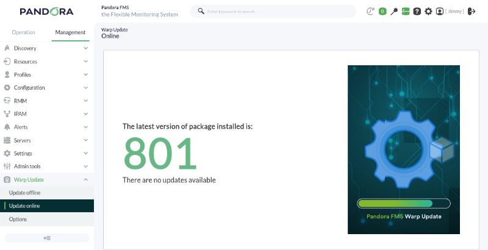
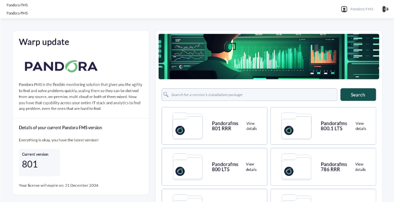

# Updates

Updating Pandora FMS is not an emergency, it is maintenance. And like any
maintenance, it is done when it is due and with the backup already taken, not on a
Friday afternoon because a version just came out. This chapter explains the two
ways of bringing an installation up to date: the automatic one and the manual
one. And what to do with the pieces that do not follow the same path: the
EndPoints and the satellite servers.

## Introduction

A Pandora FMS installation has three pieces that are updated together: the **web
console**, the **database schema** and the **server**. Since version 784 the
server groups several services into fewer processes. So updating the server means
updating the whole package.

There are two ways of doing it:

- **Warp Update**: wizards from the console itself that download, apply and verify
  the update. This is the recommended route.
- **Manual update**: the same packages, applied by hand, component by component.
  It is more laborious and demands more care, but it gives you full control of the
  process and works when the wizard cannot be used.

Neither of the two touches the **EndPoints** or the **satellite servers**: each has
its own mechanism, and they are at the end of the chapter.

The current version, the schema MR and the licence support expiry date are shown
in **Management → About**. It is worth having that screen at hand before and after
any update: it is the one that tells you where you came from and where you have
arrived.

{ .diagrama }

And before starting, the usual thing, but said plainly: **take a snapshot of the
machine or a backup of all the components**. If something goes wrong, the simple
way to fix it is to go back. And that only works if there is a point to go back
to.

For the Warp Update section to show up in the menu, **Enable update manager** must
be switched on in **Management → Settings → System Settings → Advanced**. If it is
not, the console hides the whole update block and it looks as though the feature
does not exist.

## Warp update

Warp Update updates the web console, the database schema and the server
automatically, through wizards. It is reached from **Management → Warp Update** and
it has three working screens, plus one for options.

**Warp Update Online** downloads and installs from the official repositories, so
the console needs outbound internet access. Registering with an email address is
required to use it. The wizard shows the installed version and the versions it can
be brought up to: only LTS ones, or consecutive ones too, depending on the
configuration. And the release notes, under **Show details**, before deciding.

{ .diagrama }

**Warp Update Offline** does the same without a connection to the repositories.
The administrator downloads the packages and uploads them to the wizard. To
download them, an email address is required and the unique access code the console
associates with the licence must be copied. With that code you get into the
repository, which reports the installed, the next and the latest version, and lets
you download three files:

| File | What it updates |
|---|---|
| `package_XXX.XXX.fms` | The web console and the database schema. |
| `pandorafms_server-XXXXX.tar.gz` | The server. |
| `.sig` | The signature of the two previous ones, to check they have not been altered. |

They are uploaded one by one from the wizard (**Browse it**), you check that what
the screen shows matches what you want to apply, and the process is launched. It is
better to update the console and the schema first, and the server afterwards. Each
file has to fit within the `post_max_size` and `upload_max_filesize` limits in
`/etc/php.ini`, or the upload will fail with nothing more than a size error.

{ .diagrama }

If you are coming from LTS 777, the specific path —which packages, in what
order and which steps cannot be skipped— is in
[Upgrading from LTS 777 to 800](../anexos/a6-actualizacion-de-la-lts-777-a-la-800.md).

**Warp journal** leaves a trail of what has been done: version updated, whether it
was server or console, whether it came from online or offline, who launched it and
when. It is the first stop when something does not add up after an update.

The **Options** of Warp Update are few and delicate:

- **Limit to LTS updates**: restricts the update to LTS versions, which are the
  ones with extended support.
- **Allow no-consecutive patches**: offline only, it allows jumping from one
  version to a non-consecutive one. It is off by default, and that is fine.
- **Warp Update URL**, **Use secured Warp Update** and **Proxy server**: these are
  not fields to touch out of curiosity. Before changing them, check with support.

## Manual update

The manual update uses the same packages the offline mode downloads, but applied
by hand in the terminal, as **root**. The order is not negotiable: **console,
database schema and server**. The procedure is valid for EL 7, EL 8, EL 9 and
Ubuntu 22.04 LTS.

### Console

The `.fms` package is copied to the console directory, unpacked, and replacing
everything is accepted:

```bash
mv package_XXX.XXX.fms /var/www/html/pandora_console/
cd /var/www/html/pandora_console/
unzip package_XXX.XXX.fms
# when asked about each replaced file: A (All)
```

Then the package number is updated in the database, replacing `XXX` with the
target version:

```bash
mysql -u root -p -D pandora -e "UPDATE tconfig SET value=XXX WHERE token='current_package'"
```

### Database schema

The MR updater is run:

```bash
/usr/bin/php /var/www/html/pandora_console/godmode/um_client/updateMR.php
```

### Server

The server package is unpacked, installed and the service restarted:

```bash
tar -xzvf pandorafms_server-XXXXX.tar.gz
cd pandora_server/
./pandora_server_installer --install
systemctl restart pandora_server
```

### EndPoint

They do not go through Warp Update, and there is no need to go machine by machine.
The comfortable way is the **self-update** with file collections and the
`pandora_update` plugin. The new EndPoint binary is dropped into a collection.
The EndPoint runs the plugin with the name of that collection and compares the
binary in the collection with the one it is running. If they differ, it stops,
replaces itself and restarts with the new one. Every architecture needs its own
collection (one binary for 32-bit Windows and another for 64-bit, for instance),
and the process leaves a record in a log that can be watched with an
`async_string` module. The new version can also be installed by hand, with the
installer of each operating system (Linux, MS Windows). In an environment with
hundreds or thousands of devices, that is work the collection does on its own.

### Satellite server

The satellite is not touched by Warp Update either: it is updated with its own
installer, the same one used to install it. In the update to 785 there is also a
policy migration step, because Dataserver-type modules of Satellite agents became
Satellite-type modules. Until that migration is completed, policy changes do not
reach those agents.

### Verification

Once the job is done, check **Management → About** to confirm the package and the
MR, and **Management → Servers** to see the version in the **Version** column of
every server. If the three pieces do not match, the update is not finished.
