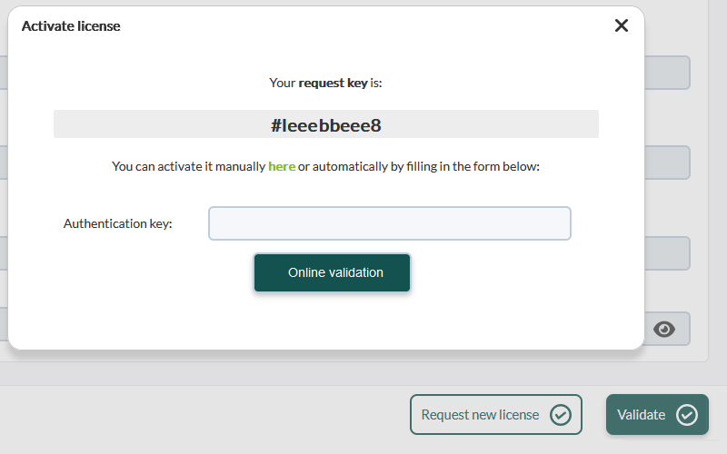

# Licensing

Pandora FMS is licensed by **devices**, not by metrics. That decision has very
practical consequences in the architecture. A 24-port switch can report hundreds
of modules without costing more licence than the switch. And adding logs, security
or inventory does not make it more expensive, because they are included. What you
pay for is how many devices are monitored and, in some cases, through which route.

This chapter does not talk about prices: that is sales territory. It talks about
which licence model fits which architecture, which is what conditions a
deployment.

To get your bearings before going into detail, this is the correspondence between
what has to be monitored (and what is contracted separately) and the licence that
applies:

| If what has to be monitored is… | You need… | And on top of that… |
|---|---|---|
| Servers, applications, cloud, virtualisation | **Pandora ONE** (the top one) | — |
| Network equipment with nothing installed | **Pandora NMS** | Can be counted by modules |
| Workstations (PCs) | **Pandora RMM** | **Includes RC SaaS**; on-premise RC is paid separately |
| Several installations with a single view | **Command Center** | **Additional** licence to the nodes', per **active node** |
| Security (SIEM) | **Pandora SIEM** | A **percentage** of Pandora ONE, Pandora RMM or Pandora NMS |
| SAP, IBM i or z/OS | The plugin for each one | Sold separately |
| Remote control of machines | **Pandora RC** | Separate: **RC SaaS comes with the Pandora RMM licence**, on-premise RC is paid separately |
| Incident and asset management | **Pandora ITSM** | Has its own licence |
| Not wanting to maintain anything | **Pandora MaaS** | Subscription only |

## Licence types

### Perpetual and subscription licences

The on-premise version supports two models. The software and the features are the
same in both cases:

- **Licence (perpetual)**: bought once. Support and maintenance are renewed every
  year, to keep receiving patches and new versions.
- **Subscription**: paid every year. Both come out roughly the same over five
  years. So the choice is about cash flow (less initial investment) or about who
  books the expense, not about features.

The cloud version (**Pandora MaaS**) is subscription only, with an annual
commitment: nothing is installed or maintained there, and the platform updates
itself.

An on-premise licence includes, at no extra cost:

- Technical support 8×5 through the ticketing tool, with no limit on incidents.
  The 24×7 with a dedicated phone line is contracted separately. The scope, the
  hours and what is left out are in the
  [licence agreement](https://pandorafms.com/downloads/PandoraFMS_Licencia.pdf).
- **Updates**: patches and new versions.
- **All the features**, without cuts: log collection and monitoring, security,
  Discovery, **satellite servers**, remote EndPoint deployment, inventory and RMM,
  among others.
- Access to the module library, the knowledge base and the Enterprise code.

Two things from that list are worth keeping. **The satellite server is not
licensed separately**: it is part of the licence, not an add-on. And **the web
user experience feature (WUX) is included inside Discovery**.

And what happens if you stop paying. The two models behave differently. With an
on-premise licence the software **keeps working** and you only lose support,
patches, new versions and access to the Enterprise library. With pay-per-use, if
you do not pay, the software stops working.

The legal conditions (warranty on the software, scope and exclusions of support,
and liability) are developed in the
[licence agreement](https://pandorafms.com/downloads/PandoraFMS_Licencia.pdf).

### How it is counted: agents or modules

The licence screen of the console is what rules. The field that decides how it is
counted is **Limit mode**: **agents** or **modules**.

**By agents.** The number of agents is counted, and each agent can carry **as many
modules as it needs**: there is no cap. An agent is any monitored device: a
server, a router, a switch, an access point, a NAS. In virtualisation, every
virtual machine with its own IP address. Devices watched over SNMP also count as
an agent, even though they have nothing installed on them.

**By modules.** The number of modules is counted, not the number of machines. A
5,000-module licence is split however you like. 5,000 agents with one module each.
Or 50 agents with 100 modules each. Or any combination in between.

Which one suits you? It depends on how the estate grows:

- The **agent licence gives you "no nasty surprises" scaling** when the detail
  multiplies inside a single machine. A database server with twenty databases can
  report hundreds of modules without spending more licence than the server.
- The **module licence is more effective and easier to understand** when you want
  to watch a little of many devices. If all you want from each camera is a ping,
  every camera ends up being an agent with one module. Counting modules there is
  cheaper and clearer than counting agents.

The two models do not work for every licence:

- The **Pandora NMS** licence does allow module-based licensing.
- The **Pandora RMM** licence is not compatible with module-based licensing.

Two more rules that affect the count:

- **Minimum**: the minimum licence to contract with support is **100 agents**, or
  its equivalent in modules when counting by modules.
- **Per environment, not per server**: an installation is licensed as a whole, not
  piece by piece. Nodes sitting in passive for high availability **do not count**:
  an environment with replicas or redundancy runs on a single licence. The
  exception is the **Command Center**, licensed by **number of active nodes**
  (replicas do not count there either).
- **Mixed licence**: **types** of licence can be combined in the same installation
  (for instance 10 Pandora ONE, 50 Pandora NMS and 500 Pandora RMM), but counting
  methods are not mixed, nor are payment models. The installation is **all agents
  or all modules**, and **all perpetual or all subscription**.

### Additional licences

There are pieces that are **not** included in the monitoring licence and are
contracted separately.

#### Command Center

Its licence is **additional** to the nodes' monitoring licence (Pandora ONE,
Pandora NMS or Pandora RMM) and is counted by **active nodes**. Replicas for
redundancy do not add up. Each node handles on the order of **2,000 agents**,
though it can do more depending on the environment.

An example makes it clear. An environment of **10,000 agents with 4 nodes** is
licensed with **a single 10,000-agent licence**: the licence is for the
environment, not for each node. Plus **the Command Center licence** for those four
nodes. If there were also nodes in passive for high availability, they would not
count.

#### Pandora RC

Remote control (Windows, Linux and Mac desktops and shells from the browser) is a
product with its own licence: it is not part of the monitoring licence even though
it is used from the same console. The **Pandora RMM** licence includes **RC in
SaaS mode**. **On-premise RC is independent and paid separately**.

#### SAP

The SAP plugin is not part of the monitoring licence either: it is sold and
licensed separately.

#### IBM i and z/OS

The **IBM i (AS400)** and **mainframe (z/OS)** plugins follow the same path:
separate licence. Along with SAP, they are the exceptions to the "everything
included" of the monitoring licence. They are not our own development.

#### Pandora SIEM

The security feature is licensed as a **percentage of the monitoring licence**
(Pandora ONE, Pandora RMM or Pandora NMS) and is activated from the console.

#### Pandora ITSM

Incident, asset and project management is another product, with its own licence.
It integrates with Pandora FMS but is not part of the monitoring licence.

What does **not** have to be licensed separately, even though it may look like it:
the **satellite server**, log collection, discovery, inventory and remote agent
deployment. They are included.

### Pandora ONE, Pandora NMS and Pandora RMM

The three licences are best understood together. What separates them is not what
you can do with the platform, but which devices they apply to:

- **Pandora ONE is the top licence**: it covers every kind of device, with EndPoint
  or through remote checks. It applies to everything that is not specifically
  network or workstation.
- **Pandora NMS only includes remote checks**: it is meant for systems that are
  exclusively network (routers, switches, network elements) with nothing installed
  on them. It allows module-based licensing. If one of those devices also needs a
  local check, that is covered by combining licence types (see the mixed licence
  above).
- **Pandora RMM is aimed at workstations (PCs)**, not servers: it is the licence
  for Mac and Windows desktop machines.

The rule that ties them together is simple: **the FMS licence (Pandora ONE) is
calculated as every agent that is not Pandora NMS or Pandora RMM**. A mixed estate
does not force you to choose a single licence: they can be combined. But every
device pays the type that corresponds to it.

Around those three there are further modalities. **Pandora Free**, with the same
features as Pandora ONE but **free up to 50 agents or 600 monitors**. **Pandora
MaaS**, the managed cloud version. And the entry-level editions (**Pandora Open**,
maintained by the community, and **Pandora MINI**), which are another conversation.

## Licence installation

The licence is installed from the console itself, in **Management → Setup →
License** (*Licence*). The first thing needed is the **AuthKey**: the key Pandora
FMS (or its distributor) sends by email or in a PDF. It is a number between 12 and
15 digits, and **it only works once**. With it the licence for *your* installation
is generated.

A new installation runs as **Pandora Free** (50 agents limit) until a real licence
is installed. If nothing is touched, it is not broken: it is unlicensed.

The wizard starts with **Request new license**, which opens the activation dialog.
There it shows a piece of data worth noting down: the installation's **request
key**, a short code of the `#1ceebbee8` kind. With that and the AuthKey there are
two paths.

{ .diagrama }

### Online

The AuthKey is typed into the **Authentication key** field and **Online
validation** is pressed. The console generates the licence, validates it against
the server and leaves it installed.

From then on it does not have to be touched again: it refreshes on its own. The
**Sync license online** button forces that check and confirms that everything is
in order. It answers *"License is up to date"* if there are no changes and
*"License updated successfully"* if there were. The two errors seen at this step
are *"Error while connecting to licence server"*, when the console cannot reach
the server, and *"Invalid response while validating license"*, when it reaches it
but the response is not valid.

### Offline

When the console cannot reach the internet, the **request key** shown by the
dialog is used. It is copied and taken to the **Warp portal** (the same one that
serves the update packages) or sent to support. Whatever they return is the
licence. That key is pasted into the **Customer key** field on the licence screen
and saved.

There is no online validation, so the licence stays exactly as it was installed.
It is worth keeping the key they returned and repeating the request when it is
time to renew.

After saving, the licence screen shows the picture of what is contracted: expiry
date, **Platform Limit** (the limit) and **Current Platform Count** (what is
there, with enabled and disabled items). Then **License Mode**, **Limit mode**
(agents or modules) and **License Type** (console or Command Center). And the limits
per type: **One Limit**, **NMS Limit**, **RMM limit** and **SAP limit**.

Three more things that save support calls:

- If the licence is a **Command Center** one, the nodes do not have to be activated
  one by one: the Command Center licence activates them automatically.
- **Do not start the `pandora_server` daemon** with the Enterprise version
  installed before enabling the Enterprise part of the console: it will throw
  errors.
- If the installation is a Command Center, the licence is propagated from the
  Command Center to all the nodes.

For prices, fees and changes of model you have to talk to sales: this page
explains what each licence covers and how it fits the architecture, not what it
costs.
