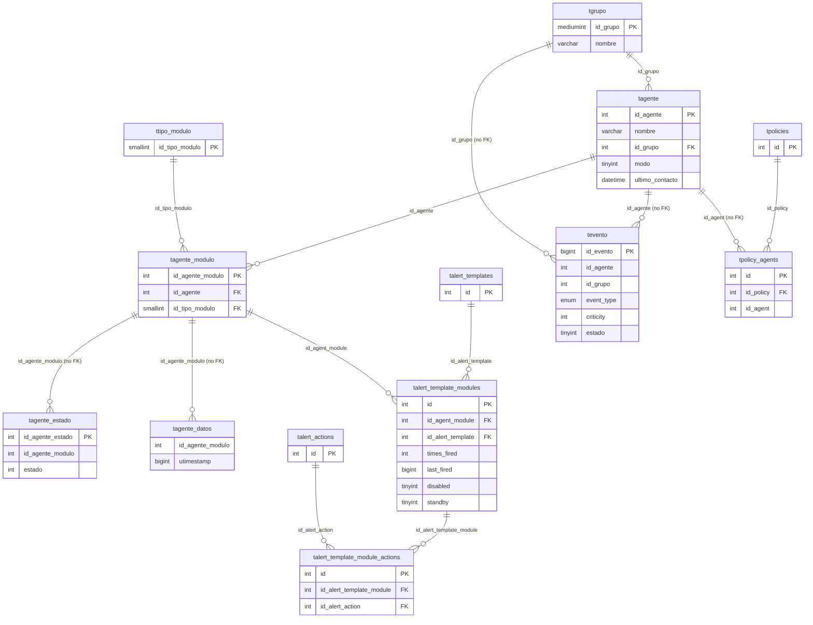

# Database schema

All the information in Pandora FMS (agents, modules, alerts, events, users,
policies) lives, in the end, in a handful of MySQL tables. It is tempting to
look directly there when the interface does not give the quick answer you need:
a report with custom SQL, a diagnostic `SELECT` at three in the morning, a
script that needs to know in which column the server stores the last contact of
an agent. This chapter is the map of that territory: which tables exist, what
each one is for and how they relate to each other.

!!! warning "Before touching the database"
    The schema changes between versions (new columns, tables that appear or
    disappear, types that are adjusted) with no notice other than the changelog
    of each build. This page documents the version given in the header of the
    [table reference](10.2-referencia-de-tablas.md), which is always aligned
    with the real code. To read or write Pandora FMS data from outside, the
    recommended way is the
    REST API:
    it is stable between versions and it does not require knowing the internal
    schema. Accessing the database directly is a last resort, with no
    compatibility guarantee, and **you must never write directly** on tables
    managed by the product: the server and the Web console take for granted
    that they are the only ones writing there, and a row touched by hand can
    leave the data aggregation, a counter or a task queue in a state they
    cannot interpret themselves. For read-only queries, always prefer a replica
    or the historical database over the main database in production.

One detail surprises you the first time: the Web console stores the texts
(agent and module names, descriptions...) with the special characters converted
to HTML entities, so `Router & Firewall` appears in the table as
`Router &amp; Firewall`. Keep it in mind when filtering by name. And modules
deleted from the console do not disappear instantly: they stay marked with
`delete_pending = 1` until the server removes them, which is why module queries
exclude them.

This chapter covers the main database, the historical one and the Command
Center one. It does not cover third-party databases that Pandora FMS integrates
with (external SIEM, CMDB, etc.): those have a schema of their own and are out
of the scope of this documentation.

## Overview: databases, engine, files and version

A Pandora FMS installation can have up to three different databases, all of them
with the same engine:

- **Main database** (`pandora`): the only mandatory one. It stores the complete
  configuration and the recent monitoring data.
- **Historical database** (optional, enabled with `history_db_enabled`): same
  schema as the data tables of the main one, designed to retain time series
  beyond what the main one purges. See
  [Historical database](#historical-database-what-moves-when-and-how-it-is-purged).
- **Command Center database**: in installations with Command Center, each node
  keeps its own main database and the Command Center adds one of its own with
  `tmetaconsole_*` tables. See
  [Command Center](#command-center-its-own-tables-and-synchronization).

The supported engine is Percona Server for MySQL 8 (recommended, especially
above 4,000 agents) or MySQL 8 / MySQL 8.4 since build 785; the complete
requirements table is in [Installation](../parte-1/1.1-instalacion.md).

The schema is defined in two files that are loaded once, at installation:
`pandoradb.sql` (structure: the 271 tables) and `pandoradb_data.sql` (seed data:
module types, default configuration, catalogues). From there on, two tokens of
the `tconfig` table (`db_scheme_version`, for example `8.0NG`, and
`db_scheme_build`, for example `PD260915`) identify the installed schema
version, and the console compares them with the package version to warn about
outdated databases.

Between major versions, schema changes arrive as `extras/mr/<number>.sql`
files, one per *build*. The console stores in `tconfig` the `MR` token with the
highest number already applied and, on each update check, offers as pending the
files with a higher number; when they are applied, the file moves to
`extras/mr/updated/` and the `MR` token is updated. They are not run by hand
unless the update procedure says so explicitly.

## Map by functional area

The 271 tables of the schema are not organised in different `SCHEMA` or
separate databases (they all live in the same database), but they do follow a
clear functional distribution. The following table groups the tables by the
area they cover; it is a construction of this documentation to make navigation
easier, not a structure declared in the engine.

| Functional area | What it covers | No. of tables |
|---|---|---|
| Agents and monitoring (core) | Agents, modules, their configuration and their data | 37 |
| Groups and organisation | Group and category hierarchy | 4 |
| Alerts | Alert templates, actions and commands | 16 |
| Events | Event log and its life cycle | 10 |
| Policies | Configuration deployed in bulk on agents | 13 |
| Users, profiles and sessions | Accounts, permissions and active sessions | 16 |
| Notifications and messaging | Internal notices and messages between users | 11 |
| Reports and visualisation | Reports, graphs, dashboards, visual consoles | 34 |
| Discovery and reconnaissance | Network discovery tasks | 9 |
| Network maps and GIS | Network maps and geolocation | 17 |
| Cluster and high availability | Agent cluster configuration | 3 |
| Command Center | Nodes, synchronization and migration between nodes | 14 |
| Credential manager | Store of reusable credentials | 1 |
| Servers, configuration and maintenance | Servers, global configuration, backups | 13 |
| SNMP traps | Traps received and their normalisation | 2 |
| IPAM (IP address management) | Managed networks, subnets and IP addresses | 8 |
| NCM (Network Config Manager) | Network device configuration | 12 |
| RMM (Remote Monitoring & Management) | Remote management of machines | 7 |
| SIEM | Security event rules and decoders | 12 |
| Security and vulnerabilities | Detected vulnerabilities and patches | 3 |
| Downtime planning | Scheduled maintenance windows | 3 |
| Tags | Tagging of modules and policies | 3 |
| Services | Services made up of other elements | 2 |
| Agent self-configuration | Self-configuration rules for new agents | 3 |
| Remote commands (Web console) | Remote commands runnable from the console | 2 |
| [Collections](../parte-2/2.9-colecciones.md) and plugins | File collections and plugin catalogue | 2 |
| Languages and translation | Interface translations | 3 |
| Miscellaneous / internal utilities | Support tables with no area of their own | 11 |

For the detail of columns, types, keys and comments of any table in this list,
the [table reference](10.2-referencia-de-tablas.md) gathers the 271 tables
grouped by this same area, with a direct link to each one.

## Core tables in detail and relationship diagram

A handful of tables concentrate most of the usual queries. Knowing them by
heart saves more than one trip back to the full reference:

- **Agent and module inventory.** `tagente` stores one record per agent
  (`id_grupo` references `tgrupo`; `modo` is the learning mode of the module at
  creation, not a state of the agent: see
  [Codes and enumerations](#codes-and-enumerations)). Each module of that agent
  is a row in `tagente_modulo` (`id_agente` references `tagente`,
  `id_tipo_modulo` references `ttipo_modulo`, the catalogue of module types).
  The last known state of each module lives in `tagente_estado`: one row per
  module, with `id_agente_modulo` and `id_agente` pointing to the previous
  tables by naming convention, with no declared `FOREIGN KEY`.
- **Module data.** The time series are split into four tables according to the
  type of data: `tagente_datos` (numeric), `tagente_datos_string` (string),
  `tagente_datos_inc` (incremental) and `tagente_datos_log4x` (logs). All four
  are indexed by `id_agente_modulo` + `utimestamp`, also with no declared
  `FOREIGN KEY`: the volume they move every day advises against that check on
  each insert (see
  [Historical database](#historical-database-what-moves-when-and-how-it-is-purged)).
- **Alerts.** An alert template (`talert_templates`) is assigned to a specific
  module through `talert_template_modules` (`id_agent_module` references
  `tagente_modulo`, `id_alert_template` references `talert_templates`;
  `times_fired`, `last_fired`, `disabled` and `standby` also live there). Each
  assignment triggers one or more actions via
  `talert_template_module_actions`, which point to `talert_actions` and, from
  there, to `talert_commands`.
- **Events.** `tevento` is one row per generated event, with `id_agente`,
  `id_grupo`, `id_agentmodule` and `id_alert_am` as references by convention
  (with no declared `FOREIGN KEY`). `event_type` is a closed `ENUM` with the
  possible event types; `criticity` and `estado` are the codes described in the
  next section.
- **Policies.** `tpolicies` is the header of a policy; `tpolicy_agents` and
  `tpolicy_groups` define the agents or groups it applies to, and
  `tpolicy_modules` and `tpolicy_alerts` the modules and alerts it deploys on
  them.
- **Credential manager.** `tcredential_store` stores each credential under its
  `identifier` as primary key; `product` is an `ENUM` with the supported
  credential types (`CUSTOM`, `AWS`, `AZURE`, `GOOGLE`, `SAP`, `WMI`, `SNMP`).
  The complete functional detail is in
  [Credential manager](../parte-2/2.2-gestor-de-credenciales.md), and its
  encryption in
  [Database encryption](../parte-9/9.5-cifrado-de-la-base-de-datos.md); here
  only the shape of the table matters.

The following diagram summarises those relationships. Continuous lines mark a
`FOREIGN KEY` declared in the schema; the rest are relationships by column
naming convention, with no restriction declared in the engine.



## Codes and enumerations

Several columns store integers that only make sense with their table of meanings
at hand.

**Module status** (column `estado` of `tagente_estado`): values that the server
really stores.

| Code | Meaning |
|---|---|
| `0` | Normal |
| `1` | Critical |
| `2` | *Warning* |
| `3` | Unknown |
| `4` | Not started: initial value when the module is created, before receiving the first data |

The console constants `AGENT_MODULE_STATUS_*` add further values, but they are
**filter values** of the interface, not something the column ever stores: `5`
(not started, in filters), `6` (not normal, a grouping value), `7` (forced
normal) and `100`/`200`/`300` (critical, *warning* or normal with some alert
fired). Do not confuse column and filter: if `estado` is queried directly by
SQL, only the values `0` to `4` will appear.

**Agent status:** no column stores it. The Web console calculates it from the
counters of `tagente` (`normal_count`, `warning_count`, `critical_count`,
`unknown_count`, `notinit_count`, `total_count` and `fired_count`, the one for
fired alerts), which the server keeps up to date. To find out the state of an
agent with SQL, look at those counters.

**Agent mode** (column `modo` in `tagente`): `0` normal, `1` learning, `2`
self-disabled (*autodisable*). The column has `0` by default, but in practice
agents are born at `1`: it is the value the server uses when creating an agent
from an XML and the Web console when adding it by hand.

**Module type** (table `ttipo_modulo`): catalogue with id, internal name (for
example `generic_data`), numeric category and data type (`numeric`, `boolean`,
`string`). There are about forty types; the complete catalogue is in the
`ttipo_modulo` row of the
[table reference](10.2-referencia-de-tablas.md#ttipo_modulo).

**Event status** (column `estado` in `tevento`): `0` new, `1` validated, `2` in
progress.

**Event type** (column `event_type` in `tevento`, closed `ENUM`):
`going_unknown`, `unknown`, `alert_fired`, `alert_recovered`,
`alert_ceased`, `alert_manual_validation`, `recon_host_detected`, `system`,
`error`, `new_agent`, `going_up_warning`, `going_up_critical`,
`going_down_warning`, `going_down_normal`, `going_down_critical`,
`going_up_normal`, `configuration_change`, `ncm`.

**Event criticality** (column `criticity` in `tevento`): `0` maintenance, `1`
informative, `2` normal, `3` *warning*, `4` critical, `5` minor, `6` major. The
values `20`, `21` and `34` are combinations used by the console filters (`20`,
not normal; `21`, critical or normal; `34`, *warning* or critical) and they are
not criticalities of a specific event.

**Fired alerts:** there is no single "status" column for an alert. It is
deduced from `talert_template_modules.times_fired` (firing counter) and
`last_fired` (timestamp of the last one); `standby` and `disabled` control
whether the alert can fire at all.

## Historical database: what moves, when, and how it is purged

The historical database is optional (`history_db_enabled` in `tconfig`, next to
`history_db_host`, `history_db_port`, `history_db_name` and the rest of the
connection parameters, configurable from
**Settings → System settings → Historical database**). When it is active, the
server moves the time series data of the modules (`tagente_datos`,
`tagente_datos_string`) to it as a periodic task of `pandora_db.pl`, and, where
applicable, events and traps as well. The exact detail of the movement is
Enterprise functionality and it is not in the community tree, so it is not
documented here.

In the main database, the same periodic process purges the data whose retention
period has expired, with these default limits:

| Parameter | By default | Purges |
|---|---|---|
| `days_purge` | 45 days | `tagente_datos` |
| `string_purge` | 7 days | `tagente_datos_string` |
| `event_purge` | 7 days | `tevento` |
| `days_delete_not_initialized` | 7 days | Agents that have spent that time without starting |
| `days_compact` | 0 (disabled) | Compaction of old data |

The historical database, when it is active, has its own purge cycle (the same
function, run on the historical connection) with its own limits
(`history_db_days`, `history_db_string_days`): it does not inherit the days of
the main database.

To size how much each database is going to grow according to the number of
agents and modules, see
[Volume analysis and high-capacity design](../parte-9/9.14-analisis-de-volumetria-y-disenos-para-alta-capacidad.md),
which is not repeated here.

## Command Center: its own tables and synchronization

The Command Center has a database of its own, with tables prefixed
`tmetaconsole_*` that replicate or cache information from the managed nodes
(they never replace the equivalent tables of each node, which remain the
original source of that data).

The key tables are:

- `tmetaconsole_setup`: registration of each node, with its URL and the
  connection credentials to its database, API and console (encrypted if
  [database encryption](../parte-9/9.5-cifrado-de-la-base-de-datos.md) is
  active).
- `tmetaconsole_agent`: agents synchronized from the nodes, together with their
  source node.
- `tmetaconsole_agent_secondary_group`: secondary groups replicated from the
  nodes.
- `tmetaconsole_ha_databases`: high availability databases registered per node.
- `tmetaconsole_license_limit_cache`: cache of the aggregated licence limit of
  all the nodes.

The synchronization and the migration of elements between nodes use a second
group of tables: `tsync_queue` (synchronization queue), `tmigration_queue` and
`tmigration_module_queue` (migration queues of agents and modules between
nodes), `tmerge_error`, `tmerge_steps` and `tmerge_queries` (node merging) and
`tnode_relations` (relationship between each element and its source node). When
the migration moves module data between nodes that have the historical database
enabled, the operation also touches that historical connection at source and
destination, not only the main database of each node.

The registration and management of nodes from the interface are covered in
their own Command Center chapter; this section does not repeat that procedure.

## Encrypted data

This chapter is, by convention of the whole site, the only place where tables
and columns are named: the rest of the pages, including
[Database encryption](../parte-9/9.5-cifrado-de-la-base-de-datos.md), refer here
instead of repeating them. With encryption active, these columns store the
encrypted value instead of the original one: passwords of plugin modules and
SNMPv3 credentials in `tagente_modulo` and `tpolicy_modules`; passwords of
Enterprise inventory modules; agent custom fields marked as password type in
`tagent_custom_data`; several password tokens in `tconfig` (SMTP mail,
LDAP/Active Directory, historical database, console replication, API, update
proxy, Pandora RC, remote commands, access hash between nodes); the connection
passwords of each node in `tmetaconsole_setup`; and user, password and
additional fields of each credential in `tcredential_store`.

All of them are stored as `TEXT` or `VARCHAR`: encryption does not use any
dedicated binary type, it produces base64 text. That has a direct consequence
for whoever queries the database by hand: a `SELECT` over any of these columns
returns the encrypted value, not the original one. To read it in plain text the
encryption and decryption mechanism is needed, not an SQL query: see
[Database encryption](../parte-9/9.5-cifrado-de-la-base-de-datos.md) for the
complete list of protected data and the activation procedure.

## Useful read-only queries

A handful of queries cover most one-off diagnostic needs. All of them are
read-only and respect the warning at the beginning of the chapter: prefer a
replica or the historical database over the main one in production.

Agents that have not contacted for more than one day:

```sql
SELECT nombre, direccion, ultimo_contacto
FROM tagente
WHERE disabled = 0
  AND ultimo_contacto < NOW() - INTERVAL 1 DAY;
```

Modules in critical status right now:

```sql
SELECT a.nombre AS agente, m.nombre AS modulo
FROM tagente_estado e
JOIN tagente_modulo m ON e.id_agente_modulo = m.id_agente_modulo
JOIN tagente a ON e.id_agente = a.id_agente
WHERE e.estado = 1
  AND m.disabled = 0
  AND m.delete_pending = 0;
```

Events by criticality in the last 24 hours:

```sql
SELECT criticity, COUNT(*)
FROM tevento
WHERE utimestamp > UNIX_TIMESTAMP(NOW() - INTERVAL 1 DAY)
GROUP BY criticity;
```

Alerts that have fired at least once, with their last firing:

```sql
SELECT m.nombre AS modulo, t.times_fired, FROM_UNIXTIME(t.last_fired) AS ultimo_disparo
FROM talert_template_modules t
JOIN tagente_modulo m ON t.id_agent_module = m.id_agente_modulo
WHERE t.times_fired > 0;
```

Data of a module in a date range:

```sql
SELECT FROM_UNIXTIME(utimestamp) AS fecha, datos
FROM tagente_datos
WHERE id_agente_modulo = ?
  AND utimestamp BETWEEN UNIX_TIMESTAMP('2026-01-01') AND UNIX_TIMESTAMP('2026-01-31')
ORDER BY utimestamp;
```

Number of agents per group:

```sql
SELECT g.nombre AS grupo, COUNT(*) AS agentes
FROM tagente a
JOIN tgrupo g ON a.id_grupo = g.id_grupo
GROUP BY g.nombre
ORDER BY agentes DESC;
```

Custom fields of a specific agent:

```sql
SELECT f.name, d.description
FROM tagent_custom_data d
JOIN tagent_custom_fields f ON d.id_field = f.id_field
WHERE d.id_agent = ?;
```

Modules without data (unknown) grouped by group:

```sql
SELECT g.nombre AS grupo, COUNT(*) AS modulos_desconocidos
FROM tagente_estado e
JOIN tagente_modulo m ON e.id_agente_modulo = m.id_agente_modulo
JOIN tagente a ON e.id_agente = a.id_agente
JOIN tgrupo g ON a.id_grupo = g.id_grupo
WHERE e.estado = 3
  AND m.disabled = 0
  AND m.delete_pending = 0
GROUP BY g.nombre;
```
