# Monitoring with EndPoints

The EndPoint is the software installed inside the machine to be monitored, to
get the most out of it: processes, services, files, whatever is only visible
from the inside. Pandora FMS maintains three, one in Go, another in Perl and
another in C++ for Windows, which share the configuration format and the
delivery protocol but differ in what each operating system allows. This chapter
covers what an EndPoint does, how to take the first steps with it and how to
manage its configuration from the Web console without touching the file by hand
every time.

## What an EndPoint is

An EndPoint does the same thing over and over: it reads its configuration file,
runs the modules defined in it, gathers the result into an XML and sends it to
the server over Tentacle. That cycle repeats every `interval` seconds, with no
further ambition and no mystery. The complexity, if there is any, lies in
deciding which modules to run, not in the delivery mechanism.

Do not confuse two things with similar names. The **agent** is the logical
container that exists in the Web console: a name, some modules, a history. The
**EndPoint** is the process installed on the machine that feeds that agent with
data. Most of the time they go hand in hand (one EndPoint, one agent), but the
agent can exist with no EndPoint behind it, receiving data another way: remote
monitoring (SNMP, WMI, network checks from the server or from a Satellite
Server), insertion through the API or a *discovery* plugin. The question that
decides between installing an EndPoint or relying on remote monitoring is
simple: do you need something that is only visible from inside the machine (a
process, a log file, the real CPU usage, a script of your own), or is what you
see from outside enough? The second does not require touching the target
machine; the first does.

The EndPoint installation is in
[Online installation of the EndPoint](../parte-1/1.1-instalacion.md#online-installation-of-the-endpoint)
and its offline variants. Here it is assumed that it is already installed and
running.

### The three EndPoints: Go, Perl and Windows

| EndPoint | Language | Systems | Service | Configuration |
|---|---|---|---|---|
| Go | Go | Linux x86_64 | `systemd` (`pandora_agent_daemon`) | `/etc/pandora/pandora_agent.conf` |
| Unix (Perl) | Perl | Other Unix: AIX, HP-UX, Solaris, BSD, macOS; and Linux on architectures with no Go binary | `systemd` (`pandora_agent_daemon`) | `/etc/pandora/pandora_agent.conf` |
| Windows | C++ | MS Windows | `PandoraFMSAgent` service | `pandora_agent.conf` in the installation folder |

On Linux, the Go EndPoint is today the one installed by default and the
recommended one, and it has good reasons to be. It is a single self-contained
binary, statically compiled and with no external libraries: it asks for no
interpreter, no modules and no specific versions of anything installed on the
machine. The little it uses from the system are the tools every Linux brings as
standard (`sh`, `ps`, `df`) and the Tentacle client, which travels in the same
package. That makes it ideal to deploy at scale on the systems it is compatible
with: you copy it, you start it and it works, with no dependency surprises from
one machine to another. And since Go cross-compiles for many operating systems
and architectures, the same code can produce binaries for other platforms
without rewriting anything; today the official package is distributed for Linux
x86_64.

!!! tip "One binary, zero dependencies"
    To deploy EndPoints on many Linux x86_64 machines, the Go EndPoint is the
    most convenient option: there is no need to prepare the system before
    installing it.

The Perl EndPoint comes into play in two situations: Unix systems that are not
Linux (AIX, HP-UX, Solaris, the BSDs, macOS) and Linux architectures for which
there is no Go binary, which today are `x86`, `armv7l` and `aarch64`. The online
installer detects the architecture on its own and switches to building Perl from
sources without it having to be asked for explicitly. On Windows, the only
candidate is the native C++ EndPoint.

All three speak the same language towards the server: same `pandora_agent.conf`
format, same `module_begin` / `module_end` syntax, same data XML and same
Tentacle transport. What changes from one to another (which module types it
supports, whether it has a watchdog, how it is restarted) is pointed out section
by section as it appears.

## First steps with a freshly installed EndPoint

A freshly installed EndPoint registers the agent in the Web console as soon as
it sends its first XML: there is no need to create it by hand. Agent
autocreation on the server makes it possible (`autocreate 1` in
`pandora_server.conf`), and it comes enabled by default in every environment.
The agent appears in the group the EndPoint declares (if that group does not
exist, in the fallback group set by `autocreate_group` on the server) with the
interval and the modules that the configuration template brings from the
factory: on Linux and Windows, a handful of basic modules (CPU load, TCP
connections and plugins for disk, memory and network usage), enough to check at
a glance that the delivery works. The default interval is 300 seconds (five
minutes); changing it is a matter of editing `interval` in the configuration
file.

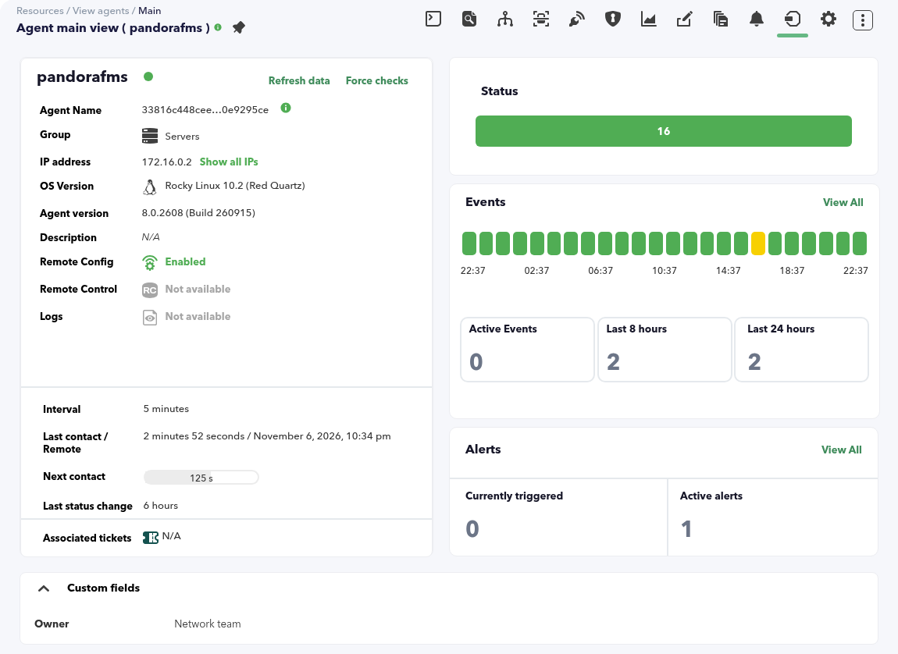{ .captura }

!!! note "If the agent does not appear"
    With `autocreate 0` on the server, the data of an agent that does not exist
    in the console is discarded. It is a security option for environments where
    only agents created by hand are accepted; if the EndPoint sends and the
    agent does not appear, it is the first thing to check.

On Linux, the EndPoint runs as a `systemd` service named
`pandora_agent_daemon`:

```bash
systemctl start pandora_agent_daemon
systemctl stop pandora_agent_daemon
systemctl restart pandora_agent_daemon
```

The old start-up script in `/etc/init.d` is still present in some package, but
it is retired: it only warns that `systemctl` has to be used and ends without
doing anything. Do not use it, and do not document procedures around it.

On Windows, the EndPoint runs as the `PandoraFMSAgent` service:

```powershell
NET START PandoraFMSAgent
NET STOP PandoraFMSAgent
```

The configuration lives in `/etc/pandora/pandora_agent.conf` on Linux and Unix
(the same file for the Go EndPoint and the Perl one; in an installation with its
own path, in `<prefix>/etc/pandora/`) and in `pandora_agent.conf` inside the
installation folder on Windows (by default, `C:\Program Files\pandora_agent`).
Any manual change to that file requires restarting the service for it to take
effect; if remote configuration is active, bear in mind what is explained
further down too, because a local change may end up overwritten.

### Essential parameters of pandora_agent.conf

Of the many tokens `pandora_agent.conf` accepts, these are the ones touched on
the first day. The rest (modules aside) is in the
[full EndPoint configuration reference](../parte-9/9.1-referencia-completa-de-configuracion-del-endpoint.md).

| Parameter | What it does | Default |
|---|---|---|
| `server_ip` | IP or FQDN of the Pandora FMS server the EndPoint reports to. | `localhost` |
| `interval` | Seconds between each collection and delivery cycle. | `300` |
| `group` | Group the agent is assigned to in the Web console. | No value in the code; the installation templates bring `Servers`. |
| `agent_alias` | Visible name of the agent in the console. If left empty, it takes the machine name (*hostname*). Do not confuse it with `agent_name`, the internal identifier the server uses to avoid duplicating agents: changing the alias does not rename the agent. | Empty (hostname) |
| `remote_config` | Allows editing this configuration and its modules from the console. It is covered in detail in the next section. | `0` in the code; the installation templates leave it at `1` |
| `debug` | With `1`, the EndPoint logs more detail in its log and, after sending each XML, keeps a copy in the temporary folder (with the `sent` suffix) instead of deleting it. The data is sent anyway: it serves to see exactly what is sent, not to test on the sly. | `0` |

## Remote configuration from the Web console

!!! warning "It comes enabled from the factory"
    The Linux and Windows installation templates bring `remote_config 1`: any
    EndPoint installed with the standard package allows, from the first minute,
    someone with access to the console to edit its configuration and its modules
    without touching the machine. The online installer only changes that value
    if the `PANDORA_REMOTE_CONFIG` variable is passed to it explicitly; if
    nothing is touched, it stays active. If the `remote_config` token is missing
    from the file altogether, the value the code assumes is `0`, but that is not
    what the standard installation brings: it is the situation of a file edited
    by hand and trimmed. Before taking for granted that an EndPoint is closed to
    remote changes, check the token.

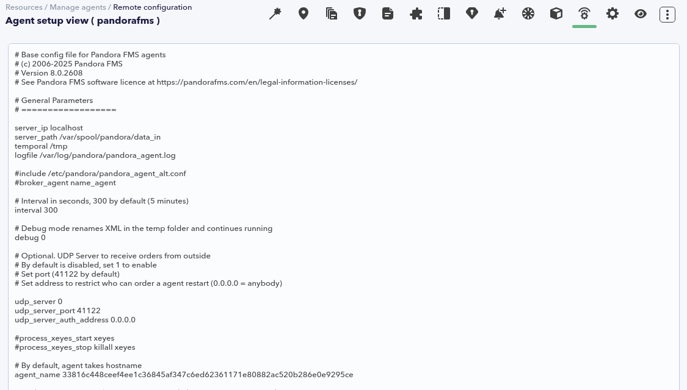{ .captura }

With remote configuration active, the console can replace the EndPoint
`pandora_agent.conf` entirely and create or modify local modules without anyone
connecting to the machine. The mechanism underneath is the same in all three
EndPoints, with nuances: on each cycle, the EndPoint calculates the MD5 of its
current configuration and compares it with the one on the server.

- If the server does not have an MD5 for that agent yet, the EndPoint uploads
  its local configuration: it is the first contact, and the console starts from
  what was already on the machine instead of demanding that it be written from
  scratch.
- If the server MD5 differs from the local one, the EndPoint downloads the new
  configuration and leaves it as its active file.
- If they match, nothing happens: it is the normal case, cycle after cycle.

Deactivating it is as simple as setting `remote_config 0` and restarting the
service; from then on, changes only get in by editing the file by hand on the
machine.

Two more pieces of the configuration worth knowing from the start: the agent
*custom fields*, which the EndPoint can declare in its file (`custom_field1_name`,
`custom_field1_value` and so on) and which, with remote configuration active,
are also edited from the console; and the password-protected groups: if the
console group requires a password, the EndPoint has to declare it with
`group_password` for the server to create the agent in that group.

A custom field is only filled in if it already exists in the console with that
same name (**Resources → Custom fields**; everything about them is in
[2.21, Agent custom fields](2.21-configuracion-comun-de-los-agentes.md#agent-custom-fields)); if it does not exist, the server
discards the value outright. Its type is also defined there: free text, list of
values, password (the console shows it with asterisks) or link. For a field of
type link, the EndPoint sends a pair with the text and the address:

```conf
custom_field1_name Documentation
custom_field1_value ["Server manual","https://intranet.example.com/srv01"]
```

A difference between EndPoints, and not a small one: the Perl EndPoint applies
remote configuration with any `transfer_mode` (`tentacle`, `ssh`, `ftp` or
`local`), while the Go EndPoint only does so with `tentacle` or `local`; with
`ssh` or `ftp` it does not download remote configuration.

### EndPoint autoconfiguration

Remote configuration has a natural extension for large deployments:
autoconfiguration, which applies group, policies or extra configuration to every
new EndPoint as soon as it registers, according to rules defined beforehand,
without touching them one by one. It is explained in detail in
[Auto-provisioning mechanisms](../parte-6/6.6-mecanismos-de-autoprovision.md).

## Monitoring the basics of the system

Before thinking about scripts of your own or exotic integrations, it is worth
covering the obvious: how much CPU and free memory there is, how much disk is
left, whether a process or a service is still alive. It is 80% of what is asked
of an EndPoint, and a good part of it arrives done: without configuring
anything, the template it is installed with already collects the basics.

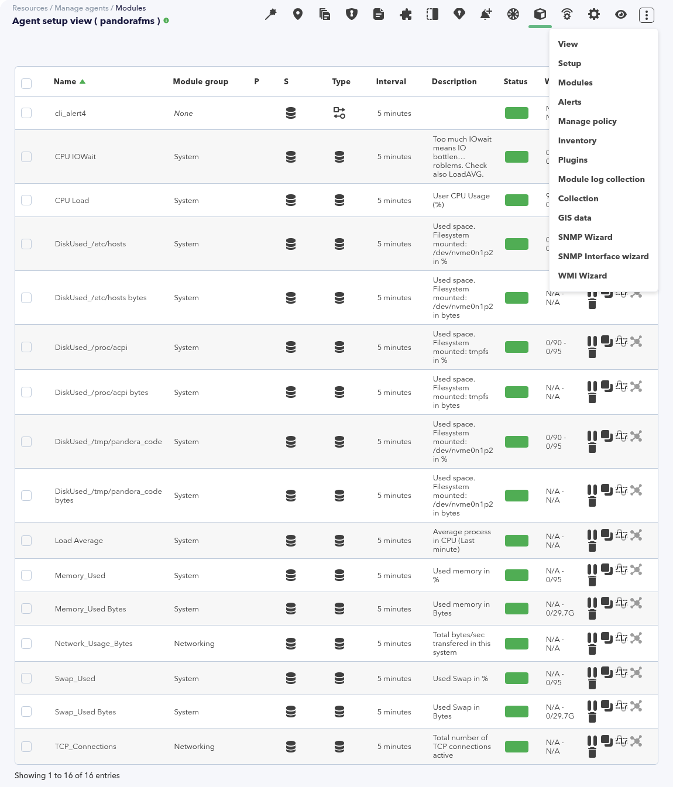{ .captura }

| What comes from the factory | Linux (Go and Perl) | Windows |
|---|---|---|
| CPU usage | `CPU Load` module (with `vmstat`), plus `CPU IOWait` and `Load Average` | `CPU Load` module (WMI query) |
| Usage of each disk (%) | `pandora_df_used` plugin; on the Go EndPoint, the `df_used` template of the `pandora-plugin_exec` executor | `df_percent_used.vbs` plugin |
| Memory usage (%) | `pandora_mem_used` plugin (includes *swap*) | `mem_percent_used.vbs` plugin |
| Network traffic | `pandora_netusage` and `net_usage` plugins; on the Go EndPoint, the `pandora_netusage` template | `network.vbs` plugin |
| TCP connections | `TCP_Connections` module | `TCP_Connections` module |
| Known services | `autodiscover --default` plugin: detects the usual services (databases, web servers…) and watches their status, their CPU and their memory | Same, with `autodiscover.exe --default` |
| Hardware information (CPU, RAM, disks, interfaces) | `hardware_info` plugin, once a day | Same, with `hardware_info.exe` |

!!! note "What the Go EndPoint leaves out of the factory template"
    The Go EndPoint template, the one installed by default on Linux, creates no
    modules for the boot partitions (`/boot` and `/boot/efi`) or for the traffic
    of the loopback interface and the virtual ones (`lo`, `docker`, `br-*`,
    `veth`, `tailscale`, `incus`): on a freshly installed machine they say
    nothing about the state of the system. Each template takes its own filters,
    `exclude` for disks and `deny_regexp` for interfaces. The Perl EndPoint
    keeps its previous plugins.

    Known services follow the same idea: `autodiscover --default` ignores the
    units systemd lists with no unit file behind them (load state `not-found`),
    which would otherwise show a permanent `0` as if the service were down. An
    installed service that is stopped is still reported, because that red is the
    intended alert.

Even so, it is worth knowing how each thing is done by hand: to watch a
specific disk, process or service, to adjust thresholds or to replace the
template with one of your own. What follows describes the native modules of each
EndPoint: first what is common to all three and then what changes according to
the operating system.

### Modules common to all EndPoints

Go, Perl and Windows share these five modules with the same syntax:

| Module | What it measures |
|---|---|
| `module_cpuusage` | CPU usage percentage. |
| `module_freememory` | Free memory, in MB. |
| `module_freepercentmemory` | Free memory, in %. |
| `module_freedisk` | Free space on a partition or drive, in MB. |
| `module_freepercentdisk` | Free space on a partition or drive, in %. |

```conf
module_begin
module_name CPU
module_type generic_data
module_cpuusage
module_end

module_begin
module_name Free memory
module_type generic_data
module_freememory
module_end

module_begin
module_name Free memory (%)
module_type generic_data
module_freepercentmemory
module_end

module_begin
module_name Disk / free (%)
module_type generic_data
module_freepercentdisk /
module_end
```

`module_freedisk` and `module_freepercentdisk` need to know which drive to look
at: on Linux and Unix, the mount point exactly as it appears in `df` (`/`,
`/var`); on Windows, the drive letter (`C:`). The rest of the definition (which
disk, which partition) is not guessed: if the mount point or the letter does not
exist on the machine, the module generates no data.

`module_cpuusage` optionally accepts the number of the core to measure (`0` the
first, `1` the second…); with no value, or with `all`, it aggregates the usage
of all cores into one.

### Monitoring specific to Linux and Unix (Go and Perl EndPoints)

On Linux and the rest of Unix, `module_proc` and `module_service` are the same
module with two names: they look, among the running processes, for one whose
full command line (as `ps aux` shows it, from the binary name onwards) matches
the parameter exactly. The result is `1` if there is a match and `0` if there is
not; it is **not** a count of processes, so it makes no difference whether there
is one instance of the process running or five. There is no asynchronous mode
and no watchdog: if the process dies, the next cycle reflects it, and that is
where the watching ends.

```conf
module_begin
module_name SSHD running
module_type generic_proc
module_service /usr/sbin/sshd -D
module_end
```

!!! warning "The whole command line, not just the name"
    `module_service sshd` finds nothing if the real process runs as
    `/usr/sbin/sshd -D`. The line has to be copied as `ps aux` shows it,
    arguments included.

Two modules exclusive to Unix add detail about that same process:
`module_cpuproc` (CPU usage) and `module_memproc` (resident memory, in MB). Both
require the same kind of exact match as `module_proc`, and if the process is not
running, the module generates no data that cycle. Also exclusive to Unix is
`module_occupiedpercentdisk`, the counterpart of `module_freepercentdisk`: the
used percentage instead of the free one.

```conf
module_begin
module_name SSHD, CPU usage
module_type generic_data
module_cpuproc /usr/sbin/sshd -D
module_end

module_begin
module_name Disk / used (%)
module_type generic_data
module_occupiedpercentdisk /
module_end
```

For everything a native module does not cover there is `module_exec`: it runs the
command or script given to it and takes its standard output as the datum. On
Linux and Unix it runs through `/bin/sh`, and on some systems (Debian and its
derivatives, above all) that `/bin/sh` is `dash`, not `bash`: if the command
uses `bash` syntax (`[[ ]]`, *arrays*, `source`…), it fails silently or with a
different result than expected in an interactive terminal. The safe way to avoid
it is to wrap the command in `bash -c`.

```conf
module_begin
module_name Established connections
module_type generic_data
module_exec bash -c "ss -tn state established | wc -l"
module_end
```

### Monitoring specific to MS Windows

On Windows, `module_service` and `module_proc` stop being the same module and
each one looks at a different thing.

`module_service` checks the status of a service by its **short name** (the
internal one, the one shown in the "Service name" column of the services
manager, not the display name), in quotes if it contains spaces. It returns `1`
if the service is running and `0` if it is stopped or does not exist.

```conf
module_begin
module_name Print Spooler
module_type generic_proc
module_service Spooler
module_end
```

`module_proc` looks by process name, with the `.exe` extension included
(`notepad.exe`, not `notepad`), and unlike Unix it does return the number of
running instances, not a simple yes/no.

```conf
module_begin
module_name Notepad instances
module_type generic_data
module_proc notepad.exe
module_end
```

Both modules accept an asynchronous mode on Windows (`module_async`): instead of
waiting for the next interval, the EndPoint watches for status changes and sends
the datum as soon as they happen. On services it relies on the event log
notifications of the Service Control Manager; on the Windows editions that do
not offer them (the Home ones), the EndPoint switches on its own to checking the
status every 10 seconds. Asynchronous modules are not supported on broker
agents.

The watchdog (`module_watchdog yes`) is built on top of the asynchronous mode,
and it turns the module into an active watcher. Watch the value: without it, the
watchdog does not activate.

- **Services.** If the service stops, the EndPoint starts it again by itself;
  no command has to be given.

    ```conf
    module_begin
    module_name Print Spooler
    module_type generic_proc
    module_service Spooler
    module_async yes
    module_watchdog yes
    module_end
    ```

- **Processes.** It has to be told how to relaunch it with
  `module_start_command` (without it, the EndPoint discards the module and notes
  it in its log). `module_startdelay` and `module_retrydelay` set, in
  milliseconds, the wait before the start and between retries, and
  `module_retries` the number of attempts. The process is launched as the
  EndPoint service itself, that is, as `SYSTEM`; to launch it in the session of
  the user who has the desktop open, `module_user_session yes` is added.

    ```conf
    module_begin
    module_name Notepad
    module_type generic_proc
    module_proc notepad.exe
    module_async yes
    module_watchdog yes
    module_start_command c:\windows\notepad.exe
    module_startdelay 3000
    module_retrydelay 2000
    module_retries 5
    module_end
    ```

Windows does not have `module_cpuproc`, `module_memproc` or
`module_occupiedpercentdisk`: for the CPU or memory usage of a specific process
on Windows you have to resort to `module_perfcounter` or `module_wmiquery` (see
further down).

## Creating your own modules

The first thing decided when creating a module is its type (`module_type`): it
tells the server what kind of datum it receives and how to calculate its status.
These are the ones used in an EndPoint:

| Type | What it receives | How it is interpreted |
|---|---|---|
| `generic_data` | A number. | The value as it is; the status comes from the thresholds. It is the default type. |
| `generic_proc` | `1` or `0`. | Direct status: `1` is normal and `0`, critical. For "is it alive?". |
| `generic_data_string` | A text. | The text as it is; the status comes from the text thresholds. |
| `generic_data_inc` | A counter that only grows. | The rate of change per second between two readings (bytes/s, requests/s…). |
| `generic_data_inc_abs` | A counter that only grows. | The absolute difference between two readings, without dividing by time. |
| `async_data`, `async_proc`, `async_string` | The same as their `generic_*` equivalents. | Data that does not arrive at fixed intervals (events, status changes). They never go to unknown: if no data arrives in twice their interval, they go back to normal (`async_recovery 1` on the server, the default value). |
| `log` | Log lines. | It is not a monitoring datum: it goes to log collection. |

The two incremental ones need a previous reading to calculate anything, so the
first datum they send is discarded. The full list of Pandora FMS module types,
including the remote monitoring ones, is covered in
[Introduction and architecture](../parte-1/1.2-introduccion-y-arquitectura.md).

Every module, native or your own, is declared with the same wrapper:
`module_begin` opens the definition, `module_end` closes it, and in between go
`module_name` (mandatory), the data module itself (`module_exec`, one of the
native modules above…) and, optionally, `module_description`, `module_type` (by
default, `generic_data`, a numeric value) and the threshold tokens:
`module_min_warning`, `module_max_warning`, `module_min_critical`,
`module_max_critical` mark the warning and critical ranges; `module_str_warning`
and `module_str_critical` do the same by text comparison or regular expression
for string-type modules. `module_unit` adds a unit to the value shown in the Web
console (`%`, `GB`…) and `module_group` groups related modules under the same
heading in the agent view. All three EndPoints accept these tokens with the same
name and the same effect.

```conf
module_begin
module_name Disk /var free (%)
module_type generic_data
module_freepercentdisk /var
module_min_warning 20
module_min_critical 10
module_unit %
module_group Disk
module_end
```

By default, every module runs on every EndPoint cycle, that is, every `interval`
seconds. To space it out there is `module_interval`, which is not measured in
seconds but in cycles: it is a multiplier of the general `interval`. With
`interval 300` (five minutes), a module with `module_interval 4` runs one out of
every four cycles, every 20 minutes. It is useful for costly checks or checks
that do not change often, without touching the pace of the rest of the modules.

```conf
module_begin
module_name Packages pending update
module_type generic_data
module_exec apt list --upgradable 2>/dev/null | grep -c upgradable || true
module_interval 12
module_end
```

If what is needed is a fixed interval in time, independent of `interval` (once a
day, every hour), there is `module_absoluteinterval`, which is explained in
[Scheduled monitoring](#scheduled-monitoring).

For what no native module covers, `module_exec` accepts any command or script
installed on the machine and turns its standard output into the module datum; it
is the way in to local plugins, whose development is covered in
[Creating local plugins](../parte-9/9.8-creacion-de-plugins-locales.md).

Two rules before the examples. The first: the command has to return a single
value, on a single line. The second, the one that causes the most grief: if the
command ends with an exit code other than `0`, the EndPoint discards the datum
even if it has written something. On Linux and Unix the command is launched with
`sh -c`; on Windows, with `cmd.exe /c`.

Users with an open session on a Linux server, with a warning from five upwards:

```conf
module_begin
module_name Connected users
module_type generic_data
module_exec who | wc -l
module_min_warning 5
module_end
```

Is there a backup from the last 24 hours? The module returns `1` or `0` and,
since it is of type `generic_proc`, the `0` puts the module in critical without
defining thresholds:

```conf
module_begin
module_name Recent backup
module_type generic_proc
module_exec [ -n "$(find /backup -name '*.tar.gz' -mtime -1)" ] && echo 1 || echo 0
module_end
```

On Windows, is the computer waiting for a restart to finish applying updates?
`reg query` returns an error code when the key does not exist, which is exactly
the normal case, so the `&& … ||` turns the result into a `1` or a `0` that
always ends well:

```conf
module_begin
module_name Pending restart
module_type generic_data
module_exec reg query "HKLM\SOFTWARE\Microsoft\Windows\CurrentVersion\WindowsUpdate\Auto Update\RebootRequired" >nul 2>&1 && echo 1 || echo 0
module_min_warning 1
module_end
```

!!! tip "The exit code, always under control"
    A `grep -c` that finds nothing writes `0`, but it exits with code `1` and
    the EndPoint throws the datum away. If a command can fail in the normal
    case, force the output with `&& echo … || echo …` or end the pipe with a
    command that always ends well, such as `wc -l`.

### Creating modules from the Web console

With remote configuration active (see above), the Web console allows creating
and editing these same local modules without touching `pandora_agent.conf` by
hand: the form generates the same tokens seen in this section and the EndPoint
picks them up on its next remote configuration check. Without remote
configuration, the only way is to edit the file directly on the machine.

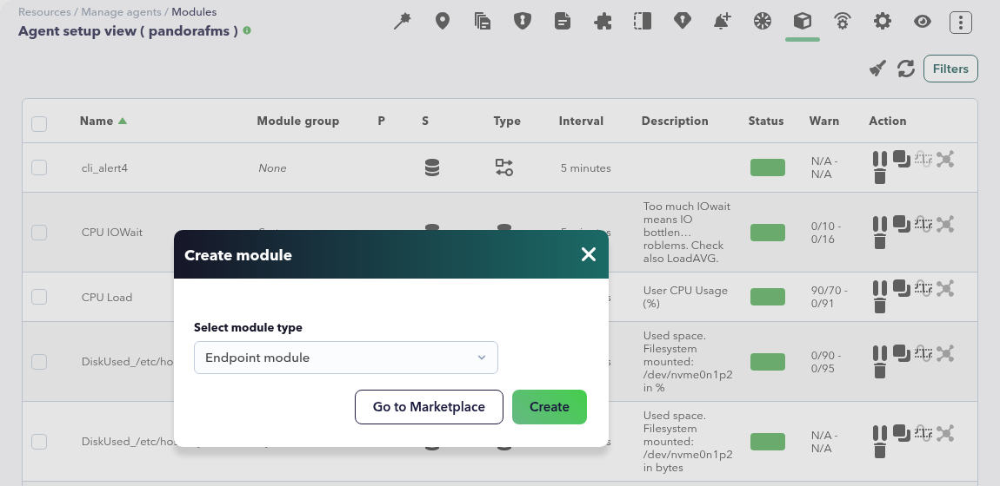{ .captura }

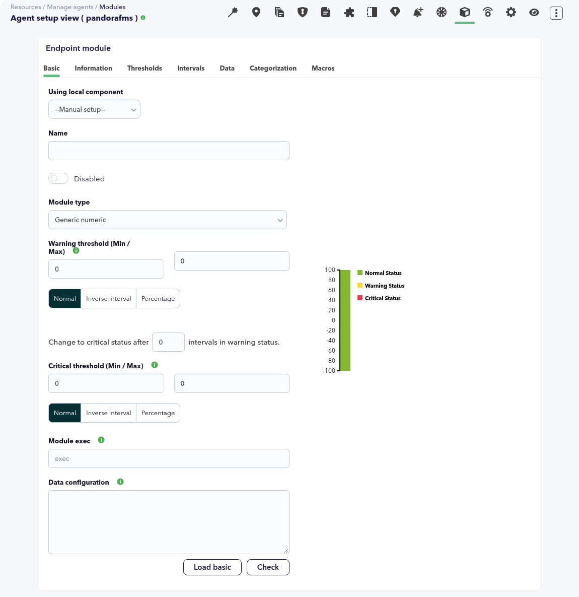{ .captura }

The first thing in that form is not an empty field but a selector: **Using local component**. Before typing anything from scratch it is worth knowing what it hides, and that is what the next section is about.

### Local components: modules that are already prepared

Writing by hand the module that measures free memory on a Linux box or disk space on a Windows one has its charm the first time and none the tenth. That is why the console keeps **local components**: ready-made EndPoint modules, with their `module_begin … module_end` definition, data type, thresholds and description, ready to be loaded into the module creation form.

A component is a template, not a live module. When you pick one, the console copies its fields into the form (name, type, thresholds, the *Module exec* command and the *Data configuration* block) and from then on it is an ordinary local module that you can adjust before saving. No link remains with the component: changing or deleting it later does not alter the modules already created from it.

!!! note "These are not the modules a fresh EndPoint ships with"
    The modules that appear on their own on a freshly installed EndPoint (CPU Load, disk usage, memory…) come from the EndPoint's own configuration template, described in [Monitoring the basics of the system](#monitoring-the-basics-of-the-system). Local components are a separate catalogue that only comes into play when you create a module from the console.

**Using a component.** With remote configuration enabled, in the agent's edit view:

1. In the modules tab, click "Create module" and choose the "Endpoint module" type.
2. In **Using local component**, pick the group first. Components hang from the same component group tree as the remote ones, for example "Operating Systems" → "UNIX Systems" → "Linux".
3. A second drop-down appears with the group's components. Pick one and the form fills in.
4. Check what was loaded, adjust what you need (the name, a threshold, a disk mount point) and save.

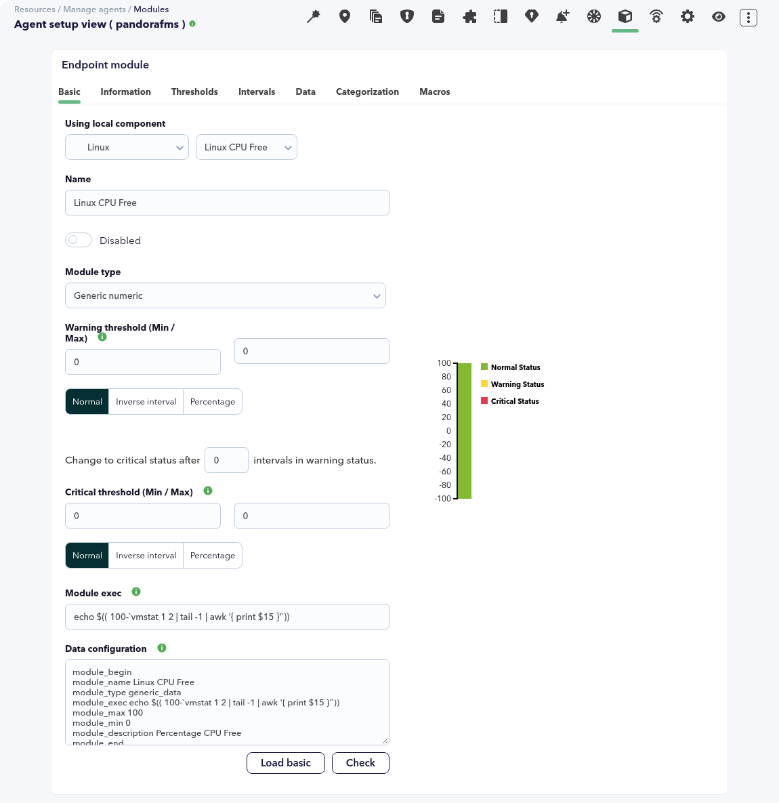{ .captura }

Read the *Data configuration* block before saving: it is the only way to know what the EndPoint will really run.

**What the console ships with.** More than fifty components, grouped by technology:

| Group | Example components |
|---|---|
| Linux | `Linux CPU Free`, `Linux Load Average`, `Linux Memory Free`, `Linux Disk Free`, `SSH Status`, `Free i-nodes`, `Linux Zombie processes`, `Disk_IO_Wait`, `OpenedFiles` |
| Microsoft Windows | `Windows CPU Load`, `Windows Free Memory`, `Windows Free Disk C`, `Windows_Update_LastRun`, `Microsoft Firewall`, `Microsoft Antivirus`, `Kaspersky Antivirus` |
| Citrix | `Citrix_Sessions`, `Busy XML Threads`, `Windows Users Connected`, the `Serv_IMA` and `Serv_HCA` services, and eight Windows event modules (`Event 1000`, `Event 1004`…) |
| Solaris, BSD, HP-UX, MacOS and AIX | System and user CPU (`CPU_System`, `cpu_user`), free space on the root partition (`disk_root_free`), free memory and swap, load average and daemon checks (`InetdDaemon`, `sshDaemon`) |

**Managing them and creating your own.** Components are managed under "Management" → "Configuration" → "Templates" → "Local components" ("Local component management"). The list shows each component's name, description and group, with duplicate and delete actions on every row and a "Create" button for a new one.

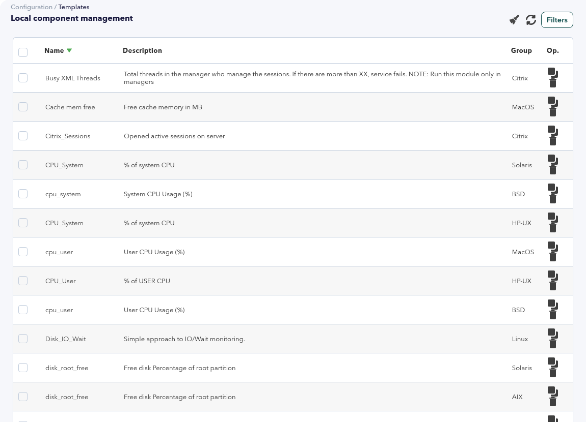{ .captura }

A component's form is the same as a module's, with an extra **Group** field and without the intervals tab. There are two ways to get your own: create it from scratch with "Create", or duplicate a bundled one and adapt it, which is almost always faster because the definition is already written. A custom component is good for what any template is good for: the module that repeats across fifty agents gets written once.

**Remote** components (the network, SNMP and WMI ones that the server runs) work on the same idea and are explained in [Network components: do not start from scratch](2.6-monitorizacion-de-redes.md#network-components-do-not-start-from-scratch).

## Advanced monitoring of MS Windows

The Windows EndPoint adds a handful of modules that have no equivalent in Go or
in Perl, because they depend on technologies specific to Windows.

`module_wmiquery` runs a WQL query against WMI and `module_wmicolumn` indicates
which column of the result to take as the module value:

```conf
module_begin
module_name Free physical memory (KB)
module_type generic_data
module_wmiquery SELECT FreePhysicalMemory FROM Win32_OperatingSystem
module_wmicolumn FreePhysicalMemory
module_end
```

If the query returns several rows, the module collects one datum per row; for a
single value it is best for the query to return only one.

`module_perfcounter` reads a Windows performance counter directly (the same ones
the Performance Monitor shows). Counter names are in the system language: the
example is for a Windows in Spanish. For counters that express a rate ("per
second"), `module_cooked 1` delivers the value already calculated instead of the
raw counter.

```conf
module_begin
module_name Bytes received on the network
module_type generic_data
module_perfcounter \Interfaz de red(*)\Bytes recibidos/segundo
module_cooked 1
module_end
```

The Windows event viewer is read with `module_logchannel` (the recommended one)
or with `module_logevent`, which is kept for compatibility. Both filter by log
(`module_source`, the only mandatory one), type, event code, application or
pattern, and their main use is log collection, which has a chapter of its own:
[Log collection and monitoring](2.19-recoleccion-y-monitorizacion-de-logs.md).

Finally, `module_exec_powershell` runs the given command or script through
PowerShell (`powershell -C "<command>"`), for everything that is better solved
with a cmdlet than with a `cmd.exe` command:

```conf
module_begin
module_name Stopped services
module_type generic_data
module_exec_powershell (Get-Service | Where-Object {$_.Status -eq 'Stopped'}).Count
module_end
```

## EndPoint plugins

A local plugin is similar to `module_exec` in that it is a program installed on
the machine that the EndPoint runs on every cycle, but with an important
difference: it does not return one datum, but whole modules. The plugin writes
the XML of one or several modules (name, type, datum, description…) to its
output and the EndPoint adds it as it is to its data file. That is why a single
plugin such as `pandora_df_used` creates one module for each disk it finds. All
three EndPoints accept it with `module_plugin`, and as with `module_exec`, if the
plugin ends with an exit code other than `0`, its output is discarded.

The shortest form is a loose line, which runs on every cycle:

```conf
module_plugin nagios_plugin_wrapper Disk_tmp /usr/lib/nagios/plugins/check_disk -w 20% -c 10% -p /tmp
```

If the way it runs has to be adjusted, `module_plugin` also goes inside a
`module_begin` / `module_end` block, next to the tokens that control execution:
`module_interval` (every how many EndPoint cycles: `2`, one out of every two),
`module_absoluteinterval` (an interval of its own, such as `1d`), `module_timeout`
(seconds of margin before giving it up as failed) or `module_crontab`. In that
case `module_type` is not needed: the type and the datum are put by the plugin
itself in its XML. `module_name` is only needed if the block uses
`module_absoluteinterval`; then it is needed so that each plugin has its own
`.ref` file. The installation templates already do it that way:

```conf
module_begin
module_plugin hardware_info
module_absoluteinterval 1d
module_end

module_begin
module_plugin autodiscover --default
module_timeout 30
module_end
```

The Linux and Unix package already brings several plugins ready to use in its
plugins folder (some, such as `pandora_df_used` or `autodiscover`, have already
appeared in the default monitoring table) and it is enough to cite them by name,
with no path. Among them is `nagios_plugin_wrapper`, which runs an
already-written Nagios plugin (its first argument is the module name; the rest,
the call to the plugin with its parameters) and turns its exit code and its text
into a Pandora FMS module, without rewriting anything. On Windows, the plugins
the package brings are VBScript scripts and loose executables in the `util\`
folder (the same `df_percent_used.vbs`, `mem_percent_used.vbs` or
`autodiscover.exe` from the previous table); a plugin of your own in PowerShell
is invoked like any other command, with `module_plugin`:

```conf
module_plugin powershell.exe -File "%ProgramFiles%\pandora_agent\util\mi_plugin.ps1"
```

Writing a plugin of your own, in any language, is covered in
[Creating local plugins](../parte-9/9.8-creacion-de-plugins-locales.md).

### File collections

To avoid copying a plugin by hand on every machine there are
[collections](2.9-colecciones.md): packages of files that are uploaded once to
the Web console and assigned to the EndPoints that need them, which download
them and leave them ready for a `module_plugin` to use. All three EndPoints
accept them; how they are created, assigned and used from policies is explained
in its chapter, [Collections](2.9-colecciones.md).

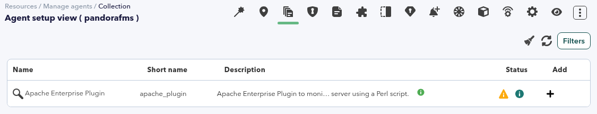{ .captura }

!!! note "Remote configuration, a prerequisite"
    Collections are distributed over the same channel as remote configuration
    (see [Remote configuration from the Web console](#remote-configuration-from-the-web-console)):
    without it active, there is no way to push a collection to the EndPoint.

## Advanced monitoring with the EndPoint

### Conditional monitoring

A precondition (`module_precondition`) decides whether the module gets to run; a
condition (`module_condition`) evaluates the result already obtained. Both share
the same syntax, in all three EndPoints:

| Form | Syntax | It is met when |
|---|---|---|
| Numeric comparison | `<operator> <value> <command>` | The value meets `<operator> <value>`. Operators: `>`, `<`, `=` and `!=` (there is no `>=` or `<=`). |
| Interval | `(<minimum>,<maximum>) <command>` | The value is between the two limits, not including them. |
| Regular expression | `=~ <pattern> <command>` | The value matches `<pattern>`. |

What changes is where the value comes from and what the command does:

- In a **precondition**, the EndPoint runs the `<command>` first and compares
  its output. If a module has several, all of them have to be met; if any fails,
  the module does not run that cycle.
- In a **condition**, the value is the datum the module has just obtained. If it
  is met, the EndPoint launches the `<command>` separately, as a response action
  (restart something, clean a directory…); the module datum does not change.

A precondition to avoid false alarms: the module checks whether there is a
recent backup on a network resource mounted at `/backup`, but only if that
resource is mounted. If it is not, the module does not run that cycle, instead
of marking as critical a backup it has not even been able to look at:

```conf
module_begin
module_name Recent backup
module_type generic_proc
module_precondition = 1 mountpoint -q /backup && echo 1 || echo 0
module_exec [ -n "$(find /backup -name '*.tar.gz' -mtime -1)" ] && echo 1 || echo 0
module_end
```

A condition as a response action: the module measures how full the root disk is
and, if it goes over 90%, the EndPoint deletes compressed logs older than 30
days. The datum is sent anyway; the deletion is a separate effect:

```conf
module_begin
module_name Disk / used (%)
module_type generic_data
module_occupiedpercentdisk /
module_condition > 90 find /var/log -name '*.gz' -mtime +30 -delete
module_min_warning 85
module_end
```

### Intensive monitoring

Intensive monitoring serves to find out before something falls without
multiplying the data that is sent. It is activated with the global token
`intensive_interval`, in seconds and shorter than `interval`: the EndPoint
starts going round every `intensive_interval` seconds. On each round it runs the
modules marked with `module_intensive_condition`, but it only sends their datum
when their compliance with the condition changes, or when their normal interval
is due. With `intensive_interval` at `0` (the default value) it is the
same as `interval` and there is no intensive monitoring. The condition uses the
same syntax as those in the previous table, without a command.

```conf
# General part of the file
interval 300
intensive_interval 10

module_begin
module_name Ping to the gateway
module_type generic_proc
module_exec ping -c 1 -W 1 192.168.1.1 >/dev/null 2>&1 && echo 1 || echo 0
module_intensive_condition = 0
module_end
```

### Scheduled monitoring

There are two ways for a module not to follow the normal pace of the EndPoint.

`module_absoluteinterval` gives it an interval of its own, in real time and not
in cycles like `module_interval`. It accepts a number with a suffix (`30s`,
`15m`, `6h`, `1d`) or, with no suffix, a number of `interval` cycles. Underneath,
the EndPoint translates it into cycles by rounding up: with `interval 300`, a
`module_absoluteinterval 7m` runs every two cycles, that is, every 10 minutes. So
it is best not to expect more precision than that of `interval` itself.

What really sets it apart from `module_interval` is memory: all three EndPoints
save the time of the module's last run in a reference file (`.ref`), so that the
interval is respected even if the EndPoint restarts. A daily module runs once a
day, not once a day plus one for each restart. The special value `once` makes
the module run a single time and turns it into an asynchronous one.

```conf
module_begin
module_name Web certificate: days to expiry
module_type generic_data
module_exec echo $(( ( $(date -d "$(openssl x509 -enddate -noout -in /etc/ssl/certs/web.pem | cut -d= -f2)" +%s) - $(date +%s) ) / 86400 ))
module_absoluteinterval 1d
module_end
```

`module_crontab` goes one step further: the module only runs when the time
matches a five-field cron expression (minute, hour, day of the month, month, day
of the week); the rest of the cycles it does nothing. It is the right thing for
what makes sense at a specific time, such as a nightly close or a weekly report.

```conf
module_begin
module_name Weekly report generated (Monday, 9:00)
module_type generic_proc
module_exec [ -f /var/reports/weekly.done ] && echo 1 || echo 0
module_crontab 0 9 * * 1
module_end
```

### Post-processing, flip-flop and other module settings

A handful of tokens, common to all three EndPoints, fine-tune how the datum is
treated once obtained, without touching how it is obtained. They are the configuration-file equivalents of the form fields described in
[2.20, Common module configuration](2.20-configuracion-comun-de-los-modulos.md):

| Token | What it does |
|---|---|
| `module_postprocess` | Factor by which the server multiplies the numeric value when it receives it (to convert bytes into MB, for example). The EndPoint sends it as it is along with the datum. |
| `module_ff_interval`, `module_ff_type`, `module_each_ff`, `module_min_ff_event*` | They adjust the *flip-flop*: how many consecutive status changes are needed for the server to fire an event, instead of one for each change. |
| `module_timeout` | Seconds of margin for the module command or plugin to finish before giving it up as failed. |
| `module_save <variable>` | Saves the module value in the given environment variable, so that the modules that run afterwards use it. |

`module_async`, already seen in the monitoring of Windows services and
processes, is exclusive to that EndPoint: it turns the module into a watcher
that warns as soon as it changes status, instead of waiting for the cycle.
Neither Go nor Perl implements it.

## The EndPoint as a network monitoring point

### Remote checks from the EndPoint

An EndPoint can also watch another machine on the network from where it is
installed, without that machine having an EndPoint of its own. The difference
between systems is one of substance, not of nuance: Windows brings native
modules for this; on Linux and Unix, with Go or with Perl, there are no
equivalents and they are built with `module_exec`.

On Windows, `module_ping` launches a ping against the given host and gives `1`
or `0` depending on whether it gets a response; `module_ping_count` and
`module_ping_timeout` adjust the number of attempts and the waiting time.
`module_tcpcheck` checks whether a TCP port responds, with `module_port` to
indicate which one and `module_timeout` for the waiting margin. `module_snmpget`
launches an SNMP query and takes the returned value as the module datum, with
`module_snmp_version`, `module_snmp_community`, `module_snmp_agent` (the host)
and `module_snmp_oid`.

```conf
module_begin
module_name Ping to the gateway
module_type generic_proc
module_ping 192.168.1.1
module_ping_count 2
module_ping_timeout 1
module_end

module_begin
module_name Server web port
module_type generic_proc
module_tcpcheck 192.168.1.10
module_port 443
module_end
```

On Linux and Unix the same result is achieved with `module_exec`, supported by
the system tools. Here the same rule applies as in any other `module_exec`: the
exit code decides whether the datum is sent, so it has to be forced explicitly
instead of trusting the command's own exit code.

```conf
module_begin
module_name Ping to the gateway
module_type generic_proc
module_exec ping -c 1 -W 1 192.168.1.1 >/dev/null 2>&1 && echo 1 || echo 0
module_end

module_begin
module_name Server web port
module_type generic_proc
module_exec nc -z -w 2 192.168.1.10 443 && echo 1 || echo 0
module_end

module_begin
module_name Uptime over SNMP
module_type generic_data
module_exec snmpget -Ovq -c public -v 2c 192.168.1.10 sysUpTime.0
module_end
```

For network monitoring from outside the target machine (with no EndPoint
needed) there is remote monitoring, in
[Network monitoring](2.6-monitorizacion-de-redes.md).

### Broker mode

An EndPoint in broker mode stops reporting as a single agent and starts
generating and sending, in the same cycle, one or several additional agents:
each `broker_agent <name>` in `pandora_agent.conf` starts a child agent with its
own configuration, derived from that of the main EndPoint (same server, same
interval, same transfer mode), but with its own name and its own modules. It is
what allows, for example, a single EndPoint installed on a gateway to report
data from several devices behind it, each one as its own agent in the console.

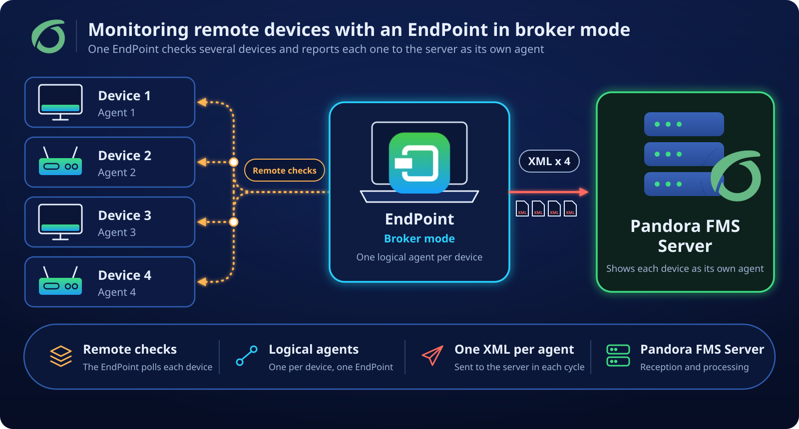{ .diagrama-oscuro }

All three EndPoints accept it. On the Windows EndPoint, broker agents do not
accept asynchronous modules: a module with `module_async` in the configuration
of a broker is discarded.

```conf
broker_agent Router-planta-1
broker_agent Router-planta-2
```

### Proxy mode

In proxy mode, the EndPoint stops limiting itself to sending its own data and
also starts acting as a Tentacle intermediary for other EndPoints on its network
that do not reach the server directly. On starting with `proxy_mode 1`, it starts
its own local Tentacle server (`tentacle_server`) listening on
`proxy_address` and `proxy_port` (by default, all interfaces and port `41121`,
the same as the server's), and it forwards what it receives towards `server_ip`
and `server_port`. `proxy_max_connection` limits the simultaneous connections it
accepts (by default, `10`) and `proxy_timeout` the waiting time of each one (by
default, `1` second). The EndPoints that rely on the proxy only need to point
their `server_ip` to the machine acting as proxy, instead of to the real server.

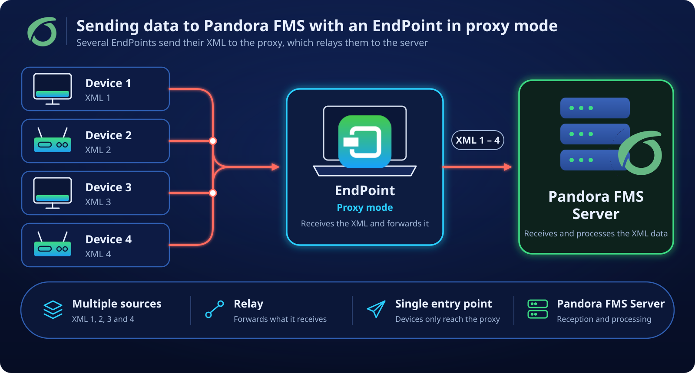{ .diagrama-oscuro }

```conf
# On the EndPoint acting as proxy
proxy_mode 1
proxy_address 0.0.0.0
proxy_port 41121
```

### Secondary server

`secondary_mode` decides whether the EndPoint also sends its data to a second
server, in addition to the main one (`server_ip`), under what circumstance and,
with `ha_fallback`, whether it also uses it for remote configuration:

| Value | Behaviour |
|---|---|
| `never` (default) | It is only sent to the main server. |
| `on_error` | The main one is tried first; only if it fails, it is sent to the secondary one. |
| `always` | It is sent to both servers, always. |
| `ha_fallback` | Same as `on_error` for data and, if the main server is not available, the remote configuration is retrieved from the secondary one. |

The secondary server is configured with its own mirrored set of tokens
(`secondary_server_ip`, `secondary_server_port`, `secondary_transfer_mode`,
`secondary_server_ssl`, `secondary_server_path`, `secondary_server_user`,
`secondary_server_pwd`), independent of the main server's. It is the way to keep
reporting when the main server is not available, or to feed two different
Pandora FMS installations at once, without depending on proxy mode or on a full
distributed architecture.

With `ha_fallback`, if the EndPoint cannot read the remote configuration from
the main server, it looks for it on the secondary one with the same
`secondary_*` tokens. If it is not there either, it uploads its local
`pandora_agent.conf` and its MD5 so it can also be managed from that server.
The download uses Tentacle (in Windows, an empty `secondary_transfer_mode`
means `tentacle`; Go also accepts `local`). While the main server responds, the
secondary one is not queried, and the configuration already sent to the
secondary is not deleted when the main one comes back: the agent does not
compare both copies, so managing them is up to whoever runs the environment.

`ha_fallback` is available in the Go and Windows EndPoints.

```conf
secondary_mode ha_fallback
secondary_server_ip 10.0.0.5
secondary_transfer_mode tentacle
```

## Remote actions on the EndPoint

The Perl and Windows EndPoints can listen for orders through a small UDP server:
it is activated with `udp_server 1` (it comes deactivated), it listens on
`udp_server_port` (`41122` by default) and it only serves the addresses in
`udp_server_auth_address` (`0.0.0.0`, the default value, accepts any). The Go
EndPoint has no UDP server.

The orders it understands are few and deliberately limited:

| Order | What it does | Perl | Windows |
|---|---|---|---|
| `REFRESH AGENT` | Forces an immediate run of the cycle: the EndPoint collects and sends its data without waiting for the interval. | Yes | Yes (see note) |
| `START PROCESS <name>` / `STOP PROCESS <name>` | Runs the command defined in `process_<name>_start` / `process_<name>_stop`. Without that token, the order is rejected. | Yes | Yes |
| `START SERVICE <name>` / `STOP SERVICE <name>` | Starts or stops the given Windows service, only if it is authorised with `service_<name> 1`. | No | Yes |

```conf
udp_server 1
udp_server_port 41122
udp_server_auth_address 10.0.0.20
process_backup_start /usr/local/bin/run_backup.sh
process_backup_stop /usr/local/bin/stop_backup.sh
```

```conf
udp_server 1
udp_server_auth_address 10.0.0.20
service_spooler 1
process_informe_start C:\scripts\informe.bat
```

!!! note "Three words on Windows"
    The Windows EndPoint requires every order to have exactly three words; that
    is why, to refresh it, the order is `REFRESH AGENT *`. It is the form used
    by the alert action "Restart agent" that comes as standard; if a two-word
    order does nothing on a Windows EndPoint, this is the reason.

From the server, the orders are sent with `udp_client.pl`
(`/usr/share/pandora_server/util/udp_client.pl <ip> 41122 "<command>"`), which is
what the "Remote agent control" alert command and the "Restart agent" action
use.

To run arbitrary commands or scripts on the EndPoint from the console, without
depending on this UDP server or on predefined actions, there is remote command
and script execution:
[Remote execution of scripts and commands](../parte-3/3.4-ejecucion-remota-de-scripts-y-comandos.md).

## Other monitoring techniques

Three more mechanisms, for occasional use, complete what an EndPoint can
contribute beyond its modules:

- **KeepAlive.** A module of type `keep_alive` that goes to critical when the
  agent stops sending data. It is created only from the Web console (even if
  there is no remote configuration) and it leaves no trace in
  `pandora_agent.conf`.
- **Command Snapshot.** A text-type module that collects the full output of a
  long command (`ps aux`, `netstat -n`) to see it in the console as it is, like
  a screenshot. It requires enabling the *Command line snapshot* option in the
  Web console configuration. With the Go EndPoint it does not work:
  `module_exec` only takes the first line of the output.
- **Image monitoring.** A text-type module (`generic_data_string` or
  `async_string`) whose datum is an image encoded in base64
  (`data:image/jpeg;base64,…`), which the console shows as an image instead of
  as text. Normally a plugin generates it.

The EndPoint also takes part in two areas with a chapter of their own: the
system inventory, in [Inventory](../parte-3/3.1-inventario.md), and log
collection, in
[Log collection and monitoring](2.19-recoleccion-y-monitorizacion-de-logs.md).

### Watching text files with module_regexp

`module_regexp` watches a text file looking for the new lines that meet
`module_pattern` (a regular expression); `module_pattern_exclude` discards those
that, meeting it, also match this other one. What it returns depends on the
type: with `generic_data`, how many lines match; with `generic_proc`, `1` if
there is any; with `generic_data_string`, the lines. All three EndPoints accept
it with the same tokens, including `module_pattern_exclude`: despite what some
old documentation says, it is not exclusive to Linux, it also works on the
Windows EndPoint. Only Windows adds `module_noseekeof`: with `1`, the module
reviews the whole file on every run instead of only what was added since the
previous one.

```conf
module_begin
module_name Errors in the application log
module_type generic_data_string
module_regexp /var/log/miapp/error.log
module_pattern ERROR
module_pattern_exclude KNOWN_ERROR
module_end
```

It is the minimum mechanism to watch a single file; for log collection in
earnest (centralised, with multiple sources and later search) there is
[Log collection and monitoring](2.19-recoleccion-y-monitorizacion-de-logs.md).

## How it works inside

Everything above (modules, plugins, collections) flows into the same delivery
mechanism. It is worth understanding it once, because it explains in one go why
the agent appears on its own in the console, what `debug 1` really does and why
data is not thrown away when the buffer fills up.

**The data XML and autocreation.** On each cycle, the EndPoint gathers the result
of all its modules into a single XML document, wrapped in an `<agent_data>` tag
with the agent attributes (name, alias, group, interval, version…) and one
`<module>` for each module, with its name, type and datum. That file is first
written to the `temporal` folder with the name
`<agent hash>.<timestamp>.data` and it is sent from there; the XML is not
generated directly on the fly at delivery time, so a trace always remains on
disk while the cycle lasts. It is this same XML that the server processes to
create the agent and its modules the first time they appear (`autocreate 1`,
already seen in
[First steps with a freshly installed EndPoint](#first-steps-with-a-freshly-installed-endpoint)):
there are no two different formats, one for registration and another for
day-to-day operation.

**Learning, normal and self-disabled modes.** Whether a new module from the XML
ends up in the console also depends on the mode of the agent, which is chosen
when editing it in the Web console:

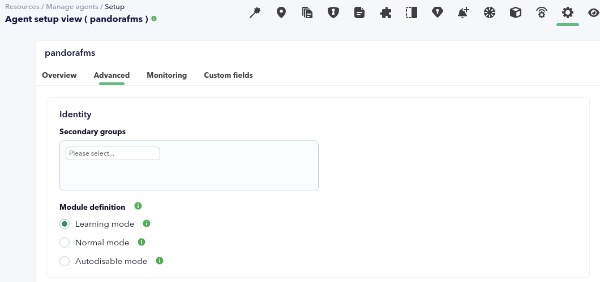{ .captura }

| Mode | What it does with the XML |
|---|---|
| Learning mode (default) | It creates the new modules and updates the agent data (IP address, interval, operating system and EndPoint version, custom fields) and the configuration of the modules that already exist, except those that come from a policy. |
| Normal mode | It only processes data from modules that already exist: the new ones are discarded and the agent data the XML sends does not overwrite the console ones. |
| Self-disabled mode | Same as learning, but the server disables the agent when all its modules (not counting the asynchronous ones) go to unknown, and it enables it again as soon as new data arrives. Intended for machines that appear and disappear. |

It is the first suspicion when someone adds a `module_begin` to the EndPoint,
checks that the XML comes out well and the module never appears: the agent is in
normal mode and the server, obediently, ignores it.

**Transfer: Tentacle, SSH, FTP and local.** The delivery itself is done by an
external program that the EndPoint launches against the `.data` file, according
to `transfer_mode`: all three EndPoints accept the four modes (`tentacle` by
default, `ssh` with `scp`, `ftp` and `local`, a file copy for when the EndPoint
runs on the same machine as the server) with the same repertoire in Go, Perl and
Windows.

!!! note "Tentacle, the default mode"
    `tentacle` is the one the installation templates bring, and its client
    travels in the EndPoint package itself; `ssh` and `ftp` depend on the
    machine having `scp` or an FTP client.

With Tentacle, two tokens activate client options: `server_ssl 1` adds `-c`
(encryption) to the `tentacle_client` call, and `server_pwd` adds `-x <key>`
(password shared with the server). Both translate the same way in the three
EndPoints.

**The XML buffer.** If the delivery of the cycle fails (server down, network
cut), by default the EndPoint throws that XML away: the next round generates a
new one and the lost datum does not come back. `xml_buffer 1` changes that
policy: the `.data` file that could not be sent stays in `temporal` and the
EndPoint tries to send it again, together with the one from the next round, on
the following cycle. The policy is applied equally in Go, Perl and Windows, with
the same three limits, all with the same default value (`1024`, in the sense each
one indicates):

| Token | Limit |
|---|---|
| `temporal_min_size` | Minimum free megabytes on the `temporal` partition; below that, nothing new is stored in the buffer. |
| `temporal_max_files` | Maximum number of `.data` files accumulated in `temporal`. |
| `temporal_max_size` | Maximum megabytes occupied by those files altogether. |

With `xml_buffer 0` (the default value) these three limits are not even checked:
the EndPoint accumulates nothing that cannot be sent on the spot.

**`debug`, again.** It already came up in
[Essential parameters of pandora_agent.conf](#essential-parameters-of-pandora_agentconf):
with `debug 1` the delivery does not change (the datum goes out the same, cycle
after cycle) but the EndPoint stops checking remote configuration and
collections on every round and keeps each `.data` sent with the `sent` suffix
instead of deleting it, so that it can be reviewed afterwards.

**`autotime`.** By default, the EndPoint puts the local time of the machine it
runs on in the XML (`timestamp`). With `autotime 1`, that attribute disappears
from the XML and it is the server that puts its own reception time when
processing the datum. It is useful for EndPoints on machines whose clock is not
to be trusted (a badly synchronised virtual machine, a device with no NTP) and
that, otherwise, would generate data with a shifted timestamp. The behaviour is
identical in the three EndPoints.


## Feature comparison between EndPoints

Before installing a specific EndPoint on a machine, it is worth having at hand
what it is capable of doing and what it is not. The table summarises by feature,
not token by token; that is in the
[full EndPoint configuration reference](../parte-9/9.1-referencia-completa-de-configuracion-del-endpoint.md),
which details each token one by one with its exact compatibility.

| Feature | Go | Perl | Windows |
|---|---|---|---|
| Basic native modules (CPU, memory, disk) | Yes | Yes | Yes |
| Unix process modules (`module_proc`/`module_service` yes/no, `module_cpuproc`, `module_memproc`, `module_occupiedpercentdisk`) | Yes | Yes | No |
| Windows service and process with asynchronous mode and watchdog | No | No | Yes |
| WMI, performance counters, event viewer, PowerShell | No | No | Yes |
| Native network checks (`module_ping`, `module_tcpcheck`, `module_snmpget`) | No (with `module_exec`) | No (with `module_exec`) | Yes |
| `module_exec` | Yes, first line of the output | Yes | Yes |
| Local plugins (`module_plugin`) | Yes | Yes | Yes |
| File collections | Yes | Yes | Yes |
| Remote configuration | Yes, only `tentacle` and `local` | Yes, the four transfer modes | Yes, the four transfer modes |
| Precondition, condition, intensive, `module_crontab`, `module_absoluteinterval` | Yes | Yes | Yes |
| Broker mode | Yes | Yes | Yes, without asynchronous modules on broker agents |
| Proxy mode | Yes | Yes | Yes |
| Secondary server | Yes | Yes | Yes |
| UDP server (remote actions) | No | Yes | Yes |
| `module_regexp` | Yes | Yes | Yes, also with `module_noseekeof` |
| Transfer modes of the data XML (`tentacle`, `ssh`, `ftp`, `local`) | All four | All four | All four |
| XML buffer (`xml_buffer`) | Yes | Yes | Yes |


## Troubleshooting

Most problems with an EndPoint come down to one of these checks, in the order in
which they are best done.

1. **Does the agent appear in the console?** If nothing appears, check
   `autocreate` on the server (see
   [First steps with a freshly installed EndPoint](#first-steps-with-a-freshly-installed-endpoint))
   and that the EndPoint reaches the server: the Tentacle port (`41121` by
   default) has to be reachable between the two machines.
2. **Is the configuration file the one you think?** With remote configuration
   active, a change made by hand on the machine may end up overwritten by the
   server on the next cycle if the MD5 does not match (see
   [Remote configuration from the Web console](#remote-configuration-from-the-web-console)).
   Compare the local file with the one the console shows before taking a change
   for lost.
3. **Does the plugin or the `module_exec` have the right permissions and path?**
   A plugin of your own or a script outside the plugins folder needs the full
   path, and the file needs the execute permission (`chmod 755` on Linux and
   Unix).
4. **Are the output and the exit code the ones the EndPoint expects?** Run the
   command or the plugin by hand, in the same account the EndPoint runs with,
   and check two things: that the exit code is `0` (if it is not, the EndPoint
   discards the datum even if it has written something good) and that the
   output is exactly what is expected (a single value for `module_exec`, a
   complete and valid XML for a plugin). To check the XML of a plugin, `xmllint`
   is more reliable than looking at it by eye. Since a plugin writes one or
   several loose `<module>` elements, with no root element, they have to be
   wrapped before validating them:

    ```bash
    (echo "<plugin>"; ./mi_plugin; echo "</plugin>") | xmllint --noout -
    ```

5. **Debug mode.** With `debug 1` (see
   [Essential parameters of pandora_agent.conf](#essential-parameters-of-pandora_agentconf)),
   each `.data` sent is kept with the `sent` suffix in the `temporal` folder, so
   it can be opened to check exactly what each module or plugin generated that
   cycle, without waiting for it to reach the console.
6. **The EndPoint log.** On Linux and Unix,
   `/var/log/pandora/pandora_agent.log` by default (`logfile` in
   `pandora_agent.conf`); on Windows, `pandora_agent.log` in the installation
   folder, and `pandora_debug.log` next to it if debug mode is active.
7. **Restart the service** after any manual change to the configuration file:
   `systemctl restart pandora_agent_daemon` on Linux and Unix, `NET STOP` /
   `NET START PandoraFMSAgent` on Windows (see
   [First steps with a freshly installed EndPoint](#first-steps-with-a-freshly-installed-endpoint)).
8. **Run the EndPoint by hand, without the service.** Each EndPoint has its own
   way of running outside the service, useful to see the messages as they
   happen: the Go EndPoint accepts `pandora_agent --once /etc/pandora` for a
   single collection and delivery cycle; the Windows EndPoint accepts
   `PandoraAgent.exe --process` to run as a user process instead of as a
   service, and `--test-ssh` / `--test-ftp` to test those two transfer modes
   separately with the current configuration.

!!! tip "EndPoint permissions, not just the plugin's"
    On Linux, the `pandora_agent_daemon` service runs as `root` unless
    `pandora_user` is set in the configuration; on Windows, the service runs as
    `SYSTEM`. A command that works in an interactive terminal may fail inside
    the EndPoint if it depends on environment variables or permissions that only
    the user who opened that terminal has.

For what is not specific to the EndPoint (server, Web console or other component
errors) there is the
[general troubleshooting guide](../parte-9/9.13-troubleshooting-con-pandora.md).
