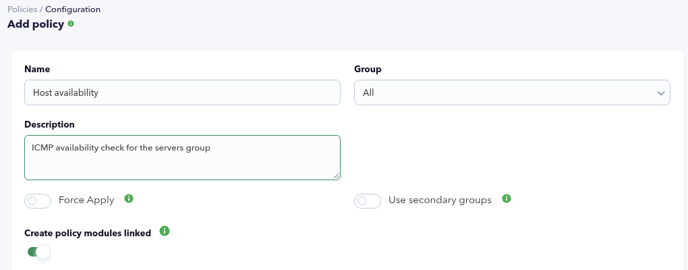
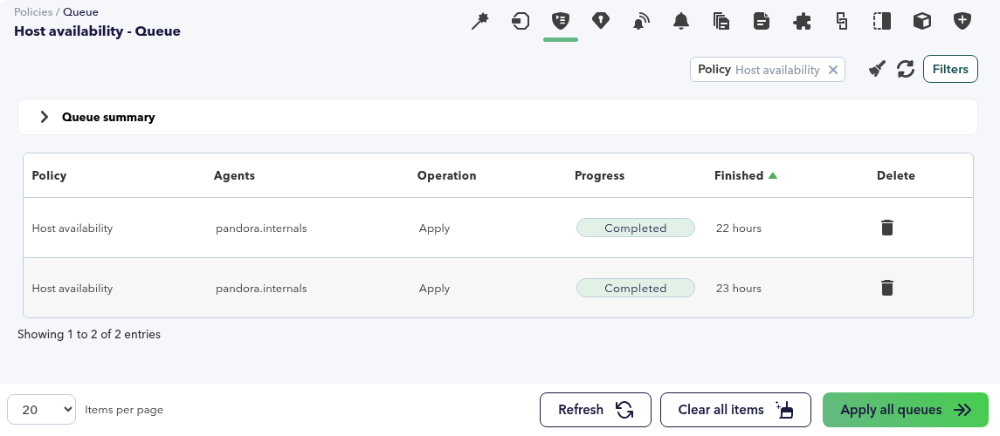
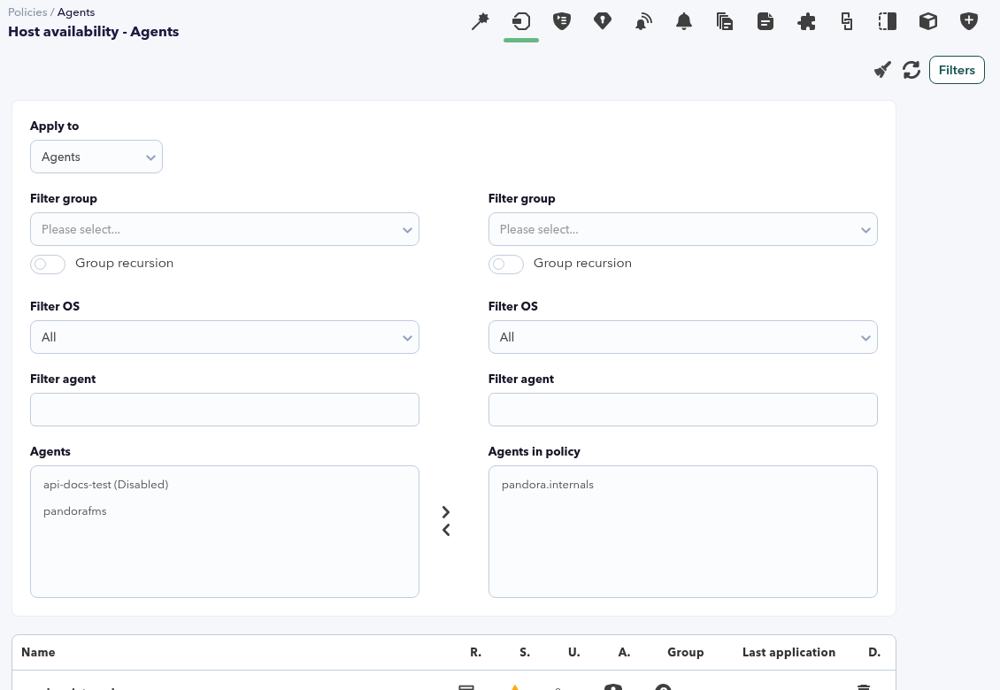
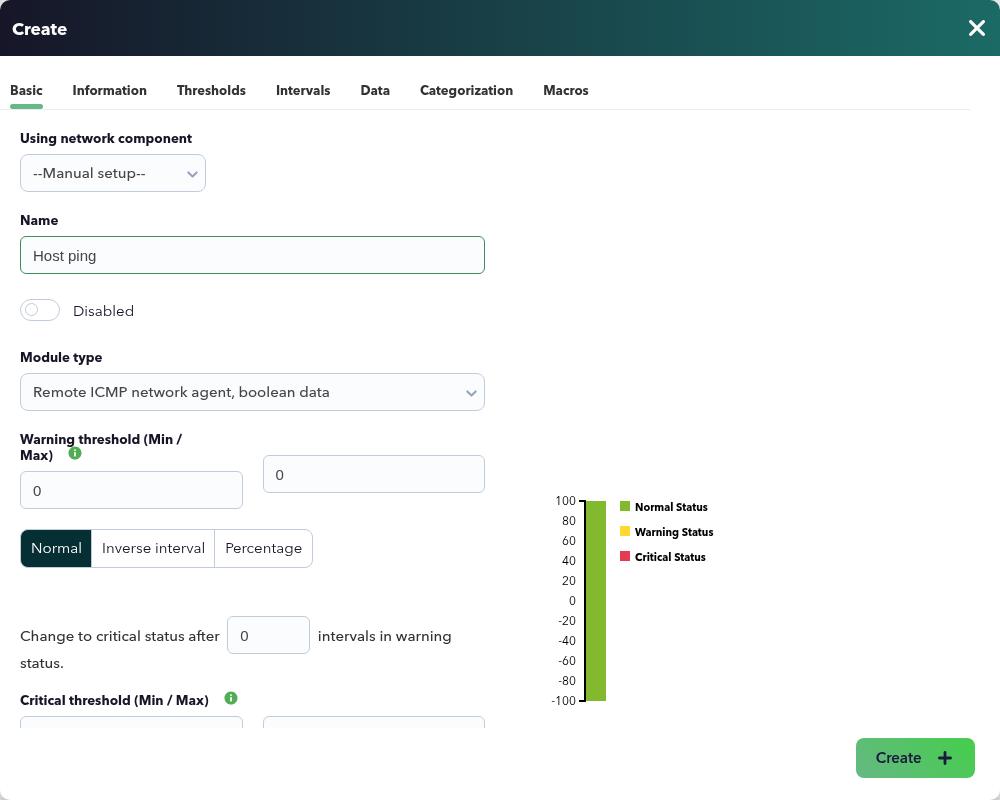
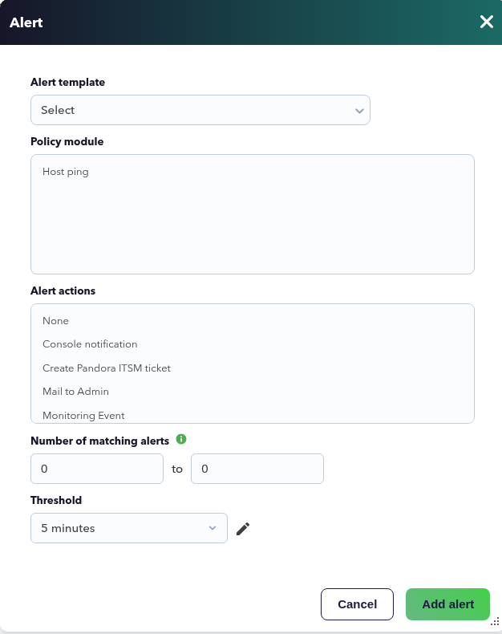
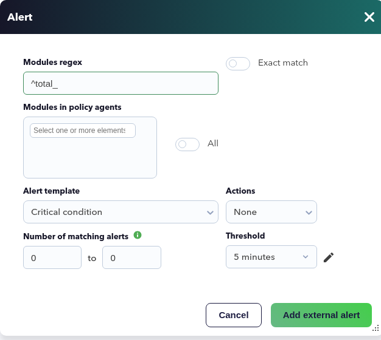
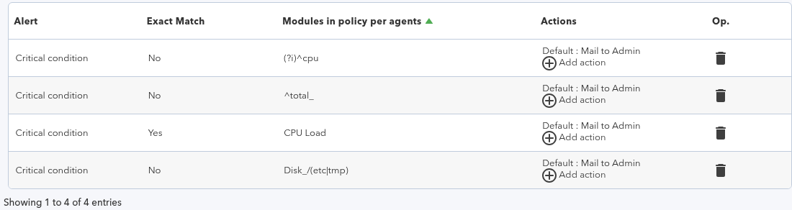
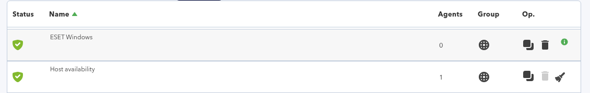

# Monitoring policies

An availability module configured by hand on twenty agents means twenty changes
the day the monitoring criteria change. A policy lets you define it once,
attach the targets and request its application. Saving is not enough: the
change has to be queued, and you have to check that the server has applied it.

## 2.10.1 What a policy solves and what stays outside

A policy groups configuration shared by several agents: modules, alerts,
plugins, collections and other elements managed from its tabs. You define it
once, associate it with agents or groups and apply it; the server then creates
that configuration on each target.

**A use case.** A company wants to watch the availability of all its web
servers with ping, and they are in the "Web" group. Without a policy, it would
have to create the ICMP module on every agent and repeat the operation for each
new server. With a policy, the work is this:

1. Create the policy and define a single ICMP availability module in it.
2. Associate the "Web" group instead of the agents one by one.
3. Request the application, and the server creates the module on every agent in
   the group.

From then on the policy keeps working on its own. When a server joins the
group, the server detects it in a later reconciliation and applies the policy
without anyone intervening. When the module's threshold has to change, you edit
it once in the policy and apply again. And if one particular server needs a
different threshold, you unlink its module and it keeps its own configuration
without leaving the policy. Sections
[2.10.3](#2103-associating-agents-and-groups) and
[2.10.4](#2104-policy-modules-and-per-agent-exceptions) explain each step.

**When to use it.** A policy is the tool for a common change that must be kept
on the targets as they join and leave. It is not meant for everything:

| Need | What to use |
|---|---|
| Common, persistent configuration for a set of agents | A policy |
| Configuration specific to a single agent | Edit that agent, or an unlinked-module exception |
| A one-off change on many existing agents | [Bulk operations](2.11-operaciones-masivas.md) |

Bulk operations act once on the selected agents: they do not watch who joins
afterwards and do not replace this persistent association.

**What it does not do.** A policy does not turn editing one agent into an
instant operation on all the others. Neither creating the module nor selecting
the group proves by itself that monitoring is already running: the queue shows
the requested work, and the module on the agent and its data let you check the
result. When the configuration has to reach the machine, its EndPoint and the
remote configuration come into play as well.

## 2.10.2 Creating, applying and withdrawing a policy

In the web console, from **Management → Resources → Manage policies**, you
create a policy and give it a name and a group. The form also lets you add a
description and set **Force Apply**, **Use secondary groups** and **Create
policy modules linked**. The last option decides whether the *new* modules
created by the policy on the agent are born linked; it does not automatically
link the modules that were already there and are adopted. **Force Apply**
offers to force module creation even when the EndPoint has no remote
configuration; in addition, a configuration file that cannot be read or written
does not raise the error event or block the application. Do not mistake it for
a guarantee that configuration reaches
the machine without that requirement.

A policy does nothing until it is applied. After creating it, the work always
follows the same four-step cycle:

1. **Define.** In **Modules** you define the availability module, and in
   **Agents** you add an agent or a group. Saving leaves the change pending
   application, and the **Agents** tab flags it as such. Nothing has run on any
   machine yet.
2. **Request the application.** It is queued from an agent's row, from a
   group's row or, for all targets at once, with **Apply all queues**. None of
   the three is instant: each one only adds an operation to the queue.
3. **Wait for it to finish.** In **Queue** each row is an operation, with its
   policy, the agent, the type of operation, the progress and when it finished.
   The queue stays empty until an application is requested.
4. **Check the result.** Review the application status in **Agents** and the
   module created on the target agent. A queue entry marked as completed does
   not prove that the module works, and if it stays incomplete or the module
   does not appear, applying again is not a check: you have to find out why.

Before step 2 it is worth reviewing in **Agents** and **Modules** which changes
are waiting, so you do not apply blindly.

The screenshot shows two applications that have already completed. Each row can
be deleted with its trash icon, and **Clear all items** empties the whole queue.
The filters let you keep one type of operation, one agent, or only the complete
or incomplete operations.

The queue distinguishes two types of application, which are the ones offered by
the operation filter, besides **Delete**:

| Operation | What it does |
|---|---|
| **Apply (database and files)** | Applies the policy in full: updates the console and writes the configuration on the machines |
| **Apply (only database)** | Updates what the console records, but does not guarantee that no file is written: it only conditions module deletion, and other application paths can still write configuration |

For changes that must reach an EndPoint's remote configuration, use the full
application and verify the result on the target.

When you edit the policy or mark an item for withdrawal, the cycle repeats:
save, review pending items, queue, wait and check. If you withdraw an agent,
the **Agents** tab lets you mark it as pending removal and undo the mark before
applying. The server processes the withdrawal and cleans up the association:
adopted modules keep existing, linked modules created by the policy are
removed, and unlinked modules, already detached from the definition, may
remain. The policy alerts assigned to those modules and the inventory modules
the policy had assigned to the agent also disappear. Check the agent after the
operation: cleaning up its files does not
always complete. Deleting the whole policy is explained in section [2.10.12](#21012-searching-duplicating-importing-exporting-and-deleting-policies).

## 2.10.3 Associating agents and groups

The **Agents** tab of the web console distinguishes two origins of assignment.
When you select an agent and add it directly, the association is recorded as
pending application. In the list you can check its status and, if you mark it
for withdrawal, it stays pending until the next processing; the mark can be
undone before then. The queue lets you follow the operation requested for that
agent.

For the availability module example, you can add a direct agent first and apply
the policy. Then, in **Apply to**, select **Groups**, add the group of machines
and queue the group's application. The group's «pending» status is not the same
as an active rule: the server only reconciles agents of groups whose association
shows as applied. So first check that the group appears as applied, then verify
the queue and the modules of the agents that belong to it.

The **Use secondary groups** option includes agents that belong to the selected
group as a secondary group, in addition to those that have it as their primary
group. It is not the same as automatically selecting every child group: when
you add a group, recursive selection of descendants is a separate operation that
records those groups individually. For example, if the group «Services» has a
subgroup «Web», selecting only «Services» does not mean «Web» has been
associated. In contrast, an agent with «Services» as a secondary group can join
through that association if the option has been enabled.

Once the group association is applied, the server's reconciliation compares the
group's current agents with those associated that way. When a new one joins, it
adds its association and queues its application; when one leaves, it marks the
withdrawal and queues the corresponding removal. A later addition is not
instant: check both the queue and the module on the new agent. If an agent was
also associated directly, the reconciliation keeps the direct assignment when
it leaves the group.

## 2.10.4 Policy modules and per-agent exceptions

In the **Modules** tab of the web console you choose the type, open its form
with **Create** and save the definition in the policy. For the example, select
**Network ICMP module** and define an availability check before applying to the
targets. Unlike creating the module on a single agent, here it is defined for
the agents associated with the policy. The fundamentals of local and network
modules are explained in
[Monitoring with EndPoints](2.1-monitorizacion-con-endpoints.md) and
[Network monitoring](2.6-monitorizacion-de-redes.md).

The selector also includes modules for EndPoint, TCP, SNMP, WMI, remote
execution, web, prediction, query and customization through API, plugins and
user experience, depending on the available servers. It also offers Satellite
server ICMP, SNMP, WMI, SSH, execution and TCP. You choose the type before
saving the policy definition; Satellite modules only apply to compatible
targets: the server skips a Satellite module for an agent without Satellite
configuration.

Editing a module in **Modules** leaves the policy pending application. The
delete icon marks it for withdrawal, and you can undo it before the next
application. When you apply, check the specific module on each affected agent.
If you rename a module and the new name already exists on an agent, the match
may change which module is adopted or withdrawn: before renaming, review the
matches on the targets. Do not take a name match as proof that both definitions
are interchangeable.

The relationship of each module with the policy has two independent axes:

| Axis | What it indicates | Effect when applying |
|---|---|---|
| Linking | Linked or unlinked from the common definition | A linked module follows changes; an unlinked one keeps its individual settings |
| Origin | Created by the policy or adopted because it already existed on the agent | An adopted module is kept and detached when the definition is withdrawn; a module created by the policy can be deleted |

A new module is born linked or not depending on **Create policy modules
linked**. A pre-existing one with the same name and a compatible type can be
adopted: it is born **unlinked** to preserve its individual configuration, even
if the policy has linked module creation enabled. «Adopted» is not a third
linking state. If the type does not match on the normal adoption path, the
server skips that module instead of converting it. The comparison is made by
module family (EndPoint, network, plugin or prediction), not by exact type. An
adopted module keeps its own configuration intact (port, target IP, plugin
parameters, SNMP community): the policy does not overwrite it.

When you apply again, a linked module recovers the policy definition and loses
the edits made on the agent; an unlinked or adopted module keeps its own.
Renaming a policy module has an effect worth knowing: if the new name matches an
agent module and that module is adopted, the module the policy had created
under the previous name is deleted. Unlinking a module has another: its policy
alerts stop belonging to the policy and become ordinary agent alerts.

In the module list you can disable and enable modules without deleting them,
duplicate them, delete them in bulk and copy them to another policy; the copy
skips those that already exist with that name in the destination and reports
that it was partial. The state propagates on the next application. Creating an
EndPoint module marks the policy for updating both the database and the agent's
configuration files; the other types only change in the console.

To keep an exception on one agent, unlink its availability module there. That
change goes through a pending state and requires applying the policy again.
While the module stays unlinked, do not expect later edits of the common
definition to reach it. To return it to the definition, the policy's **Linking**
tab lists the unlinked modules per agent: select the module and press **Link**;
then check its application in **Queue** and on the agent. Linking again also has
a pending state. If you undo a transition that is still pending, the state can
return directly to the previous one without waiting for another application.

When the module definition is withdrawn, the server detaches the adopted module
without deleting it and removes the one created by the policy. When an agent is
withdrawn the same happens, and unlinked modules stop pointing to that
definition. Check the result per agent: a name match with another policy or a
failure while updating the configuration can alter what you observe.

## 2.10.5 Policy inventory modules

The **Inventory modules** tab of the web console assigns to the policy a remote
inventory definition already available in the system. It does not create a
local `module_inventory` block on each EndPoint: that block belongs to the
configuration of local modules, whereas here you prepare a definition that the
server associates with the target agents.

Press **Add**, choose the inventory module from the list organized by operating
system, set the interval and enter the credentials the inventory type requires.
The form accepts custom fields when they are enabled. You must choose an
available module and check that the target meets its access conditions;
associating it with the policy does not install tools or grant credentials on
the queried machine. The same inventory module cannot be added twice to the same
policy.

From the list you can edit the interval, the credentials and the custom fields,
or mark the module for withdrawal and undo that mark. When editing, check the
values of the custom fields before saving; do not assume the form retrieves the
previous ones. Editing does not change the selected module type. After saving,
review the operation in **Queue** and apply the policy. The server creates or
updates the remote inventory assignment of each agent; if it was marked for
withdrawal, it removes that assignment. Check on the agent that the inventory
definition is present and, after it runs, that data arrives. The presence of the
definition does not prove that the remote query worked. General inventory
management is in chapter [3.1](../parte-3/3.1-inventario.md).

## 2.10.6 SNMP, SNMP interfaces and WMI wizards

In the web console, the policy's **Agent wizard** submenu offers three entries:
**SNMP Wizard**, **SNMP Interfaces wizard** and **WMI Wizard**. All of them
explore a target given in the form, present candidates and let you create module
definitions in the policy. They do not automatically explore every agent when
the policy is saved: you first select the results, then create the modules and,
separately, apply the policy to its targets.

- **SNMP Wizard:** you give the device IP, the server that will run the query,
  the port and the SNMP version. You provide the community or, for SNMPv3, the
  corresponding authentication and privacy credentials. The exploration queries
  the available remote components and shows the compatible results so you can
  choose which modules to create. If there are no results, check connectivity,
  credentials and components before insisting on creation.
- **SNMP Interfaces wizard:** uses the SNMP connection parameters to discover
  the interfaces of the chosen device. It lets you filter by interface and by
  operational or administrative status, and select the interface modules you
  want to add. If no interfaces appear, there is no valid selection to apply
  just because you are on the policy tab.
- **WMI Wizard:** you give the IP, the query server, the namespace and the WMI
  credentials. You can also import visible credentials from the store. You run
  the query and select the results of the WMI components before creating the
  modules.

The wizard shares its interface with the one for a single agent, but its save
path is different: when opened from a policy, **Create modules** inserts the
selected modules into **Modules** of that policy. A name that already exists
there can prevent that candidate from being created. Review the policy's module
list first, then **Queue** and, after applying, the specific modules of the
assigned agents. Modules are created with a 300 s interval and the module group
chosen in the wizard; edit them afterwards in **Modules**. Plugin or WMI modules
point to each agent's own address, not to the explored IP. Exploring one IP does not guarantee that the credentials, the
target address or the module type will later work on all of them.
[Network monitoring](2.6-monitorizacion-de-redes.md) explains SNMP and WMI;
[appendix A4](../anexos/a4-ampliar-los-asistentes-snmp-y-wmi-con-componentes-propios.md)
explains how to extend the wizards' component catalog.

## 2.10.7 Alerts and external alerts

A policy assigns alert templates in two ways, on two different tabs. **Alerts**
points at modules that the policy itself defines in **Modules**. **External
alerts** points at modules that already exist on the policy's agents and
identifies them by name. In both cases the policy only *assigns* things that already
exist: the template, which defines when the alert fires, and the actions, which
define what happens when it does (for example, sending an email or running a
command). An alert can carry several actions, each with its own firing range
and threshold. Templates, actions, notifications and escalation are designed
separately, in chapter [5.5](../parte-5/5.5-alertas-y-notificaciones.md).

They are two similar tools with different purposes. They are explained
separately, and what they share is gathered at the end.

| | Alerts | External alerts |
|---|---|---|
| Target module | One defined in the policy's **Modules** | Any module of the policy's agents whose name matches |
| Unlinked module | The alert is not applied | The alert is applied anyway |
| Enable, disable or set standby | Yes | No |
| Changing the template or the module | Withdraw the alert and create another | Withdraw the entry and create another |

### Alerts on policy modules

**When to use them.** When the alert goes with a module that the policy itself
creates. For example, the availability policy defines the ICMP module
"Host ping" and wants to raise an alert when it fails: the down-alert template
is assigned to that module, and every agent that receives the module receives
the alert too.

In **Alerts**, the **Add** button opens a window
with the template, one or more policy modules (**Policy module**), the actions
(**Alert actions**, multiple selection) and two execution settings. The
template is required: without it the console rejects the request. If you pick
several modules, one alert is created per module, and the console lists those
left without an alert because they already had one with that template in the
policy.

If no action is chosen, the alert uses the template's default action and the
list shows it as «Default». When actions are chosen, two settings control when
they run:

- **Number of matching alerts** sets on which consecutive firings of the alert
  the action runs: `0` and `0` means always; the same number N in both fields,
  only on firing N; `0` and M, up to firing M; N and M, from firing N to M.
- **Threshold** is the minimum time between two executions of that action. The
  default is five minutes.

You can later add more actions from the policy list with **Add action**, each
with its own values, or remove them with their delete icon. The console also
lets you enable, disable or set an alert on standby, and mark it for
withdrawal; the mark shows as strikethrough in the list and can be undone
before applying. It is not a form for editing the template from the policy.

**On application.** The server looks in each agent for the module tied to that
definition and creates or updates its alert if the module is **linked**, with
the enabled, disabled or standby state it has in the policy. It skips the alert
on an unlinked module and cannot attach it to a module that does not yet exist
on the agent. So check the module first and then the alert and its actions on a
target agent, not just the policy's alert counter.

### External alerts

**When to use them.** When the alert must reach modules that the policy does
not define: those that already exist on the agents, created by hand, by a
wizard or by another policy. For example, every disk module of a mixed estate,
without creating a module in the policy for each one. The policy does not know
those modules: it finds them by name, which is why how names are compared is
the most important thing on this tab.

In **External alerts**, the **Add** button opens a window with two ways of naming the modules, which can be
combined in the same request:

- **Modules regex**, next to the **Exact match** switch: a module name or an
  expression to find several.
- **Modules in policy agents**: the list of module names that the policy's
  agents have, with multiple selection and the **All** switch. Each chosen
  name is saved as an entry with exact matching.

The template, the actions, the firing range and the threshold work as in
**Alerts**. Each text typed in **Modules regex** and each name chosen in the
list produce an entry of their own on the tab.

**How names are compared.** With **Exact match** on, the module name must be
identical to the text given, letter by letter and case-sensitive; there are no
wildcards. With the switch off, which is how the form opens, the text is read
as a Perl regular expression and the alert reaches every module whose name
satisfies it. Three rules avoid surprises:

- **The expression is not anchored.** It matches anywhere in the name: `cpu`
  also finds `System_cpu_load`. To narrow it down, use `^` at the start and `$`
  at the end.
- **It is case-sensitive.** `cpu` does not find a module called `CPU Load`. To
  ignore case, prefix it with `(?i)`.
- **Special characters keep their usual meaning** (`.`, `*`, `(`, `|`, `[`,
  `$`). To look for a literal name that contains them, the simplest route is to
  turn **Exact match** on.

With an agent that has the modules `CPU Load`, `Disk_/`, `Disk_/etc/hosts`,
`Disk_/tmp/pandora_code` and nine modules whose name starts with `total_`,
these texts give the following results:

| Text | Exact match | Modules that receive the alert |
|---|---|---|
| `CPU Load` | On | `CPU Load` |
| `^total_` | Off | The nine `total_…` modules |
| `cpu` | Off | None: `CPU Load` has its letters in capitals |
| `(?i)^cpu` | Off | `CPU Load` |
| `Disk_/(etc|tmp)` | Off | `Disk_/etc/hosts` and `Disk_/tmp/pandora_code`, but not `Disk_/` |

An invalid expression, such as an unclosed parenthesis, is not rejected on
saving: the console accepts it and the server applies it to no module; it only
leaves a trace in its log at a high verbosity level. If an external alert
reaches no module, check the expression first. A policy also does not keep two
entries with the same template and the same text, whether or not **Exact
match** is on: if you need several criteria for one template, combine them in
a single expression, such as `^(web|app)_`. Check in the list that the new
entry has appeared.

The list shows the template, whether matching is exact, the text, the actions
and the withdrawal operation; you can filter by template, by module name and
by action. You can add or remove actions and mark the entry for withdrawal, or
undo the mark, but you cannot edit its text or its template: to change the
criterion, prepare another entry and withdraw the old one.

**On application.** The server compares each entry with the
modules of the agents assigned to the policy at that moment, whether linked or
not, whether the policy created them or they already existed, or they come from
another policy; it leaves out those marked for deletion. On each module that
matches it creates the alert if it does not have one. A module that appears
later on the agent and satisfies the expression does not receive the alert
until the next application. A name present only on another agent does not
create a new module.

### What they have in common

On every application, the alert's actions on the agent are replaced by the
policy's, both in **Alerts** and in **External alerts**: an action added by
hand to that alert on the agent disappears. When a withdrawal is applied, the
server removes the alert from every module that had matched. When several
policies can act on the same module, check the result on the agent: there is no
universal precedence. After applying, check which specific modules received the
alert and that their actions are the expected ones.

**Limits and permissions.** While an application is in progress, the console
does not allow adding or withdrawing alerts or actions and shows «This policy is
applying and cannot be modified». An administrator with the **AW** permission
sees all templates and actions; other users see only those of the groups where
they have alert write permission (**LW**). When adding, the console warns once
the policy already has 1000 alerts (250 for external alerts) that exceeding
that amount has a serious impact on performance. As a rule of thumb, one
well-bounded expression replaces many separate entries.

## 2.10.8 EndPoint plugins in a policy

The **Agent plugins** tab of the web console stores configuration blocks that
will end up on the EndPoint. Use **Add** to set the execution command, the
timeout, the normal or absolute interval and, when needed, additional module
options. You can then edit the block, disable or enable it, or mark it for
withdrawal and undo that withdrawal. Disabling comments out the configured
block; it does not delete the executable.

This is not the same as creating a **Plugin module** in **Modules**: that is a
module defined in the policy for the console's agents; **Agent plugins** adds a
`module_plugin` directive to the remote configuration that the EndPoint reads.
The distinction matters before you look for a result: in the second case you
must check the configuration block and the execution on the machine, as well as
the data received by the agent.

With the **Absolute** interval, the additional options must include
`module_name`; without it, the form does not save.

Creating a plugin or marking it for withdrawal leaves the policy pending
application; editing, enabling or disabling it does not, so queue the
application by hand from **Queue**. The server includes the plugin blocks not
marked for withdrawal when it writes the target's remote configuration. A
disabled plugin is still written to that configuration, but commented out. On
the EndPoint, check that the command points to an executable that is really
available and that the module produces data. The policy distributes the
*configuration*, not the binary the command needs. To distribute a file you can
associate a [collection](2.9-colecciones.md), which has its own publishing and
synchronization cycle. Configuring a single EndPoint is explained in
[Monitoring with EndPoints](2.1-monitorizacion-con-endpoints.md).

## 2.10.9 Collections associated with the policy

A collection that has already been created and published is added in the
policy's **Collections** tab from **Collections to add**. After you press the
add icon, it appears in **Collections in policy**. That association marks the
policy for application; it does not republish the collection package. In both lists, an icon shows
whether the collection is up to date or outdated; the policy does not block the
application because of it, so check it before applying. Only collections from
groups where you have the **AW** permission are offered, and the policy cannot be
modified while it is being applied. Its creation, publishing and synchronization
are explained in
[Collections](2.9-colecciones.md).

Review **Queue** and apply the policy. The server adds the collection reference
to the agents' remote configuration; the EndPoint uses that reference to check
the package and download it when appropriate. The queue status confirms that
the policy was applied, not that every machine has already received the package:
verify the collection on a target EndPoint and its synchronization status.

To withdraw it, use the delete icon in **Collections in policy**; the entry is
marked and you can undo the mark before applying. Then check that it disappears
from the agent's remote configuration. Immediate deletion of local files is not
promised: cleanup depends on the EndPoint's cycle and conditions. The
performance notice shown when adding many collections is an interface warning,
not an operating limit to be taken as a requirement.

## 2.10.10 Log collection modules

The **Module log collection** tab of the web console defines which logs the
policy's EndPoints will read. In **Add**, choose **Log file** to give the file
path and, where relevant, the source type, the search pattern and the exclusion
pattern. **Windows event channel** uses an event channel or source and lets you
filter by type, code and pattern. You give the module a name and decide whether
it is enabled. File mode generates a file-reading definition; channel mode
generates a Windows events one: they are not interchangeable sources.

The list separates file modules from Windows event modules. From it you can
edit, enable or disable, and mark for withdrawal; a pending withdrawal can be
undone. Saving the form records the block in the policy, but the create and edit
path does not by itself mark its application status. Open **Queue**, queue the
application and wait for processing instead of reading the «created» notice as
«delivered». The same goes for withdrawal: the «deleted» notice only means the
module is marked, and it does not disappear from the EndPoint until the policy
is applied.

The server adds the log collection blocks not marked for withdrawal to the remote
file; when a withdrawal is applied, it stops including the block. On a target
EndPoint, check the received configuration, that the indicated source exists and
that log entries arrive after the execution cycle. Event channel support is
specific to Windows EndPoints. Defining this module from a policy also does not
replace preparing the system that receives and stores logs. The general
explanation is in chapter [2.19](2.19-recoleccion-y-monitorizacion-de-logs.md).

## 2.10.11 FIM from a policy

In **File Integrity Monitoring** of the web console there are two controls that
must not be confused. **Apply FIM from this policy** lets this policy take part
in FIM for its targets; **Enable FIM** determines whether the tracking
configuration is active. With both enabled, you set the files to watch and,
depending on the case, the depth, the maximum number of files per directory, the
maximum size, the excluded extensions and the cache time. Save with **Update**,
review **Queue** and apply.

The server first checks whether the policy must apply FIM and then the
activation value. If both allow tracking, it generates a separate remote FIM
configuration for each agent and its integrity check; if FIM is applied but
disabled, it follows another path that disables the FIM module on that agent.
Clearing **Apply FIM from this policy** stops associating the policy with FIM on
the agent and discards the FIM configuration saved in the policy, but it does
not touch the agent's FIM files or disable its module: it should not be
presented as a guarantee that any previous local configuration is deleted.
Enabling FIM only re-enables the FIM module the agent already has; the policy
does not create it. The files to watch are entered one per line.

To check the result, review the queue first and then, on a target EndPoint with
remote configuration, the received FIM configuration and the module that runs
the tracking. The EndPoint also needs the FIM executable available; receiving a
definition does not install it. The Unix, Go and Windows EndPoint consumers read
the remote configuration and tell whether tracking is enabled, but a download or
execution failure can prevent results even when the queue has finished. If the
machine already has another FIM configuration, verify in that specific case
which one applies. The general explanation of FIM is in chapter [7.6](../parte-7/7.6-fim.md).

## 2.10.12 Searching, duplicating, importing, exporting and deleting policies

The **Manage policies** list of the web console lets you search by part of the
name, filter by group and extend that filter to descendant groups with
**Recursion**. It also shows each policy's status: up to date, pending database
changes, pending full application or with an operation in progress. The list
indicator does not replace checking **Queue** and the agents. Copying, deleting
and purging require **AW** on the policy's group and only appear where
management is allowed. If a user does not
see an expected policy, also check their access to the group: the list is
limited to the groups they can manage. The list filter queries the definitions
of the console where it is opened: under centralized management, those of
Command Center; on a non-centralized node, those of that node. Do not confuse it
with the global search in the header or expect aggregated results from all
nodes from this filter.

The **Copy** icon in the list creates another definition with a name derived
from the original. It copies the general settings, modules and the alerts tied
to them, external alerts, collections, EndPoint plugins and log collection
modules. It does not copy the agents, the assigned groups, the remote inventory
modules or the FIM configuration. Open the copy, review each tab you need,
assign targets and apply. The copy is named «<name> copy» (or «copy (2)» and so
on if the name is taken) and it is created whole or not at all: if any element
fails, nothing is left half done and «Could not be copied» is shown. If the
original has modules, the copy appears as pending update; without agents, it has
applied nothing on any machine.

To exchange a definition as a **`.prd`** file, use **Resources export/import**:
in **Export**, choose **Policy** and the specific policy and download the file;
in **Import**, select the `.prd` and review the result of the process. Importing
requires managing the policy's group: otherwise the whole process is rolled back,
and elements in groups without permission are skipped with a notice. The
**Manage policies** list itself also offers uploading a policy `.prd` with
**Select file** and **Upload**. The importer expects data of type `policy`; it
does not accept just any file because it has that extension. The format includes
relationships for agents, groups, inventory, modules, alerts, collections,
plugins and logs, but the FIM configuration is not among the policy elements
this path exports. Some references may be missing at the destination and the
importer may skip elements: after importing, review the definition, the
associations and the queue before applying it, and do not expect a complete
restoration of the original installation.

Exported files can contain module parameters and inventory credentials. Treat
them as sensitive material: do not publish them or add them to the documentation
repository.

There is also a legacy **`.ptr`** export: it produces XML and offers to include
or not the agents. **It is not the `.prd` described above** and must not be
loaded as such in its importer. The presence of that export option does not show
that all current tabs, such as FIM and log modules, have an equivalent import
path. If you need to move a policy between environments, explicitly verify the
content of the chosen file and what appears at the destination.

The agents column does not count disabled agents or those marked for withdrawal,
but they also prevent the policy from being deleted: it can show zero agents and
still have **Delete** disabled. Deleting a policy also removes its queue
entries; in Command Center, the policy is first cleaned from the nodes.

To delete a policy that still has agents, you do not use **Delete** right away:
the list disables that action and offers **Delete all agents**. That request
queues the withdrawal of agents and groups; wait for it to finish, check in
**Queue** and on the agents that the policy stopped applying, and go back to the
list. Only when no agents remain associated is **Delete** enabled. An
application in progress also blocks editing and purge or delete requests from
that path. Deleting the definition from the console does not certify that each
EndPoint has cleaned up its files: inspect the targets before considering the
withdrawal finished.

## 2.10.13 Permissions and management from Command Center

Ordinary policy management in the web console requires the **AW** permission
(agent write). Access to a specific policy checks the permission on its group;
the list retrieves the policies of the groups the user can manage. To enter a
policy's page, **AW** on the general group is also checked. These checks must
not be mistaken for a universal permissions table for every operation: the
agent, module and collection forms also apply their own filters and controls.

An administrator passes all these checks. «On the general group» means **AW** on
the **All** group: a user with **AW** in only one specific group cannot open the
policy's page.

### Centralized or not centralized

Command Center can work with policies in two ways, and that decides where they
are edited. The basic difference is this:

| | Centralized management | Non-centralized management |
|---|---|---|
| Where policies are edited | In Command Center, under **Centralized management → Policy management** | On each node, in its own policy list |
| What the node shows | A read-only notice that points to Command Center | The usual management controls |
| What Command Center offers | The list and the policy's tabs, including **Queue**, with operations directed at the nodes | The **Policy Manager**, with the **Apply**, **Queue** and **Sync** tabs |
| Permission needed in Command Center | **AW** | **PM** (or being an administrator) |

In centralized mode, the node's notice is not a promise that any direct call to
the node's API is blocked: what is described here is the path through the
interface.

To apply from Command Center in centralized mode, select the policy and the
agent or group in its **Agents** tab, or use **Apply all queues** in **Queue**.
Then check the operation, the progress and the corresponding node; if one does
not respond, the queue may warn that information is missing. The policy list
also warns about nodes that have pending synchronization and operations in
their queue. Central application is not the same as simultaneous, successful
execution on every node. Check the result on the node and on a target agent,
especially if there were pending operations or connection failures.

In non-centralized mode, Command Center only distributes the application and
the queue from the **Policy Manager**; policies are created and edited on each
node.

The architecture between nodes and partial failures are explained in chapter
[6.3](../parte-6/6.3-command-center.md). Meanwhile, the queue states and the check on each target are the
operational reference.
