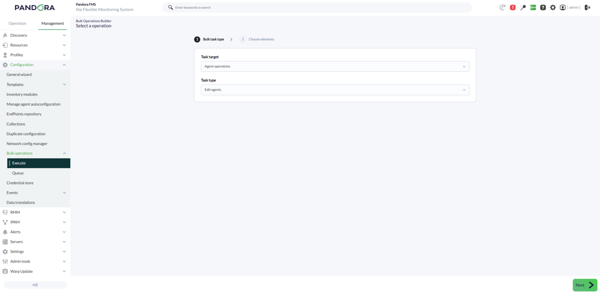
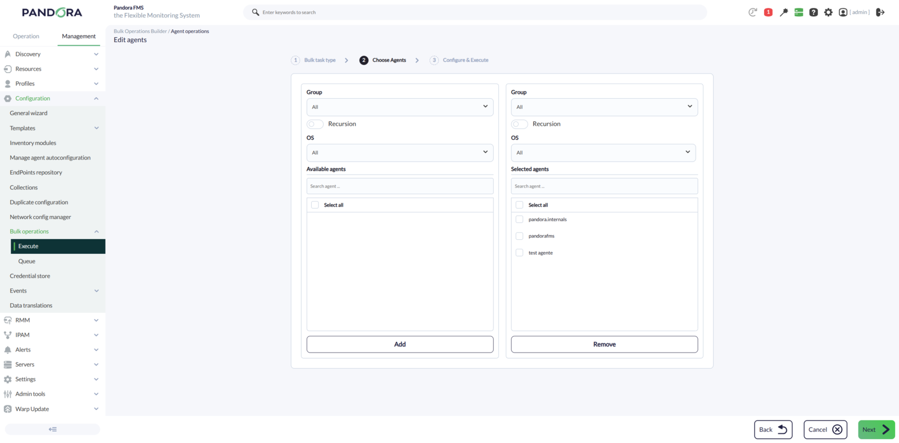
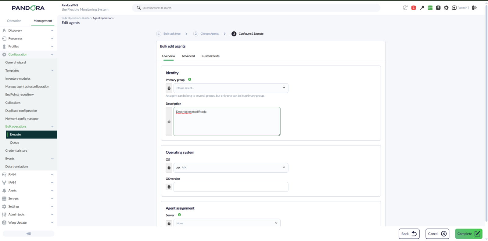
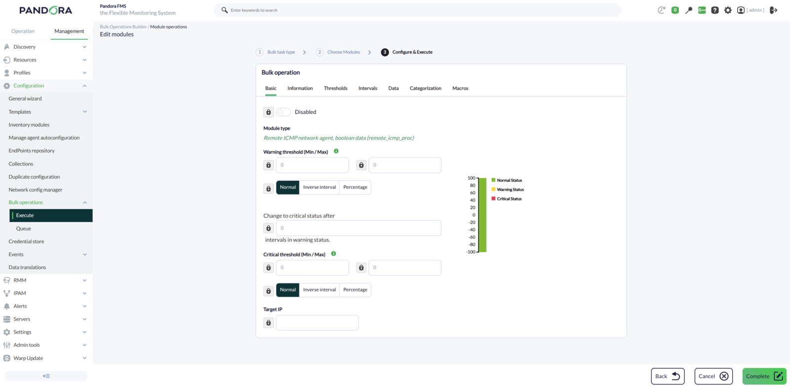
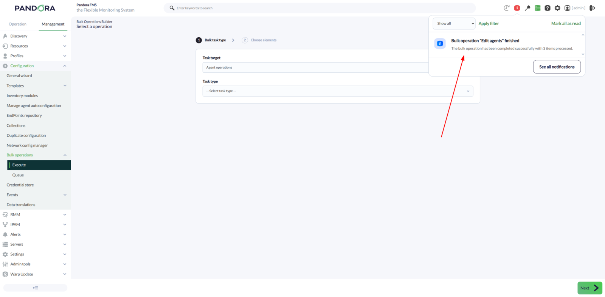

# Bulk operations

Changing the interval of one module takes three clicks. Changing it in the four
hundred `CPU Load` modules of a Linux server farm takes 1,200 clicks, a lost
afternoon and, almost certainly, a couple of forgotten modules that someone will
find six months from now wondering why that particular server runs at a
different pace. **Bulk operations** exist for this: choose once what changes,
choose once who it changes for, and let Pandora FMS do the repetitive work.

The tool has been rebuilt from scratch. Where there used to be one submenu per
element type, each with its own form and its own quirks, there is now a single
step-by-step wizard that works the same for agents, modules, alerts, policies,
users and SNMP alerts. Three ideas hold it up:

- **One wizard.** First you choose the operation, then the affected elements
  and, at the end, the changes or the confirmation.
- **One lock per field.** When editing, what is not unlocked is not touched. No
  more "leave the field blank and cross your fingers".
- **One queue.** The operation runs in the background, in batches, while the
  operator keeps working; when it finishes, it tells you.

!!! warning "A bulk delete cannot be undone"
    Deleting one hundred agents costs the same as deleting one: a button.
    There is no bin and no way back. Before confirming a delete, review the
    list of selected elements with the same care you would give an `rm -rf`.

## Access and structure of the wizard

Bulk operations live in **Management → Configuration → Bulk operations**, with
two entries:

- **Execute**: the wizard that builds and launches the operation.
- **Queue**: the pending or failed operations (see
  [The operation queue](#the-operation-queue)).

Every operation follows the same pattern:

1. **Bulk task type.** You choose the **Task target** (agents, modules, alerts,
   policies, users or SNMP alerts) and the **Task type** (edit, delete, copy,
   add…).
2. **Choose elements.** You select the agents, modules, policies, users or
   alerts the operation acts on.
3. **The steps that follow, depending on the operation.** An edition ends in
   **Configure & Execute**; a delete, in a confirmation with the count of
   elements; alert and copy operations add intermediate steps (templates,
   actions, destinations).

The buttons are the same across the wizard: **Next**, **Back**, **Cancel** and,
in the last step, **Complete**, which launches the operation.

These are the available operations:

| Task target | Task types |
|---|---|
| Agent operations | Edit agents · Delete agents |
| Module operations | Edit modules · Edit satellite modules · Delete modules · Copy modules between agents |
| Alert operations | Add alerts · Edit alerts · Delete alerts · Add alerts actions · Delete alerts actions |
| Policy operations | *Modules:* edit modules, edit satellite modules, copy modules between policies, copy modules from agents · *Alerts:* add and delete alerts, add and delete alerts actions · *External alerts:* add and delete external alerts, add and delete their actions |
| User operations | Edit users · Add profiles to users · Delete profiles from users |
| SNMP alert operations | Edit SNMP alerts · Delete SNMP alerts |

In the policies dropdown the task types appear grouped in three blocks (Modules,
Alerts and External alerts): there are many of them and, without grouping,
finding the one you were after was an exercise in patience.

What appears in this list depends on the user's permissions (see
[Permissions](#permissions)): a target you have no permission for is simply not
offered.

### The draft: leave and come back without losing your work

Every time you press **Next**, the wizard saves what you have chosen so far in a
**draft**. If the operator moves to another screen (or is interrupted, which is
the usual thing), coming back to **Execute** resumes the operation where it was
left.

There is a single draft per user: choosing a new task type in the first step
discards the previous one. **Cancel**, in any step, discards it too and takes you
back to the empty first step. On pressing **Complete**, the draft moves to the
queue and disappears: there is nothing left to resume.

The wizard only complains when there is a reason. If you try to move on without
having selected any element, it warns you and does not let you continue; as long
as you do not try, it shows no errors.

## Selecting elements

The second step uses a two-panel selector: on the left, the available elements;
on the right, the selected ones. You tick boxes and move them from one side to
the other with **Add** and **Remove**; the **Select all** checkbox ticks
everything the panel shows at that moment.

For agents, the filters are:

| Filter | What it does |
|---|---|
| Group | Shows the agents of the chosen group |
| Recursion | Includes the agents of the subgroups |
| OS | Filters by operating system |
| Search | Filters by name |

The selector includes enabled and disabled agents alike, and only shows those of
groups the user can manage.

For modules, you first choose the agents (with the same filters) and then their
modules, with these additional filters:

| Filter | What it does |
|---|---|
| Module type | Data modules, network modules, plugin modules, prediction modules, WMI, web or WUX |
| Module data type | Boolean, numeric, text, incremental… |
| Common modules | Shows only the modules (by name) that every selected agent has |
| Search | Filters by module name |

The **Common modules** filter is the one that turns the operation into something
genuinely useful: with fifty agents selected, turning it on leaves only the
modules that exist in all fifty, which are usually exactly the ones you want to
touch.

Two exclusions are worth bearing in mind before you go looking for a module that
does not appear:

- **Modules that belong to a policy do not appear** in Edit modules or in
  Delete modules. They are edited from the policy operations (see
  [Policy operations](#policy-operations)), because any change made by hand on
  the agent would be overwritten by the policy on its next application.
- **Edit modules leaves out satellite modules**, which have an operation of
  their own (**Edit satellite modules**) because their configuration is
  different.

## The lock: what is changed and what is left alone

The old question of any bulk edition is how to tell "I do not want to change this
field" from "I want to leave this field empty". The previous answer was leaving
it blank or choosing "No changes" in a dropdown, depending on the screen. The
current one is a **lock** next to each field.

- Every field appears **locked** by default (closed lock, grey field).
- A locked field **is not sent**: each element keeps the value it had.
- When you press the lock (**Click to unlock**), the field is enabled and **it is
  applied as it is**. If you unlock it and leave it empty, the value is erased in
  every selected element.

That last rule is the one that bites. Unlocking a field out of curiosity and
pressing **Complete** amounts to emptying it in every element. If you have
unlocked something you did not mean to touch, just lock it again before
finishing.

The lock propagates to the dependent blocks: the macros of a plugin and the
satellite configuration of a module also start locked and have to be opened
explicitly.

!!! example "Change only the interval"
    You want to move every `CPU Load` module of the agents in the `Servers-Linux`
    group to 10 minutes, without touching descriptions or thresholds. In step 2
    you filter the group with recursion, turn on **Common modules** and select
    `CPU Load`. In step 3 you unlock only the interval, set it to 10 minutes and
    press **Complete**. Everything else, locked, stays as it was in each module.

The lock is used in agent, module, satellite module and policy module editions.
User and SNMP alert editions do not use it: there each field is applied only if
it is filled in. Operations that create something new (adding alerts or actions)
do not need it either, because there is no previous value to respect.

## Agent operations

### Edit agents

Steps: **Bulk task type → Choose Agents → Configure & Execute**.

The third step reuses the same agent edition form, with its tabs (**Overview**,
**Advanced** and **Custom fields**) and with every field protected by the lock.
Any piece of data you can change in an agent can be changed here in bulk: primary
group, description, operating system, assigned server, custom fields…

On execution, Pandora FMS checks again the write permission on the group of each
agent. If an agent the user has no permission on has slipped into the selection,
that agent is not modified and the attempt is recorded in the audit log.

### Delete agents

Steps: **Bulk task type → Choose Agents → Confirm delete operation**.

The last step has no options: it shows how many agents are going to be deleted
and warns that the action cannot be undone. If one of them fails, the rest go
ahead and the error is recorded in the queue.

On a node whose management is centralised from the Command Center, this operation
is not offered: agents are deleted from the Command Center.

!!! example "Clean up a lab"
    To delete the test agents of the `Lab` group: target **Agent operations**,
    type **Delete agents**; in step 2 you filter by the `Lab` group, **Select
    all** and **Add**; in step 3, you check the count and press **Complete**.

## Module operations

### Edit modules

Steps: **Bulk task type → Choose Modules → Configure & Execute**.

You can mix modules of any kind, but the mix decides which fields you see. The
form shows only what makes sense for every selected module at once, according to
two things: the module data type (boolean, numeric, text…) and the type of check
(data, network, plugin, WMI, web…).

So, with two boolean ICMP modules you can edit the thresholds; with a selection
that mixes ICMP, plugins and data modules, the thresholds and the fields specific
to each check disappear and the form says so with a notice ("unavailable;
modules of different types have been selected"). Only what is common remains
(description, interval, enabled or disabled status…), explained in [2.20, Common module configuration](2.20-configuracion-comun-de-los-modulos.md).

One rule comes inherited from the individual edition: if a module type does not
allow editing a field in its normal form, it does not allow it in the bulk
edition either, even if the rest of the modules in the selection could.

Two restrictions affect the **parent module**:

- You can only choose a parent if every selected module belongs to the same
  agent.
- None of the selected modules can be the parent of the selection; a module
  cannot be its own parent.

!!! tip "Where the plugin operations went"
    The old section of plugin operations no longer exists. To enable or disable
    plugin modules or edit their macros in bulk, you use **Edit modules** with
    the **Module type** filter set to plugin modules. The macros are only
    editable if every selected module uses the same plugin.

### Edit satellite modules

Same as **Edit modules**, but limited to the modules a Satellite server
collects, with their specific configuration (also under lock).

### Delete modules

Steps: **Bulk task type → Choose Modules → Confirm delete operation**. As with
agents, the last step shows the count and there is no way back. Policy modules do
not appear here either.

### Copy modules between agents

Steps: **Bulk task type → Choose Modules → Destination agents → Confirm**. You
choose the source modules, then the agents that will receive them and, in the
confirmation, you are shown how many modules will be copied into how many agents.

## Alert operations

These operations work with alerts associated to agent modules. They all share the
starting point: **Choose Modules → Choose templates**.

| Task type | Steps after choosing modules and templates |
|---|---|
| Add alerts | Choose actions → Confirm |
| Edit alerts | Configure alerts |
| Delete alerts | Confirm |
| Add alerts actions | Choose actions → Confirm |
| Delete alerts actions | Choose actions → Confirm |

The confirmation tells you how many templates and actions are assigned (or
removed) and in how many modules. Templates, actions and how alerts themselves
work are explained in their own chapter.

## Policy operations

Policy operations are divided into three blocks. They all work on the policy
definition, not on the agents: **after any change you have to apply the policy**
for it to reach its agents (see
[Monitoring policies](2.10-politicas-de-monitorizacion.md)).

**Modules:**

| Task type | Steps |
|---|---|
| Edit modules | Choose policy modules → Configure & Execute (with lock) |
| Edit satellite modules | Same, for the satellite modules of the policy |
| Copy modules between policies | Choose policy modules → Destination policies → Confirm |
| Copy modules from agents | Choose source agent modules → Destination policies → Confirm |

The last one is the convenient way to turn into a policy something you have
fine-tuned by hand on one agent: you try it on one, you copy it to the policy and
you apply it to the rest.

**Alerts** (on the modules of the policy): add and delete alerts, add and delete
alerts actions. The steps are the same as in
[Alert operations](#alert-operations), but the second step chooses policy
modules.

**External alerts** (defined at policy level, not at module level): add and
delete external alerts and their actions. Here the second step chooses policies,
not modules.

## User operations

| Task type | Steps |
|---|---|
| Edit users | Choose users → Configure & Execute |
| Add profiles to users | Choose users → Configure profiles |
| Delete profiles from users | Choose users → Configure profiles to delete → Confirm |

**Edit users** changes preferences, not identities: language, block size of the
lists, home page, default event and log filter, self-refresh time, pages with
self-refresh and time zone. Each field is applied only if it is filled in.

**Add profiles to users** assigns a combination of profile and group to every
selected user; **Delete profiles from users** removes it.

## SNMP alert operations

| Task type | Steps |
|---|---|
| Edit SNMP alerts | Choose SNMP alerts → Configure alerts |
| Delete SNMP alerts | Choose SNMP alerts → Confirm SNMP alert deletion |

In the selector, each alert appears with its identifier in front
(`[ID Alert: 1] - <description>`), which is useful when there are several with
similar descriptions.

The edition allows changing description, OID, custom OID, source IP of the trap,
trap type and subtype, group, unique value and the variable fields of the trap
(up to 20). Each field is applied only if it is filled in. How trap alerts work
is explained in
[SNMP trap monitoring](2.7-monitorizacion-de-traps-snmp.md#trap-alerts).

## The operation queue

When you press **Complete**, the wizard does not wait for the operation to
finish: it sends it to the queue, goes back to the first step and shows the
**Operation queued** notice. The web server processes it in the background in
batches, and the operator can prepare the next one meanwhile.

When it finishes, well or badly, a notification reaches the console with the name
of the operation and the number of elements processed.

The **Queue** page only shows what is **pending** or has **failed**; operations
completed successfully disappear from the list (the notice that they have
finished is the notification). For each entry it shows:

| Column | Content |
|---|---|
| Operation type | The operation launched |
| User | Who launched it |
| Status | Pending or failed |
| Error | **Show error** button with the detail, if there is one |
| Progress | Progress bar, which refreshes by itself every two seconds |
| Created | Date and time of launch |
| Op. | Delete the entry |

The queue does not retry. A failed operation is reviewed with **Show error**,
deleted from the list and, once the problem is fixed, launched again from
**Execute**.

### Batch size and PHP limits

The operation is not processed in one go, but in batches. Their size is set by
**Limit for bulk operations**, in **Settings → System Settings → Behavior**
(**Other** block): the number of elements processed in each round, so that a big
operation does not run out of memory. It accepts values between 100 and 2000; by
default it is half of the PHP `max_input_vars`. See
[Complete console configuration reference](../parte-9/9.2-referencia-completa-de-configuracion-de-la-consola.md).

| Requirement | Detail |
|---|---|
| Enough PHP `max_input_vars` | If the form sends more fields than PHP accepts, the wizard warns you before sending: the leftover elements could be lost. With very large selections, raise the value in `php.ini` or split the operation |
| Limit for bulk operations | Between 100 and 2000 elements per batch; by default, half of `max_input_vars` |

Since the operation is processed in the background, it no longer depends on the
PHP `max_execution_time` or `max_input_time`.

## Bulk operations from the Command Center

In the Command Center bulk operations appear as **Bulk operations** in its
management menu, with the same **Execute** and **Queue** entries, but with a
reduced catalogue:

| Task target | Available task types |
|---|---|
| Agent operations | Edit agents · Delete agents |
| User operations | Edit users |

Operations on modules, alerts, policies and SNMP alerts are not available in the
Command Center; they are done in each node. How the Command Center works and how
it relates to the nodes is explained in its own chapter.

## Permissions

| Access | Required permission |
|---|---|
| **Bulk operations → Execute** menu | Agent write (AW) |
| **Queue** page | Pandora FMS management (PM) |
| Agent and module operations | Agent read or write (AR/AW) |
| Delete agents | In addition, the node must not be centrally managed from the Command Center |
| Alert and SNMP alert operations | Alert write or management (LW/LM; LW for SNMP alerts) |
| Policy operations | Agent read or write (AR/AW), on a node without centralised management |
| User operations | User management (UM) |

Besides the permission to see the operation, running it checks the permission on
the group of each element: the selector only offers agents of groups the user can
manage, and if one of them does not comply at the moment of execution, it is
skipped and recorded in the audit log.
