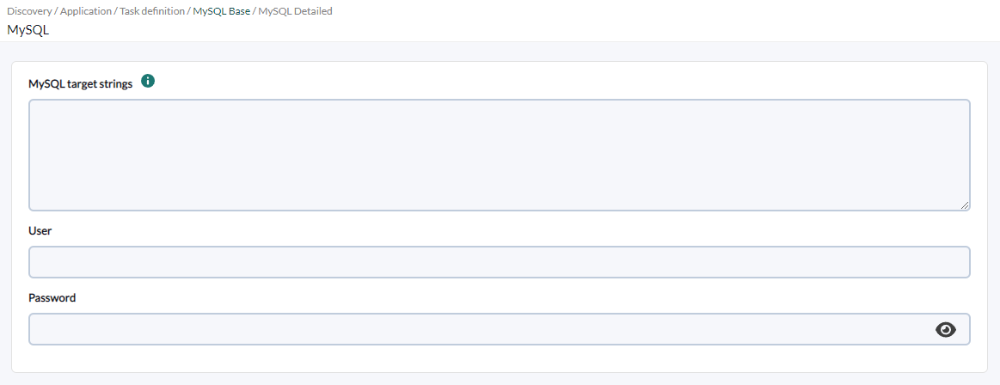
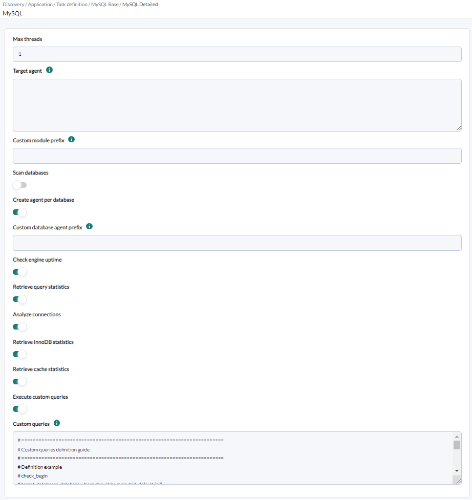
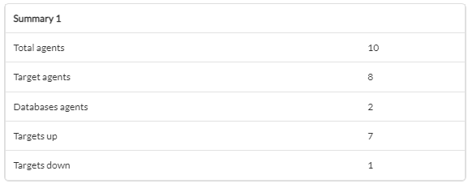

# Application monitoring

A database that does not respond gives no warning: it simply stops answering,
and the users are usually the first to find out. Installing an EndPoint on each
database server to watch it is an option, but not the only one, nor the most
convenient when the instances are dozens and live on machines that are not
always yours. With Discovery, a .disco package from the Marketplace and a task
in **Discovery → Applications** are enough: the server queries the application
remotely at every interval and creates, or updates, the corresponding agents
and modules. With nothing installed on the monitored host.

How a .disco package is installed and what a task does step by step is
explained only once, in section 2.3 (How a .disco package task works).
Here only what is specific to applications is left. One warning beforehand: the
Applications section shows only what is installed; if the checkbox of an
application is missing, its .disco package is missing ([The Discovery sections](2.3-monitorizacion-y-descubrimiento-automatico-con-discovery.md#the-discovery-sections)).

This chapter stops at seven applications from the catalog, but what it tells
applies to all the others: any .disco package in Applications is installed,
configured and run the same way, with the [task of a .disco package](2.3-monitorizacion-y-descubrimiento-automatico-con-discovery.md#how-a-disco-package-task-works).
What changes from one to another is the fields it asks for and the modules it
creates, and that detail (all its fields, the modules it generates, custom
queries) lives on the page of each plugin in the
[integration documentation](https://pandorafms.com/docs/integrations/latest/)
and in its [Marketplace](https://marketplace.pandorafms.com/) entry, and it is
not copied here. For an application that is not in this table, search for it by
name on those two sites.

| Application | Short name in the catalog | Detail |
|---|---|---|
| MySQL | `pandorafms.mysql` | [Integration documentation](https://pandorafms.com/docs/integrations/latest/discovery/mysql-discovery/) and [Marketplace](https://marketplace.pandorafms.com/entries/pandorafms.mysql) |
| Microsoft SQL Server | `pandorafms.mssql` | [Integration documentation](https://pandorafms.com/docs/integrations/latest/discovery/mssql-discovery/) and [Marketplace](https://marketplace.pandorafms.com/entries/pandorafms.mssql) |
| PostgreSQL | `pandorafms.postgresql` | [Integration documentation](https://pandorafms.com/docs/integrations/latest/discovery/postgresql/) and [Marketplace](https://marketplace.pandorafms.com/entries/pandorafms.postgresql) |
| MongoDB | `pandorafms.mongodb` | [Integration documentation](https://pandorafms.com/docs/integrations/latest/discovery/mongodb-discovery/) and [Marketplace](https://marketplace.pandorafms.com/entries/pandorafms.mongodb) |
| Oracle | `pandorafms.oracle` | [Integration documentation](https://pandorafms.com/docs/integrations/latest/) and [Marketplace](https://marketplace.pandorafms.com/entries/pandorafms.oracle) |
| Apache | `pandorafms.apache` | [Integration documentation](https://pandorafms.com/docs/integrations/latest/discovery/apache-discovery/) and [Marketplace](https://marketplace.pandorafms.com/entries/pandorafms.apache) |
| NGINX | `pandorafms.nginx` | [Integration documentation](https://pandorafms.com/docs/integrations/latest/discovery/nginx/) and [Marketplace](https://marketplace.pandorafms.com/entries/pandorafms.nginx) |

Virtualization (VMware, Proxmox) and orchestrators (Kubernetes) also appear in
the Applications section, but they have a chapter of their own:
[Virtualized environment monitoring](2.16-monitorizacion-entornos-virtualizados.md)
and [Container and orchestrator monitoring](2.13-monitorizacion-de-contenedores-y-orquestadores.md).

## Complete example: a MySQL task

MySQL serves as an example because it is the typical case: a list of instances,
a user with read permissions and one agent per instance. The generic steps
(defining the task, forcing it, reading the summary) are in 2.3; what follows is
only what is specific to a database.

1. **What the .disco package asks for.** After the first defining step, the
   .disco package adds two steps. **MySQL Base** asks for the list of instances
   (`SERVER:PORT`, with 3306 by default; one per line or separated by commas),
   the user and the password.

   

   **MySQL Detailed** asks for the threads, whether an agent per database is
   wanted, the prefixes, the metric groups and the custom queries.

   

   The user and the password go in fields of their own, of password type, and
   not in the [Credential manager](2.2-gestor-de-credenciales.md): MySQL is one
   of the .disco packages that works that way.

2. **Preparing the user in MySQL.** The plugin only reads, and it is advisable
   that its user does the same:

    | Requirement | Detail |
    |---|---|
    | Network | Reachability from the Discovery server to each instance (port 3306 by default). |
    | Data | `SELECT` permission on the tables of the databases and on those of `INFORMATION_SCHEMA`. |
    | Server status | `SHOW STATUS` and `SHOW VARIABLES` permissions. |

    An example: a `pandora_monitor` user with those permissions and an instance
    `mysql-prod-01:3306`. The permissions are the ones listed on the plugin page
    in the integration documentation; it is advisable to grant it only what its
    monitoring policy requires.

3. **Filling in and running.** It is saved with **Complete setup** and the task
   is forced from the list, as described in
   [The task list](2.3-monitorizacion-y-descubrimiento-automatico-con-discovery.md#the-task-list).

4. **What it creates.** One agent for each reachable instance, with its
   connection module and the engine modules that have been left enabled.
   **Scan databases** adds the per-database metrics, and with **Create agent per
   database** each database has its own agent, with the instance agent as its
   parent. An instance that cannot be reached creates no agent: it is counted
   in **Targets down** in the task summary.

   

## Databases

After the MySQL walkthrough, only the particularities change from one database
to another. The table collects them; the rest of the mechanics (agent per
instance, option of an agent per database, connection module) is the same.

| Application | What it brings | Specific preparation | More information |
|---|---|---|---|
| **Microsoft SQL Server** | Agent per instance and, if requested, per database; instance and database metrics; custom queries; connection and query timeouts of their own (5 seconds by default). | A login with `VIEW SERVER STATE`, and `SELECT` for custom queries. ODBC mode is optional and requires the ODBC 17 driver and unixODBC on the machine that runs the plugin. | [Integration documentation](https://pandorafms.com/docs/integrations/latest/discovery/mssql-discovery/) and [Marketplace](https://marketplace.pandorafms.com/entries/pandorafms.mssql) |
| **PostgreSQL** | Agent per target and, with **Scan databases**, per database; availability, activity, connections, buffer cache, storage, transactions and table statistics. | It uses a **Custom credential** from the [Credential manager](2.2-gestor-de-credenciales.md) instead of user and password in the task. The role must be able to connect to the monitored databases and read their statistics views. | [Integration documentation](https://pandorafms.com/docs/integrations/latest/discovery/postgresql/) and [Marketplace](https://marketplace.pandorafms.com/entries/pandorafms.postgresql) |
| **MongoDB** | Agent per target; engine and per-database metrics; a step of its own for custom queries. | The targets are connection URIs, with the user inside them (port 27017 by default). Roles `read` or `dbAdmin` on the databases and `clusterMonitor` or `clusterAdmin` for server statistics. | [Integration documentation](https://pandorafms.com/docs/integrations/latest/discovery/mongodb-discovery/) and [Marketplace](https://marketplace.pandorafms.com/entries/pandorafms.mongodb) |
| **Oracle** | A .disco package present in the Applications catalog. | There is no plugin page in the integration documentation: its fields and its permissions are not described here. | [Integration documentation](https://pandorafms.com/docs/integrations/latest/) and [Marketplace](https://marketplace.pandorafms.com/entries/pandorafms.oracle) |

With three of them (MySQL, Microsoft SQL Server and MongoDB) the user and the
password, or the URI that carries them, are written in the task itself; with
PostgreSQL the identifier of a credential is enough. If the password of a
monitoring user changes often, the difference matters.

## Web servers: Apache and Nginx

Web servers are not queried over SQL but over HTTP: each one publishes a status
endpoint that the plugin reads and turns into modules. Before creating the task,
that endpoint has to be active on the monitored server.

| Application | Requirement on the server | What it creates | More information |
|---|---|---|---|
| **Apache** | `mod_status` enabled, with the `server-status?auto` response machine-readable and restricted to the IP of the system that runs the plugin. Basic authentication is only needed if the endpoint requires it. | One agent per distinct network location among the URLs, with an availability module ("Apache Connection") and one module per key/value line of the response. | [Integration documentation](https://pandorafms.com/docs/integrations/latest/discovery/apache-discovery/) and [Marketplace](https://marketplace.pandorafms.com/entries/pandorafms.apache) |
| **NGINX** | `ngx_http_stub_status_module` module compiled and `stub_status` exposed; basic authentication optional. | One agent per URL, with modules for active, accepted and handled connections, requests, and connections in reading, writing and waiting, in addition to availability. | [Integration documentation](https://pandorafms.com/docs/integrations/latest/discovery/nginx/) and [Marketplace](https://marketplace.pandorafms.com/entries/pandorafms.nginx) |

One warning about Apache: `server-status` counts things on the server that
nobody has any reason to read. It must be opened only to the IP of whoever
monitors, not to everyone. The Apache plugin, moreover, delivers the data as XML
files over Tentacle (the target and the port are fields of the task), instead of
answering only with the JSON that 2.3 describes; the result in the console is
the same.

## What you get and how it connects to policies

The result is normal agents, in the group of the task, with their modules, which
are updated on every run. To check the first result: force the task, open its
summary from the task list ("View summary") and look for the created agents. If
something does not appear, the summary usually explains it ("Done" does not
guarantee that the plugin has found anything): see
[When it fails](2.3-monitorizacion-y-descubrimiento-automatico-con-discovery.md#when-it-fails)
and the troubleshooting table on the plugin page in the integration
documentation.

To apply alerts and other configurations homogeneously to the created agents,
the place is [Monitoring policies](2.10-politicas-de-monitorizacion.md).

## References and links

- Marketplace: <https://marketplace.pandorafms.com/>. Each .disco package in the
  catalog has its entry there, with the short name from the table in the
  introduction.
- [Integration documentation](https://pandorafms.com/docs/integrations/latest/): one page per plugin (MySQL, Microsoft SQL
  Server, PostgreSQL, MongoDB, Apache and NGINX).
- Reusable credentials: [Credential manager](2.2-gestor-de-credenciales.md).
- Creating your own .disco packages: [Creating discovery plugins](../parte-9/9.7-creacion-de-plugins-de-discovery.md).
