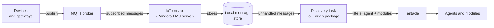

# IoT monitoring

A temperature sensor on a factory floor has no room for an EndPoint. Neither does a solar meter or a warehouse door reader. What almost all of them can do is publish what they measure to an **MQTT broker**: a messaging server that devices write to through named *topics* (the protocol's channels, such as `factory/line-a/temperature`). Pandora FMS uses exactly that. It does not talk to the sensor: it listens to the broker, collects what is published on the topics you care about, and turns it into agents and modules like those of any other host.

In practice, anything that can publish an MQTT message can be monitored, with graphs, thresholds and alerts, without installing anything on the device. This chapter explains how that chain works, how to configure it and, above all, which modules come out of which messages, with real examples.

| Requirement | Detail |
|---|---|
| MQTT broker | Reachable from the Pandora FMS server host. Devices publish to it; Pandora FMS only subscribes. |
| Pandora FMS server | Includes the IoT service (`pandora_iot_server`), which collects the messages. |
| IoT .disco package | Installed in the console. The task it creates turns messages into agents and modules. |
| Tentacle | The task sends the generated data through Tentacle, like any other .disco package. |
| Permissions | The IoT service settings are available to administrator users only. |

Installing the .disco package and the common life cycle of its tasks are covered in [2.3 (Monitoring and automatic discovery with Discovery)](2.3-monitorizacion-y-descubrimiento-automatico-con-discovery.md#installing-updating-and-uninstalling-a-disco-package) and are not repeated here. What follows is specific to IoT; the integration guide, with the full reference of settings and options, is [IoT Discovery](https://pandorafms.com/docs/integrations/latest/discovery/iot/).

## How it works

The chain has four links. Each one fails in a different way, so it helps to keep them straight.

1. **Devices publish** messages to the broker, each on its own topic.
2. **The IoT service** keeps a single connection to the broker, subscribes to the configured topics and stores every message it receives in a local store on the server.
3. **The Discovery task** of the IoT .disco package runs on each interval, reads the messages it has not handled yet and applies the **filters** you defined.
4. **For each group of messages that matches a filter**, the task generates an agent with its modules and sends it to Pandora FMS through Tentacle. From there on it is a regular agent.



Three limits explain most of what follows:

- **A single connection.** Adding topics does not add connections or processes: the service sends one subscription request carrying all the topic filters.
- **Quality of service 0.** Subscriptions are always requested with QoS 0 (delivery at most once, no acknowledgement) and this is not configurable. If the connection drops briefly, messages published in that window are not recovered.
- **Limited retention.** Messages are deleted from the store after a set period (24 hours by default), whether the task has handled them or not. A task that does not run within that period loses the messages.

## Enabling and configuring the IoT server

The service ships with the server but is switched off. Enable it with the **Enable IOT Server** switch under **Setup → System settings → General setup**, **Features** tab. Once enabled, a dedicated page appears, for administrator users only: **Setup → System settings → IoT Server**.

!!! note "Labels in the Spanish console"
    Some labels on this page appear in the Spanish console with text that does not match their function. The table identifies them by their original name and by what they do.

| Field | What it does | Default |
|---|---|---|
| Server configuration | Path of the configuration file the server generates for the service. | `/etc/pandora/pandora_iot_config.ini` |
| Server host | Address of the MQTT broker. | `test.mosquitto.org` |
| Server port | Broker port. | `1883` |
| Server protocol | Transport: `tcp`, `websockets` or `unix`. | `tcp` |
| Server user / Server password | Broker credentials, if it requires them. | empty |
| Server topic | Topic or topics to subscribe to (see below). | `testtopic/#` |
| Enable SSL / Trust SSL certificate | Connection encryption (see the warning). | off / on |
| Database location / Database name | Folder and name of the local message store. | `/opt/pandora/pandora_iot_server/db`, `pandora_iot.db` |
| Data cleaning interval | Minimum seconds between two cleanups of expired messages. | `300` |
| Data cleaning period | Age, in seconds, after which a message is deleted. | `86400` (24 hours) |
| Log name / Log location | Name and folder of the service log. | `pandora_iot.log`, `/var/log/pandora/` |
| Log level | Level of detail in the log. | `info` |
| Max log bytes / Log rotation count | Maximum size of the active log and number of rotated files kept. | `50000000`, `3` |

The default host and topic point to a public test broker: they are good for checking that everything starts, not for production. The first thing to change is the broker.

### Topics

The **Server topic** field accepts two forms:

- **A single filter**, such as `factory/#`.
- **Several filters**, as a JSON array on one line: `["factory/+/temperature", "factory/+/status", "alerts/#"]`.

Wildcards are the MQTT ones: `+` replaces exactly one level (`factory/+/temperature` matches `factory/line-a/temperature` but not `factory/line-a/room-1/temperature`) and `#` replaces all remaining levels and must come last (`alerts/#` matches `alerts`, `alerts/site-a` and everything below). A malformed array (trailing comma, single quotes, empty members) stops the service from starting with the error `Invalid topic configuration`. The field accepts at most 200 characters, brackets and quotes included.

Only messages from subscribed topics reach the store: a task filter will never see a message whose topic is not on this list. Also remember that the broker decides which filters it accepts according to its own access rules.

### Connection encryption

To encrypt the connection, enable **Enable SSL** and **Trust SSL certificate** together. With **Trust SSL certificate** on, the service **does not verify the broker's certificate**: traffic is encrypted, but nothing checks that the broker is who it claims to be. With **Enable SSL** on and **Trust SSL certificate** off, the service does not set up encryption at all. If your environment requires validating the broker, this version does not offer it; solve it at the network level (restricted access to the broker, for example).

### When changes take effect

The Pandora FMS server writes the service configuration file and starts the service **every time it starts**. For that reason, changes made on the IoT Server page **do not apply until `pandora_server` is restarted**. After the restart, check the service from the system:

```bash
systemctl status pandora_iot_server
```

The service log (`/var/log/pandora/pandora_iot.log` by default) should show a line like this for each topic:

```text
MQTT broker accepted subscription to factory/+/temperature with QoS 0
```

If the broker rejects a filter, the log says so and gives the reason.

## The Discovery task of the IoT package

The service only collects. The task of the IoT .disco package decides which agents and modules are born, and it is created and managed like any other (see [How a .disco package task works](2.3-monitorizacion-y-descubrimiento-automatico-con-discovery.md#how-a-disco-package-task-works)). Besides the common first step, its wizard has two steps of its own:

| Step | Field | What it does |
|---|---|---|
| Iot base | DB path | Full path of the message store. Defaults to `/opt/pandora/pandora_iot_server/db/pandora_iot.db`; it must match the service's **Database location** and **Database name**. |
| Iot base | Time window | No effect in this version: leave it empty. |
| Iot base | Tentacle IP / Tentacle port | Destination of the generated data. Default `127.0.0.1` and `41121`. |
| Iot base | Tentacle extra options | Optional. Not applied to the transfer in this version. |
| Iot detailed | Max threads | Threads used to process messages (default 1). |
| Iot detailed | Filter messages modules | Where the filters are written. This is the heart of the package and has its own section below. |

Two conditions affect the outcome:

- **The task must be able to read the store.** The store is a local file on the server where the IoT service runs, so the task has to run on that same host. If **DB path** does not match or the file does not exist, the task reports that it cannot find the file and generates nothing.
- **The agents' group comes from the task.** Agents are created in the group set in the task's first step, and their interval is the task's interval.

On each run, the task reads the messages it has not handled yet, passes them through the filters, generates the agents and **marks the messages as handled**: a message is processed only once. The run summary shows two counters, **Total agents** and **Total messages** (the agents generated and the modules created).

## Filters: from message to module

Each filter describes one module: which messages produce it, what value it carries and which agent it belongs to. Filters are written in the **Filter messages modules** field, one after another, between `filter_begin` and `filter_end`:

```text
filter_begin
filter_module_name Temperature
filter_module_type generic_data
filter_topic line-a
filter_message "value"
filter_message_capture_json $.value
filter_module_value __json1__
filter_end
```

| Directive | Mandatory | What it does |
|---|---|---|
| `filter_module_name` | Yes | Module name. Accepts macros. |
| `filter_module_type` | Yes | Module type: `generic_data`, `generic_data_string`, `generic_proc`… |
| `filter_module_value` | Yes | Module value. Accepts macros. |
| `filter_topic` | No | Text or regular expression that must match the topic. Without it, every topic matches. |
| `filter_topic_exact_match` | No | `1`: the text must appear as-is in the topic. `0` (default): regular expression. |
| `filter_message` | No | Text or regular expression that must match the message content. |
| `filter_message_exact_match` | No | Same as the previous one, for the message. |
| `filter_message_capture_regex` | No | Regular expression with capture groups; each group feeds a `__regexN__` macro. |
| `filter_message_capture_json` | No | JSONPath expressions separated by `\|` (for example, `$.soil.moisture`); each path feeds a `__jsonN__` macro. |

Macros usable in `filter_module_name` and `filter_module_value`:

| Macro | Replaced by |
|---|---|
| `__topic__` | The exact topic of the message. |
| `__regexN__` | Capture group N of `filter_message_capture_regex`. |
| `__jsonN__` | The result of path N of `filter_message_capture_json`. |

Four rules change the result and are worth knowing before writing the first filter:

1. **The agent is named after the text of `filter_topic`.** Not after the message topic: after the filter's text. All filters with the same `filter_topic` add modules to the same agent; filters with different texts create different agents. A short, clean `filter_topic` (`line-a`) gives a well-named agent; one with the full path gives an agent named with the full path.
2. **Modules of the same agent are told apart by the message.** Since two filters with the same `filter_topic` go to the same agent, what separates them is `filter_message`: the JSON temperature on one side, the literal `ONLINE` on the other.
3. **One module, one value per run.** If several messages in the same run produce a module with the same name in the same agent, only the first is kept. The rest are marked as handled and never reach Pandora FMS. If devices publish faster than the task runs, the task interval sets the resolution of your data.
4. **One message can feed several filters**, and a message that matches no filter is marked as handled all the same.

## Examples and results

The following examples were tested with a Mosquitto broker, the IoT service and the package's processor. The tables show what the processor generates for Pandora FMS.

### A plant with two lines and a greenhouse (JSON)

Devices publish these messages:

| Topic | Message |
|---|---|
| `factory/line-a/temperature` | `{"sensor":"t1","value":21.4,"unit":"C"}` |
| `factory/line-a/status` | `ONLINE` |
| `factory/line-b/temperature` | `{"sensor":"t2","value":35.8,"unit":"C"}` |
| `greenhouse/zone1` | `{"temp":24.5,"humidity":61,"soil":{"moisture":38}}` |

The subscribed topics are `["factory/+/temperature", "factory/+/status", "greenhouse/#"]` and the task filters are:

```text
filter_begin
filter_module_name Temperature
filter_module_type generic_data
filter_topic line-a
filter_message "value"
filter_message_capture_json $.value
filter_module_value __json1__
filter_end
filter_begin
filter_module_name Line status
filter_module_type generic_proc
filter_topic line-a
filter_message ^ONLINE$
filter_module_value 1
filter_end
filter_begin
filter_module_name Temperature
filter_module_type generic_data
filter_topic line-b
filter_message_capture_json $.value
filter_module_value __json1__
filter_end
filter_begin
filter_module_name Humidity __topic__
filter_module_type generic_data
filter_topic greenhouse/zone
filter_message_capture_json $.humidity
filter_module_value __json1__
filter_end
filter_begin
filter_module_name Soil state
filter_module_type generic_data_string
filter_topic greenhouse/zone
filter_message_capture_json $.soil.moisture
filter_module_value Moisture __json1__ %
filter_end
```

The task summary reports `Total agents: 3` and `Total messages: 5`, and these agents appear in the console:

| Agent | Module | Type | Value |
|---|---|---|---|
| `line-a` | Temperature | `generic_data` | `21.4` |
| `line-a` | Line status | `generic_proc` | `1` |
| `line-b` | Temperature | `generic_data` | `35.8` |
| `greenhouse/zone` | Humidity greenhouse/zone1 | `generic_data` | `61` |
| `greenhouse/zone` | Soil state | `generic_data_string` | `Moisture 38 %` |

Note three things. Line A has two modules because its two filters share `filter_topic`. The `greenhouse/zone` agent gathers every zone that matches that text, and the `__topic__` macro keeps modules from different zones from overwriting each other: `Humidity greenhouse/zone1`, `Humidity greenhouse/zone2`… And the string module (`Moisture 38 %`) shows that the value does not have to be the bare number: it can be composed from fixed text and macros.

### Messages that are not JSON: doors and meters

Not every device speaks JSON. With plain-text messages, capture with regular expressions:

| Topic | Message |
|---|---|
| `sensors/door1` | `OPEN` |
| `sensors/door2` | `CLOSED` |
| `meters/m1` | `temp=24.5;hum=61` |

```text
filter_begin
filter_module_name Door __topic__
filter_module_type generic_data_string
filter_topic sensors/door
filter_message_capture_regex ^(OPEN|CLOSED)$
filter_module_value __regex1__
filter_end
filter_begin
filter_module_name Humidity
filter_module_type generic_data
filter_topic meters/
filter_message_capture_regex temp=([0-9.]+);hum=([0-9]+)
filter_module_value __regex2__
filter_end
```

| Agent | Module | Value |
|---|---|---|
| `sensors/door` | Door sensors/door1 | `OPEN` |
| `sensors/door` | Door sensors/door2 | `CLOSED` |
| `meters/` | Humidity | `61` |

The doors end up in a single agent with one module per door, thanks to `__topic__`. The meter shows how `__regex2__` picks up the second capture group (humidity) and leaves the temperature out; to keep the temperature too, another filter with the same `filter_topic` and `__regex1__` is enough.

### What to do with the modules once created

The generated modules are regular Pandora FMS modules: they show in the agent, can be graphed and used in alerts, reports and dashboards like those of any other agent. Status thresholds are defined on each module once it exists.

## Checking and troubleshooting

When something does not show up, walk the chain in the order the message travels, left to right.

| Symptom | Likely cause | What to check |
|---|---|---|
| The service does not start | Invalid configuration (`Invalid topic configuration`), missing folder permissions or unreachable broker. | `systemctl status pandora_iot_server` and the service log. |
| Changes on the IoT Server page have no effect | The configuration is written when the server starts. | Restart `pandora_server`. |
| No accepted-subscription lines in the log | The broker is unreachable or rejects the credentials. | Host, port, protocol, user, password and firewall. |
| The broker rejects a filter | Broker access rules or wrong wildcard syntax. | The reason logged for each filter. |
| The task reports it cannot find the database file | **DB path** does not match the store, or the task does not run on the service host. | That the path is exactly `Database location` + `Database name`. |
| The task ends with no agents | No filter matches the pending messages, or the messages expired before the run. | The summary's `Total agents`; the subscribed topics; that the task interval is shorter than the retention period. |
| A published value is missing | Several messages produced the same module in the same run and only the first is kept. | Shorten the task interval or publish less often. |
| The agent has an unexpected name | The name comes from the text of `filter_topic`. | Adjust `filter_topic` (see rule 1). |
| Values are not extracted | The JSONPath does not match the message, or the regular expression lacks the expected groups. | Test the path or expression against a real message; JSON paths use the `$.field.subfield` syntax. |

The service log records messages and inserts only with `Log level` set to `debug`. At that level the log also includes the parameters loaded at startup, **password included**, so it should not be left on `debug` in production.
