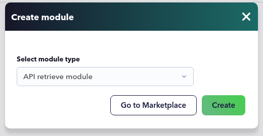
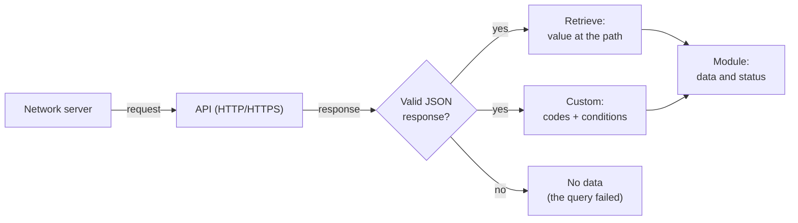
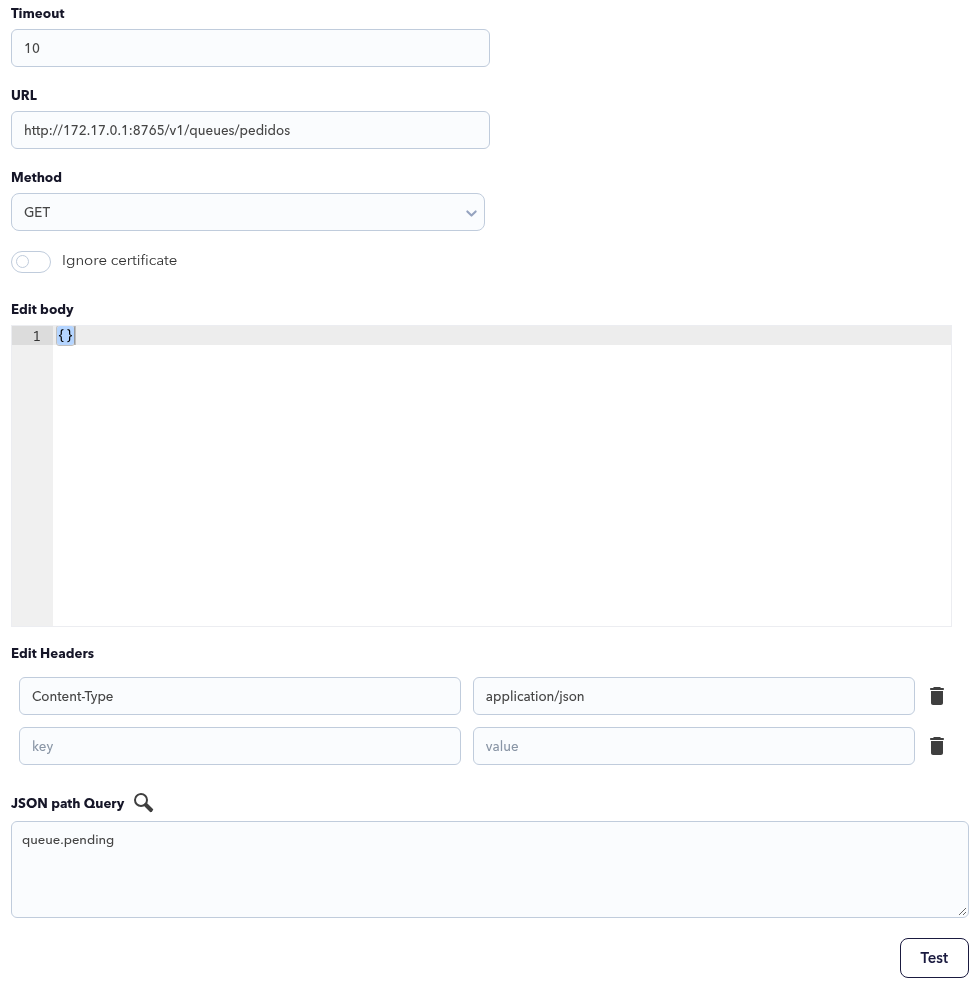
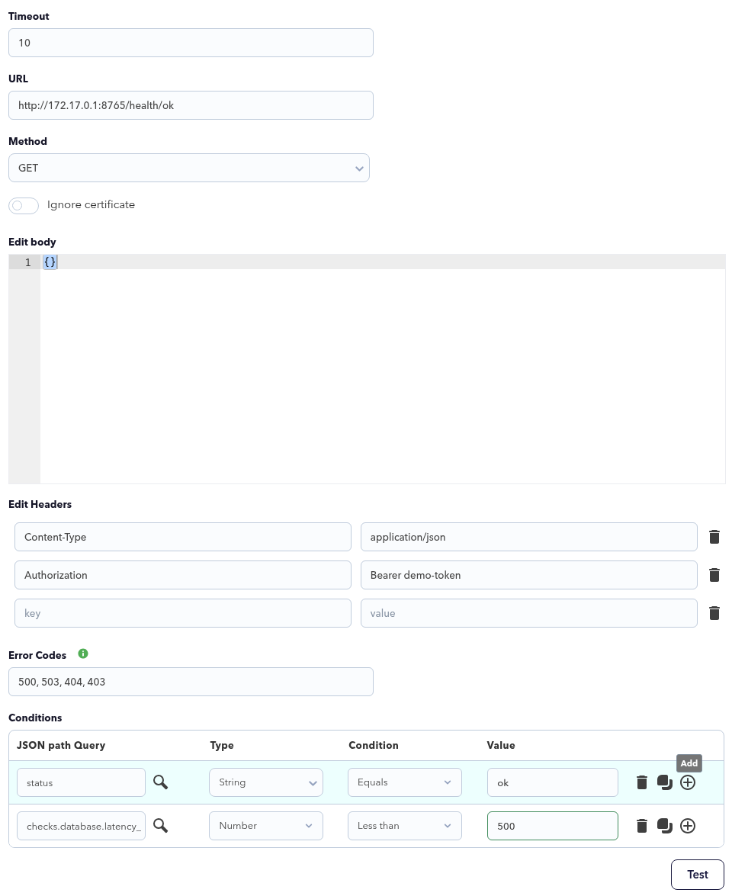
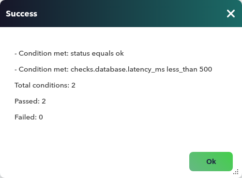

# API monitoring

A web server that answers is not the same as a service that works. `ping` replies, port 443 is open, the process is in the list... and the API returns a `200` whose body says `"status": "degraded"`, or a queue with 128 unprocessed orders, or a `503` nobody has seen because the monitoring dashboard is still green. Almost everything that matters to a business is now queried over HTTP and answered in JSON, and a check that only asks "is the port open?" is often not enough.

Pandora FMS handles this with **API modules**: the server sends an HTTP(S) request to the address you give it, reads the response and turns it into a module. No plugin, no script, and nothing installed on the system that exposes the API. There are two questions you can ask an API, and each has its own module:

- **"What value does it return?"** A number, a text or a true/false extracted from the response. This is the **API retrieve module**.
- **"Is it healthy?"** A status, normal or critical, that comes from comparing the HTTP code and several response fields against what you expect. This is the **API custom module**.

| Requirement | Detail |
|---|---|
| Network server | API modules are executed by the Pandora FMS network server. If none is active, the console does not offer these types when you create a module. |
| Connectivity | The server host must be able to reach the API URL (name resolution, port and firewall included). |
| Response | JSON. If the API answers anything else, the module processes nothing. |
| Creation | Only as agent modules, policy modules and in bulk operations. They are not available as network components. |

This chapter covers what is specific to API modules: the request, data extraction and condition evaluation. The fields common to all modules (interval, group, thresholds) work as in any other module; alerts are covered in [5.5, Alerts and notifications](../parte-5/5.5-alertas-y-notificaciones.md) and spreading modules across many agents in [2.10, Monitoring policies](2.10-politicas-de-monitorizacion.md).

## API module types

When you create an agent module, the type selector offers two new entries, next to the web and prediction modules:



| Selector entry | Data type | What it is for |
|---|---|---|
| API retrieve module | Numeric, boolean or alphanumeric, your choice | Store the value found at a specific point of the response: a queue, a latency, a version, a flag. |
| API custom module | Boolean | Decide whether the API is fine: 1 if all conditions are met, 0 if not. |

Internally there are four module types, because the retrieve module splits according to the data it stores:

| Type | Data | What it stores |
|---|---|---|
| API retrieve numeric data | Numeric | The number found at the path. |
| API retrieve boolean data | Boolean | 1 if the value found is `true`; 0 in any other case. |
| API retrieve alphanumeric data | Alphanumeric | The text found. If the path points to an object or a list, its content is stored as JSON text. |
| API custom retrieve | Boolean | 1 or 0 depending on the conditions. |

The rule for choosing fits on one line. If you want **the value** (to graph it, to set thresholds on it), use retrieve. If you want **a verdict** on the health of the API, use custom. If you need both, create two modules on the same URL: they do not interfere with each other.

## How it works

The module does not go through any EndPoint. The network server runs it, just like a network or web module:

1. When the module is due (according to its interval), the network server builds the request from the URL, method, headers and, if applicable, the body.
2. It sends the request with the configured timeout. If it fails, it retries: three attempts by default, which you change with the **Retries** field of the **Data** tab. Responses of up to 20 MB are accepted.
3. It checks that the response is JSON.
4. Depending on the type, it extracts the value from a path (retrieve) or evaluates the HTTP code and the conditions (custom).
5. It processes the result like that of any other module: the data is stored, the status is calculated with the thresholds and the alerts fire.



One detail worth keeping in mind: when the query fails (the API does not answer, the response is not JSON or the URL is empty), the module **does not receive any data**. It does not turn critical for that reason: it simply gets no new value and, if the failure persists, ends up in unknown status when its interval expires. That is why the custom module has its own error codes (see below): they are the way to turn a specific API failure into a critical.

## Configuring the request

Both modules share the request block, in the **Basic** tab of the module creation or edit form (the other tabs, common to all modules, are in [2.20](2.20-configuracion-comun-de-los-modulos.md)):



| Field | What it does | Default |
|---|---|---|
| Timeout | Seconds to wait for the response before considering it failed. It is the one in this tab: the *Timeout* field of the **Data** tab plays no part in these modules. | `10` |
| URL | Full address of the endpoint, including the scheme (`http://` or `https://`). Required: without a URL the module does not run. | empty |
| Method | `GET`, `POST`, `PUT` or `DELETE`. | `GET` |
| Ignore certificate | When enabled, the API certificate is not validated. Use it only for tests or for internal certificates you cannot fix: it turns off the check that you are talking to who you think you are. | disabled |
| Edit Headers | HTTP request headers, as key-value pairs. | `Content-Type: application/json` |
| Edit body | Request content. Makes sense with `POST`, `PUT` and `DELETE`. | `{}` |

Three rules explain most of the modules that "do not do what they should":

- **The body is only sent if the method is not `GET` and the `Content-Type` header is exactly `application/json`.** If you change that header, the body is silently ignored.
- **Authentication goes in the headers.** There are no user and password fields: a token-based API is queried with a header such as `Authorization: Bearer <token>`, and an API key is sent in whichever header that API requires. Keep in mind that the header is part of the module configuration, so anyone who can view or edit the module can see the token.
- **Headers arrive as configured on `GET`.** The server also identifies itself with the user agent `Pandora-API-Client/1.0`, in case the API filters on it.
- **The server queries, not the console.** The request leaves the Pandora FMS server host. The API being reachable from your browser does not prove it is reachable from the server.

!!! warning "Content-Type on POST and PUT"
    In tests with version 8.0NG.805, the target API received `POST` and `PUT` requests with `Content-Type: application/x-www-form-urlencoded` even though the module header was `application/json`; the body did arrive intact. If your API requires exactly `application/json`, check it with a real request before trusting the module.

## Extracting a value from the response

The retrieve module stores what it finds at the **JSON path query** (*JSON path Query*). The path is written as field names separated by dots, and list elements are numbered from zero:

| API response | Path | Value |
|---|---|---|
| `{"queue": {"name": "orders", "pending": 128}}` | `queue.pending` | `128` |
| `{"queue": {"name": "orders", "pending": 128}}` | `queue.name` | `orders` |
| `{"items": [{"id": 7}, {"id": 9}]}` | `items.1.id` | `9` |

!!! warning "This is not full JSONPath"
    The console talks about "JSONPath" in its messages, but the actual syntax is the dot syntax in the table. A path such as `$.queue.pending`, `queue['pending']` or `items[?(@.id==9)]` finds nothing. Field names that contain a dot cannot be used either.

Retrieve modules have their warning and critical thresholds in the same **Basic** tab, like any module with data; how they work is in [2.20](2.20-configuracion-comun-de-los-modulos.md#thresholds-and-statuses).

You do not need to type the path by hand. With the URL already filled in, the magnifier button next to **JSON path Query** makes a preliminary request and shows the response as a tree; click a value and confirm, and the path is filled in for you. That button makes the request **from the console**, not from the server, so it may work even if the server cannot reach the API (and the other way round). The **Test** button does the same and shows the result of the path before you save.

The module type decides what is done with the value:

| Type | Value found | Module data |
|---|---|---|
| Numeric | `128` | `128` |
| Alphanumeric | `"2.4.1"` | `2.4.1` |
| Alphanumeric | an object, such as `queue` in the first table | Its content as JSON text; field order may change (`{"pending":128,"name":"orders","consumers":4}`) |
| Boolean | `true` | `1` |
| Boolean | `"true"` (text) | `1` |
| Boolean | `false`, `"ok"`, `1` or anything else | `0` |

If the path is empty, the response is not JSON or the path does not exist in the response, the module stores nothing in that run.

## Checking the status of an API

The custom module does not extract a value: it gives a verdict. Its data is `1` (normal) when everything is fine and `0` (critical) when something does not add up. It has no thresholds of its own: the status is decided by the error codes and the conditions.

Evaluation follows a fixed order:

1. **Error codes.** The **Error Codes** field is a comma-separated list of HTTP codes. The default for a new module is `500, 404, 403`. If the response carries one of them, the module becomes `0` and nothing else is evaluated.

    !!! warning "Write the codes without spaces"
        In tests with version 8.0NG.805, with spaces after the commas (`500, 503, 404, 403`, which is also the format of the default value) only the first code is recognized: a `503` or a `404` does not turn the module into `0`. Without spaces (`500,503,404,403`) they all work. Until this is fixed, write the list without spaces.
2. **Conditions.** If the code is not in the list, each condition is evaluated. **All** of them must be met for the module to be `1`; if one fails, it is `0`. A module without conditions is `1` as long as the code is not in the list.



Each condition has four parts:

| Part | What it is |
|---|---|
| JSON path Query | The path of the field to evaluate, with the same dot syntax as the previous section. Filled in with the magnifier. |
| Type | The expected data type: `Null`, `String`, `Number` or `Boolean`. |
| Condition | The comparison operator (depends on the type; next table). |
| Value | The value to compare against. Not used by operators that do not need one. |

The available operators depend on the type you choose:

| Type | Operators | Met if |
|---|---|---|
| Boolean | Is true / Is false | The field is true / false. They do not use *Value*. |
| Null | Equals / Not equals | The field is / is not null. |
| Number | Equals / Not equals | The number is equal to / different from the expected one. |
| Number | Greater than / Less than | It is greater / smaller than the expected one. |
| String | Equals / Not equals | The text is equal to / different from the expected one. |
| String | Contains / Not contains | The text contains / does not contain the expected one. |
| String | Is empty / Is not empty | The field is empty / not empty. They do not use *Value*. |
| String | Regex match | The value matches the regular expression, case-insensitive. |

Some rules that change the result:

- **A path that does not exist counts as an unmet condition.** If the API changes format and the field disappears, the module becomes `0`, which is exactly what you want.
- **The type must match the data.** With type `Number`, a non-numeric field fails the condition.
- **Error codes are evaluated on a JSON response.** If the API answers an error with a body that is not JSON (an HTML error page, for example) or with no body, the query is considered failed and the module is left without data instead of becoming `0` (checked with a `500` and an HTML body). If you want to catch that case, also watch for the module staying in unknown status.

The console includes a **Test** button below the conditions. It sends the request and shows which conditions are met, how many were evaluated (*Total conditions*), how many pass (*Passed*) and how many do not (*Failed*).


 Always use it before saving: it is much cheaper than finding out about a badly written condition at three in the morning.

## Examples and results

The three examples use a fictional API at `api.example.com`. They were reproduced on an 8.0NG.805 console against a local test API, and the results are what the module returned.

!!! example "Pending orders queue (numeric retrieve)"
    You want to graph how many orders are waiting in the queue and alert if it goes above 500.

    Configuration: API retrieve module, **numeric** data; URL `https://api.example.com/v1/queues/orders`; method `GET`; path `queue.pending`; critical threshold from 500.

    API response:

    ```json
    {"queue": {"name": "orders", "pending": 128, "consumers": 4}}
    ```

    Result: the module is `128` and is graphed like any numeric module. When the API returns `"pending": 612`, the threshold turns it critical and the associated alerts fire.

!!! example "Deployed version (alphanumeric retrieve)"
    You want to know which version runs in production, to see in the history when it changed.

    Configuration: **alphanumeric** data; URL `https://api.example.com/v1/info`; path `build.version`.

    Response: `{"build": {"version": "2.4.1", "commit": "9f3c2ab"}}`

    Result: the module is `2.4.1`. Each deployment shows up as a value change.

!!! example "API health with an authentication header (custom)"
    You want a single module that turns the API critical if it is not healthy, if the database is slow or if it answers with an error.

    Configuration: API custom module; URL `https://api.example.com/v1/health`; method `GET`; headers `Content-Type: application/json` and `Authorization: Bearer <token>`; error codes `500,503,404,403` (no spaces); two conditions:

    | JSON path Query | Type | Condition | Value |
    |---|---|---|---|
    | `status` | String | Equals | `ok` |
    | `checks.database.latency_ms` | Number | Less than | `500` |

    Result depending on what the API answers:

    | Response | Module | Why |
    |---|---|---|
    | `200` with `{"status": "ok", "checks": {"database": {"latency_ms": 120}}}` | `1` | Code not in the list and both conditions are met. |
    | `200` with `{"status": "degraded", "checks": {"database": {"latency_ms": 120}}}` | `0` | The first condition fails. |
    | `200` with `{"status": "ok", "checks": {"database": {"latency_ms": 900}}}` | `0` | The second condition fails: 900 is not less than 500. |
    | `200` with `{"status": "ok"}` | `0` | `checks.database.latency_ms` does not exist. |
    | `503` with `{"error": "unavailable"}` | `0` | Code in the error list (and `status` is missing as well). |
    | `200` with an HTML page | no data | The response is not JSON. |

## Use with policies and bulk operations

API modules can be created in the same ways as the rest of network modules:

- **On an agent**, from its modules form.
- **In a policy**, to spread the same module across many agents (see [2.10, Monitoring policies](2.10-politicas-de-monitorizacion.md)). This is the typical case for an API with the same contract in several environments.
- **With bulk operations**, to change a field (a timeout, a header) in many modules at once (see [2.11, Bulk operations](2.11-operaciones-masivas.md)).

!!! note "Secrets in headers"
    A policy that carries a token in a header distributes it to every module it generates. If the token expires or rotates, change it in the policy (or with a bulk operation), not agent by agent.

## Checking and troubleshooting

| Symptom | Likely cause | Check |
|---|---|---|
| The console does not offer the API types when creating a module. | No active network server, or a network component is being created. | Check the server list for a running network server; create the module on an agent. |
| The module has no new data. | The API does not answer, the response is not JSON or the URL is empty. | Repeat the request from the server host (`curl -i <url>`) with the same headers and check that the response is JSON. |
| The retrieve module stores nothing. | The path does not exist in the response or is badly written (for example, with `$.` in front). | Use the magnifier to pick the path on the real response. |
| The boolean module is always `0`. | The value at the path is not `true`. A `1` or an `"ok"` gives `0`. | Switch to a numeric module or to a custom module with conditions. |
| A code in the error list (for example `503` or `404`) does not turn the module into `0`. | The list is written with spaces after the commas and only the first code is recognized. | Rewrite the list without spaces: `500,503,404,403`. |
| The custom module is `0` and the API answers fine. | A condition is not met: nonexistent path, type mismatch or wrong operator. | Press **Test**: it shows how many conditions fail. |
| The custom module is `1` even though the API is broken (for example, it answers `401`). | The code is not in the error list and no condition detects it: without conditions, anything not in the list gives `1`. | Add the code to **Error Codes** (`401` if authentication fails) and define at least one condition on the body. |
| The body does not reach the API. | Method `GET`, or the `Content-Type` header is not exactly `application/json`. | Check the method and the header. |
| Certificate error (HTTPS). | Expired or self-signed certificate, or a name mismatch. | Fix it on the API; as a last resort only, enable **Ignore certificate**. |
| The magnifier works, but the module does not. | The console reaches the API and the server does not (or the other way round). | Test the request from each host separately. |

To see what the server does with each request, check its log (`/var/log/pandora/pandora_server.log`). Query failures (empty URL, failed request) appear with the module identifier; the detail of successful runs and of non-JSON responses is only visible by raising the server verbosity.
