# Log collection and monitoring

Logs are that file nobody looks at until something catches fire at three in the
morning and it is time to work out what happened. Pandora FMS collects them
from every origin you name: the Windows event log, text files from any Unix
flavour, the syslog of any machine. It leaves them in a single console, ordered
by the moment they arrived. This chapter explains how that collection is
enabled, how logs are requested from each EndPoint and what can be done with
them afterwards.

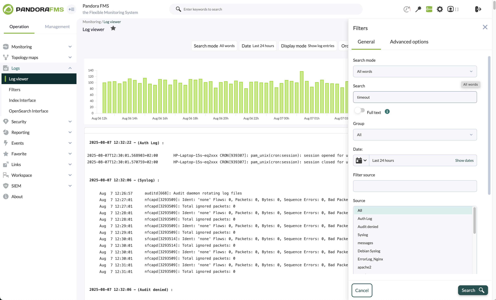

Pandora FMS does not store logs in its monitoring database. It keeps them in
**OpenSearch**, a search engine built for text, and that is why the first
requirement, before touching anything in the console, is to have that engine
available and reachable. The rest of the chapter assumes it already is; the
installation and configuration of the engine have a technical appendix of their
own.

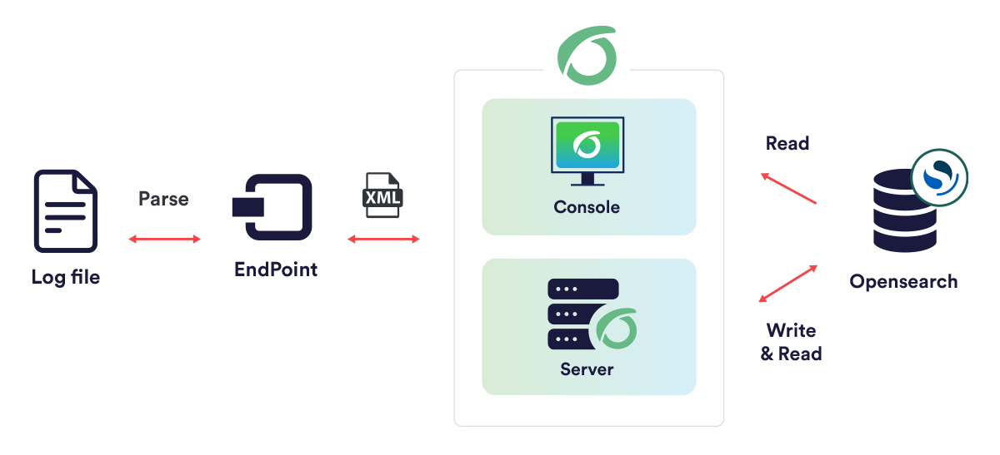

!!! note "What this is not"
    Unstructured log monitoring is not a SIEM. Pandora FMS keeps the text as it
    comes, without analysing it, and puts it at your disposal so that you can
    search it. If what you want is to correlate events and launch rules, that is
    [Pandora SIEM](../parte-7/7.2-siem.md), which builds on these same data.

## How it works

The chain has four links and it is worth keeping them clear, because each one
can fail on its own.

1. The **EndPoint** reads the event log or the text file and puts the raw logs,
   in *RAW* format, inside the XML report it already sends as usual. No
   separate channel is needed.
2. The Pandora FMS **Data Server** receives that XML, which carries monitoring
   and logs at the same time. When it processes it, it separates one from the
   other.
3. The **references** of the EndPoint that has reported and of the log origin
   are stored in the main database. The log text is not: the text goes to
   OpenSearch.
4. OpenSearch indexes it. Pandora FMS creates **a new index every day** for
   each instance, with a name such as
   `pandorafms-<identifier>-<year.month.day>`, plus an auxiliary index of
   origins that ends in `-sources`.

The server splits the received content by line breaks, so each physical line
becomes an OpenSearch document. The exception is **Windows events**, which
already arrive as a block and are stored whole. Since version 806, right after
that split, the server replaces every occurrence of the literal `{{\n}}` in each
entry with a real line break. The replacement happens after the split, so it
does not create new documents: one logical entry is still one document. That is
what allows a multiline entry to be shown as a block in the viewer (see
[Multiline log entries](#multiline-log-entries)).

Logs travel over the network encoded, to prevent a strange format from breaking
the transport. If you also want them to travel encrypted,
[encrypted Tentacle](../parte-9/9.4-referencia-completa-de-tentacle.md) is
used; nothing special has to be done for logs, it is the same secure transport
that applies to the rest of the XML.

A server maintenance task deletes the old information after the interval you
set (**30 days** by default). It is not a blunt deletion: the server removes
the documents by date and, when an index is left empty, it removes that too.

The **Syslog Server** is the shortcut. Instead of waiting for an EndPoint to
read a file and send it, this component reads the syslog of the machine where
the server lives and processes it on the spot. For high volumes of syslog it is
quite a bit faster, and it allows spreading the load: several EndPoints on one
side and several remote syslog servers on the other.

## Prerequisites

| Requirement | Detail |
|---|---|
| OpenSearch | Installed, started and reachable from the Pandora FMS server. Without it there is nowhere to store the logs. |
| Log collector | Enabled in the web console (next section). If it is disabled, modules of type log are discarded without further ado. |
| `rsyslog` | Only if you are going to use the **Syslog Server**; it is installed on the server and, if needed, on the clients that send. |
| Ports | The one of the search engine (`9200` by default) for the collector, and `514` (TCP and UDP) for syslog collection. |

## Log collector configuration

Menu **Management → Settings → System Settings → Log collector**. It is
enabled with **Activate Log Collector** and confirmed with **Update**. Until
you enable it, that screen only shows the switch.

Once activated, the **OpenSearch options** appear, which are the ones that
connect the console with the engine:

| Option | What it is for |
|---|---|
| **OpenSearch IP** | Address or name of the OpenSearch server. |
| **Use https** | Enable it if the engine listens over HTTPS. |
| **OpenSearch Port** | TCP port; `9200` by default. |
| **Number of logs viewed** | How many records the log viewer shows; `50` by default. |
| **Days to purge old information** | Days before deleting what has been collected; `30` by default. |
| **Basic authentication** | User (**User**) and password (**Password**) if the engine asks for them. Having them set is strongly recommended. |

The screen itself tells you whether the connection works: **OpenSearch is
running.** when everything lines up, **Unauthorized** when the credentials are
not correct and **There is no OpenSearch defined. Empty ip or port.** when the
address or the port is missing. That indicator is the fastest way to know
whether the problem is configuration or network.

!!! warning "Index configuration: touch it only if you know what you are doing"
    The **Index configuration** block changes how OpenSearch builds the index.
    A wrong configuration can destabilise the system, so do not move it out of
    curiosity. On top of that, template changes apply **from the following
    index on**: they do not rewrite what is already indexed.

The options in the **Index configuration** block are the following:

- **Indexing size**: maximum length, in characters, that OpenSearch indexes
  from each line as a full value (*keyword*). Lines that exceed it are still
  stored and can be searched by words, but they are left out of regular
  expression searches (REGEX mode). `2000` by default.
- **Number of shards**: primary shards of the index; `1` by default. It is only
  set when the index is created: it cannot be changed on an index that is
  already closed.
- **Number of replicas**: replicas of each shard; `0` by default. Setting `0`
  saves disk, but a restart of the node leaves the information temporarily
  unavailable and a corruption becomes permanent loss.
- **Auto expand replicas**: adjusts the replicas only according to the number
  of nodes, with a range such as `0-1` or `all` as a cap. If the allocation
  rules prevent placing all the replicas, the cluster can be left in `YELLOW`
  state.

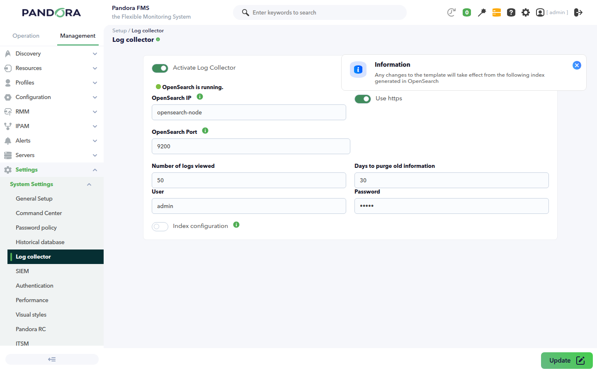

## Collecting logs with EndPoints

The real collection is done by the **EndPoints**, both on Windows and on Unix
(Linux, macOS, Solaris, HPUX, AIX, BSD…). To register the modules from the
**Module log collection** wizard the collector has to be configured already,
and if you are going to add modules of type **Windows event channel**, the
EndPoint has to be a Windows one. The rest of the modules and their general
tokens are in [Monitoring with EndPoints](2.1-monitorizacion-con-endpoints.md)
and in the [full EndPoint configuration
reference](../parte-9/9.1-referencia-completa-de-configuracion-del-endpoint.md).

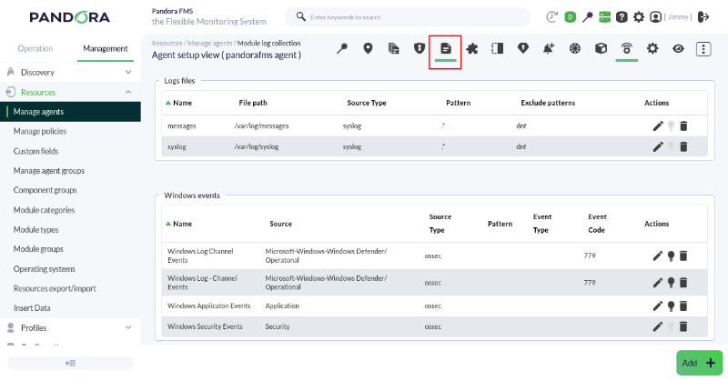

The collection shipped with the product (Unix, Windows and Go EndPoints, and the
bundled *plugins*) sends **one physical line per entry** and does not join the
lines of a single logical entry; the exception is Windows events, which are
already stored as a block. To show an entry as a block you need a collection of
your own (for example, a custom *plugin*) that knows where the entry starts and
ends, sends it as one line and encodes its internal line breaks with the
`{{\n}}` marker. The mechanism and its limits are in [Multiline log
entries](#multiline-log-entries); writing that *plugin* is another job. Without
the marker, everything behaves exactly as before.

### Plain text logs

To watch a text file, a module of type `log` is used with the `module_regexp`
token, which points to the path of the file. An example module on Linux:

```text
module_begin
module_name Syslog
module_description Collection of the system messages file
module_type log
module_regexp /var/log/messages
module_pattern .*
module_pattern_exclude DEBUG
module_end
```

On Windows the syntax is the same, only the path changes:

```text
module_begin
module_name Apache_log
module_description Collection of the Apache log
module_type log
module_regexp C:\server\logs\apache.log
module_source_type apache
module_pattern .*
module_end
```

`module_pattern` filters the lines you are interested in and
`module_pattern_exclude` excludes the ones you are not. Other examples of our
own:

```text
module_begin
module_name apache_access
module_type log
module_regexp /var/log/httpd/access_log
module_pattern .*
module_pattern_exclude \s200\s|\s301\s
module_source_type web-log
module_end

module_begin
module_name Audit denied
module_type log
module_regexp /var/log/audit/audit.log
module_pattern denied
module_end

module_begin
module_name Secure
module_type log
module_regexp /var/log/secure
module_pattern Failed|failure|invalid|denied|accepted|root
module_end
```

!!! warning "`module_type log` does not store in the database"
    A module with `module_type log` is not stored as a normal module: it is
    sent to the log collector. If the collector is disabled, **the information
    is discarded**. It is the number one cause of "I have put the module in and
    I see nothing".

Log collection on Linux used to be done with *plugins*. Since version 781 this
is the recommended method; the plugins were left as legacy.

### MS Windows events with `module_logchannel`

On Windows, besides files, the **event log** can be read. For that there is
`module_logchannel`, which displaces the old `module_logevent`. The latter
still works for compatibility, but it is not supported since LTS version 2025
and it only makes sense on old Microsoft systems (Windows 7, Windows 2003 or
earlier). On a modern Windows, `module_logchannel`.

The general format is this one:

```text
module_begin
module_name MyEvent
module_type log
module_logchannel
module_source <logName>
module_eventtype <event level (optional)>
module_eventcode <event id (optional)>
module_application <origin (optional)>
module_pattern <substring to search for (optional)>
module_source_type <log type for the SIEM (optional)>
module_end
```

There are two warnings worth reading before fighting with the filters. The
first: only events **later than the last EndPoint run** are taken into account.
On the first run not everything that already existed in the log is collected;
sending starts from that point on. The second: parameter names are
case-sensitive, so copy them exactly as they are.

#### `module_source`

It is the source that originates the event: the old Windows NT classification
(System, Application, Security…). Do not confuse it with
`module_application`, which identifies the application. You can use one or the
other, but one of the two is needed.

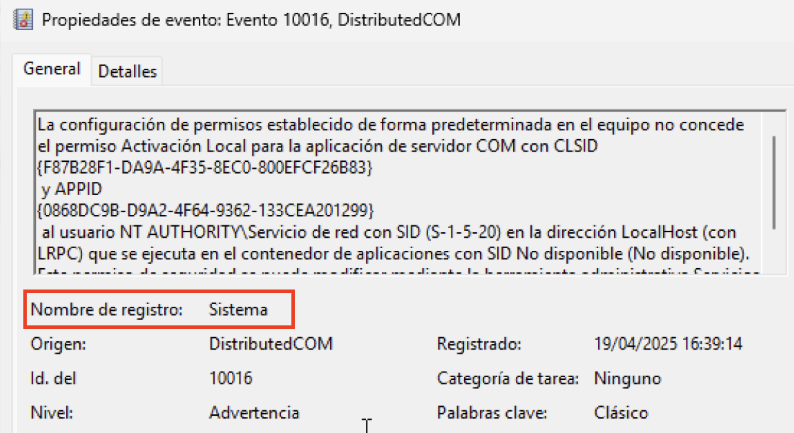

Even if the event viewer shows it to you in your language, here **they are
written in English**: `System`, `Application`, `Security`. Long names are
copied exactly as they are, without translating:

```text
Microsoft-Windows-DeviceManagement-Enterprise-Diagnostics-Provider/Administration
```

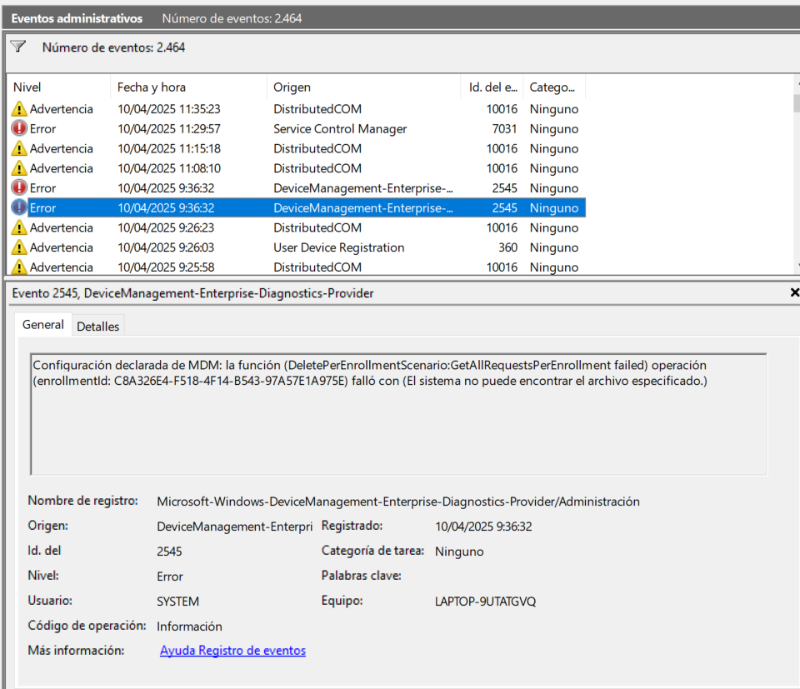

#### `module_source_type`

It is the type of log that the SIEM decoders and rules consume. If you omit it,
`syslog` is used by default. The types the tool usually handles are `syslog`,
`ids`, `web-log`, `squid`, `host-information` and `ossec`.

!!! tip "Not all types are active from the factory"
    The decoder engine does not bring all those types ready to use. In the
    default installation `ossec` (Windows events), `web-log`, `ids`, `firewall`
    and `syslog` are active; `squid` and `windows` come in the folder of
    disabled decoders, and `host-information` does not exist as such. Before
    choosing a type, check which decoders you have active in the
    [SIEM chapter](../parte-7/7.2-siem.md).

For the SIEM, Windows events are processed with `ossec`. This example collects
all the security events:

```text
module_begin
module_logchannel
module_name Security_Events
module_type log
module_source Security
module_source_type ossec
module_end
```

#### `module_eventtype`

Optional filter by event level. The values are those of the event viewer:

| Code | Event type |
|---|---|
| `0` | Success audit |
| `1` | Critical |
| `2` | Error |
| `3` | Warning |
| `4` | Information |

To keep only the security warnings:

```text
module_begin
module_logchannel
module_name Security_Events_Warning
module_type log
module_source Security
module_eventtype 3
module_source_type ossec
module_end
```

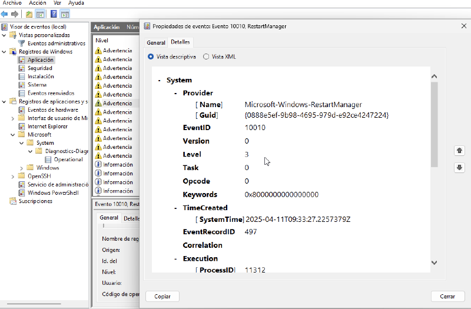
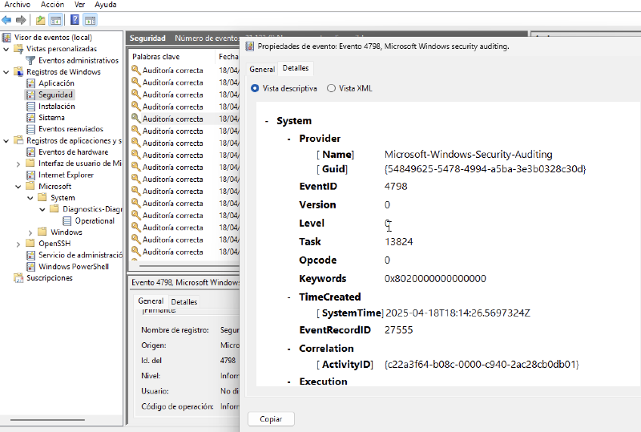

#### `module_eventcode`

Optional filter by **event identifier**, the `eventID` you see in the viewer. It
is the most precise filter of all. This example takes only the events with
identifier `4798`:

```text
module_begin
module_logchannel
module_name Security_Events_4798
module_type log
module_source Security
module_eventcode 4798
module_source_type ossec
module_end
```

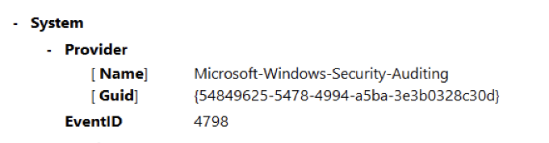

#### `module_application`

Origin of the event, optional. To get the exact name of the provider, select an
event in the Windows viewer, open **Properties** and copy the **Full name**
field. If the name has spaces in it, **do not put it in quotes**. For example:

```text
module_begin
module_name Pandora_Events_Windows
module_type log
module_logchannel
module_application Pandora FMS
module_source Application
module_end
```

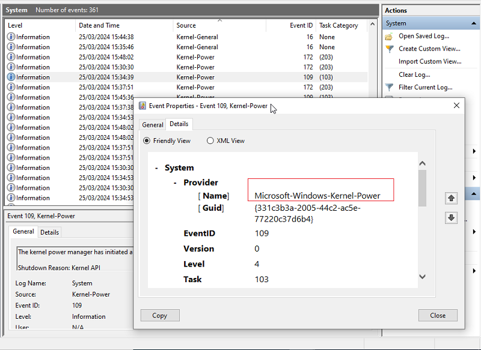

As a reference, the providers that appear most are the operating system's own
(`Microsoft-Windows-Winlogon`, `Microsoft-Windows-Security-Auditing`,
`Microsoft-Windows-WindowsUpdateClient`, `Microsoft-Windows-TaskScheduler`…),
those of applications and services (`MSSQLSERVER`, `Windows Defender`,
`Windows Firewall`, `VSS`…), the useful ones for advanced diagnosis
(`Microsoft-Windows-Kernel-General`, `Microsoft-Windows-DistributedCOM`,
`Microsoft-Windows-Ntfs`…) and third-party ones (`VMware Tools`,
`Oracle Database`, `Symantec Endpoint Protection`, `TeamViewer`,
`Apache Service`…). Each application uses its own and there are hundreds of
them.

### Windows events and Sysmon

**Sysmon** (System Monitor) is a free utility from Microsoft, inside the
Sysinternals package, that records in detail activities that the normal event
viewer lets through: process creation and execution, incoming and outgoing
network connections, changes in the Windows registry, DLL loading, file access,
code injection into legitimate processes. It is common material in intrusion
attempts and lateral movement, and that is why it matters so much in
cybersecurity.

It works by installing a driver in kernel mode that keeps writing to the Event
Viewer. Pandora FMS collects it as one more channel of the Windows EndPoint and
sends it to the server. The combination Sysmon + Pandora FMS + Pandora SIEM
gives visibility far above that of the traditional log: early detection of
advanced attacks, automatic alerts on the events you define and a correlatable
history for forensics or auditing.

Sysmon comes in the *Sysinternals Suite* package and its configuration file is
long: monitoring "everything" punishes the performance of the machine and of
the system that receives the data. For Sysmon events **this** module has to be
used, with the exact name and type:

```text
module_begin
module_name WinEvtLog
module_type log
module_logchannel
module_source Microsoft-Windows-Sysmon/Operational
module_source_type windows
module_end
```

Here `module_source_type windows` replaces `ossec`, and the name `WinEvtLog` is
the one the Pandora SIEM rules expect.

!!! warning "Sysmon does not come ready from the factory"
    The Sysmon channel has to be enabled and its decoders and rules fine-tuned;
    in a freshly installed system, the decoders and rules of
    `windows`/`sysmon` are disabled and the active Windows channel is the
    `ossec` one. Do not take for granted that adding the module is enough to
    see the events processed by the SIEM: check decoders and rules in
    [Pandora SIEM](../parte-7/7.2-siem.md).

## Pandora FMS Syslog Server

The **Syslog Server** allows Pandora FMS to analyse the syslog of the machine
where the server resides and store it in OpenSearch. Its advantage is that it
unifies origins without depending on every machine having an EndPoint: any
machine that knows how to export syslog can send its messages to it. And for
convenience: **every host from which logs arrive generates its agent
automatically** if it did not exist.

The installation of `rsyslog` is for both the server and the clients:

```bash
dnf install rsyslog
```

On the server, edit `/etc/rsyslog.conf` and enable listening over **TCP** and
**UDP**:

```conf
# Syslog reception over UDP
module(load="imudp")
input(type="imudp" port="514")

# Syslog reception over TCP
module(load="imtcp")
input(type="imtcp" port="514")
```

Restart the service and check that port `514` is listening:

```bash
systemctl restart rsyslog
netstat -ltnp
```

On the client, in its `/etc/rsyslog.conf`, enable forwarding to the server
(replace `remote-host` with the real address):

```conf
action(type="omfwd" Target="remote-host" Port="514" Protocol="tcp")
```

!!! warning "The 8 KB limit and phantom origins"
    By default, `rsyslog` cuts messages at 8 KB. A longer log is split into
    several entries and the following ones lose the host name, which creates
    new origins, and agents, that do not exist. To avoid it, raise the maximum
    size:

    ```conf
    $MaxMessageSize 512k
    ```

    And, if you can, create the agents with **alias as name** equal to the
    *hostname* of the client: that way they are not duplicated.

To enable the feature on the Pandora FMS server, edit `pandora_server.conf`:

```conf
# Enable (1) or disable (0) the Pandora FMS Syslog Server
syslogserver 1

# Absolute path of the input file that the Syslog Server reads
syslog_file /var/log/messages

# Number of threads of the Syslog Server
syslog_threads 2

# Maximum number of lines queued by the Syslog Server
syslog_max 65535
```

And, of course, the device or the client has to be told to send its logs to the
server. Without that, the server listens to nothing.

### Filters at the Pandora FMS server level

The server can sift what comes in with two tokens of `pandora_server.conf`.
`syslog_whitelist` **admits only** what matches the regular expression and
discards the rest. `syslog_blacklist` **discards** what matches and lets the
rest in. Both come disabled.

The white list is applied first, which reduces the work of the black one, and
the black one at the end. The expression is case-sensitive: `windows` is not
`Windows`. And there are two traps:

- If you enable `syslog_whitelist` **without** an expression, **nothing** gets
  in. With the `.*` expression of the example everything does.
- If you enable `syslog_blacklist` **without** an expression, nothing is
  blocked.

## OpenSearch interface: the Log Viewer

With the collector running and data inside, everything is looked at from
**Operation → Logs → Log viewer**. The screen shows the occurrences per unit of
time and allows filtering by date, group, agent, origin and keyword.

The **Search** field is the most useful part. It combines with the search mode
(**Search mode**), which has four options:

- **Exact match**: the log **contains** the exact string.
- **All words**: it contains **all** the words, in any order. It is the default
  mode.
- **Any word**: it contains **some** of the words, in any order.
- **REGEX**: it treats the text as a regular expression.

If you tick the option to see the **context**, the viewer also shows you the
neighbouring lines of the result, which often explain more than the line
itself.

With the **Search** field empty there is no filtering by content: the viewer
lists every entry in the period, with the date, agent and origin filters you
have set. Write a term (the name of the agent, a word from the message) only to
narrow the results.

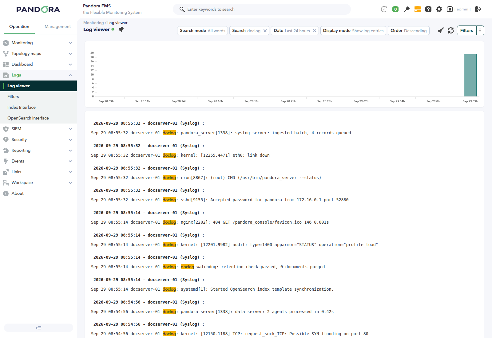

### Advanced display and search

In the **Advanced options** tab the view can be changed and the logs turned
into charts. The **Display mode** decides whether text entries or a chart are
shown. For the chart a **capture model** has to be chosen (**Use capture
model**): a set of regular expressions and identifiers that extract values from
each line.

The default model is **Apache log model**, which understands the `access_log`
of Apache in standard format and draws response times grouped by page and
response code. A few more models come from the factory and you can create your
own with the edit and create buttons.

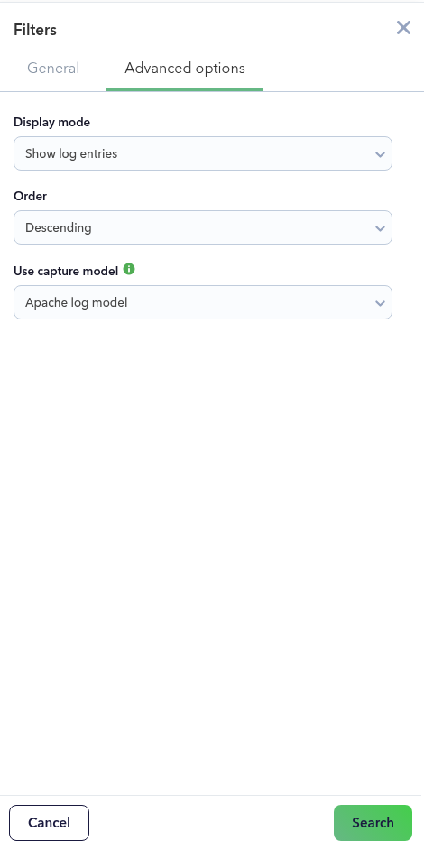

### Multiline log entries

A *stack trace* does not fit on one line. Neither does a request and its XML
response, or an exception with twenty stack frames. Until version 806, the
viewer split those entries into one row per physical line; since 806 it can show
them for what they are, a single block, if the collection asks for it.

The server does not guess where an entry starts and ends: the collection decides
that. For an entry to be shown whole, the collection has to send it as **one
physical line** and, inside it, encode each internal line break with the literal
`{{\n}}` marker (two braces, a backslash, `n` and two braces). The marker is
exactly that: `{{/n}}` does nothing.

From there, the server does three things, in this order:

1. It splits the received content by line breaks, as usual, and gets one string
   per entry.
2. It replaces **all** occurrences of `{{\n}}` in each string with a real line
   break.
3. It indexes the entry as **a single OpenSearch document**, with the breaks
   inside the content.

Because the replacement happens after the split, no new documents appear: one
logical entry is still one document. The viewer renders the content inside a
`<pre>` with line wrapping (`pre-wrap`), so the breaks are shown as they are,
just like in Windows events.

For example, the collection sends this line:

```text
2026-06-11 16:49:57 ERROR Processing request 471{{\n}}  at Service.Process (Service.cs:120){{\n}}  at Host.Run (Host.cs:45)
```

And the viewer shows a single three-line entry:

```text
2026-06-11 16:49:57 ERROR Processing request 471
  at Service.Process (Service.cs:120)
  at Host.Run (Host.cs:45)
```

!!! note "What does not change"
    - The bundled collection still sends one line per entry, and the server
      still splits it the same way. Without the marker, the viewer looks exactly
      as before.
    - There is no data migration, mapping change or new index: existing indexes
      keep being used.
    - **Windows events** were already stored as a single document and do not go
      through the split; their behaviour does not change.
    - There is no new configuration option, and no restart other than the usual
      server update is needed.
    - One entry is one event. If a line contains the literal `{{\n}}` by chance,
      it will also become a line break; unlikely, but worth knowing.
    - Every line in the block shares the timestamp of the collection cycle, not
      its own.

!!! tip "Grouping in the viewer is not the solution"
    Grouping by agent, origin and date in the viewer was ruled out.
    `@timestamp` is the collection cycle's, so that grouping would join every
    entry of the run, not one logical entry. Grouping is therefore the
    collection's responsibility.

For SIEM, the entry arrives already decoded: a single event with its line
breaks, and the *decoders* and *rules* apply to the whole block, not to each
line. This is explained in [SIEM](../parte-7/7.2-siem.md#log-collection-for-siem).

### Frequent filters

If you repeat the same combination of filters, save it: **Save filter**, you
give it a name and **Save**. Later you bring it back with **Load filter**,
choosing it from the list. A saved filter can be overwritten with the current
changes.

In **Operation → Logs → Filters** those filters are managed: edit them, delete
them one by one or in bulk, and create new ones.

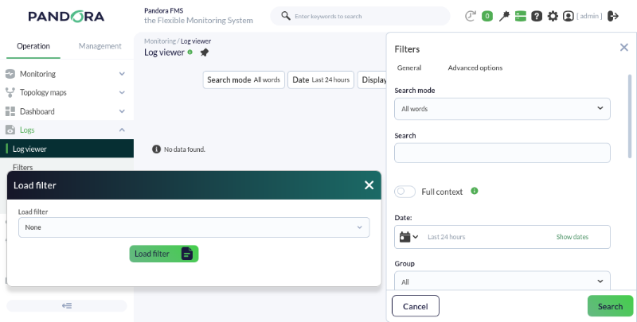

### Saved filters as pinned elements

The pinning system of Pandora FMS allows leaving the **Log viewer** at hand in
the menu, with the filters already set. It is done with the drawing pin icon
next to the title of the section. When the filter is loaded again, the pin
appears disabled, and if you click it the pinning is removed. Pinned elements
are independent of frequent filters; they do not get in each other's way.

## Log source in the agent view

Every agent that sends logs says so on its own page (see [2.21, Common agent
configuration](2.21-configuracion-comun-de-los-agentes.md#the-tabs-of-the-agent-view) for the other tabs). In the agent view a
**Logs** box appears with one row per origin, where you see the **date of the
last update** and a **Review** button (the magnifying glass) that opens the Log
Viewer already filtered by that agent and that origin. It is the most
convenient way to jump from "this agent stopped sending logs" to "here are its
last messages".

By default, both the box and the viewer work with the **last 24 hours**; it is
changed when needed.

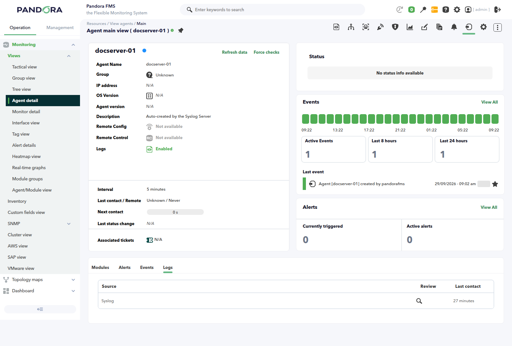

## Monitoring the log engine itself

And what if the one that goes quiet is the engine itself? When the collector is
enabled, the Pandora FMS server watches itself: it generates a battery of
modules on OpenSearch and adds them to its **self-monitoring agent**
(`pandora.internals` by default). They appear like any other module, in
**Resources → Manage agents**, inside that agent.

There are fourteen of them, on top of the usual internal modules of the server:

| Module | What it measures | Values |
|---|---|---|
| **Log server connection** | Connection with the engine | `1` connected; `0` not connected |
| **Total sources** | Distinct origins with logs | Whole number (`0` or more) |
| **Total documents** | Stored documents (lines) | Whole number (`0` or more) |
| **Opensearch nodes online** | Nodes that answer in the cluster | Whole number (`0` or more) |
| **Opensearch CPU %** | Cluster CPU | `0`–`100` % |
| **Opensearch available memory** | Free memory of the system | `0`–`100` % |
| **Opensearch JVM heap usage** | Usage of the JVM heap | `0`–`100` % |
| **Opensearch Disk usage** | Used disk | `0`–`100` % |
| **Opensearch Total shards** | Occupancy of the shard capacity per node | `0`–`100` % (it can go over `100` if there are more shards than capacity) |
| **Opensearch Index Health** | Health of the most recent index | `green`, `yellow` or `red` |
| **Opensearch Index Status** | Status of the most recent index | `open` or `close` |
| **Opensearch daily index** | The most recent index is today's | `0` yes; `1` no |
| **Opensearch index deletion** | Purge of old indexes | `0` normally; `1` it is not being purged |
| **Longest data archived** | Date of the oldest data | Date `YYYY-MM-DD HH:MM:SS` |

With this, what really hurts is detected: that the engine stopped ingesting
logs. To find out without looking by hand, set up an alert on any of these
modules, as with any other
([Alerts and notifications](../parte-5/5.5-alertas-y-notificaciones.md)).

## Permissions

The viewer follows the usual permissions on agents. To open it, **agent read**
permission (`AR`) is needed. Without it, the screen is not shown. Searches also
respect the groups on which the user has read permission, just like the rest of
the web console.
