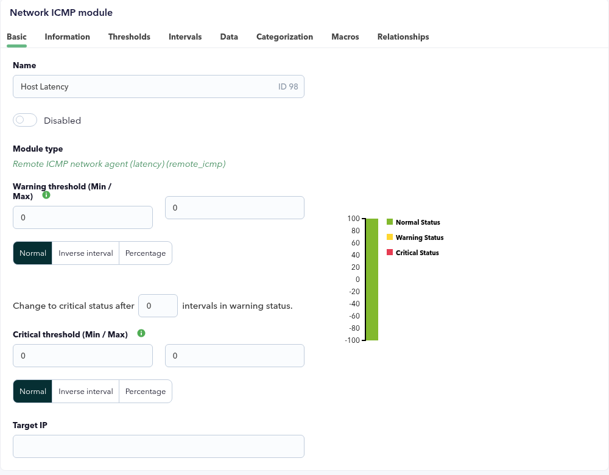
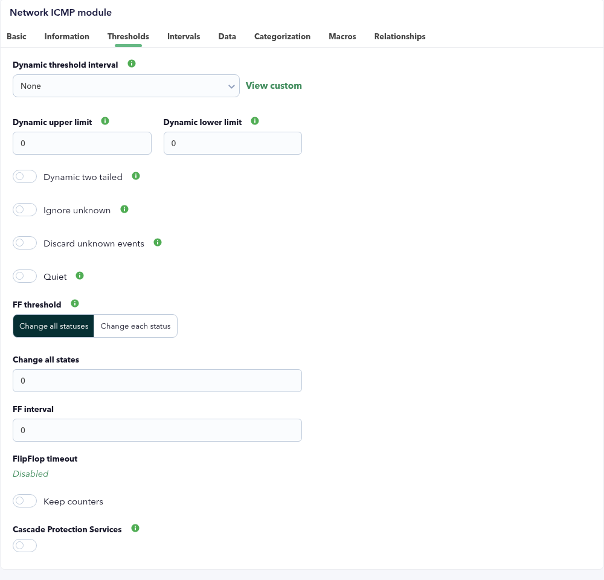
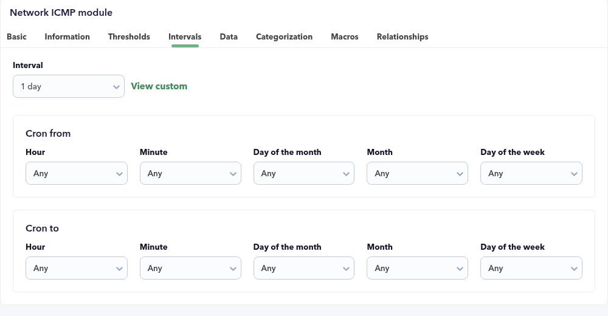
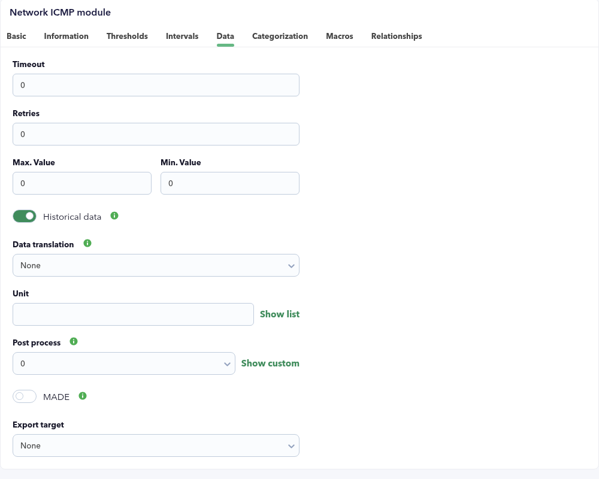
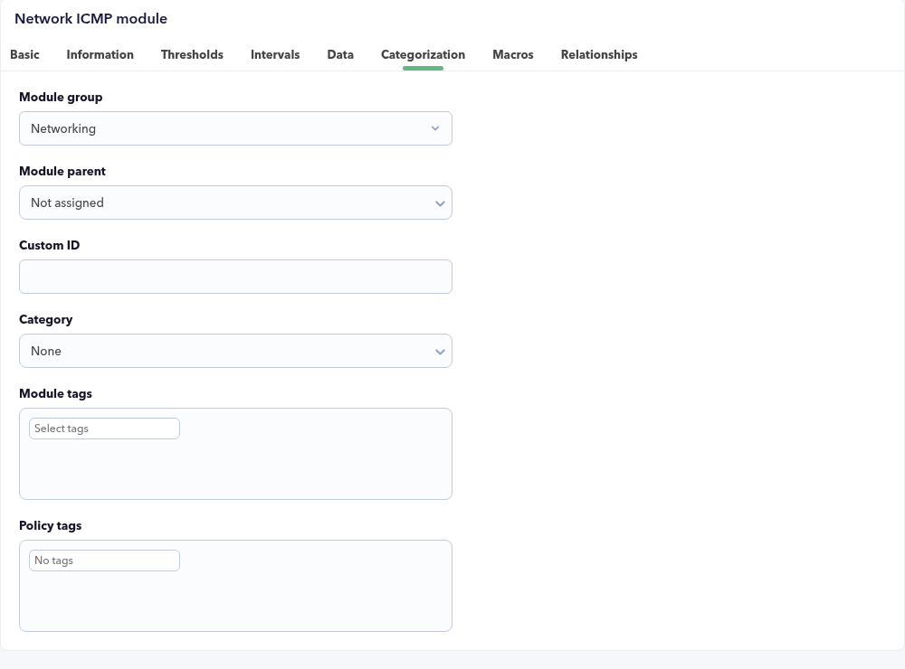

# Common module configuration

A module is a specific measurement of an agent: "how much CPU it uses", "does port 443 answer", "how many orders are waiting in the queue". What changes from one module to another is **how the data is obtained** (a command on the EndPoint, a `ping` from the server, an SNMP query, an API request), and that is explained in the chapter of each technology. What does not change, or changes little, is everything else: how often it is measured, which values count as normal, what happens when the data does not arrive, how much is stored and how it is organized. That "everything else" is a single form, the same for almost every type, and this chapter explains it once so it is not repeated in the nineteen previous ones.

The agent counterpart of this chapter is [2.21, Common agent configuration](2.21-configuracion-comun-de-los-agentes.md). You reach the module form from **Manage agents**, with the agent's **Modules** button and **Create module**, or by editing an existing module. A policy (see [2.10, Monitoring policies](2.10-politicas-de-monitorizacion.md)) uses the same form to define modules that it then spreads across agents.

The form is split into eight tabs:

| Tab | What it contains |
|---|---|
| **Basic** | Name, type, warning and critical thresholds, and the fields specific to the module type (a URL, an OID, a command…). |
| **Information** | Description and per-state instructions. |
| **Thresholds** | Dynamic thresholds, unknown, quiet mode and flip-flop protection. |
| **Intervals** | Execution interval and cron-style scheduling. |
| **Data** | Timeout, retries, minimum and maximum values, historical data, unit and post process. |
| **Categorization** | Module group, parent, identifier, category and tags. |
| **Macros** | The module's custom macros. |
| **Relationships** | Direct or failover relationships with modules of other agents. |

!!! note "Not every field always appears"
    The form adapts to the module type. An EndPoint module has no timeout or retries, because the server does not run it; an API custom module has no thresholds, because its status comes from its conditions; and the *FlipFlop timeout* field only exists in asynchronous modules. If a field in this chapter is not in your form, the module type does not use it.

## Basic data

| Field | What it does |
|---|---|
| **Name** | Module name, unique within its agent. It appears in views, reports and alerts, so it should be understandable without seeing the agent: "CPU usage", not "mod3". |
| **Disabled** | The module stops running and receiving data, but keeps its configuration and history. It is the way to switch it off without losing it. |
| **Module type** | The kind of data it returns: numeric, boolean (`proc`: 1 normal, 0 critical), alphanumeric or incremental, plus the asynchronous ones. The type decides which thresholds make sense. Type names and their EndPoint usage are in [2.1](2.1-monitorizacion-con-endpoints.md#creating-your-own-modules). |
| **Description**, in **Information** | Free text. It is the first thing whoever receives an alert sees, so it deserves a sentence. |

## Thresholds and statuses

A module can be in one of four statuses: **normal**, **warning**, **critical** and **unknown**. The first three come from comparing the data with the thresholds; the last one, from the data not arriving.

The warning and critical thresholds are in the **Basic** tab. Each has a minimum and a maximum value, and three modes:

| Mode | When the status changes |
|---|---|
| **Normal** | The value is **inside** the range. If you set no maximum, any value above the minimum counts; in numeric modules, a maximum of `0` means infinity. |
| **Inverse interval** | The value is **outside** the range. It also works with alphanumeric modules. |
| **Percentage** | The new value is compared with the previous one, and the status changes if the variation, as a percentage, exceeds the increase (maximum) or decrease (minimum) given. |

If a value meets the warning and the critical threshold at the same time, **critical wins**.

!!! example "CPU with warning from 70 and critical from 90"
    Warning threshold with minimum `70` and maximum `95`; critical threshold with minimum `90` and maximum `0` (no upper limit). The two ranges overlap between 90 and 95.

    | Value received | Status | Why |
    |---|---|---|
    | `40` | Normal | Outside both ranges. |
    | `75` | Warning | Inside the warning range. |
    | `92` | Critical | Meets both and critical prevails. |
    | `99` | Critical | Above the critical minimum, no upper limit. |

Below the warning threshold, **Change to critical status after** *N* **intervals in warning status** promotes to critical a module that has been in warning for *N* runs in a row. With `2`, the sequence warning → warning → warning goes to critical. If a module stays "in warning" forever because nobody looks at it, this field keeps it from becoming decoration.

### When the data does not arrive: unknown

If a module goes more than **two intervals** without receiving data, it enters unknown status. Three settings in the **Thresholds** tab govern that behavior:

| Field | What it does |
|---|---|
| **Ignore unknown** | The module never goes to unknown: it keeps its last known status. Useful for data that arrives sporadically; dangerous if you enable it to "clean" a red screen, because it stops telling you the module is dead. |
| **Discard unknown events** | The module does go to unknown, but does not generate the event. |
| **Quiet** | The module keeps receiving and storing data, but generates no events and fires no alerts. Used while testing a new module or during an intervention. |

### Dynamic thresholds

Instead of setting the values by hand, the module can calculate its thresholds from its own history. It is enabled by choosing a **Dynamic threshold interval** in the **Thresholds** tab: the system takes the data of that period, calculates the mean and the standard deviation and sets the thresholds from them.

| Field | What it does |
|---|---|
| **Dynamic upper limit** / **Dynamic lower limit** | Adjust the calculated limit, as a percentage. If the mean is around 60 and the upper critical threshold is 80, a dynamic upper limit of `10` raises it to 88. |
| **Dynamic two tailed** | Adds a lower threshold to the upper one, so both very high and very low values change the status. |

### Flip-flop protection

A value that oscillates between good and bad on every cycle is an interpretation problem: the module changes color constantly and the alerts never stop. The **FF threshold** requires the new status to repeat several times in a row before the change is accepted. With `0` (the default) the module changes status as soon as it receives an out-of-range value; with `2`, two more consecutive critical values are needed before it goes critical.

- **All state changing** / **Each state changing**: use the same tolerance for any change, or a different one for the change to normal, to warning and to critical.
- **FF interval**: shorter interval for the next check when the protection is triggered, so the confirmation arrives sooner than usual.
- **FlipFlop timeout**: only in asynchronous modules; the identical data that confirm the change must arrive within that time.
- **Keep counters**: advanced option that counts per status instead of per value.

The EndPoint equivalents (`module_ff_interval`, `module_min_ff_event`…) are in [2.1](2.1-monitorizacion-con-endpoints.md#post-processing-flip-flop-and-other-module-settings).

!!! tip "It is a tool for unstable environments"
    With flip-flop, the console takes longer to reflect a real failure: it has to repeat. Use it where noise is the problem, not by default.

## When it runs

In the **Intervals** tab, the **Interval** is the period in which the module must return data. In EndPoint modules it is expressed as a multiple of the agent interval: the console shows it as "Agent interval ×*N*". In modules run by the server it is the period at which the check is launched. It is also the reference for the unknown status: two intervals without data.

The **Cron from** and **Cron to** fields restrict when the module runs, with five fields: minute, hour, day of the month, month and day of the week. Three cases:

| Configuration | When it runs |
|---|---|
| All fields on "Any" (default) | Always, no restriction. |
| Only **Cron from**, with specific values (`15 20 * * *`) | When it matches those values: every day at 20:15. |
| **Cron from** and **Cron to** (`5 * * * *` and `10 * * * *`) | During the interval: every hour, between minutes 5 and 10. |

The EndPoint equivalent is `module_crontab`, explained in [2.1](2.1-monitorizacion-con-endpoints.md#scheduled-monitoring).

In the **Data** tab are the **Timeout** and the **Retries**: the seconds to wait for the response of a remote check and how many times it is repeated if it fails. They make no sense in local EndPoint modules. With `0` the server default is applied.

## Data: what is stored and how it is shown

All in the **Data** tab:

| Field | What it does |
|---|---|
| **Min. Value** / **Max. Value** | Range the module may return. The server **discards** data outside it. |
| **Historical data** | With it disabled only the last known value is stored: there are no graphs, but database space is saved. It is only justified when the system needs to run faster. |
| **Unit** | Text shown next to the value (`%`, `MB`, `ms`). |
| **Post process** | Multiplier applied to the value **before storing it**. Accepts decimals. |
| **Data translation** | Applies a translation or formula when displaying the data; if you choose one, the unit field is disabled. |
| **Export target** | Export server the module is sent to, if you have one configured. |
| **MADE** | Numeric modules only: the data is processed by the MADE engine (if active) and generates events automatically. |

!!! example "From bytes to megabytes"
    A module returns bytes and you want to see megabytes: post process `0.00000095367` (1 / 1,048,576) and unit `MB`. A value of `5242880` is stored as `5`.

!!! warning "Changing post process with data already stored"
    The data is stored already transformed. If you change the multiplier on a module with history, old and new data end up on different scales and the graphs become inconsistent. Set the scale when you create the module, not afterwards.

## Organizing modules

In the **Categorization** tab:

| Field | What it does |
|---|---|
| **Module group** | Functional group of the module (network, system, database…), different from the agent group. Used to filter and group views. |
| **Module parent** | Module this one depends on, for the hierarchy of cascade protection. |
| **Custom ID** | Your own identifier, for example from your inventory. |
| **Category** | No effect in the regular interface; it is meant to be used with the Command Center. |
| **Module tags** | Tags that propagate to the module's events, serve as a filter in reports and views, and can restrict a user's access to certain modules. |
| **Policy tags** | Tags the module receives from its policy. |

Other settings that organize or document the module:

- **Cascade Protection Services**, in **Thresholds**: if the module is part of a service, alerts only fire at the highest level of the tree where the conditions are met, not at all levels at once.
- **Critical, warning and unknown instructions**, in **Information**: what the person receiving the alert should do. This is the place for "restart service X, and if that fails, call Y".
- **Macros**: variables of the module itself, with names like `_name_`, that can be used in alerts. To get the same at agent level, use the agent custom fields and the `_agentcustomfield_N_` macro (see [2.21](2.21-configuracion-comun-de-los-agentes.md#agent-custom-fields)).
- **Module relations** (direct or failover): allow one module to replace another in the SLA calculation.
- **Import from credential store**: in the types that support it, fills the fields from a stored credential (see [2.2, Credential manager](2.2-gestor-de-credenciales.md)). It only copies the data into the form; the module is not linked to the credential.

## In a policy and in bulk operations

The form is the same, but it behaves differently:

- **In a policy**, the fields the policy controls appear locked in the agent's module. They are changed in the policy, not agent by agent. Some fields, such as module tags, are not available in a policy module. See [2.10](2.10-politicas-de-monitorizacion.md).
- **In a bulk operation** each field has a lock: only the fields whose lock you open are changed, and the rest are respected. See [The lock: what is changed and what is left alone](2.11-operaciones-masivas.md#the-lock-what-is-changed-and-what-is-left-alone) in 2.11.

## Checking and troubleshooting

| Symptom | Likely cause | Check |
|---|---|---|
| The module is in unknown status. | It has gone more than two intervals without data: the agent or the check does not respond. | Look at the time of the last data; check the agent or the server running the module. |
| A module with old data looks normal and never goes unknown. | **Ignore unknown** is enabled: it keeps the last status. | Review the **Thresholds** tab. |
| The data exceeds the threshold and the status does not change. | FF threshold above 0, or the wrong threshold mode (normal versus inverse). | Review the FF threshold and the mode of each threshold. |
| The module changes status and there is no alert. | **Quiet** mode, or cascade protection delegates it to the parent service. | Review **Quiet** and **Cascade Protection Services**. |
| The module has data but no graph. | **Historical data** disabled. | Review the **Data** tab. |
| Data that does arrive is missing. | Outside **Min. Value** and **Max. Value**: the server discards it. | Review the range in the **Data** tab. |
| Graphs show a scale jump. | Post process was changed with data already stored. | Review the change history and reapply the scale from a clean date. |
| The module does not run at the expected time. | Restrictive cron schedule, or a long interval. | Review **Cron from**, **Cron to** and the interval. |
