# Common agent configuration

An agent is the unit Pandora FMS uses to organize what it watches: a host, a network device or a service that groups modules, belongs to a group and has a status of its own. What changes from one agent to another is what is monitored on it, and that is explained in the chapter of each technology. What does not change is the **agent sheet**: the view where it is consulted and the form where it is configured. This chapter explains it once, as [2.20, Common module configuration](2.20-configuracion-comun-de-los-modulos.md) does for the module form, so the rest of the chapters can link here instead of repeating it.

The sheet has two halves:

- **The agent view**, with a tab bar (*Main*, *Alerts*, *Custom fields*…) and, in the main tab, the agent status and the list of its modules.
- **The edit form**, reached with the **Manage** tab of the view or from **Manage agents**, with three or four inner tabs: **Overview**, **Advanced**, **Monitoring** and **Custom fields**.

The sheet is shown to anyone with read or write permission on any group of the agent, whether primary or secondary (see [4.1, Secondary groups](../parte-4/4.1-grupos-perfiles-y-tags.md#secondary-groups)). Editing it requires write permission. In [bulk operations](2.11-operaciones-masivas.md) the same form is reused with locks, and in the Command Center the **Monitoring** and **Custom fields** tabs are not available.

## The tabs of the agent view

In the header of the view the tabs are icons, and the label of each one appears when the cursor is over it. The tab bar is not the same for every agent. Some tabs are always there; others only appear if the agent has something to show in them. When an expected tab is missing, it is almost always because its condition is not met.

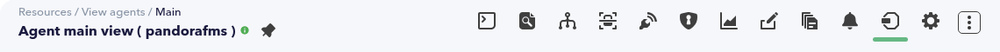

**Tabs that are always present**

| Tab | What it shows |
|---|---|
| **Main** | General status, contact, events, alerts, modules and custom fields. It is the default tab. See [The Main tab](#the-main-tab). |
| **Alerts** | The agent's alerts and their status. |
| **Custom fields** | The values of the agent's custom fields. See [Agent custom fields](#agent-custom-fields). |
| **Graphs** | Graphs of the agent's modules. |
| **External Tools** | External tools configured for the agent. |
| **Traps view** | SNMP traps filtered by this agent. See [2.7](2.7-monitorizacion-de-traps-snmp.md). |

The **Alerts** tab open, as an example of a tab in the bar:

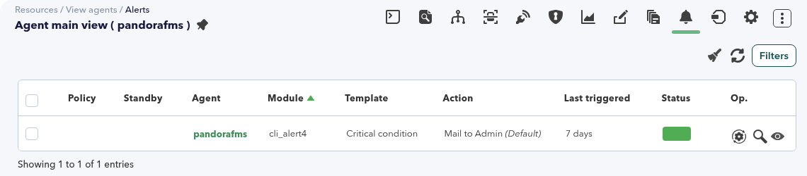

**Tabs that depend on a condition**

| Tab | Appears when… |
|---|---|
| **Manage** | The user has write permission on any group of the agent. |
| **Interfaces** | The agent has SNMP interface modules. See [2.6](2.6-monitorizacion-de-redes.md). |
| **Inventory** | There is inventory data for the agent. See [3.1](../parte-3/3.1-inventario.md#the-agents-inventory-tab). |
| **GIS data** | GIS is enabled in the console. See [5.11](../parte-5/5.11-mapas-gis.md#agent-view-and-gis-data). |
| **Issues** | The ITSM integration is enabled and the agent has tickets. See [5.8](../parte-5/5.8-gestion-de-incidencias-itsm.md). |
| **URL address** | The agent has a URL address configured (the field of the same name, in **Advanced**). |
| **Log viewer** | Log collection is active and the agent has sources. See [2.19](2.19-recoleccion-y-monitorizacion-de-logs.md#log-source-in-the-agent-view). |
| **Pandora RC** | The custom field that holds the Pandora RC key is configured and the agent has a value in it. See [3.2](../parte-3/3.2-control-remoto-con-rc.md). |
| **SAP view** | The agent is a SAP agent. |
| **Security hardening** | The agent has security inventory data. |
| **Vulnerabilities** | Vulnerability analysis is active (on the agent or globally) and vulnerabilities have been found. |
| **View RMM** | The agent is an RMM agent. |
| **WUX Console** | The agent has web user experience modules. See [2.14](2.14-monitorizacion-de-experiencia-de-usuario-ux.md). |
| **URL Route Analyzer** | The agent has a route steps module. |
| **Network config manager** | The user has NCM read permission, configuration management is enabled on the server and on the agent, and the agent has an IP address. See [3.6](../parte-3/3.6-gestion-de-configuracion-de-equipos-de-red-ncm.md). |
| **Policies** | Policies exist. See [2.10](2.10-politicas-de-monitorizacion.md). |
| **Collection** | Collections exist. See [2.9](2.9-colecciones.md). |
| **Audit info view** | The user has platform management permission. See [7.8](../parte-7/7.8-auditoria-interna.md). |
| Extension tabs | Each installed extension, according to its own permissions (for example, the VMware and RHEV managers). |

### The three-dot menu

At the end of the bar there is a three-dot icon. Clicking it opens a menu with the tabs available for the agent, like the bar but with the label written out, so there is no need to hover over each icon. In the agent view, the management tabs (**Modules**, **Alerts** and **Policies**) hang under **Manage**. The edit bar has the same menu.

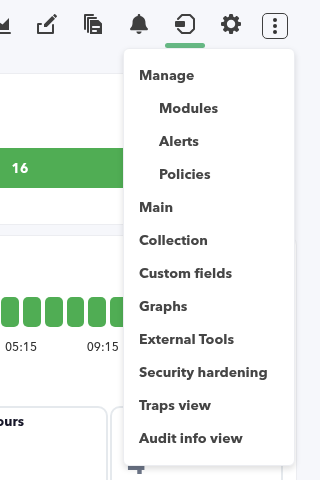

What is shown is decided by the **Tabs menu** setting, under **Management → Settings → System Settings → Visual styles**, **Behaviour** tab (see [9.2](../parte-9/9.2-referencia-completa-de-configuracion-de-la-consola.md#4-visual-styles)). It is a console-wide setting: it affects every screen with tabs and every user.

| Value | What it shows |
|---|---|
| **Show both (tabs and menu)** | The icon bar and the three-dot menu. This is the default. |
| **Show only icons** | Only the icon bar; the three-dot icon disappears. |
| **Show only menu** | Only the three-dot menu; of the bar, only the active tab remains. |

!!! note "A module's data, from the module"
    A module's data view (received data, main or historical database, from now or by range) has no tab of its own. It is opened from the module's links in the **Main** list.

## The Main tab

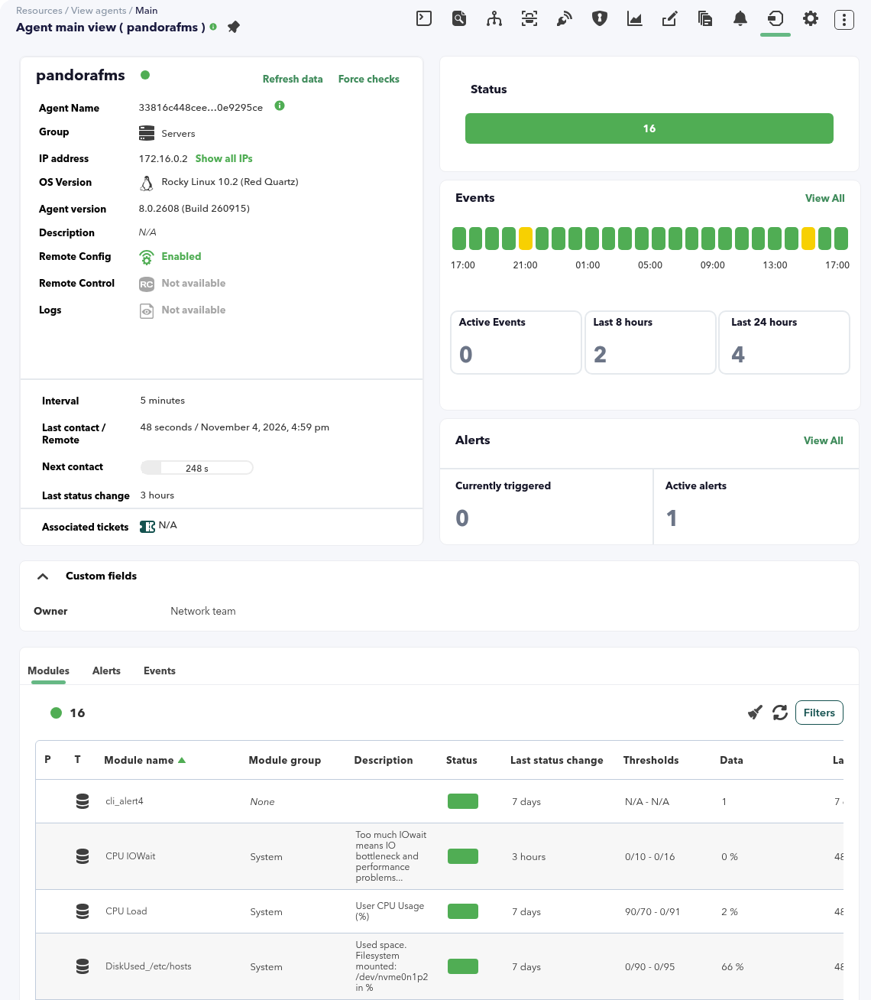

The **Main** tab gathers, from top to bottom:

| Block | What it contains |
|---|---|
| **General overview** | Name, group, IP addresses, operating system version, agent version, description, and whether remote configuration, remote control and logs are enabled. |
| **Contact** | Interval, last contact (local and remote), next contact with its progress bar, and last status change. |
| Actions | **Refresh data** and **Force checks**, the latter with permission to do so. |
| Status bar | Number and percentage of normal, warning, critical, unknown and not initialized modules. |
| Events | Active events, events from the last 8 and 24 hours, and the last event. |
| Alerts | Alerts currently fired and active alerts. |
| Security | Results of security monitoring, vulnerabilities, hardening and file integrity. Only shown if there is data. |
| **Custom fields** | The fields marked to be shown in the main view. |
| **Modules** | The agent's module list, with their status and data. See [The module list](#the-module-list). |

The event counts in this block do not filter by the user's event permissions, although the events subtab does require them. If a count does not match what the user sees in the events console, that is the reason.

### Agent status and labels

The agent status comes from the statuses of its modules. It is **Not initialised** if all modules are, or there are none; otherwise it is **Critical** if any module is, then **Warning**, then **Unknown** and, if none applies, **Normal**. A module becomes unknown when twice its interval passes without receiving data, unless the agent or the module has **Ignore unknown** enabled.

Next to the name, labels may appear that explain why the agent is not behaving as expected. If several apply, the first one in this list is shown:

1. **Disabled**, if the agent is in disabled mode.
2. **Quiet**, if it is in quiet mode.
3. **Event Storm protection**, if the server has throttled the agent's event generation.
4. **In scheduled downtime**, if a scheduled downtime is active (see [3.8](../parte-3/3.8-paradas-planificadas.md)).

### The module list

Below the summary, the **Modules** subtab lists the agent's modules. It can be filtered by status (all, critical, alert fired, normal, not normal, warning, unknown), by name and by **Module group**, and it has a **Hierarchy mode** that shows the modules as a tree according to their relationships. The columns are: source policy, type, name, module group, description, status, last status change, thresholds, data, last contact, graphs and actions. "Not initialised" is counted in the status bar but is not a filter. What each module setting means is in [2.20](2.20-configuracion-comun-de-los-modulos.md).

The bar also has the **Events** (with event read permission, see [5.4](../parte-5/5.4-consola-de-eventos-centralizada.md)), **Alerts**, **Logs** (if collection is active) and **Interfaces** (if there are interface modules).

## The agent edit tabs

The edit view (**Management → Resources → Manage agents** and the agent) has its own tab bar, different from the one in the view. The tabs are icons too, with the label shown on hover, and their number depends on the user's permission and on what the agent has.

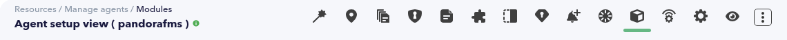

With permission to disable agents but without write permission, the bar is reduced to **View**, **Modules** and **Alerts**. With write permission the rest appears, according to these conditions:

| Tab | What it does | Appears when… |
|---|---|---|
| **View** | Goes back to the agent view. | Always. |
| **Setup** | The agent edit form. See [The edit form](#the-edit-form-overview). | Write permission. |
| **Remote configuration** | Edits the agent's remote configuration file. See [2.1](2.1-monitorizacion-con-endpoints.md#remote-configuration-from-the-web-console). | The agent has remote configuration and the file is writable. |
| **Remote satellite configuration** | Edits the remote configuration of a satellite. | The agent has a remote satellite configuration. |
| **Modules** | The agent's module table. See [The module edit view](#the-module-edit-view). | Always. |
| **Network config manager** | Management of the network device configuration. See [3.6](../parte-3/3.6-gestion-de-configuracion-de-equipos-de-red-ncm.md). | The user has NCM permission, the NCM server is enabled and the agent has an IP address. |
| **Alerts** | Assigns alerts to the agent's modules. See [5.5](../parte-5/5.5-alertas-y-notificaciones.md). | Always. |
| **Security** | Security monitoring settings of the agent: hardening, vulnerability scanning and file integrity. Needs remote configuration and agent version 774 or higher. | Write permission. |
| **Inventory** | The agent's inventory modules. See [3.1](../parte-3/3.1-inventario.md). | Write permission. |
| **Plugins** | The agent's plugins. | The agent has remote configuration. |
| **Module log collection** | Log collection tied to modules. See [2.19](2.19-recoleccion-y-monitorizacion-de-logs.md). | The agent has remote configuration. |
| **Manage policy** | The policies applied to the agent. See [2.10](2.10-politicas-de-monitorizacion.md). | Policies are available. |
| **Collection** | The file collections of the agent. See [2.9](2.9-colecciones.md). | Collections are available. |
| **GIS data** | The agent's position on the map. See [5.11](../parte-5/5.11-mapas-gis.md). | Write permission. |
| **Agent wizard** | Opens three wizards that create modules from what the agent discovers: **SNMP Wizard**, **SNMP Interfaces wizard** and **WMI Wizard**. See [2.6](2.6-monitorizacion-de-redes.md). | Write permission. |
| **Incidents** | The incidents associated with the agent. | The agent has incidents. |
| Extension tabs | Each extension that adds a tab of its own to the edit view. | According to the extension's permissions. |

## The edit form: Overview

The **Overview** tab holds the agent's identity and how it relates to the server.

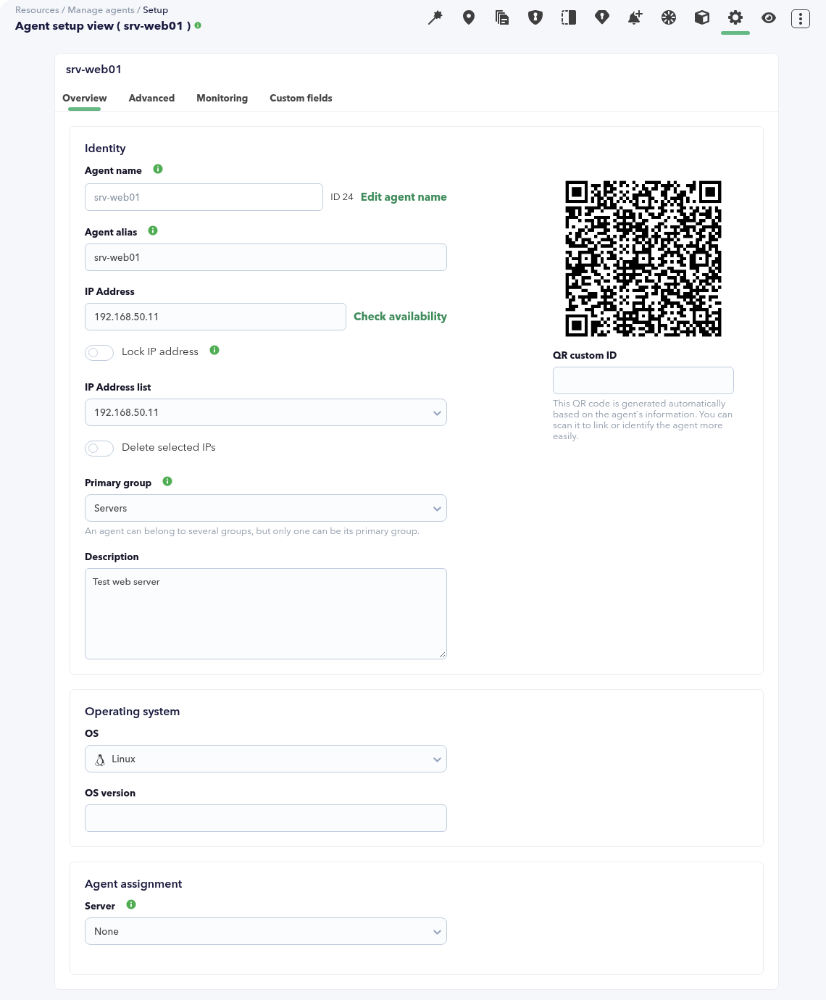

| Field | What it does |
|---|---|
| **Agent name** | Internal, unique identifier. With **Use alias as name** disabled, the console generates it. Changing it after the agent is created warns about the risk of duplicates: two agents with the same name get mixed up on the server. It is not shown in the interface. |
| **Agent alias** | Visible name. It can be repeated; a duplicate alias is only rejected if **Use alias as name** is active. |
| **Use alias as name** | Only exists when creating the agent. By default it takes the value of the global setting. |
| **QR custom ID** | The agent's own identifier, available as the `_agentcustomid_` macro. The characters `/ \ | % # & $` and HTML tags are removed. |
| **IP Address** | The agent's IP. The format is validated and, if another agent already uses it, confirmation is requested before saving. |
| **Check availability** | Checks whether the address responds. |
| **Lock IP address** | Prevents the IP from being updated automatically when the EndPoint reports a different one. |
| **IP Address list** and **Delete selected IPs** | Manage the agent's additional addresses. |
| **Primary group** | Required. It is locked if the user has no permission on it or if the group has reached its agent limit. |
| **Interval** | How often the agent contacts the server. It is also the reference for unknown: after twice that time without data, the modules become unknown. By default, the global value or 300 seconds; the console warns below 5 minutes. |
| **Description**, **OS** and **OS version** | Free text and selector. |
| **Add default monitoring** | Only exists when creating the agent and is enabled by default: it adds the *Host Alive* and *Host Latency* modules. |
| **Server** | Preferred server for the agent's remote tasks: **None**, **Autobalance** or a specific one. With **None**, the agent's remote modules do not run. |
| **Enable auto High Availability** | Enabled by default. |
| **Satellite server** | Read-only; shows the assigned satellite, if any. |

!!! example "Two agents with the same alias"
    Two branches have a host called "checkout-server". With **Use alias as name** disabled, both agents can have that alias without conflict, because each gets a different internal name. With the setting enabled, the console rejects the second one.

## The edit form: Advanced

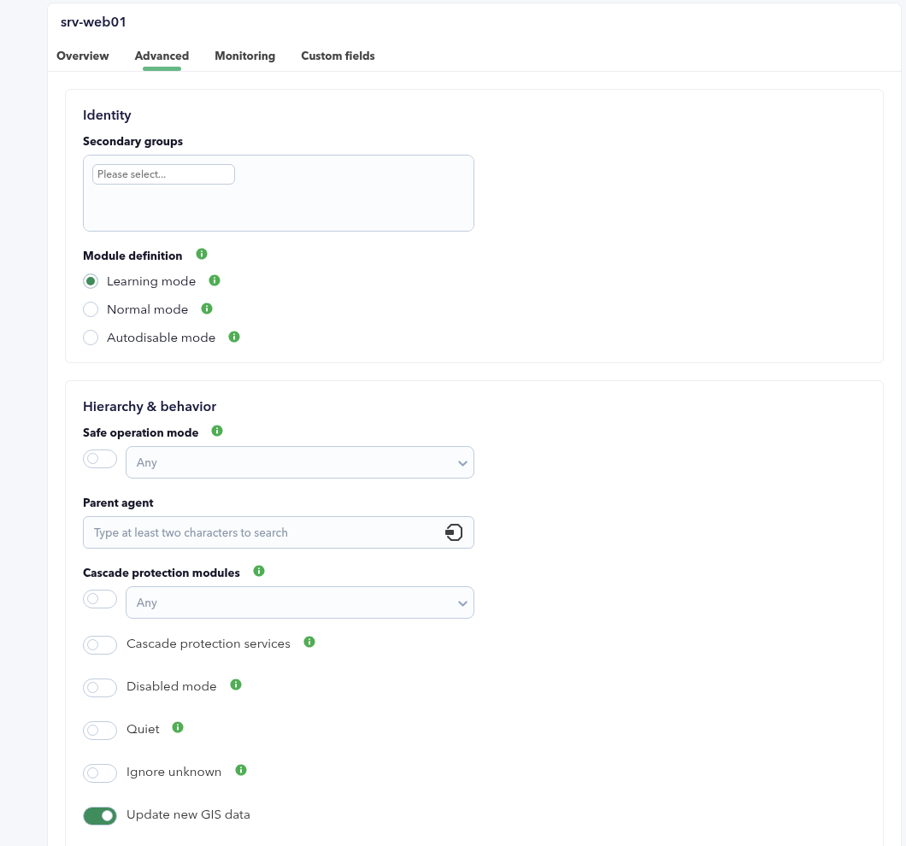

The **Advanced** tab decides how the server treats the agent. It is split into three blocks: **Identity**, **Hierarchy & behavior** and **Configuration & appearance**. It has the most side effects, so it is worth reading what each option does.

### Secondary groups

**Secondary groups** gives users from other groups access to the agent without duplicating it. The primary group cannot also be a secondary one. See [4.1](../parte-4/4.1-grupos-perfiles-y-tags.md#secondary-groups).

### Module definition

**Module definition** sets what the server does with the data that arrives in the EndPoint's XML:

| Mode | New modules | Agent data in the XML | Disables itself |
|---|---|---|---|
| **Learning mode** (the default) | Creates them automatically. | Overwrites interval, address, versions, time zone and parent. | No. |
| **Normal mode** | Ignores modules that are not declared in the console. | Does **not** overwrite interval, operating system version, EndPoint version, time zone or parent agent. | No. |
| **Autodisable mode** | Creates them automatically. | Same as learning mode. | The agent disables itself when all its modules are unknown and re-enables itself as soon as data arrives. |

Normal mode has an effect that cannot be deduced from its name: besides not creating modules, it freezes the agent's data. If you change the EndPoint's interval and the console still shows the old one, check this field.

### Safe operation mode

**Safe operation mode** disables the other modules of an agent when a specific one becomes critical. The checkbox only enables the selector; what is saved is the chosen module. If the chosen module becomes critical, the server disables the rest of the agent's modules and re-enables them when it recovers, refreshing their timestamps so they do not become unknown. With the value **Any** the server does nothing: a module has to be chosen.

### Parent agent and cascade protection

**Parent agent** establishes the hierarchy between agents (for example, the switch a server hangs from). It is searched by name and autocomplete starts at two characters.

**Cascade protection** is configured on the child and prevents an alert storm when the parent goes down. When active, the server inhibits the child agent's alerts if the parent, or any of its ancestors (up to 1024 levels), has a fired alert whose template has **critical** priority. Two clarifications:

- It looks at **fired alerts**, not at the module status. A module in critical whose alert has not fired (because of an occurrence threshold, for example) does not trigger the protection.
- **Cascade protection modules** narrows it: with **Any**, any critical alert of the parent is enough; with a specific module, only that module's alerts count.

**Cascade protection services** is independent: it only acts if the service has its own cascade protection enabled. See [5.3](../parte-5/5.3-monitorizacion-de-negocio-y-servicios.md) and, for the per-module equivalent, [2.20](2.20-configuracion-comun-de-los-modulos.md#organizing-modules). Alerts are explained in [5.5](../parte-5/5.5-alertas-y-notificaciones.md).

### Disabled, quiet and ignore unknown

Three switches that look alike and do not do the same thing:

| Option | Data | Alerts and events | What else happens |
|---|---|---|---|
| **Disabled mode** | Not processed. | Not generated. | Excluded from the unknown calculation. When saving with the mode active, all the agent's fired alerts are acknowledged, and the agent is put on hold in its remote configuration. In many listings it does not even appear. |
| **Quiet** | Still processed. | Alerts are not executed and events are not generated. | The **Main** tab shows "(Quiet)" next to the name. |
| **Ignore unknown** | Still processed. | Work normally. | The server does not mark the agent's modules as unknown for lack of data: they keep their last status. By default it takes the global value. |

If the reason is a stop with an end date, a [scheduled downtime](../parte-3/3.8-paradas-planificadas.md) is a better choice: it returns to its previous state on its own and leaves a record in reports and SLA.

### Other settings

- **Update new GIS data**: enabled on creation. See [5.11](../parte-5/5.11-mapas-gis.md).
- **RMM**: appears only with remote configuration and a Linux, Windows or Mac operating system; it activates the RMM agent with the default values of the EndPoint's configuration file. See [3.2](../parte-3/3.2-control-remoto-con-rc.md).
- **Agent icon**: the agent's icon in maps and views.
- **URL Address**: source of the **URL address** tab of the view.
- **Remote configuration**: if the agent has remote configuration, it shows its fingerprint and a link to delete it. See [2.1](2.1-monitorizacion-con-endpoints.md#remote-configuration-from-the-web-console).

## The edit form: Monitoring

The **Monitoring** tab switches EndPoint features on and off by writing to its remote configuration:

| Switch | What it enables |
|---|---|
| **Security vulnerabilities** | Vulnerability analysis. |
| **Security hardening** | Hardening checks. |
| **Security monitoring** | Security monitoring. |
| **Log collection** | Log collection. See [2.19](2.19-recoleccion-y-monitorizacion-de-logs.md). |
| **Hardware monitoring** | Hardware inventory. |
| *Software monitoring* | Software inventory. |
| **Inventory** | Inventory modules. See [3.1](../parte-3/3.1-inventario.md). |

For the tab to appear, the agent must have remote configuration, a Windows, Linux or Mac operating system and version 774 or later. It does not exist in bulk operations or in the Command Center.

## The module edit view

Besides the form, editing an agent has a dedicated view for its modules. It is opened from the modules icon in the bar of the edit view (**Management → Resources → Manage agents**, the agent, and the **Modules** icon). It brings together the agent's module list, its filters and the actions on them. The configuration of each module (basic data, thresholds, interval) is explained in [2.20](2.20-configuracion-comun-de-los-modulos.md).

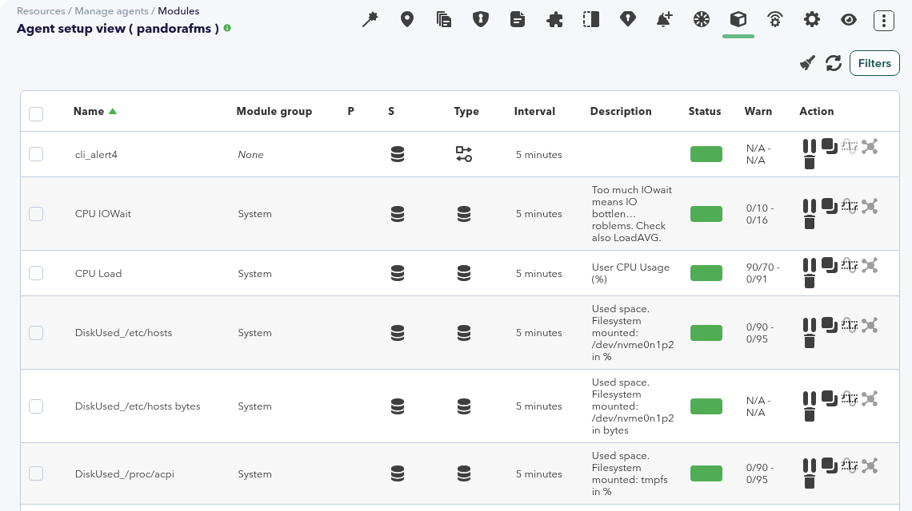

### The module table

| Column | What it shows |
|---|---|
| Checkbox | Selects the module for actions on several modules. Only with write permission on the agent. |
| **Name** | The module name, which opens its edit form. Disabled modules are shown in italics. It may carry icons: quiet module (*Quiet*), module in a scheduled downtime, and name conflict between the agent and the satellite, when the module is defined with the same name in the agent configuration file and in the satellite one. |
| **Module group** | The module's group or *None*. |
| **P** (*Policy*) | If the module comes from a policy, an icon that links to it and that tells adopted modules from unlinked ones. It only appears with policies available and write permission. See [2.10](2.10-politicas-de-monitorizacion.md). |
| **S** (*Server*) | The icon of the server that runs the module. A module with no data received adds a **Non initialized module** mark. |
| **Type** | The icon of the module type. |
| **Interval** | The module's interval or, if it has none of its own, the agent's. |
| **Description** | The description, truncated. |
| **Status** | The current status as a colour block; hovering over it shows the detail. With an interval below 300 seconds, a warning reminds that the unknown status requires 300 seconds or more. |
| **Warn** | The module's warning and critical thresholds. |
| **Action** | The row's action icons (see below). |

With **Show in hierarchy mode** enabled, child modules appear indented under their parent module and sorting by columns is disabled. If the page cuts a branch, the module's ancestors are shown so the context is not lost.

### Filters

The **Filters** button opens a panel with these criteria, which are combined:

| Filter | What it does |
|---|---|
| **Search** | Filters by module name. |
| **Status** | All, **Normal**, **Warning**, **Critical**, **Unknown** or **Not initialised**. |
| **Module group** | All, **Not assigned** or a specific group. |
| **Show in hierarchy mode** | Groups child modules under their parent. Not offered when editing the modules of a policy. |
| **Enabled/Disabled** | All, enabled only or disabled only. |

### Actions on a module

The icons in the **Action** column depend on the permission and on the module type:

| Action | What it does | Condition |
|---|---|---|
| **Disable module** / **Enable module** | Pauses or reactivates the module. | Anyone who can see the list. |
| **Duplicate** | Creates a copy of the module in the same agent. | Write permission. Not offered on web analysis modules. |
| **Normalize** | Deletes the stored data that exceeds the average of the last year by 30 %, to remove erroneous peaks. It is a destructive, irreversible operation. If there is no data to delete, it says so. | Write permission and a numeric data module; otherwise the icon appears disabled. |
| **Create network component** | Turns the module into a reusable network component. | Administrator and a network module; otherwise the icon appears disabled. |
| **Delete** | Removes the module. If it has child modules, the confirmation lists them, because they are deleted too. | Write permission. |

Users who only have the permission to disable agents see the list and can enable and disable modules, but cannot select, create, duplicate, normalize or delete them.

### Creating a module

The **Create module** button opens a dialog to choose the type of the new module. Once chosen, the form for that type opens.

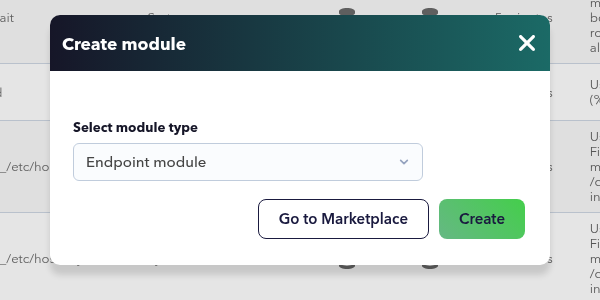

The available types depend on the servers present in the system:

| Available when… | Type |
|---|---|
| Always. | **Endpoint module** |
| There is at least one network server. | **Network ICMP module**, **Network TCP module**, **SNMP module**, **WMI module**, **Remote execution module**, **Web module**, **Prediction module**, **API retrieve module** and **API custom module** |
| There is at least one plugin server. | **Plugin module** |
| There is at least one WUX server. | **UX module** |
| The agent has a remote satellite configuration. See below. | **Satellite types** |

There are six satellite types. They are run by the satellite, not by a server, and are only offered if the agent has a remote satellite configuration (**Remote satellite configuration** tab, in [The agent edit tabs](#the-agent-edit-tabs)). How each one is configured is in [Satellite modules](../parte-6/6.2-servidores-satelite.md#satellite-modules):

| Type | What it checks | See |
|---|---|---|
| **Satellite ICMP module** | Connectivity by ping. | [ICMP and TCP](../parte-6/6.2-servidores-satelite.md#icmp-and-tcp) |
| **Satellite TCP module** | A TCP port. | [ICMP and TCP](../parte-6/6.2-servidores-satelite.md#icmp-and-tcp) |
| **Satellite SNMP module** | An OID over SNMP. | [SNMPv1 and SNMPv2](../parte-6/6.2-servidores-satelite.md#snmpv1-and-snmpv2), [SNMPv3](../parte-6/6.2-servidores-satelite.md#snmpv3) |
| **Satellite WMI module** | A WMI query. | [WMI](../parte-6/6.2-servidores-satelite.md#wmi) |
| **Satellite SSH module** | A command over SSH. | [SSH](../parte-6/6.2-servidores-satelite.md#ssh) |
| **Satellite Exec module** | A command on the satellite itself. | [Remote execution](../parte-6/6.2-servidores-satelite.md#remote-execution) |

The **Go to Marketplace** button opens the catalogue of modules and plugins.

### Actions on several modules

With modules checked, the bottom bar offers an action selector and the **Execute action** button:

| Action | What it does |
|---|---|
| **Disable selected modules** | Pauses the checked modules. |
| **Enable selected modules** | Reactivates the checked modules. |
| **Delete selected modules** | Removes the checked modules and, before each one, its children. |
| **Force to normal selected modules** | Administrators only. Forces the normal status of each module. Changing the status by hand can alter reports and SLAs, and is recorded in the audit log. |

When finished, the console states whether the operation was applied to all modules or to how many of them (for example, "Applied to 3/5 modules"). To apply an action to many agents at once, see [2.11](2.11-operaciones-masivas.md).

## Agent custom fields

Custom fields are your own metadata added to all agents: the owner, the customer, the location, the inventory reference, the host's SNMP community. They are created once, filled in per agent, and can then be shown, filtered, searched and used in macros. For the agent, they are what custom macros are for the module (see [2.20](2.20-configuracion-comun-de-los-modulos.md#organizing-modules)).

### Creating a field

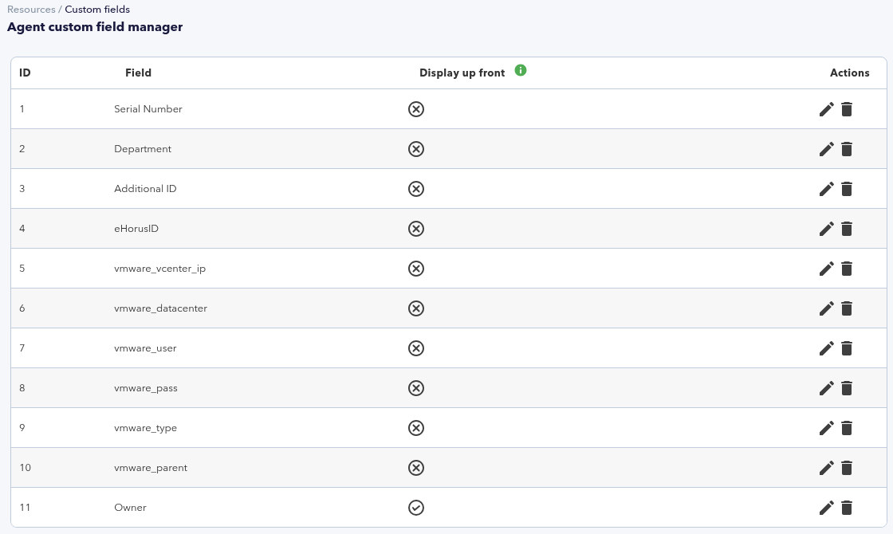

Fields are created in **Management → Resources → Custom fields** (*Agent custom field manager*), with **Create field**. Only administrators can access this manager.

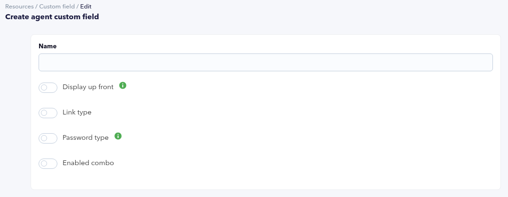

| Setting | What it does |
|---|---|
| **Name** | Required and unique. The EndPoint identifies the field by this name. |
| **Display up front** | The field is visible in the **Main** and **Custom fields** tabs for users without write permission on the agent. Without it, only those who can edit the agent see it. |
| **Password type** | The value is typed in a password field and shown as dots or asterisks. It is only saved when changed. |
| **Enabled combo** and **Combo values** | The value is chosen from a list; the values are separated by commas. |
| **Link type** | The value carries a text and a URL (**Link text** and **Link URL**). If the URL has no scheme, `http://` is prepended. |

The four types are therefore text, list, password and link. **Combo** and **Password** are mutually exclusive: to switch from one to the other, the combo values must be emptied first. A user who is not an administrator cannot change a field's type.

The manager's listing shows each field's **ID**. That number is needed for macros, so write it down.

### Filling in the values

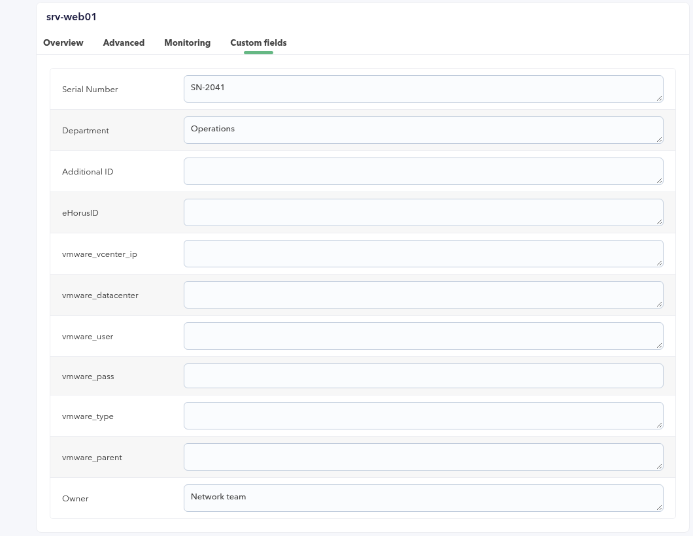

Values are filled in per agent in the **Custom fields** tab of the edit form, or for many agents at once with [bulk editing](2.11-operaciones-masivas.md#edit-agents). Even though only an administrator creates the fields, **any user with write permission on the agent can edit their values**.

### How they are displayed

- In the **Custom fields** box of **Main**, only the fields with **Display up front** appear, never password-type ones, and empty ones are omitted. Values accept BBCode and links open in a new tab.
- In the **Custom fields** tab, whoever has write permission on the agent sees all the fields; everyone else sees only those marked for the main view. Passwords are shown as dots.

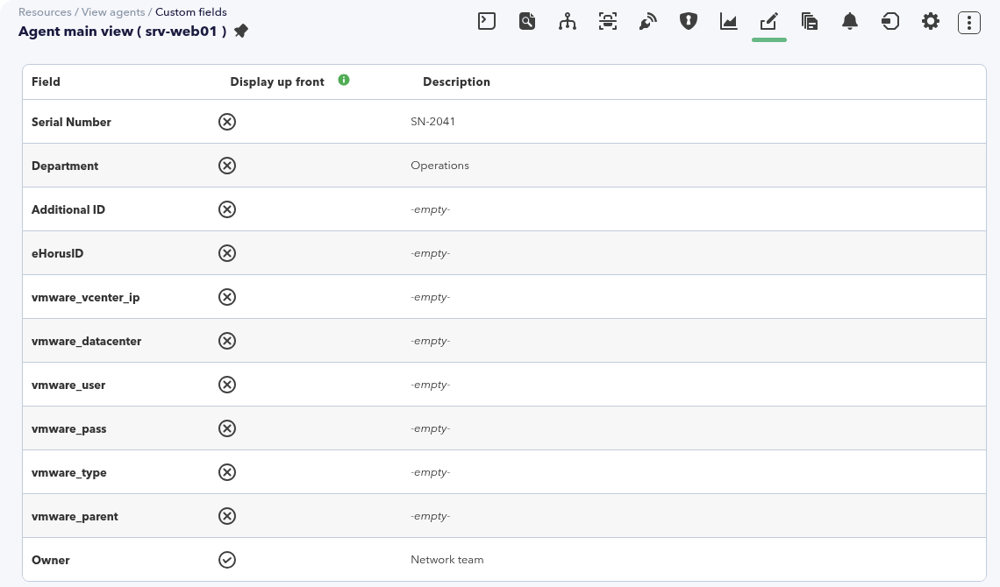

!!! warning "Links are not rendered as links in the tab"
    In the **Custom fields** tab, a link-type field is not shown as a link: the raw value (text and URL together) may be visible. The link works in the **Main** box. If you need it to be clickable for everyone, mark the field with **Display up front**.

### Declaring them from the EndPoint

The EndPoint can send the field values in its configuration file, with the tokens `custom_fieldN_name` and `custom_fieldN_value`, where `N` is a sequential number within the file (1, 2, 3…):

```conf
custom_field1_name Owner
custom_field1_value Network team
custom_field2_name Documentation
custom_field2_value ["Server manual","https://intranet.example.com/srv01"]
```

The server looks up the field by its name and creates or updates the agent's value, both at registration and on every update. Three consequences:

- **The EndPoint never creates fields.** If the name does not exist in the console, the value is discarded and only a trace is left in the server log.
- **The type is not validated.** The server stores the value as it arrives: it does not check whether the field is a password, list or link. A link value must already travel as the `["text","url"]` pair, as in the example.
- **With remote configuration active, the value can also be edited from the console.** See [2.1](2.1-monitorizacion-con-endpoints.md#remote-configuration-from-the-web-console).

The number `N` in the file is **not** the field's ID in the manager.

### Using them in macros

The `_agentcustomfield_N_` macro is replaced by the value of the agent's custom field in:

- Alert actions and templates (see [5.5](../parte-5/5.5-alertas-y-notificaciones.md)).
- The parameters of network, SNMP, WMI, ICMP, plugin and inventory modules (see [2.6](2.6-monitorizacion-de-redes.md#macros-in-the-module-fields)).

Three rules that prevent the most common mistakes:

- **`N` is the field's ID in the manager**, not the order in the EndPoint file. A field with ID `4` is used as `_agentcustomfield_4_`.
- **The macro does not mask passwords.** If a password-type field is used in an alert or a command, its value appears in clear text in the result. Anyone who can read the result can read the password.
- Outside the context of a module, the macro is replaced by an empty string.

!!! example "Owner in the alert email"
    The "Owner" field is created and receives ID `11`, and it is filled in on each agent with the responsible team. The email alert action uses `_agentcustomfield_11_` in the recipient field or in the message body: each alert reaches the right people without creating one action per team.

### Other uses

- Filtering the agent list by custom field (password ones are not offered), and saving the filter.
- **Monitoring → Custom fields** menu, with a view of the values per agent.
- Global search (except passwords), the event extended detail, reports and the agent and module Top N widgets.
- **Pandora RC**: the custom field whose value is the Pandora RC key (see [3.2](../parte-3/3.2-control-remoto-con-rc.md)).
- API: creating a field and getting its ID. In API v1 there is no operation to write the values.
- Policies: they do not manage the agent's custom fields.

## What changes by context

| Context | What changes in the sheet |
|---|---|
| **Bulk operations** | The form is reused with one lock per field (only what is checked is changed) and the **Monitoring** tab is hidden. Custom fields can be edited in batch. See [2.11](2.11-operaciones-masivas.md). |
| **Command Center** | No **Monitoring** or **Custom fields** tabs. |
| **Policy** | A policy's modules are distributed per agent (see [2.10](2.10-politicas-de-monitorizacion.md)); the agent sheet does not manage custom fields from policies. |
| **Without remote configuration** | No **Monitoring** tab and no **RMM** option. |

## Checking and troubleshooting

| Symptom | Probable cause | What to check |
|---|---|---|
| A tab of the view is missing | Its condition is not met. | The table in [The tabs of the agent view](#the-tabs-of-the-agent-view) and the user's permissions. |
| The console rejects the alias | **Use alias as name** is active and the alias already exists. | The setting at agent creation. |
| I changed the EndPoint's interval and the console shows the old one | The agent is in **Normal mode**. | **Module definition** in **Advanced**. |
| The agent disables itself and comes back | **Autodisable mode**: all its modules were unknown. | **Module definition** and the arrival of data. |
| A module with an alert generates no notifications | Agent in **Quiet** mode, the parent's cascade protection, or a scheduled downtime. | The labels in the **Main** tab and the parent's fired alerts. |
| An agent's alerts were acknowledged on their own | It was saved with **Disabled mode** active. | The agent's history. |
| An agent's modules disable themselves | **Safe operation mode**: the chosen module became critical. | The module selected in **Advanced**. |
| A value from the EndPoint does not appear in the field | The field name does not exist in the console. | **Management → Resources → Custom fields** and the name in `custom_fieldN_name`. |
| The `_agentcustomfield_N_` macro returns a different value | `N` is the file order and not the field's ID. | The **ID** in the fields manager. |
| A link field looks like plain text | The **Custom fields** tab does not render them as links. | The **Custom fields** box in **Main**. |
| A password appears in an alert email | The macro does not mask the password type. | Remove the macro from the actions or do not use a password field. |
