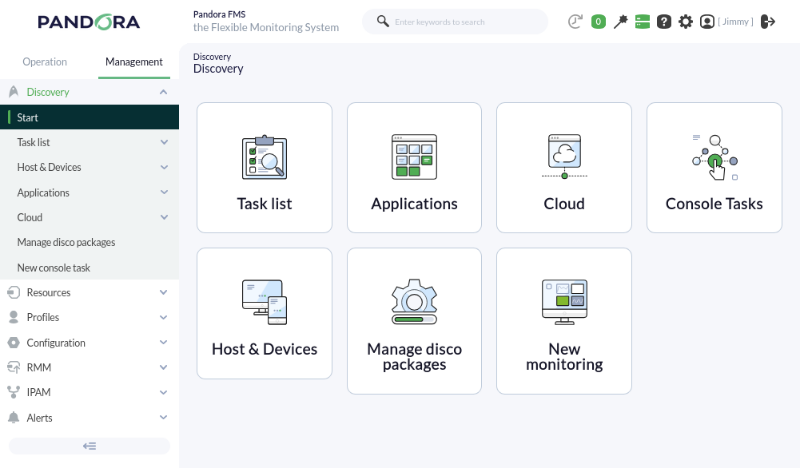
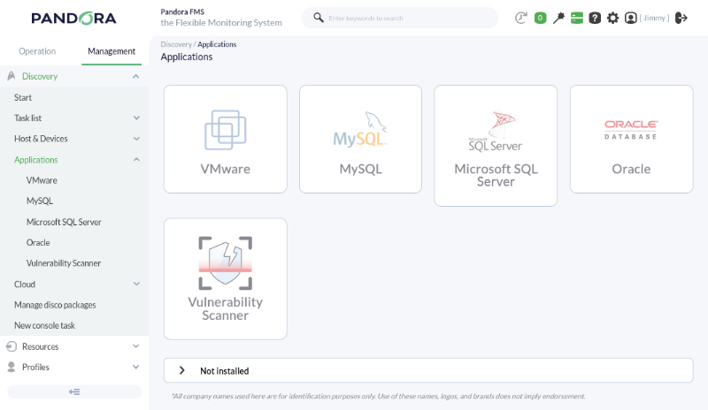
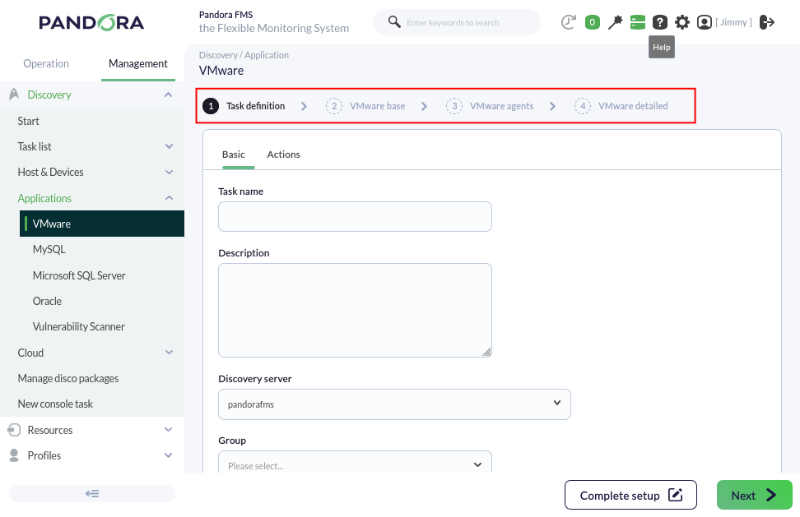
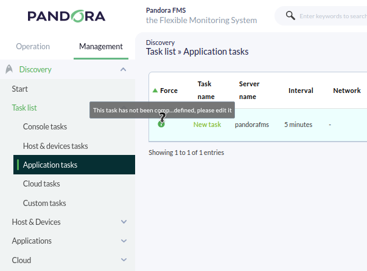
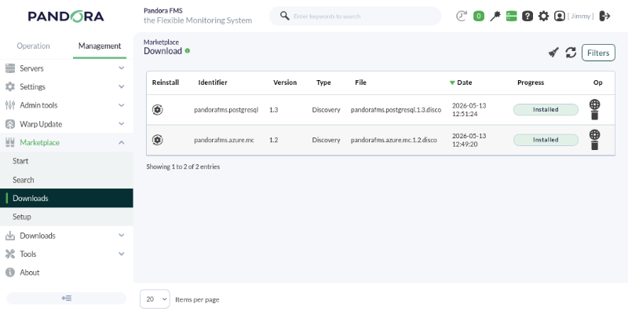
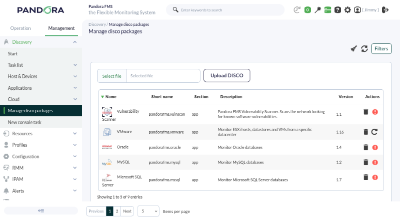
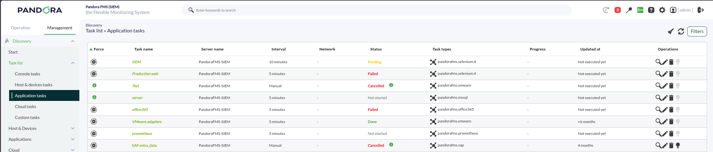
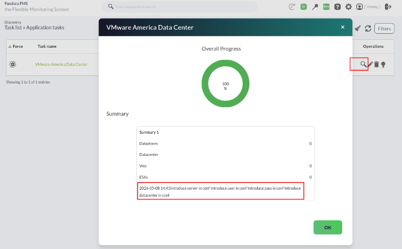
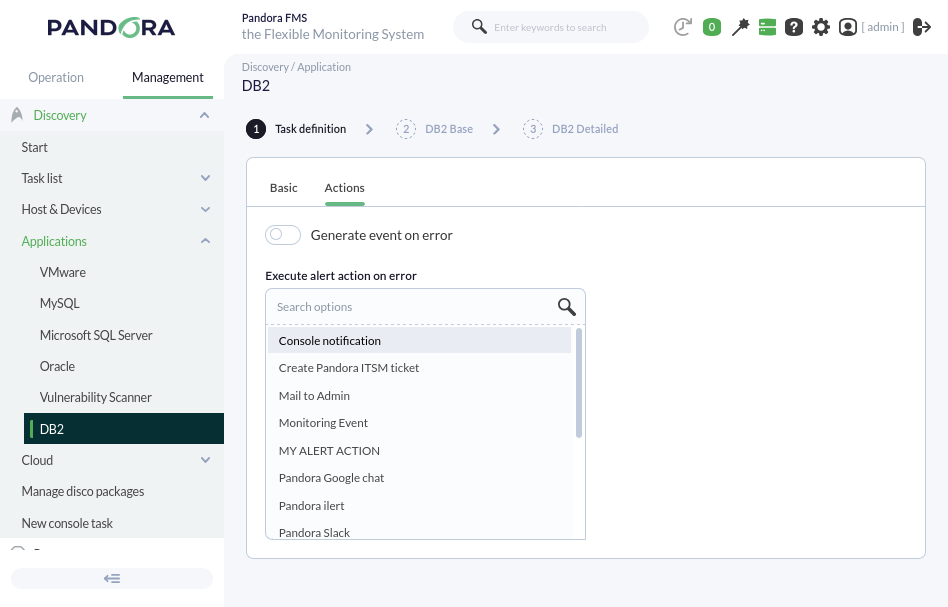

# Automatic monitoring and discovery with Discovery

Registering an agent by hand (creating it, giving it an IP address, deciding
which modules it needs) is reasonable for ten machines. For the five hundred
behind a corporate network, or for the instances a cloud creates and destroys
on its own, it is a curse. **Discovery** is the set of wizards in the Pandora
FMS Web console that avoids that curse: instead of creating every agent one by
one, it finds what is there (devices on a network, instances of a cloud, a
hypervisor, an application) and registers the agents and their initial modules
without anyone typing a registration per device. And, depending on the type
of task, it either steps aside once the registration is done or stays in charge
of the monitoring; the difference matters, and it is explained right below.

## What Discovery is

Discovery works with **tasks**. A task is a job left scheduled: what has to be
explored (a network range, a cloud account, a database, a hypervisor), which
credentials to get in with, in which group to leave whatever appears and how
often to repeat the search, or whether it is only launched by hand. It is
created with a wizard, it stays in the task list and, from there on, it runs on
its own.

There are two families of tasks, and it is worth not confusing them, because
after the registration they behave very differently:

| | Host & Devices | Applications, Cloud and Custom |
|---|---|---|
| What they explore | Networks (see [Network discovery with Host & Devices](2.4-descubrimiento-de-redes-con-host-y-dispositivos.md)): the devices that answer in a range, the ones that arrive in a CSV or the ones a script of your own finds | A specific service: an AWS account, a vCenter, a database, a Kubernetes cluster… |
| What they leave | Agents with their modules and, in the network scan, relationships between devices and a network map | Agents with their modules |
| Who monitors afterwards | The usual servers (network, WMI, plugins…): Discovery steps aside | Discovery itself, which on every run queries the service again and brings the data; the task interval is the monitoring interval |
| Where they come from | They come with the console | `.disco` packages installed separately (see [Extending Discovery](#extending-discovery-disco-packages-and-marketplace)) |

In both cases, the one doing the work is the **Discovery server**, one more of
the Pandora FMS servers: without it running, tasks are created but nobody runs
them. It is started and sized like any other, with the tokens described in
[Full server configuration reference](../parte-9/9.3-referencia-completa-de-configuracion-del-servidor.md).

### Where it is in the console

Discovery has its own entry in the management menu, **Management → Discovery**,
visible with any of the agent access permissions over the All group (AR, AW,
RR, RW or PM). Creating tasks inside **Host & Devices** requires write
permission, AW; managing the custom scan scripts, in **Manage scan scripts**,
requires PM; and uploading or removing .disco packages in
**Manage disco packages** is reserved for a console administrator.

The start page of the menu, **Start**, is only its cover: it has no content of
its own, just one shortcut to each section. When **Applications** or **Cloud**
do not have any .disco package installed yet, the Web console replaces the
listing with an empty notice with a button that takes you straight to installing
one.

### The Discovery sections

| Section | What it does | Where it is documented |
|---|---|---|
| Task list | All the tasks, by tabs (console, Host & Devices, applications, Cloud, custom) | This chapter; console tasks, in [Console tasks](2.5-tareas-de-consola.md) |
| Host & Devices | Network scan, CSV import, EndPoint deployment, custom scans | [Network discovery with Host & Devices](2.4-descubrimiento-de-redes-con-host-y-dispositivos.md) |
| Applications | Application wizards installed as a .disco package | [Application monitoring](2.12-monitorizacion-de-aplicaciones.md) (and containers or virtualization, depending on the .disco package) |
| Cloud | Cloud provider wizards installed as a .disco package | [Cloud environment monitoring](2.15-monitorizacion-entornos-cloud.md) |
| Custom | Own .disco packages or third-party ones with no category | [Creating discovery plugins](../parte-9/9.7-creacion-de-plugins-de-discovery.md) |
| Manage disco packages | Uploading, updating and uninstalling .disco packages | This chapter |

Applications, Cloud and Custom are not fixed lists: each one only appears in
the menu when there is at least one .disco package installed in that section.
Without .disco packages, the whole section disappears from the menu instead of
showing up empty. Each installed .disco package appears as a tile of its own
inside its section (here, Applications with VMware, MySQL, Microsoft SQL
Server, Oracle and the vulnerability scanner), and creating a task means going
into the tile of the corresponding wizard:

The creation form changes from one .disco package to another (the VMware one is
not the Oracle one), but all of them share the same frame: name and group are
mandatory and, from there on, as many steps as the wizard asks for, with a
progress indicator at the top and the **Next** button to move from one to the
next:

Like any Discovery task, these can also notify when they fail, from their
**Actions** tab (see [Discovery task alerts](#discovery-task-alerts)).

Saving without finishing all the steps leaves the task created but incomplete,
and the task list warns about it: an Applications, Cloud or Custom task that has
not gone through its final step (the **Complete setup** button) appears with a
warning icon in the operations column instead of the usual force-run button,
and it has to be edited to finish defining it; the server will not run it until
then.

## Extending Discovery: .disco packages and Marketplace

What turns a Discovery wizard into something installable is the .disco package
**`.disco`**: a file that packages the definition of the wizard form together
with the executables the server launches to carry it out. Without a .disco
package there is no wizard; the network scan of Host & Devices is the exception,
because it comes built in from the factory.

The catalogue gathers close to forty .disco packages: clouds (AWS, Azure, Google
Cloud, Digital Ocean, OVH), virtualization (VMware, Proxmox, XenServer),
orchestration (Kubernetes, OpenShift), databases (MySQL, PostgreSQL, Oracle,
DB2, Microsoft SQL Server, MongoDB) and other tools, such as a vulnerability
scanner or user experience monitoring with Selenium. All of them come from the
**[Marketplace](https://marketplace.pandorafms.com/)**, which the Web console
carries integrated in its own menu, **Management → Marketplace**. Each entry of
the Discovery catalogue links to its page: to that menu if the console has a
connection to the Marketplace, or directly to the Marketplace website if it does
not.

### Installing, updating and uninstalling a .disco package

There are two ways, and which one applies depends on a single question: does
the Web console have Internet access?

**With a connection: from the console Marketplace.** It is the convenient way,
and the usual one in any installation that sees the Internet:

1. In **Management → Marketplace**, search for the .disco package (in
   **Search**, or from the link in its entry in the Discovery catalogue) and
   open its page.
2. Click **Install** and confirm. The console downloads the .disco package,
   installs it and shows the progress on the page itself; when it finishes, the
   button gives way to **Installed**.
3. The wizard appears in its section (Applications, Cloud or Custom, depending
   on what the .disco package declares).

Installations done this way are recorded in **Marketplace → Downloads**
(visible to administrators), from where a .disco package can be
**Reinstalled** without searching for it again. Without an Internet connection,
the console Marketplace itself warns that it needs one to work.

**Without a connection: manual installation, for isolated environments.** When
the console lives on a network with no way out (the usual thing in industrial,
defence or simply paranoid environments), the .disco package is carried by hand:

1. Download the `.disco` package from the Marketplace website on a machine that
   does have Internet (a Marketplace `.zip` has to be renamed first with that
   extension) and carry it to the isolated network.
2. Upload it in **Discovery → Manage disco packages**. The console validates
   its content, installs it and copies it to every active Discovery server, so
   that they know how to run its tasks.
3. The wizard appears immediately in its corresponding section.

Whichever of the two ways is used, updating a .disco package means installing the
new version on top. Uninstalling it, from **Manage disco packages**, removes it
from the console and from the servers alike; tasks already created with that
.disco package can no longer run. Creating a `.disco` package of your own,
including the fields its form can ask for, is covered in [Creating discovery
plugins](../parte-9/9.7-creacion-de-plugins-de-discovery.md); broadly speaking,
each field is declared with its label, a help text and a type (text, number,
selector, checkbox or password), and the ones of type password can be stored
encrypted in the database, besides always being shown hidden in the form like
any field of that type.

**Manage disco packages** lists, for each installed .disco package, its name and
icon, the short name, the section where it appears (Applications, Cloud or
Custom) and the version loaded. In the actions column, besides deleting it,
there is a button to force the synchronisation of its files with the active
Discovery servers (the console already synchronises on its own when a .disco
package is uploaded, so it only has to be pressed if something was left half
done). That synchronisation copies the folder of the .disco package to the
[remote configuration
directory](../parte-9/9.2-referencia-completa-de-configuracion-de-la-consola.md#16-directories)
(`remote_config/discovery/`, by default), from where it then reaches every
Discovery server. If a .disco package is missing its directory or its `.ini`
file in the console, that button disappears and an error icon is shown in its
place: its `.disco` package has to be uploaded again to fix it.

## How a .disco package task works

So far, a .disco package is something that gets installed. What matters is what
it does when someone uses it: the **.disco package task** is the wizard
installed, filled in and scheduled. It works the same for Applications, Cloud
and Custom, and that is why it is told once, here, instead of repeating it in
every chapter that hangs from them. Its result is **agents and modules** in the
console, created by the Discovery server with whatever the .disco package plugin
returns. What it does not do is install anything on the monitored machine:
neither EndPoint nor files. Every run repeats the query and updates those
agents.

### The first step: defining the task

All .disco package wizards start with the same form, before the .disco package
says anything of its own:

| Field | What it does |
|---|---|
| **Task name** | Mandatory. |
| **Description** | Free text. |
| **Discovery server** | Active Discovery server that will run the task. Mandatory. |
| **Group** | Group of the task and of the agents it creates. Mandatory. |
| **Interval** | *Defined* (300 seconds by default) or *Manual*. A manual task only runs when it is forced from the task list. Mandatory. |
| **Use execution cron** | Optional. The task is still queued on every interval, but it only runs if it matches the five-field cron expression; that expression replaces the interval selector in the form. |

If the name, the server, the group or the interval is missing, the form does not
save. The **Actions** tab of that same step carries the **Timeout** and the
notification options in case of error, which already have their section further
down: [Discovery task alerts](#discovery-task-alerts).

### The steps the .disco package defines

Afterwards, each .disco package declares the configuration steps it needs and,
in each one, the fields that have to be filled in. The MySQL .disco package,
for example, adds two: "MySQL Base" and "MySQL Detailed". **Next** saves the
step and moves on to the next one; **Complete setup** closes the task. Until it
is pressed, the server does not run it, and the task list marks it with a
warning icon. A step can also be built on the fly: the console runs a script
from the .disco package that returns the form in JSON, and if that script fails,
the step shows "The discovery script failed:" and the error, instead of the
fields.

A .disco package can ask for these types of field:

| Type | What the user sees |
|---|---|
| String, number and text area | Free field; it can be mandatory and carry help text and placeholder. |
| Password | Masked field. It is only saved if it changes, and the .disco package can ask for it to be encrypted when saving it. |
| Checkbox | Yes/no switch; it can show or hide other fields. |
| Selector and multiple selector | List of options of the .disco package itself, or **Pandora data**: agent or module groups, agents, modules, module types, statuses, templates and alert actions, intervals, tags and operating systems. |
| Tree | Browser of a structure, for example a bucket or a resource tree. |
| Credential | Selector of the credentials of the [Credential manager](2.2-gestor-de-credenciales.md) of type Custom, AWS, Azure, SAP, SNMP, Google or WMI. |

With credentials, the field only shows identifiers; the username and the
password are not copied into the task definition. When running it, the server
looks the identifier up in the credential manager and hands the plugin the data
as a JSON encoded in base64. The field names depend on the type:

| Credential type | Data the plugin receives |
|---|---|
| Custom and SAP | `user`, `password` |
| AWS | `access_key_id`, `secret_access_key` |
| Azure | `client_id`, `application_secret`, `tenant_domain`, `subscription_id` |
| WMI | `user`, `password`, `namespace` |
| Google and SNMP | The document stored in the credential, as it is |

Nothing forces the use of the selector: a .disco package can ask for the
username and the password in fields of its own, as the MySQL one does. The
PostgreSQL one, on the other hand, uses a Custom credential.

### What happens on each run

1. The assigned Discovery server takes the task when its interval turn comes,
   or when someone forces it (with cron, only if the expression matches). In the
   .disco package command it replaces the values of the fields and adds data
   from the task: group, interval, temporary path and access to the console API.
2. It launches every command the .disco package declares, with the timeout of
   the task **applied to each one**.
3. The plugin answers with a **JSON** on standard output. If it brings
   monitoring data, the server creates or updates the agents and their modules
   with them. The rest (counts, notices, plugin errors) is saved as the task
   **summary**, with one entry per command, and it is read with the summary icon
   of the task list.

### When it fails

- A command that ends with a non-zero exit code leaves the task in **Failed**
  and triggers the error options of the **Actions** tab: event and alert
  actions.
- If a command exceeds the timeout, the summary says "The execution timed out."
  and the task is also left in **Failed**.
- With a zero exit code, an empty response or one that is not JSON does not
  change the status: the task ends in **Done**, and whatever came out (or
  whatever is in the standard error) stays in the summary. It is worth looking
  at it: "Done" says that the plugin did not break, not that it found anything.
- A JSON without monitoring data does not create agents either; it is saved in
  the summary and nothing else.
- In the SAP .disco package, if the licence does not allow it, the server does
  not run the command and notes it in the summary.

## The task list

The task list, in its Host & Devices, applications, Cloud or custom tab, shows
the task name, the assigned Discovery server, interval, network, status, task
type, progress and date of the last update, and it can be filtered by task
name, group, Discovery server, network and status. On each task its immediate
execution can be forced, its progress seen, its pending results reviewed, and it
can be edited, disabled or deleted; seeing the network map it has generated only
makes sense (and is only available) for network discovery tasks, not for the
applications or Cloud ones, which do not draw a topology.

Any task, whatever its type, also has a summary icon that opens its run summary:
in the Applications, Cloud and Custom ones it details what the .disco package
has been finding or the errors it has found along the way, with the detail the
.disco package itself decides to show.

| Status | When it appears |
|---|---|
| Not started | The task exists but the server has not run it yet. |
| Pending | Queued, waiting for its turn or for its next run. |
| Searching / Processing | Under way: searching for devices or processing what has been found. |
| Review | It finished and there are results waiting for the user to decide which ones to turn into an agent. |
| Done | It finished with no errors. |
| Failed | It finished with at least one error. |
| Cancelled | The server restarted while the task was running; it has to be launched again. |

Console tasks (database backups, PHP functions, scheduled report generation and
the like) share the same list, in their own tab, but they have a chapter of
their own: [Console tasks](2.5-tareas-de-consola.md).

## Discovery task alerts

A Discovery task works on its own and, for that very reason, it can fail on its
own: an expired credential, a cloud API that changes, a network range that no
longer exists. Without a notice, the failure is only discovered the day someone
misses an agent. In order not to depend on that coincidence, all tasks (network
scan, custom scan, Applications, Cloud and Custom) can notify when a run ends in
error, with two options that can be used together or separately:

| Option | What it does |
|---|---|
| **Generate event on error** | It creates a critical event, "[Discovery] Task error: *task name*", in the group of the task, visible in the event console like any other one. |
| **Execute alert action on error** | It launches one or several of the alert actions already defined in the console (an email, a message, a command…). |

Where they are configured depends on the family: in **Host & Devices** they are
in the first step of the network scan and custom scan form; in
**Applications**, **Cloud** and **Custom**, in the **Actions** tab of the
wizard.

In those same Applications, Cloud and Custom tasks, the **Actions** tab also
brings the **Timeout** field: the maximum time, in seconds, that each run is
allowed to go on before it is considered failed; 60 seconds by default.

The alert action receives "Discovery task error: *task name*" as its main text,
and the `_discovery_task_` macro, with the task name, is available to compose
messages of your own in the action.

The notices only fire when the run fails, that is, when the task ends in
**Failed** status. A correct run that finds nothing is not an error: if the
network is empty, Discovery does not consider it a reason for alarm.

## Inside the Discovery server

The server schedules its tasks according to the interval of each one: the
automatic ones reschedule themselves; the manual ones are only launched when
someone asks for it. Each task runs in its own thread, and the server opens in
parallel as many threads as the higher of its two thread tokens sets (one meant
for Host & Devices and applications tasks, another for the legacy network scan),
so raising the one in use is enough for more tasks to run at the same time. If
the server restarts with a manual task half done, that task is marked as
cancelled in the list, waiting to be launched again; automatic tasks, on the
other hand, are simply rescheduled for their next round.

What the server does at the end of each round depends on the family. In Host &
Devices, the devices found are turned into agents, right away or after the
user's review (see [Reviewing the results before creating
agents](2.4-descubrimiento-de-redes-con-host-y-dispositivos.md#reviewing-the-results-before-creating-agents)).
In applications, Cloud and Custom, on every round, the server runs the .disco
package, collects the monitoring data it returns and with them creates the
agents that are missing and updates the values of their modules. For these
tasks, Discovery is not only the one that registers: it is also the one that
monitors, and if the task is disabled or deleted, its modules stop receiving
data.

The server tokens related to Discovery (the switch and the server threads, and
the paths that some application .disco packages use to connect to Java, SAP or
Microsoft SQL Server) are described, with their default values, in
[Full server configuration reference](../parte-9/9.3-referencia-completa-de-configuracion-del-servidor.md).
