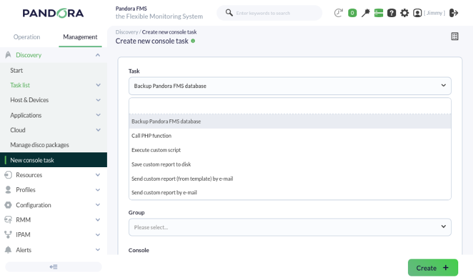
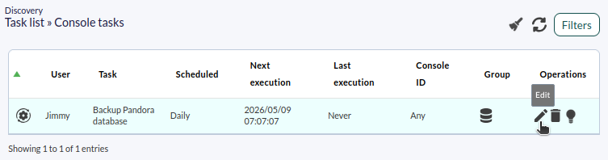

# Console tasks

Taking a backup by hand every night, or logging in every Monday to send the
same report by email, is the kind of task an administrator forgets exactly the
week it is needed most. **Console tasks** solve that oversight: they are
periodic jobs of the Web console itself —they do not go through any monitoring
server— that are scheduled once and run on their own, with the date and the
interval they are given.

## What console tasks are

They are in **Discovery → Task list**, on the **Console tasks** tab. They share
a screen with the rest of the
[Discovery](2.3-monitorizacion-y-descubrimiento-automatico-con-discovery.md)
tasks, but they have nothing to do with them: they do not scan networks or
inventory anything, so it is worth not confusing them just because they sit one
tab apart.

## Console task types

Every console task is, at bottom, a call to a specific function, with its own
parameters. This is what the **Task** selector offers when creating a new task:

| Type (the "Task" selector) | What it does | Its own parameters |
|---|---|---|
| Backup Pandora database | Generates a full backup of the installation | Path where to save it; enable or disable it |
| Send custom report by email | Generates an already saved custom report and sends it by email | Report, email addresses, subject, message, format (PDF/CSV/JSON) |
| Send custom report (from template) by email | The same, but from a report template (per agent or combined) | Template, agents, "Report per agent", addresses, subject, message, format |
| Save custom report to disk | Generates a custom report and saves it to disk instead of sending it | Path, file prefix, format (XML/PDF/JSON/CSV) |
| Execute custom script | Runs a system script on the console server | Script path |
| Call PHP function (untranslated; it appears in English) | Calls an internal PHP function by name; internal use of the console itself —for example, starting the remote console service GoTTY—, not meant to be created by hand | Function name |

It does not appear in the creation selector, although it shares the same
internal table of types: **Send csv log** (sending a log of events in CSV,
deliberately removed from the creation form). Like "Call PHP function", it has
no translation either, so in a Spanish Web console it would show in English if
it ever appeared in a listing.

Creating and designing the report or the template these types send or save —
what it contains, in what format— is the business of
[Reports](../parte-5/5.2-informes.md); here only how to schedule its sending or
its periodic saving is covered. What the backup contains and how to restore it
is explained in [Backup and restore](../parte-6/6.8-backup-y-restore.md); here
only how to schedule it is covered.

## Creating and scheduling a task

From **Task list → Console tasks**, a new task asks for a name, a type (previous
table), a schedule —once or periodic: hourly, daily, weekly, monthly, yearly or
custom, with a calendar of days for weekly recurrence—, the date and time of the
next run, a group and the parameters of the chosen type. Saving creates the
task, which stays in the listing waiting for its turn.



Scheduling a backup, a script of your own or the saving of a report to disk
requires write or administration permission (see [Required
permissions](#required-permissions) below); without that permission, those
three types do not even appear in the selector.

## Editing, enabling/disabling, forcing a run and deleting

The listing shows user, task (name and type), schedule, next run, last run,
**Console ID** —see [The "Console ID" column](#the-console-id-column)—, group
and operations, and it can be filtered by task, schedule, console and group, and
narrowed by date and time of the last run. Each row offers forcing the immediate
run, editing, enabling or disabling, and deleting, although not all actions are
always visible: editing and deleting require administration —or, if the task is
one of the three report types, reports management is enough too—, and
enable/disable is hidden for the backup, the script, "Call PHP function" and the
sending of internal feedback.



## Required permissions

| Action | Permission |
|---|---|
| Viewing the "Console tasks" tab and forcing a task to run | Read, write, reports management or administration (any of the four) |
| Creating or editing a task (form) | Reports management or administration |
| Editing a task, your own or one created by another user | Reports management or administration; write alone is not enough, not even for the user who created it |
| Creating a "sensitive" type (backup, script of your own, saving to disk, function call) | Write or administration; otherwise the type does not even appear in the selector |

## How and where they actually run

No Pandora FMS server runs console tasks: the Web console itself does. For
that, the operating system crontab has to call a console page,
`enterprise/extensions/cron/cron.php`, over HTTP every minute; on every call,
the console records that cron has been there, checks which tasks have reached
their date and time and runs them. The typical line, with the console URL and
the system user that applies:

```text
* * * * * <user> wget -q -O - --no-check-certificate --load-cookies /tmp/cron-session-cookies --save-cookies /tmp/cron-session-cookies --keep-session-cookies https://<console>/pandora_console/enterprise/extensions/cron/cron.php >> /var/www/html/pandora_console/log/cron.log
```

There is no need to copy it from here: the console itself shows it, already with
its URL and its installation path, in the notice described below. That same
cron pass takes care, on the way, of other internal maintenance of the console
—status checks, licence token renewal, sending reports by other means—; they
are not part of this screen and are not documented here.

A task with a "once" schedule deletes itself when it finishes running; with a
periodic schedule, it waits for the next round.

Console tasks also exist in the [Command
Center](../parte-6/6.3-command-center.md): the same **Console tasks** tab, with
the same types, is available in the centralised console, and it needs its own
crontab line, on the Command Center machine itself, pointing at its `cron.php`.
When a task needs to choose agents as a parameter —for example, a report per
agent—, the form groups them by the node they come from, since the Command
Center gathers agents from several managed consoles.

### The "Console ID" column

Meant for architectures with more than one console: each task can be anchored to
a specific console so that only that one runs it, or left open ("Any") so that
the first console whose cron passes runs it. It is not that the different
consoles "do not talk" to each other, as a quick reading might suggest: it is
that each task decides, by configuration, whether it is exclusive to one console
or open to all, and that distribution prevents the same task —a report sending,
for example— from firing twice when several consoles have their own active
crontab. In the listing, the column shows the identifier of the assigned
console, "Any" if there is no restriction, or "None" if the assigned console no
longer exists.

### Requirements for them to run and troubleshooting

| Requirement | Detail |
|---|---|
| System crontab entry | A line that calls `enterprise/extensions/cron/cron.php` of the console with `wget` every minute and saves the output in `log/cron.log` of the installation (see the example line above) |
| HTTP access to the console | The machine where the crontab runs has to be able to open the console URL; with certificates of your own, `--no-check-certificate` keeps `wget` from stopping |
| Warning if it does not run | The console checks when it last ran and warns if it has been more than ten minutes without doing so, or if it has never run |

If the Web console detects that this cron has gone more than ten minutes without
running, or that it has never run, it shows a notice of its own —"not running
properly" or "not configured"— with the exact crontab line to add, and it links
back to this same screen. That notification is the first stop when debugging why
a scheduled task has not run on its date.
