# Network monitoring

Remote monitoring is the other half of the trade: everything an
[EndPoint](2.1-monitorizacion-con-endpoints.md) cannot tell you because it does
not live inside the machine, but is checked from outside —a router, a switch, a
printer, a UPS— or that is worth checking from outside even when the device has
an agent of its own, such as the real availability of a service as seen from
the network. This chapter covers ICMP, TCP, SNMP, WMI, remote commands and the
use of remote server plugins: everything a Pandora FMS server does on the other
side of the network, with nothing installed at the destination. The notices
devices send on their own, SNMP traps, have a chapter of their own: [SNMP trap
monitoring](2.7-monitorizacion-de-traps-snmp.md).

## Remote monitoring: what it is and when to use it

Checking a device from outside does not require touching it: it is enough that
it answers a network request —a ping, a TCP connection, an SNMP or WMI query, a
command over SSH— and that some Pandora FMS server has network visibility all
the way to it. It is the only possible path for a device that does not accept
software of its own (a router, a switch, a printer, a UPS) and a reasonable
alternative for a server that does, when what matters is what the network sees
and not what the operating system itself sees.

No EndPoint is needed to have an agent. A logical agent can be registered
straight from the Web console, with no configuration file behind it, and have
network modules attached to it: it is what, for example,
[Discovery](2.4-descubrimiento-de-redes-con-host-y-dispositivos.md) does when it
scans a network. If a module leaves its target address field empty, it uses the
IP address of the agent itself; that way an agent with no EndPoint can carry
all its modules without repeating the IP in each one.

| Check | Server that runs it | Token that enables it |
|---|---|---|
| ICMP (availability and latency) | Network High Performance Server, in bulk with `fping` | [`networkhpserver`](../parte-9/9.3-referencia-completa-de-configuracion-del-servidor.md#2-server-activation-and-number-of-threads) |
| SNMP | Network High Performance Server, in bulk with `pandorafsnmp` (v1, v2c and v3) | [`networkhpserver`](../parte-9/9.3-referencia-completa-de-configuracion-del-servidor.md#2-server-activation-and-number-of-threads) |
| TCP | Network Server | [`networkserver`](../parte-9/9.3-referencia-completa-de-configuracion-del-servidor.md#2-server-activation-and-number-of-threads) |
| Remote commands | Network Server | [`networkserver`](../parte-9/9.3-referencia-completa-de-configuracion-del-servidor.md#2-server-activation-and-number-of-threads) |
| WMI | Network Server, with the `pandorawmic` client | [`networkserver`](../parte-9/9.3-referencia-completa-de-configuracion-del-servidor.md#2-server-activation-and-number-of-threads) |
| Remote plugins | Heavy Server | [`heavyserver`](../parte-9/9.3-referencia-completa-de-configuracion-del-servidor.md#2-server-activation-and-number-of-threads) |

All three come enabled from the factory and share out the work on their own:
with the Network High Performance Server running, the Network Server leaves
ICMP and SNMP in its hands and keeps the rest. If the high-performance one is
disabled, the Network Server takes charge of ICMP again (with the system
`ping`) and of SNMP (with `snmpget`, query by query). The details of that split
are in [Performance, fine tuning and
troubleshooting](#performance-fine-tuning-and-troubleshooting).

When the network to be checked is not visible from any central server —a site
with no direct route, an isolated network—, a [satellite
server](../parte-6/6.2-servidores-satelite.md) does exactly the same work from
inside that network and delivers the data as if it were one more server.

!!! example "A router with no EndPoint"
    An agent "router-core" is registered with address `192.168.10.1`, with
    nothing installed on it. From there, network modules are added to it —ICMP
    to know whether it answers, SNMP to read its interfaces— exactly as with
    any other agent.

## First steps: creating a network module

A network module is created from the agent view, on the **Modules** tab, with
the **Create** button → **Create network module**. The form asks for the type
first:

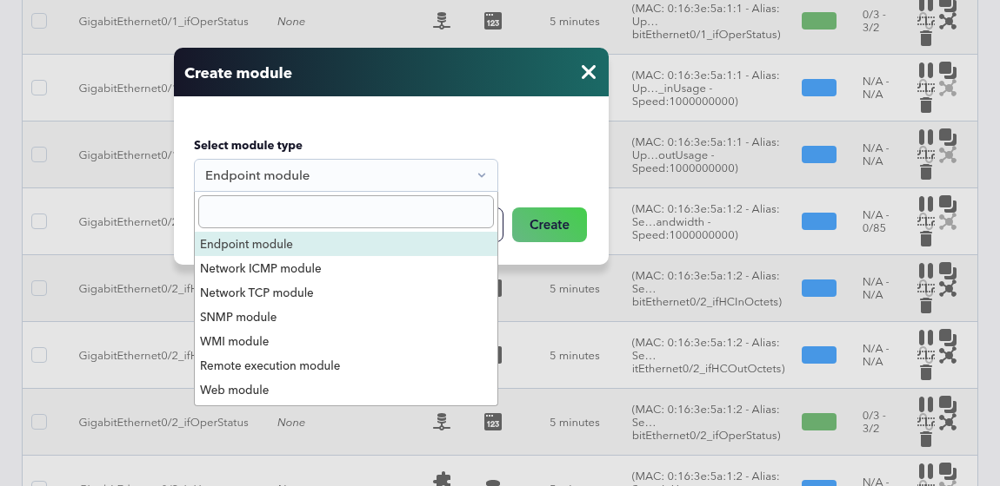{ .captura }

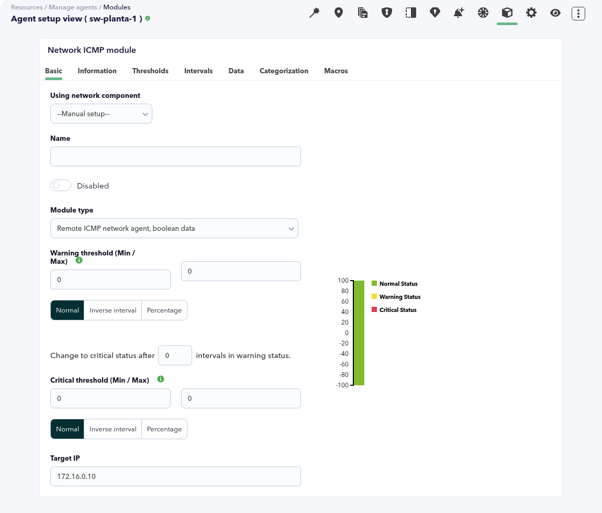{ .captura }

| Family | What it is for | Section |
|---|---|---|
| ICMP | Availability and latency of the network | [Availability and latency with ICMP](#availability-and-latency-with-icmp) |
| TCP | Network ports and services | [Services with TCP](#services-with-tcp) |
| SNMP | Devices with an SNMP agent (routers, switches, UPS…) | [SNMP monitoring](#snmp-monitoring) |
| Remote command | Commands over SSH or Windows remote | [Remote commands: SSH and Windows](#remote-commands-ssh-and-windows) |
| WMI | Windows devices with no EndPoint | [Windows without an agent: WMI](#windows-without-an-agent-wmi) |
| Plugin | Checks packaged in a script | [Remote server plugins](#remote-server-plugins) |

The complete table of internal types, with what each one returns and how its
status is interpreted, is in [Module type
reference](#module-type-reference); each section of this chapter links to its
row.

All network modules share these fields, with their default value:

| Field | Default value | What it does |
|---|---|---|
| Target IP | empty (`auto`) | If left empty, it uses the agent IP. It accepts the `_agentname_` and `_agentalias_` macros when the agent name or alias resolves to a valid IP. |
| Port | empty (`161` in SNMP, `22` in remote commands over SSH) | Destination port, when the check needs it. |
| Interval | 300 s | How often the check is repeated. |
| Warning threshold (min/max) | 0 / 0 | Range that sets the module to warning status. |
| Critical threshold (min/max) | 0 / 0 | Range that sets the module to critical status. |
| Timeout | 0 (uses the server one) | Maximum time before the check is taken as failed. |
| Retries | 0 | Additional attempts before discarding the data. |
| FF threshold (flapping) | 0 (disabled) | Number of state changes in a row that have to be seen before taking them as real; see the example below. |
| Unknown instructions | empty | Text the operator sees when the module falls into unknown status. |
| Minimum / maximum | 0 / 0 | Any data outside this range is discarded as invalid. |

!!! example "Ping and latency to the router, with thresholds"
    On the "router-core" agent (`192.168.10.1`), two network modules:

    - **Available** (`remote_icmp_proc`): with no configuration beyond the
      target IP, it is enough to know whether the router answers.
    - **Latency** (`remote_icmp`): same target, with a warning from `100` ms
      and critical from `300` ms.

    As soon as the Network Server runs the module, the agent status goes from
    "No data" to normal and the first value appears in its view; it is the
    sign that the module is well configured.

### Common advanced properties

These editor tabs appear in all network modules, whatever the type. The whole form, with thresholds, unknown status, intervals and data, is explained in [2.20, Common module configuration](2.20-configuracion-comun-de-los-modulos.md):

- **Custom ID** (*Categorization* tab): a free identifier to relate the module
  to an external system, such as a CMDB.
- **Post process** (*Data* tab): multiplies the data received by the given
  factor, before storing it. It is useful, for example, to convert octets into
  bits: a module that reads octets per second with a post process of `8`
  already stores the data in bits per second.
- **Export target** (*Data* tab): also sends the data to an export server.
- **Category** (*Categorization* tab): grouping used by the Command Center.
- **Cron** (*Intervals* tab): if **Cron from** is enabled, the module stops
  running by interval and runs only when the current date and time match the
  configured expression.

!!! example "Running a module only at night"
    A module with **Cron from** set to `0 2 * * *` runs once a day, at two in
    the morning, instead of every 300 seconds.

The **FF threshold** (from *flapping*) keeps an alert from firing because of an
isolated state change: it requires seeing the same number of state changes in a
row before taking them as real.

!!! example "Avoiding a false spike from flapping"
    An unstable WAN link goes from normal to critical and back to normal
    several times in a few minutes. With an FF threshold of `3`, the module
    does not change status —and does not fire alerts— until it sees three
    readings in a row with the same sign; the flickering stops generating
    noise.

### Network components: do not start from scratch

A **network component** is a prefabricated module: the same configuration of a
network module, saved as a template so that it does not have to be filled in
every time. In the editor of a new module, the **Using network component**
field lets you choose one instead of filling in the form by hand; the manual
option (`--Manual configuration--`) is still available to use none.

The installation brings components grouped by manufacturer and technology:
Cisco MIBs, UNIX systems, Microsoft Windows, WMI, databases, and so on with the
rest of the groups included from the factory.

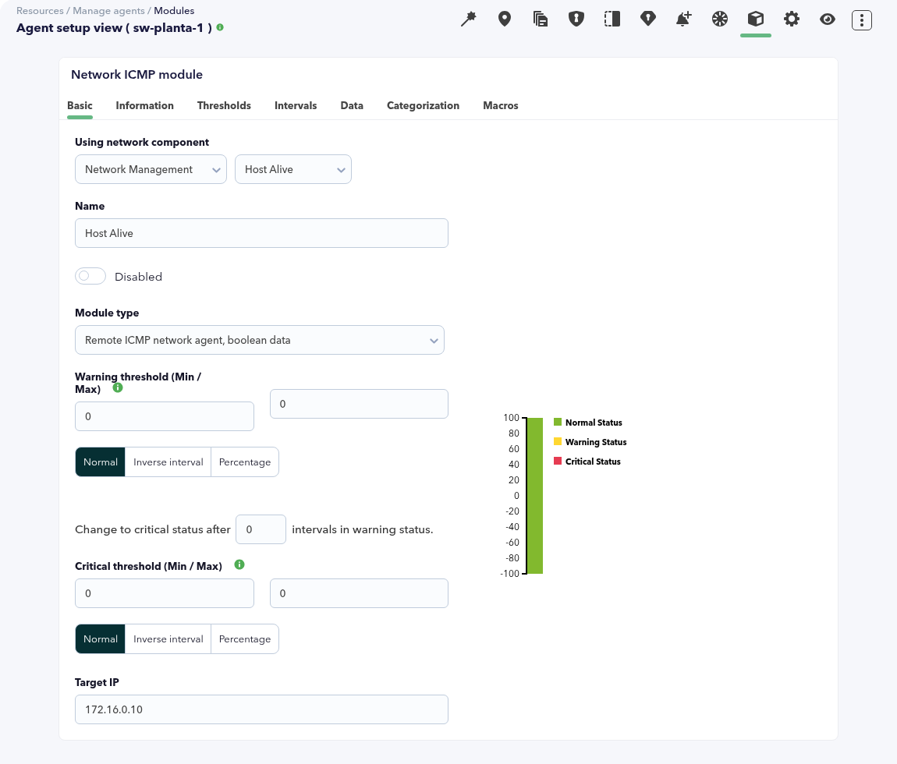{ .captura }

!!! example "Applying Host Alive and Host Latency from components"
    When creating a new module, selecting the **Host Alive** component
    (*Network Management* group) registers the same boolean ICMP module that
    would be configured by hand; **Host Latency**, from the same group, does
    the same with latency. It is the fastest way to leave an agent with no
    EndPoint with the minimum covered. In fact, the agent registration form
    itself brings a checkbox, checked by default, that creates these two
    modules (Host Alive and Host Latency) automatically as soon as the agent
    is registered, without going through the module editor.

**Creating a component of your own.** Components are managed under **Management → Configuration → Templates → Remote components** ("Remote component management"). The list shows each component's name, the server that runs it, the module type, the description and the group, and can be filtered by group and by text.

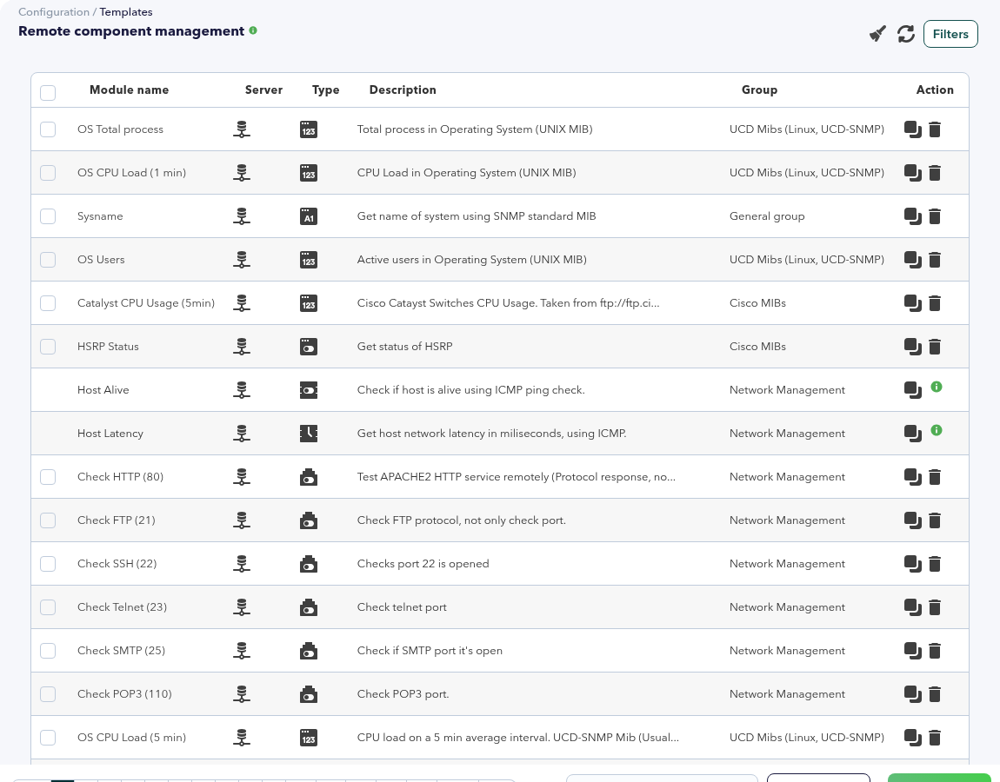{ .captura }

There are two ways to get your own: **duplicate** an existing one and adapt it, which is usually quickest because it already comes configured, or pick the module type in the selector at the bottom of the list and click **Create**. For OID-based ones there is a third: the "Create network component" button in an OID's detail panel in the [SNMP browser](#snmp-browser).

The form is a network module's (name, type, thresholds and the information, data, categorization and macros tabs) plus a **Group** field, which decides in which branch of the "Using network component" selector the component appears. It carries no target IP: that is set on each agent when the component is applied.

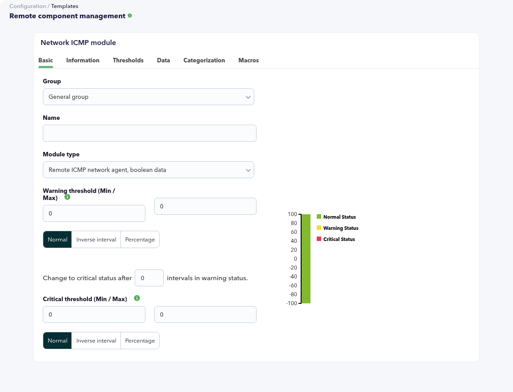{ .captura }

Factory components flagged as internal, such as **Host Alive** and **Host Latency**, cannot be edited or deleted, only duplicated. Once created, a component can be applied to any agent, included in a [monitoring policy](2.10-politicas-de-monitorizacion.md) or left for [Discovery](2.4-descubrimiento-de-redes-con-host-y-dispositivos.md) to apply in bulk during a scan.

### Macros in the module fields

Some fields of remote modules accept macros that the server replaces with
agent data every time it runs the module. That saves typing the same value by
hand on every agent, and it is what allows a network component or a policy
module to work the same for agents with different data. The typical case is the
SNMP community: if every device has its own, it is stored in an agent custom
field and the module uses the macro instead of the community.

The fields that accept macros are these:

| Field | Modules |
|---|---|
| Target IP | ICMP, TCP and SNMP |
| SNMP community | SNMP v1 and v2c |
| User, authentication password and privacy password | SNMP v3 |
| User and password | WMI and remote WMI inventory |

These macros can be used in those fields:

| Macro | Replaced by | Where |
|---|---|---|
| `_agentcustomfield_N_` | Value of the agent custom field whose identifier is N | All the fields in the previous table |
| `_addressn_N_` | IP address number N of the agent, with its addresses sorted | All the fields in the previous table |
| `_agent_`, `_agentalias_` | Agent alias | Target IP |
| `_agentname_` | Agent name | Target IP |

The macro is only replaced if the field value **starts with it**: a value such
as `_agentcustomfield_3_` works; `comunidad_agentcustomfield_3_` is sent as it
comes. Custom fields are created in **Management → Resources → Custom fields**.
The identifier that appears in that listing is the N of the macro. The value is
filled in on each agent. The field types, how the EndPoint declares them and the
precautions with passwords are in [2.21, Agent custom fields](2.21-configuracion-comun-de-los-agentes.md#agent-custom-fields).

!!! example "A different SNMP community per device"
    The "SNMP community" custom field is created, which receives the
    identifier `4`, and it is filled in on each agent with its community
    (`sw-core-ro`, `sw-planta2-ro`…). An SNMP network component with **SNMP
    community** `_agentcustomfield_4_` is then applied to all the switches,
    directly or through a policy: each module queries with the community of
    its own agent.

!!! example "Watching the second IP of a device"
    On a server with two interfaces registered in the agent, an ICMP module
    with **Target IP** `_addressn_2_` checks the second address. The order is
    the one of the sorted addresses, not the order in which they were added.

The remote plugins have a macro set of their own, a wider one; it is explained
in [Plugin macros](#plugin-macros).

## Availability and latency with ICMP

ICMP is the most basic check and it has two types: **Available**
(`remote_icmp_proc`), which returns whether the IP answers or not, and
**Latency** (`remote_icmp`), which returns the response time in milliseconds
(see [Module type reference](#module-type-reference)). The Network High
Performance Server measures with `fping`, grouping all the pending destinations
in a single call (if it is disabled, the Network Server does it with the system
`ping`): it sends as many packets per attempt and as many retries as the
[`icmp_packets`](../parte-9/9.3-referencia-completa-de-configuracion-del-servidor.md#3-network-snmp-and-wmi)
and
[`icmp_checks`](../parte-9/9.3-referencia-completa-de-configuracion-del-servidor.md#3-network-snmp-and-wmi)
tokens indicate, with the timeout of
[`network_timeout`](../parte-9/9.3-referencia-completa-de-configuracion-del-servidor.md#3-network-snmp-and-wmi).
If there is no answer within those limits, the availability module marks
critical status and the latency one is left with no data.

!!! example "Availability of a printer"
    An **Available** module on `192.168.10.50`: with no adjustment beyond the
    target IP, it warns as soon as the printer stops answering ping, with no
    need to install anything on it.

!!! example "Latency of a WAN link"
    A **Latency** module on the IP of the remote router, with a warning at
    `100` ms and critical at `300` ms: a link that starts to degrade can be
    seen coming before it goes down completely.

For something finer than latency —for example, the percentage of lost packets
instead of only the round-trip time— there is the packet loss plugin the
installation brings (see [Remote server plugins](#remote-server-plugins)).

## Services with TCP

TCP checks a service by its port, with four types: **open port**
(`remote_tcp_proc`, boolean), **numeric** (`remote_tcp`), **text**
(`remote_tcp_string`) and **incremental** (`remote_tcp_inc`); what each one
returns, in [Module type reference](#module-type-reference). Two fields do the
work:

- **TCP send**: what is sent to the port. Several steps of a conversation are
  separated with `|`; the `^M` sequence is replaced by a real carriage return.
- **TCP receive**: what is expected back, compared **case-insensitively**. It
  is mandatory in the text and incremental types; in the open port one, only
  if it is filled in.

!!! example "Open port"
    A module of the **open port** type on port `443`, with no **TCP send** or
    **TCP receive**: it is enough for the port to accept the connection to
    mark normal status.

!!! example "Header of a web server"
    **TCP send**: `GET / HTTP/1.0^M^M`. **TCP receive**: `200 OK`. The module
    goes to normal as soon as the response contains that string, no matter
    whether the server returns it in upper or lower case.

!!! example "Three-step SMTP conversation"
    **TCP send**: `HELO midominio.com^M|MAIL FROM: <a@midominio.com>^M|RCPT TO: <b@destino.com>^M`.
    **TCP receive**: `250|250|250`. Every step is sent and checked before
    moving on to the next one.

!!! example "SSH banner"
    Port `22`, with no **TCP send**, and **TCP receive** with the text
    `SSH-2.0` to confirm the protocol version the server announces when
    connecting.

Retries and timeout are adjusted as in any network module, with the server
defaults in [`tcp_checks` and
`tcp_timeout`](../parte-9/9.3-referencia-completa-de-configuracion-del-servidor.md#3-network-snmp-and-wmi).

## SNMP monitoring

### SNMP in five minutes

To monitor a device over SNMP, it needs the SNMP agent enabled and Pandora FMS
needs to know how to talk to it: which protocol version (v1, v2c with a read
community; v3 with user, authentication and privacy) and which OID to read. An
**OID** (*Object IDentifier*) is the address of a specific piece of data inside
the device —temperature, CPU, the status of an interface—; it can be written in
its numeric form (`.1.3.6.1.2.1.1.5.0`) or, if the server has the **MIB** that
describes it loaded, in its textual form (`sysName.0`). Every OID that is
monitored is a different network module.

| OID | What it is |
|---|---|
| `.1.3.6.1.2.1.1.3.0` (`sysUpTime`) | Time the device has been up |
| `.1.3.6.1.2.1.1.5.0` (`sysName`) | Configured name of the device |
| `.1.3.6.1.2.1.2.2.1.8` (`ifOperStatus`) | Operational status of an interface |
| `.1.3.6.1.2.1.2.2.1.10` (`ifInOctets`) | Input octets per interface (32-bit counter) |
| `.1.3.6.1.2.1.31.1.1.1.6` (`ifHCInOctets`) | The same, in its 64-bit version for fast links |

When the OID is textual, the server translates it to numeric with the MIBs it
has loaded (see [MIB manager](#mib-manager)); without the right MIB, the
browser and the modules can only work with the number.

The recommended way to register SNMP modules is one of the two wizards in the
agent view: they explore the device over SNMP and propose the modules already
configured, without looking up a single OID by hand. Creating the SNMP modules
one by one, later in this section, is left for the cases a wizard does not
cover: a loose OID that appears in no template, a MIB of the manufacturer's
own, or the fine tuning of a module already created.

### SNMP interfaces wizard

In the agent view, the **SNMP Interfaces Wizard** tab. It is the shortcut for
switches and routers: instead of creating one module per interface and
magnitude by hand, it walks the `IF-MIB::interfaces` branch of the device and
proposes all the modules at once.

The first step asks for the SNMP connection —the same form the SNMP wizard of
the next section uses—:

| Field | Default value | What it does |
|---|---|---|
| Target IP | empty | Address of the device to explore. It is a free-text field: **it does not accept the agent macros** `_agentname_` or `_agentalias_`; a real IP has to be typed even if the agent already has one associated. |
| Port | `161` | SNMP port of the device. |
| Server to run the command | Local console | Which Pandora FMS server makes the real SNMP query. It only needs changing when the console has no direct path to the device: see [Running wizards and tests from a remote server (Exec Server)](#running-wizards-and-tests-from-a-remote-server-exec-server). |
| Import from credential store | — | If there is any SNMP set saved in the [credential manager](2.2-gestor-de-credenciales.md) visible to the user, it appears here; choosing it fills in the rest of the fields by itself. |
| SNMP version | `2c` | `1`, `2c` or `3`. Choosing `3` shows the authentication form below. |
| SNMP community | `public` | Read community, for v1 and v2c. |

With version `3`, the form adds the usual SNMPv3 fields: security level (no
authentication or privacy, with authentication and no privacy, or with both),
user, authentication method and password (MD5, SHA, SHA256 or SHA512) and
privacy method and password (DES, AES, AES192 or AES256) — the same as in
[SNMP modules](#snmp-modules).

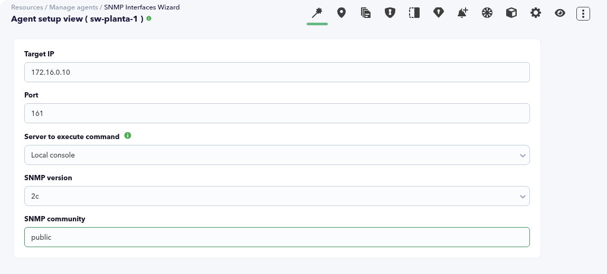{ .captura }

Once the query is done, the wizard decides once, for the whole device, whether
it works with 32- or 64-bit traffic counters: if the device answers on the
high-capacity counter branch (meant for fast links), it uses that one for all
its interfaces; if not, it stays with the classic 32-bit counters. The result
is presented as a collapsible block per interface, with a switch that includes
or excludes it whole; only the interfaces that are operationally and
administratively up come already enabled, so as not to fill the agent with dead
modules for ports with nothing connected. Above the blocks there is a filter
bar with free-text search by interface name or description, two switches to
keep only the ones that are operationally or administratively up, and a switch
to select at once all the interfaces that pass the filter. Inside each block,
another switch marks or unmarks all its modules at the same time, and each
module can be enabled or disabled separately and brought with its warning and
critical thresholds already edited before creating anything. A special block,
at the beginning of the listing, applies the same set of modules to all the
selected interfaces at once, without repeating the selection interface by
interface.

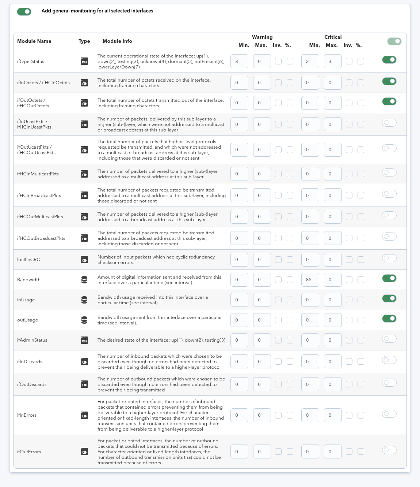{ .captura }

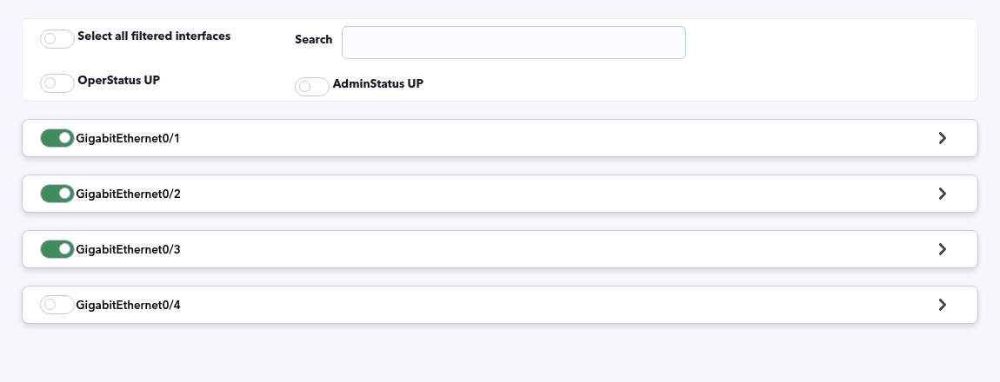{ .captura }

For every interface that stays checked, the wizard proposes:

| Module | What it measures | Threshold |
|---|---|---|
| Operational status | Whether the interface is up, down, in testing… | It depends on the **administrative status** of the interface: if it is administratively up, the critical threshold expects it to be operationally up too (it warns or fails if not); if it is administratively down, the threshold is inverted so as not to warn about something expected; if it is in testing, it uses a third set of ranges. |
| Input / output octets | Traffic in bytes per second | Incremental, with no threshold by default |
| Input / output unicast packets | Packets per second | Incremental, with no threshold by default |
| Input / output multicast and broadcast packets (only with 64-bit counters) | Packets per second | Incremental, with no threshold by default |
| CRC errors | Frames discarded because of a frame error | Incremental, with no threshold by default |
| Bandwidth, input usage, output usage | Percentage of the link capacity in use, calculated from the traffic and the interface speed | The aggregated bandwidth module brings an `85`% as default critical threshold; the input and output usage ones, separately, with no threshold |

The three usage percentage modules do not read an OID directly: an internal
plugin calculates them from the traffic and the nominal speed of the interface,
so they count as plugin-type modules in the agent, even though the wizard
presents them just like the rest. On Cisco devices recognised by their PEN, the
wizard also adds a duplex mismatch module per interface, when the device
exposes that data.

Which modules of this table come already checked by default, without touching
anything, is decided in **Setup → System settings → Performance**, on the
**Interfaces wizard** tab (see [9.2 · Full console configuration
reference](../parte-9/9.2-referencia-completa-de-configuracion-de-la-consola.md#3-performance)):
it is one switch per module, valid for all agents.

Before creating, the wizard goes over the list and marks in grey, with a
warning, the modules that already exist in the agent (or in the policy, if a
policy is being edited) with the same name; it does not prevent going on, but
it warns so as not to duplicate without noticing. The modules created behave
afterwards like any SNMP module: they are edited, their threshold is changed or
an alert is added in the same way as to one made by hand.

**Where they show up afterwards.** The agent view gets an **Interfaces (SNMP)** tab, with one row per interface: its status, access to its graph, the IP, the MAC and the last contact. The console does not query the device again to build it: it deduces the interfaces from the **name** of the modules (`<interface>_if…` or `if…_<interface>`, which is how this wizard creates them) and takes the IP and the MAC from their description, hence the `--` in the IP column when the description carries none. A hand-made SNMP module with the same name pattern shows up in the list too.

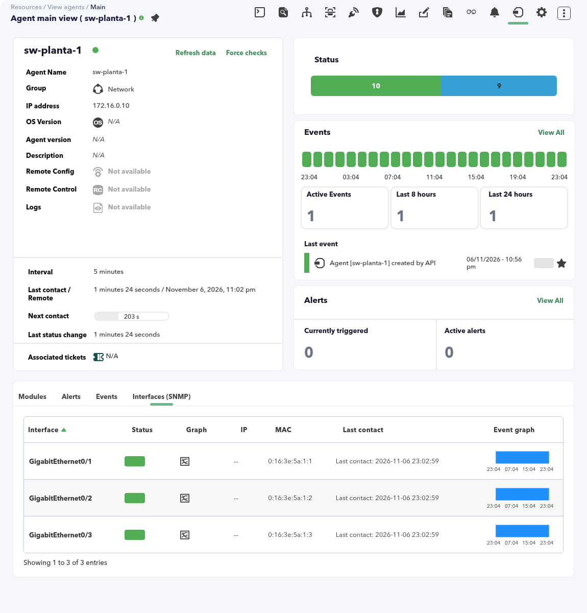{ .captura }

!!! example "A 24-port switch, only active interfaces and their traffic"
    Target IP `192.168.10.2`, version `2c`, community `public`. After the SNMP
    walk, only the interfaces with operational status up are left checked (the
    **OperStatus UP** filter helps to check it at a glance) and, of the modules
    each one proposes, only **Operational status** and the input and output
    octets: the availability and the traffic of each port in use, without
    errors or packets that an access switch rarely needs watching.

!!! example "A router with SNMPv3 from the credential store"
    Target IP, the one of the router; version `3`. Instead of typing user and
    passwords by hand, the set already saved in the credential manager is
    chosen, with security level `authPriv`, authentication `SHA` and privacy
    `AES`: the wizard fills in the rest of the form by itself and makes the
    exploration with those credentials.

### SNMP wizard

In the agent view, the **SNMP Wizard** tab. Unlike the previous one, this
wizard monitors the device as a whole, not only its interfaces, and shares the
same connection form of the previous section (target IP with no agent macros,
port, server to run the command, import from the credential store, version and
community or v3 credentials).

With the connection made, the wizard identifies the manufacturer of the device
by its **PEN** (*Private Enterprise Number*, the identifier every manufacturer
registers with IANA inside the identification branch of the device). If the PEN
is not registered in Pandora FMS, the wizard says so and proposes nothing: it
has to be
[registered](../anexos/a4-ampliar-los-asistentes-snmp-y-wmi-con-componentes-propios.md#registering-a-manufacturer-pen)
or, if it is of no interest, the modules have to be created by hand from [SNMP
modules](#snmp-modules). If it recognises it, it offers the library of modules
already prepared for that manufacturer —plus the ones that are good for any
device— grouped in blocks according to what they measure: CPU, memory, disks,
storage, and so on with the rest. Each block is enabled or disabled at once
with its own switch, and each module inside a block can be checked or unchecked
separately, with its warning and critical thresholds already editable before
creating anything; an indicator next to each block warns how many of its
modules are selected.

This wizard creates two kinds of modules:

- **Fixed OID**: they read an OID of the manufacturer MIB directly —CPU,
  memory, sensors…—, just like an SNMP module created by hand.
- **Calculated by plugin**: for data that do not come out of a single OID —a
  percentage of disk used, free memory expressed as a percentage…—, the wizard
  relies on a remote plugin called `snmp_remote.pl`. If that plugin is not
  registered in the installation (see [Remote server
  plugins](#remote-server-plugins)), these modules stay disabled in the wizard
  even if the manufacturer is recognised.

As in the interfaces wizard, before creating, the modules that already exist in
the agent or that repeat with the same name inside the selection itself are
marked in grey, without that preventing going on.

The catalogue of manufacturers and components this wizard uses is not closed:
it can be extended with new manufacturers and with components of your own, of
fixed or dynamic OID, read directly or calculated by a plugin —see [Extending
the SNMP and WMI wizards with components of your
own](../anexos/a4-ampliar-los-asistentes-snmp-y-wmi-con-componentes-propios.md).

!!! example "A Linux server with net-snmp"
    On a server with the `net-snmp` agent installed, the wizard recognises the
    Net-SNMP/UCD PEN and proposes CPU, memory and disk space modules ready to
    check and create, without looking up a single OID by hand.

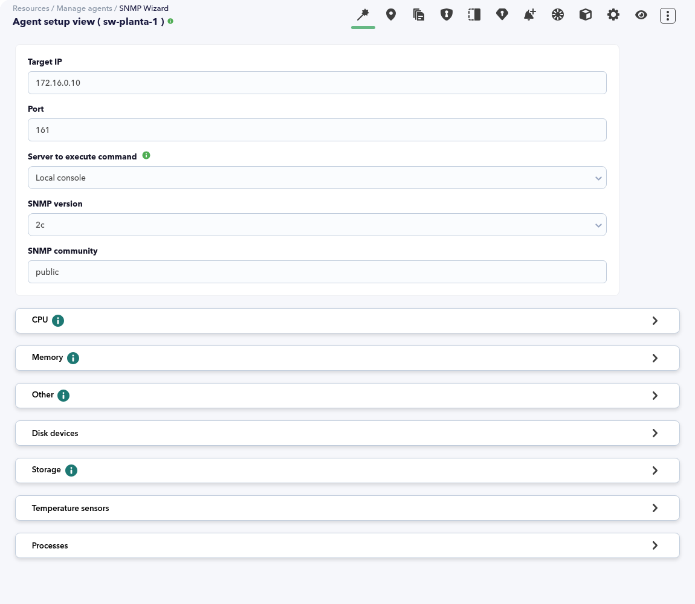{ .captura }

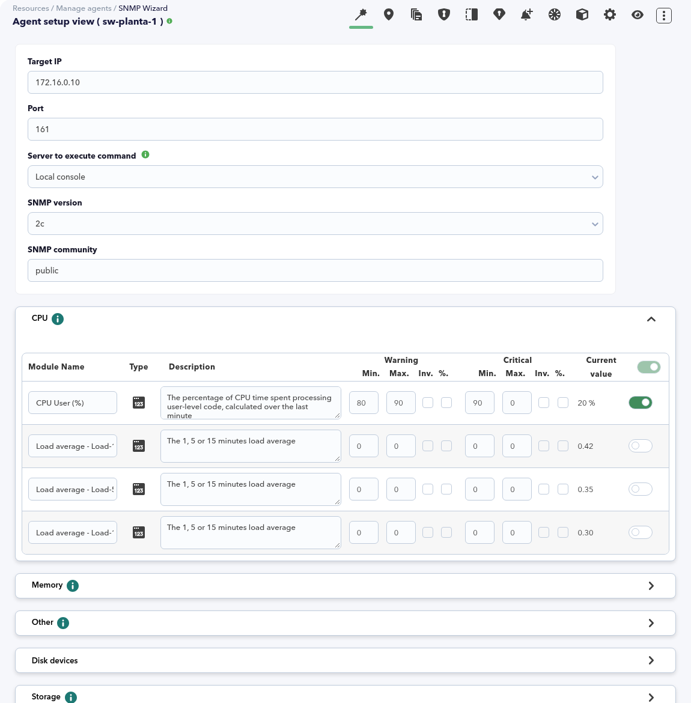{ .captura }

!!! example "A Windows server with the SNMP service"
    On a Windows server with the SNMP service enabled and a read community
    configured, the same connection is repeated (version `2c`, the community
    of the device): if the wizard recognises the PEN the service declares, it
    offers the blocks of modules already prepared just as in Linux; if it does
    not recognise it, it warns that the PEN is not registered and what
    corresponds is to document the device with [SNMP
    modules](#snmp-modules) or to register it by hand.

### SNMP browser

For when it is not known which OID is needed: the **SNMP browser** walks the
whole tree of the device, or only a specific branch if the exploration is to be
shortened, and allows searching for a text string with highlighting of
matches. On any OID found there are direct actions: create a network
component, an agent module or a policy module, without leaving the browser.

!!! example "Looking up the temperature of a switch"
    "temperature" is searched in the already explored tree of the switch, the
    OID corresponding to the sensor is located and the agent module is created
    directly from the result, with **Create agent module**.

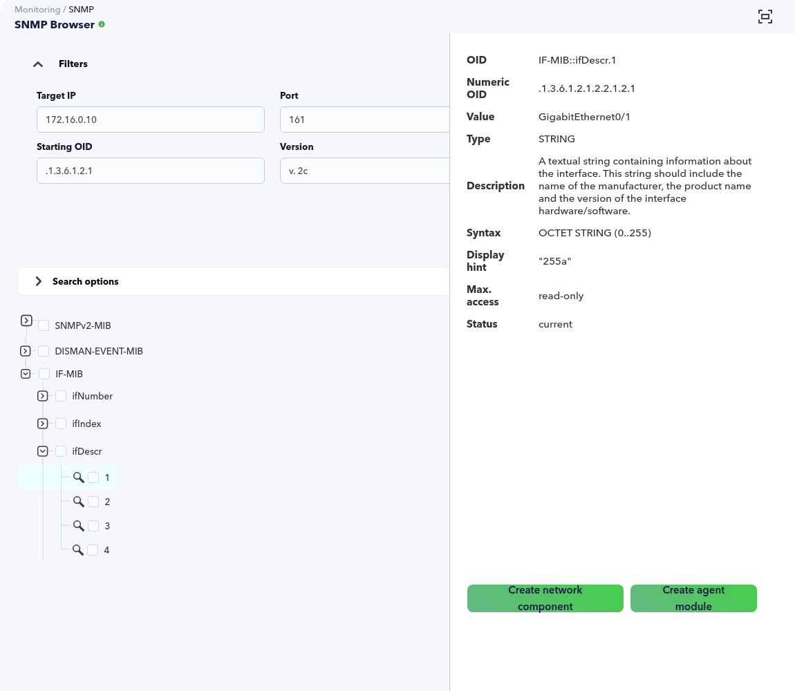{ .captura }

### SNMP modules

For what no wizard covers: a loose OID with no template, a MIB of the
manufacturer's own or the fine tuning of a module already created. Four types:
**numeric** (`remote_snmp`), **status** (`remote_snmp_proc`), **text**
(`remote_snmp_string`) and **incremental** (`remote_snmp_inc`, for counters:
see [Module type reference](#module-type-reference)). Fields of their own, with
their default value:

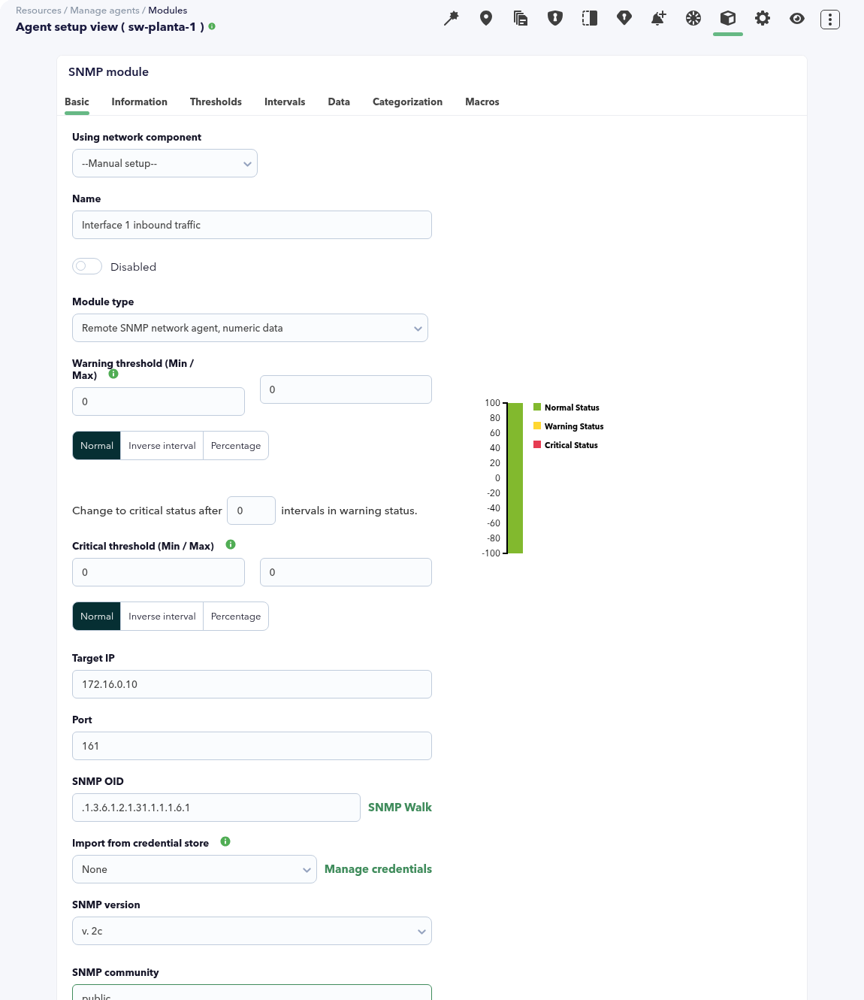{ .captura }

| Field | Default value |
|---|---|
| Port | `161` |
| OID | — |
| Version | `2c` |
| Community (v1/v2c) | empty; `public` in the wizards |
| Security level (v3) | `noAuthNoPriv` |
| User (v3) | — |
| Authentication method (v3) | MD5, SHA, SHA256 or SHA512; `MD5` by default (the console asks for a minimum of 8 characters in the password) |
| Privacy method (v3) | DES, AES, AES192 or AES256; `DES` by default |

The **Credentials** field allows choosing a set saved in the [credential
manager](2.2-gestor-de-credenciales.md) instead of typing community or user by
hand. Next to the OID field, the **SNMP Walk** button opens the same browser of
the previous section without leaving the module editor.

!!! example "Uptime over v2c"
    OID `.1.3.6.1.2.1.1.3.0`, version `2c`, community `public`: numeric module
    with the uptime of the device, in hundredths of a second.

!!! example "CPU of a device with a manufacturer OID"
    A switch exposes its CPU load in an OID of its own, outside MIB-II (for
    example, `.1.3.6.1.4.1.9.9.109.1.1.1.1.7.1` on Cisco devices). Numeric
    module with that OID, version `2c` and the community of the device.

!!! example "v3 authPriv module with SHA and AES"
    Version `3`, security level `authPriv`, user `pandora_ro`,
    authentication `SHA` with its password, privacy `AES` with its own: the
    highest level of SNMP security the form offers.

!!! example "Traffic of an interface as incremental"
    OID `.1.3.6.1.2.1.31.1.1.1.6.1` (`ifHCInOctets` of interface 1), type
    **incremental**. The SNMP counter grows without stopping while the device
    is up; Pandora FMS stores the difference between two readings divided by
    the elapsed time, that is, a **rate** (octets per second), not the raw
    value of the counter.

### MIB manager

MIBs describe what every OID of a manufacturer means; without the corresponding
MIB loaded, an OID is only seen in its numeric form. The **MIB uploader** allows
uploading the ones of the manufacturer, in `.mib` or `.zip` format, and leaves
them available to translate OID in the browser, in the modules and in the traps.

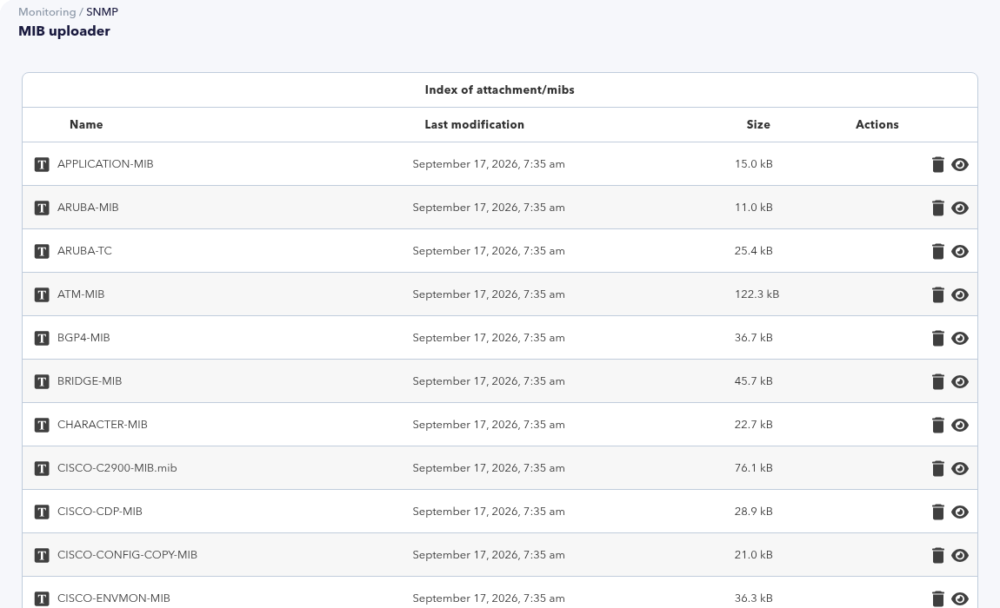{ .captura }

!!! example "Loading the MIB of a UPS"
    The `.mib` file the UPS manufacturer delivers is uploaded; from there on,
    its OIDs appear translated in the browser and traps of that same
    manufacturer can be used, already identified by their name.

### SNMP from an EndPoint

It makes sense when the SNMP device is only reachable from inside a network
that only an EndPoint reaches, not the central server. The Windows EndPoint has
a native directive for it:

```
module_snmpget
module_snmp_version 2c
module_snmp_community public
module_snmp_agent 192.168.10.1
module_snmp_oid .1.3.6.1.2.1.1.3.0
```

(SNMPv3 credentials are given inside the advanced options of the module itself,
with no dedicated sub-token per field).

The Go and Perl EndPoints do not have an SNMP directive of their own: they rely
on `module_exec` to call the system `snmpget`, just as for any other external
command.

!!! example "The same OID, from each EndPoint"
    Windows:
    ```
    module_snmpget
    module_snmp_version 2c
    module_snmp_community public
    module_snmp_agent 192.168.10.1
    module_snmp_oid .1.3.6.1.2.1.1.3.0
    ```
    Go or Perl:
    ```
    module_exec snmpget -v 2c -c public 192.168.10.1 .1.3.6.1.2.1.1.3.0
    ```

See [2.1 · Monitoring with EndPoints](2.1-monitorizacion-con-endpoints.md) for
the rest of the directives of the local configuration file.

All of the above is polling: Pandora FMS asks and the device answers. For the
opposite —the device warns at the moment something happens— there are the
traps, which are received, filtered, translated and turned into alerts as
explained in [SNMP trap monitoring](2.7-monitorizacion-de-traps-snmp.md).

## Windows without an agent: WMI

WMI allows reading information from a Windows device without installing an
EndPoint on it, provided remote access to WMI is enabled at the destination.
The WMI module relies on the `pandorawmic` client, which the Network Server
launches with the given credentials —stored in the [credential
manager](2.2-gestor-de-credenciales.md) or typed by hand— against the target
device. Its five types (numeric, status, text and incremental) are in [Module
type reference](#module-type-reference).

Fields of the module:

| Field | What it is |
|---|---|
| IP | Target Windows device |
| WMI credential | From the credential manager, or a user and password typed separately |
| Namespace | WMI namespace where the queried class lives; empty by default |
| WMI query | The query in **WQL**, the WMI dialect similar to SQL |
| Field number | Which column of the response to use, if the query returns several |
| Key string | Optional: if filled in, the module returns `1` or `0` depending on whether the response contains that string, instead of the string itself |

!!! example "Free space on C:"
    Namespace `root\cimv2`, query
    `SELECT FreeSpace FROM Win32_LogicalDisk WHERE DeviceID='C:'`, field
    number `0`: it returns the free space of the disk in bytes.

!!! example "Spooler service running"
    Query
    `SELECT State FROM Win32_Service WHERE Name='Spooler'`, key string
    `Running`: the module returns `1` while the service is active and `0` as
    soon as it stops.

!!! example "A WQL query of your own"
    Any WMI class of the device can be queried the same way, adjusting the
    field number to the column of interest in the response —for example,
    `SELECT Name, Status FROM Win32_PnPEntity` with field number `1` to keep
    only the status.

The **WMI Wizard**, in the agent view, groups the most usual queries in
templates ready to check: services (boolean, running or stopped), processes,
disk space and registered WMI components —the same component mechanism as in
SNMP, but for WMI—, without writing a single WQL query by hand. That catalogue
of WMI components can also be extended with queries of your own, just like the
one of the SNMP wizard: see [Extending the SNMP and WMI wizards with components
of your
own](../anexos/a4-ampliar-los-asistentes-snmp-y-wmi-con-componentes-propios.md#wmi-components).

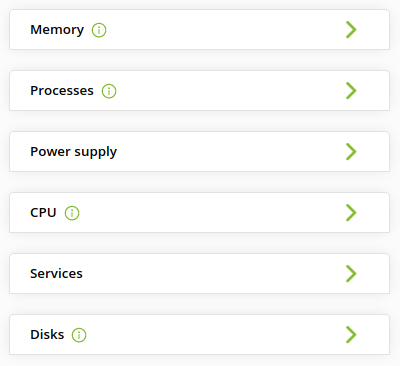

For the target Windows device to answer WMI, its firewall has to let the
corresponding incoming connections through (see [Windows firewall requirements
for agentless
monitoring](#windows-firewall-requirements-for-agentless-monitoring)).

## Remote commands: SSH and Windows

A remote command module runs a command on the target device and collects its
output (numeric, status, text and incremental types: see [Module type
reference](#module-type-reference)), with three connection methods:
**Inherited** (uses the operating system configured in the agent itself), **SSH**
for Linux and **Windows remote** (WinRM) for Windows. In all three cases, the
command connects with a credential from the [credential
manager](2.2-gestor-de-credenciales.md) —of the generic credential type— and
the **Command** field, in single quotes when needed (double quotes are escaped
with `\"`).

The wizard in the agent view brings three ready templates: disk usage, status
of a process and status of a service.

!!! example "Disk usage over SSH"
    SSH method, credential of the Linux device, command:
    ```
    df -h / | tail -1 | awk '{print $5}' | tr -d '%'
    ```
    it returns the usage percentage of the root disk as a numeric value.

!!! example "nginx process running"
    SSH method, command:
    ```
    pgrep -c nginx
    ```
    A boolean module that returns `0` if there is no `nginx` process running,
    and a higher number if there is.

**Windows remote** (WinRM) needs, just like WMI, the firewall of the target
device to let the corresponding incoming connections through (see [Windows
firewall requirements for agentless
monitoring](#windows-firewall-requirements-for-agentless-monitoring) below).

### Windows firewall requirements for agentless monitoring

Both WMI and Windows remote need the firewall of the target device to have
these inbound rules enabled:

| Requirement | Detail |
|---|---|
| File and Printer Sharing (SMB) | **File and Printer Sharing (SMB-In)** rule |
| RPC (endpoint mapper) | **File and Printer Sharing (Spooler Service - RPC-EPMAP)** rule |
| WMI | **Windows Management Instrumentation (WMI-In)** rule |

Without these three rules active, the device rejects the connection even if the
credentials and the query or the command are right.

## Remote server plugins

A **remote plugin** is a script or executable that the Heavy Server launches
with parameters and from which it collects a single value —numeric, boolean or
text—; the type of data is decided by the module (see [Module type
reference](#module-type-reference)). There are two classes: **standard**, which
only returns the value, and **Nagios**, which besides an error code can return
a descriptive string. The installation brings several registered from the
factory and the administrator can register the ones needed from **Management →
Servers → Plugins**.

When a plugin is registered, its type is given, the **maximum time** of
execution —15 s to start with— and the field macros (`_field1_`, `_field2_`…)
that whoever applies it to a module will use, each one with its description,
help text, default value and whether it must be hidden in the form (for
passwords and sensitive data). The effective timeout of a specific plugin is
the **shortest** between the one configured in the server and the plugin's own;
if neither of the two turns out valid, 15 s are used as a last resort.

As soon as a plugin is used by some module or component, the editor blocks its
**Plug-in parameters** and its field macros: they can no longer be added,
removed or edited, so as not to break the modules that already depend on them.
To change the parameters, the plugin has to stop being used in all its modules
and components first.

### Plugin macros

Macros are what makes a plugin reusable: the command is registered once with
gaps, and every module that uses it fills those gaps with its own values. There
are three families: the field macros, which are defined by whoever registers
the plugin; the agent and module ones, which the server provides; and the ones
left available for the module alerts.

**Field macros.** In **Plug-in parameters** the parameter line is written as
the script expects it, with `_field1_`, `_field2_`… in the place of each value.
In **Parameters macros** each one is described:

| Field | What it is for |
|---|---|
| Description | Label of the field in the module form |
| Default value | Value with which the field appears filled in when creating the module |
| Help | Help text shown next to the field |
| Hide value | The field is shown as a password (dots) and the value is stored encrypted |

The **Command preview** shows the complete line with the default values
replaced, useful to check the registration before saving. When creating a
module of the plugin type and choosing that plugin, the form shows one field
per macro, with its description, its help and its default value. Hidden values
are decrypted only at the moment of launching the plugin.

!!! example "Plugin of your own with user and password"
    A script that queries the status of an application is registered with
    these **Plug-in parameters**:
    ```
    -H _field1_ -u _field2_ -p _field3_
    ```
    and three macros: `_field1_` with description "Server", `_field2_` with
    description "User" and default value `monitor`, and `_field3_` with
    description "Password" and **Hide value** checked. In the module,
    `192.168.10.20`, `monitor` and the password are filled in, which is shown
    with dots; the server runs the script with
    `-H 192.168.10.20 -u monitor -p <password>`.

**Agent and module macros.** Besides the field ones, the parameter line
accepts these macros (more than the fields of the other remote modules, see
[Macros in the module fields](#macros-in-the-module-fields)), which the server
replaces every time it runs the plugin:

| Macro | Replaced by |
|---|---|
| `_agent_`, `_agentalias_` | Agent alias |
| `_agentname_` | Agent name |
| `_agentdescription_` | Agent description |
| `_agentgroup_` | Name of the agent group |
| `_agentstatus_` | Agent status |
| `_address_` | Main IP address of the agent |
| `_addressn_N_` | IP address number N of the agent, with the addresses sorted (`_addressn_2_` is the second one) |
| `_agentcustomfield_N_` | Value of the agent custom field whose identifier is N |
| `_module_` | Module name |
| `_moduledescription_` | Module description |
| `_modulegroup_` | Module group |
| `_modulestatus_` | Module status |
| `_moduletags_`, `_name_tag_` | Module tags |
| `_email_tag_`, `_phone_tag_` | Emails and phone numbers associated with the module tags |
| `_interval_` | Module interval, or the agent one if the module has none of its own |
| `_target_ip_`, `_target_port_` | IP and port of destination configured in the module |
| `_policy_` | Name of the policy the module comes from, if it comes from one |
| `_id_agent_`, `_id_module_`, `_id_group_` | Numeric identifiers of the agent, the module and the group |

The server replaces the field macros first and then these, so the value of a
field macro can in turn be one of them. It is the way for the same module to
serve many agents: with `_address_` as value, each agent checks its own IP.

!!! example "A plugin module for all the agents of a policy"
    In the **DNS Plugin** plugin, the **DNS Server to check** field is filled
    in with `_address_` instead of a fixed IP. Applied through a [monitoring
    policy](2.10-politicas-de-monitorizacion.md) to the agents of all the DNS
    servers of the company, each module asks the IP of its own agent, without
    touching a single module by hand.

!!! example "Custom field as parameter"
    If the agents have a custom field with the administration port of each
    device (identifier `3`), the parameter `-p _agentcustomfield_3_` passes the
    port of each agent to the plugin.

**Macros for alerts.** In the alerts of a plugin module, `_plugin_param1_`,
`_plugin_param2_`… stay available with the value of each field macro, and
`_plugin_param1_desc_`, `_plugin_param2_desc_`… with its description. They
serve so that the notice says what the check was run against without repeating
the data in the alert text. A macro with **Hide value** is also replaced here,
and in the clear: it is not advisable to use the macro of a password in the
text of an alert.

!!! example "Alert that says which server failed"
    With the plugin of the first example, the alert text
    `Failure at _plugin_param1_desc_ _plugin_param1_ (_module_)` arrives as
    "Failure at Server 192.168.10.20 (Application status)".

### Factory plugins

| Factory plugin | What it is for |
|---|---|
| DNS Plugin | Resolves a domain name against a given DNS server |
| UDP port check | Checks whether a UDP port answers |
| SMTP Check | Verifies an outgoing mail server |
| MySQL Plugin | Runs a query against a MySQL server |
| Packet Loss | Percentage of packets lost towards a destination |
| Check certificate validity | Validity and expiry of a certificate |
| SSL Verification | SSL/TLS connection check |
| IPMI Plugin | Reading of IPMI sensors (see [9.12 · Advanced automatic discovery: IPMI and custom recon tasks](../parte-9/9.12-descubrimiento-automatico-avanzado-ipmi-y-reconocimiento.md)) |
| SNMP remote | Used internally by the [SNMP wizard](#snmp-wizard) for the calculated modules |

!!! example "DNS resolution against 8.8.8.8"
    **DNS Plugin** with its fields filled in like this: **Target IP**
    `192.168.10.30` (the IP the domain must return), **Domain to check**
    `midominio.com` and **DNS Server to check** `8.8.8.8`. The module checks
    that `midominio.com` resolves to that IP when that DNS server is asked.

!!! example "Checking an SMTP server"
    **SMTP Check** plugin pointing at port 25 of the mail server: boolean
    module that fails if the server stops accepting SMTP connections.

!!! example "Open UDP port"
    **UDP port check** plugin with the IP and UDP port of the service to
    check (for example, an NTP server on `123/udp`).

Creating a plugin of your own, instead of using the factory ones, is told in
[9.9 · Creating remote
plugins](../parte-9/9.9-creacion-de-plugins-remotos.md).

## Route monitoring

The route analyzer traces the network path to a destination and warns if it
changes, something neither ICMP nor TCP do by themselves: it is not enough to
know that the destination answers; what matters is where the traffic goes
through to reach it. It relies on the `route_parser` plugin of the source
EndPoint, which combines ping and traceroute:

```
route_parser -t <destination_address>
```

It requires an EndPoint at the source point of the route and ICMP reachability
to the destination. It is registered from the plugins tab of the agent view,
just like any other local plugin, and once enabled it generates a visualisation
with every hop of the route and the time to it.

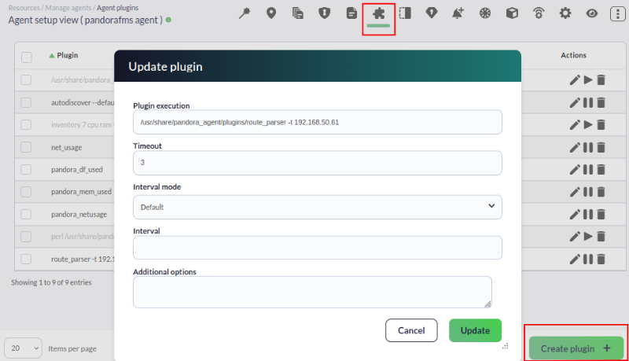

!!! example "Route to a remote site"
    On the EndPoint of the head office, `route_parser -t 172.16.0.2` (the IP
    of a device at the remote site) shows, hop by hop, which routers the
    traffic goes through between both sites and warns if that route changes.

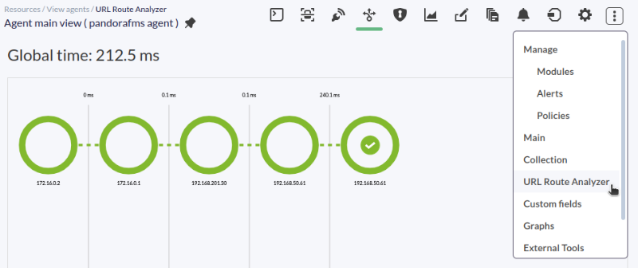

## Running wizards and tests from a remote server (Exec Server)

When the console has no direct path to a network, because it is behind a
firewall or on another segment, the SNMP wizards and the SNMP browser can be
run from another server that does reach it, for example the [satellite
server](../parte-6/6.2-servidores-satelite.md) of a remote site. It is chosen in
the **Server to run the command** field of the wizard. How to prepare that
server and what requirements it has is explained in [Satellite
servers](../parte-6/6.2-servidores-satelite.md).

## Module type reference

| Internal type | Family | Returns | What it is used for |
|---|---|---|---|
| `remote_icmp_proc` | ICMP | Boolean | Availability over ping |
| `remote_icmp` | ICMP | Numeric | Latency in milliseconds |
| `remote_tcp` | TCP | Numeric | Connection time to the port |
| `remote_tcp_proc` | TCP | Boolean | Port open or closed |
| `remote_tcp_string` | TCP | Text | Textual response of a service |
| `remote_tcp_inc` | TCP | Incremental | Counter read over TCP |
| `remote_snmp` | SNMP | Numeric | Value of an OID |
| `remote_snmp_inc` | SNMP | Incremental | SNMP counter (traffic, packets…) |
| `remote_snmp_string` | SNMP | Text | OID of string type |
| `remote_snmp_proc` | SNMP | Boolean | Status derived from an OID |
| `remote_cmd` | Remote command | Numeric | Numeric output of a command |
| `remote_cmd_proc` | Remote command | Boolean | Success or failure of a command |
| `remote_cmd_string` | Remote command | Text | Textual output of a command |
| `remote_cmd_inc` | Remote command | Incremental | Counter read over command |
| `wmi_generic_data` | WMI | Numeric | Numeric value of a WQL query |
| `wmi_generic_proc` | WMI | Boolean | Boolean result of a WQL query |
| `wmi_generic_data_string` | WMI | Text | String returned by a WQL query |
| `wmi_generic_data_inc` | WMI | Incremental | Counter read over WMI |
| `wmi_generic_data_inc_abs` | WMI | Absolute incremental | Difference between two readings of a WMI counter |
| `generic_data` | Plugin | Numeric | Numeric value returned by the plugin |
| `generic_proc` | Plugin | Boolean | Correct or failed result of the plugin |
| `generic_data_string` | Plugin | Text | String returned by the plugin |
| `generic_data_inc` | Plugin | Incremental | Counter returned by the plugin, as a rate |
| `generic_data_inc_abs` | Plugin | Absolute incremental | Counter returned by the plugin, as a difference |

A **plugin** module has no family of types of its own: it uses the generic
types of the table and it is whoever creates the module who chooses the one
that corresponds to what the plugin returns.

The **boolean** types (with the `_proc` suffix) are interpreted with the same
rule in all cases: `1` is correct (normal) status and `0` is critical status.
The **incremental** ones store a **rate per second**: the difference between two
readings divided by the time elapsed between them, not the raw value of the
counter. The **absolute incremental** ones (suffix `_inc_abs`) store the
difference between two readings, without dividing by the time. In both cases
the first reading only serves as a reference: the server discards it and the
module shows no data until the second one.

## Performance, fine tuning and troubleshooting

Remote monitoring is shared out by three servers, enabled from the factory: the
**Network High Performance Server** (ICMP and SNMP in bulk), the **Network
Server** (TCP, remote commands and WMI, and the SNMP modules that fail
repeatedly) and the **Heavy Server** (remote plugins). What each one does and
how they share out the work is explained in [Compatibility and migration to
the new server
architecture](../anexos/a3-compatibilidad-y-migracion-a-la-nueva-arquitectura-de-servidores.md).
Each one has its own number of threads, which is the first thing worth raising
when a type of check starts arriving late. The threads, retries, timeouts and
binary paths are in [9.3 · Full server configuration
reference](../parte-9/9.3-referencia-completa-de-configuracion-del-servidor.md#3-network-snmp-and-wmi).

Ports that have to be open from the Pandora FMS server to the monitored
devices:

| Check | Port / protocol |
|---|---|
| ICMP | ICMP protocol (no port) |
| SNMP get | `161/udp` |
| WMI | The ones remote WMI itself uses on the target Windows device |
| SSH (remote commands) | `22/tcp`, unless another one is configured |

SNMP traps go the other way, from the device to the server, over `162/udp`
(see [SNMP trap monitoring](2.7-monitorizacion-de-traps-snmp.md)).

When a remote module stays in unknown, the first thing is to repeat the same
check by hand from the Pandora FMS server, not from the administrator's desk,
with the same credentials:

```
snmpget -v 2c -c public 192.168.10.1 .1.3.6.1.2.1.1.3.0
```

The complete diagnosis (logs, checks per module type and usual causes) is in
[9.13 · Troubleshooting with
Pandora](../parte-9/9.13-troubleshooting-con-pandora.md). The sizing of threads
and servers for large volumes is in [9.14 · Volumetrics analysis and designs
for high
capacity](../parte-9/9.14-analisis-de-volumetria-y-disenos-para-alta-capacidad.md).
