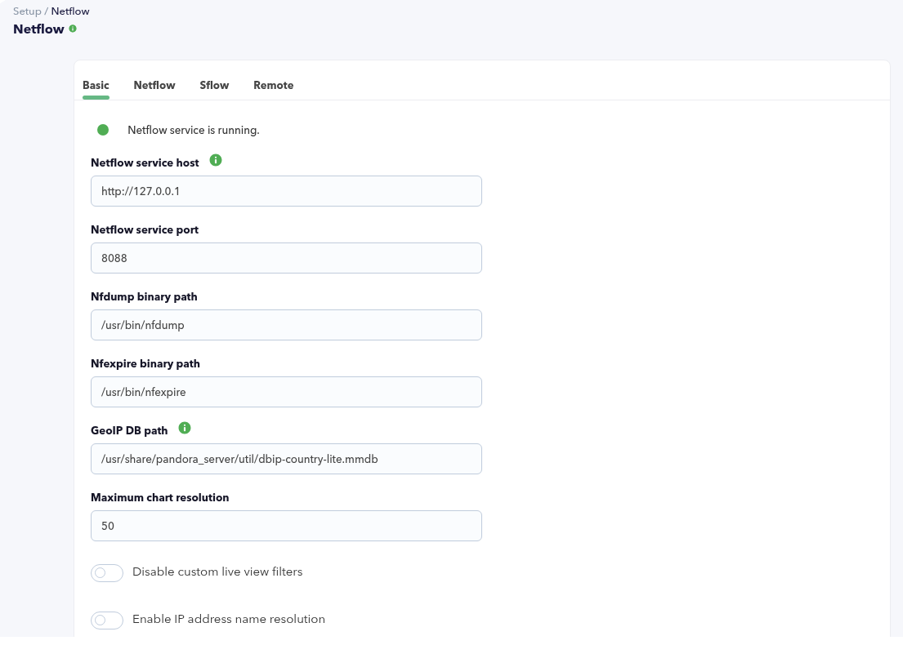
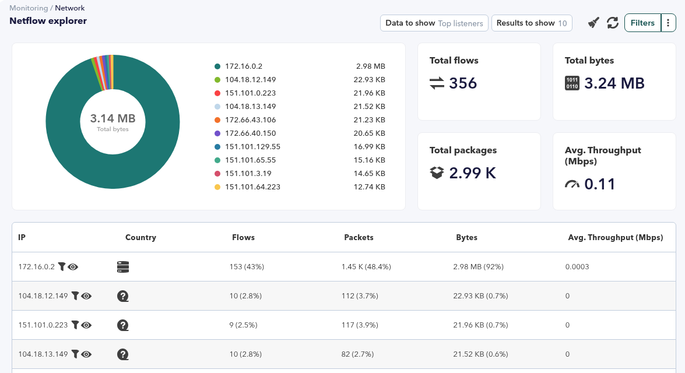
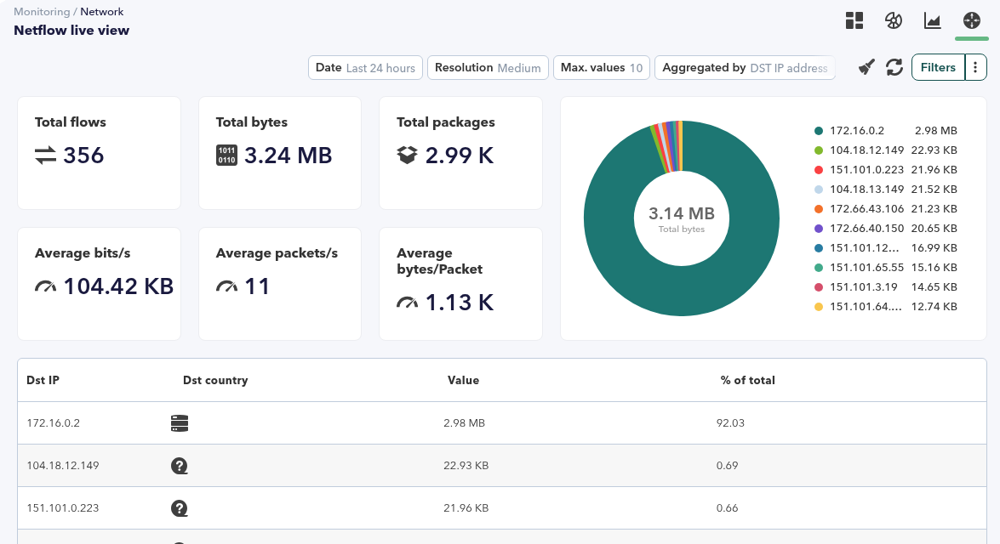
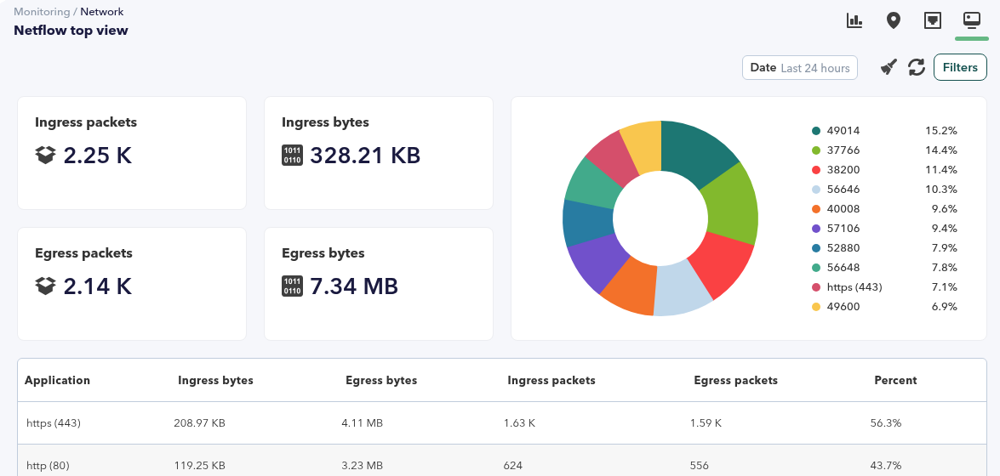
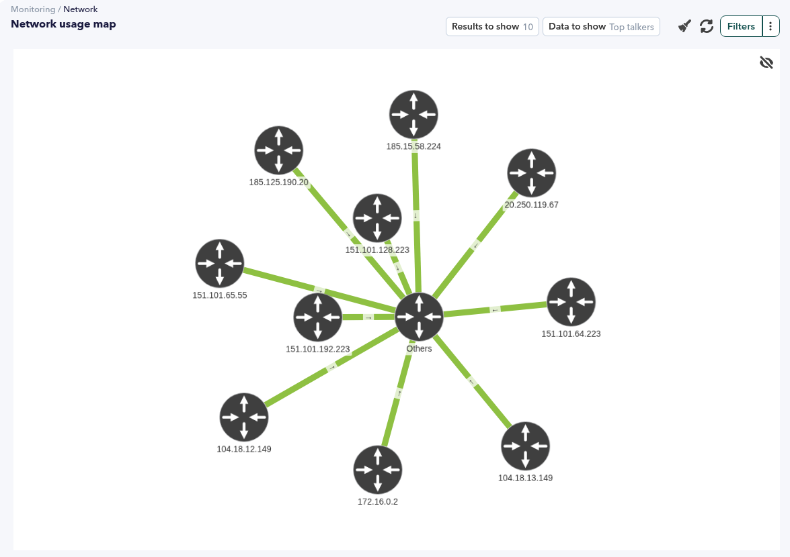
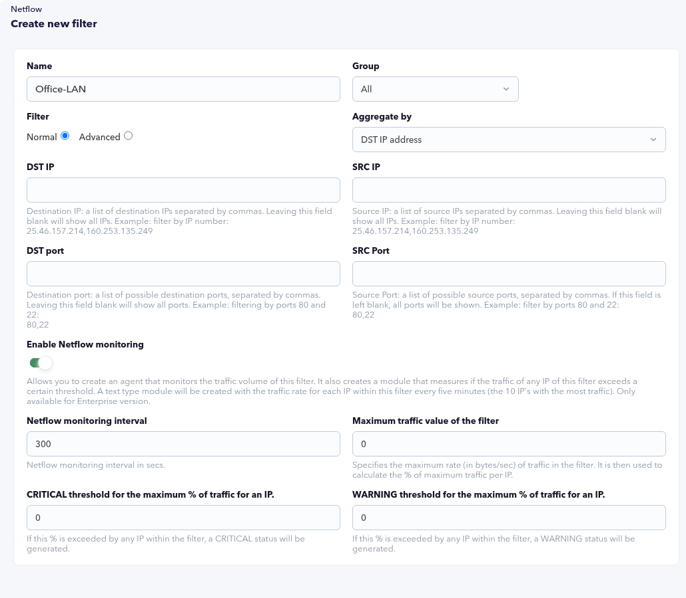

# Netflow traffic monitoring

Everything explained in [Network monitoring](2.6-monitorizacion-de-redes.md)
answers one question: how much traffic goes through an interface? Netflow
answers the next one, the one that really matters when the link saturates:
whose traffic is it? SNMP polling of an interface gives a number that goes up
and down; flow analysis tells which IP, which port and which protocol are
generating it, with nothing installed on the machine that talks. This chapter
covers how traffic reaches Pandora FMS, how it is enabled and configured, how
it is explored and displayed, how to turn it into modules with alerts, and how
it looks in reports, dashboards and in the Command Center. Netflow and sFlow
—two different export formats, one from Cisco and the other born for
high-speed networks— are enabled separately but are queried and displayed
together on every screen.

## Concepts: flow, exporter, probe and collector

A **flow** is a set of packets that share the same seven data: source IP and
port, destination IP and port, protocol, input interface and type of service
(ToS). While those seven data do not change, all the packets that go through
the router count as the same flow, and what is recorded is not each packet but
the aggregated flow: how many bytes and how many packets it has moved, between
which instants.

Whoever generates that information is the **exporter**: usually the router or
switch itself, if it already speaks NetFlow (versions 5, 9 or the most recent
IPFIX), sFlow, or one of the compatible formats such as jFlow or NetStream
from other manufacturers. When the network equipment does not know how to
export flows —a low-end switch, for example— the alternative is a **probe**: a
machine that listens to the traffic through a mirror port (*port mirroring*)
and generates the flows in software, with a tool such as `fprobe` or `pmacct`.

At the other end is the **collector**: the process that receives those flows
over UDP and writes them to disk. In Pandora FMS they are `nfcapd`, for
NetFlow, and `sfcapd`, for sFlow, and they live on the Pandora FMS server
itself.

!!! example "A switch with no NetFlow of its own"
    An access switch that does not export flows is connected to a mirror port
    of a `fprobe` probe, and it is that probe —not the switch— which sends the
    NetFlow flows to the Pandora FMS server.

## How it works in Pandora FMS

The chain, in version 805, has five steps. The exporter sends the flows over
UDP to the corresponding collector: `nfcapd` for NetFlow, listening by default
on port `9995`, or `sfcapd` for sFlow, on `6343`. The collectors write them,
each one in its own path, inside the general network directory configured in
the console, in files that are rotated according to the configured interval
(`netflow_interval`/`sflow_interval`). After the configured maximum lifetime in
days, `nfexpire` purges the oldest files.

Up to here, nothing very different from previous versions. What changes in 805
is how those data are queried: it is no longer the console itself running
`nfdump` by hand, but a **Netflow query service** (`pandora_netflow_server`, a
binary of its own written in Go) that listens over HTTP on `127.0.0.1:8088`
and is the one that really launches `nfdump` —locally or, if configured, over
SSH against another machine— and returns the result already digested to the
console. Flow data are not stored in the Pandora FMS database: the views query
the capture files on demand, although not all of them accept the same filters.
Filter monitoring follows another path: the Netflow server runs `nfdump`
directly to compute its modules, without going through the query service.

The Pandora FMS server is the one that manages that whole life cycle, but not
in the same way for the two pieces. The `nfcapd` and `sfcapd` collectors are
started once, when the server itself starts —if Netflow or sFlow are enabled
at that moment— and are stopped when it stops; enabling or disabling either of
the two protocols, or changing their rotation interval, has no real effect
until the next server restart. The query service, on the other hand, is
checked every five seconds: it is the server that starts it, reconfigures it
or stops it on the fly, without restarting itself —we will see it in detail in
the next section—. Apart from querying, there is a second way of taking
advantage of these data: filter monitoring, which turns the traffic of a
specific filter into normal modules, with their usual alerts (see [Monitoring
and alerting on a filter](#monitoring-and-alerting-on-a-filter)).

| Piece | What it does | Who starts it |
|---|---|---|
| `nfcapd` / `sfcapd` | Receive the flows over UDP and write them to disk | The Pandora FMS server |
| `pandora_netflow_server` | Queries those files with `nfdump` and serves the data over HTTP to the console | The Pandora FMS server (as a system service) |
| `nfexpire` | Purges capture files older than the configured maximum lifetime | The Pandora FMS server, in its maintenance tasks |

## Requirements and installation

| Requirement | Detail |
|---|---|
| `nfdump` 1.6.8 or higher | Includes the `nfcapd`, `sfcapd` and `nfexpire` binaries; it is installed apart from the Pandora FMS package |
| `pandora_netflow_server` service | It is delivered along with the Pandora FMS server, with its own systemd unit; the server itself starts and controls it |
| Collector UDP ports open | `9995/udp` for NetFlow, `6343/udp` for sFlow (or the ones configured), reachable from the exporters |
| Disk with good write bandwidth | Capture files grow fast in networks with high traffic |
| GeoIP database (optional) | `.mmdb` file for the functions that query the country of an IP; the network usage map does not represent countries |
| Linux system | The Pandora FMS server that runs Netflow is not supported on Windows |

With the collectors running, the quickest way to check that everything works
is to look whether capture files are arriving at the configured path; if
nothing arrives, the problem is before Pandora FMS, in the exporter or in the
firewall.

!!! example "Quick check after installing"
    With `9995/udp` open in the firewall of the server and an exporter already
    pointing at it, checking in the Netflow data path that new `nfcapd.*`
    files keep appearing every configured interval is the sign that reception
    works, even before touching anything in the console.

## Sending flows to Pandora FMS

A router or switch that already speaks NetFlow only needs to be told the IP of
the Pandora FMS server and the collector port: NetFlow v9 to port `9995`,
sFlow to `6343`. That configuration lives on the network equipment itself and
is outside Pandora FMS; every manufacturer has its own syntax to enable the
export.

When the equipment does not know how to export flows, the probe does that work
for it. `fprobe` is the usual option on Linux to generate NetFlow from an
interface in promiscuous mode or from a mirror port; `pmacct` covers the same
case, although in a deployment with Pandora FMS it is considered experimental.
Once running, `nfdump -R <path>` on the capture files confirms that the flows
are arriving, without going through the console. To choose the interface,
configure the destination and verify the probe and the collector separately,
see [annex A5 · Configuring fprobe for
Netflow](../anexos/a5-configuracion-de-fprobe-para-netflow.md).

## Enabling and configuring Netflow and sFlow in the console

Netflow and sFlow are enabled separately, each one with its own switch, in
**Setup → System settings → General setup**, **Features** tab: "Enable
Netflow" and "Enable Sflow" —two switches of the same kind—. On the same page,
**Directories** tab, "General network path" sets
the base directory where the data subdirectories of both protocols live.

With Netflow or sFlow enabled, a configuration page of its own appears,
**Setup → System settings → Netflow & Sflow** ("Netflow & Sflow" in the menu),
organised in tabs:

- **Basic.** Host and port of the query service, paths of the `nfdump` and
  `nfexpire` binaries, path of the GeoIP database, maximum chart resolution,
  a switch to disable the custom filters of the live view and another one to
  enable name resolution by IP —with an explicit warning that it can be slow,
  because it implies a DNS query for every IP that appears in the result—.
  Below these fields, an indicator with a coloured dot says whether the query
  service responds or not.
- **Netflow** (only visible with Netflow enabled). Data subdirectory, path of
  the `nfcapd` daemon, listening port, rotation interval —`10`, `30` or `60`
  minutes, with the warning that changing it requires restarting the
  server— and maximum lifetime of the files.
- **Sflow** (only visible with sFlow enabled). The same fields as Netflow,
  with the `sfcapd` daemon and its own port, with one difference: the rotation
  interval is not a selector but a free-text field, in seconds (`3600` by
  default), and it carries no restart warning.
- **Remote.** Enable remote query over SSH, remote host, port and user; it is
  explained in detail in [Netflow data on another machine: remote
  nfdump](#netflow-data-on-another-machine-remote-nfdump). With remote query
  enabled, the same status indicator of the Basic tab adds a second line with
  whether that remote connection is reachable.



When saving any change on the Netflow configuration page, it is the Pandora
FMS server itself that notices the configuration changed —it checks it every
five seconds— and regenerates the configuration file of the query service,
restarting it so that it takes the new values. If neither Netflow nor sFlow
are enabled, the server simply stops that query service —the collectors, on
the other hand, are only stopped when the server itself stops, as explained in
[How it works in Pandora FMS](#how-it-works-in-pandora-fms)—.

| Option | Default value |
|---|---|
| Host of the query service | `http://127.0.0.1` |
| Port of the query service | `8088` |
| `nfdump` binary | `/usr/bin/nfdump` |
| `nfexpire` binary | `/usr/bin/nfexpire` |
| Netflow collector binary (`nfcapd`) | `/usr/bin/nfcapd` |
| sFlow collector binary (`sfcapd`) | `/usr/bin/sfcapd` |
| Netflow data subdirectory | `netflow` (under the general network path) |
| sFlow data subdirectory | `sflow` (under the general network path) |
| Netflow collector port (`nfcapd`) | `9995` |
| sFlow collector port (`sfcapd`) | `6343` |
| Netflow interval | `30` minutes |
| sFlow interval | `60` minutes |
| Netflow maximum lifetime | `5` days |
| sFlow maximum lifetime | `5` days |
| Maximum chart resolution | `50` |
| GeoIP database | `/usr/share/pandora_server/util/dbip-country-lite.mmdb` |

The data path that the collectors and the query service really use comes from
joining the "General network path" (for example,
`/var/spool/pandora/data_in/`) with the subdirectory of each protocol: with
the factory values, `/var/spool/pandora/data_in/netflow` for Netflow and
`/var/spool/pandora/data_in/sflow` for sFlow.

The complete detail of every token, both the console ones and the ones the
server reads, is in [9.2 · Full console configuration
reference](../parte-9/9.2-referencia-completa-de-configuracion-de-la-consola.md)
and in [9.3 · Full server configuration
reference](../parte-9/9.3-referencia-completa-de-configuracion-del-servidor.md).

!!! example "Enabling sFlow alongside Netflow with a week of retention"
    With "Enable Netflow" and "Enable Sflow" checked and "General network
    path" in `/var/spool/pandora/data_in`, on the Sflow tab the factory
    interval is left and the maximum lifetime is set to `7` days: after a
    week, the sFlow capture files are purged by themselves and new ones keep
    coming in.

## Netflow filters

A **Netflow filter** delimits the traffic queried or monitored. The Explorer
and the Live view accept filters of their own and saved filters; the Top view
does not offer a traffic filter. The Network usage map uses its own filters,
independent of the saved Netflow filters. The latter are managed in
**Management → Resources → Netflow filters**, with agent write permission.

Each filter has a **normal** mode, with destination IP and port, source IP and
port (comma-separated lists, empty means "all") and an **aggregation** —by
source or destination IP or port—, or an **advanced** mode, with the filter
syntax of `nfdump` itself (similar to that of `tcpdump`), for what the normal
mode does not cover. The filter is assigned to a group, like any other Pandora
FMS resource. From the operation views that accept them (Explorer and Live
view), saved filters can be loaded without writing them again.

!!! example "Basic filter of a server"
    Normal mode, "Dst Ip" `192.168.10.20`, with no other criterion: it shows
    all the traffic that has that server as destination, wherever it comes
    from.

!!! example "Advanced filter of a subnet without DNS"
    Advanced mode, with the expression:
    ```
    src net 192.168.10.0/24 and not port 53
    ```
    All the traffic that leaves network `192.168.10.0/24`, excluding DNS
    traffic.

The same filter also has the **monitoring** fields explained in [Monitoring
and alerting on a filter](#monitoring-and-alerting-on-a-filter): enabling it
is not a separate screen, but one more switch inside the filter itself.

A filter can also be created without going through the console, with the
`--create_netflow_filter` option of the command-line management script or with
the `create_netflow_filter` operation of the API, to automate the creation of
repetitive filters from outside the interface.

## Netflow explorer

**Operation → Monitoring → Network → Netflow explorer.** It is the view to
investigate a specific period: "Data to show" only has two options, **Top
listeners** (who receives the most traffic) and **Top talkers** (who sends the
most traffic), and "Results to show" is chosen among `5`, `10`, `15`, `20`,
`25`, `50`, `100` or `250` (`10` from the factory). The rest is the date range
and the same basic and advanced filter tabs as the rest of the views, with the
possibility of saving the filter used or loading one already saved. The result
can be exported to CSV, and each IP in the table carries a direct link to a
whois query, without leaving the explorer.



!!! example "The biggest senders of the last day"
    "Data to show" in **Top talkers**, "Results to show" in `10`, date range
    the last 24 hours, advanced filter `src net 192.168.10.0/24`: the
    resulting table is the 10 machines of that network that have generated the
    most traffic in the day.

## Live view

**Operation → Monitoring → Network → Netflow live view.** It is the view
designed to follow traffic almost in real time rather than to investigate a
history: period (predefined, custom or relative, such as "this week" or "this
month"), basic or advanced filter, aggregation, maximum number of aggregates
to show and chart resolution. The chart types available here are only four
—**summary**, **area graph**, **circular mesh** and **host detailed
traffic**—; the rest of the chart types that existed in previous versions of
this view (data table, Top-N of connections, sources, applications and
protocols) have moved to the [Top view](#top-view). The filter used can be
saved or updated without leaving the view.



The advanced tab of this view also includes "Netflow source IP", a field that
is not available when editing a saved filter from Management. It allows
limiting the flows by the IP of the exporter (router or switch, not the source
IP of the traffic), but it is only applied if the advanced filter expression
is left empty and the normal criteria are used. With an advanced expression,
the exporter field does not restrict the query.

!!! example "Traffic by destination port in the last hour"
    Advanced filter `src net 192.168.10.0/24`, aggregation by destination
    port, period the last hour, chart type area graph: it shows at a glance
    which ports concentrate the outgoing traffic of that network in almost
    real time.

!!! example "Only the flows of a specific router"
    With several exporters sending flows to the same server, "Netflow source
    IP" in `192.168.10.1` limits the view to the flows that router exported,
    even if the filter touches neither the source nor the destination of the
    traffic. Leave the advanced filter expression empty for the exporter field
    to be applied.

## Top view

**Operation → Monitoring → Network → Netflow top view.** Four breakdowns
over the same period: **Applications**, **Network protocols**, **Netflow
sources** (which router and which interface have exported the most flows, with
the last time each IP was seen) and **Connections** (the Top-N of connections
that in previous versions was in the live view). The percentages of a Top-N do
not have to add up to 100. The period can be chosen, but this screen does not
allow applying an IP, port or advanced expression filter.



!!! example "Which application consumes the most bandwidth this week"
    "Applications" breakdown and period the last week: the table sorts the
    detected applications by traffic volume, from highest to lowest, without
    restricting the result to a network such as `192.168.10.0/24`.

## Network usage map

**Operation → Monitoring → Network → Network usage map.** It represents
traffic as a map of connections between nodes, instead of a table or a chart:
each line between two points represents observed traffic according to the
period and the advanced filter applied. Here senders or receivers can be
chosen, as well as the number of results, and the map's own filters can be
saved. It does not show countries or geolocate the nodes, even if a GeoIP
database is configured.



!!! example "Seeing the outgoing connections of a network at a glance"
    With "Data to show" in **Top talkers**, `10` results and advanced filter
    `src net 192.168.10.0/24`, the map shows the connections between the nodes
    of that traffic; it does not place the destinations on a geographic map.

## Monitoring and alerting on a filter

Monitoring a filter turns its traffic into agent modules. It is enabled from
the filter editor itself, with "Enable Netflow monitoring". With the Netflow
server enabled (`netflowserver 1`) and automatic agent creation enabled, the
agent `Netflow_<filter name>` is created and three modules are added; if the
agent already exists, it is reused:



| Module | What it measures |
|---|---|
| Throughput (`<filter>_throughput`) | Total traffic of the filter (module with the `bps` label) |
| Throughput status (`<filter>_throughput_status`) | Normal, warning or critical, according to the configured thresholds |
| Top 10 (`<filter>_throughput_data`) | The 10 IPs with the most traffic inside the filter, with their throughput and a ratio with respect to the configured maximum, in text |

The interval of this monitoring is set per filter —five minutes to start
with—. The status module distinguishes normal (`0`), warning (`1`) and
critical (`2`) when comparing the traffic of the IPs with the configured
thresholds. The form labels the maximum traffic in bytes per second and
presents the thresholds as percentages, but the status calculation does not
apply a consistent conversion between the units of the throughput and those of
that maximum. A threshold value that guarantees the expected result cannot be
deduced from those labels; it is advisable to check the status with known
traffic before associating an alert. These modules accept alerts like any
other module; their configuration is explained in [Alerts and
notifications](../parte-5/5.5-alertas-y-notificaciones.md).

!!! example "Checking the monitoring before associating an alert"
    In a filter on network `192.168.10.0/24`, set the interval to `300`
    seconds and check that the agent `Netflow_<filter name>` receives the
    throughput module, the status and the Top 10. Compare the status value
    with measured traffic before using it as an alert condition; the form
    alone does not ensure the equivalence between bytes/s and bits/s.

## Reports and dashboards

Four chart types —**area graph**, **summary**, **data table** and **Top-N of
connections**— are available as report elements, each one with its own filter,
period, resolution and maximum number of values; see [5.2 ·
Reports](../parte-5/5.2-informes.md) for the rest of the report elements and
how to combine them. The Netflow widget of dashboards goes further: it offers
the nine Netflow chart types —the four previous ones plus circular mesh, host
detailed traffic, sources, applications and protocols— and also a network
usage map, with its own period, aggregation, "Data to show" (Top
listeners/Top talkers) and maximum number of values; see [5.1 ·
Dashboards](../parte-5/5.1-dashboards.md).

!!! example "Weekly report of the Top-N of connections"
    Top-N of connections report element, filter on network
    `192.168.10.0/24`, weekly period, maximum `10` values: every week the
    report records which connections concentrated the most traffic.

## Netflow data on another machine: remote nfdump

When the traffic volume is high and it is convenient to store the capture
files on a dedicated disk, on another machine, the query service can run
`nfdump` over SSH against that remote machine instead of doing it locally. It
is enabled on the **Remote** tab of the Netflow configuration, with the
connection host, port and user. The query service runs as a system service
under the `root` user, so the SSH key that has to be authorised beforehand in
the `authorized_keys` of the remote user is the one of `root` on the machine
where that service runs, with no password: the service has no way of entering
it interactively. The connectivity check that feeds the status indicator also
uses batch mode (without asking anything on screen) and a short timeout, of a
few seconds, before taking it as down. With remote query enabled, the status
indicator of the Basic tab adds a second line that says whether that SSH
connection is reachable at that moment.

In this setup, the collectors and `nfexpire` keep running wherever it
corresponds: if the capture files live on the remote machine, the purge by age
also has to be scheduled there, for example with a `cron` task that calls
`nfexpire` with the same maximum lifetime configured in the console.

!!! example "Storing the capture on a dedicated storage server"
    With the public key of `root` of the Pandora FMS server already added to
    the `authorized_keys` of a user in `192.168.10.50`, "Enable Remote
    Nfdump" is enabled with host `192.168.10.50`, port `22` and that same
    user: the operation views keep working the same, but every query is
    resolved by `nfdump` on that remote machine, not on the Pandora FMS
    server itself.

## Netflow in the Command Center

In an architecture with a [Command Center](../parte-6/6.3-command-center.md),
each node still has its own Netflow query service, with its own collectors and
its own configuration. The Command Center does not centralise the flow data
—neither do the nodes, which query them on demand—: when Netflow data are
requested from the Command Center console, it calls the remote API of each
node involved and joins the responses, without the traffic itself going
through the Command Center.

## Permissions

Permissions are not identical on all screens. The Explorer and the Network
usage map check agent read (AR); the Live view and the Top view accept read
(AR) **or** write (AW). Managing the list of Netflow filters requires AW,
while the creation and editing form checks write on resources (RW) and, for an
existing filter, its group. Saving or modifying the map's own filters requires
AW. A map filter is not equivalent to a Netflow filter assigned to a group.

| Requirement | Detail |
|---|---|
| Explorer and Network usage map | Agent read (AR) |
| Live view and Top view | Agent read (AR) or agent write (AW) |
| Manage the list of Netflow filters | Agent write (AW), with the list limited to the accessible groups |
| Create or edit a Netflow filter | Write on resources (RW); to edit an existing one, also access to its group |
| Save or modify the map filters | Agent write (AW) |
