# Inventory

There is a question that appears in any systems department sooner or later,
almost always at a bad moment: "and what do *we* have?" Not what is green or
what alert went off this morning, but what machines there are, with which
processor, what software they have installed, who has an account on them and
what services they start on boot. Answering that by hand is archaeology: open a
session here, look at a `uname` over there and pray nobody installed something
they should not have. The **inventory** in Pandora FMS exists so that
archaeology is not necessary: it collects that data on its own, from every
monitored machine, and leaves it available to query and export.

## What inventory is

Inventory is the part of Pandora FMS that answers "what is there", not "how is
it doing". It is a distinction worth making clear from the start: a monitoring
module has thresholds, statuses and alerts; an inventory record does not.
Nobody is going to get a notice because a machine has version 1.2 of a library
installed. Inventory is a photograph, and its value lies in being able to
compare photographs: what changed since yesterday, what new software appeared,
which user was created without anyone knowing.

That is why inventory is **independent of monitoring**. It is collected
separately, stored separately and queried separately, even though it lives in
the same console and feeds the same reports. A machine can be perfectly
monitored and hold not a single inventory record, and the other way round.

Data can be collected in two ways:

- **Locally**, with the EndPoint installed on the machine. The EndPoint runs the
  inventory *plugins* and sends the result.
- **Remotely**, with the **inventory modules** that the Pandora FMS server runs
  against a machine on the network: WMI *queries*, SSH commands or any *script*
  that returns the expected format.

Inventory feeds listings and reports: from a list of software installed across
the whole fleet to a report of configuration changes on a network device. That
is covered further down.

## Inventory modules: the catalogue

Everything starts with an **inventory module**. It is the piece that defines
*what* is collected, and it has three data that matter: a **name**, the
**operating system** it applies to and a list of **fields** separated by
semicolons. When the module collects data, each line of the result is split by
those fields and shown as a table. If the format says `Model;Size`, the console
knows that the first column is the model and the second one the size.

Pandora FMS ships a fairly broad default catalogue of modules, split by
operating system. These are the main ones:

| Operating system | What can be inventoried |
|---|---|
| **Linux** | Processor, memory, video and network cards, disks, CD-ROM, installed software, start-up services, file systems, processes, users, IP addresses and routes |
| **Windows** | All of the above plus monitors, motherboard, installed patches, printers, installed services, Microsoft products and keys (MS-Products, product_ID, product_key) |
| **Solaris** | Processor, memory, network cards and software |
| **Cisco** | Device configuration, interfaces (through a local *script* or over SSH) and general information |
| **Android** | Installed software |

The catalogue is what the console offers; what the EndPoint collects on its own
and what is requested remotely is covered in the next two sections.

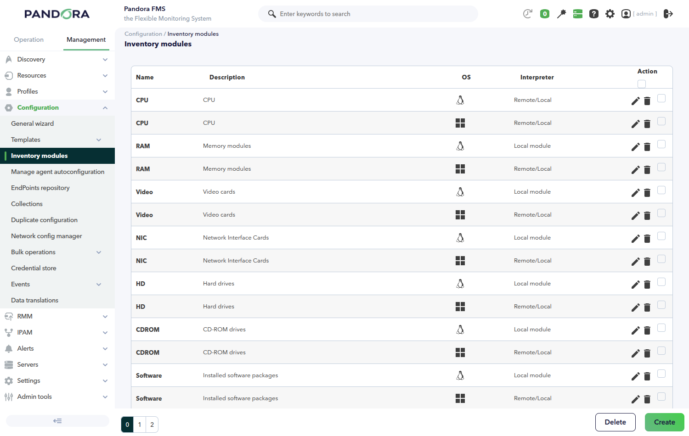

There is one detail that costs more than one lost hour and that is worth saying
out loud: **the operating system of the module has to match the one of the
EndPoint**. If a module is marked as Windows and you try to assign it to a
Linux EndPoint, it will not appear in the list. It is not a console error: the
module is meant for another system.

Where all this is managed: **Management → Configuration → Inventory modules**.

## Local inventory with EndPoints

The local path is the most convenient one when the EndPoint is already
installed: the machine looks at itself and sends the result. There are no ports
to open and no one's credentials to store.

### Linux

On Linux, the EndPoint carries a *plugin* called `inventory`. It is enabled with
one line in the `pandora_agent.conf` configuration file:

```text
module_plugin inventory 1 cpu ram video nic hd cdrom software init_services filesystem users route
```

The line reads in three parts. First, enabling the module. Then a number that is
**how often, in days**, it runs: if set to `0`, inventory is sent **on every
EndPoint run**. And at the end, the list of objects to collect. If only the
number is left, everything available is collected:

```text
module_plugin inventory 1
```

The objects the *plugin* understands are: `cpu`, `ram`, `video`, `nic`, `hd`,
`cdrom`, `software`, `init_services`, `filesystem`, `process`, `users`, `ip`,
`route` and `kernel`.

| Requirement | Detail |
|---|---|
| `lshw` or `hwinfo` installed | The *plugin* uses them for hardware. With neither of the two, only software, start-up services, file systems, processes and routes are collected |
| root permissions | Some objects (for instance, the user list or the hardware) need elevated privileges |

The *plugin* records on the machine itself when it last ran, so the interval in
days is respected even if the EndPoint starts many times a day.

### Windows

On Windows, local inventory is not enabled with a single line, as on Linux.
Here **each inventory object is a module of its own**, and each module calls its
own *script*. The EndPoint brings the sample in the configuration file
(commented out); you uncomment what you want to use and restart the EndPoint.
Each module has this shape:

```text
module_begin
module_plugin cscript.exe //B //t:20 "%PROGRAMFILES%\Pandora_Agent\util\cpuinfo.vbs"
module_end
```

The *scripts* the Windows EndPoint brings cover, each one, one object:

| Object | EndPoint *script* |
|---|---|
| Processor | `cpuinfo.vbs` |
| Memory | `raminfo.vbs` |
| Disks | `diskdrives.vbs` |
| CD-ROM | `cdromdrives.vbs` |
| Video card | `videocardinfo.vbs` |
| Network cards | `ifaces.vbs` |
| Monitors | `monitors.vbs` |
| Printers | `printers.vbs` |
| Installed software | `software_installed.vbs` |
| Microsoft products and KBs | `ms_products.exe` |
| Users | `userslogged.vbs` |
| Product key and ID | `productkey.vbs`, `productID.vbs` |

One detail to look at before leaving it like that: the factory sample adds
`module_absoluteinterval 7d` to every module, which makes inventory run **once
every seven days**, regardless of the EndPoint interval. If inventory has to
follow the normal EndPoint frequency, that line is removed. A weekly inventory
goes stale fast.

### Local modules appear on their own

Here is the practical difference with remote inventory, and it is worth
underlining because it saves a fair amount of work: **local modules are not
assigned by hand in the console**. It is enough that the module exists in the
catalogue with the right operating system and that the run is defined in the
EndPoint file. When the first data arrives, the console creates the module in
the agent's record and leaves it visible on its **Inventory** tab.

### Creating your own local modules

Besides the ones that come as standard, you can create your own inventory
modules for Linux and Windows. The procedure is the same as for remote, with two
exceptions: the **Interpreter** and **Code** fields are left empty, and a
*script* is needed that returns an XML with this structure:

```xml
<inventory>
  <inventory_module>
    <name>MODULE_NAME</name>
    <type>generic_data_string</type>
    <datalist>
      <data>DATA1;DATA2;DATA3</data>
    </datalist>
  </inventory_module>
</inventory>
```

The name has to be exactly the same one given to the module in the console, and
each `<data>` is a line with the fields separated by `;` as declared in the
**Format**.

The *script* is declared in `pandora_agent.conf` as one more *plugin*: the
EndPoint runs the command and puts its output as is into the XML it sends to the
server, so the *script* only has to print the `<inventory>` block on standard
output. On Linux, a shell *script* and the line that launches it look like this:

```sh
#!/bin/sh
# /etc/pandora/plugins/mi_inventario.sh

echo "<inventory>"
echo "  <inventory_module>"
echo "    <name>MyInventory</name>"
echo "    <type>generic_data_string</type>"
echo "    <datalist>"
echo "      <data>one;two</data>"
echo "      <data>three;four</data>"
echo "    </datalist>"
echo "  </inventory_module>"
echo "</inventory>"
```

```text
# pandora_agent.conf
module_plugin /etc/pandora/plugins/mi_inventario.sh
```

The EndPoint *plugins* directory (`/etc/pandora/plugins`) is in the `PATH`, so
the *script* can also be called by its name (`module_plugin mi_inventario.sh`).
On Windows, the line follows the same pattern as the standard modules, with
`module_begin` and `module_end`, and the *script* prints the same XML:

```text
# pandora_agent.conf
module_begin
module_plugin cscript.exe //B //t:20 "%PROGRAMFILES%\Pandora_Agent\util\mi_inventario.vbs"
module_end
```

And the warning about order: **the module has to be created in the console
before restarting the EndPoint**, or the data will arrive and there will be
nowhere to store it.

## Remote inventory: creating the module and assigning it

The remote path is the one used when there is no EndPoint on the machine: a
network device, a server on which nothing is to be installed or a machine only
reachable over SSH. Here the one doing the work is the Pandora FMS **server**,
which runs the module *script* against the target and stores the result.

### Creating the module

It is done in **Management → Configuration → Inventory modules**, with the
**Create** button. The fields of the form are these:

| Field | Detail |
|---|---|
| **Name** | Mandatory; the identifier of the module |
| **Description** | Free text |
| **OS** | Mandatory; it has to match the one of the target |
| **Interpreter** | The interpreter the *script* runs with (Shell, Perl…). **It is left empty only for local modules** |
| **Format** | Mandatory; the fields the module returns, separated by `;` |
| **Block Mode** | Switch; the module result is treated as a single block (see further down) |
| **Script mode** | Choose between **Script mode** (a **Script path** is given) and **Use inline code** (the **Code** is written directly) |

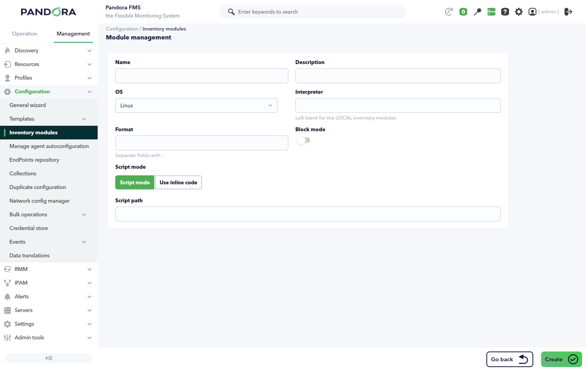

The classic warning, and it still holds: **if the Format is left empty, the
module is not saved and what was written is lost**. It is the field that gets
forgotten the most and the one that annoys the most when it is forgotten.

### What the script has to return

Here is the difference with local inventory, and it is worth having it clear
because it is the one that breaks the first attempts: the remote *script* **does
not return an XML**. The XML with `<inventory>` is the EndPoint's business; the
remote module returns **plain text**, with **one record per line** and the
fields separated by `;`, in the same order as the module **Format**. The server
stores that output as is and the console paints it as a table, using the Format
as header.

The *script* receives as arguments the **target** (the value of the *Target*
field) and then either the **custom fields** in the order they were created or
the **user and password**. With that it queries the remote machine and writes
one line per element.

A minimal example: a module with **Format** `Field1;Field2`, **Interpreter**
`/bin/sh` and this **Code**:

```sh
#!/bin/sh
# $1 is the target; then come the custom fields or the user and password
target="$1"

# ... the query against $target goes here ...

echo "one;two"
echo "three;four"
```

That leaves two records, one per line, with two fields each. A real module does
exactly the same, only it fills each line with whatever the query returns: the
Windows CPU module that ships with Pandora prints one line per processor with
`name;speed;description`, and the Cisco one writes a single line with
`IP;hardware;serial number;IOS`.

If the module is in **Block Mode**, the output is not split into records: it is
stored whole as a single text block, which is what is later compared in the diff
view.

### Assigning it to the EndPoint

The assignment is done in the agent's record, on the **Inventory** tab
(Management → Resources → Manage agents → agent → Inventory). The creation form
asks for:

| Field | Detail |
|---|---|
| **Module** | The inventory module to add; only those matching the EndPoint OS appear |
| **Interval** | How often it runs (one hour by default) |
| **Target** | IP or name of the machine the inventory is taken from |
| **Use custom fields** | Replaces user and password with fields of its own, with a name |
| **Username** and **Password** | Target credentials; they accept EndPoint custom field macros |

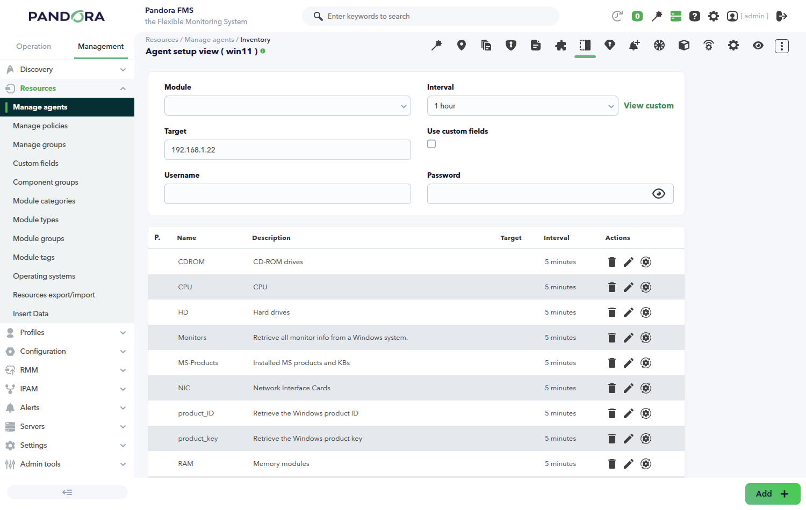

With **Use custom fields**, fields are created with a name, given a value and
marked **It's a password** on those that have to be stored obfuscated. Those
fields are passed to the *script* in the same order they were created. Once the
module is assigned, the table on the tab allows you to **Force** an immediate
run (useful to avoid waiting for the interval), edit it or delete it.

Underneath, the server builds the command with the interpreter, the *script*
path or the inline code, the target and the credentials (or the custom fields),
and runs it with a configurable **timeout**. If the command fails, the inventory
of that cycle is simply not updated.

## Viewing inventory data

There are two ways to look at inventory, and each one serves a different purpose.

### The agent's Inventory tab

In an agent's view (the other tabs are in [2.21](../parte-2/2.21-configuracion-comun-de-los-agentes.md#the-tabs-of-the-agent-view)), the **Inventory** tab shows all its modules, one below
another. At the top there is a **Module** selector, a **Date** selector (*Now*
by default) and a search box. Each module is painted as a table, with the
**Format** as header and a **Total** of records at the foot. It is the view for
looking at one particular machine calmly.

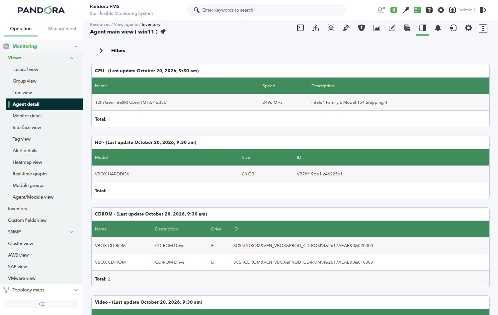

The date selector needs an explanation, because it puzzles you the first time.
**A date only appears when there were changes.** Pandora FMS stores inventory
only when the data changes from the last time, so if a machine has been the same
for a week, the selector will not have one entry per day. It is a design
decision, not a failure: storing the same photo every hour would be noise.

### The global view

In **Operation → Monitoring → Inventory** the inventory of the whole fleet is
seen at once. The filters are group (with the option to include subgroups),
agent, module, free search, order by agent, date and agent status.

By default the view is in **Basic info** mode, which shows one row per agent
with its general data: alias, IP, group, operating system, version, interval,
last contact, custom fields… When a specific module is chosen, the table changes
and shows the data of that module, with a **timestamp** column and an **agent**
column to know whose each row is.

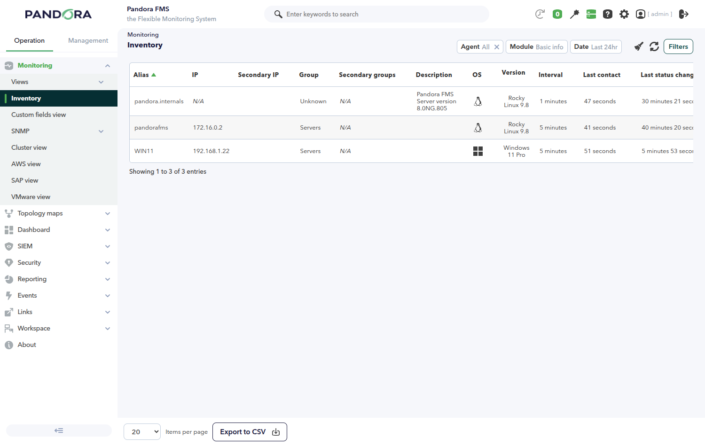

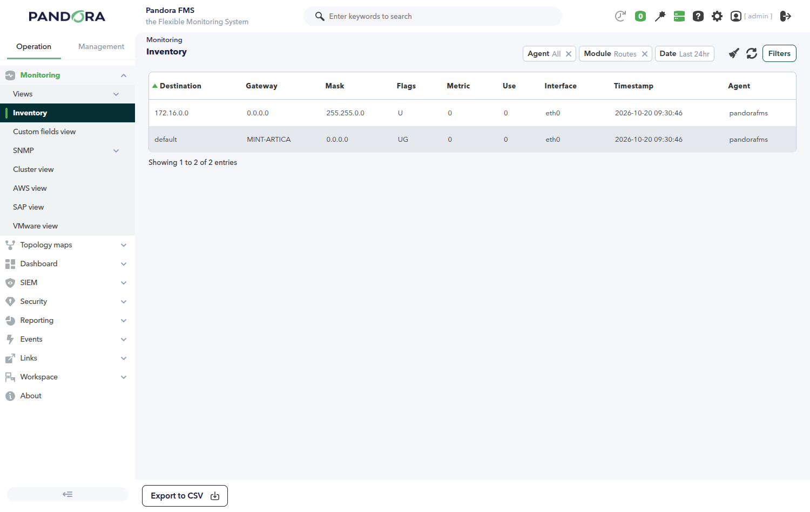

The **Export to CSV** button downloads whatever is filtered at that moment, with
the CSV separator configured in the console.

### Changes generate events

Every time the inventory of a module changes, the server generates a
**configuration event** with the additions and the removals: which record
appeared and which one disappeared. It is the raw material of change reports,
and also the reason why a very busy module (the process list, for example) can
flood the console with events. That is what the blacklist explained in the
[inventory maintenance](#inventory-maintenance) section is for.

## Differences between inventory versions

There are modules whose result makes no sense split into rows. The configuration
of a network device, for example: it is a text block and what matters is
comparing it with the one from the previous run, not reading it line by line as
a table.

That is what **Block Mode** is for. When it is enabled on a module, its result
is stored whole as a text block, and in the agent view a **Diff view** button
appears next to the module name:

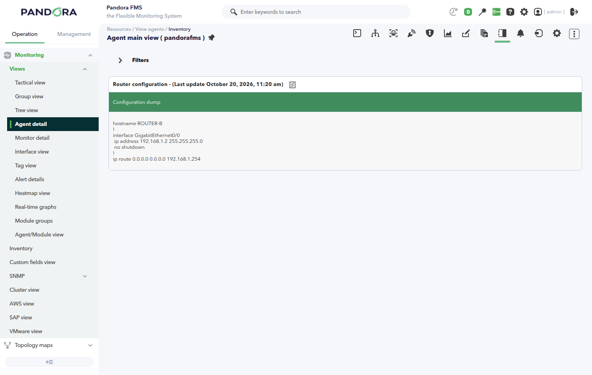

That view puts the two versions in two columns and highlights what changed. It
is the tool to answer "has anyone touched this *router* since last week?".

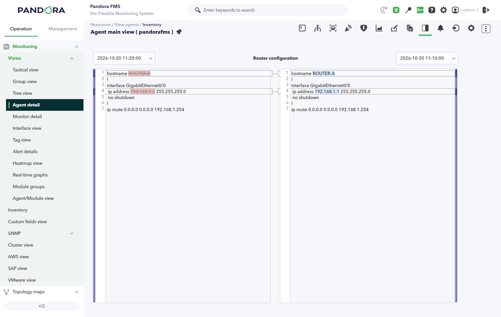

## Inventory alerts

Inventory also serves to watch what *should not* be there. That is what
**inventory alerts** are for, configured in **Management → Alerts → Inventory
alerts**.

The idea is the same as the one of the rest of
[Alerts and notifications](../parte-5/5.5-alertas-y-notificaciones.md), with one
fundamental difference: they do not fire on a monitoring module, but on the
content of the inventory of a group of agents. They are therefore global: they
apply to a group, not agent by agent.

The form has these fields:

| Field | Detail |
|---|---|
| **Name** and **Description** | Identification of the alert |
| **Group acl** | Visibility of the alert |
| **Inventory modules** | The module whose content is watched |
| **Condition** | How it is decided whether it fires: **Match**, **Black list** or **White list** |
| **Time threshold** | Minimum time between triggers |
| **Action** | What runs when it fires |
| **Alert groups** | The groups of agents it is evaluated on (the real condition) |
| **Disable event** | If enabled, the alert does not also generate an event |

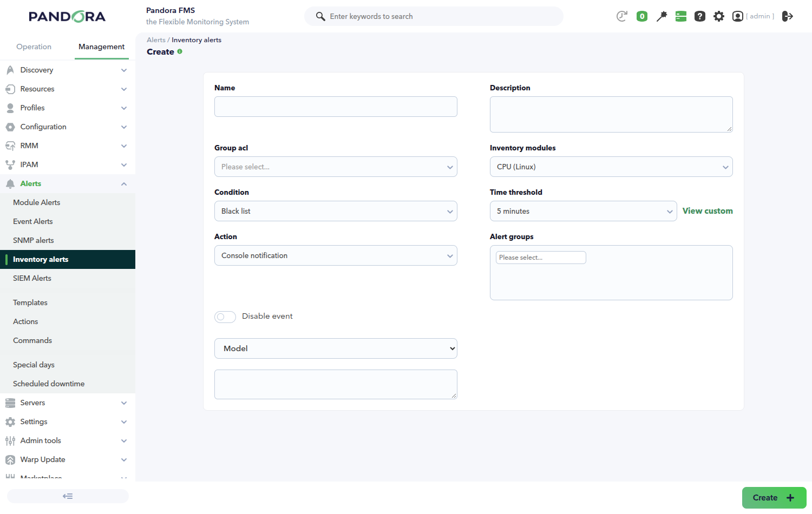

**Group acl** and **Alert groups** have to be told apart carefully, because both
talk about groups and they do not mean the same: the first is who can see the
alert, the second is which agents it applies to. A slip here leaves the alert
with no effect or firing where it should not.

The three conditions work like this:

- **Match**. The module fields are filled in (for example, the name and version
  of a software) and it fires when one line of the inventory matches all of
  them. The fields accept regular expressions, and an empty field is equivalent
  to "any value" (`.*`). It is the condition for "tell me if this particular
  version of this program shows up".
- **Black list**. A module field is chosen and a list of values is written, one
  per line. If the inventory contains any of them, it fires. It is the condition
  for "this should not be installed".
- **White list**. The same, but the other way round: the inventory value **has
  to be** in the list, and if it is not, it fires. It is the condition for "only
  these are allowed".

And **Disable event** has its charm when inventory triggers many alerts at once:
it prevents each one from also generating an event and leaving the events
console like a Christmas tree. The alert still fires and runs its action; what
is saved is the event.

These alerts are the way to detect vulnerable versions of a program,
unauthorised software or user accounts nobody should have.

## Inventory in reports and policies

Inventory does not live isolated: it feeds reports and it can be deployed
through policies.

Under **reports** there are four elements that pull from inventory:

- **Agent inventory**, the list of agents with their general data.
- **Module inventory**, the list of modules with their data.
- **Inventory**, the full inventory with filters.
- **Inventory changes**, the additions and removals recorded.

The mechanics of templates and reports are covered in
[Reports](../parte-5/5.2-informes.md).

And under **policies**, inventory modules can be applied to groups of agents
just as a monitoring module is applied, with its interval. On the Inventory tab
of the agent, the modules that come from a policy are marked with an icon.
Policies are explained in
[Monitoring policies](../parte-2/2.10-politicas-de-monitorizacion.md).

## Inventory maintenance

Two settings worth knowing so that inventory does not become a problem of space
or of noise.

The first is **deletion by age**. The **Max. days before delete inventory
data** field is in **Management → Settings → System Settings → Performance**,
**21 days** by default. Past that term, the server starts deleting the oldest
inventory history. If it has to be kept longer for audits, it is raised; if the
database has to be slimmed down, it is lowered.

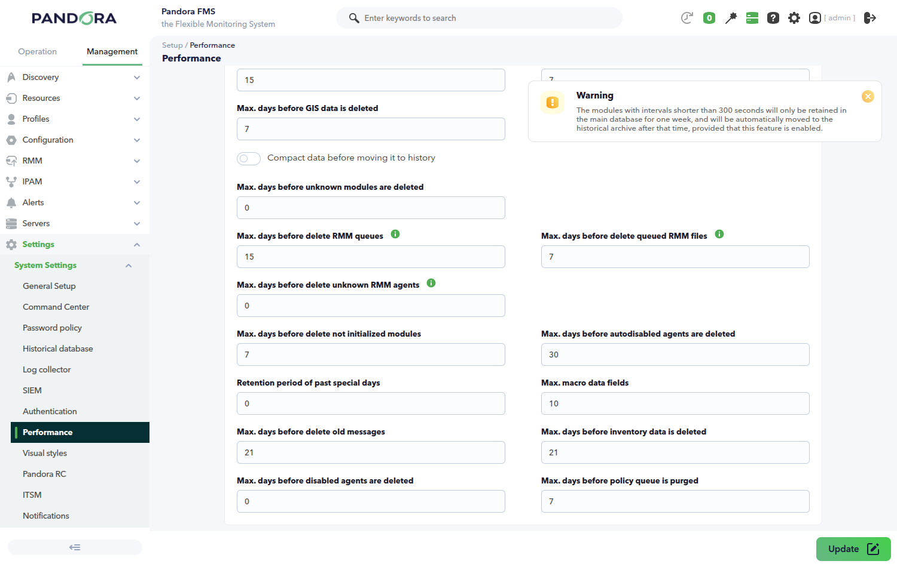

The second is the **changes blacklist**. There are modules whose content changes
on every run (the process list is the textbook example) and that would therefore
generate a configuration event every time. To avoid it, those modules are marked
in a list and their changes stop generating events.

The list is in **Management → Settings → System Settings → General setup**, on
the **Behavior** tab, inside the **Events** section. It is a double selector: on
the left are the modules that are **out of the blacklist** and on the right the
ones that are **in the blacklist**, and they are moved from one side to the
other with the arrows.

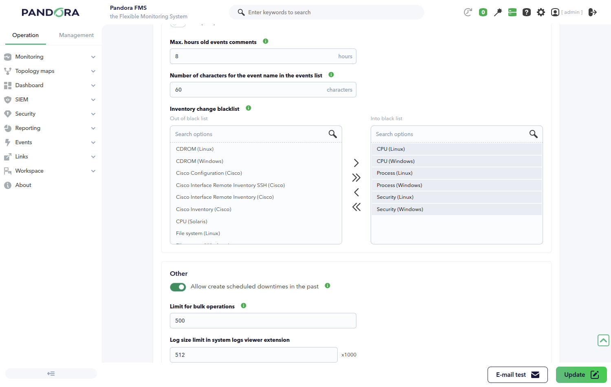

From the factory, the processor, the processes and the security module already
come excluded, in their Linux and Windows versions.

With this, inventory is complete: it is collected on its own, it is queried at a
glance, it warns when something does not add up and it does not fill the
database more than necessary. Which is exactly what is asked of a tool that
answers the question "what do we have?".
