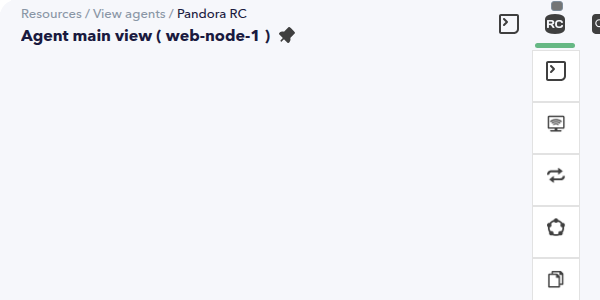

# Remote control with RC

Monitoring a machine is not the same as being able to get into it. Pandora RC covers that second part: taking control of a Windows, Linux or macOS machine from the browser, without depending on its IP address or opening ports on the remote network. The integration with Pandora FMS brings that control into the agent's own page, so the operator does not have to switch to another portal or copy identifiers.

## What it is and when to use it

Pandora RC, formerly eHorus, is a remote management system. The target machine runs an RC agent that keeps an outbound connection to the Pandora RC service. From the Pandora FMS console, the RC web client opens and gives access to that machine as if you were sitting in front of it.

The integration provides three things: the machine identifier is linked to the Pandora FMS agent, the **Pandora RC** tab appears on its page and the client is launched from there. It does not replace monitoring or modules: it is an access path to resolve what monitoring detects.

Do not confuse this chapter with its neighbours. Software distribution (3.3) installs or updates programs; remote script and command execution (3.4) runs commands; remote control with RC opens a graphical or shell session to operate the machine. Pandora RC is also a product with its own licence: RC in SaaS mode is included with the Pandora RMM licence and RC on-premise is purchased separately (see [1.5](../parte-1/1.5-licenciamiento.md#pandora-rc)).

## Requirements

| Requirement | Detail |
|---|---|
| RC agent | Installed and provisioned on the target machine, with a connection to the Pandora RC service. |
| RC user | A Pandora RC account with access to that agent. If the user cannot see it, the session cannot be opened. |
| Integration enabled | The **Pandora RC** section in the console settings must be enabled and hold valid credentials (see [9.2](../parte-9/9.2-referencia-completa-de-configuracion-de-la-consola.md#7-pandora-rc), section 7). |
| RC key | The custom field configured for the RC key, `eHorusID` by default, must contain the RC agent identifier. |
| Permissions | `AW` on the agent group or administrator. If per-user configuration is enabled, the user also needs their RC credentials enabled. |
| Console | HTTPS access to the Pandora RC service. If the console runs on Windows, the CA certificate store must be configured in PHP. |
| Licence | RC SaaS included with Pandora RMM; RC on-premise separately (see [1.5](../parte-1/1.5-licenciamiento.md#pandora-rc)). |

## The Pandora RC tab on the agent

The tab appears in the top bar of the agent page, next to the other tabs. It is shown when the integration is enabled and the custom field for the RC key exists and has a value. The icon is the Pandora RC one.

When you hover over the tab, a submenu opens with five actions: **Terminal**, **Display**, **Processes**, **Services** and **Files**. Each one opens the Pandora RC client in the corresponding section. The rest of the agent page tabs are explained in [2.21](../parte-2/2.21-configuracion-comun-de-los-agentes.md#the-tabs-of-the-agent-view).

If the tab does not appear, the problem is usually before the integration: the custom field is missing, the agent has no value or the key has not been generated. If it appears but the submenu does not open, check the integration and the permissions.

## Available actions

The five actions share the same flow: choose one, click **Launch** and the session opens. If the RC agent has a local password, it is requested on connection.

| Action | What it allows |
|---|---|
| **Terminal** | Opens an interactive shell on the remote machine, with the RC agent permissions. |
| **Display** | Shows the remote desktop and lets you interact with it. |
| **Processes** | Lists the machine processes and lets you manage them. |
| **Services** | Lists and controls system services. |
| **Files** | Browses the file system and transfers files. |

The floating **Display** bar lets you minimise the bar, take a screenshot, use the remote clipboard, send key combinations such as `Ctrl+Alt+Del` and switch to full screen. In **Terminal**, be especially careful: you are working with the same account that runs the RC agent.

Pandora RC allows one active session per machine. If another user is connected, the agent appears busy and the session does not open until it is released. The session also closes after inactivity according to the time configured in the RC agent, 300 seconds by default.

## Obtaining the RC key

The RC key is the unique identifier of the Pandora RC agent. It is stored in a custom field on the Pandora FMS agent. The field name is configured in the integration; the default value is `eHorusID`.

The EndPoint can fill it in automatically. In the Go EndPoint and the Windows one, the path to the RC agent configuration file is set with the `prc_conf` token or its `pandorarc_conf` alias. If the file exists and contains the key, the EndPoint adds the custom field with that value. The Unix Perl EndPoint reads `ehorus_conf`, which is kept as a legacy alias.

If no path is set, the Go EndPoint tries the standard locations `/etc/pandorarc/pandorarc_agent.conf` and `/etc/ehorus/ehorus_agent.conf`. On Windows, the installer sets the path. The full reference for these tokens and their compatibility per EndPoint is in [9.1](../parte-9/9.1-referencia-completa-de-configuracion-del-endpoint.md).

You can also write the key by hand in the agent custom field. This is useful when the RC agent is on a machine without its own EndPoint or when the key is obtained by other means. In either case, check that the value matches the RC agent: if it does not, the tab may appear, but the session will not reach the right machine.

## Security and limits

- **RC agent local password.** It is optional and is configured in the RC agent, not in Pandora FMS. It is not stored on the RC central servers; it is requested interactively on connection. Use it if the machine is sensitive.
- **API credentials.** The Pandora RC user and password are stored encrypted in the console database (see [9.5](../parte-9/9.5-cifrado-de-la-base-de-datos.md)). If per-user configuration is enabled, each user uses their own.
- **HTTPS and certificates.** The client connects over HTTPS. If the console runs on Windows and does not recognise the RC service CA, set `curl.cainfo` in `php.ini` to a valid certificate store.
- **One session per machine.** RC does not allow two simultaneous sessions on the same agent. Plan access or wait for it to be released.
- **Inactivity timeout.** The session closes by itself after the time configured in the RC agent. If it is left open and unused, the machine remains locked until it is closed.
- **Licence and mode.** RC SaaS and RC on-premise are not the same. The first comes with Pandora RMM; the second is purchased separately and requires its own deployment. See [1.5](../parte-1/1.5-licenciamiento.md#pandora-rc).

## Common problems

- **The tab does not appear.** The custom field is missing, the agent has no value or the integration is not configured. Check the `eHorusID` field and the **Pandora RC** section in the settings.
- **Authentication error.** The RC user does not have access to that agent or the API credentials are invalid. Test the connection from the global settings ([9.2](../parte-9/9.2-referencia-completa-de-configuracion-de-la-consola.md#7-pandora-rc), section 7).
- **Connection error.** Check the API hostname and port, the console HTTPS access and, on Windows, the CA certificate.
- **The agent appears busy.** Another user has an active session. Wait for it to be released.
- **The EndPoint does not generate `eHorusID`.** Check the path in the `prc_conf`/`pandorarc_conf` token (or `ehorus_conf` in Perl) and that the file is readable by the agent user.
- **The session opens but there is no image or terminal.** The RC agent is not connected to the RC service, or a proxy or firewall is in the way. Troubleshooting that part belongs to the Pandora RC documentation.

## Relationship with other chapters

- **[2.21](../parte-2/2.21-configuracion-comun-de-los-agentes.md#the-tabs-of-the-agent-view)** explains the rest of the agent page tabs.
- **[9.1](../parte-9/9.1-referencia-completa-de-configuracion-del-endpoint.md)** documents `prc_conf`, `pandorarc_conf` and `ehorus_conf` with their compatibility per EndPoint.
- **[9.2](../parte-9/9.2-referencia-completa-de-configuracion-de-la-consola.md#7-pandora-rc)**, section 7, covers the global Pandora RC settings.
- **[9.5](../parte-9/9.5-cifrado-de-la-base-de-datos.md)** explains encryption of the API credentials.
- **[1.5](../parte-1/1.5-licenciamiento.md#pandora-rc)** clarifies the RC SaaS and RC on-premise licence.
- **[3.4](3.4-ejecucion-remota-de-scripts-y-comandos.md)** covers remote script and command execution, which is another access path.
