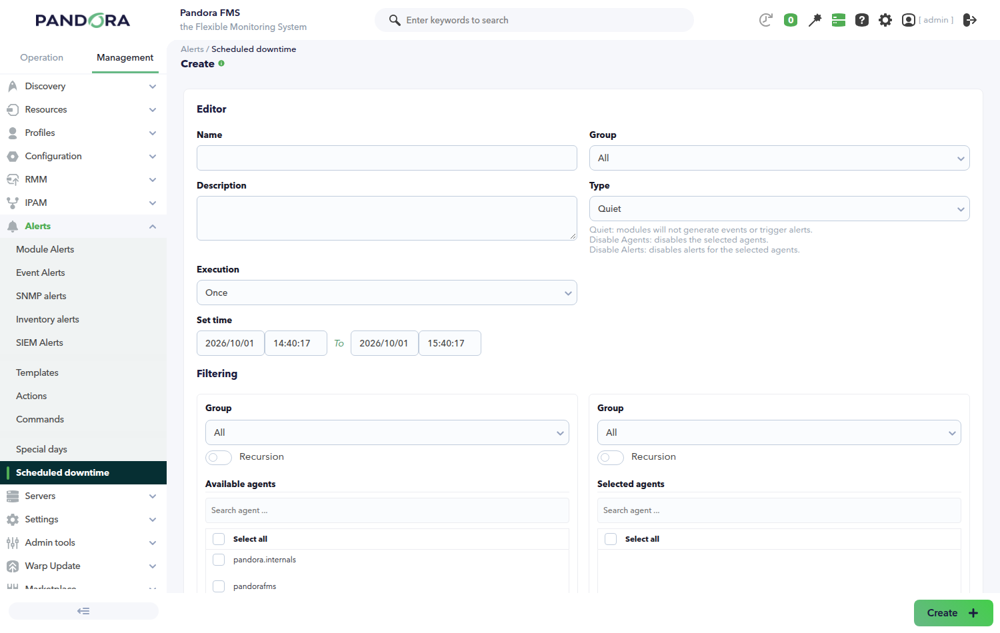
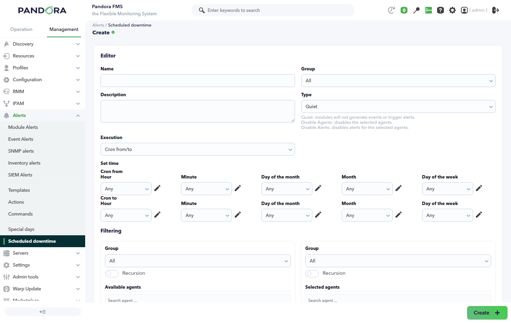
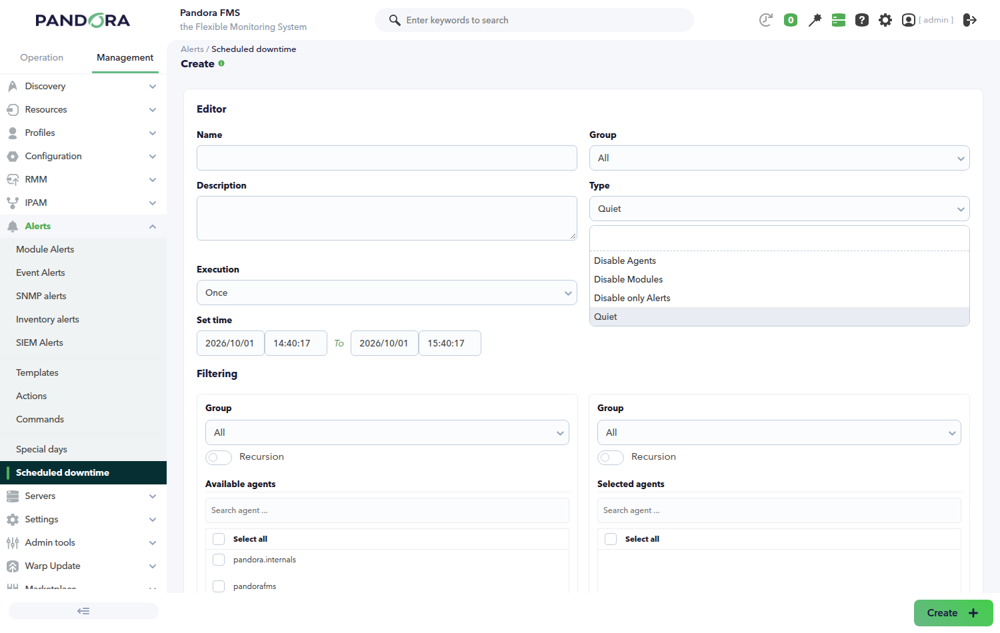
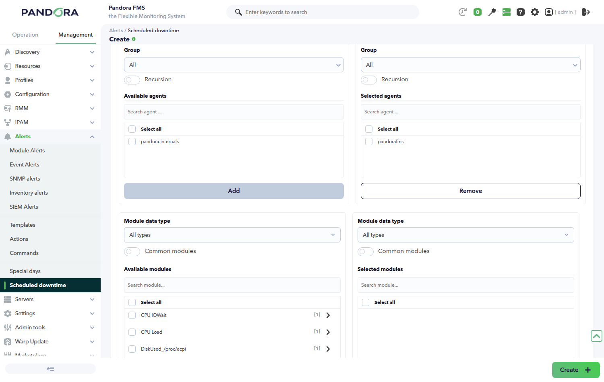
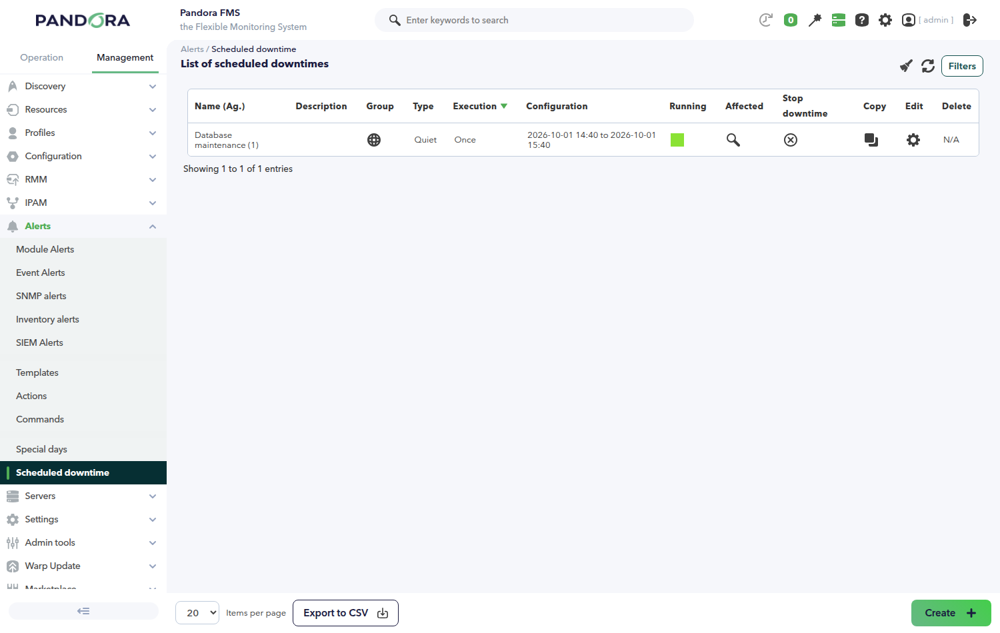

# Planned downtime

A system patch, a backup that starts at two in the morning or a scheduled reboot
of the hypervisor are windows in which the infrastructure behaves oddly on
purpose. Monitoring, which does not know that, fires alerts by the dozen. A
**planned downtime** is how you tell the web console, in advance, which stretch
of time it should not take seriously.

## What a planned downtime is

The web console lets you create planned downtimes from
**Management → Alerts → Scheduled downtime**. The idea is simple: a window of
time is defined, along with what happens inside it, and the Pandora FMS server
applies that state while the window is open.

Depending on the **Type** chosen, the downtime does one of four things: disable
the selected EndPoints, disable their modules, disable only the alerts of those
modules or mark them as quiet. In all four cases, when the downtime starts and
when it ends, the server generates an informational system event, one of those
that appear in blue in the events console. That trace is the practical
difference from disabling an EndPoint by hand: the downtime is temporary,
scheduled and reversible, and the event records that it ran and when.

Do not confuse the two gestures. Disabling an EndPoint by hand and forgetting to
enable it again is a classic of the trade, and it stays in the reports as a gap
with no explanation. A planned downtime, on the other hand, switches itself off
when the time comes, and the periods it covers are marked as valid in the
availability and SLA reports, as explained further down.

## Creating a planned downtime

The creation form asks for little and brings the most convenient values already
filled in:

| Field | Default value | Detail |
|---|---|---|
| **Name** | empty | Mandatory and unique; two downtimes cannot have the same name |
| **Group** | **All** | Group the downtime will belong to |
| **Description** | empty | Free text to document the window |
| **Type** | **Quiet** | The four options are detailed in their own section |
| **Execution** | **Once** | With an initial slot from the current time to the current time plus one hour |

Before saving, the console checks that the dates are coherent: the start before
the end, the start time before the end time and the correct day range in the
periodicities that use one. A repeated name or an inverted slot does not pass
the filter.

One option changes the meaning of "creating in the past". It is
**Allow create scheduled downtimes in the past**, and it lives in the general
settings, in the behavior section. It is enabled by default. With it enabled, a
downtime whose window has already passed can be registered: the downtime
**does not run**, because the server does not see it start, but its existence
**is reflected** in the availability reports and in the SLA calculations. It is
useful to document a maintenance that was done without having created the
downtime on time. Anyone who reads that downtime in the list should not expect
to see it move to "Running".

## Execution modes: once, periodically and cron

The **Execution** field accepts three modes, and each one hides a different
form.

**Once**. The most direct one: start date and time and end date and time. The
downtime starts when the start arrives, applies during the slot and ends on the
end date. It is the option that solves a one-off maintenance.

**Periodically**. It repeats the window over time. The **Type Periodicity** can
be **Weekly** or **Monthly**. In the weekly one the days of the week are chosen;
in the monthly one, a range of days of the month (for example, from day 20 to
day 10 of the next month). In both cases a time slot is set with **From hour**
and **To hour**, and the slot is allowed to cross midnight. Here the
**Expiration Date** also appears, with a **Never** switch: if it is disabled,
the downtime stops running past that date. It is the only mode that offers
expiration; **Once** and **Cron from/to** do not show it.

**Cron from/to**. The most flexible mode and the least friendly one. Two
conditions are defined, one for the start (**Cron from**) and one for the stop
(**Cron to**), and each one is made of five fields: **Hour**, **Minute**,
**Month day**, **Month** and **Week day**. Each field is set as **Any** or
**Custom**. Watch the order: in the form the fields go
**Hour, Minute, Month day, Month, Week day**, but the expression the console
stores (and that you will see in the **Configuration** column of the list)
starts with the minute (`minute hour day-of-month month day-of-week`). The
server checks every minute whether the expression matches the current minute: it
requires an exact match, not an approximate one.

Two examples to fix the format:

- `0 2 * * 1` starts on Monday at 02:00.
- `*/15 9-17 * * 1-5` starts every fifteen minutes between 09:00 and 17:00, from
  Monday to Friday.

The expression is stored as is and the server evaluates it on every cycle. It is
worth reviewing the condition after creating it, because it is the piece that
decides when the downtime starts and when it stops.

## The four types of downtime

The **Type** drop-down offers exactly four options. It is worth reading them
calmly, because two of them are similar in name and do different things.

| Type | What it does | When it ends |
|---|---|---|
| **Disabled Agents** | Disables the selected EndPoints and, with them, all their modules | Re-enables only those that were not already disabled by hand |
| **Disable Modules** | Disables the selected modules, including those already disabled before the downtime | Re-enables the modules the downtime covered |
| **Disabled only Alerts** | Disables the alerts of the selected modules, without disabling the module | Reactivates the alerts |
| **Quiet** | Marks the EndPoint or the modules as quiet: they keep collecting data, but generate no events and fire no alerts | If it quieted the EndPoint, it goes back to the Quiet state it had before; if it quieted modules, they are reactivated even if they were already quiet |

The first row deserves a nuance. **Disabled Agents** acts on the EndPoints and
drags all their modules with it. The other three act on the modules, not on the
whole EndPoint. And **Disabled only Alerts** disables no module: what it switches
off are the alerts of those modules.

The detail that generates the most questions is the preservation of the manual
state. If an EndPoint was already disabled (or quiet) by hand before the
downtime started, when the automatic end comes it **respects it**: it stays as
it was. With modules there is a nuance worth having clear: the automatic end of
the server **re-enables everything the downtime covered**, including what was
already switched off by hand. The difference is in who ends it: if you
**stop it by hand** from the console, only what the downtime itself switched off
is reverted, in agents as well as in modules.

## Adding agents and modules

The creation form already includes the element selector: the EndPoints and the
modules affected are chosen in the same creation step, with no need
to create an empty downtime and add them afterwards. The selector is a dual
panel: on the left the **Available agents**, on the right
the **Selected agents**, with the **Add** and **Remove** buttons to move them
from one side to the other. If there are no agents selected yet, the modules are
not filled in and the console warns with a **Select agents first**.

The panel filters do most of the work:

- **Group** limits the list of available agents to the chosen group.
- **Recursion** decides whether the agents of the subgroups are also included:
  **recursion is respected**. The "All" group resolves to the user's groups and
  only adds subgroups when recursion is enabled.
- **Module data type** filters the modules by their data type, with
  **All types** by default.
- **Common modules** shows only the modules that are present in
  **all** the selected agents. It is the quick way to apply the downtime to a
  shared module without going agent by agent.

A practical rule that saves trouble: in **Quiet**, if no specific module is
selected, the **whole EndPoint** is quieted; in **Disabled Agents** and
**Disabled only Alerts**, leaving the module list empty applies the downtime to
the agent as a whole. In **Disable Modules**, on the other hand, at least one
module has to be chosen: with no modules selected the downtime starts but
**does nothing**. And in that type the selector does not filter by status:
disabled modules appear too.

Elements are saved as they are added and can be removed one by one from the same
screen.

## Managing the list: filter, stop, copy, delete and export

The downtime list shows one row per downtime with these columns: **Name (Ag.)**
(the name and, in brackets, how many agents are affected), **Description**,
**Group**, **Type**, **Execution**, **Configuration**, **Running**, **Affected**,
**Stop downtime**, **Copy**, **Edit** and **Delete**. At the top are the filters
**Search**, **Group**, **Between dates**, **Execution type**, **Agent**,
**Module** and the **Do not display previous or stopped downtimes** checkbox,
plus the **Export to CSV** button.

The **Between dates** filter only makes sense with **Once** downtimes; the
periodic ones and the cron ones are not searched by slot. And the order of the
list is not the creation date: it is sorted by execution type and by start date,
so the creation date is a fact of the record, not the criterion of the table.

The **Configuration** column sums up the window in the format that applies:

| Mode | How it is shown |
|---|---|
| **Once** | `2026-10-01 13:57 to 2026-10-01 14:57` |
| **Periodically**, weekly | `Weekly: Thu (00:00:00-23:59:59)` |
| **Periodically**, monthly | `Monthly: From day 20 to day 10 (08:00:00-09:00:00)` |
| **Cron from/to** | `Start condition: * * * * * - Stop condition: * * * * *` |

You can act on every row. While a downtime is **Running** it cannot be edited
and the **Delete** button shows as **N/A**; what is available is
**Stop downtime**, which cuts the execution on the spot and answers with a
"Downtime has been stopped successfully". **Copy** duplicates the downtime to
reuse its configuration, and **Export to CSV** dumps the list with the filters
applied.

One notice is left, the one that appears when the console detects downtimes
created with old, malformed formats: "WARNING: There are malformed scheduled
downtimes" and the question "Do you want to migrate automatically the malformed
items?". On accepting, the console splits each malformed downtime into two
halves, labelled `[1/2]` and `[2/2]`, so that the window that crossed from one
period to another is expressed in a valid way.

## How it runs inside

The execution is not done by the console: it is done by the Pandora FMS server.
In an installation with several servers, only the master applies the downtimes,
so that they do not step on each other.

Every 60 seconds, the server goes through the downtimes and checks whether it is
time to start or stop any of them. The check depends on the execution type: a
**Once** downtime compares the current time with its slot; a **Periodically**
one looks at the day and the time; a **Cron from/to** one evaluates its two
expressions against the current minute. When a downtime starts, the server
applies the state and writes the system event "Server \<server\> started planned
downtime: \<name\>"; when it ends, it writes the corresponding "stopped".

| Requirement | Detail |
|---|---|
| Pandora FMS server running | Without a server there are no downtimes; the console only defines them |
| Master server | In installations with several servers, only the master applies the downtimes |
| One cycle every 60 seconds | The server checks every minute whether it is time to start or stop one |
| Server clock | Cron conditions are compared by the minute with the server time |
| Downtime not entirely past | A downtime whose window has already passed does not start; the permission to create it in the past is read by the console, not by the server |

## What changes in reports and SLA

Here is the reason for everything above. The periods covered by a planned
downtime are considered **valid**: they do not penalise the SLA and do not muddy
the availability, because the system knows the infrastructure was down on
purpose. Without that mark, a one-hour maintenance would read as a one-hour
outage.

The reports sum up a period with several states according to the
**Priority mode**, which decides whether the **OK** state or the **unknown** one
prevails when they coincide. That setting is not from this screen and it is
explained in detail in [Reports](../parte-5/5.2-informes.md); here it is enough
to know that a well-created downtime protects the calculation.

If the past option is enabled, the downtime is recalculated **backwards** in
time, so that a window already closed keeps counting in the reports that cover
it. In service reports, a downtime that affects any element of the service is
considered to affect the **whole** service, and malformed downtimes stay out of
the calculation. The detail of services is in [Business and service
monitoring](../parte-5/5.3-monitorizacion-de-negocio-y-servicios.md).

## The Scheduled Downtime dashboard widget

Planned downtimes also have their place in dashboards. The widget is called
**Scheduled Downtime** in the catalogue and shows the name of each downtime, its
configuration, whether it is running and the elements affected. It accepts a
filter by group, pagination and export to CSV and JSON.

How a widget is added to a dashboard, which sizes it accepts and how it is
placed is explained in [Dashboards](../parte-5/5.1-dashboards.md); here it is
only noted that it exists and what it shows.

## Outside the console: API and CLI

The console is the convenient path, but not the only one. The API allows
creating, editing and deleting downtimes, besides adding agents, adding modules
and removing agents from a downtime that already exists, with operations such as
`planned_downtimes_edit`, `planned_downtimes_deleted`,
`planned_downtimes_add_agents` and `planned_downtimes_delete_agents`.

From the server command line, the command appendix offers `--create_downtime` to
create it, `--add_item_downtime` to add elements, `--get_all_planned_downtimes`
and `--get_planned_downtimes_items` to list, `--stop_downtime` to stop it and
`--set_planned_downtimes_deleted` to delete it. There is a nuance worth keeping
in mind: **stopping a periodic downtime in execution does work from the web
console, but the CLI rejects it**. The command answers with an "[ERROR] … cannot
be stopped" and an "[INFO] Periodical and running planned downtime cannot be
stopped". If a periodic one that is running has to be cut, it has to be done
from the interface, not from the CLI.

A broad-brush alternative is left for whoever does not want to create one
downtime per case: the CLI allows enabling or disabling whole groups of
EndPoints with `--enable_group` and `--disable_group`. It serves for a quick,
global deactivation, but it does not schedule the return and does not leave the
downtime mark in the reports. That is what the planned downtime is for.
