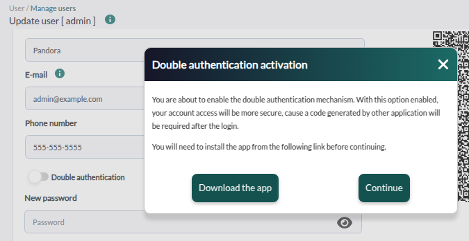
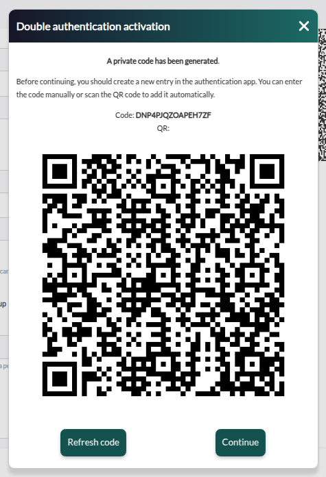
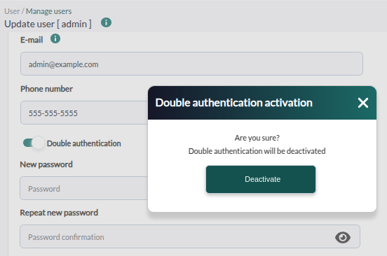
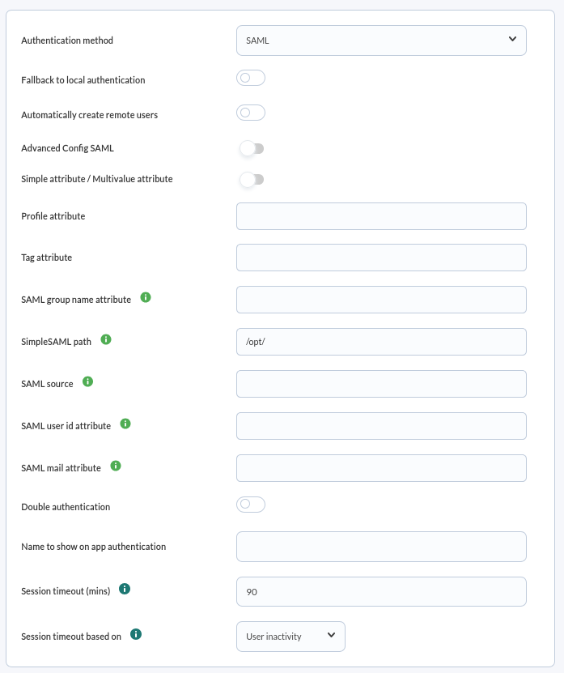

# External authentication and centralized access

Pandora FMS ships with its own authentication, but almost nobody uses it in
production: the normal thing is to delegate it to the company directory. This
chapter covers the available methods, **field by field**, and what changes when
there is a Command Center above.

Everything is configured in **Management → Settings → System Settings →
Authentication**. There are four methods, and one rule that repeats across all of
them: **administrators (*superadmin*) always authenticate against the local
database**. It is the safety net that keeps you from being locked out if the
directory goes down.

## Local and external authentication

The **Authentication method** is chosen from a drop-down:

| Method | What it is |
|---|---|
| **Local Pandora FMS** | The default authentication, against the internal database |
| **LDAP** | Delegated to an LDAP server |
| **Active Directory** | Delegated to Active Directory. Enterprise |
| **SAML** | Delegated to a SAML identity provider. Enterprise |

Two fields apply to almost all external methods:

- **Fallback to local authentication.** If enabled, when the external system does
  not validate the user, local authentication is attempted. Administrators always
  have it enabled, whether they want to or not.
- **Autocreate remote users.** If enabled, Pandora FMS registers the user the
  first time they log in against the directory, without creating them by hand.

## Local authentication

It is the factory one: username and password against Pandora FMS's internal
database. There is nothing to configure except choosing it as the method. It is
the one administrators use and the one that serves as a fallback when the
directory does not respond.

## LDAP

First of all, the dependency: the **OpenLDAP** utilities are needed on the server,
installed with the distribution package (`ldap-utils` on Debian/Ubuntu,
`openldap*` on RHEL).

The connection fields:

| Field | What it is for |
|---|---|
| **LDAP server** and **Secondary LDAP server** | Server address, direct (`x.x.x.x`) or as a URL (`ldap://…`, `ldaps://…`) |
| **LDAP port** | Server port (389 by default) |
| **LDAP version** | Protocol version |
| **Start TLS** | Encrypts communication between client and server |
| **Base DN** | Starting point for searches |
| **Login attribute** | Attribute used to identify the user. **It is case-sensitive** |
| **LDAP administrator login** and **LDAP administrator password** | Credentials of an account with permission to query the directory |
| **LDAP search timeout (seconds)** | How long the search waits before giving up |
| **Enable secondary LDAP** | Enables a second server, with its own server, port, version, Start TLS, base DN, login attribute and administrator credentials |

Two decisions that change the behavior:

- **LDAP function.** Choose how searches are made: *Local command*, which uses
  the system's `ldapsearch` command, or *PHP function*, the console's own engine.
  For directories with many entries, the console recommends the local command.
- **Login user attribute.** Which directory attribute is taken as the user
  identifier (for example, the email).

And for automatic user creation:

- **Save password.** Stores the directory password in the local database. If the
  local fallback was enabled, this is enabled too.
- **Force automatic user profile creation** and, below it, **Profile
  autocreation**, **Group autocreation** and **Tag autocreation**, to decide with
  which permissions the newly created user is born, and **Automatically assigned
  no hierarchy**.
- **Autocreate blacklist.** A comma-separated list of users that will **not** be
  created automatically.
- **Recursive group search.**

If **Advanced Config LDAP** is enabled, **Advanced LDAP permissions** appear, where
rules with profile, groups and tags tied to an attribute filter are added.
Attributes are written in the format `Attribute_name = Attribute_value`: if the
user matches any of them, they are created with that profile.

## Active Directory

It is the LDAP variant for Active Directory, and it is **Enterprise**. It shares
the concept, but with its own fields:

- **Active Directory server**, **Active Directory port** (389 by default), **Start
  TLS** and **Domain**. If you use the advanced configuration, the domain must
  contain the full LDAP path, like `ldap://addc.mydomain`.
- **Enable secondary Active Directory**, with its server, port, Start TLS, domain
  and **AD search timeout (seconds)** (5 by default).
- **Save password**, **Advanced AD configuration** and **Advanced AD permissions**,
  with the same idea of attribute rules as in LDAP.
- **Auto enable node access**: "new users will be able to connect on the nodes".
- **Recursive group search** and **Autocreate blacklist**.

A detail that is not Pandora FMS's, but explains many calls: Windows allows the
old password to be used for **60 minutes** after a change in Active Directory.
Windows controls that, not the console.

## Double authentication (2FA)

Double authentication adds a second factor on top of the password. In the global
authentication configuration there are three settings:

- **Double authentication.** Enables the option so that users can turn it on.
- **Force 2FA for all users.** Makes it mandatory for everyone.
- **Display name in the authentication app.** The name the user will see in their
  code app, so they do not confuse Pandora FMS with other services. It is worth
  setting.

Each user turns it on in **Operation → Workspace → Edit my user**.



It needs a **code-generating app** (Google Authenticator and similar) on the
user's own phone, and the server and the phone to have **synchronized time**;
without that, the codes do not match.



To disable it for a specific user without going through the console, there is the
CLI:

```bash
/usr/share/pandora_server/util/pandora_manage.pl /etc/pandora/pandora_server.conf \
    --disable_double_auth '<user>'
```



## SAML

**SAML** is an open XML-based authentication standard: Pandora FMS acts as a
service provider and delegates to an identity provider. Here too, **administrators
always authenticate against the local database**.

Three pieces are needed to use it: a working SAML server (SimpleSAMLphp), the
Pandora FMS configuration and, if the provider is Azure, the configuration on the
Azure side. The SimpleSAMLphp technical annex covers the installation step by
step; here are the fields on the Pandora side.

| Field | What it is for |
|---|---|
| **SimpleSAML path** | Directory where `simplesamlphp` is installed |
| **SAML source** | Name of the configured *authsource* |
| **SAML user ID attribute** | Attribute taken as the identifier. **The ID cannot contain** the characters ``> < " ` & / * ( ) º °`` or spaces |
| **SAML email attribute** | Attribute with the email address (for autocreation) |
| **SAML group name attribute** | Attribute with the group (for autocreation) |
| **Simple attribute / multi-value attribute** | Whether the attributes come as a single value or as a list |
| **Profile attribute** and **Tag attribute** | Where the user's profile and tag come from |
| **SAML profile and tag prefix** | Prefix to match the attribute value with the profile or tag |



With **Advanced Config SAML** enabled, **Advanced SAML permissions** appear, with
the same attribute-rule mechanism as LDAP and AD.

## Sessions and API tokens

Two settings govern when a session is closed:

- **Session timeout (mins).** How long the session lasts.
- **Session timeout based on.** What the time is counted from: **the last login**
  (it restarts on every login) or **the user's inactivity** (it restarts with
  every action). A screen left open with auto-refresh does not count as
  inactivity.

Apart from the session, each user has their **API token**, which is generated and
used as a *bearer token* in the HTTP header to call the API without a username and
password.

## Authentication in a Command Center

When there is a **Command Center**, user administration is handled centrally, and
that affects login. A user whose authentication is not local (AD, LDAP or SAML)
needs, in order to enter the nodes, either **their password to be saved** (*Save
Password*) or the node to have **Auto enable node access** enabled. Otherwise, the
user exists on the node but cannot log in.

The first time a centralized user accesses a node, the console warns that you have
to wait for the Command Center to synchronize and log in again with the same
credentials. That is normal behavior, not an error.
