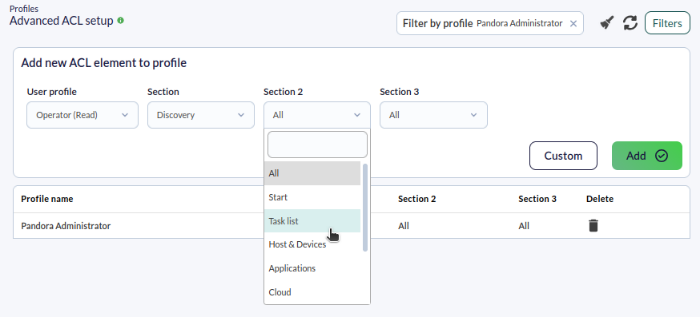
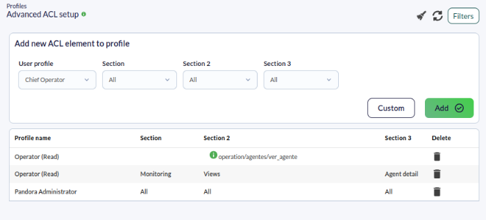
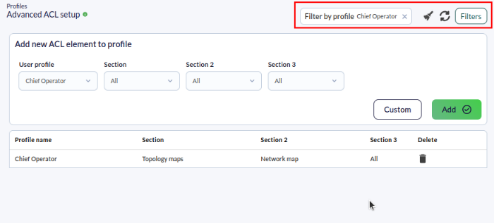

# Advanced security and visibility (advanced ACL)

The groups and profiles from the previous chapter decide **what a user can do**.
But there is a question they do not answer: **which pages they see**. An
administrator profile gives access to everything, and many times that is not what
you want; you want someone to be able to touch one part of the console and not the
rest. That is what the **advanced ACL** system (formerly called Enterprise ACL) is
for: it defines, profile by profile, which pages each user has access to.

Two rules worth knowing before touching anything. The first: ***superadmins* are
exempt** from the system, and everyone else is bound by it, even if they have the
*Pandora Administrator* profile. The second: the advanced ACL and the classic one
(groups and profiles) are **parallel and compatible**, but the classic one is
evaluated **first**. If the classic ACL does not allow something, the advanced one
does not open it.

## What the advanced ACL system adds

The classic model is Unix-style: *role, action, group, user*. The advanced one goes
a step further and allows **restricting administration page by page**: which
sections and which specific screens each profile can open. It is the tool for
granting very specific low-level permissions without opening the whole hand.

## Enabling the system

The system comes **disabled**. It is enabled like this:

- **On a node**: **Management → Settings → System Settings → General setup →
  Features → Use Advanced ACL System**, enable it and click **Update**.
- **In a Command Center**: **Configuration → Metasetup → Use Advanced ACL System**.

In a Command Center, the system is configured **independently** in the Command
Center itself and on each node.

!!! warning "You can lose access to the console"
    When you enable the advanced ACL, **all** pages are restricted for **all**
    groups, including the administrator group, and only the pages you have defined
    remain allowed. If an administrator profile has no page included, **it will see
    nothing**. Before enabling it, leave the rules defined for the profile you are
    going to log in with.

If you get locked out by mistake, there is no need to reinstall: from the server,
the system is turned off via the CLI.

```bash
pandora_manage /etc/pandora/pandora_server.conf --disable_eacl
```

And to turn it back on, `--enable_eacl`.

## How rules are defined

They are configured in **Management → Profiles → Advanced ACL Setup**; in a
Command Center, in **Centralized management → Management → Advanced ACL Setup**.
There are two ways to add pages, and a button next to **Add** switches between
them: **Wizard** and **Custom**.

**The wizard** works with drop-downs: choose the **user profile**, the
**Section**, **Section 2** and, if needed, **Section 3**. If you choose **All** in
the section, that profile will see the whole section; with **All** in every one, it
will see everything, as if the system were not active. Three things that surprise
you the first time:

- The drop-down only lists pages **accessible from the menu**. For a page reached
  another way, you have to use the custom editor.
- It shows **all** menu options, whether or not the profile has access. Adding one
  the profile cannot use does not make it appear.
- The default profile in the drop-down is **Chief Operator**. Change it before
  adding anything, or you will be giving permissions to the wrong person.



**The custom editor** is for pages that are not in the menu: you paste the page's
`sec2` parameter by hand. For example, to give access to an agent's main view,
open any agent's view, copy the `sec2` from the URL
(`operation/agentes/ver_agente`) and put it in the **Section 2** box.



A detail that explains menus that "do not show up": for a section to appear in the
menu, the user needs access **to at least its first page**. And to check at any
time which pages a profile is allowed, there is **Filter by profile**.



## Security

The system is not decorative. A restricted page **is not shown in the menu and
cannot be used**, not even by typing the URL by hand. Moreover, a page that the
classic ACL does not allow will not be allowed by the advanced one either.

There is an extra check that verifies whether a page belongs to its section, which
reinforces security against tampered URLs. That check skips pages added with the
custom editor and entire allowed sections, so as not to penalize load.

## Visibility permissions on shared elements

There are elements that are not agents or modules and behave differently:
**reports**, **visual consoles**, **network maps** and **dashboards** act as
**containers**. A user with visibility over all data creates a report and assigns
it to a general group. From then on, anyone with access to that group will see the
report and **all its content**, even if they do not have permission on the
individual elements that make it up. It is convenient, and that is why it is worth
knowing before sharing a report.

There are exceptions to keep in mind:

- Some dashboard *widgets*, such as the *treeview* or the event control, because
  they allow interacting with the data.
- Elements of a visual console, which can be restricted to a specific group.

And a coexistence rule for anyone with read **and** write access: when editing a
container, they can only **add** elements they have access to and can **delete**
elements they do not have access to, but cannot add them back.

The rest of the shared elements are governed by their menu and their permission:

- **Servers**: *Manage servers*, *Manage consoles* and *Manage HA database*.
- **Credential store**: each credential is seen according to the group assigned to
  it.
- **Scheduled downtimes**, **audit log** and local server **logs**.
- **Database management** from the console and **external tools**.
- **Plugin registry**, **Insert data**, **resource registry** and **resource
  export and import**.
- **String translator**, **workspace** and **EndPoint repository**.

## Customization and examples

The advanced ACL does not only close doors; it also opens the right ones. Three
examples that always come up when it is enabled:

- For a user to **change their own data**, they need access to **Workspace → Edit
  my user → All**.
- For them to **generate their own tokens**, **Workspace → Edit my Tokens →
  All**.
- For them to **read their notifications**, **Workspace → Messages → All**; and if
  they also have to **reply** to a message, add the `sec2`
  `operation/messages/message_edit` in the custom editor.

The same mechanism works for any individual page: find its `sec2` and add it by
hand. It is the way to adjust the console to what each role needs, without opening
entire sections.

## Strict ACL

The user record has a **Strict ACL** checkbox. It is not the default option and
the console itself warns that it is **not recommended**, because it affects
performance. What it does, in short: a user with strict ACL **does not see any
tag**, that is, the tag permission system stops showing them modules. Enable it
only if you know why you need it.

For the use and best practices of tagging and naming, see the next chapter in
Part 04.
