# GIS maps

## Introduction

A **GIS map** is a visual representation of where each agent in the installation
is, geographically. On a base map (streets, satellite image or a map of your
own), agents appear as markers at their last known position, with the color of
their status. A glance shows where each machine is and how it is doing.
Agents that do not report coordinates of their own are not left out: they are
drawn at the map's **default position for agents without GIS data**, a point
that is set when the connection or the map is created.

It is the geographical view of Part 5. The chapter
[5.7 Network topology maps](5.7-mapas-topologicos-de-red.md) draws
relationships: who depends on whom, how machines connect. A GIS map draws
places. They do not compete: one answers "what goes down with what" and the
other, "where is what goes down".

For a GIS map to show anything, three pieces have to agree. The EndPoint
provides the position, the Pandora FMS server processes it and stores it, and
the web console defines the map connections and the maps. The chapter goes
through the three in that order and ends with the reference of the parameters
involved.

## Requirements and activation

| Requirement | Detail |
|---|---|
| Server with GIS enabled | Token `activate_gis` set to `1` in `pandora_server.conf`. It defaults to `0` and, with that value, the server discards all the position information it receives |
| Console with the feature enabled | **Enable GIS features** switch in the general configuration of the web console |
| A default map | There must be a map marked as default; it is the one the agent view uses to place the agent |
| Internet access | OpenStreetMap and Google Maps connections load the base map tiles from the user's browser |
| Google Maps API key | A valid key; it may take a few minutes to become fully active |
| Reverse geolocation | Internet (Google or OpenStreetMap) or a local MaxMind GeoLiteCity file |

The web console switch is in **Management → Settings → System Settings → General
setup**, on the **Features** tab: "Enable GIS features" → **Update**.

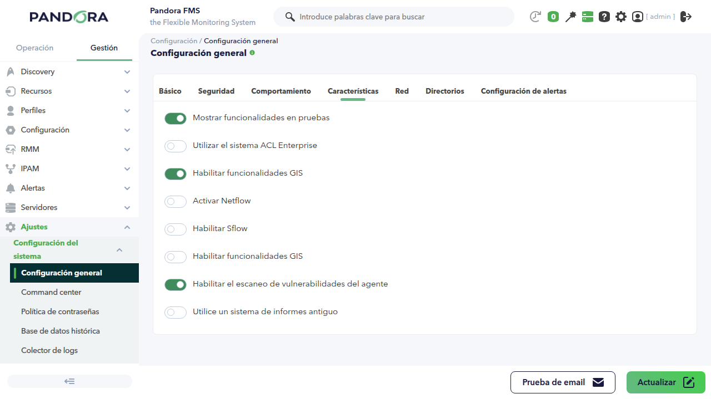

Remember that they are two different switches: the console one decides which
parts of the interface are shown; the server one decides whether the position
information is processed and stored. The console may be showing the maps while
the server ignores what it receives.

## Configuring the position of EndPoints

The EndPoint configuration file, `pandora_agent.conf`, accepts fixed position
parameters. With them the agent is placed without depending on anything else:

```ini
latitude 40.37346827
longitude -3.6418548
altitude 637
position_description Madrid, Vallecas
```

| Requirement | Detail |
|---|---|
| `latitude` | Latitude in decimal degrees |
| `longitude` | Longitude in decimal degrees |
| `altitude` | Altitude in meters; it is optional |
| `position_description` | Readable description of the place (for example, "Madrid, Vallecas"); it is optional |
| `gis_exec` | Path of a **script** that returns the coordinates |

`gis_exec` points to a script that, when run, prints a single line with the
coordinates separated by commas: `latitude,longitude,altitude`. Altitude is
optional. An example of valid output would be `41.377,-5.105,2.365`. The script
must exist on the system; if the path does not resolve to a real file, the
EndPoint ignores `gis_exec` and uses the manual values. When `gis_exec` is
defined and executable, it takes precedence over `latitude` and `longitude`.

!!! warning "The output of `gis_exec` is not read the same way in every piece"
    The **EndPoint** reads the string as `latitude,longitude,altitude`; the
    **satellite server**, on the other hand, reads it as
    `longitude,latitude,altitude`. If the same script is going to feed both,
    keep in mind the order each one expects: the same `41.377,-5.105` means
    different coordinates depending on who reads it.

## Reverse geolocation and Discovery

The Discovery server can calculate the position of the agents it discovers
without them reporting anything: it geolocates their IP address and places them
on the map. To do so it uses a reverse geolocation algorithm and a database that
relates IP addresses to positions. The token
`recon_reverse_geolocation_file` points to the file with that information, in
MaxMind GeoLiteCity format (`GeoLiteCity.dat`). If the file does not exist or
cannot be read, the server warns and discards it.

Because the position deduced from an IP address is approximate, the token
`recon_location_scatter_radius` scatters the agents at random around the
calculated point, with a radius in meters, so that they do not all pile up in
the same place. A value of `0` leaves them exactly at the deduced point.

Besides the local file, the server can resolve the address online:

- `google_maps_description`, set to `1`, enables reverse geolocation with the
  public Google Maps API.
- `openstreetmaps_description`, set to `1`, enables it with the public
  OpenStreetMap API.

!!! warning "Online reverse geolocation costs performance"
    The two options above **reduce the performance** of the server and **need
    Internet access**: the address of every position received has to be
    resolved. They also depend on the service provider being available.

The last token in the processing is `location_error`, a radius in meters. Two
positions less than that distance apart are considered the same. It keeps a
motionless agent from appearing to move because of GPS receiver noise: if the
jump does not exceed the threshold, the server updates the current position but
does not record it as a movement. When the agent does move beyond the
threshold, the server records the previous position in the history and sets
the new one. The current position and the position history are stored in the
database; their schema is in
[10.1](../parte-10/10.1-esquema-de-la-base-de-datos.md) and
[10.2](../parte-10/10.2-referencia-de-tablas.md).

## Map connections

A **map connection** defines where the base maps come from: the tile server, the
Google key, the static image or the WMS service. They are created from the web
console in **Management → Settings → System Settings → Map connections GIS**.
The list shows the existing connections and the **Create** button opens the new
connection form.

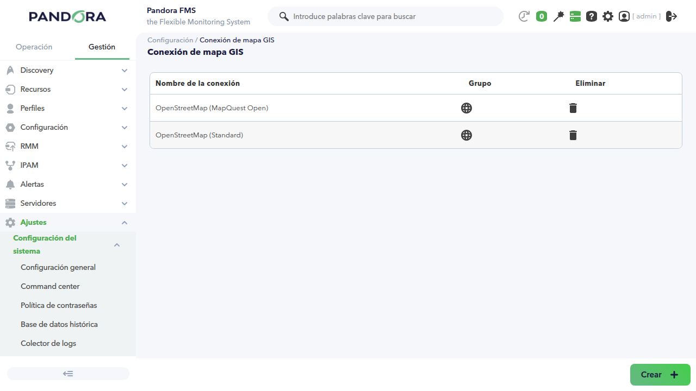

Every connection shares a few basic fields before the type is chosen:

| Requirement | Detail |
|---|---|
| Connection name | Name used to identify it and to select it later when building a map |
| Group | Group the connection belongs to |
| Number of zoom levels | Zoom levels available on the map |
| Default zoom level | Level the map opens with, unless the map itself overrides it |

Once the type is chosen, its own fields appear. The four possible types are
**Open Street Maps**, **Google Maps**, **Static Image** and **WMS Server**.

**Open Street Maps.** It only asks for the URL of the tile server, with the
`${z}`, `${x}` and `${y}` markers in place:

```text
http://tiles.example.com/${z}/${x}/${y}.png
```

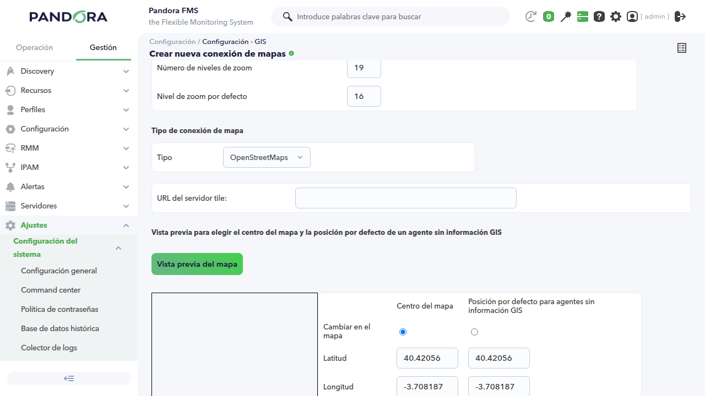

The installation ships two OpenStreetMap connections ready to try,
"OpenStreetMap (MapQuest Open)" and "OpenStreetMap (Standard)".

**Google Maps.** It asks for the base map type (Google Hybrid, Google Physical
or Google Satellite) and the Google Maps API key.

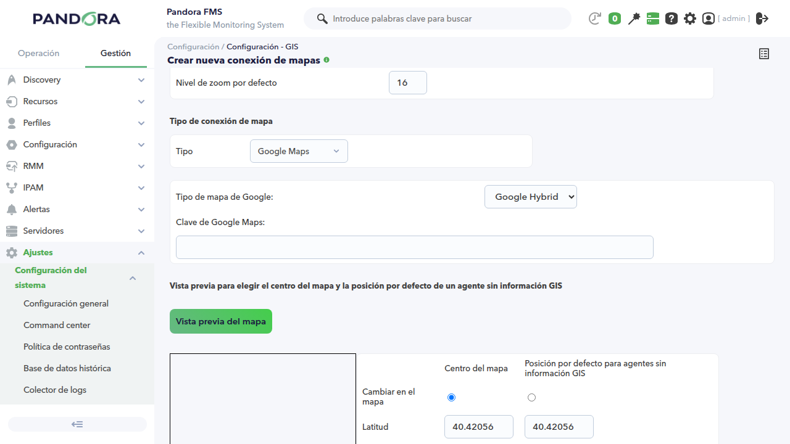

**Static Image.** It uses an image of your own as the base map. The image must
be in the EPSG:4326 (WGS84) projection. Its URL, its corners (left, bottom,
right and top) and its size in pixels (width and height) are given.

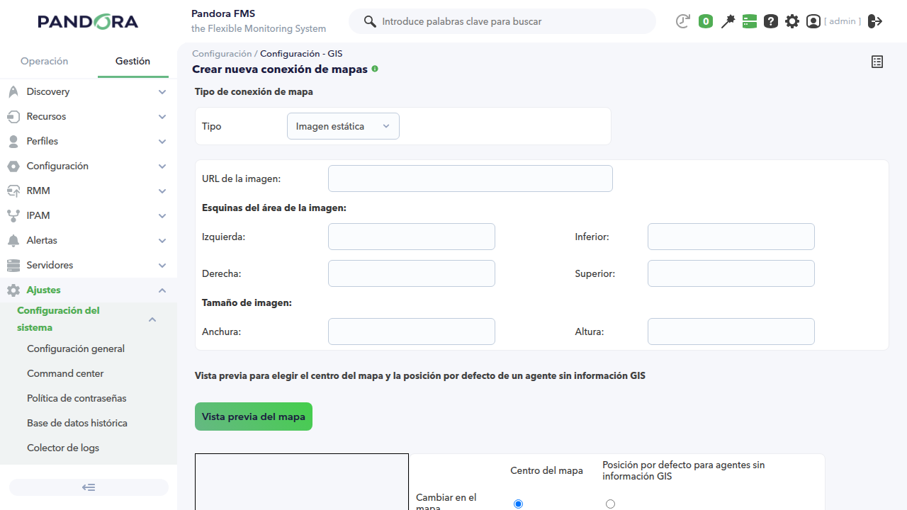

**WMS Server.** The service URL and the list of layers to be obtained from it
are given. It is the way to use a map server of your own (for example,
GeoServer) when an online service cannot be used.

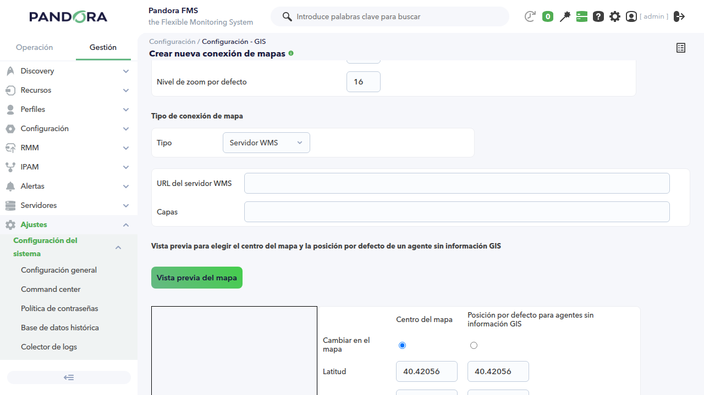

Once the type is set, the **map center** and the **default position for agents
without GIS data** remain: the point where the map opens and the point where
agents that do not report coordinates are placed. The console offers two ways to
set them. The map is previewed with **Load preview map** and clicked on it,
after choosing with the **Change in the map** selector which of the two points
is being moved; or the values are typed by hand in their cells, with a dot as
the decimal separator.

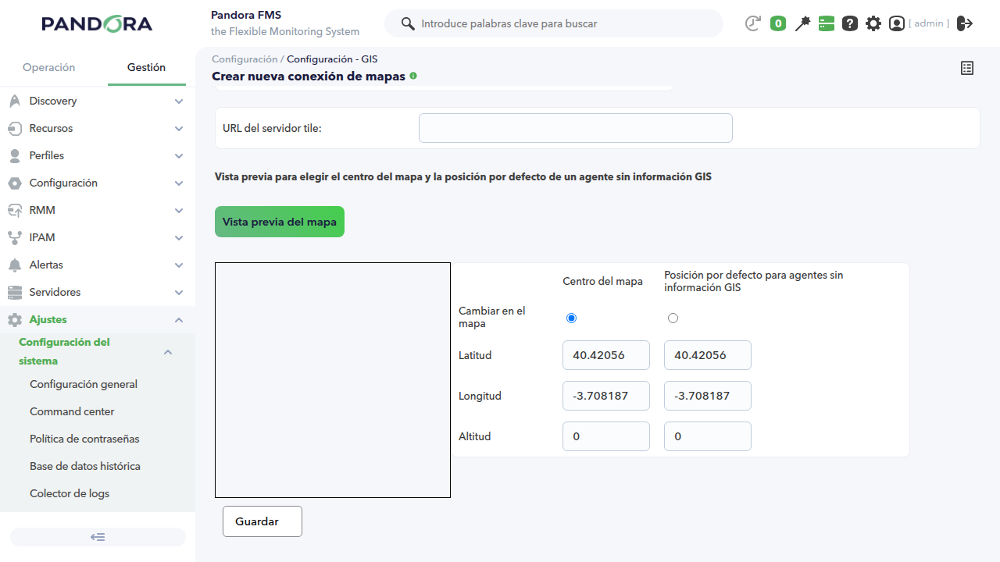

The connection is saved with **Save**.

## Creating and defining a GIS map

GIS maps are managed in **Operation → Topology maps → GIS Maps → GIS Maps
list**. The list allows creating, editing, viewing and deleting maps, and
marking which one is the **default map** with the radio button in the "Default"
column.

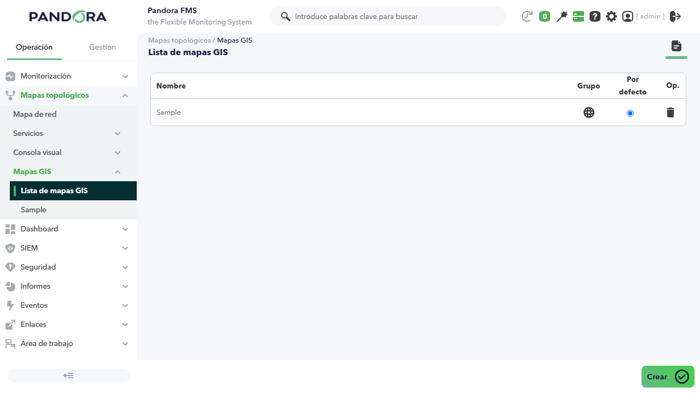

!!! warning "A default map is needed"
    The agent view places the agent on the default map. Without one marked as
    such, that view warns that there is no default map and shows no position.

The **Create** button opens the map builder. The first fields are the **Map
name**, the group, the **Default zoom** and the coordinates of the center and of
the default position. Then one or more **map connections** are added, to be used
as base layers: they are selected in **Add Map connection** and are added to the
list. Only one of them can be active as a base layer at a time.

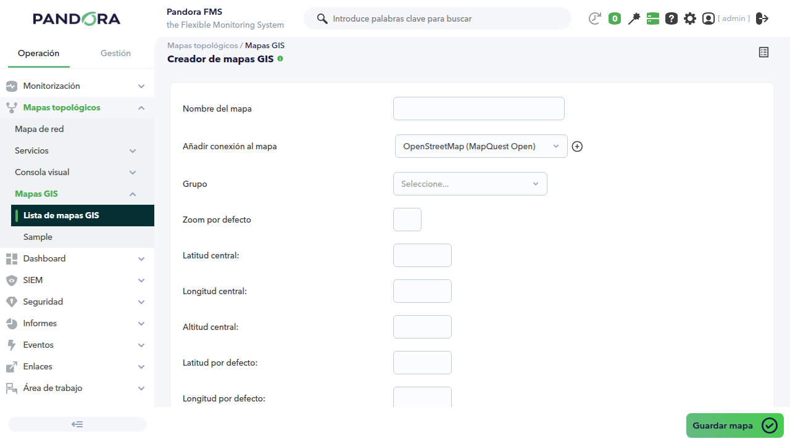

When a connection is marked as the default one of the map, or when it is
changed, the console asks whether its default data is to be used. If accepted,
it fills the center coordinates, the default position and the zoom with the
values of the connection; if rejected, it changes nothing and only adds the
connection.

**Layers.** A layer decides which agents are painted on the map. Each layer can
show the agents of a group, a specific list of agents or a group with a
representative agent. They are created from **New layer**, where its name,
whether it is visible, the group it takes the agents from and the list of agents
are set, and they are added to the list of layers of the map. Layers can be
sorted, edited and deleted, and all of them are saved with the rest of the map.

!!! warning "A group with a representative is not repeated"
    Once a layer has a group with its representative agent, another layer
    cannot be created with that same group and a different representative.

The map is saved with **Save map**. If the map is going to be the default map,
there is no need to define layers: it is used to place the agent in its view.

## Operating the map

The map viewer shows the map with its layers and its controls. The name of the
map appears in the title and, in the top bar, the operation controls.

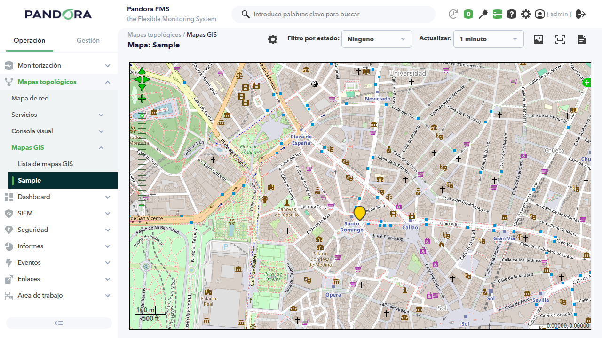

**Navigation.** The arrows in the top left corner move the map in each
direction; the **+** and **-** icons and the zoom bar change the zoom level. The
map can also be dragged with the mouse.

**Layers.** The layer control allows choosing the base layer (when the map has
more than one connection) and marking which layers are visible and which are
not. Among them is the system layer **Hierarchy of agents**, which draws dotted
lines between an agent and its parent when both are visible.

**Status filters.** The **Filter by status** selector reduces the agents shown
to those in a specific status: **None** (all), **Critical**, **Warning**, **OK**
or **Other**.

**Refresh.** The **Refresh** selector sets how often the map is refreshed (from
5 seconds to 2 hours, 1 minute by default). The refresh is done over AJAX,
without reloading the page.

Clicking on an agent expands its information, and the agent name links to its
agent view. If the user has management permission, the bar also includes the
gear button to edit the map and the link to the public map, which opens the
viewer without signing in.

## Agent view and GIS data

In the agent view (see [2.21](../parte-2/2.21-configuracion-comun-de-los-agentes.md#the-tabs-of-the-agent-view)), the **GIS data** tab shows the default map and the position
of the agent. With GIS enabled in the console, the tab bar includes that
section, which, besides the position in latitude, longitude and altitude,
presents a table with the information reported by the agent in the chosen period
(including the place description, resolved by reverse geolocation) and the
position history.

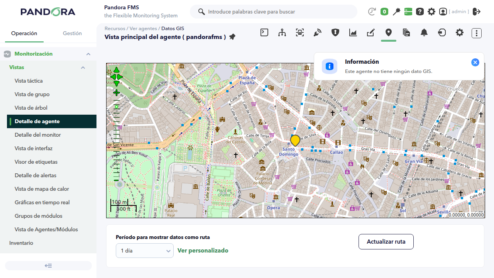

In the agent administration, the **GIS data** tab is used to set the position by
hand: the map is clicked or the latitude, longitude and altitude fields of the
lower form are filled in. When the position is changed by hand, the console
turns on the **Ignore new GIS data** option by itself, so that the next data
packet does not readjust what has just been set. If that is not what is wanted,
it has to be turned off before pressing **Update**.

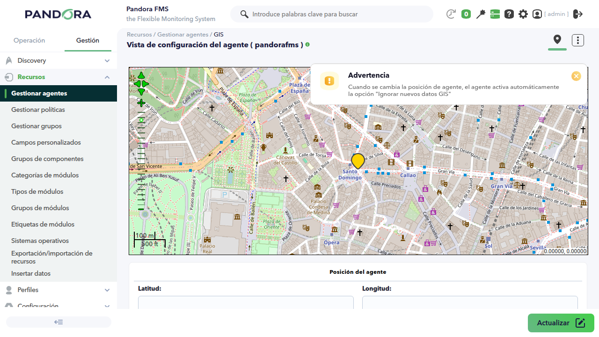

The other end of that setting is in the agent management, in the **Update new
GIS data** option. When it is on, the server applies the position information it
receives; when it is off, it keeps the last valid position. It is the option to
use when an agent reports a wrong position or when it has to be left at a fixed
position. If the position is set by hand on the **GIS data** tab, it is
worth reviewing this option afterwards: it is the same setting seen from the
other side.

!!! note "The GIS data tab is shown even if global GIS is off"
    The agent administration forces the global switch to build the **GIS data**
    tab, so that interface appears even if "Enable GIS features" is disabled.
    The GIS view button in the agent view, on the other hand, does depend on the
    global switch and is not shown if it is off.

## Parameter reference

The complete detail of each token, with its context, is in
[9.3 Full server configuration
reference](../parte-9/9.3-referencia-completa-de-configuracion-del-servidor.md)
and in [9.1 Full EndPoint configuration
reference](../parte-9/9.1-referencia-completa-de-configuracion-del-endpoint.md).

**Server (`pandora_server.conf`)**

| Parameter | Default value | What it does |
|---|---|---|
| `activate_gis` | `0` | Enables (`1`) or disables (`0`) the processing of GIS information in the server |
| `location_error` | `50` | Radius in meters below which two positions are considered the same |
| `recon_reverse_geolocation_file` | empty | MaxMind GeoLiteCity file for the reverse geolocation of the discovered agents |
| `recon_location_scatter_radius` | `50` | Radius in meters of the circle in which the discovered agents are scattered at random |
| `google_maps_description` | `0` | Enables (`1`) reverse geolocation with the Google Maps API |
| `openstreetmaps_description` | `0` | Enables (`1`) reverse geolocation with the OpenStreetMap API |

**EndPoint (`pandora_agent.conf`)**

| Parameter | Format | What it does |
|---|---|---|
| `latitude` | Decimal degrees | Fixed latitude of the device |
| `longitude` | Decimal degrees | Fixed longitude of the device |
| `altitude` | Meters (optional) | Altitude of the device |
| `position_description` | Free text | Readable description of the place |
| `gis_exec` | Path of a script | Script that returns `latitude,longitude,altitude` on one line |

## Cross references

- **[5.7 Network topology maps](5.7-mapas-topologicos-de-red.md)**: the other
  way of seeing the network from the console: GIS draws geography, topology
  draws relationships.
- **[9.3 Full server configuration
  reference](../parte-9/9.3-referencia-completa-de-configuracion-del-servidor.md)**:
  the GIS tokens of the server, in their full context.
- **[9.1 Full EndPoint configuration
  reference](../parte-9/9.1-referencia-completa-de-configuracion-del-endpoint.md)**:
  the position parameters of the EndPoint, next to the rest of its
  configuration.
- **[10.1 Database schema](../parte-10/10.1-esquema-de-la-base-de-datos.md)**
  and **[10.2 Table reference](../parte-10/10.2-referencia-de-tablas.md)**: the
  schema of the tables that store positions, connections, maps and layers.
- **[2.9 Collections](../parte-2/2.9-colecciones.md)**: how to distribute the
  position script from the server, if `gis_exec` is used.
