# Mobile app

The Pandora FMS mobile app is the console in your pocket: monitoring status,
events, alerts and services without opening a browser. It is called **Pandora
FMS Console** and it exists for Android, for iOS and as a web build that the
console itself publishes. The app brings together the monitoring views and the
Pandora AI chat, which can run actions in the console.

## What it is and where it fits

The app is a client of the console **API v2**: it connects to
`<console>/api/v2` with the user account and shows the information that user is
allowed to see. There is no intermediate server and no database of its own; if
the console does not answer, the app has nothing to show.

Three platforms, one application:

- **Android**: installed app.
- **iOS**: installed app.
- **Web**: the same client compiled for the browser and served by the console at
  `<console>/mobile/`.

The app covers the monitoring views: agents, modules, events, alerts, groups,
servers, services and notifications. The assistant can run actions in the
console, with the permissions of the signed-in account. The views are there to
reach the detail quickly; hands-on operations are still done in the web console.

Version 1.0.0 requires a console **806 or later**. The app reminds you on the
initial setup screen, and on an older console some screens may stay empty
because the endpoints they use do not exist.

Within Part 5, the app is one more way of looking at what the monitoring
chapters already document: it does not replace the web console dashboard and it
adds no new features. It simply brings them closer to the phone screen.

Interface labels are quoted in English, the language of the screenshots; the
app is translated into 15 languages, with RTL support.

## Access and installation

| Requirement | Detail |
|---|---|
| Console | Pandora FMS 806 or later, reachable from the device |
| Account | Console user with read permissions on the groups to be consulted |
| API access | The client IP must be allowed in the console (see below) |
| Network | Connection to the console host; in production, HTTPS with a valid certificate chain |
| Browser (web build) | The console serves the app at `<console>/mobile/`; it must be opened from the same domain as the console |

On **Android** and **iOS** the app is installed like any other application. On
first launch it shows a **four-screen onboarding** that introduces the dashboard,
the lists, the details and the menu. It can be skipped with **Skip**; it does not
appear again.

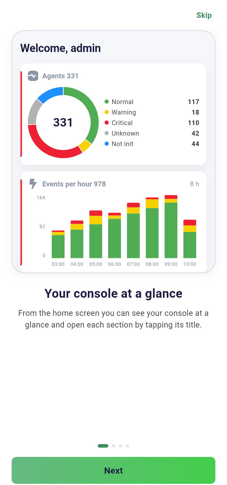{ width="282" }

The **web build** is not installed: it is opened in the browser. The address is
the console address followed by `/mobile/`:

```text
https://<console>/mobile/
```

The web app talks to the API from the same origin as the console; that is why it
cannot be served from another domain or from `file://`. If the console uses
HTTPS, so does the app.

When the console is opened in a mobile browser, some pages offer a bridge to the
installed app: **Open in app** opens the equivalent screen and **Continue in
browser** stays in the console. The bridge only appears on pages that have an
equivalent screen in the app, and only on normal navigations, not on forms or
downloads. The screens the app can open are the dashboard, agents, modules,
groups, events, alerts, servers, services and notifications, including their
detail pages.

## Connecting to the console

The first time the app is opened it needs to know which console it points at.
The screen asks for one thing: the **Console URL**, scheme included.

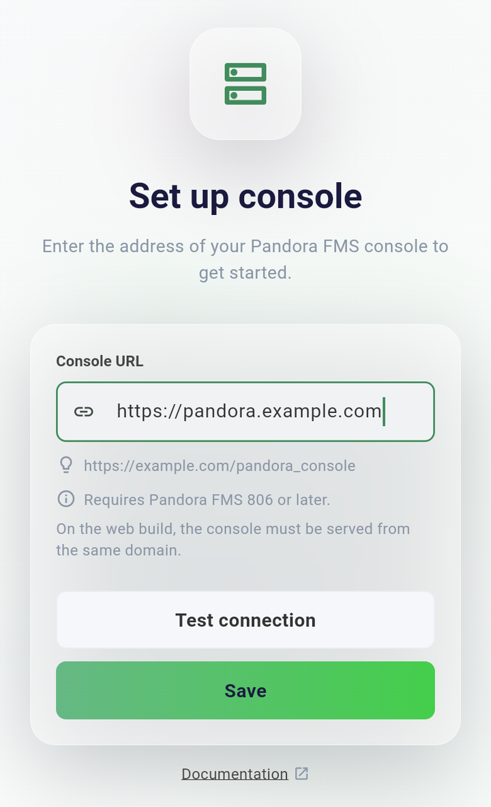{ width="365" }

The field accepts a full URL, with or without a trailing slash:

```text
https://pandora.example.com/pandora_console
```

Pressing **Test connection** checks that the URL answers as a Pandora FMS
console. If the check passes, **Save** stores the console and goes to the login
screen. Used consoles stay in a suggestion list that appears when the field is
tapped; each one can be removed with the cross on the right. On the web build,
the app reminds you that the console must be served from the same domain; the
suggestion list does not change that rule.

These are the errors the check can return:

| Message | Meaning |
|---|---|
| That URL is not valid. Use http:// or https://. | The scheme is missing or the URL is malformed |
| Cannot reach that console. | The host does not answer, the port is closed or the network does not reach it |
| The console security certificate is not valid or is incomplete. Contact the administrator. | The server does not present a certificate chain the device accepts |
| The URL responds, but it does not look like a Pandora FMS console. | The URL answers, but it is not a console API |

If the URL is `http://`, the app warns that the connection is not encrypted and
asks for confirmation before continuing. The warning is informative; it does not
prevent you from going on.

### The console must allow the client IP

The console API only serves addresses included in the **IP list with API
access**. It is configured under **General setup → Security** and accepts single
addresses, wildcard ranges (`192.168.20.*`) or `*` to allow them all. If the list
is empty or does not include the IP the client comes from, the app cannot
authenticate even with correct credentials.

### The browser connects and the app does not: the certificate chain

This is the most common failure when putting the app into production. The
console opens without problems in the phone browser, but the app rejects the
connection with the certificate message. It is not a credentials or network
problem: it is the certificate chain.

Browsers complete the chain on their own: if the server does not send a link,
they download it using the certificate information or take it from their cache.
The HTTP libraries used by apps do not perform that download and validate
exactly what they receive. If an intermediate certificate or the cross-signed
root is missing, the device cannot trace the path to a trusted authority and
drops the connection.

The server must send **three certificates**, in this order:

1. The console certificate (leaf).
2. The intermediate certificate of the certificate authority.
3. The **cross-signed** root, not the self-signed one. For Sectigo, the R46
   issued by USERTrust RSA or by AAA Certificate Services.

Apache offers two ways to configure it. The first is a single file with the
three certificates concatenated:

```apache
SSLCertificateFile    /path/to/console-fullchain.pem
SSLCertificateKeyFile /path/to/console.key
```

The second splits the chain across directives:

```apache
SSLCertificateFile      /path/to/console.crt
SSLCertificateChainFile /path/to/intermediate.pem
SSLCACertificateFile    /path/to/cross-signed-root.pem
SSLCertificateKeyFile   /path/to/console.key
```

If the provider delivers a `fullchain`, use it as is. If not, the cross-signed
root must be collected by hand. With Sectigo, the `.p7c` package contains
several versions of the same root; the right one is the one whose issuer is
USERTrust RSA or AAA Certificate Services:

```bash
curl -O http://crt.sectigo.com/SectigoPublicServerAuthenticationRootR46.p7c
openssl pkcs7 -inform DER -in SectigoPublicServerAuthenticationRootR46.p7c \
  -print_certs -out r46-chain.pem
```

From that file, pick the cross-signed variant and discard the self-signed one.
It is also a bad idea to drag along duplicate roots or several alternatives: the
device may reject the whole chain.

Then validate the configuration, reload the web server and check from a network
without TLS inspection:

```bash
apachectl configtest
systemctl reload apache2   # or your web server service
openssl s_client -connect <host>:443 -servername <host> -showcerts
```

The output must show **three certificates** and end with:

```text
Verify return code: 0 (ok)
```

!!! warning "Do not disable validation in the app"
    Accepting invalid certificates would open the door to intercepting
    credentials and data. If the chain cannot be completed, fix it on the server;
    do not relax the app.

## Signing in and permissions

With the console configured, the app shows the login screen: user, password and
the **Log in** button. The eye icon shows or hides the password, and the gear in
the top right corner lets you change the console URL.

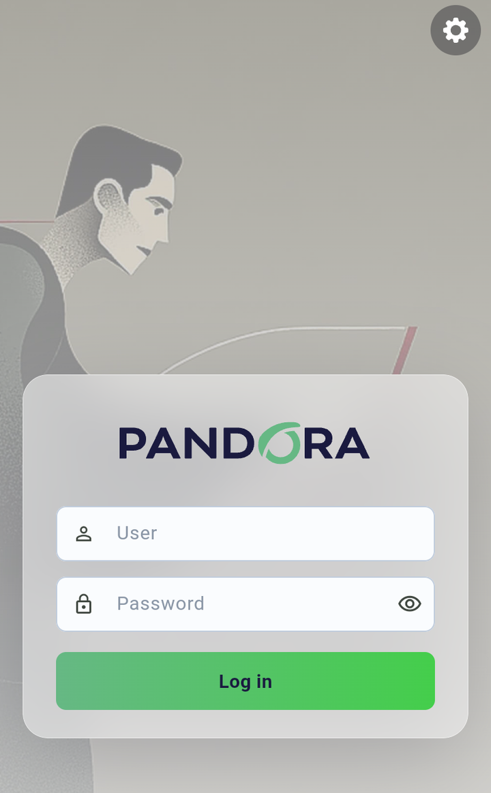{ width="371" }

If the account has **two-step verification**, after the password the app asks
for the six-digit code from the authenticator app. The code expires and you can
go back to the login with **Back to login**. Errors are distinguished: wrong
credentials, unreachable console, too many attempts and a user with no profile
assigned.

The app does not decide what the user can see: the console does. On startup it
queries the API to find out which sections are allowed and **hides** the ones
that answer with a permission error. If that query fails for a temporary reason,
the app hides nothing and lets each screen show its own error. In practice: if a
user has no access to alerts, the alerts section does not appear.

!!! tip "An account with just the right permissions"
    Do not hand out an administration account across phones. Create a user with
    the appropriate profile and give it access only to the groups it must
    consult. If Pandora AI is going to be used, review which actions it can run
    too: the assistant acts with the permissions of that account.

Logging out is in the menu, at the end of the list. It asks for confirmation and
revokes the session in the console; the next launch requires signing in again.

## How the app works

All data screens share the same patterns. Learning them once saves you half of
this chapter.

**Navigation.** The bottom bar has five destinations: **Home**, **Events**,
**Alerts**, **AI** and **Menu**. The menu opens the rest of the sections: agents,
modules, groups, servers, services, notifications and About. The arrows in the
header go back; returning to a list restores its filters and sorting.

**Lists.** Each list loads **20 items per request** and asks for the next page at
the end, with no "load more" button. Search, filters and sorting are applied **in
the console**, not on the phone: if the API does not expose a filter, the app does
not simulate it.

**Filters.** The funnel in the header opens a sheet with the filters for that
screen. Fields are filled in and applied with **Apply**, which closes the sheet;
**Reset** returns to the initial values and also closes. Applied filters remain
as **chips** above the list, and each chip is removed with its cross. The app
remembers the last combination per console and per screen.

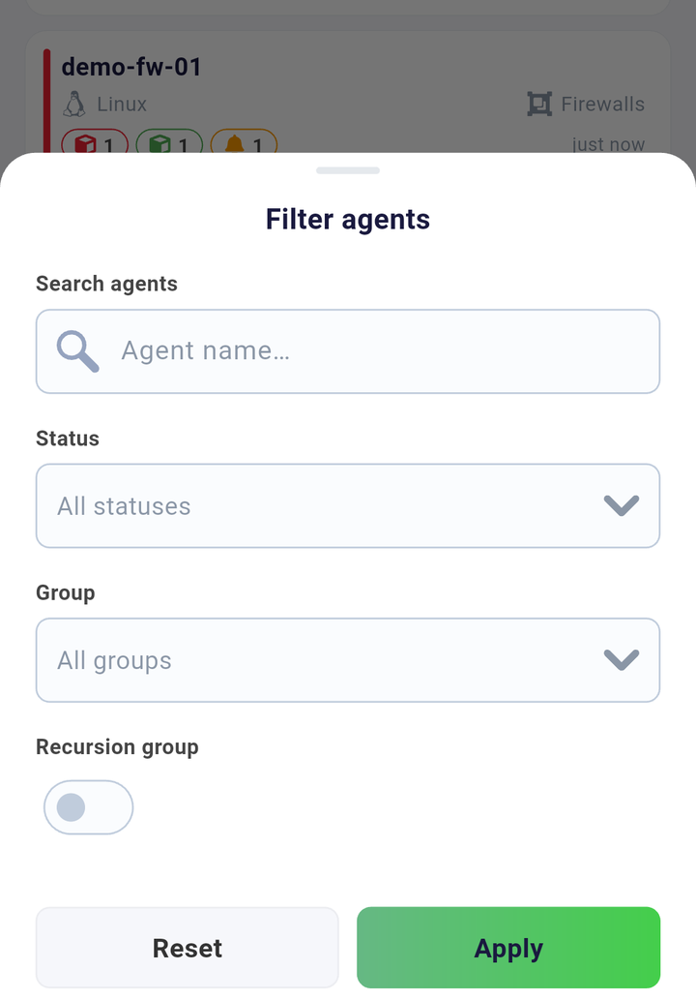{ width="418" }

**Sorting.** The arrows icon opens the sort sheet: choose the field and the
direction (ascending or descending). Like the filters, sorting travels to the
API.

**Details.** Detail pages organise information in tabs that can be tapped or
swiped: summary, modules, events, alerts, actions, history. Long values are
truncated with an ellipsis and open in full when tapped.

**Loading and errors.** While the response arrives you see a skeleton shaped
like the content, not a spinner. If the request fails, the screen shows the error
and a **Retry** button; if there are no results, an empty state with the reason.

**Dates and times.** They are shown in the console user's time zone. If the
profile does not have one, the console time zone is used and, as a last resort,
UTC. Data is stored and requested in UTC; the zone only changes how it is
displayed.

**Refreshing.** Lists refresh by pulling down. The dashboard refreshes the same
way and keeps the last response until it is refreshed again.

## The screens

Each app section is a view of the monitoring. Below is what each one shows, what
can be filtered and what opens from it. Configuration details for agents,
modules, alerts and services are in their Part 2 and Part 5 chapters; here only
the view is explained.

### Home

The dashboard summarises the console status in two blocks. The first, monitoring,
shows the number of agents with a ring by status, modules with a bar by status,
events per hour for the last eight hours, the event total with its severity
breakdown, triggered and untriggered alerts, and the status of pending and
in-progress events.

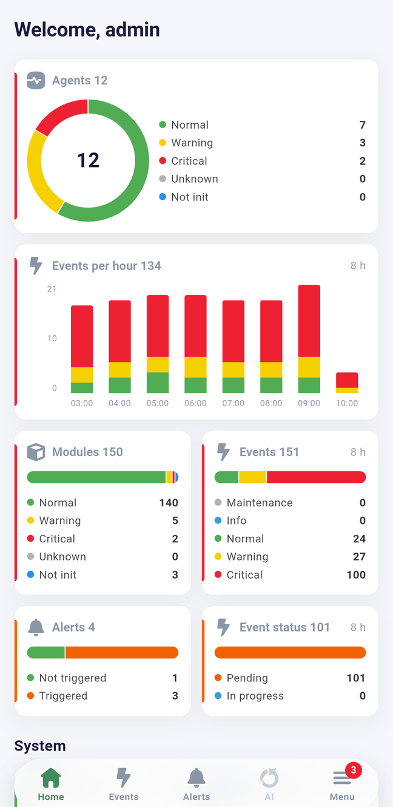{ width="293" }

The second block, **System**, adds CPU, memory and database read/write for the
last eight hours, the server status and a database summary: active or inactive,
size, events in the last 24 hours and record count.

The cards are not decorative: tapping them opens the corresponding section
(agents, modules, events, alerts or servers). In the agent ring, each legend
slice can be tapped to isolate that status.

### Agents

The agent list shows, for each agent, its status, operating system, group,
module counters (critical, warning and normal), alerts and last contact. The
colour bar on the left summarises the agent status.

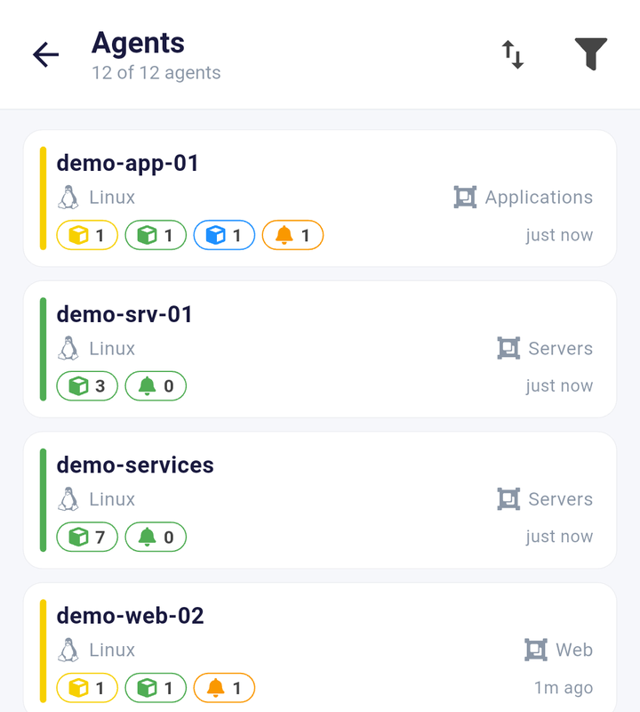{ width="540" }

You can search by name, filter by status, group (with the option to include
subgroups) and operating system, and sort by alias, name, address, group,
critical modules, warning modules, total modules or last contact. By default,
the most recent first.

The agent page has four tabs: **Summary**, **Modules**, **Events** and
**Alerts**. The summary shows the module bar, the event activity of the last 24
hours, triggered and active alerts, and the agent information: name, alias,
identifier, group, IP, operating system and version, agent version, description,
remote configuration, interval, last and next contact, last remote contact, last
status change and assigned server.

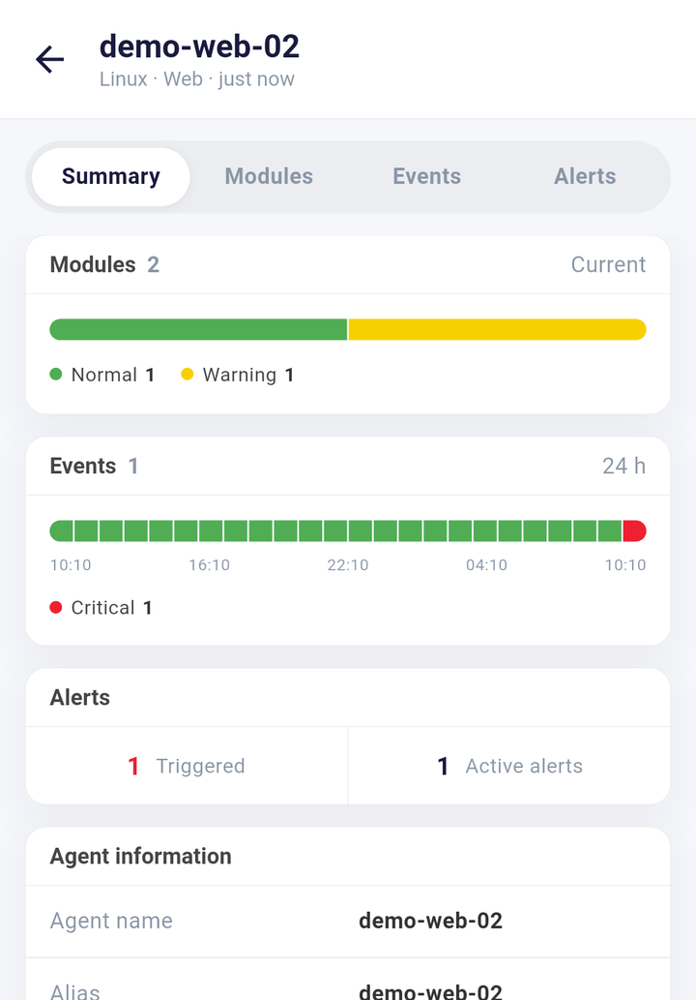{ width="418" }

The app warns when the agent is disabled, has no server assigned, has never
contacted, has been out of contact for too long or has more than 200 modules, a
threshold at which the console itself warns that performance may suffer.

The **Modules** tab lists the agent modules with their current value, the time of
the last data point and a sparkline. Tapping one opens its page.

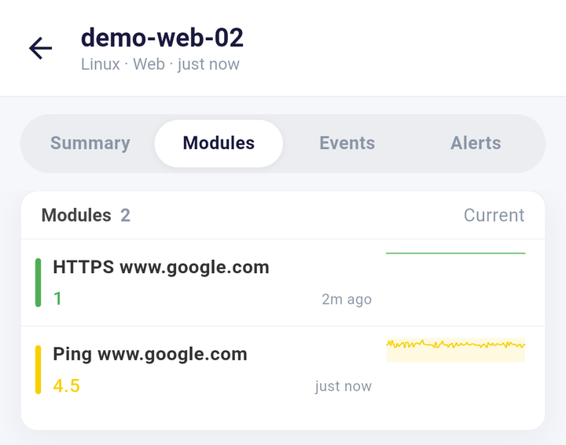

### Modules

The **Modules** entry in the menu is the global list: every module from every
agent, with its name, agent, current value, time and sparkline. You can search by
name, filter by agent, status and module group, and sort by name or group. Modules that do not
produce a graph say so in the row.

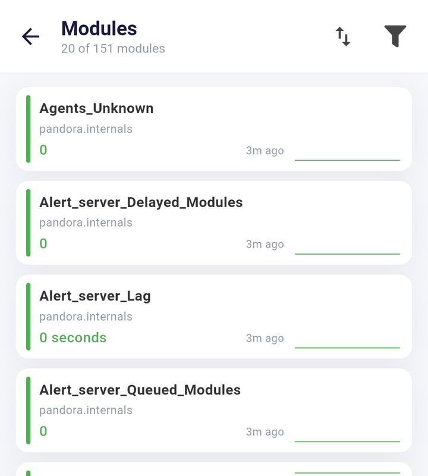{ width="540" }

The module page has four tabs: **Summary**, **History**, **Events** and
**Alerts**. The summary draws the graph for the period with the maximum and the
average, the module status histogram and its information: status, agent, type,
group, unit, warning and critical thresholds, parent module and identifier. If
the module stores an image instead of a number, it says so and does not invent a
graph.

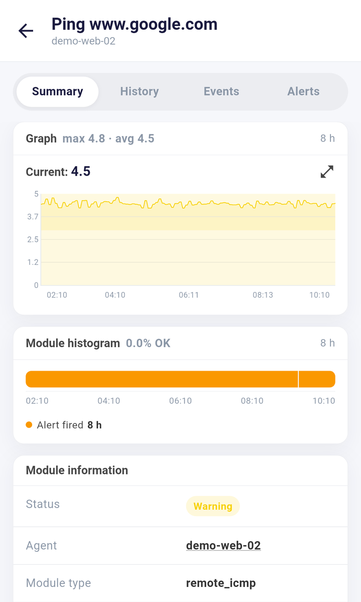{ width="360" }

The graph can be opened full screen. The **History** tab shows the value history
grouped by day; **Events** and **Alerts** show what happened in the last 24
hours.

### Events

The event list shows the most recent first, with severity, type, agent and
module, and the elapsed time. You can filter by date range (from 15 minutes to
all time, or a custom range), status, criticality, event type, group —with
subgroups—, agent, alerts only and text. You can sort by date, event, type,
status, criticality or source.

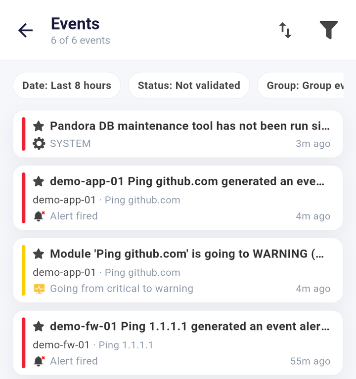{ width="563" }

The event page has up to five tabs: **General**, **Details**, **Comments**,
**Agent fields** and **Custom data**, depending on what the event carries.
General gathers the name, identifier, status, severity, type, agent, module,
group, owner, who acknowledged it, date and source. Details adds the event's own
fields, with critical, warning or unknown instructions when they exist. Comments
shows the comments; Agent fields, the agent custom fields; and Custom data, the
event custom data.

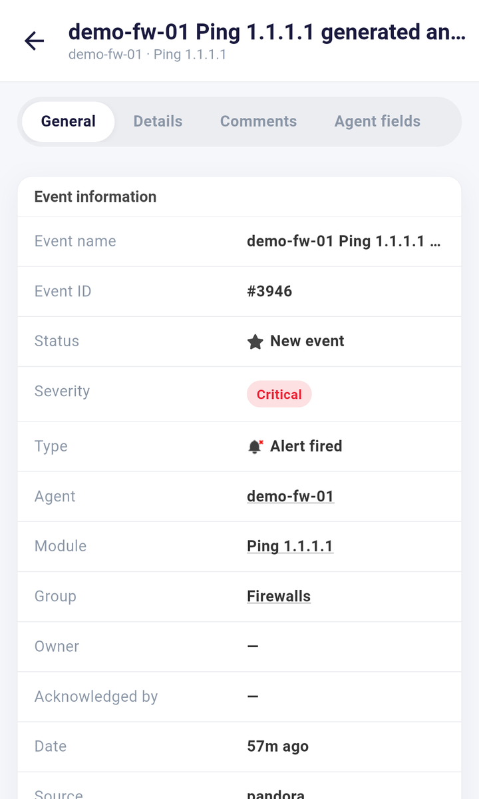{ width="360" }

The event status change is done in the web console.

### Alerts

The alert list shows the agent, module, template, number of triggers and the
last time it fired. You can search by agent or module, filter by status, standby
and criticality, and sort by last fired date or number of triggers.

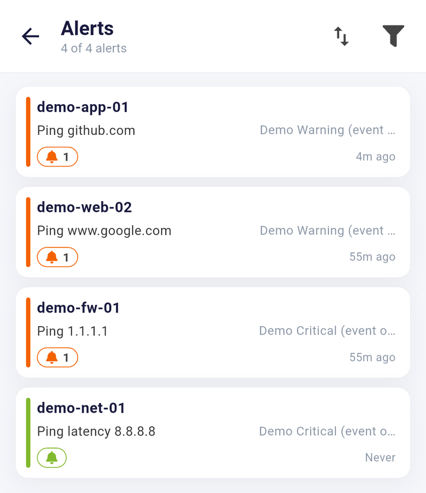{ width="519" }

The page has three tabs: **General**, **Actions** and **Triggered**. General
shows agent, module, template, status and number of triggers, the last time it
fired, standby, whether it is disabled and the associated policy. Actions lists
the configured actions with their threshold and last execution. Triggered
collects the firings with the date, recovery, manual validation and executed
actions.

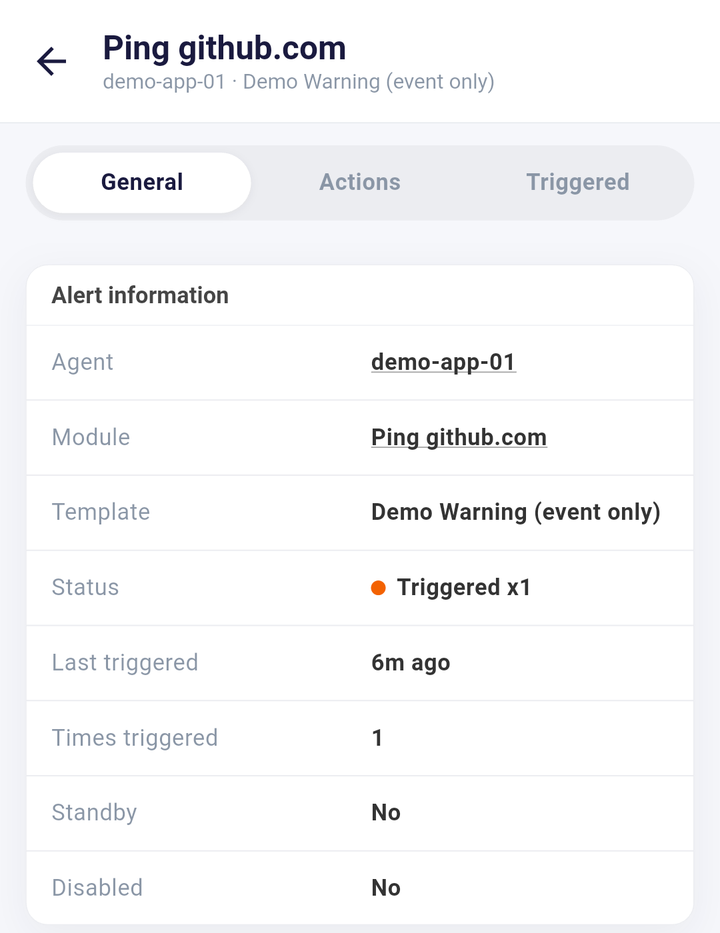{ width="463" }

Acknowledging or forcing an alert is done in the web console.

### Groups

The group list shows, for each group, its agents and its modules grouped by
status, plus alerts when it has them. You can search by name and sort by name or
identifier.

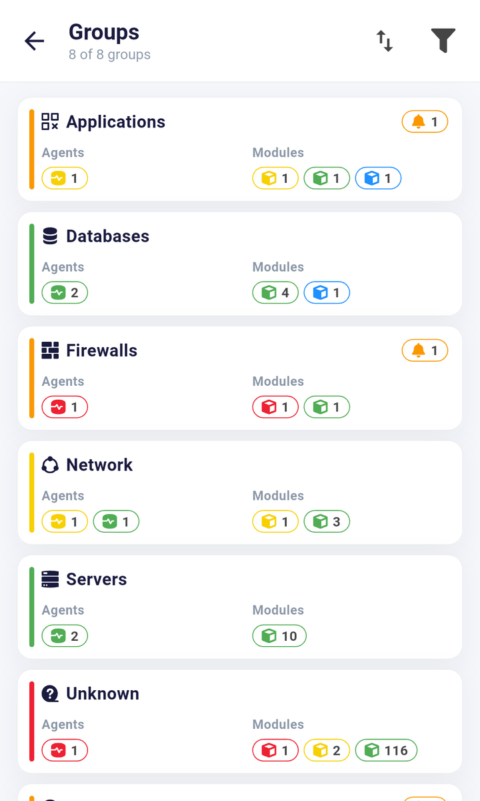{ width="360" }

The group page has three tabs: **Summary**, **Agents** and **Modules**. The
summary shows the counters and the group information: identifier, parent group,
description, contact, agent limit and whether alerts are enabled.

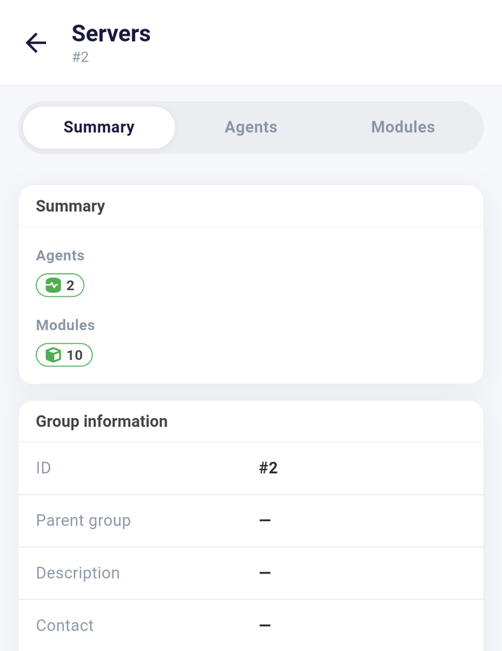{ width="463" }

### Servers

The server list shows each server with its status, type, whether it is master,
running modules over the total, lag, thread queue and last update. You can search
by name or version, filter by status, type and master, and sort by name, status,
type, master or update.

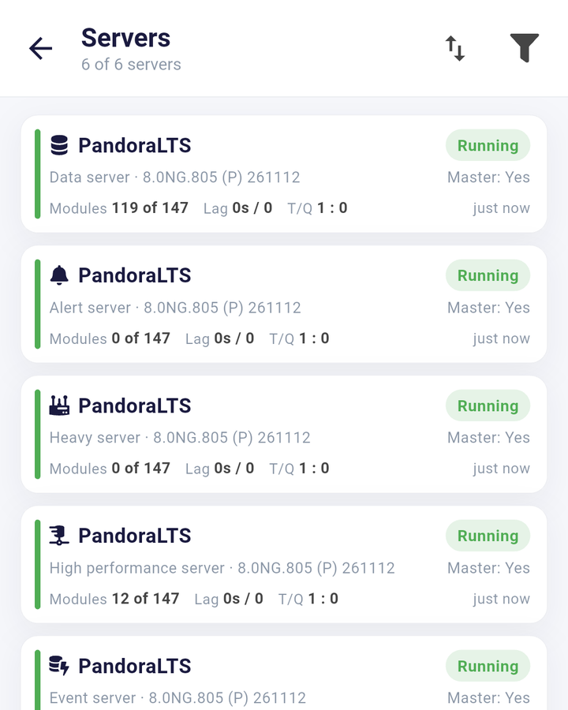{ width="480" }

Each row is a console server —data, network, alert, event— and shows at a glance
whether it is up to date. There is no detail page: the information fits in the
row.

### Services

The service list shows status, description, group, mode (manual or smart),
value, SLA and last update. You can search by name or description, filter by
status, group, mode and favourites, and sort by name, description or status.

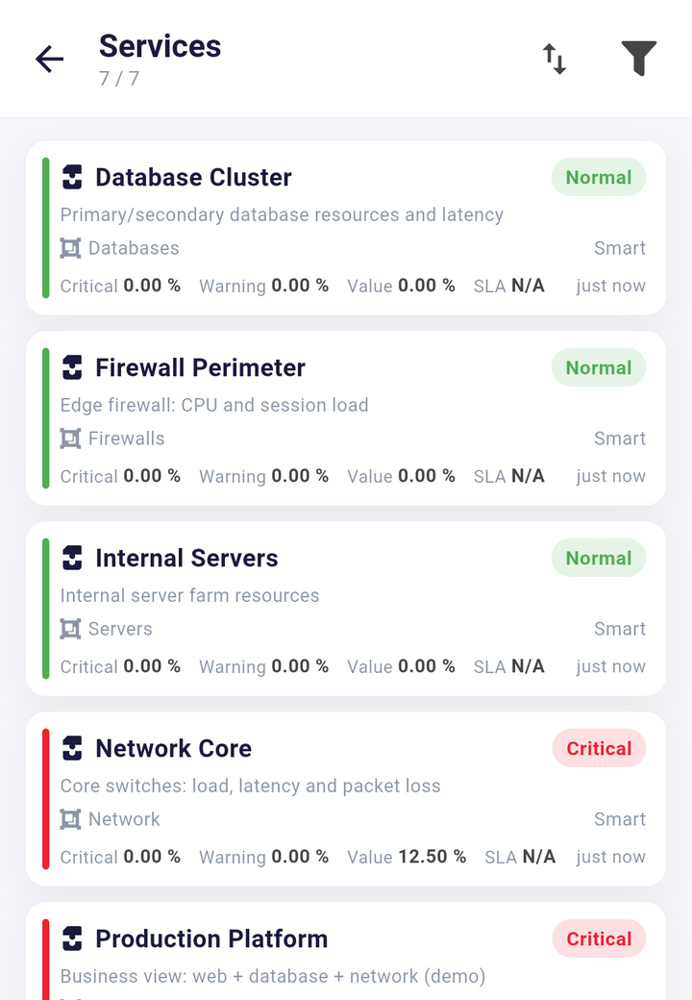{ width="415" }

The service page has two tabs: **Summary** and **Elements**. The summary gathers
description, group, mode, critical, warning and value percentages, status, SLA
and last update. Elements lists the elements that make up the service: agents,
modules and other services, with their weight and status.

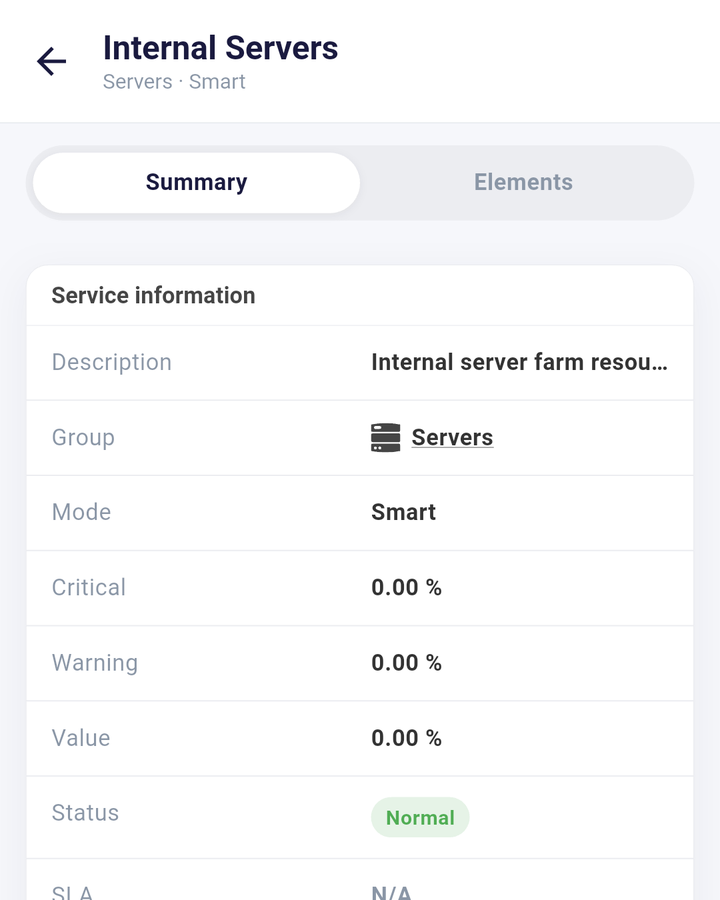{ width="480" }

### Notifications

The notification inbox collects the notices the console sends to the user. Each
row shows the subject, the beginning of the text, the date and whether it is read
or unread. The unread count appears as a badge on the menu icon and, inside the
menu, next to **Notifications**.

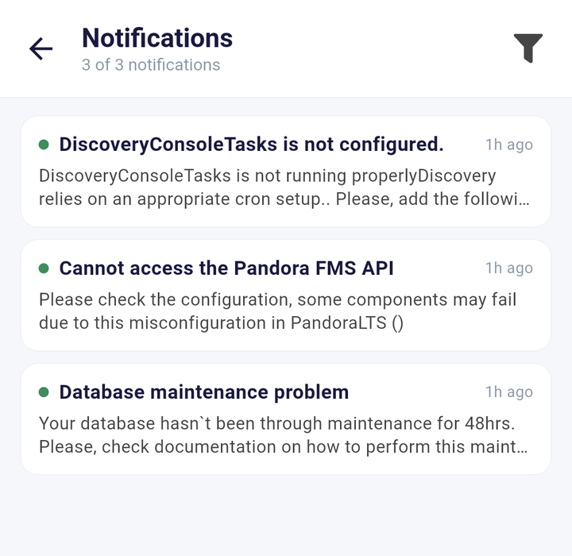{ width="617" }

Opening a notification shows the full text and the reception date. The
notification is shown as it arrived; opening it does not change its status.

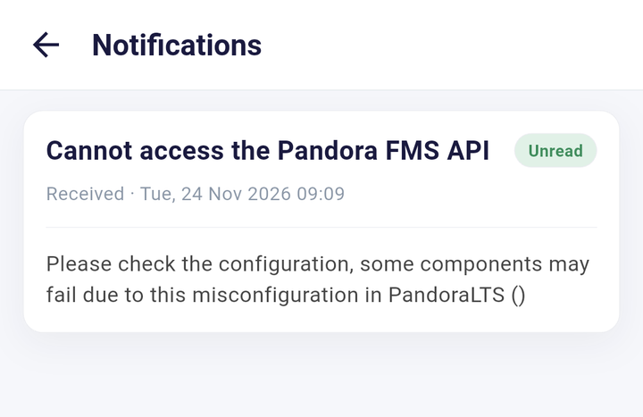

### Pandora AI

The Pandora AI chat opens from the **AI** tab in the bottom bar. The screen has
the conversation thread, the input field and a send button; at the top, access to
**Sessions** and the available models. Sessions can be created, resumed and
destroyed, and the assistant can ask for data with a form before answering. It
can also run actions in the console, for example creating an agent, with the
permissions of the account.

While it thinks, the **AI** icon in the bottom bar animates; if the chat is
minimised, the indicator stays there and the conversation is not lost. Closing
the chat asks for confirmation and keeps the session to resume later.

The tab is only available when the console has Pandora AI enabled and the user
has permission to use it. If no model is configured either, the chat says so and
does not let you start a conversation.

## Menu and app information

The side menu gathers all sections and the account that has signed in, and ends
with **Log out**. The app version is shown at the bottom.

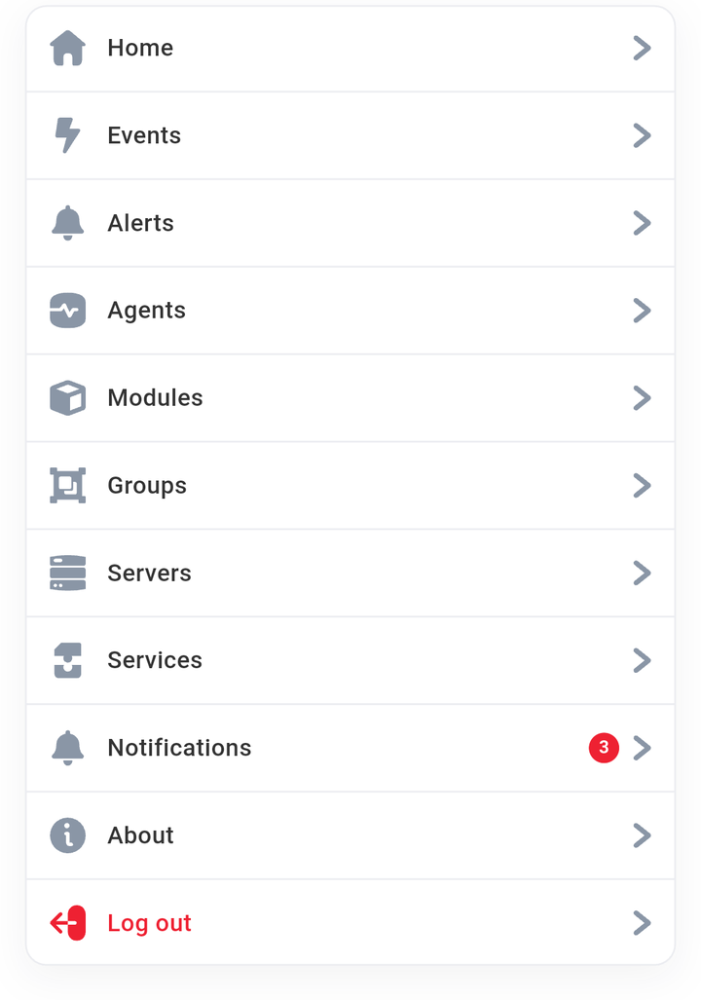{ width="421" }

**About** shows the app version, the console data (version, package, MR and
build) and the links to the documentation, support, privacy policy, changelog,
quick guide and open source licences.

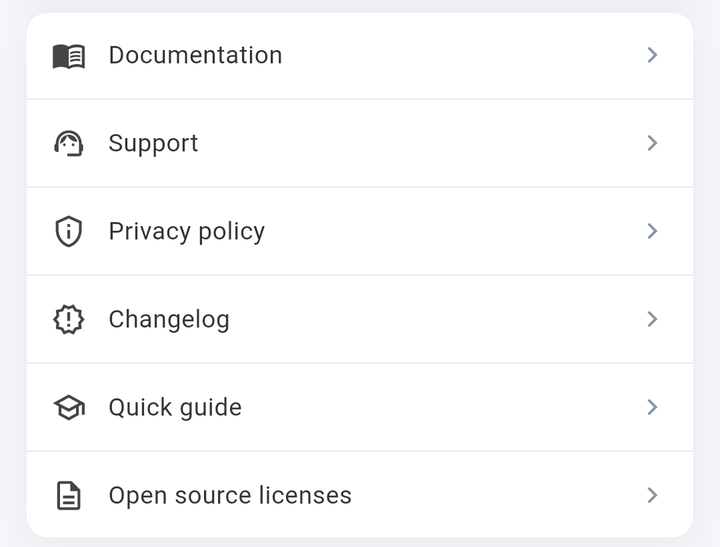

The **changelog** lists the highlights of each published version. A new
installation shows the onboarding; on an update, the app may show once the
highlights of the versions that were skipped. If the version has no highlights,
it does not interrupt.

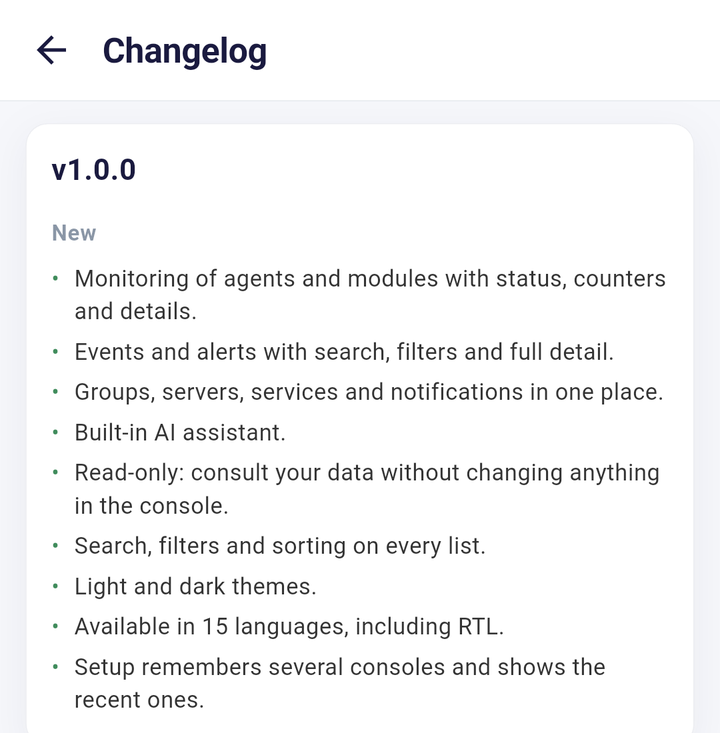{ width="589" }

The app **language** comes from the console profile. So does the **theme**:
light, dark or the system one, depending on what the user has configured in the
console. There is no language or theme switch inside the app.

## Security and session

The app does not store the password. On sign-in, the console returns an access
token that the app keeps **in memory** and a refresh token that is stored in the
device secure store. When the access token expires, the app renews it with the
refresh token without asking for the password again; if the session is no longer
valid, it returns to the login screen.

Logging out revokes the full session in the console, not just the phone token. On
the web build, refreshing relies on the browser cookie, which travels to the same
console domain.

The app requires **HTTPS** with a valid chain. It does not allow accepting an
invalid certificate even for testing: if the server does not present the full
chain, the connection is dropped and the message points to the administrator. It
is awkward the first time, but it keeps credentials from travelling without
guarantees.

Sections are hidden according to the user permissions, and the account should
have only the permissions it needs. The assistant runs actions with the
permissions of that account, so the token is treated as a credential: renewed and
revoked as such.

Anything that can be run from the phone goes through the assistant; the rest is
done in the web console.
