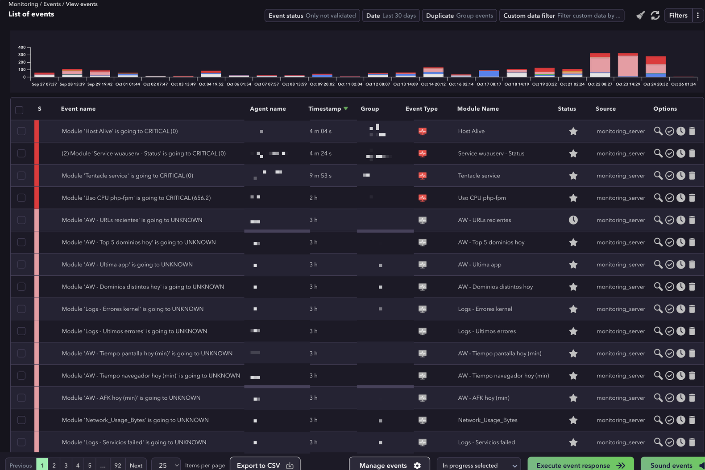
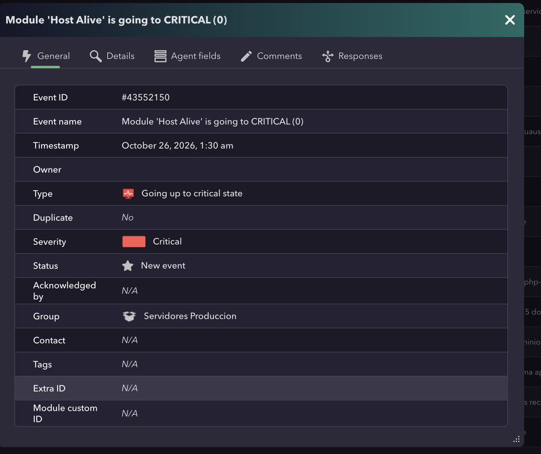
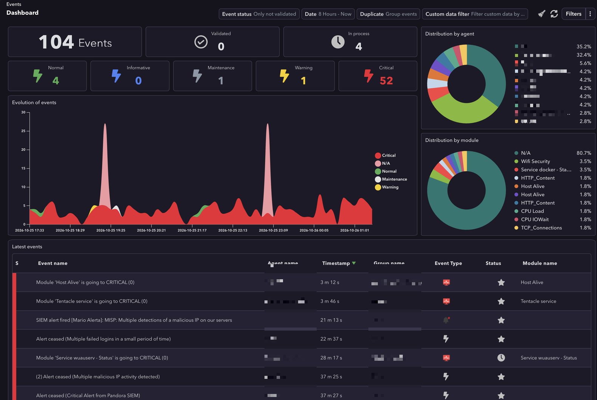
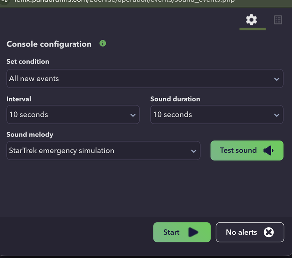
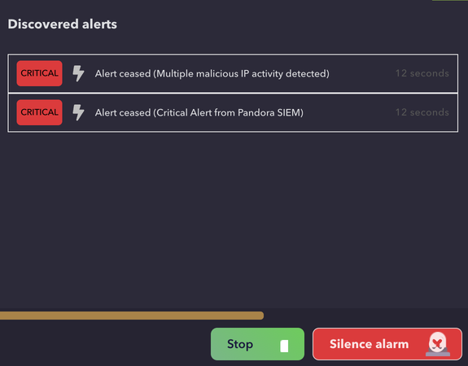
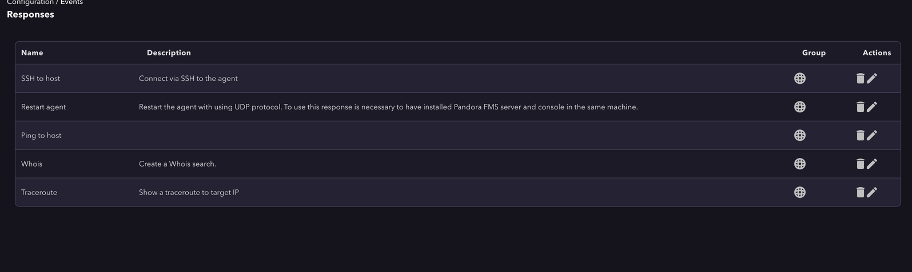
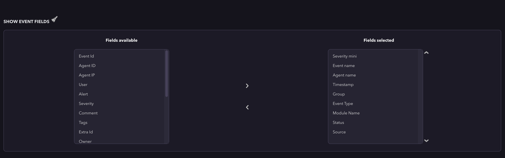

# Centralized event console

Events are the logbook of what happens on the platform. Every time a module
changes state, an alert fires or a limit is crossed, an event is left behind. And
because the logbook grows fast, what really matters is not keeping everything but
**finding what matters when it matters**. That is what this chapter is about: the
event console, its states, its filters, its dashboard and everything around them.

## Introduction: what an event is

An **event** is the record of something that happened on the monitored systems.
By default, the event view shows a **snapshot** of what is happening right now;
the history is a different thing and is queried separately.

Events are classified by **severity**:

| Value | Severity | Color |
|---|---|---|
| 0 | **Maintenance** | White/grey |
| 1 | **Informational** | Blue |
| 2 | **Normal** | Green |
| 3 | **Warning** | Yellow |
| 4 | **Critical** | Red |
| 5 | **Minor** | Pink |
| 6 | **Major** | Brown |

On an event you can **change its state** (validated or in progress), **change the
owner**, **delete it**, view its **additional information**, **add a comment**
(free text that later helps with filtering; it accepts Markdown links, including
in the **Event Custom ID** field), run **custom responses** and add or remove
**custom tags**.

## The event view

The screen is in **Operation → Events → View events**. Each row summarizes one
event. The detail opens when you click the **event name**, if that column is
visible, or the **magnifying glass** in the options column, which remains
available even if you hide the name column. Columns can be sorted, and the detail
shows associated data such as the module that generated the event, its group or
the module tags.

Two visibility rules worth keeping in mind:

- A user sees **only the groups they belong to**, unless they are in the **All**
  group.
- If there are agents with **secondary groups**, the user will only see them if
  **Search in secondary groups** is enabled. That option costs the server.

The default search is a very specific snapshot: **last 8 hours**, **unvalidated**
events and **grouped** to avoid duplicates. It can be changed, and in fact almost
the whole chapter is about how.

Pandora FMS also uses events to warn about its own limits: for example, when the
maximum number of agents configured for a group is reached.

The view can also show an **evolution chart** of the events in the filtered
period: it loads above the list and gives you a quick idea of whether the noise is
going up or down.



## Event states and lifecycle

An event can be in four states: **New**, **Validated**, **In progress** and **Not
validated**.

The piece that saves the most work is **self-validation**. When a module goes
*critical* or *warning*, an event is generated; when it returns to normal, another
one is generated. Self-validation marks the first one as validated as soon as the
recovery arrives. As a result, the default view (which filters by "not
validated") stops showing problems that are already solved without anyone having
to click.

**Manual validation** also exists: you validate the event, the system stores **the
date and the user** who validated it and lets you leave a comment. After that, the
event disappears from the default view.

The **In progress** state is set from the responses tab and is a way of saying "I
am looking at this". Its practical effect: **the event is not self-validated** and
remains pending until someone closes it.

All of this can be done **one at a time or in batches**: validate, mark as in
progress or delete a selection. One limit worth knowing: **custom responses**
apply to a maximum of **ten events** per operation; the limit is set in
**Performance** under **Events response max. execution**.

{ .captura }

## Filtering events

The filter is the console's main tool, and it has more parts than it seems.

**Saved filters.** A filter can be saved and loaded again later. It is the way to
avoid rebuilding the same search every morning.

**Age.** **Max. hours old** limits the time window. By default it is 8 hours.

**Duplicates.** The **Duplicate** selector decides how repeated events are
grouped:

| Mode | What it groups |
|---|---|
| **All events** | Nothing: every event is shown on its own |
| **Group events** | By event name, agent and module |
| **Group agents** | By agent |
| **Group extra id** | Only by the *Extra ID*, sorted by date |

**Group and hierarchy.** You can filter by group; **Group recursion** also
includes subgroups, and **Search in secondary groups** includes agents with
secondary groups. The last two cost the server.

**Dates.** **From** and **To** request a specific interval.

**Free search.** The **Free search** field accepts a **regular expression**: for
example, `(Connections|Network)` finds both words. It applies to the agent name,
event name, *Extra ID*, source, *custom data* and comments.

**Custom data.** You can filter by **field name** or by **field value** (*Filter
custom data by field name* / *by field value*). The chosen fields are shown as
columns.

**The rest of the filters**: source, *Extra ID*, comment, server, module, owner,
user who validated, **alert events only**, and tags **with** or **without**
certain tags.

And for the filters you use every day there are **pinned filters**: load a saved
filter and pin it with the **pushpin** icon in **Operation → Pinned**. The same
icon removes it.

## The events dashboard

Since version 805 there is a specific panel: **Operation → Events → Dashboard**.
It shares the event view's filtering, but it is designed as a control panel: you
save filters and query them without wrestling with the full table.

The practical difference: **View events** is for working on a specific event (see
the detail, validate, comment); the **Dashboard** is for looking at the whole
picture. If what you want is "how is the day going", start with the dashboard.



## Deletion, retention and history

Events can be deleted **by hand**, one at a time, and also **on their own**.
Retention is controlled in **Management → Settings → System Settings →
Performance** with the **Max. days before events are deleted** setting
(`event_purge`), which defaults to **7 days**.

If the **event history** is also enabled in the historical database, events are
kept for reports; event deletion in the history defaults to **180 days**. That
database is covered in Part 06 · Historical database.

## CSV and RSS export

Filtered events can be **exported to CSV** from **Operation → Events → View
events → Export to CSV File**. It is the way to take the list to a spreadsheet or
another system.

The events **RSS feed** is in **Operation → Events → RSS**. Two things are needed
to use it: the IP from which it is read must be in the **IP list with API access**
and you need an RSS reader. In a Command Center, RSS has its own limitations; if
it does not load, start there.

## Acoustic console

The **acoustic console** warns you with sound when something happens. It opens in
**Operation → Events → Acoustic console** and shows a pop-up window that polls
every **10 seconds**.

By default, these events make a sound:

- The firing of any **alert**.
- A module going to **warning**.
- A module going to **critical**.
- A module going to **unknown**.

Three warnings that explain almost every "it does not make a sound":

- The browser must **allow pop-ups**.
- **Do not minimize** the window: minimized, it does not work as expected.
- Only events that happen **while the window is open** and match the selected ones
  make a sound.



To add your own melodies, copy **WAV** files to
`/var/www/pandora_console/include/sounds/` and register them in **Admin tools →
Acoustic console setup → Create**.



## Event responses

**Event responses** are actions launched when an event occurs. They are
configured in **Management → Configuration → Events → Responses** and use
**macros** that are replaced with the event data. Macros are wrapped in
underscores (`_agent_address_`) and are the same ones used elsewhere in the
platform.



| Macro | What it returns |
|---|---|
| `_agent_address_` | Agent address |
| `_agent_alias_` | Agent alias |
| `_agent_id_` | Agent identifier |
| `_agent_name_` | Agent name |
| `_alert_id_` | Identifier of the associated alert |
| `_command_timeout_` | Command response time |
| `_current_user_` | User running the response |
| `_current_username_` | Full name of that user |
| `_customdata_json_` | *Custom data* in JSON |
| `_customdata_text_` | *Custom data* as text, with line breaks |
| `_customdata_X_` | A specific *custom data* field |
| `_event_date_` | Event date |
| `_event_extra_id_` | *Extra ID* |
| `_event_id_` | Event identifier |
| `_event_instruction_` | Event instructions |
| `_event_severity_id_` | Severity identifier |
| `_event_severity_text_` | Translated severity |
| `_event_source_` | Event source |
| `_event_status_` | Event status |
| `_event_tags_` | General event tags, separated by commas |
| `_event_text_` | Full event text |
| `_event_type_` | Event type |
| `_event_utimestamp_` | Date in *utimestamp* format |
| `_group_id_` | Group identifier |
| `_group_name_` | Group name |
| `_group_contact_` | Group contact |
| `_module_address_` | Module address |
| `_module_id_` | Module identifier |
| `_module_name_` | Module name |
| `_node_id_` | Node identifier (Command Center and node) |
| `_node_name_` | Node name |
| `_owner_user_` | User who owns the event |
| `_owner_username_` | Full name of the owner |
| `_user_id_` | User identifier |

The `_event_type_` macro does not return the identifier; it returns the
translated text of the type. These are the values the console recognizes:

| Type (`event_type`) | What `_event_type_` returns |
|---|---|
| `unknown` | Unknown |
| `going_unknown` | Going to unknown |
| `going_up_warning` | Going from critical to warning |
| `going_down_warning` | Going down from normal to warning |
| `going_up_critical`, `going_down_critical` | Going up to critical state |
| `going_up_normal`, `going_down_normal` | Going up to normal state |
| `alert_fired` | Alert fired |
| `alert_recovered` | Alert recovered |
| `alert_ceased` | Alert ceased |
| `alert_manual_validation` | Alert manually validated |
| `new_agent` | New agent created |
| `recon_host_detected` | Discovery server detected a new host |
| `system` | SYSTEM |
| `error` | Error |
| `configuration_change` | Configuration change |
| Anything else | `Unknown type: <type>` |

## Event tags

There are two kinds of tags, and they should not be mixed:

- **System tags**: set when the event is created through the CLI or the API.
- **Custom tags**: added and removed **by hand from the console**, and only a
  *superadmin* can do it. They are managed in **Management → Configuration →
  Events → Event tags**.

Behavior that surprises you the first time:

- If an event carries **several custom tags**, only **the first** is shown in the
  view; the rest are behind the help icon.
- The order is **alphabetical**. If you want a strict order, start the name with a
  number.
- The custom tags column **cannot be sorted**, although the rest of the columns
  can.

## Event alerts and correlation

Events and alerts are related: there are **event alerts** and correlation
mechanisms so that the same problem does not generate a hundred notifications.
Alerts, templates and actions are covered in [Alerts and
notifications](5.5-alertas-y-notificaciones.md#alerts-on-events); here only the
relationship is presented.

!!! warning "In Command Center the rules are not centralized"
    Event alert rules **are not centralized**. Each node needs its own rules so
    that it fires its own events; the rules configured in the Command Center only
    fire for the Command Center's own events.

## Events from the CLI and API

There are three ways to create and validate events from outside the console:

- **`pandora_revent.pl`**, in `/usr/share/pandora_server/util/`, creates and
  validates events against the API. Run it without parameters to see the syntax.
- **`pandora_revent_create.pl`** does the same, but **only creates**: useful when,
  for security reasons, you do not want to grant the ability to validate.
- **The CLI** `pandora_manage.pl` with `--create_event` creates events and passes
  **custom data** as JSON:
  ```bash
  pandora_manage /etc/pandora/pandora_server.conf \
    --create_event 'Sample event' system Firewalls 'localhost' \
    'module' 0 4 '' 'admin' '' '' '' '' \
    '{"Location": "Office", "Priority": 42}'
  ```

And to query the **SLA summary** of an event there is **`get_event_lifetime`**,
which calculates the response and resolution time from the minutes you pass to it.

## View configuration and customization

In **Management → Configuration → Events** you configure the four pieces we have
been seeing: **custom columns**, **filters**, **responses** and **event tags**.

**Custom columns** decide what is shown in the table. There are 28 fields
available, including: event identifier and name, agent identifier and name, IP,
user, group, status, date, event type, module, alert, severity, comment, tags,
event tags, source, *Extra ID*, owner, ACK timestamp, instructions, server, data,
module status, severity mini, module custom ID, *custom data* and **Event Custom
ID**. Five are selected by default: severity mini, event, status, agent and date.



Two rules: **at least one column** must remain selected (otherwise the console
adds the date), and you can return to the **last saved state** with the reset
button.

The **number of characters in the event name** shown in the list is set
separately, in **Management → Settings → System Settings → General setup →
Behavior → Events**. The default is `60`; with `0` the full name is shown, without
truncation. The Command Center has the same setting in its general setup.

## Command Center: centralized events

When there is a **Command Center** above several nodes, the event console becomes
the centralized view: you see the events from the nodes and can work on them, with
**event replication** and the history behind it.

What changes, and it is worth knowing before promising anything:

- The **view** and management are centralized, but the **event alert rules are
  not**: each node needs its own.
- Some **bulk operations** and **RSS** have their own limitations in the
  centralized environment.

The architecture and replication are covered in Part 06 · Command Center.
