# Alerts and notifications

A monitoring system that knows a disk is 99% full and keeps it to itself is a very
competent and very useless notary. Monitoring collects data; **alerts** are what
turn that data into a person getting out of their chair before the server goes
down. That is what this chapter is about: how an alert is built, **why it fires**
(and, above all, why sometimes it does not) and how to tune it so that it warns
about what matters without turning the mailbox into a landfill.

The chapter has **two blocks** on a single page:

- **Block 1** explains the module alert, the most common one, and all the
  mechanisms the rest share: commands, actions, templates, counters, recovery,
  escalation, macros and notifications.
- **Block 2** covers the alerts that come from other sources: **events**,
  **logs**, **SNMP traps**, **SIEM** and **inventory**. Each one points back to
  block 1 for what is common and explains only what changes.

If you configure alerts for the first time, read block 1 in order: it is designed
to be built around a single practical case that grows as you go.

!!! info "The chapter's practical case"
    We are going to send an email when the **root disk** of the `srv-web01` server
    goes critical. At first it will be a simple notice; later we will make it
    recover on its own, escalate to an SMS if the problem is not fixed and leave a
    trace in the event console.

## Block 1 · The module alert and its mechanisms

### What an alert is

An **alert** is Pandora FMS's reaction to a wrong value in a **module**. That
reaction is configurable and can be anything the operating system of the Pandora
FMS server knows how to run: send an email, write to a file, launch a script,
create an event, open a ticket or send a message to a chat channel.

There are several types of alerts, depending on what triggers them:

| Type | Fires on | Where it is explained |
|---|---|---|
| **Module alert** | The status or value of a module | Block 1 |
| **Event alert** | One or more events that meet some rules | [Alerts on events](#alerts-on-events) |
| **Log alert** | One or more log lines that meet some rules | [Alerts on logs](#alerts-on-logs) |
| **SNMP trap alert** | A received SNMP trap | [Alerts on SNMP traps](#alerts-on-snmp-traps) |
| **SIEM alert** | A SIEM event that meets a filter | [SIEM alerts](#siem-alerts) |
| **Inventory alert** | A change in an agent's inventory | [Inventory alerts](#inventory-alerts) |

Pandora FMS also has a **scheduled downtime** system that disables alerts during a
maintenance window. It is explained in the chapter
[Scheduled downtimes](../parte-3/3.8-paradas-planificadas.md).

### Anatomy of an alert: command, action and template

The piece that confuses most at the beginning, and the one that makes the most
sense once understood, is that an alert **is not an object** but the union of
three:

| Piece | Answers | What it defines |
|---|---|---|
| **Command** | *What is run?* | The order the server launches: send an email, write to a log, call an API. |
| **Action** | *How is it run?* | A command with its arguments filled in: who gets the message, with what subject, with what text. |
| **Template** | *When is it run?* | The firing conditions: what value, at what times, how many times, how often. |

The alert itself is born when you **assign a template to a module** and tell it
which action or actions to launch.

Splitting it this way has a huge advantage: with a handful of commands, a handful
of actions and a handful of generic templates you cover almost any scenario, and
when the administrator's email changes you modify **one** action instead of a
hundred alerts.

#### The field flow

Template, action and command share a series of **generic fields** (`Field1`,
`Field2`, … `Field20`) that carry the information from one step to the next until
it becomes the command's arguments. In the email command, for example, field 1 is
the recipient, field 2 the subject and field 3 the text.

The precedence rule is simple: **the one closest to execution wins**. If the
template and the action define the same field, **the action's value rules**; if
the action leaves it empty, the template's value is used.

!!! warning "SNMP trap alerts work the other way round"
    In SNMP trap alerts the precedence is reversed: the field of the **SNMP alert
    itself** rules, and the action's fields are only used if that one is empty. It
    is detailed in [Alerts on SNMP traps](#alerts-on-snmp-traps).

!!! note "There are twenty fields, not ten"
    Templates, actions and recovery fields accept up to **twenty** fields. In
    practice a command uses the ones it declares; the rest stay empty and do no
    harm.

### Alert commands

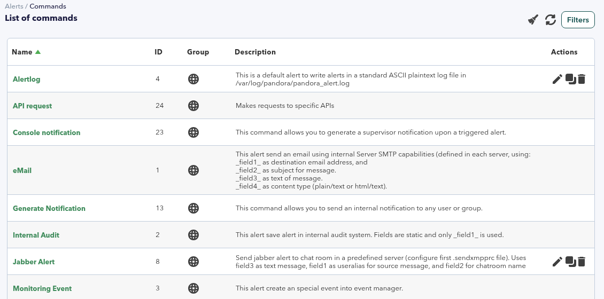{ .captura }

A **command** is what the server really runs. It is managed in **Management →
Alerts → Commands** and requires the alert management permission (**LM**).

Pandora FMS ships with a good collection of ready-made commands, so the normal
thing is to **create none**. You only need your own when you want to run something
that is not on the list: an in-house script, a command-line tool, a delivery to an
internal system.

#### Predefined commands

| Command | What it does |
|---|---|
| **eMail** | Sends an email (in HTML) from the Pandora FMS server. Fields: recipient, subject, text and content type. |
| **Internal Audit** | Records the alert in the internal audit system. |
| **Monitoring Event** | Creates a custom event in the event console. Fields: name, type, source, agent, severity, extra ID, tags and comments. |
| **Alertlog** | Writes the alert, as plain text, to `/var/log/pandora/pandora_alert.log`. |
| **SNMP Trap** | Sends an SNMP trap with the given arguments. It is an example to adapt; it does not work as is. |
| **Syslog** | Sends the alert to the system log with `logger`. |
| **Sound Alert** | Plays a sound on the server. |
| **Jabber Alert** | Sends a message to a Jabber room (`.sendxmpprc` must be configured first). |
| **SMS** | Sends an SMS with `sendsms` (smstools). The number must carry the international prefix. |
| **Validate Event** | Validates a module's events, given the agent and module names. |
| **Remote agent control** | Sends an order to an EndPoint with the UDP server enabled, for example to force it to run and send data. |
| **Generate Notification** | Sends an internal notification to a user or a group. |
| **Send report by e-mail** | Sends a report by email as PDF, JSON or CSV. |
| **Send report by e-mail (from template)** | Same, but from a report template and an agent filter by regular expression. |
| **Pandora ITSM Ticket** | Opens a ticket in Pandora ITSM. |
| **Pandora Google chat**, **Pandora Slack**, **Pandora Telegram**, **Pandora ilert**, **Pandora Vonage**, **Pandora MS Teams** | Send the notification to the corresponding service. |
| **RMM Script** | Runs an RMM script on the EndPoint. |
| **Console notification** | Sends a notification to the web console of the chosen users. |
| **API request** | Makes a request to an API: URL, method, headers, data and SSL. |

The commands **eMail**, **Internal Audit**, **Monitoring Event**, **Validate
Event**, **Generate Notification**, the two email report commands, **Pandora ITSM
Ticket**, **Pandora Telegram**, **RMM Script**, **Console notification** and **API
request** are **internal** and **cannot be modified**. The rest can.

!!! warning "Slack, ilert, Vonage and the others must be finished off"
    The messaging commands that are not internal carry placeholders such as
    `TOKEN`, `API_KEY` or `SECRET` in the command line. Until you **edit the
    command** and replace them with the real values, the notice will not reach
    anyone. **Pandora Telegram** is the exception: it reads the *token* from the
    general configuration (**Management → Setup → System settings → General setup
    → Alerts configuration**), and is used through the `_telegramtoken_` macro.

#### Creating your own command

1. Go to **Management → Alerts → Commands** and click **Create**.
2. Fill in:
    - **Name** and **Description**.
    - **Command**: the order the server will run. It accepts
      [macros](#alert-macros), and in particular `_field1_` … `_field20_`, which
      are replaced by the action's fields.
    - **Group**: which alert group it can be associated with. Only the groups of
      the user creating it are offered, unless they belong to **All**.
    - **Field N description** and **Field N values** for each field the command
      uses.
3. Save with **Create**.

Each field can be a free text box or a **drop-down list**. To make it a list, fill
its *Field N values* with `value,label` pairs separated by semicolons:

```text
value1,label1;value2,label2;value3,label3
```

The label is what the user sees when configuring the action; the value is what is
sent to the command. In addition, **Hide** masks the field's content with
asterisks, intended for passwords.

If a field's value is the special *token* `_html_editor_`, when the action is
configured that field is shown with an HTML editor. That is what the email command
uses for the message body.

!!! tip "Try it on the command line first"
    The server runs the command as is, substituting the macros. It is worth
    checking first, from a terminal, that the order works and produces what you
    expect (the email arrives, the file is written…). Debugging an order through an
    alert is the slowest way to find out that a quote is missing.

!!! danger "The command runs with the server's privileges"
    External commands are run by the Pandora FMS server **with the same
    privileges as the user the server runs as**. Be careful who is given
    permission to create commands. In addition, the server cuts the execution if
    it takes longer than the time set in `global_alert_timeout` (15 seconds by
    default).

#### Permissions

To enter command management you need the **LM** permission (alert management), and
to **edit a non-internal command** you also need the **PM** permission on the
command's group.

### Alert actions

An **action** is a command with its fields filled in. It is managed in
**Management → Alerts → Actions**. It is the piece you reuse: an action "Notify
the systems team by email" serves a thousand alerts.

#### Predefined actions

These are the ones that ship by default:

| Action | Command it uses | What for |
|---|---|---|
| **Mail to Admin** | eMail | Send an email. You must change the sample address (`yourmail@domain.es`). |
| **Monitoring Event** | Monitoring Event | Create an event when it fires and another when it recovers. |
| **Restart agent** | Remote agent control | Ask an EndPoint to refresh itself (`REFRESH AGENT *`). |
| **Send Report by e-mail** and **Send Report by e-mail (from template)** | The report ones | Send reports by email. |
| **Create Pandora ITSM ticket** | Pandora ITSM Ticket | Open a ticket in Pandora ITSM. |
| **Pandora Google chat**, **Pandora Slack**, **Pandora Telegram**, **Pandora ilert**, **Pandora Vonage**, **Pandora MS Teams** | The messaging ones | Notify in the corresponding service. |
| **Console notification** | Console notification | Warn the chosen users in the web console. |

!!! tip "Copy the predefined one, don't start from scratch"
    When you create an action based on one of the predefined commands, the easiest
    way is to **copy** the equivalent predefined action and modify it. It already
    has the fields set sensibly, including the macros in the text.

#### Creating an action

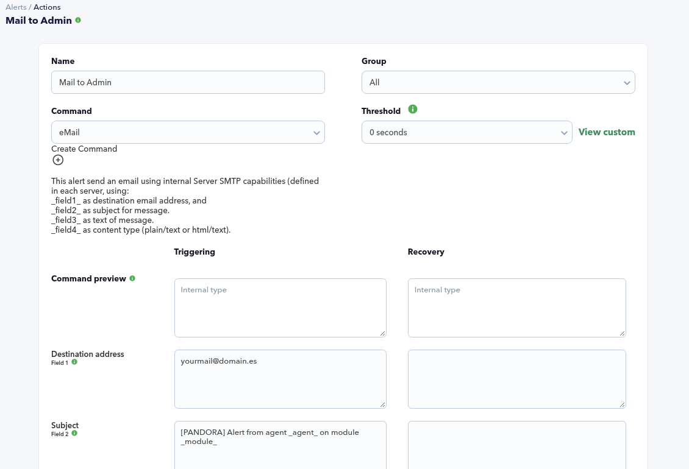{ .captura }

1. Go to **Management → Alerts → Actions** and click **Create**.
2. Fill in:
    - **Name**.
    - **Group**. If the associated command has a group other than *All*, the
      action can only belong to that group or to *All*. If for some reason they
      differ, a warning appears so that someone with permissions can fix it.
    - **Command**: the one that will be used.
    - **Threshold**: the action runs **only once** within this interval, however
      many times the alert is activated.
    - **Command preview**: read-only field that shows the resulting order with the
      macros unreplaced.
3. In the **Triggering** section, fill in the fields the command will use when the
   alert **fires**.
4. In the **Recovery** section, fill in the fields for when the alert **recovers**.
   If you leave it empty, the triggering ones are reused (see
   [Alert recovery](#alert-recovery)).
5. Save.

To modify an action, click its name in the list. To delete it, use the trash icon
on its row.

!!! warning "Careful when renaming an action"
    Some actions are located by name. The console itself warns that an action *may
    stop working if its name is changed*. On the predefined ones, better leave it
    alone.

!!! info "Pandora ITSM: work unit on recovery"
    When the command is **Pandora ITSM Ticket**, the **Create workunit on
    recovery** option appears: if the closing status is applied when the alert
    recovers, instead of closing the ticket a work unit is added to the ticket in
    Pandora ITSM.

#### Which threshold rules

A fine detail that saves headaches: the threshold can be defined **in three
places** and, when there is more than one, **the most specific wins**:

1. The **command's** (the most general).
2. The **action's**, which replaces the command's if it is greater than zero.
3. The **action's within the alert** (the *Threshold* you set when assigning the
   template to the module), which replaces the previous ones if it is greater than
   zero.

The action only runs if that time has passed since its last execution. When the
alert **recovers**, the recovery action runs anyway once, even if the threshold has
not elapsed.

### Alert templates

The **template** answers the most important question: **when?** It defines the
firing conditions and is associated with modules. It is managed in **Management →
Alerts → Templates**, which requires the **LM** permission.

Its design lets you create a small group of generic templates ("the module is
critical", "the value exceeds 90", "the text contains ERROR") and reuse them across
the whole estate. Resist the temptation to create one template per module: in six
months nobody will know which is which.

#### Predefined templates

| Template | Condition | Notes |
|---|---|---|
| **Critical condition** | Critical status | Default action: email to the administrator. Recovery enabled. |
| **Warning condition** | Warning status | Same action. Recovery enabled. |
| **Unknown condition** | Unknown status | Same action. Recovery enabled. |
| **Manual alert** | Never met | To fire alerts **by hand** (see below). |
| **Default critical condition** | Critical status | Read-only system copy of *Critical condition*. Included because of the importance of the critical status. |

The four condition templates have a **time threshold of 24 hours** (86400 s), a
maximum of **one** alert per interval and recovery enabled. The first three can be
customized; *Default critical condition* cannot.

The **Manual alert** template deserves an explanation: its condition is an
impossible range, so it is **never met** and never fires on its own. It is used to
hang actions on that you want to launch by hand, such as restarting an EndPoint
from the console or running a command on the server.

#### Creating a template: the three-step wizard

Click **Create** in **Management → Alerts → Templates**. The wizard has three
steps: **General**, **Conditions** and **Advanced fields**.

##### Step 1 · General

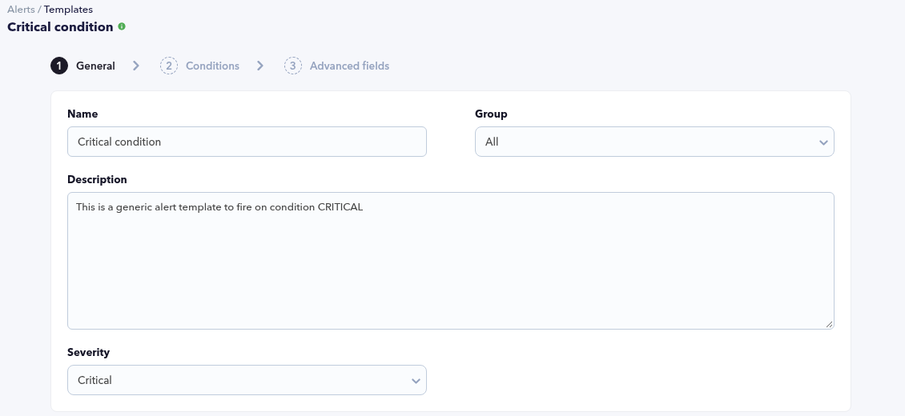{ .captura }

| Field | What it is for |
|---|---|
| **Name** | How the template will look in lists. It must be unique. |
| **Group** | The template's group. Only the user's groups are offered, unless they belong to *All*. |
| **Description** | Free text. |
| **Severity** | Informative: the event generated by the alert **inherits** this severity, and it is useful for filtering. It is also the one used by [cascade protection](#cascade-protection). |

##### Step 2 · Conditions

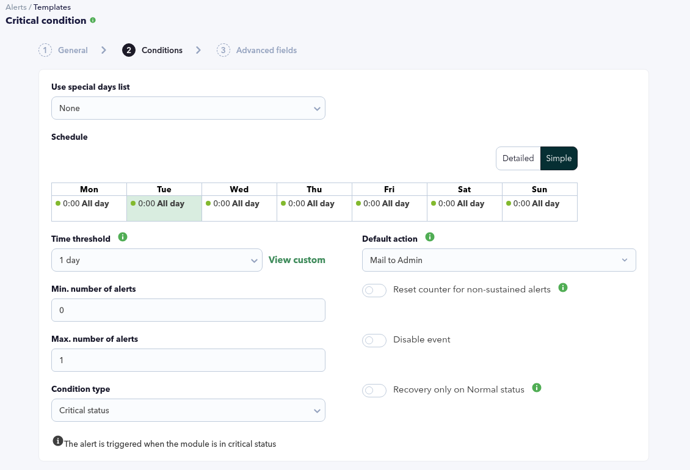{ .captura }

This is where you decide **when** it fires. These are the fields:

| Field | What it does |
|---|---|
| **Use special days list** | Applies a [special days calendar](#special-days) to the template. |
| **Condition type** | The condition itself. Explained right below. |
| **Time threshold** | The interval during which alerts are counted. See [When an alert fires](#when-an-alert-fires-counters-threshold-and-flip-flop). |
| **Min. number of alerts** | How many times the condition must be met **before** it fires. |
| **Max. number of alerts** | How many times it can fire at most within the time threshold. |
| **Reset counter for non-sustained alerts** | Forces repetitions to be consecutive. |
| **Default action** | The action that will be assigned automatically when the template is applied to a module. There can be only one (or none). |
| **Schedule** | Which days and at what times it can fire. |
| **Disable event** | If checked, the "alert fired" event is not created in the event console. |
| **Recovery only on Normal status** | Appears with the critical, warning and unknown conditions. See [Alert recovery](#alert-recovery). |

**Condition types.** The list is as follows, with a sentence and an example each:

| Type | Fires when… | Example |
|---|---|---|
| **Regular expression** | The module value matches a regular expression (case-insensitive). | A text module returning `ERROR: disk failure`: value `error\|fail`. |
| **Max and min** | The value is **outside** the range (or **inside**, depending on the checkbox). | Temperature outside 10–35 °C. |
| **Max.** | The value exceeds the maximum. | CPU above 90. |
| **Min.** | The value is below the minimum. | Free space below 10. |
| **Equal to** | The numeric value is exactly the given one. | A status module returning `0`. |
| **Not equal to** | The numeric value is different from the given one. | A replica counter that is not `3`. |
| **Warning status** | The module is in warning. | |
| **Critical status** | The module is in critical. | The most common case. |
| **Unknown status** | The module is in unknown. | An EndPoint that stopped reporting. |
| **Not normal status** | The module is in **any** status other than normal. | Warn without telling warning from critical. |
| **On Change** | The value **changes** from the previous one (or, depending on the checkbox, does not change). | A module returning a file's hash. |
| **Always** | Whenever a data point arrives. | Tests and logs. |
| **Complex alert** | A condition on the module's **history** is met. | See below. |

!!! warning "Equal and not equal compare numbers"
    **Equal to** and **Not equal to** compare **numerically**. They are no use with
    text modules (`1.2.3` and `1.2.4` are both read as `1.2`): for text, use
    **Regular expression**.

!!! note "The checkbox \"Trigger when matches the value\""
    Next to the condition, depending on the type, the **Trigger when matches the
    value** checkbox appears. It changes the direction of the condition, and the
    screen itself shows a sentence below ("The alert would fire when…") that
    confirms the result:

    | Type | Checkbox checked | Checkbox unchecked |
    |---|---|---|
    | **Regular expression** | Fires when the value **matches** | Fires when it does **not** match |
    | **Max and min** | Fires when the value is **inside** the range | Fires when it is **outside** |
    | **On Change** | Fires when the value **changes** | Fires when it does **not** change |

**Complex alerts.** They compare the data point with a calculation over the
module's history. They are configured with three fields:

- **Math function**: average, sum, maximum or minimum.
- **Condition**: less than, greater than or equal to.
- **Time window**: the last 30 days, this month, the last 7 days, this week, the
  last day or today.

With **average**, the server compares the data point that has just arrived with the
period's average: "the current value is **greater** than the average of the last 7
days". With the other functions it compares the period's result with the
template's **value**: "the **sum** of the last 30 days is **equal** to 2".

**Schedule.** By default it is shown in **Simple** mode: a grid by weekday where
you can see at a glance when the alert will be active. In **Detailed** mode you can
define several time slots per day with second-level precision. If a slot has the
same start and end time, it means **the whole day**.

!!! info "If the template is old"
    Templates created with earlier versions use weekdays and a start and end time.
    They keep working, but as soon as a template has the new schedule, **the new
    one prevails** over the old one.

##### Step 3 · Advanced fields

- **Alert recovery**: enables or disables recovery. If enabled, when the module
  stops meeting the condition the action runs with the recovery fields.
- **Firing fields**: the `Field1` … `Field20` fields that will be passed to the
  action when the alert fires.
- **Recovery fields**: those for the recovery.

[Macros](#alert-macros) can be used in all these fields. The wizard ends with
**Finish**.

!!! tip "Where to put the text: in the action or in the template"
    If the same message works for everything that uses that action, put it in the
    **action** (so it changes in a single place). If it changes depending on the
    type of problem, put it in the **template** and leave the action's field empty:
    there, the template does the talking.

### When an alert fires: counters, threshold and flip-flop

This is the section that saves the most support questions. An alert that "does not
fire" almost always fires exactly when it should, but under rules nobody had read.
Let's read them.

#### The four knobs

| Knob | Where it is | What it does |
|---|---|---|
| **Min. number of alerts** | Template | How many times the condition must be met **before** firing. With `0` (the default) the alert fires on the first one. It is a filter against false positives. |
| **Max. number of alerts** | Template | Cap on firings **within the time threshold**. When it is reached, the alert goes quiet until the counter is reset. |
| **Time threshold** | Template | The length of the counting "window". After that time, the firing counter goes back to zero. |
| **Reset counter for non-sustained alerts** | Template | Makes the **minimum** count require **consecutive** repetitions. |

There is a fifth element that is not in the template but has an influence: the
module's **flip-flop**. Pandora FMS does not change a module's status on the first
bad data point: it waits until it repeats as many times as the module's **flip-flop
threshold** says. The alert, as soon as it sees the status already changed, starts
its own count; the two filters **add up**. Flip-flop protection is set on the
module and explained in
[Flip-flop protection](../parte-2/2.20-configuracion-comun-de-los-modulos.md#flip-flop-protection).

#### A numeric case

Take a template with a **time threshold of 1 hour**, **minimum 0** and **maximum
3**, on a module with a 5-minute interval that stays critical:

```text
 t (min)   0    5    10   15   20  ...  60   65
 checked   ✔    ✔    ✔    ✔    ✔        ✔    ✔
 action    ▶    ▶    ▶    ·    ·   ...  ·    ▶
 counter   1    2    3    3    3        3    1 (new cycle)
```

It fires on the first three evaluations (the maximum is 3), goes quiet for the rest
of the hour and, on the first evaluation after the threshold, the counter goes back
to zero and the alert can fire again.

If you set **minimum 2**, the first two bad data points only add to the counter and
it is the **third** that fires. And here the fourth knob comes in:

| Module status sequence | Reset counter **checked** | **Unchecked** |
|---|---|---|
| normal → critical → critical → critical | Fires on the 3rd critical | Fires on the 3rd critical |
| normal → critical → normal → critical → normal → critical | **Does not fire** (each normal resets the count) | Fires on the 3rd critical |

In short: **with the reset checked, only consecutive streaks count**. It is what you
need when "three times in a while" will not do and you want "three in a row".

#### Decision table

| If you want to… | Configure |
|---|---|
| Warn on the first one and only once per problem | Minimum `0`, maximum `1`, long threshold (e.g. 24 h) and recovery enabled. |
| Ignore one-off spikes | Minimum `2` or `3` and the reset **checked**. |
| Keep notices coming while the problem lasts | High maximum (e.g. `10`) and a reasonable threshold (e.g. 30 min). |
| Not flood the recipient even if the module is unstable | A long **action** threshold (see [Which threshold rules](#which-threshold-rules)). |

!!! info "How it is evaluated, step by step"
    When a data point arrives, the server checks **in this order**: whether it may
    fire today (weekday and [special days](#special-days)), whether we are within
    the schedule, whether the time threshold has expired, whether the data point
    meets the condition and, finally, the minimum and maximum limits. The first one
    to fail stops the process.

!!! warning "Modules in unknown"
    A module in unknown status receives no data, so it is not evaluated on every
    cycle. For **Unknown status** alerts to be checked periodically you must enable
    `unknown_updates` in the Pandora FMS server configuration (see [Related server
    and console parameters](#related-server-and-console-parameters)).

### Alert recovery

An alert that warns that something is wrong and never warns that it is fine again
forces someone to go and look. **Recovery** closes the loop: when the condition
stops being met, the action runs with the **recovery fields**.

#### What runs

On recovery, the alert's actions run with their **recovery fields**. The field that
is used comes from this order of preference:

1. The **action's** recovery field.
2. The **template's** recovery field.
3. If neither is defined, the **triggering** field with the `[RECOVER]` prefix.
   Field 1 is the exception and carries no prefix (it is usually a recipient).

That is why an empty recovery field does not come out empty: it comes out as the
triggering one with the `[RECOVER]` prefix (for example, a subject `[RECOVER]
[PANDORA] Alert from agent …`). It is not an error, it is the default value.

#### When it recovers

| Alert type | Recovers… |
|---|---|
| **Module** | On the **first evaluation** in which the condition stops being met. |
| **Event, log or SIEM** | When the alert's **time threshold expires** (they have no "good data point" to cause it). |

!!! note "No agent or module macros in event and log recovery"
    Since the recovery of an event or log alert happens when the threshold expires,
    there is no recovery event to take the agent or module from. The module- and
    agent-related macros are **not available** in the recovery fields of those
    types.

#### Recovery only on Normal status

With the critical, warning and unknown conditions, the **Recovery only on Normal
status** option appears.

Take a module that goes from *critical* to *warning*. For the "critical status"
alert that is already an improvement and it **recovers**, even if the problem is
only half solved. If you prefer the recovery to be announced only when the module
is truly **normal**, check this option: the alert will only recover when the last
status is *normal*.

#### Which events it generates

Unless the alert has **Disable event** checked, or the module or agent is in quiet
mode, Pandora FMS writes to the event console:

- **Alert fired** when it fires (unless a *Monitoring Event* action has already
  generated one).
- **Alert recovered** when it recovers.
- **Alert ceased** when the alert ends by threshold expiry without recovery.

The template's **priority** is what the firing event inherits; the recovery event
comes out with *Normal* severity.

##### Event custom data: which action produced it

Fired and recovered alert events carry three keys in their **Custom data** field
that identify **which action took place**, so that a glance tells how the event was
generated without going back to the alert:

| Key | Value | What it tells |
|---|---|---|
| `actions` | List of names | The actions that were executed in that firing or recovery. |
| `forced` | `1` or `0` | `1` if a **Force check** (forced execution) originated it, `0` for a normal execution. |
| `recovered` | `1` or `0` | `1` if it is the **recovery** execution, `0` if it is the firing one. |

For example, a normal firing with the *Mail to Admin* action looks like this:

```json
{"actions": ["Mail to Admin"], "forced": 0, "recovered": 0}
```

And the manual *Force check* of an alert that sends email and a notification:

```json
{"actions": ["Mail to Admin", "Console notification"], "forced": 1, "recovered": 0}
```

They are useful to **filter** in the event console (the custom data filter searches
by key or by value) and to tell, among alert events, those coming from a manual test
from those coming from a real failure. They are added on module, event and log
alerts; the SIEM alert does not carry them.

### Assigning an alert to a module

With command, action and template ready, the most important thing is missing:
**saying which module it applies to**. There are three ways, depending on whether
you start from the alerts, from the agent or from a policy.

#### From the alerts menu

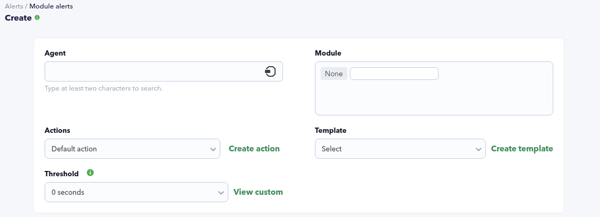{ .captura }

1. Go to **Management → Alerts → Module Alerts** and click the **Create** button in the
   bottom-right corner.
2. Choose:
    - **Agent**: with autocomplete.
    - **Module**: those of the chosen agent.
    - **Template**: the one that defines the conditions.
    - **Actions**: the one that will run. If the template already has a default
      action, you can leave **Default**.
    - **Threshold**: an action will not run more than once in this interval. **It
      takes priority over the action's threshold.**
3. If an action or a template is missing, the **Create action** and **Create
   template** buttons take you to create them; when finished, you return to the
   builder.
4. Click **Add alert**.

!!! tip "Define the module's thresholds first"
    A "critical status" alert only makes sense if the module has its **warning and
    critical thresholds** defined. Without them, the module never goes critical and
    the alert, for all its elegance, never fires.

#### From the agent

In the agent's configuration there is an **Alerts** tab with the same builder and,
in addition, the list of the alerts already assigned. From that list you can:

- See an alert's detail (**Template** column, magnifying glass icon).
- Edit or delete each of its actions (**Actions** column).
- In the operations column: **disable** or enable the alert, put it in
  **standby**, **add an action** or **delete it altogether**.

!!! warning "Deleting does not ask for confirmation"
    The trash icon in the agent's alert list **removes the alert immediately,
    without a confirmation message**.

#### From a policy

Alerts can also be defined in a **monitoring policy** to apply them to all the
agents that use it. It is explained in the chapter
[Monitoring policies](../parte-2/2.10-politicas-de-monitorizacion.md).

#### Modifying an existing alert

Once the alert is created, **its template and its module cannot be changed**: you
can only add, remove or adjust **actions**. You can remove the action selected at
creation with the grey trash icon, or add others with the **+** button. If another
template is needed, create the alert again.

!!! info "The default action is hidden if there are more"
    The template's default action is only shown if it is the **only** one in the
    alert. As soon as you add another, it stops being shown (but it is still one
    more action in the list).

#### Practical case: the first version

With all of the above, the `srv-web01` alert looks like this:

| Piece | Value |
|---|---|
| Command | **eMail** (predefined) |
| Action | **Mail to Admin**, with the recipient changed to `sistemas@miempresa.com` |
| Template | **Critical condition** (predefined): critical status, maximum 1, threshold 24 h, recovery enabled |
| Module | `Disco /` of `srv-web01`, with a critical threshold defined in the module |

When the module goes critical an email will arrive; when it recovers, another one,
for the recovery, will arrive. It is a working alert with **a few clicks and one
email address**.

### Alert escalation

**Escalation** is additional actions that run **if the alert repeats** a given
number of times in a row. It is the civilized way of saying "warn the team; if by
the third nobody has lifted a finger, warn their manager; if by the tenth, ring the
on-call phone".

#### How it is configured

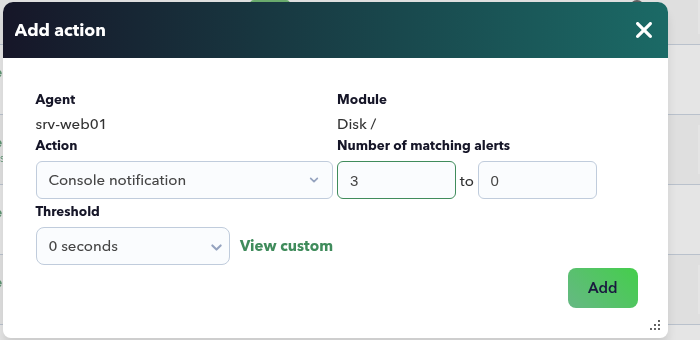{ .captura }

When assigning an alert to a module (or editing it in the alert list), each action
carries a range, **Number of matching alerts**, with a "from" box and a "to" box. They read as "from
repetition *N* to repetition *M*".

| From | To | Means |
|---|---|---|
| `0` | `0` | Always, on every firing. It is the default. |
| `1` | `1` | Only on the first firing. |
| `3` | `3` | Only on the third. |
| `3` | `0` (or lower than the from) | From the third onward, with no limit. |

In addition, each action can carry its own **threshold** as a second parameter:
with it, that action is not launched more than once per interval.

#### A detail that is not obvious

!!! warning "On firing, escalation does not accumulate"
    When the alert **fires**, only the action whose range contains the current
    repetition number runs. If you configure an email for repetition 1 and an SMS
    for 3, on the third **only the SMS goes out**, not the email and the SMS. For
    both to go out, the email must cover a range that includes 3 (for example, `0`
    to `0`, which is "always").

    **Recovery** is different: when the alert recovers, **all** the actions that
    had already been launched run again, not only the one that would correspond to
    the current repetition.

If on a firing **no** action covers the counter, the template's **default action**
is used. And **forced execution** ignores the ranges.

#### Practical case: adding an SMS

Back to `srv-web01`. Now we want the usual email and, if the disk stays critical,
an SMS on the third repetition:

1. In the template we set **Max. number of alerts** = `10` and **Time threshold** =
   `30 minutes`, so that it can repeat.
2. In the module's alert, the **Mail to Admin** action keeps the range `0` to `0`
   (always).
3. We add the **SMS** action with range `3` to `0` (from the third firing onward).

Result: the email goes out on every firing and, from the third, the SMS goes out as
well.

### Alert states: active, disabled and standby

An alert can be in three states, and the difference between the two "off" ones is
the one most often confused.

| State | Evaluated | Runs actions | Generates events | Appears in the alert view |
|---|---|---|---|---|
| **Active** | Yes | Yes | Yes | Yes |
| **Standby** | Yes | **No** | **No** | Yes, and shows whether it is fired |
| **Disabled** | No | No | No | **No** |

A **disabled** alert is as if it did not exist. An alert in **standby** works only
at the display level: you can see whether it is fired or not, but it does nothing.
It is very useful during maintenance or a go-live: you keep seeing what *would*
have gone off without bothering anyone.

Both states are changed from the alert list (operations column) and also in batches
with the [mass operations](#mass-operations-on-alerts).

### Avoiding alert storms

A network failure in the wrong place can leave a hundred devices "down" at once,
and with them a hundred emails waiting to go out. Pandora FMS has several
mechanisms to prevent that.

#### Cascade protection

**Cascade protection** prevents the bombardment when a group of agents stops being
reachable because of an intermediate device (a router, a switch). The network
checks would fail on every device behind it, and Pandora FMS would consider down
devices that are, in fact, perfectly fine.

For it to work:

1. The **child** agent must have its **parent agent** correctly configured
   (*Parent*, in the agent's **Advanced options**).
2. In those same options of the child, enable **Cascade protection modules** and/or
   **Cascade protection services**.

##### Module-based cascade

While the parent has **any fired module alert whose template has critical
severity**, the child agent **generates no module alerts**. If a **specific
module** of the parent is also set (in the **Hierarchy & behavior** box), only that
module's status counts. The check goes up the whole chain of parents.

!!! warning "It is all or nothing, and it depends on the template's priority"
    The child agent loses **all** its module alerts for as long as the parent's
    alert lasts, not only the critical-status ones. And it is only inhibited if the
    parent's fired alert uses a template with **critical severity**: if the parent
    uses a template of lower severity, the child does not find out. It is worth
    reviewing the severity of the templates on the devices others depend on.

##### Service-based cascade

Protection based on [services](5.3-monitorizacion-de-negocio-y-servicios.md)
prevents a service's elements from firing their alerts if the alert of the service
they belong to has already fired. You must enable **Cascade protection services**
on the agents that should behave this way and **Cascade protection enabled** in the
service's own configuration.

When the service's alert goes off, the `_rca_` macro lets you include in the message
which elements are critical: it is the root cause analysis chain.

#### Safe operation mode

**Safe operation mode** is enabled in the agent's advanced options and is tied to a
specific module. If that module goes **critical**, the rest of the agent's modules
are **disabled** until the watched module returns to *normal* or *warning*; then
they are re-enabled on their own. It is useful, for example, to stop launching
remote checks when connectivity is lost.

#### Scheduled downtimes

During a scheduled downtime, the alerts of the affected modules are disabled and
re-enabled when it ends. It is explained in
[Scheduled downtimes](../parte-3/3.8-paradas-planificadas.md).

#### Protection against event storms and events in process

There are three more valves:

- **Event storm protection**: it is a **manual switch**, turned on and off by hand.
  The server does **not detect** storms on its own: while the switch is on, it stops
  generating module events and alerts, and when it is turned off everything goes back
  to normal. It is meant for an emergency, for example a network outage that has put
  half the installation in critical. Details in the next section.
- **Alerts disabled in a group**: the same idea, but **limited to one group**. In
  **Manage groups** (see [Agent groups](../parte-4/4.1-grupos-perfiles-y-tags.md#agent-groups)), when editing the group, the **Alerts** switch ("Enable alert use
  in this group") leaves it without module alerts while it is off. The other groups
  are not touched, and agents, data and status change events carry on as usual. The
  server looks at **the agent's primary group** and only that one: the setting does
  not travel down the group hierarchy to the children, and it does not affect event,
  log or SNMP trap alerts either. It is the right valve to silence a whole
  environment, for example "Pre-production" or a customer being migrated, without
  touching the rest.
- `event_inhibit_alerts`: if enabled (`1`), an alert **does not fire while the last
  event of that alert is "In process"**. It is the way of saying "I'm already
  looking at it, don't insist". Recovery is sent anyway.

##### Event storm protection, step by step

**Where it is enabled.** In **Management → Setup → System configuration → General
setup**, in the **Events** block, with the **Event storm protection** switch. Also
from the command line, with
`pandora_manage.pl <configuration_file> --set_event_storm_protection 1` (and `0` to
turn it off).

**What the server does while it is on.** It checks the switch, in the database, every
time it is about to generate an event or an alert, and if it is on it skips:

| What is skipped | Detail |
|---|---|
| **Module alerts** | They are neither evaluated nor fired, whether by normal data, by unknown status or for services. |
| **Status change events** | A module going critical or back to normal generates no event. |
| **Unknown status events** | They are not generated either. |

What is **not** interrupted: **data** keeps arriving and being stored, and module
status keeps being calculated, so graphs and traffic lights stay alive. Event and log
alerts and SNMP trap alerts do not go through this valve.

**What it looks like.** The console shows a system notification ("Event storm
protection is enabled") warning that some events may get lost while the mode is on and
recommending a server restart after changing the setting. Each agent carries the
**Quiet by storm protection** mark in its header, unless it is already disabled, in
quiet mode or silenced by the group configuration.

**When to use it.** When a big outage is going to generate thousands of events and
alerts that add nothing new and also overload the mail server and the console. Turn it
on, fix the cause and turn it off.

!!! warning "What is not recovered"
    The events that were skipped are **not generated later**: if a module went
    critical during the protection, the event for that change will never exist. Alerts,
    on the other hand, are evaluated with each new data point, so when the protection is
    turned off a module that is still critical evaluates its alert again with the next
    data and may fire then. Turn it off as soon as the emergency is over: while it is
    on, **nothing is notified** about modules.

### Alert macros

**Macros** are placeholders such as `_agent_` or `_data_` that the server replaces
with the real value at the moment the alert runs. They are what turn a generic
message into "the disk of `srv-web01` is at 98%".

They can be used in the fields of the **template**, the **action** and the
**command**, and in the recovery ones.

Some real examples:

```text
Subject:  [PANDORA] Alert _alert_name_ on _agent_ / _module_
Text:     _agent_ (_address_) reports _data_ _dataunit_ on module _module_
          at _timestamp_. Status: _modulestatus_. Firings: _alert_times_fired_.
```

#### Agent macros

| Macro | Description |
|---|---|
| `_agent_` | Agent alias; if it has none, its name. |
| `_agentalias_` | Agent alias. |
| `_agentname_` | Agent name. |
| `_agentdescription_` | Agent description. |
| `_agentgroup_` | Name of the agent's group. |
| `_agentstatus_` | Current status of the agent. |
| `_agentos_` | Operating system of the agent. |
| `_agentcustomid_` | Custom identifier of the agent. |
| `_agentcustomfield_N_` | Custom field number *N* of the agent, for example `_agentcustomfield_9_`. |
| `_address_` | IP address of the agent. |
| `_addressn_N_` | IP address of the agent at position *N* (`_addressn_1_`, `_addressn_2_`…). |
| `_all_address_` | All the agent's addresses. |
| `_secondarygroups_` | Secondary groups of the agent (only in command and action macros). |
| `_id_agent_` | Agent identifier; useful to build a URL to the console. |
| `_server_ip_`, `_server_name_` | IP address and name of the server the agent is assigned to. |

#### Module and data macros

| Macro | Description |
|---|---|
| `_module_` | Module name. |
| `_modulecustomid_` | Custom identifier of the module. |
| `_moduledescription_` | Module description. |
| `_modulegroup_` | Name of the module's group. |
| `_modulestatus_` | Module status. |
| `_moduletags_` | URLs associated with the module's tags. |
| `_name_tag_`, `_email_tag_`, `_phone_tag_` | Name, emails and phone numbers associated with the module's tags. |
| `_id_module_` | Module identifier. |
| `_interval_` | Module execution interval. |
| `_data_` | The data point that triggered the alert. If the module uses data translation, it returns the **translated** value. |
| `_dataunit_` | The unit set in the **Unit** field of the module's advanced options. |
| `_prevdata_` | The data point before the one that fired the alert. |
| `_moduledata_X_` | Last data point of module *X* **of the same agent**, with the console's decimals and its unit. If *X* contains spaces, write them as an HTML entity: `&#x20;`. |
| `_lastdatatimestamp_` | Date and time of the last data point received (useful in alerts for the change to unknown). |
| `_lastdatatime_` | The same, in Unix time format. |
| `_modulelaststatuschange_`, `_modulelaststatustime_` | Timestamp and date of the module's last status change (only in command macros). |
| `_warning_threshold_min_`, `_warning_threshold_max_` | Minimum and maximum warning thresholds. |
| `_critical_threshold_min_`, `_critical_threshold_max_` | Minimum and maximum critical thresholds. |
| `_policy_` | Name of the policy the module belongs to, if applicable. |
| `_plugin_parameters_` | The module's plugin parameters, in JSON format. It can be used in the email subject and body. |
| `_target_ip_`, `_target_port_` | IP address and port of the module's target. |
| `_discovery_task_` | Name of the Discovery task that failed. |

#### Macros from the alert itself

| Macro | Description |
|---|---|
| `_alert_name_` | Alert name. |
| `_alert_description_` | Alert description. |
| `_alert_threshold_` | Alert threshold. |
| `_alert_times_fired_` | Number of times it has fired. |
| `_alert_priority_` | Numeric priority. |
| `_alert_text_severity_` | Priority as text (Maintenance, Informational, Normal, Minor, Warning, Major, Critical). |
| `_alert_critical_instructions_`, `_alert_warning_instructions_`, `_alert_unknown_instructions_` | The module's instructions for each status. |
| `_id_alert_` | Alert identifier; useful to correlate it in third-party tools. |
| `_fieldN_` | User-defined field *N*. |
| `_timestamp_` | Date and time when it fired. |
| `_timezone_` | Time zone of `_timestamp_`. |
| `_tztimestamp_±HHMM_`, `_tztimezone_±HHMM_` | `_timestamp_` and time zone converted to a given offset, for example `_tztimestamp_+0200_`. |
| `_time_down_seconds_`, `_time_down_human_` | **Only in recovery alerts**: how long it was down, in seconds or in long format ("1day 10h 35m 40s"). |

#### Group, URL and service macros

| Macro | Description |
|---|---|
| `_groupcontact_` | The group's contact information, the one entered when creating it. In log and SIEM alerts the macro is called `_group_contact_`. |
| `_groupother_` | Other information about the group. |
| `_groupcustomid_` | Custom identifier of the group. |
| `_id_group_` | Identifier of the agent's group. |
| `_homeurl_` | The console's public URL, the one set in the console's general options. |
| `_rca_` | Root cause analysis chain (services only). |
| `_telegramtoken_` | The Telegram *token* from the alert configuration. |

#### Email macros

| Macro | Description |
|---|---|
| `_modulegraph_Nh_` | Graph of the module for the last *N* hours, as an image. |
| `_modulegraphth_Nh_` | The same, including the warning and critical thresholds if defined. |
| `_modulegraph_ModuleName_Nh_` | Graph of **another module** of the same agent. |
| `_statusimage_`, `_statusimagetag_` | Visual status indicator at the time of sending; the second generates an HTML image element. |

!!! warning "Graphs need the server to reach the console"
    To draw a graph, the server asks the API of **its own console** for the image. It
    is an internal call: it identifies itself with the server's unique identifier, not
    with a user, so no account is needed. Normally **nothing has to be configured**: at
    startup the server takes the console address from its public URL (or, if empty,
    uses `http://127.0.0.1/pandora_console/include/api.php`) and the API password from
    the console configuration. Only if the console does not answer at that address
    (another port, HTTPS, another host) is `console_api_url` set in the server
    configuration file. If the graph does not reach the email, the first thing to check
    is that the server can reach that URL.

#### Macros only for event, log and SIEM alerts

We explain them next to each type in block 2: [events](#alerts-on-events),
[logs](#alerts-on-logs) and [SIEM](#siem-alerts). The SNMP trap ones, in
[Alerts on SNMP traps](#alerts-on-snmp-traps).

#### Custom module macros

Besides the system ones, each module can define its own:

- They are defined in the module itself, by expanding the macros section.
- They can have any name, for example `_myMacro_`.
- They are stored in the database and do **not** appear in the EndPoint's local
  configuration file.
- **They are only used in alerts.**
- They cannot be defined at component level, but they can in
  [monitoring policies](../parte-2/2.10-politicas-de-monitorizacion.md).
- They can be used in command, action and template fields.

!!! tip "A trick with `_moduledata_X_`"
    `_moduledata_X_` lets you put the value of **another** module of the same agent
    in the message. In the disk alert, `_moduledata_CPU&#x20;load_` adds the CPU
    load at that very moment: two data points, one email.

#### Agent custom fields in alerts

Custom macros are **per module**: they apply to that module (or to those of a policy).
To get the same behavior **at agent level**, that is, a piece of data of your own that
travels in all the alerts of all the modules of that agent, **agent custom fields** are
used:

- They are created once in **Management → Resources → Custom fields** (for example
  "Owner", "Customer" or "On-call phone"). The **identifier** shown in that listing is
  the number *N* of the macro. Their full configuration (types, values, what is shown in
  the view) is in
  [Agent custom fields](../parte-2/2.21-configuracion-comun-de-los-agentes.md#agent-custom-fields).
- They are filled in on each agent's page, and each agent keeps its own value. The
  EndPoint itself can declare them in its configuration file (see
  [Remote configuration from the Web console](../parte-2/2.1-monitorizacion-con-endpoints.md#remote-configuration-from-the-web-console),
  which also explains their types).
- They are used in any command, action or template field with the macro
  `_agentcustomfield_N_`, which the server replaces with the value **that** agent has.
  If the agent has not filled it in, the macro comes out empty. See
  [Using them in macros](../parte-2/2.21-configuracion-comun-de-los-agentes.md#using-them-in-macros).

The practical difference: a module macro has to be defined module by module, whereas a
custom field is written once on the agent and all its alerts inherit it, without
touching templates or actions. The same action serves every agent and each email
carries the data of its own.

### Sending alerts by email, from start to finish

Email is the most used channel and, therefore, the one most often misconfigured.
There are **three pieces** that must be right, and they are checked in this order:

1. **Pandora FMS knows how to send email.** It is configured once in the console,
   in **Management → Setup → System configuration → General setup → Alerts
   configuration**, **Mail configuration** block: SMTP server and port, encryption,
   user and password, authentication type, sender (name and address) and timeout.
   For Microsoft or Google, **OAuth2** can be used instead of user and password. The
   server reads those values from the console, so no file has to be touched. Without
   this, no email alert will go out, however well configured it is. The
   authentication mechanism matters: the server uses the first one advertised by
   the provider and does not try the rest, so if it advertises `DIGEST-MD5` and
   rejects it, `LOGIN` must be chosen.
2. **The action has a recipient.** In **Management → Alerts → Actions**, open
   **Mail to Admin** and replace the sample address with the real ones, separated by
   commas. Save with **Update**.
3. **The alert uses that action.** In **Management → Alerts → Module Alerts**,
   choose agent, module and template, and in **Actions** select **Mail to Admin**.
   Finish with **Add alert**.

!!! note "Local alternative: the server file"
    If the server configuration file defines `mta_address`, that local configuration
    **takes precedence over the console's** (together with `mta_port`, `mta_user`,
    `mta_pass`, `mta_auth`, `mta_from` and `mta_encryption`). It is a secondary
    method, useful as a fallback or for a given server to use another mail server. If
    it is not defined, the server uses the console configuration. OAuth2 is only
    configured in the console.

!!! note "The email links depend on the public URL"
    If the **Public URL** has been configured in the console, the emails will
    include that link (`_homeurl_` macro). If not, the links will point to what the
    console believes its address to be. And the images in the email will only be
    visible if the recipient can reach the console.

#### Practical case: an email with the graph

For the disk notice to carry the graph of the last 24 hours, it is enough to put
the macro in the action's text (field 3 of the eMail command, the one with the HTML
editor):

```text
<p>_agent_ has changed to <strong>_modulestatus_</strong>: _data_ _dataunit_.</p>
<p></p>
<p>Owner: _agentcustomfield_3_</p>
<p>View in the console: <a href="_homeurl_">_homeurl_</a></p>
```

The `Owner` line comes from an **agent custom field**: the "Owner" field has been
created here, with identifier 3 in this example, and filled in on `srv-web01` with the
name of whoever looks after that server. The same action, unchanged, warns with the
right owner for each agent.

### Other notifications

Email is not the only way. All the following are built the same way as the email
one: **a command, an action and a template** (or the predefined action, which
already has the fields set sensibly).

| To… | Predefined action | What to prepare |
|---|---|---|
| Warn in the console itself | **Console notification** | Choose the users who will receive the notification. The notification appears when the alert fires and disappears when it recovers. Recipients need read permission on the alerted item. Messages are deleted according to *Max. days before delete old messages*. |
| Write an event | **Monitoring Event** | Choose the type, severity and tags of the firing event and of the recovery event. |
| Send a message to Slack | **Pandora Slack** | Edit the command and enter the real *token*; set channel, title and description. |
| Send a message to Teams | **Pandora MS Teams** | Enter the webhook URL (field 2). |
| Send a message to Google chat | **Pandora Google chat** | Enter the room's webhook URL. |
| Send a message to Telegram | **Pandora Telegram** | Store the bot *token* in the console's alert configuration; set the chat ID. |
| Warn by SMS | **Pandora Vonage** | Edit the command with the Vonage credentials; set phone and message. |
| Warn an on-call service | **Pandora ilert** | Edit the command with the ilert API key. |
| Open a ticket | **Create Pandora ITSM ticket** | Have the Pandora ITSM integration enabled. |
| Run an RMM script | An action with the **RMM Script** command | Choose the script and its inputs. |
| Call an API | An action with the **API request** command | URL, method, headers, data and SSL. |
| Send a report | **Send Report by e-mail** | Recipients, report and format (PDF, JSON or CSV). |
| Refresh an EndPoint | **Restart agent** | The EndPoint must have the UDP server enabled. |

#### An example with the API request command

The **API request** command asks, in this order, for URL, method (`GET`, `POST`,
`PUT`, `PATCH` or `DELETE`), headers, data and SSL. To warn an in-house system with
a `POST`:

```text
Headers:  Authorization: Bearer abc123token
          Content-Type: application/json
          X-Request-ID: 123456
Data:     {"title": "_agent_: _module_", "body": "_data_ _dataunit_"}
```

### Special days

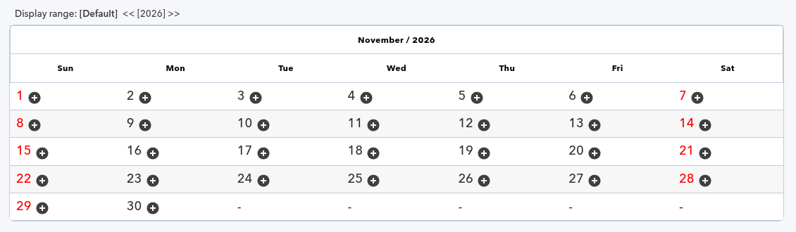{ .captura }

On January 1st, a server does not behave like any other Tuesday, and the alert
should not either. **Special days** let you say "that day, treat the alert as if it
were another day of the week".

They are managed in **Management → Alerts → Special days** and require the **LM**
permission. They work with **calendars**: each calendar is a list of dates, and then
each template (or event, log or SIEM alert) chooses which calendar to use with **Use
special days list**.

#### Creating a special day

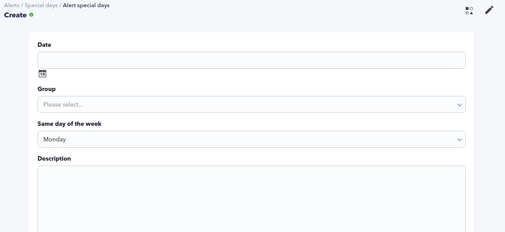{ .captura }

1. Go to **Management → Alerts → Special days**, create or choose a calendar and add
   a day.
2. Fill in:
    - **Date**.
    - **Group**: which group it applies to. *All* applies it to anyone.
    - **Same day of the week**: which day it is equated with. From Monday to Sunday,
      or **Holidays** to give it its own treatment.
    - **Description**.

In the calendar, days that apply to **every year** are marked with an indicator and
a tooltip ("valid every year"), which saves you from recreating every Christmas. If
for the same group there is a specific day, that one takes priority over the
every-year one.

#### Importing a calendar

If a holiday calendar already exists, there is no need to type it in: you can load
an **iCalendar** file (`.ics`) indicating the day of the week it is equated with,
the group and whether existing days are **overwritten**. The console reports the
dates it has skipped. There is no export.

#### How it is applied

- In a **module alert**: if the date is special, the template is evaluated as if it
  were the indicated day of the week, so that day **must be enabled** in the
  template. If it is not, the alert does not fire that day.
- In an **event, log or SIEM** alert: the alert's schedule (*Schedule*) for that day
  of the week is used, or the holidays section if it has one.

!!! example "Don't disturb the on-call on New Year's Eve"
    A "Holidays" calendar with 12/31 and 01/01 as **Same day of the week: Sunday**,
    and a template whose Sunday schedule is disabled. Those two days, the alert does
    not go out.

### Mass operations on alerts

When you have to add the same alert to two hundred modules, or remove an action from
all the alerts in a group, repeating it by hand is an expensive way to learn
patience. **Mass operations** let you do it in one go: add, edit and delete alerts,
add and remove actions, and enable, disable or put in standby. They are explained in
the chapter [Mass operations](../parte-2/2.11-operaciones-masivas.md#alert-operations).

### Viewing and reviewing alerts

#### The alert detail

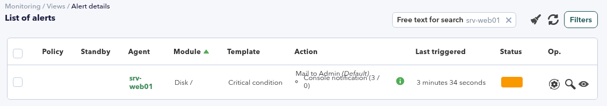{ .captura }

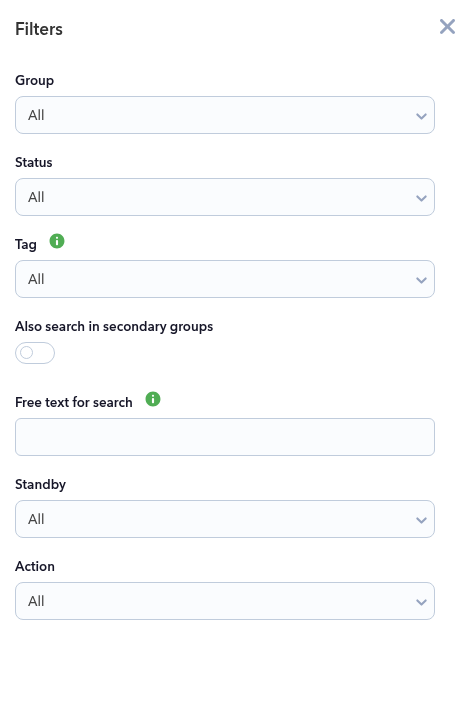{ .captura }

To know **what is happening right now**, there is **Operation → Monitoring → Views →
Alert detail**, which also appears as a tab in the agent view.

You can filter by **Group**, **Status** (All enabled, All, Fired, Not fired,
Disabled), **Tag**, **Also search in secondary groups**, free text, **Standby** and
**Action**. Each row shows the agent, the module, the template, the actions, the
last firing and the status: *alert fired N times*, *alert disabled* or *alert not
fired*.

From this view you can do several things, each with its permission:

| Operation | What it does | Permission |
|---|---|---|
| **Force check** | Icon on each alert. The server runs **all its actions** on its next cycle, **without evaluating the condition**. | **LF** on the group |
| **Validate** | Resets the counters of the selected alerts and leaves a manual validation event. | **AW** on the group |
| **Add / update action** | Batch operations on the actions of the selected alerts. | **LM** |
| **Create alert** | Opens the builder. | **LW** |

!!! warning "Force check does not check anything: it executes"
    Despite the name, **Force check** does not re-evaluate the condition. When the
    server attends the request it runs **all the alert's actions immediately**, with
    the data `N/A`, even if the module is perfectly fine, **even if the alert is
    disabled** and without respecting the escalation ranges. If the action is an
    email, the email goes out; if it is a script, the script runs. After you click
    it, the icon becomes **Refresh** until the server attends to it. An alert in
    **standby** still runs nothing.

    It is the right way to **test an action** without waiting for the module to
    fail: just assign the module the **Manual alert** template (which never fires on
    its own) and the action to test, and force it. It is also the mechanism intended
    for actions that are launched "by hand", such as restarting an EndPoint.

!!! info "What Validate does"
    **Validate** resets the alert's firing counters (it can fire again as soon as
    the condition is met), closes the firing record and creates an **alert manual
    validation** event. If the user does not have the **AW** permission on the
    group, the alert is skipped without warning.

#### Module alert list

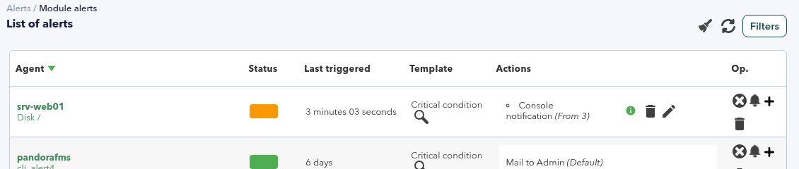{ .captura }

**Management → Alerts → Module Alerts** is the **management** view. It filters by
agents, module, actions, field content, priority, status, standby and group. Each
row lets you enable and disable the alert, put it in standby, add, update and delete
actions, or remove it. For each action it shows its escalation range: *Always*, *On
N*, *Until N* or *From N to M*, and its threshold.

!!! info "What the \"default action\" is in this list"
    Actions marked *(Default)* run every time the alert fires and **no other
    action** does.

#### Alert detail page

The magnifying glass in the **Template** column opens the detail: the agent, the
module, the template, the last firing, the status, the severity, the standby and the
policy; the **firing conditions** written in prose ("the alert would fire when the
value is below …"); the actions with their thresholds and a preview of the firing
and recovery fields. It is the fastest way to check what an alert you did not
configure yourself does.

#### Alerts and events

Every time an alert fires, recovers or ceases, it leaves an event in the event
console (unless you have disabled that). To see everything an alert has done, filter
by that event type in [the event console](5.4-consola-de-eventos-centralizada.md).

How the last firing information is displayed (timestamp, time comparison or compact
mode) is chosen in the console's **Visual styles** setting, option *Timestamp, time
comparison, or compact mode*.

### The alert server and distributed environments

Evaluating an alert and executing it are two different jobs. **Evaluating** is
cheap: compare the data with the template, check counters and thresholds. **Executing**
can be slow and depends on what lies outside: a mail server that takes its time to
answer, an SMS that goes through a gateway, a script that calls an API. The
**alert server** exists to keep the two jobs apart.

#### How it behaves

Without an alert server, the server that evaluates the alert also executes it on the
spot, and until the action finishes it does not move on. With one, the work is split
like this:

1. The server that evaluates (data, event or log server) decides that the alert fires
   or recovers and, instead of running the actions, **leaves an order in a queue**
   shared through the database. Each order carries everything needed: the data, the
   agent, the module, the alert and the extra macros.
2. An alert server **picks up the orders**, runs the alert actions (email, commands,
   notifications) and removes the order from the queue.
3. If an order takes more than `alertserver_warn` seconds (180 by default) to run
   after being queued, the server generates a warning event with the text "Alert
   execution delay has exceeded N seconds", at most once an hour.

Module, event and log alerts go through the queue, both when they fire and when they
recover. **They do not go through it**: "Force check" runs and SNMP trap alerts, which
run immediately on the server that processes them.

#### What to configure

Two `pandora_server.conf` parameters decide each server's role:

| Parameter | Role it gives the server |
|---|---|
| `alertserver_queue 1` | **Queues.** Its alerts are not executed on it: they go to the queue. It executes nothing from the queue. |
| `alertserver 1` | **Executes.** Starts the alert server, with `alertserver_threads` parallel threads. Also, with it enabled the server's own alerts always go through the queue too. |

With both at `0` (the default) there is no queue and everything runs inline.

#### Many that queue, few that execute

This is where the power is. The two roles are independent, so they can be split as
needed:

- **Any number of servers that queue.** The data, event and log servers at each site
  only evaluate and leave the order in the queue. They can sit on networks with no
  Internet exit and no access to the mail server or the SMS gateway.
- **A single server, or a small group, that executes.** They are the only ones with a
  connection to the notification services: SMTP, SMS gateways, Microsoft Teams, a
  ticketing system, external APIs. Access is opened from those servers and only
  from them.

This keeps network permissions and notification credentials in one controlled place,
and the rest of the environment does not need to know they exist. A server with no
other load can also be dedicated to running alerts, so that a slow gateway never
holds back data collection.

When **several alert servers are active**, they share the queue on their own: each
order belongs to one of them according to its identifier number and the position of
the server in the list of active alert servers sorted by name. Adding an executor
spreads the load without touching anything else.

!!! warning "What to watch"
    - **Alert command scripts run on the alert server**, not on the server that
      evaluated. A custom command must exist, with its dependencies and permissions,
      on **every** server that executes.
    - If **no** alert server is active, the queue grows and notifications do not go
      out. The "Alert execution delay…" event is the sign. The server status is
      checked in the console, in the servers list.
    - If an alert server goes down, as long as it still counts as active, nobody
      handles its share of the queue.

For the general layout of servers in a large installation, see
[Large environments](../parte-12/12.8-entornos-grandes.md).

### Related server and console parameters

#### Server (`pandora_server.conf`)

| Parameter | Default value | What it is for |
|---|---|---|
| `event_window` | `3600` s | Event window the server takes into account for event alerts. Events outside the window are not processed. |
| `log_window` | `3600` s | The same for log alerts. |
| `event_inhibit_alerts` | `0` | If `1`, an alert does not fire while its last event is "In process". |
| `global_alert_timeout` | `15` s | Maximum execution time of an external alert command. |
| `unknown_updates` | `0` | If `1`, periodically updates modules in unknown status (it can affect server performance), required for their alerts to repeat. |
| `eventserver` | `0` | Must be `1` for event alerts. |
| `logserver` | `0` | Must be `1` for log alerts. |
| `mta_address`, `mta_port`, `mta_user`, `mta_pass`, `mta_auth`, `mta_from`, `mta_encryption` | not defined | **Local** outgoing mail server: if `mta_address` is defined, it takes precedence over the console's mail configuration. It is a secondary method; the main one is in the console. |
| `console_api_url`, `console_api_pass` | empty (taken from the console) | Where and with which password the server calls the console API for the graph macros in email. Set them only if the console does not answer at the default address. |
| `alertserver` | `0` | Enables the dedicated alert server. |
| `alertserver_threads` | `1` (`4` in the sample file) | Alert server threads: orders it executes at the same time. |
| `alertserver_queue` | `0` | If `1`, alerts are queued for the alert server (with `alertserver` enabled, they are always queued). |
| `alertserver_warn` | `180` s | Generates a warning event every hour if alert execution is delayed by more than this many seconds. |

Server parameters are explained in full in the
[server configuration reference](../parte-9/9.3-referencia-completa-de-configuracion-del-servidor.md).

#### Console

| Where | What |
|---|---|
| **Management → Setup → System settings → General setup → Alerts configuration** | The console's outgoing mail configuration and the Telegram *token* (`_telegramtoken_` macro). |
| **General setup → Network → Public URL** | Base for the notification links (`_homeurl_` macro). |
| **Performance → Max. days before delete old messages** | When console notifications are deleted. |
| **Performance → Max. macro data fields** | How many fields are shown in the alert forms. |

## Block 2 · Alerts by source

Up to here, the alert was born from a module: a bad data point, a status that
changes. But not everything that deserves a notice is a module. Sometimes the
problem lies in **what the events say** (three login failures in a row), in **what a
log writes** (a `kernel panic`), in **what a device announces** (an SNMP trap) or in
**what the SIEM detects**.

The four types that follow reuse everything from
[block 1](#block-1-the-module-alert-and-its-mechanisms): [**actions**](#alert-actions),
[**commands**](#alert-commands), [**macros**](#alert-macros),
[**thresholds**](#when-an-alert-fires-counters-threshold-and-flip-flop) and
[**fields**](#the-field-flow). Two things change: *what
fires them* (some rules instead of a module template) and *where they are
configured*. That is why each section explains only what is new.

| Type | Evaluated on | Menu | Permission |
|---|---|---|---|
| [Events](#alerts-on-events) | The incoming events | Management → Alerts → Event Alerts | LM |
| [Logs](#alerts-on-logs) | The incoming log lines | Management → Alerts → Log alerts | LM |
| [SNMP traps](#alerts-on-snmp-traps) | The received traps | Management → Alerts → SNMP alerts | LW |
| [SIEM](#siem-alerts) | SIEM events | Management → Alerts → SIEM Alerts | LW, LM or AD |
| [Inventory](#inventory-alerts) | The agents' inventory | Management → Alerts → Inventory alerts | LM |

### Alerts on events

An **event alert** fires when the incoming events meet a set of **rules**. It does
not depend on a specific module: the same event may have been generated by any
module of any agent. It serves for what no module sees on its own: "three critical
events from the same agent in ten minutes", "any event whose description contains
`timeout`".

!!! warning "Essential: Event Server and event window"
    - The **Event Server** must be active (`eventserver 1` in the server
      configuration file, or from the server's remote administration in the
      console).
    - The server only works with an **event window**, the `event_window` parameter
      (default **3600 seconds**): older events are not processed.
    - In a **Command Center**, these alerts are **not centralized**: each node must
      have its own, and the Command Center's rules only fire with the Command
      Center's own events.

#### How an event alert is evaluated

This is the part worth understanding before touching anything:

1. Every time an event arrives, the server goes through the event alerts **in
   order**.
2. The **new** event must meet at least one rule of the alert.
3. Then the server reviews the events in the window (`event_window`), and counts how
   many meet each rule, respecting the **grouping** and the modifiers of each rule.
4. A rule is **satisfied** when its count reaches the required minimum.
5. The satisfied rules are combined **from left to right** with their connectors
   (`AND`, `OR`, …). **There is no precedence among them.**
6. If the result is true and the template's limits (minimum, maximum, threshold) are
   met, the alert fires.

#### Creating an event alert: the five-step wizard

Go to **Management → Alerts → Event Alerts** and click **Create**. There are five
steps: **Configure**, **Conditions**, **Rules**, **Fields** and **Triggering**.

##### Step 1 · Configure

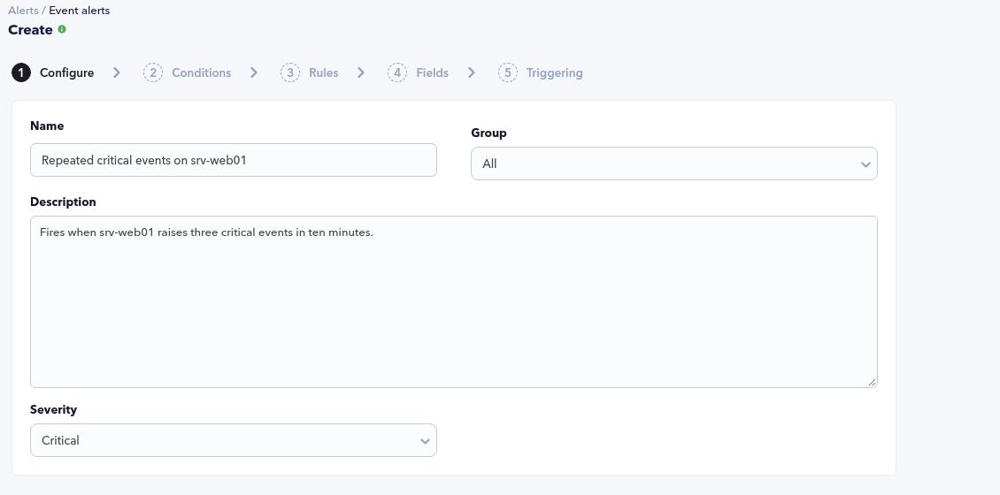{ .captura }

| Field | What it is |
|---|---|
| **Name** | Mandatory and unique. |
| **Group** | The alert's group. |
| **Description** | Free. |
| **Severity** | The severity inherited by the event the alert generates. |

##### Step 2 · Conditions

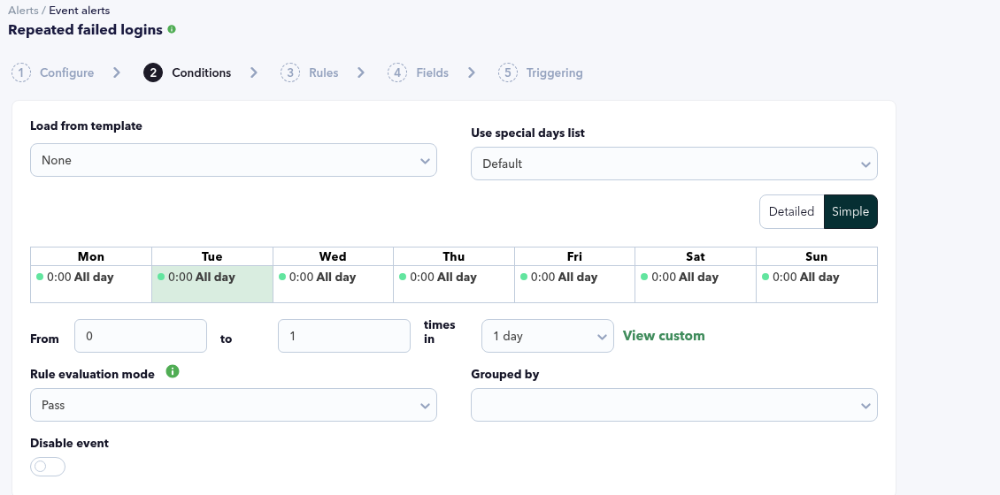{ .captura }

Unlike module alerts, there is **no template** here that decides when the alert
fires: the **triggering conditions** (schedule, time threshold, minimum and
maximum number of firings) are defined in this step and live in the alert itself.
If a template with the conditions you want already exists, you can **copy** them
from it with *Load from template*, the first row of the table.

| Field | What it is |
|---|---|
| **Load from template** | Copies the conditions from an existing alert template. It is a **copy**, not a link: if the template is changed later, the alert does not find out. |
| **Use special days list** | The [calendar](#special-days) that applies. |
| **Schedule** | The time slots in which the alert can fire (the same editor as in templates). |
| **Execute alert From … To … times in … threshold** | Minimum and maximum number of firings, and time threshold. The initial values are `0`, `1` and 1 day. |
| **Rule evaluation mode** | **Pass** or **Drop**. See below. |
| **Grouped by** | Agent, module, module alert or group. See below. |
| **Disable event** | Does not generate the alert-fired event. |

**Rule evaluation mode.** When there are several event alerts, they are evaluated
one by one **in the order they appear in the list** (they can be reordered by
dragging). The mode decides what happens when one fires:

- **Pass**: the following alerts keep being evaluated. It is the default behavior.
- **Drop**: when an alert **actually fires**, the following ones stop being
  evaluated.

!!! warning "Drop only cuts if the alert really fires"
    An event meeting the rules is not enough: if the alert does not fire because it
    has not yet reached its **minimum** of repetitions, or because it has already
    reached its **maximum**, it **does not cut** and evaluation continues with the
    next one.

**Grouped by.** Makes the rules count only events from the same agent, group,
module or module alert. If the rule is "two critical events" and you group by
**agent**, they must be two critical events **from one same agent**, not one from
each of two agents.

##### Step 3 · Rules

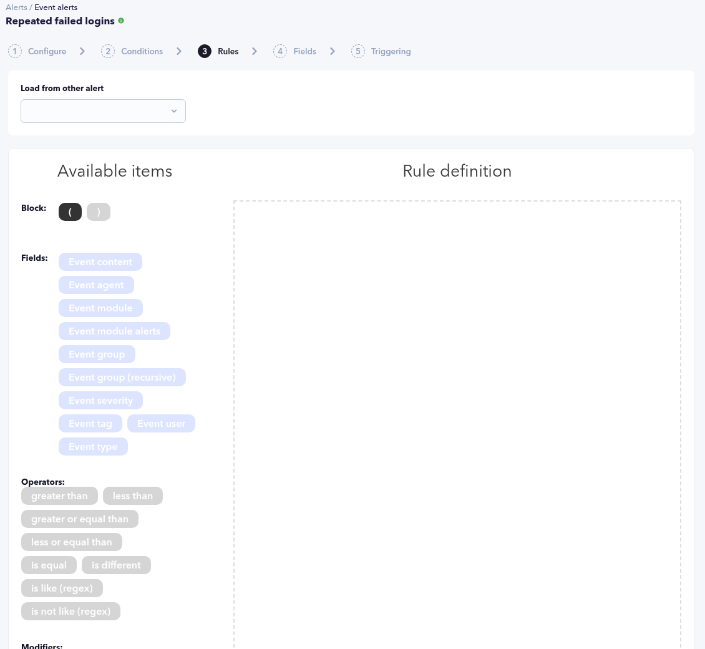{ .captura }

The heart of the alert. On the left are the **Available items** and on the right the
**Rule definition**: you **drag** items from one side to the other to build each
rule.

The items are:

| Type | Items |
|---|---|
| **Event fields** | Event content, agent, module, module alert, group, group (recursive), priority, tag, user and event type. |
| **Comparison operators** | `>`, `<`, `>=`, `<=`, is equal, is not equal, **is like (regex)** and **is not like (regex)**. On non-numeric fields only equal, not equal and the two regular expression ones are offered. |
| **Modifiers** | **within an interval (seconds)** (the window in which they must occur) and **has at least** (how many times). |
| **Connectors** | `AND`, `NAND`, `OR`, `NOR`, `XOR`, `NXOR`. |
| **Block** | The parentheses `(` and `)`. |

The grammar, simplified:

```text
S -> R | R CONNECTOR R
R -> FIELD OPERATOR VALUE | FIELD OPERATOR VALUE MODIFIER
```

Two key ideas, which are the difference between getting it right and guessing:

- **Inside a `( … )` block** the conditions must be met **at the same time in the
  same event**. `(agent is srv-web01 AND priority is critical)` requires **one**
  event that is from `srv-web01` **and** critical.
- **Between rules** (with a connector) the conditions are met **in the window**:
  `A AND B` requires that there exist events meeting `A` and events meeting `B`
  within the last `event_window` seconds, even if they are **different events**.

And two warnings:

- `is equal` and `is not equal` compare **the text literally**. For anything more
  flexible, use **is like (regex)**.
- The step's changes are only saved when you click **Next**.

There is also **Load from other alert**, which copies the rules of another event
alert, and the **Remove rule**, **Remove item**, **Clear** and **Reset** buttons. When
this step opens, the editor shows a warning about the complexity of correlation logic
(time windows, multiple conditions, boolean logic): it is worth reading.

##### Step 4 · Fields

Here go the `Field1` … `Field10` fields the action will receive (with the same
[precedence rules as in block 1](#the-field-flow)), and the **recovery**:

- **Load from template** to copy them.
- **Alert recovery**: disabled or enabled. With it enabled, the **recovery fields**
  appear.

!!! note "No agent or module macros in recovery"
    Recovery runs when the threshold expires and has no event to take the agent or
    module from. Those macros are not available here.

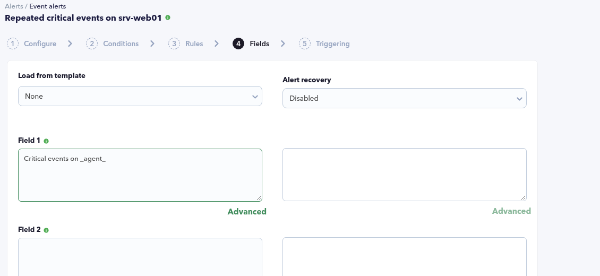{ .captura }

##### Step 5 · Triggering

The triggering conditions were already set in step 2; the **Triggering Condition**
panel at the top summarizes them. All that is left here is to associate the
actions.

The **actions** that will run are associated: you choose the **action**, the range of
repetitions (*Number of matching alerts*, as in
[escalation](#alert-escalation)) and the action's **threshold**. **Add** puts it in
the list, which shows for each action when it is launched (*Always*, *On N*, *Until
N*, *From N to M*). A selector lets you preview the **firing** or **recovery** fields
of each one.

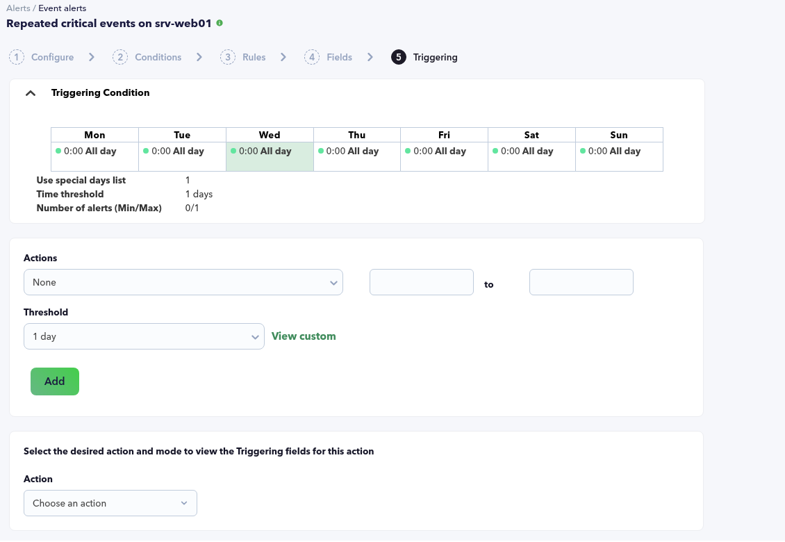{ .captura }

#### The event alert list

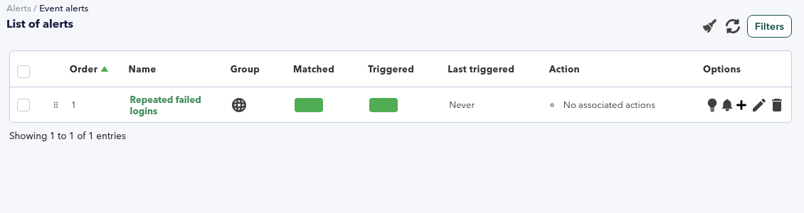{ .captura }

Each row shows the **order** (draggable), the name, the group, how many times it has
matched, how many it has fired, the last activation and the actions. From there you
can **enable or disable**, put in **standby**, **add actions**, edit, delete or
**validate** in batches.

!!! tip "Dragging only works with the list sorted"
    To reorder the alerts, the list must be sorted ascending by **Order**.

#### Event-alert-specific macros

In addition to those in [block 1](#alert-macros):

| Macro | Description |
|---|---|
| `_event_id_` | Identifier of the event that fired the alert. |
| `_event_description_` | Event description. |
| `_event_text_severity_` | Event priority, as text. |
| `_event_extra_id_` | Extra identifier of the event. |
| `_eventTimestamp_` | Timestamp of when the event was created. |
| `_event_cf_text_` | All the event's custom data, as text with line breaks. |
| `_event_cf_json_` | The same data in JSON format. |
| `_event_cfX_` | Value of the custom field whose key is *X*: with a key `IPAM`, the macro is `_event_cfIPAM_`. |
| `_event_correlation_` | IDs and descriptions of the events that triggered the correlated alert, in the `id - description` format, one per line. It is available only in event alerts and gathers every event that met the rules, not just the one that fired the alert. |

#### Practical case: three login failures in ten minutes

You want a notice when the same agent generates **three critical events in ten
minutes**:

1. **Configure**: name "Repeated login failures", group *Servers*, severity
   *Critical*.
2. **Conditions**: no schedule restriction; **Grouped by: Agent**; **Pass** mode;
   minimum `0`, maximum `1`, threshold `1 h`.
3. **Rules**: a single rule: *priority is Critical* **and** *event content is like
   (regex) `login failed`*, inside a block; modifiers **within an interval** `600`
   and **has at least** `3`.
4. **Fields**: the email subject with `_agent_`, `_event_description_` and
   `_event_correlation_` to see the three events.
5. **Triggering**: **Mail to Admin** action.

### Alerts on logs

A **log alert** is the cousin of the event alert, but over the log lines Pandora FMS
collects. It fires when the incoming logs meet some rules, and does not depend on a
module: the same text may come from several agents.

!!! warning "Requirements"
    | Requirement | Detail |
    |---|---|
    | Log Server | `logserver 1` in the server configuration file (better from remote administration). |
    | Log collector | Enabled in **Management → Setup → System settings → Log Collector → Activate Log Collector**. |
    | Log window | `log_window` (default 3600 s): logs outside the window are not processed. |
    | Menu | **Log alerts** only appears when the collector is enabled. |

Log collection and querying are explained in the chapter
[Log collection and monitoring](../parte-2/2.19-recoleccion-y-monitorizacion-de-logs.md).

#### Creating a log alert

The wizard is [**identical to the event one**](#creating-an-event-alert-the-five-step-wizard) (Configure, Conditions, Rules, Fields,
Triggering), with the same connectors, **Pass** / **Drop** mode, modifiers and [list](#the-event-alert-list).
The differences are these:

| What | Events | Logs |
|---|---|---|
| **Rule fields** | The event's (agent, module, group, priority…) | **Log content**, **log source** and **log agent** |
| **Operators** | Numeric comparison, equality and regex | **Equality and regex** only |
| **Grouped by** | Agent, module, module alert or group | **None or Agent** |
| **Window** | `event_window` | `log_window` |

!!! danger "With logs, group only by agent"
    In alerts with log rules, **only** grouping by **agent** works. If you choose
    another grouping, the alert **will never be met**.

Rules with `is equal` / `is not equal` compare literal text; for anything flexible,
use **is like (regex)**.

#### Predefined rules

Pandora FMS ships with nine sample log alerts, all in **Pass** mode:

| Alert | Rule (summarized) |
|---|---|
| **Kernel Panic** | The content is like `kernel: panic` |
| **Device not ready** | Contains `I/O error, device not ready` |
| **Out of memory** | `Out of memory` or `Paging file too small` |
| **Failed to start** | Four rules joined with `OR` |
| **CPU soft lockup detected** | Informational priority |
| **Disk or swap space problem** | Four rules joined with `OR` |
| **Fatal error**, **Bugcheck**, **Kernel-Power** | Common critical errors on Linux and Windows |

They are a good starting point: copy them and adjust.

#### Log-alert-specific macros

| Macro | Description |
|---|---|
| `_log_id_` | Identifier of the log that fired the alert. |
| `_logTimestamp_` | Timestamp of when the log was created. |
| `_logSource_` | Log source. |
| `_group_contact_` | Contact information of the group. |

Recovery runs when the threshold expires, and it has no agent or module macros, just
like in event alerts.

#### Practical case: kernel panic

1. We start from the predefined **Kernel Panic** rule: *log content is like (regex)
   `kernel: panic`*.
2. Copy the alert, assign it our group and **group by agent**.
3. As the action, **Mail to Admin** with `_agent_` and `_logSource_` in the subject.

### Alerts on SNMP traps

SNMP traps are notices that a device sends on its own: "a port has gone down", "an
authentication has failed". The **SNMP console** receives them and the **trap
alerts** decide which ones deserve a reaction. How traps are received, filtered and
translated is explained in
[SNMP trap monitoring](../parte-2/2.7-monitorizacion-de-traps-snmp.md).

They are managed in **Management → Alerts → SNMP alerts** and require the **LW**
permission.

!!! warning "Two differences from module alerts"
    - **Field precedence is reversed**: the **SNMP alert's** field rules and, if it
      is empty, the action's.
    - **They have no recovery**: when they fire, there is no second "it's over"
      notice. A trap is a one-off fact.

#### The SNMP alert list

It shows: selection checkbox, status, **Position**, description, **Custom
Value/OID**, **Enterprise String**, SNMP agent, **Times fired**, **Last
triggered**, **Alert action** and the operations (duplicate, edit, add and delete
actions, delete). It is sorted by position and filtered by free search
(description, OID, value, IP, variables), trap type and severity. **Delete selected
alerts** deletes in batches.

#### Creating an SNMP alert: three tabs

##### Basic tab

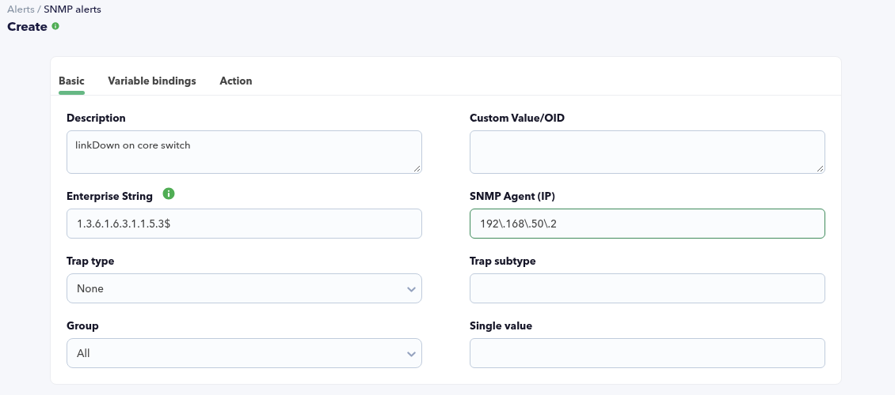{ .captura }

The fields serve to find matches with the received traps. You can combine as many as
you like: the more you fill in, the more specific the alert, and **all must be met**
at once.

| Field | How it matches |
|---|---|
| **Description** | Free. |
| **Custom Value/OID** | **Regular expression** over the trap's whole data string (the OID, type and value of each variable). Since it is anchored, you must also cover the beginning: to find the text `Testing TRAP 225` use `.*Testing.*TRAP.*`. |
| **Enterprise String** | The trap's main OID. By default it looks for the string **as a substring** (`1.21.34.2.3` finds any OID that contains it; no wildcards needed). For an **exact** match, end it with `$`. **It is not a regular expression.** |
| **SNMP Agent (IP)** | IP of the sender of the trap, as a full regular expression: for a whole network, `192\.168\.1\..*`. |
| **Trap type** | Cold start, Warm start, Link down, Link up, Authentication failure or Other. Almost all traps are *Other*; if not specified, any will do. |
| **Trap subtype** | Regular expression over the subtype, independent of the type. |
| **Single value** | Regular expression over the value of the **main** OID, not the secondary ones. |
| **Group** | The alert's group. |

!!! info "Regular expressions are anchored"
    In the regular expression fields, the pattern must match the **whole** field
    (not a piece of it) and is case-insensitive. `Testing` does not find `Testing
    TRAP 225`; `Testing.*` does (and so does `.*TRAP.*`). The Enterprise String
    field is the exception: it looks for a substring.

##### Variable bindings tab

A trap carries, besides the main OID, a list of data: the **variable bindings**.
Here there are up to **twenty** rows of **regular expressions**, one per variable,
and each has an **order** (the number of the variable it applies to). If filled in,
that variable must match; empty rows are ignored.

An expression in these rows **is not anchored**: it finds a substring, unlike those
of the other fields.

##### Action tab

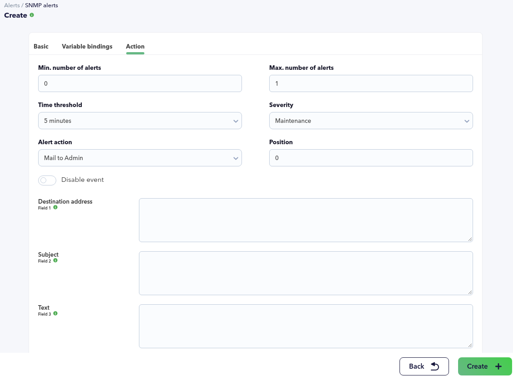{ .captura }

| Field | What it does |
|---|---|
| **Min. number of alerts** | How many matching traps are needed before the first action. Default `0`. |
| **Max. number of alerts** | How many actions are launched, at most, per interval. Default `1`. |
| **Time threshold** | From 5 minutes to a week, or a custom value in seconds. Default 5 minutes. |
| **Severity** | The severity of the event that is generated. It has no relation to the priority of the trap itself. |
| **Alert action** | The action that runs. |
| **Position** | The evaluation order. Default `0`. |
| **Disable event** | Does not create the "SNMP alert fired" event. |
| **Field 1 … N** | The fields the action will receive. Here this alert rules over the action. |

**Additional actions** are added from the list with **Add action**. All of them run
**on every firing**: they have no repetition range and no threshold of their own.
That is, **SNMP alerts have no escalation**.

#### How it is evaluated: the position

Each trap that arrives is compared with all the SNMP alerts, **ordered by position**
(from lowest to highest). An alert only fires if **all** its filters match.

The **position** acts as a priority among alerts, and its rule is not very obvious:
**when an alert fires at a position, the other alerts at that same position are
evaluated, but it stops on reaching a different position**. That is:

- Alerts with the **same position** are all evaluated.
- When one fires, those at **higher positions** are no longer evaluated for that
  trap.

This lets you build a "specific first, general after" cascade: a concrete `linkDown`
alert for a switch at position `0`, and a generic `linkDown` alert at position `1`
that only acts when the specific one has not fired.

!!! info "It is not the trap's priority nor the event's"
    The alert's position has nothing to do with the severity of the SNMP trap or
    with that of Pandora FMS events.

#### The SNMP alert threshold

If the time threshold has already passed since the last firing, the counters are
reset to zero. The alert fires if it has at least *minimum* matches and fewer than
*maximum* firings. Below the minimum, the threshold time is refreshed on every match
(the window "slides"); above the maximum, matches are counted and silently ignored.

#### The event an SNMP alert generates

After the action, the server creates the **"SNMP alert fired"** event, with the
alert's severity. **It only does so if the action is not *Monitoring Event*** and
the alert does not have **Disable event**. In other words: if the action already
creates its own event, the generic one is suppressed.

#### SNMP alert macros

| Macro | Description |
|---|---|
| `_snmp_oid_` | Trap OID. |
| `_snmp_value_` | Value of the trap OID. |
| `_snmp_fN_` | Value of variable binding number *N* (up to 20): what follows `= TYPE:`, without the outer quotes. |
| `_safesnmp_fN_` | The same, **escaped for the shell**. Always use it when the value goes into an external command. |
| `_snmp_argc_`, `_snmp_argv_` | Number of variables and full variables string. |
| `_trap_id_` | Trap identifier in the database. |
| `_data_`, `_agent_`, `_address_`, `_timestamp_` | The whole trap, the agent name, its IP and the trap date. |

!!! danger "Use `_safesnmp_fN_` with commands"
    Anyone can send a trap. If you put `_snmp_f2_` directly in a command line,
    whatever the sender writes will be run in the server's shell. `_safesnmp_f2_`
    escapes the dangerous characters. In external commands, the other one must never
    be used.

#### Practical case: a switch's `linkDown`

1. **Enterprise String**: `1.3.6.1.6.3.1.1.5.3$` (exact match of `linkDown`).
2. **SNMP Agent (IP)**: the switch's.
3. **Position**: `0`.
4. **Action**: **Mail to Admin**, with `Interface _snmp_f2_ down on _address_` in the
   subject (the interface index comes in the second variable binding).
5. In a second alert, position `1`, the same OID without IP: it picks up the
   `linkDown`s from any other device with a generic notice.

#### The external trap handler

The SNMP console processes each trap as an isolated fact. Sometimes the only
possible monitoring of a device is its traps, and the data you care about is spread
over several or is numeric. In those cases you can **post-process the trap with an
external script**:

1. Create an [alert command](#alert-commands) that runs the script, passing it the
   `_safesnmp_fN_` macros it needs.
2. Create an action with that command and associate it with the SNMP alert.
3. The script can, for example, generate a data XML for an agent module and feed
   graphs.

The data that XML generates must be of **asynchronous** type.

!!! tip "Another technique: use the alert to trigger a module"
    Another solution is for the SNMP alert to write to a log file that an agent
    module reads, so that the module goes off when the desired trap arrives and you
    can correlate from there.

#### Server parameters

The server's SNMP console is controlled with `snmpconsole`, `snmp_pdu_address`,
`snmp_ignore_authfailure`, `snmp_storm_protection`, `snmp_storm_timeout`,
`snmp_storm_silence_period` and `snmp_forward_trap`, among others; the full
reference is in the
[server configuration](../parte-9/9.3-referencia-completa-de-configuracion-del-servidor.md).
SNMP alerts can also be managed in batches with the
[mass operations](../parte-2/2.11-operaciones-masivas.md#snmp-alert-operations).

### SIEM alerts

**SIEM alerts** react to the security events generated by the SIEM server. They are
evaluated at the moment the server generates each SIEM event, and they are based on
the **same filter system** as the SIEM views: any event the view would show with
those filters fires the alert. The security side of the SIEM (decoders, rules,
views) is explained in the [SIEM](../parte-7/7.2-siem.md) chapter.

!!! warning "Requirements"
    | Requirement | Detail |
    |---|---|
    | SIEM enabled | The *SIEM* switch in the SIEM configuration. Without it, the page warns that SIEM functions are disabled. |
    | Experimental features | The **SIEM Alerts** menu item only appears with experimental features enabled. |
    | Permissions | **LW**, **LM** or **AD** for the page; **LM** to create actions; **LM** for the operation view. |

#### Management: Management → Alerts → SIEM Alerts

Here they are created, edited and deleted. The wizard has five steps:

| Step | What is configured |
|---|---|
| **Configure** | **Alert name** (unique), **group**, **description** and **severity**. |
| **Conditions** | **Load from template**, **special days list**, **from** and **to** (minimum and maximum firings), **threshold**, **Disable event** and the schedule. |
| **Filters** | Which SIEM events fire the alert. See below. |
| **Fields** | `Field1` … `Field10`, in basic or advanced mode. |
| **Triggering** | The actions, with their repetition range and threshold, as in event alerts. |

**Available filters:**

| Group | Filters |
|---|---|
| **Free search** | **Free search** (description, agent alias, decoder and type), **Group recursion** and **Group**. |
| **Match** | **SIEM group**, **Event description**, **Severity** (informational, normal, warning, critical), **Level**, **ID Rule**, **Type**, **Mitre** and **Decoder** (with each decoder's own fields). |
| **Exclusions** | **Agent**, **Excluded agents** and **Exclude Rules**. |

#### How it is evaluated

- They are evaluated when each SIEM event is processed, not by a timer.
- The schedule applies **every day**: in SIEM alerts all days of the week are
  forced. Special days are taken into account.
- The minimum, the maximum and the threshold work as in the rest, and the counters
  are reset when the threshold expires.
- They have **no recovery** of their own.

#### SIEM-specific macros

| Macro | Description |
|---|---|
| `_siem_event_level_` | Level of the SIEM event. |
| `_event_description_` | Event description. |
| `_event_text_severity_` | Event severity, as text. |
| `_eventTimestamp_` | Event timestamp. |
| `_logSource_`, `_logTimestamp_` | Source and timestamp of the source log. |
| `_group_contact_` | Group contact. |

#### Operation: Operation → SIEM → Alerts

For whoever **watches** (not configures): it lists the SIEM alerts with filters by
name and description, group, **status** (all, enabled, disabled) and **fired** (yes,
no). It shows the name, the description, the group, the matches, whether it has
fired, the action and the operations: enable, disable and put in **standby**. It
requires the **LM** permission.

### Inventory alerts

An **inventory alert** fires when an agent's inventory data meets (or fails to meet)
a condition. It is managed in **Management → Alerts → Inventory alerts** (**LM**
permission) and works like the others: it defines some conditions and an action.

| Field | What it is |
|---|---|
| **Name**, **Description** | Free. |
| **Group acl** | The alert's group. |
| **Inventory modules** | Which inventory modules are watched. |
| **Condition** | *White list*, *Black list* or **Match**. |
| **Time threshold** | As in the rest. |
| **Action** | The one that runs. |
| **Alert groups** | Which agents it applies to; by default, all. |
| **Disable event** | No alert-fired event. |

The server reviews each inventory line received, separated by `;`:

- **White list / black list**: a regular expression over **one** column. With the
  white list, it warns about what is **not** on the list; with the black list, about
  what is.
- **Match**: a regular expression **per column**, and all must be met.

Inventory itself is explained in the chapter
[Inventory](../parte-3/3.1-inventario.md).

## Closing

### Best practices and common problems

#### Design well

- **Few templates, well thought out.** A handful of generic templates ("critical",
  "warning", "value above X") cover almost everything.
- **Reusable actions.** One action per recipient or channel. When the
  administrator's email changes, you change it once.
- **Sensible thresholds.** For email notices, a maximum of 1 and a long threshold;
  if you want follow-up, a higher maximum and a short threshold, and let
  [escalation](#alert-escalation) do the rest.
- **Recovery enabled.** A notice that does not close forces someone to go and look.
- **Consistent template severity.** It conditions the [cascade](#cascade-protection)
  and the severity of the events.

#### "My alert doesn't fire"

It is worth going through this in order; almost always the cause is in the first
points:

1. Does the **module** reach critical/warning status? The critical status alert
   needs the module to have **thresholds defined**.
2. Is the alert **enabled** and **not in standby**?
3. Are we within the template's **schedule** and **day**? Is today a
   [special day](#special-days) with the template disabled that day?
4. Has the **maximum** been reached within the time threshold? See
   [When an alert fires](#when-an-alert-fires-counters-threshold-and-flip-flop).
5. Is the **minimum** of repetitions greater than 0, and the counter reset checked,
   with a module that comes and goes?
6. Is a [cascade protection](#cascade-protection) active because of a parent with a
   fired critical alert?
7. Does the **action** have a threshold that silences it? And the alert's?
8. Is there a **scheduled downtime**, or is the agent in quiet mode?
9. If it is an event or log alert: are the Event Server or Log Server active, and
   does the event or log fall within the window?
10. Does the **command work** by hand? If it fails, run it in a terminal with the
    same values.

And if what does not arrive is the **notification**: review the console's mail
configuration (or `mta_*` if the local one is used), that the action has a recipient and the configuration of the messaging
service *tokens*.

#### "I get too many"

- Raise the **minimum** and check the **counter reset** to ignore spikes.
- Lower the **maximum** and lengthen the **time threshold**.
- Add a **threshold** to the action so it does not repeat even if the alert does.
- Use [cascade protection](#cascade-protection) in networks with a single point of
  failure.
- Put the alerts in **standby** while you tune them, to see what *would* have gone
  off.

### Command Center: alerts

In a Command Center, module, log and SIEM alerts are managed on each node, and
**event alerts are not centralized**: the rules configured in the Command Center
only fire with the Command Center's own events. Alert handling in an environment
with a Command Center has its own section in the chapter
[Command Center](../parte-6/6.3-command-center.md).
