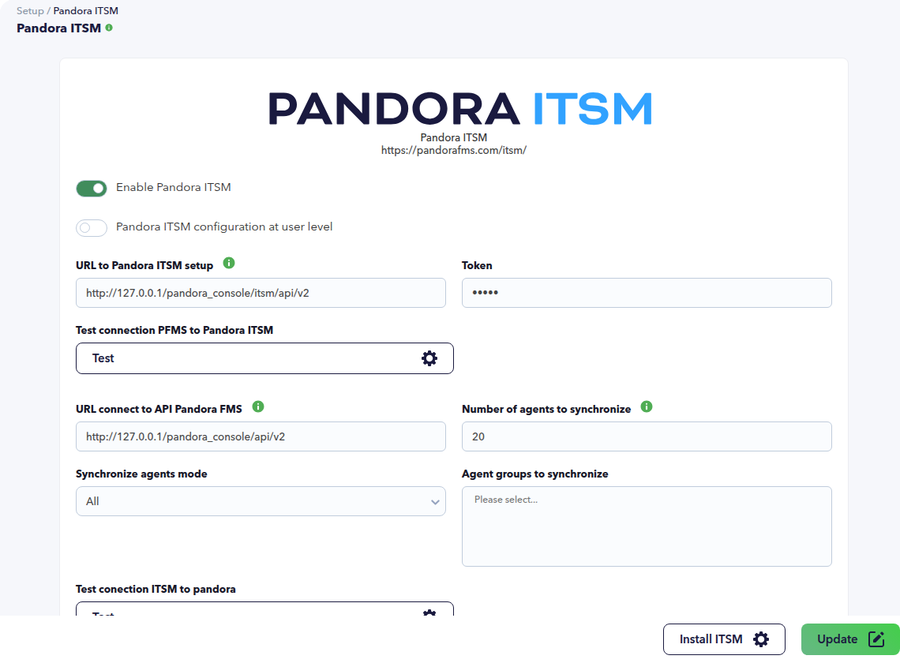
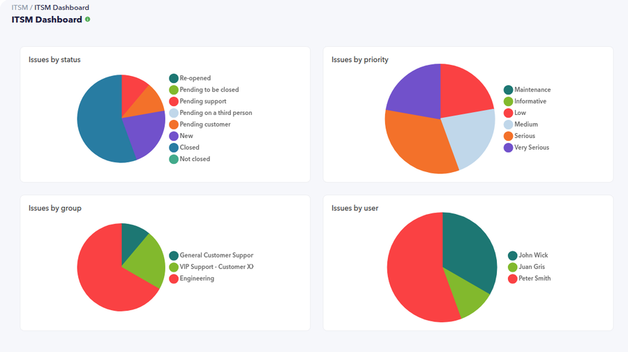
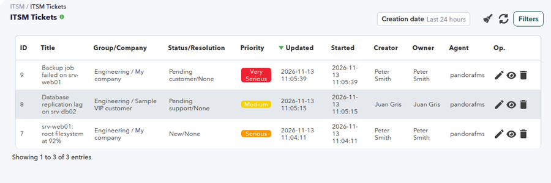
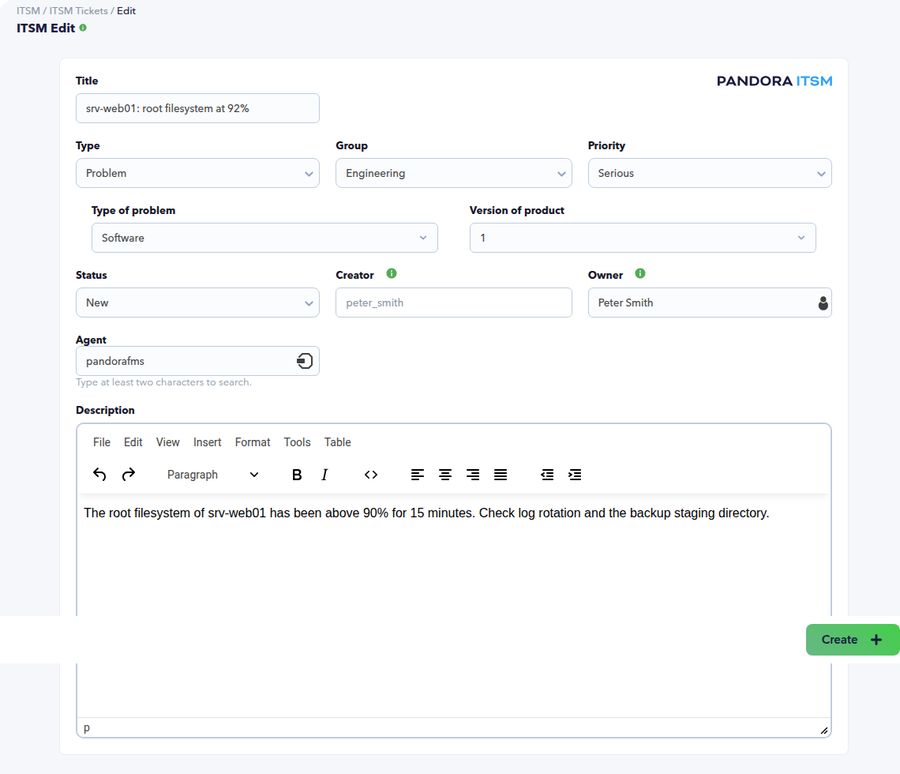
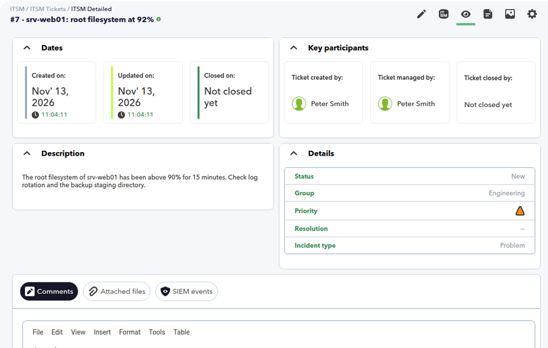
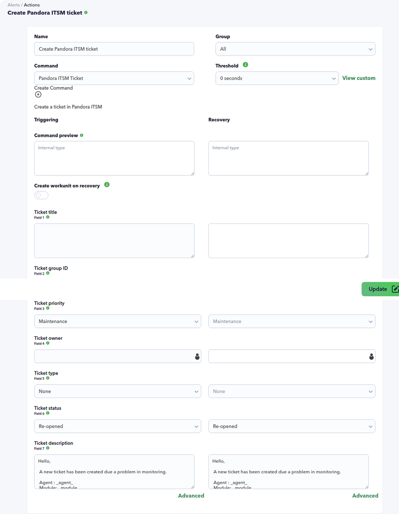
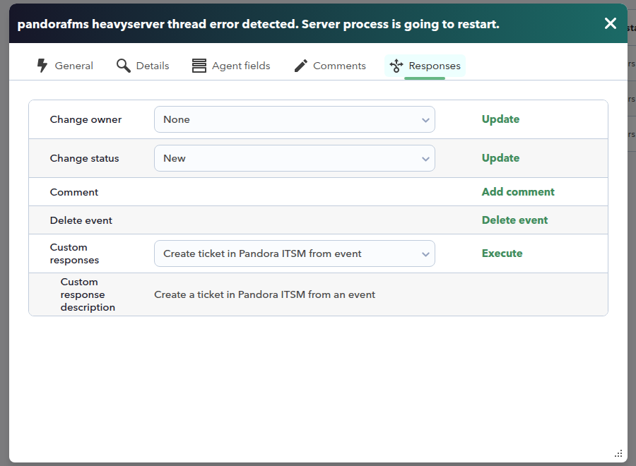
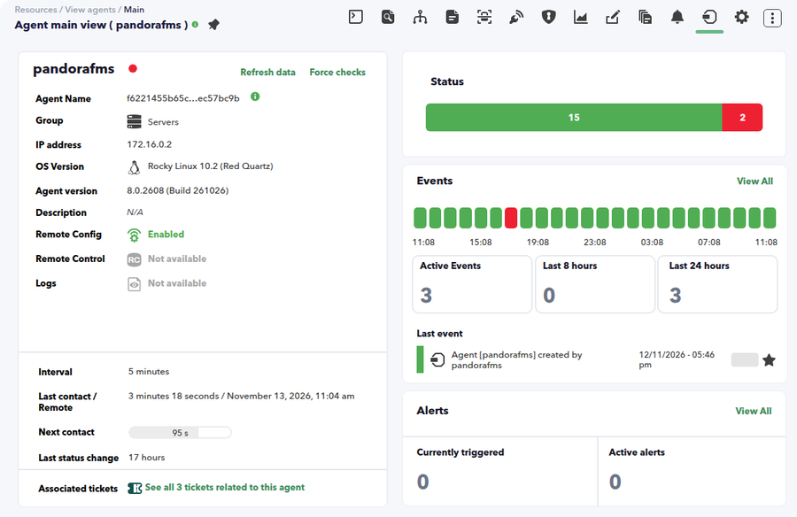

# Incident management / ITSM

A monitoring system that detects the problem and keeps it to itself is a very
competent and very useless watchman. Monitoring collects data; **incident
management** turns it into a ticket with an owner, a status and a history, so
that someone can close it and there is a record of who did it. That is what the
integration with **Pandora ITSM** provides: monitoring stops being a dashboard
you look at and starts feeding a real work queue.

Pandora ITSM is a separate product with its own license (see
[Licensing](../parte-1/1.5-licenciamiento.md)). This chapter documents the
integration **from Pandora FMS**: the settings tab, the **Operation → ITSM**
menu, ticket creation and editing, and the points where monitoring generates
tickets on its own. The internal operation of Pandora ITSM (SLA, workflows,
support teams, knowledge base, CRM, projects and incoming email) stays in its
manual. Here we explain what you have to do in Pandora FMS so that machinery
receives work.

There are two consoles, and it is worth being clear about which one is the
source of truth:

- **Pandora FMS** monitors, detects and decides when there is a problem. It does
  not own the ticket.
- **Pandora ITSM** stores the ticket, its status, its owner, its work units and
  its history. It is the source of truth for the ticket.
- The Pandora FMS console shows a summary and lets you operate on Pandora ITSM
  through its **API v2**. If the API does not respond, the ITSM section is left
  staring into space.

The integration has three entry channels:

1. **Manual creation** from the ticket list.
2. **Automatic tickets** from alerts, event responses and SIEM events.
3. **Agent synchronization** as Pandora ITSM inventory objects.

It is not a complete helpdesk and does not pretend to be. If you need queues,
teams, shifts, SLA or a knowledge base, that lives in Pandora ITSM. Here you
build the entrance from monitoring.

## Getting started

### Requirements and license

The Pandora ITSM license is separate from the monitoring license. The joint
installation described below is a **test** instance; for production, deploy
Pandora ITSM separately, with its own database and its own user. The Pandora ITSM
requirements are those of its manual:

| Requirement | Detail |
|---|---|
| Disk | 10 GB minimum, 20 GB recommended |
| CPU | 2.4 GHz, dual core |
| RAM | 1 GB minimum, 4 GB recommended |
| Base system | EL 8 (RHEL 8, Rocky Linux 8, AlmaLinux 8) or Ubuntu Server 22.04 |
| Database | MySQL 8 or later |
| PHP | 8.2 or later |
| Browser | Chrome, Edge, Firefox or Safari with HTML5; minimum resolution 1280 × 720 |
| Network | Pandora FMS must reach the Pandora ITSM API; Pandora ITSM must reach the public Pandora FMS API |
| Versions | Keep both applications up to date: the integration uses API v2, and version differences are paid for with hard-to-diagnose errors |

The joint installation runs on the Pandora FMS server and adds its own
requirements: internet access to download the package, write permission in the
console directory and permission for the database user to create or use the
`itsm` database.

### Joint installation from the console

Since version 783, the Pandora FMS console can install a Pandora ITSM instance
**as a test**. The path is **Management → Settings → System Settings → Pandora
ITSM** and the button is **Install ITSM**. It is not the recommended path for
production, but it is useful to test the integration without setting up a
separate server first.

Before installing, the wizard checks three things:

- That the `itsm` database can be created or reused.
- That the Pandora FMS database user has enough permissions.
- That the `itsm/` directory of the console can be created or overwritten.

Internet access is not checked at this point: it is a prerequisite, because step 2
downloads the package from `packages.pandorafms.com`.

If the directory already exists, the warning is explicit: **it will be deleted
and recreated**. This is not an installation to perform lightly on a server that
already runs a Pandora ITSM instance.

The process is shown as a nine-step progress bar:

| Step | What it does |
|---|---|
| 1 | Checks and prepares the `itsm/` directory |
| 2 | Downloads the Pandora ITSM package |
| 3 | Extracts the package and arranges the files |
| 4 | Creates the `itsm` database or reuses the existing one |
| 5 | Connects to the database with the Pandora FMS credentials |
| 6 | Imports the schema (`integria_db.sql`) and the initial data (`integria_dbdata.sql`), only if the database did not exist |
| 7 | Generates `itsm/include/config.php` and disables `install.php` |
| 8 | Creates the integration token and configures Pandora ITSM authentication against Pandora FMS |
| 9 | Shows the link to the Pandora ITSM console |

Step 6 only runs if step 4 had to create the database. If `itsm` already existed,
nothing is imported and the current content is kept.

If the database does not exist and the Pandora FMS user cannot create it, step 4
fails. In that case, the database administrator must grant the permissions
before retrying. An example, with the `pandora` user:

```sql
GRANT ALL PRIVILEGES ON `itsm`.* TO 'pandora'@'localhost';
```

When it finishes, the wizard leaves the connection pointing to `127.0.0.1` and
enables `ITSM_enabled`. If Pandora ITSM is published under another name, behind a
proxy or on another port, adjust the connection URL on the same tab. The first
access to the Pandora ITSM console uses the `admin` user and the `integria`
password; change it before leaving the system in anyone's hands.

!!! warning "Joint installation is not a production installation"
    The joint installation shares the Pandora FMS server and database
    credentials, and is intended for testing. For production, install Pandora
    ITSM separately and connect it to Pandora FMS with the appropriate URL and
    token. That way you can update, back up and scale each product on its own.

### Two-way connection

The integration needs two directions, and both are configured on the **Pandora
ITSM** tab:

- **Pandora FMS → Pandora ITSM**: the console needs the Pandora ITSM API URL and
  a token. The URL has the form `http://host/XXX/api/v2`; the token is the API
  credential. The **Test** button checks the API `ping` with that URL and that
  token.
- **Pandora ITSM → Pandora FMS**: Pandora ITSM needs the public URL of the
  Pandora FMS API to read the agent inventory. By default it takes the console's
  **Public URL** or, if it is not defined, the one in `config.php`. The **Test**
  button checks that address from Pandora ITSM.

{ .captura }

The default mode is **global**: all users share the token on the tab. If you
enable **Pandora ITSM configuration at user level**, the global token is hidden
and each user must set their own in their profile. It is the difference between
"the integration talks through a service user" and "each person talks through
their own Pandora ITSM user".

!!! tip "The public URL is not decoration"
    The address you enter in **URL connect to API Pandora FMS** is used by
    Pandora ITSM from its server, not by your browser. If Pandora FMS is behind a
    proxy, a VPN or a firewall, the URL must be reachable from the Pandora ITSM
    server. There is no point in your browser reaching it if the server next door
    cannot.

### User-level configuration

With user-level configuration enabled, each person needs their own Pandora ITSM
token in their user profile (`integria_user_level_pass`). The console stores it
as a credential and does not show it in clear text. If the field is empty, API
calls are made without a valid user and the ticket list may appear empty or
return an authorization error.

This mode has two clear uses:

- **Traceability**: each operation in Pandora ITSM is associated with the person
  who performed it, not with a shared service user.
- **Visibility**: each user sees the tickets their Pandora ITSM user can see.
  The Pandora FMS **RR** permission opens the section; the token decides what is
  inside.

The token is a credential. Do not share it in chat, do not paste it into a
ticket and do not store it in the repository.

### Ticket templates: alerts and event responses

The settings tab has two blocks of default values that are easy to confuse:

| Block | When it is used | Fields |
|---|---|---|
| **Alert settings** (`incident_*`) | Tickets created by the **Create Pandora ITSM ticket** alert action | Title, body, group, owner, status, priority and type |
| **Custom response settings** (`cr_*`) | Creation form opened by the **Create ticket in Pandora ITSM from event** event response | Title, body, group, owner, status, priority and type |

They are not "the console template" and "the agent template". They are two
different paths: the alert that runs on the server and the response that a user
runs from the event console. Manual creation uses neither: it starts with `LOW`
priority, `NEW` status and empty fields.

The alert action values can override those in **Alert settings**. If you want
uniform behavior, leave the action fields empty and configure the template once;
if you need different tickets per alert, fill in the action fields.

### Agent synchronization with the inventory

Synchronization turns Pandora FMS agents into Pandora ITSM inventory objects.
The controls are on the same tab:

| Control | What it does | Default value |
|---|---|---|
| **Number of agents to synchronize** | How many agents are processed in parallel | 20 (minimum 10, maximum 1,000) |
| **Synchronize agents mode** | `All`, `Enable` or `Disable`; groups only apply when there is a filter | `All` |
| **Agent groups to synchronize** | Groups synchronized when the mode is by group | Empty (all) |
| **URL connect to API Pandora FMS** | Public URL Pandora ITSM uses to read the agents | **Public URL** or `config.php` |
| **Test** (ITSM → Pandora) | Checks the connection from Pandora ITSM to Pandora FMS | Action |
| Progress bar | Progress of processed agents or node error | Read-only |

When you save, the console registers the node in Pandora ITSM
(`/pandorafms/nodes`) with the server authentication, the API password, the
number of agents, the groups, the mode, the public URL, the server label and the
node identifier. Pandora ITSM takes that data and synchronizes the agents on its
own. The console queries the status (`/pandorafms/node/{serverAuth}`) and shows the
progress (processed agents out of the total) or, if there is one, the node error.
It does not show the time since start or the next run, and it does not allow
deleting or restarting the node: those operations are performed from Pandora ITSM.

In Pandora ITSM, the **Pandora FMS Inventory** tab (inside **Setup → Setup**)
shows the connected nodes, the connection path, progress, time since start, next
run and status, with delete and restart operations. If the node does not appear,
synchronization has not started or the connection from Pandora ITSM to Pandora
FMS is not working.

!!! info "Two inventories that are not the same"
    Synchronization from the console registers the node and makes Pandora ITSM
    read the agents through the API. **Remote inventory through EndPoints** is
    something else: each EndPoint sends an XML file to the Pandora ITSM server and
    that server creates the inventory objects. That second mechanism, with object
    types and CMDB model fields, is documented in
    [Asset integration with ITSM](../parte-3/3.9-integracion-de-activos-con-itsm.md).

## The Operation → ITSM section

The **Operation → ITSM** menu only appears if the integration is enabled. It has
two entries:

- **Tickets list**: the list of tickets.
- **Dashboard**: the statistics.

The page of the list is titled **ITSM Tickets**, the edit page **ITSM Edit** and
the detail page **ITSM Detailed**.

### Dashboard

The **Dashboard** is the default page when you enter **ITSM**. It shows four pie
charts:

- Incidents by status.
- Incidents by priority.
- Incidents by group.
- Incidents by user.

{ .captura }

It has no filters or date range: it shows what the Pandora ITSM token can see. If
there are no tickets, the page says so with **Not found incidences**. For the
rest of the console dashboards, see [Dashboards](5.1-dashboards.md).

### Ticket list

The list is the work centre. The table shows these columns:

| Column | What it contains |
|---|---|
| **ID** | Ticket identifier in Pandora ITSM |
| **Title** | Title; links to the details |
| **Group/Company** | Ticket group and creator's company |
| **Status/Resolution** | Status and resolution |
| **Priority** | Priority, with colour |
| **Updated** | Last update |
| **Started** | Creation date |
| **Creator** | Creator user |
| **Owner** | Owner |
| **Agent** | Associated Pandora FMS agent, if any |
| **Op.** | Edit, view details and delete |

{ .captura }

By default, the list is sorted by **Updated** descending and paginates with the
console block size. You can sort the table by the columns that make sense; the
group/status columns and the actions are not sortable.

The **Create** button opens the creation form. The row actions are the pencil
(edit), the eye (details) and the bin (delete with confirmation). There is no
"Edit" submenu: editing is done from the row.

The filters are:

| Filter | What it searches |
|---|---|
| **Free search** | Free text in the identifier, title and description |
| **Agent** | Tickets associated with a Pandora FMS agent |
| **Status** | Pandora ITSM status, plus the **Not closed** pseudo-status |
| **Priorities** | Ticket priority |
| **Group** | Pandora ITSM group; group 1 does not appear in the selector |
| **Creation date** | Creation age |

There are three details worth knowing before trusting the filter:

- **The list starts with the "Last 24 hours" preset.** If you have not chosen
  dates, the **Creation date** filter applies the last 24 hours; older tickets do
  not appear until you widen the range. They have not disappeared: they are
  outside the filter.
- **The "Not closed" status is an addition of the console**, not an API status.
  It is used to request tickets that are not closed.
- **The date filter only sends the lower bound.** The console converts the range
  to an age in days (`fromDate`) and does not send the upper bound. If you choose
  "from May 1", it searches from that date; the "to" does not travel to the API.

The list has no selector for Pandora ITSM custom searches. That selector exists
in the dashboard widget, which can apply a saved search.

The **RR** permission opens the section. What you see inside depends on the
token: with the global token, all users see what that service user sees; with
user-level configuration, each user sees what their Pandora ITSM token allows.

### Creating and editing a ticket

The **Create** button on the list opens the creation form. The pencil on a row
opens the same form with the ticket data. The fields are:

| Field | What it is | Notes |
|---|---|---|
| **Title** | Ticket title | Required |
| **Type** | Pandora ITSM incident type | Changing it loads its custom fields |
| **Group** | Pandora ITSM group | List obtained from the API |
| **Priority** | Priority | List obtained from the API |
| **Status** | Status | List obtained from the API |
| **Creator** | Ticket creator | Read-only and always empty; the creator is set by the Pandora ITSM user of the token |
| **Owner** | Owner | Pandora ITSM user autocomplete |
| **Agent** | Pandora FMS agent | Autocomplete; registers the inventory and associates the ticket |
| **Resolution** | Resolution | Only shown when the status is `CLOSED` |
| **Description** | Description | Rich text editor |
| **Custom fields** | Fields of the ticket type | COMBO, TEXT, CHECKBOX, DATE, NUMERIC or TEXTAREA; they can be required |

{ .captura }

The **Creator** field is not a drop-down or an editable field: it is read-only and
always empty, including when you edit a ticket. The help relates it to the
configured Pandora ITSM user; the actual creator is set by the user associated
with the token (the global one or the user's, depending on the configuration) and
is shown in **Key participants** in the details. **Owner** is a Pandora ITSM user
autocomplete. If the ticket type has custom fields, they appear below when you
select the type; required fields are validated before saving.

When you save a ticket with an **Agent** selected, the console sends the agent
inventory to Pandora ITSM (`/pandorafms/agents`) and associates the ticket with
the inventory object (`/incidence/{id}/inventory/{idInventory}`). If that
association fails, the ticket may have been created anyway and the console shows
the error. If the agent does not exist as an inventory object, Pandora ITSM
creates or updates it as appropriate.

Manual creation starts with `LOW` priority, `NEW` status, no group, no type and no
owner. The creator is not chosen in the form: it is set by the Pandora ITSM user
of the token. **It does not inherit the alert or event response templates.** If
you want default values, fill them in by hand or create the ticket from an alert
or a response.

Attachments and comments are not in this form. They are managed in the details,
after the ticket is created.

### Ticket details

The details open with the eye on the row or with the title. The header shows
`#ID - Title` and the body is organized in blocks:

- **Dates**: created, updated and closed (or **Not closed yet**).
- **Key participants**: creator, owner and the user who closed it.
- **Description**: the ticket description.
- **Details**: status, group, priority, resolution and type.
- **Comments**: the ticket work units; they can be added, but not edited or
  deleted from here.
- **Attached files**: upload with description, download and delete.
- **SIEM events**: SIEM events linked to the ticket by `id_incidence`.

{ .captura }

The details **do not show the associated inventory**. If you need to see the
inventory object, check it in Pandora ITSM; the asset model is documented in
[Asset integration with ITSM](../parte-3/3.9-integracion-de-activos-con-itsm.md).
The **SIEM events** tab is explained in [SIEM](../parte-7/7.2-siem.md).

## Automatic tickets

### Tickets from alerts

Alerts are the most common way to create tickets without intervention. The
internal command **Pandora ITSM Ticket** comes out of the box and cannot be
deleted or edited: it is a system object. The **Create Pandora ITSM ticket**
action also comes out of the box, but it can be copied and adjusted; in fact, it
is recommended to copy it so you do not touch the original.

The action uses seven fields and thirteen custom fields:

| Field | Content |
|---|---|
| 1 | Ticket title |
| 2 | Group (ID) |
| 3 | Priority |
| 4 | Owner (`_ITSM_users_`) |
| 5 | Type (`_ITSM_types_`) |
| 6 | Status (`_ITSM_status_`) |
| 7 | Description |
| 8–20 | Custom fields of the ticket type |

{ .captura }

Values that are not filled in are taken from **Alert settings**. The action
fields can override them. The command accepts the alert macros from
[Alerts and notifications](5.5-alertas-y-notificaciones.md); the description and
the title are usually where they are used most.

The **Create workunit on recovery** option changes recovery behavior: if the
closing status is applied when the alert recovers, a work unit is added instead
of closing the ticket. It is useful when the ticket needs human confirmation
before closing; if your flow expects automatic closure, leave it disabled.

When the alert runs, the server sends Pandora ITSM the ticket, the agent and
inventory custom fields, the agent, the module, the node, the alert mode and the
work unit option. Pandora ITSM decides:

- If the agent exists as an inventory object, it updates it; if not, it creates
  it.
- If there is an open ticket, it updates it and adds a work unit; if not, it
  creates a new one.
- If the ticket is locked in Pandora ITSM, it does not update it: it creates a
  new one.
- On recovery, it updates the status and, if the option is enabled, adds the
  work unit.

The action is available in module, event, log, SNMP trap and SIEM alerts. The
full mechanics of commands, actions, templates and macros are in
[Alerts and notifications](5.5-alertas-y-notificaciones.md).

### Tickets from event responses

The **Create ticket in Pandora ITSM from event** response appears in the event
details when the integration is enabled. It is a URL response: it opens a new
window with the ticket creation form and applies the **Custom response settings**
values.

The flow is:

1. Open the event details.
2. Select the **Create ticket in Pandora ITSM from event** response.
3. Click **Execute**.
4. The creation form opens in a new window with the **Custom response settings**
   default values.
5. Complete the agent, the title and whatever is missing, and click **Create**.

{ .captura }

A warning that saves an argument: **the form does not inherit the event text**.
The `from_event` in the URL only tells the console that it must apply the custom
response values; it does not fill in the agent, title or description with the
event data. If you want the ticket to say what happened, copy it by hand or use
an alert, which does receive the module and agent macros.

To execute the response you need **EW**; to open the ITSM form, **RR**. The custom
responses selector is also shown with **EM**, but execution requires **EW**: with
only **EM**, the response appears in the list but cannot be executed. The
mechanics of responses and their macros are in
[Centralized event console](5.4-consola-de-eventos-centralizada.md).

### Tickets from SIEM

In the SIEM event details, the **Create a ticket in Pandora ITSM** action creates
a ticket and stores its identifier in the event's `id_incidence` field. The
ticket appears linked in the **SIEM events** tab of the details and the event's
ticket list is fed by `getListTicketsSiem`.

Creation from SIEM does not follow the same path as manual creation: it creates the
ticket and stores its identifier in the event, but it does not register the agent's
inventory or associate the ticket with its inventory object, even if the event has
an agent. If you need that association, use manual creation or an alert. SIEM as a
system, its rules and its events are documented in [SIEM](../parte-7/7.2-siem.md).

## Tickets in the agent view

The agent page has two entry points:

- **Associated tickets**, in the overview: it counts the **unblocked** tickets
  and links to the list filtered by that agent ("See all N tickets related to this
  agent").
- **Issues**, the agent's incident tab, appears only if the agent has at least
  one ticket. It shows all of them, blocked or not, with filters for status
  (default `NEW`), priority, group and creation date.

{ .captura }

The tab requires the **AW** permission. The overview can show the block with
agent read permissions, but the tab is what allows management.

The link between the agent and the ticket is stored in the ticket's `externalId`:
`node-agent-module` when created by an alert and `node-agent` when created or
edited by hand. The agent filter searches that identifier, so a ticket created by
an alert and one created by hand appear together on the agent page. The details
of the agent page are in
[Common agent configuration](../parte-2/2.21-configuracion-comun-de-los-agentes.md).

## Ticket widget in dashboards

The **Pandora ITSM tickets** widget (`ITSMIncidences`) brings the ticket list to
a dashboard. It is configured with:

- **Limit**: number of tickets, from 0 to 100.
- **Custom search**: a saved Pandora ITSM search.
- **Fields to show**: ID, Title, Group/Company, Status/Resolution, Priority,
  Updated, Started, Creator and Owner.

The default fields are ID, Title, Priority and Creator. The widget is only
available if the integration is enabled and shows what the token can see. It is
not a ticket editor: it is a query window. For the rest of the widgets, see
[Dashboards](5.1-dashboards.md).

## Permissions, best practices and troubleshooting

The permission table is as follows:

| Action | Permission |
|---|---|
| View the section and the ticket list | **RR** |
| Create, edit or delete tickets | **RR** and the Pandora ITSM token permissions |
| View the agent **Issues** tab | **AW** |
| Execute event responses | **EW** |
| Configure alert commands and actions | **LM** or **PM** |
| Configure the integration | **PM** or administrator |
| Set the user token | **UM** or editing your own profile |

The Pandora FMS permission opens the door; the Pandora ITSM user associated with
the token decides which tickets are visible and what can be done with them. They
are not two independent permission systems: they are two layers that add up.

The best practices that avoid most scares:

- **A dedicated token for the global integration.** Do not use one person's token
  for the whole team; if that person leaves, the integration leaves with them.
- **User token if you need traceability.** It is the way to know who created,
  edited or closed each ticket.
- **Align groups, statuses, priorities and types with Pandora ITSM.** The console
  paints what the API gives it; if the names do not mean the same on both sides,
  the team will classify wrong.
- **Short templates with macros.** A title with the agent and the module, and a
  body with the data and the link, are worth more than a generic paragraph.
- **The recovery work unit, with judgement.** If your flow closes tickets
  automatically, do not enable it; if it needs human validation, enable it.
- **Do not edit the internal command.** It is a system object and the console
  protects it.
- **Test both directions after every change.** The Pandora FMS to Pandora ITSM
  connection and the Pandora ITSM to Pandora FMS connection.
- **Use HTTPS and a reachable public URL.** The URL your browser sees is not
  necessarily the one the Pandora ITSM server sees.
- **Reserve the joint installation for tests.** For production, Pandora ITSM
  separately, with its own database and user.
- **Back up before installing.** The joint installation deletes and recreates the
  `itsm/` directory if it already exists.

When something fails, these are the clues that most often point to the problem:

| Symptom | Probable cause | What to do |
|---|---|---|
| **ITSM API is not reachable** | URL, token or network | Check the URL (`.../api/v2`), the token and the firewall; confirm that Pandora ITSM responds |
| **Connection failed** in **Test** | The address is not reachable or the credential is not valid | Test both directions; check the public URL and the token |
| The list appears empty or does not show old tickets | The token cannot see tickets, the user token is empty, the date filter is still on **Last 24 hours** or the filters return nothing | Check the Pandora ITSM user, the token, the date range and the filters |
| Authorization error | Expired token or no permissions | Regenerate the token and check the user |
| **Invalid response** | The URL points to an HTML page or a path that is not the API | Use the `/api/v2` path; check the reverse proxy |
| **Incidence not found** | The ticket was deleted or the token cannot see it | Check it in Pandora ITSM |
| Installation fails at the database | The Pandora FMS user cannot create or use `itsm` | Grant permissions and retry |
| Installation fails while downloading | No outbound access to `packages.pandorafms.com` | Check connectivity and the proxy |
| **No write permissions in the directory** | The console user cannot write to the directory | Fix the permissions or install Pandora ITSM separately |
| The **Issues** tab does not appear | No tickets, the integration is disabled or **AW** is missing | Check the integration and the permissions |
| The event response does not appear or cannot be executed | **EW** is missing (with only **EM** it appears but cannot be executed) or the response is in a group you cannot see | Check the permission and the response group |
| The ticket was created but the inventory was not associated | Inventory synchronization failure in manual creation or from an alert | Check Pandora ITSM and the asset model (3.9); the ticket may still exist |

For generic ticketing with other tools, see
[Reports, logs and email](../parte-12/12.7-informes-logs-y-correo.md). For the
reference of all the tab options, see section 8 of
[Complete console settings reference](../parte-9/9.2-referencia-completa-de-configuracion-de-la-consola.md).

## Closing and boundaries

The Pandora ITSM integration solves a specific problem: that the monitoring alert
does not die in an email. The ticket is born, assigned, updated and closed in
Pandora ITSM, and from Pandora FMS you can query and operate it without changing
tools. What happens afterwards (SLA, shifts, teams, knowledge base, CRM,
projects) is Pandora ITSM's job and is documented in its manual.

If you are looking for the asset model and remote inventory through EndPoints, it
is in [Asset integration with ITSM](../parte-3/3.9-integracion-de-activos-con-itsm.md).
If you are looking for alert mechanics, see
[Alerts and notifications](5.5-alertas-y-notificaciones.md). If you are looking
for event responses, see
[Centralized event console](5.4-consola-de-eventos-centralizada.md). And if you
are looking for SIEM, see [SIEM](../parte-7/7.2-siem.md).
