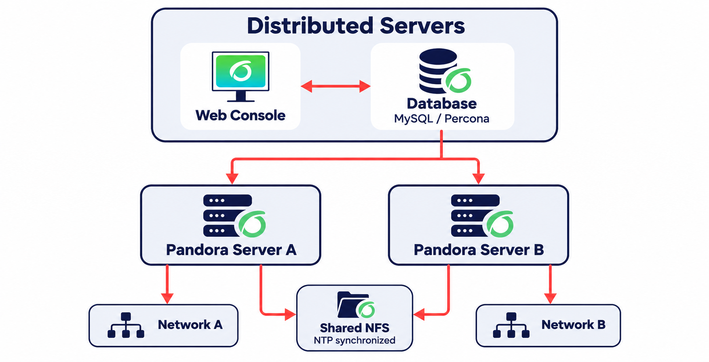
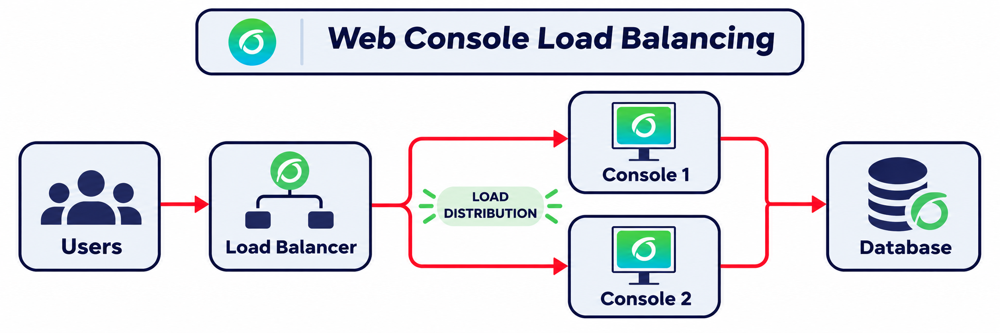
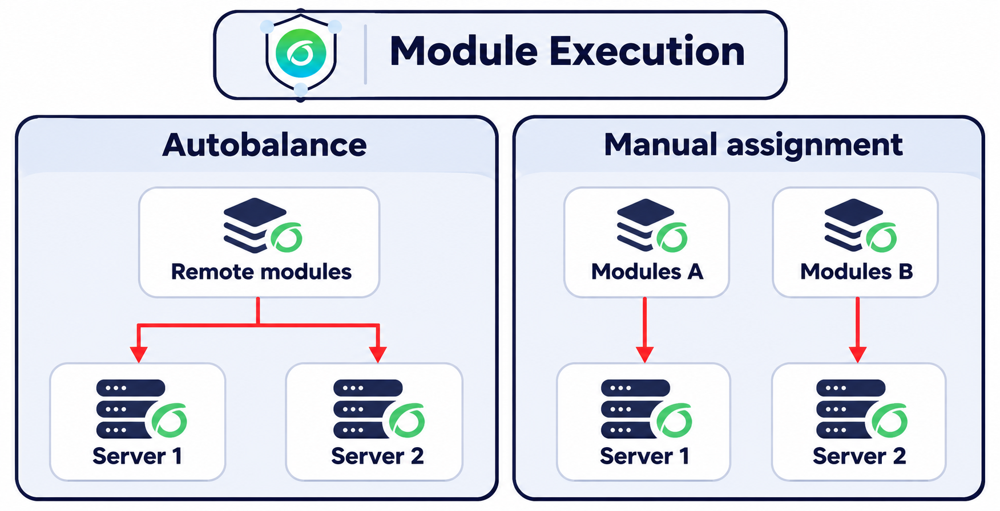
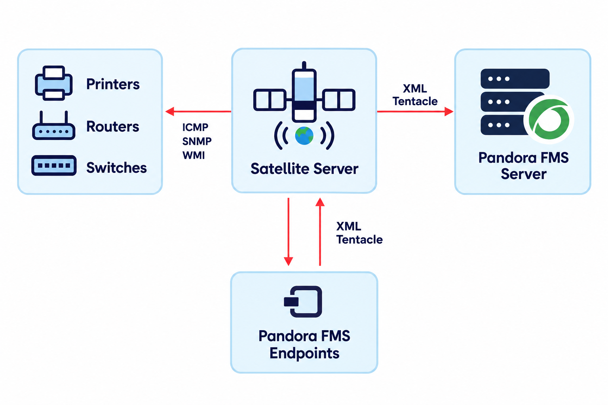
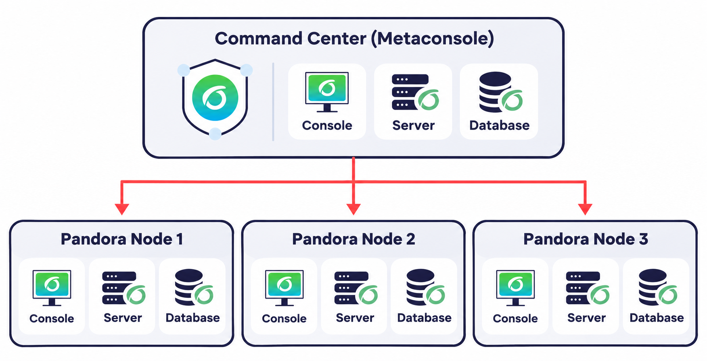
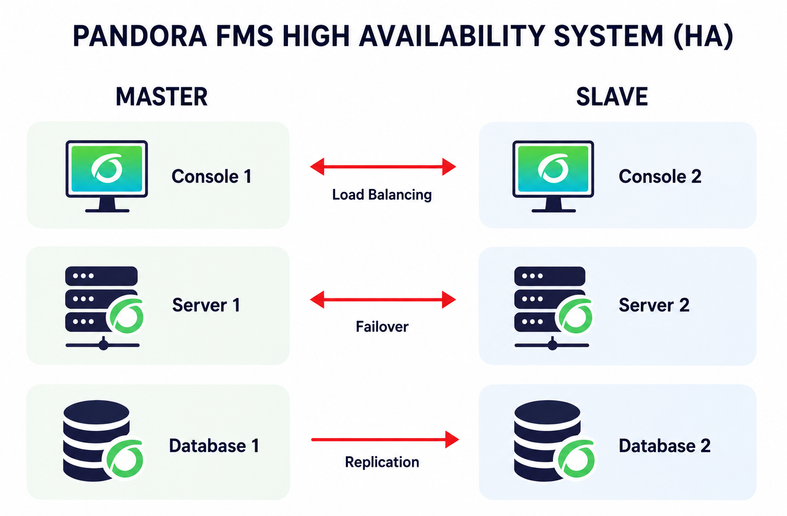
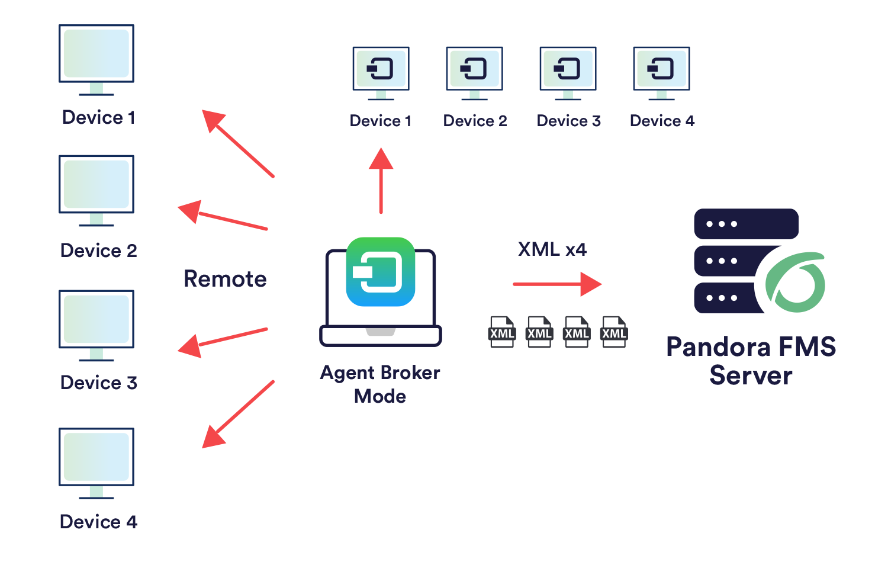

# Distributed architectures

A server, a console and a database on the same machine cover most Pandora FMS
installations. That is the classic monolith, and it is still a reasonable
starting point. The problem appears when that machine cannot reach what it has
to monitor, or when what it has to monitor is too much to come through a single
door. Then the question stops being "which product do I buy?" and becomes "how
do I split this up?".

This chapter answers that second question: which pattern fits each symptom,
which piece is needed and which chapter holds the detail. The topology map and
the description of each component are in
[Introduction and architecture](../parte-1/1.2-introduccion-y-arquitectura.md);
the installation of each piece, in
[Installation](../parte-1/1.1-instalacion.md). They are not repeated here: the
point is to decide what to deploy and link to the chapter that develops it.

## Introduction: when you need to distribute

Distributing, in Pandora FMS, does not mean buying more product. It means
spreading across several machines the pieces that already exist (server,
console, database, collection) to solve one of these two underlying problems:

- **Visibility.** There is no direct path from the server to the networks that
  have to be monitored. It may be a firewall, a site with no route, a third
  party's network. The data is not where the server looks for it.
- **Volume.** The number of devices, modules or events forces you to delegate
  collection, execution and display. A machine only goes so far, and past that
  point what drops is not a stray data point: it is the whole set.

The two reasons mix more often than it seems. A deployment that starts on a
single machine stops being enough the day a site with no direct route shows up,
or the day the console takes eight seconds to draw a listing because there are
three thousand agents behind it. And they are not always fixed the same way:
the unreachable site asks for a piece close to the network; the console volume
asks to split the web layer or the execution.

It helps to tell apart three things that are distributed in different ways,
because the product has one mechanism for each:

- **Collection.** Placing servers or satellites close to the network so that
  data is gathered where it is born.
- **Execution.** Assigning modules to specific servers, or letting any of the
  available ones run them.
- **Presentation.** Deploying several consoles, spreading their tasks or
  coordinating all of them with a Command Center.

A single deployment can spread all three at once, and each one is solved with a
different piece. Mixing them up is the fastest way to build something that half
works.

One warning before going on: **the architecture decision is not made by the
product, it is made by your infrastructure**. Pandora FMS supports almost any
split, but it will not tell you which one applies. That comes from how the
network reaches each site and how heavy each piece of data is. If that picture
is not clear, any scheme you copy from a manual will last until the first
firewall change.

Manual example: an installation with a single server at `192.168.0.10`,
`1,200` agents and a new site on `192.168.10.0/24` with no route to the main
one. The monolith does not break because of the agent count; it breaks because
that specific network is invisible. The fix is not a bigger server: it is
taking a piece to the site.

## The design criterion

This chapter has one table worth more than the rest. The first column holds
the symptom (what hurts); the second, the pattern that solves it; the third,
the chapter where it is developed. If your case is here, you are done reading
this section.

| Symptom | Pattern | Chapter |
|---|---|---|
| The server cannot reach the network and nothing can be installed on the monitored devices | Dedicated machine on that network: satellite server, EndPoint in *broker* mode or distributed server | [1.2](../parte-1/1.2-introduccion-y-arquitectura.md) / [6.2](6.2-servidores-satelite.md) / [6.1](#distributed-servers) |
| The EndPoints cannot reach the server | EndPoint in *proxy* mode or satellite server | [2.1](../parte-2/2.1-monitorizacion-con-endpoints.md) / [6.2](6.2-servidores-satelite.md) |
| I need several installations with a single view | Command Center | [6.3](6.3-command-center.md) |
| I want to spread the load across several servers | Distributed servers or load balancing | [6.1](#distributed-architecture-patterns) |
| I cannot afford a service outage | High availability | [6.9](6.9-alta-disponibilidad-ha.md) |
| The console falls short under concurrency | Web console load balancing | [6.1](#load-balancing) |

Two notes on how to read it:

- **Several rows can coexist.** A single deployment can have a site with no
  route (row 1), a Command Center that presents it along with the rest
  (row 3) and high availability so it does not go down (row 5). They are not
  mutually exclusive alternatives; they are layers.
- **It is a starting point, not a dogma.** The symptom is described from the
  side of whoever suffers the problem, and sometimes the real problem sits one
  layer up. If you hesitate between two rows, pick the one you can verify with
  a `traceroute` and a look at the machine's load.

Example of two rows at once: the site with no route on `192.168.10.0/24` is
solved with a local satellite server, and at the same time the central console,
which already serves five sites, is spread across two Apache consoles behind a
load balancer. They are different problems and they are solved with different
pieces.

!!! tip "Arriving with a specific problem?"
    The [Diagnosis and sizing](#diagnosis-and-sizing) table, at the end of the
    chapter, gathers twenty practical cases with the solution that fits each
    one.

## Distributed architecture patterns

The patterns below are ordered from least to most topology change. The first
two (distributed servers and load balancing) are developed here because they
have no chapter of their own. The rest are summarized and linked to their
owning chapter.

### Distributed servers

Several Pandora FMS servers connected to the **same MySQL or Percona database**,
with a single web console (or several pointing at the same database). There is
no hierarchy among them: all of them operate as primaries. When creating the
monitoring you choose from which server each module runs, and that is the whole
split.

{ .diagrama .diagrama-ancho }

What it is for:

- **Network segmentation.** Each server reaches the networks assigned to it;
  the site's server does not need to see the other site's network.
- **Getting around firewalls.** A server on each side of a network break avoids
  opening paths nobody wants to open.
- **Spreading the polling.** The work is divided among machines without
  duplicating the installation or the console.

Non-negotiable requirements:

| Requirement | Detail |
|---|---|
| Clocks synchronized by NTP | A time drift sends the modules to `unknown` and corrupts the graphs. This is not a style warning: it is a data failure. |
| Common NFS volume | For collections and remote configuration. Only the subdirectories are shared, not the parent directory. See [Cross-cutting requirements](#cross-cutting-requirements). |
| Direct MySQL access | All the servers talk to the same database. Communication can be encrypted with TLS. |

Database access is the delicate point. By default the connection goes
unencrypted; if the traffic between servers and database crosses a network you
do not control, it is wise to enable TLS with its certificates. The
configuration is in
[Complete server configuration reference](../parte-9/9.3-referencia-completa-de-configuracion-del-servidor.md);
the encryption of the database contents (a different thing) is in
[Database encryption](../parte-9/9.5-cifrado-de-la-base-de-datos.md).

Example: two servers, `192.168.10.11` (site A) and `192.168.20.11` (site B),
against `192.168.0.10:3306` with encryption enabled, and each site's modules
assigned to its server. The console lives on a third machine and points at the
same database.
For the resilience of this setup, see
[High Availability (HA)](6.9-alta-disponibilidad-ha.md).

### Load balancing

Load balancing spreads work across several equal pieces. Do not confuse it with
high availability: HA keeps the service up when something falls; load balancing
optimizes resources when everything works. They are complementary, but they are
not the same thing. There are four different fronts here, each with its own
mechanism.

#### Web consoles

An external load balancer (HAProxy, Keepalived) in front of several Apache
consoles pointing at the same database. The session system works
over *cookies*, which stay in the browser. It is the answer when the console
falls short under concurrency and the bottleneck is the web layer, not the
database. Console HA is covered in
[High Availability (HA)](6.9-alta-disponibilidad-ha.md) and console ports, in
[Installation](../parte-1/1.1-instalacion.md).

{ .diagrama .diagrama-ancho }

Example: two consoles at `192.168.0.20` and `192.168.0.21`, a load balancer
with TLS termination at `192.168.0.19` and the certificate on the balancer.
Users enter through the balancer's `443` and their sessions are spread between
the two consoles.

#### Module execution

The agent has an **Autobalance** mode: any available network server runs its
remote modules. It is configured in the agent's form, in the **Server** field:
if a specific server is left there, only that one runs the agent's remote
modules; if **Autobalance** is chosen, any of the available network servers
runs them. It is not enabled out of the box.

{ .diagrama .diagrama-ancho }

Do not confuse Autobalance with manual splitting at **50%**. Manual splitting
means assigning half the modules to each of two servers and marking both as
primaries; Autobalance lets any available server run an agent's modules. They
are different mechanisms and they are configured in different places. Network
server HA and primary behavior are in
[High Availability (HA)](6.9-alta-disponibilidad-ha.md); module types, in
[Network monitoring](../parte-2/2.6-monitorizacion-de-redes.md).

Example: an agent with `Autobalance` whose remote modules can be run by
`192.168.10.11` or `192.168.20.11` alike, with no fixed assignment. If either
one falls, the other keeps running them.

Example of the other mechanism: the same two servers, both marked as primaries,
with half the modules assigned to each one from the agent's form. That is
manual splitting at 50%, not Autobalance, and it does not change just because
a server goes down: the split stays where you left it.

When an agent is assigned to a specific server, its form comes with the
**Enable auto High Availability** option enabled by default. It means that if
that server becomes unavailable, the node's master server takes over the
execution of the agent's modules for as long as the outage lasts; when the
server comes back, the split returns to its place. If it is disabled, the
modules are not reassigned: they wait for their server to come back.

Example: an agent assigned to site A's server keeps running on the master if
site A falls, with no one having to reassign it; once it recovers, it runs
there again.

#### Console tasks

Console tasks are periodic jobs of the console itself (reports, backups,
scripts) run by its cron, not by a monitoring server. They can be assigned to a
specific console or left for any of them to run; that is how they are spread
across several consoles. They do not scan networks. The detail is in
[Console tasks](../parte-2/2.5-tareas-de-consola.md).

Example: two consoles registered; the reports for the east half of the company
are scheduled on one and those for the west on the other.

#### Discovery tasks

Discovery tasks are scans and discoveries: network (**Host & Devices**),
**applications** (MySQL, Oracle, DB2, SAP, SQL Server, VMware) and **cloud**
(AWS EC2/RDS/S3, Azure Compute, GCP Compute Engine). The console defines and
schedules them and can force them, but **the Discovery server runs them**: it
collects from the database the tasks assigned to it, launches the scan and
creates the agents. That server can be on another machine and has its own
threads. The detail is in
[Monitoring and automatic discovery with Discovery](../parte-2/2.3-monitorizacion-y-descubrimiento-automatico-con-discovery.md)
and in the
[Complete server configuration reference](../parte-9/9.3-referencia-completa-de-configuracion-del-servidor.md).

Do not confuse the two tabs of **Discovery → Task list**: *Console tasks*
schedules console jobs; *Discovery tasks* defines scans run by the Discovery
server.

Example: a Discovery server piles up application discovery tasks (MSSQL, Oracle
or Playwright, for example) and cannot finish them in time. The fix is to add
another Discovery server and spread the tasks between the two; if the
bottleneck is in the threads and not in the machine, the server's threads are
adjusted.

### Satellite server

Summary and link: it is a standalone server installed close to the remote
network that **needs no database**. It polls over ICMP, TCP, SNMP (v1, v2c and
v3), WMI, SSH, remote execution and plugins; it packages the results in XML and
sends them over Tentacle. It can run up to 500 checks per second and **runs
discovery tasks** (Recon Task) to create the agents. It also **forwards the
EndPoints' XML files to the server** (it acts as a Tentacle proxy) and, from
the console, the **wizards (Wizards)** and the **SNMP browser** can be launched
against it through the Exec Server. It is the one that starts the connection,
so no port has to be exposed on the remote network.

When to use it: when the server cannot reach the network and an EndPoint cannot
be installed on the devices either. Where it fits in the general map is in
[Introduction and architecture](../parte-1/1.2-introduccion-y-arquitectura.md);
its full development, in
[Satellite servers](6.2-servidores-satelite.md).

{ .diagrama .diagrama-ancho }

Example: a `192.168.10.0/24` network with no route from the server, polled by a
satellite at `192.168.10.5` that reports over `41121/TCP`.

### Command Center

Summary and link: it is the layer that coordinates several **nodes**
(instances), each with its own server and its own database, and presents them
as a single installation. It provides horizontal scalability and multi-tenant
service from a single access point. Synchronization goes in two directions:
active (the Command Center queries each node's database or API to manage
agents, modules, alerts and policies) and passive (replication of what is
generated continuously, such as events).

Its own requirements: bidirectional communication between nodes and Command
Center, clocks synchronized by NTP and the **same database version and MR
level**. Where it fits, in
[Introduction and architecture](../parte-1/1.2-introduccion-y-arquitectura.md);
its development, in [Command Center](6.3-command-center.md).

{ .diagrama .diagrama-ancho }

Example: three nodes at three sites, each with its own database, and a Command
Center that presents them together and allows searching for an agent in all
three at once.

### High availability

Summary and link: HA guarantees service continuity against hardware or software
failures, and it acts on four fronts. The Data Server is spread across several
machines with directories shared over NFS. The network servers monitor each
other (*heartbeat*) and reassign the fallen one's modules. The console is
replicated. And the database is set up active/passive with `pandora_ha` on
Percona, with automatic *Split-Brain* recovery.

{ .diagrama .diagrama-ancho }

The difference from load balancing is worth fixing: HA keeps the service up
when something falls; load balancing spreads the load when everything is fine.
The full development is in
[High Availability (HA)](6.9-alta-disponibilidad-ha.md).

Agents assigned to a specific server add the automatic high availability of
their form (see [Load balancing](#load-balancing)).

Example: two database nodes in active/passive, with automatic *Split-Brain*
recovery enabled.

### EndPoint in broker and proxy mode

Summary and link: the EndPoint has two modes for dealing with difficult
networks. In **broker** mode, an EndPoint with access to both sides remotely
polls a network the server cannot reach and reports one agent per device. In
**proxy** mode, it forwards to the server the XML files of other EndPoints with
no direct path. The satellite server also acts as a *proxy*.

{ .diagrama .diagrama-ancho }

The diagrams and topologies are in
[Introduction and architecture](../parte-1/1.2-introduccion-y-arquitectura.md);
broker mode and proxy mode, with their configuration, in
[Monitoring with EndPoints](../parte-2/2.1-monitorizacion-con-endpoints.md).
The satellite as *proxy*, in
[Satellite servers](6.2-servidores-satelite.md).

Example: an EndPoint in broker mode installed on a machine with access to the
corporate network and to `192.168.10.0/24`, polling the latter with no route
from the server to it.

## Which components can live apart

Not everything that gets separated is about the network. Some components are
separated for load or security reasons without changing the topology: they are
switched off on the main server and switched on elsewhere. This table lists the
ones the product supports, with what each one does, why it may be worth setting
it apart and its owning chapter.

| Component | What it does | Why to set it apart | Owning chapter |
|---|---|---|---|
| Alert Server | Runs the monitoring alerts. Disabled by default. | So that a slow alert (a command, a script, a notification) does not delay the server's checks; it is separated when alerts start competing with monitoring. | [5.5](../parte-5/5.5-alertas-y-notificaciones.md) / [9.3](../parte-9/9.3-referencia-completa-de-configuracion-del-servidor.md) |
| Event Server | Correlates events and fires the associated alerts. Disabled by default. | To offload event processing when volume is high, without touching the servers doing the monitoring. | [9.3](../parte-9/9.3-referencia-completa-de-configuracion-del-servidor.md) / [1.2](../parte-1/1.2-introduccion-y-arquitectura.md) |
| Log Server | Allows generating alerts from logs. Disabled by default. | To separate log correlation from the rest; it matters when log volume is high or when its alerts must not compete with monitoring alerts. | [9.3](../parte-9/9.3-referencia-completa-de-configuracion-del-servidor.md) / [1.2](../parte-1/1.2-introduccion-y-arquitectura.md) |
| Syslog Server | Parses the syslog of the machine where it is installed and stores it in OpenSearch. Disabled by default. | Because syslog and OpenSearch consume disk and CPU; isolating them keeps log growth from penalizing the monitoring server. | [9.3](../parte-9/9.3-referencia-completa-de-configuracion-del-servidor.md) / [1.2](../parte-1/1.2-introduccion-y-arquitectura.md) |
| Dedicated reporting console | Generates, stores and sends reports from the data of the main and historical databases. | So that report generation does not compete with the operations console; only administrators get in and the menu is limited. The interface labels it "Reporting". | [9.2](../parte-9/9.2-referencia-completa-de-configuracion-de-la-consola.md) / [6.3](6.3-command-center.md) |
| SIEM / OpenSearch | Stores and correlates logs and security events. | Because OpenSearch scales with nodes and disk; isolating it keeps monitoring performance and allows the cluster to grow separately. | [1.2](../parte-1/1.2-introduccion-y-arquitectura.md) / [9.2](../parte-9/9.2-referencia-completa-de-configuracion-de-la-consola.md) |

Example: enabling the Alert Server on a separate machine so that a slow alert
does not delay the main server's checks.

## Cross-cutting requirements

Some conditions apply to almost every pattern in this chapter. They are not
optional and they do not depend on the specific design: if they fail, the whole
fails.

| Requirement | Detail |
|---|---|
| NTP | Clocks synchronized on all nodes. A drift sends the modules to `unknown` and corrupts the graphs. On Rocky Linux 8 the service is `chronyd`. |
| NFS | Common volume for collections and remote configuration. Only the subdirectories are shared, not the parent directory. |
| TLS | Encryption of the connection with the database and of the Tentacle transfers. |
| Same version and MR | Mandatory between Command Center and its nodes. See [Updates](../parte-1/1.4-actualizaciones.md). |
| License | The Command Center uses a metalicense; the other nodes use their corresponding license. See [Licensing](../parte-1/1.5-licenciamiento.md) and [Command Center](6.3-command-center.md). |

About NFS: the data subdirectories are shared (remote configuration,
collections, metadata, netflow, attachments and discovery), not the parent
directory: sharing it whole hurts performance.

About TLS to the database: the connection goes unencrypted by default;
verification of the MySQL server certificate is configured when enabling it.
The reference is in
[Complete server configuration reference](../parte-9/9.3-referencia-completa-de-configuracion-del-servidor.md)
and the encryption of the database contents, in
[Database encryption](../parte-9/9.5-cifrado-de-la-base-de-datos.md).

### Port and connectivity matrix

The complete canonical table is in
[Installation](../parte-1/1.1-instalacion.md). The ports touching this
chapter's patterns:

| Source | Destination | Port | Encryption |
|---|---|---|---|
| Browser and API clients | Web console | `80/TCP` and `443/TCP` | TLS on `443`, on Apache or on the load balancer |
| Console and server | MySQL/Percona database | `3306/TCP` | Optional, with TLS |
| Command Center | Nodes (console and API) | `80/TCP` and `443/TCP` | Depending on the node |
| EndPoint and satellite server | Server (Tentacle) | `41121/TCP` | Tentacle TLS optional |
| Administration and reverse SSH tunnel | Server (SSH) | `22/TCP` | SSH |
| Network device | Server | `162/UDP` (SNMP traps) | SNMPv3 |
| Remote device | Server (syslog reception) | `514/UDP` and `514/TCP` | Depending on rsyslog |

Example: for distributed servers, `3306/TCP` (ideally with TLS) must be opened
between each server and the database; for EndPoints and satellites,
`41121/TCP` against the server that receives their data.

### Paths shared over NFS

When there are several servers or consoles, some paths have to be the same for
all of them: if each one writes to its local disk, remote configuration,
collections or NetFlow data look different depending on who reads them. The
subdirectories are shared, never `/var/spool/pandora/data_in` whole, because
sharing the parent hurts performance. The paths under `/var/spool/pandora`
belong to the server; those under `/var/www/html/pandora_console`, to the
console.

| Functionality | System path |
|---|---|
| Remote configuration of EndPoints | `/var/spool/pandora/data_in/conf` |
| Server collections (satellite and EndPoint) | `/var/spool/pandora/data_in/collections` |
| Checksums of the remote configuration | `/var/spool/pandora/data_in/md5` |
| NetFlow data | `/var/spool/pandora/data_in/netflow` |
| sFlow data | `/var/spool/pandora/data_in/sflow` |
| Discovery tasks and results | `/var/spool/pandora/data_in/discovery` |
| Remote commands (RMM) | `/var/spool/pandora/data_in/commands` |
| Console attachments (reports, images, files) | `/var/www/html/pandora_console/attachment` |
| Console collections | `/var/www/html/pandora_console/attachment/collection` |
| Discovery packages (`.disco`) | `/var/www/html/pandora_console/attachment/discovery` |
| SNMP MIBs | `/var/www/html/pandora_console/attachment/mibs` |
| Console backups | `/var/www/html/pandora_console/attachment/backups` |
| File repository | `/var/www/html/pandora_console/attachment/files_repo` |

The essential ones for several servers to share configuration and collections
are `data_in/conf`, `data_in/collections`, `data_in/md5`, `data_in/netflow`,
`data_in/discovery` and the console's `attachment` directory; the rest are
subdirectories worth reviewing if those features are used.

Example: two data servers against the same database share `data_in/conf`,
`data_in/collections` and `data_in/md5` over NFS; if they also use NetFlow,
they share `data_in/netflow` too. The console shares its `attachment` directory
so that reports and images are available on all the consoles.

## Diagnosis and sizing

This section is not a tutorial: it is an index of real problems and the
solution this chapter offers for each one.

| Problem | Solution |
|---|---|
| Alerts pile up and checks fall behind | Set up an **Alert Server** on another machine so that alert execution does not compete with monitoring ([5.5](../parte-5/5.5-alertas-y-notificaciones.md), [9.3](../parte-9/9.3-referencia-completa-de-configuracion-del-servidor.md)). |
| I have a DMZ I want to monitor but it has no connection to Pandora | Deploy a **satellite server** in the DMZ; it starts the connection and sends the data over Tentacle ([6.2](6.2-servidores-satelite.md)). |
| The server cannot reach a network and nothing can be installed on the monitored devices | Set up a **dedicated machine** on that network: **satellite server**, **EndPoint in broker mode** or **distributed server**, depending on connectivity and volume ([1.2](../parte-1/1.2-introduccion-y-arquitectura.md), [6.2](6.2-servidores-satelite.md), [Distributed servers](#distributed-servers)). |
| The EndPoints on a network cannot reach the server | **EndPoint in proxy mode** or a **satellite server** acting as proxy ([2.1](../parte-2/2.1-monitorizacion-con-endpoints.md), [6.2](6.2-servidores-satelite.md)). |
| The console falls short under concurrency | **Web console load balancing** with HAProxy or Keepalived in front of several consoles ([Load balancing](#load-balancing), [6.9](6.9-alta-disponibilidad-ha.md)). |
| I want to spread module execution across several servers | **Autobalance** in the agent's form or **manual assignment** at 50% between two servers ([Module execution](#module-execution)). |
| A network server piles up modules in queue and cannot keep up | Spread the modules across several servers with **Autobalance** or **manual assignment**, or add another **network server** ([Module execution](#module-execution), [Distributed servers](#distributed-servers)). |
| An agent assigned to a specific server stops running when that server falls | Leave **Enable auto High Availability** enabled in the agent's form; the master takes over its modules ([Module execution](#module-execution)). |
| I need to spread console tasks (reports, backups, scripts) across several consoles | Assign each **console task** to a specific console ([Console tasks](#console-tasks), [2.5](../parte-2/2.5-tareas-de-consola.md)). |
| I need to spread Discovery scans across several servers | Assign each **Discovery task** to a Discovery server ([Discovery tasks](#discovery-tasks), [9.3](../parte-9/9.3-referencia-completa-de-configuracion-del-servidor.md)). |
| The Discovery server piles up tasks in queue (MSSQL, Oracle or Playwright...) and cannot finish them in time | Add another **Discovery server** and spread the tasks between the two; if the bottleneck is in the threads, adjust them ([Discovery tasks](#discovery-tasks), [9.3](../parte-9/9.3-referencia-completa-de-configuracion-del-servidor.md)). |
| Configuration changes from the console do not reach all the servers | Share the configuration, collections and metadata subdirectories over **NFS** ([Paths shared over NFS](#paths-shared-over-nfs)). |
| Modules suddenly go to `unknown` on a distributed server | Check **NTP**, the database connection and the logs, in that order ([Troubleshooting with Pandora](../parte-9/9.13-troubleshooting-con-pandora.md)). |
| Report generation slows down the console | Set up a **dedicated reporting console** on another machine ([Which components can live apart](#which-components-can-live-apart)). |
| Log volume is high and OpenSearch consumes disk and CPU | Move the **Syslog Server** and OpenSearch to another machine ([Which components can live apart](#which-components-can-live-apart)). |
| I need to correlate events and fire alerts | Enable the **Event Server** ([Which components can live apart](#which-components-can-live-apart)). |
| I need to generate alerts from logs | Enable the **Log Server** ([Which components can live apart](#which-components-can-live-apart)). |
| I need a single view of several installations | Set up a **Command Center** with its nodes ([6.3](6.3-command-center.md)). |
| I need to scale to hundreds of thousands of devices | **Command Center** with several nodes, each with its own database ([6.3](6.3-command-center.md)). |
| I cannot afford a service outage | Set up **high availability** ([6.9](6.9-alta-disponibilidad-ha.md)). |
| I do not know whether the problem is network, database or clock | Start with **NTP**, go on to the **ports** and end in the **logs** ([Cross-cutting requirements](#cross-cutting-requirements), [9.13](../parte-9/9.13-troubleshooting-con-pandora.md)). |
| I do not know how much the installation can take | Check the **volumetry analysis** ([9.14](../parte-9/9.14-analisis-de-volumetria-y-disenos-para-alta-capacidad.md)). |
| A Command Center node does not start, events do not arrive or the history is not visible | Review the **large environments** scenarios ([12.8](../parte-12/12.8-entornos-grandes.md)). |

Example: if the modules of `192.168.20.11` suddenly go to `unknown`, the
sensible order is to check that machine's clock, then its connection with the
database and only then the modules one by one. In that order, 90% of the cases
are solved in the first step.
