# Satellite servers

Some networks are invisible to the Pandora FMS server, and nothing can be
installed on them either. A remote building, an industrial plant, a customer
network on the other side of the link: sites with no route from the server and
where dropping an EndPoint is impossible because the device is a switch, a
router, a controller or a Windows machine locked down tight. A
**satellite server** is the piece Pandora FMS places at that edge to discover
what is there, check it and send the data back. It needs no database, it has no web interface
and it talks to the server with the same XML as any other data source.

## Introduction: what it is and when to use it

The satellite server is used to discover and monitor remote networks and
devices. Three device profiles, three protocols: network elements (routers,
switches, firewalls) over SNMP or ICMP; Windows servers over WMI; Linux servers
over SNMP. The choice of protocol for each case is not a whim: it is what each
device exposes.

It is used when two conditions hold at once: there is no direct connectivity
from the Pandora FMS server to the target network, and no EndPoint can be
deployed on the devices to be monitored. If there is a route but no wish to
install software, the server's generic remote monitoring already covers much of
the work (see [Network monitoring](../parte-2/2.6-monitorizacion-de-redes.md)).
The satellite comes in when that route does not exist.

!!! example "A concrete use case"
    A company has a branch network, `192.168.10.0/24`, reachable only through a
    link the central server cannot cross. That network holds two switches, each
    with its own address (`192.168.10.1` and `192.168.10.2`), and a Windows
    server (`192.168.10.30`). The satellite server is installed at the branch,
    discovers the switches over SNMP and the Windows machine over WMI, and sends
    the data to the central server over Tentacle. Without the satellite, those
    three devices would be invisible.

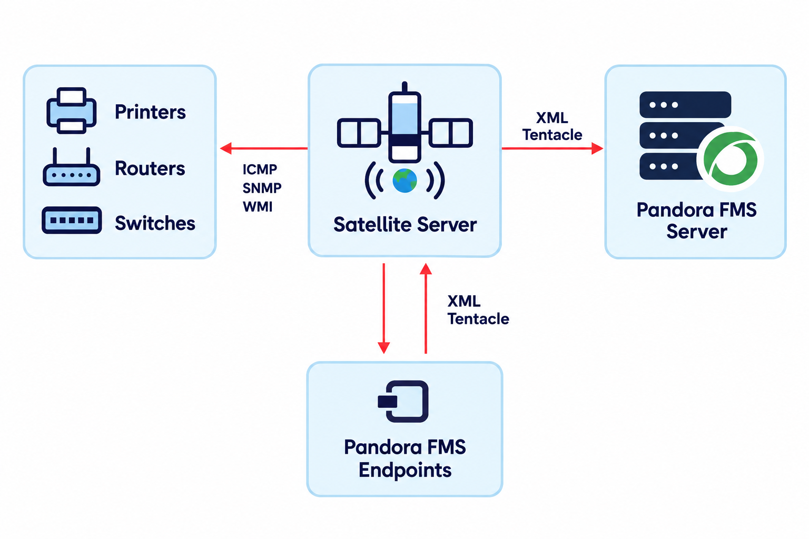

The satellite has a handful of traits that set it apart from an EndPoint and from
a regular Pandora FMS server:

- **High-rate polling.** It can run network checks (ICMP, latency and SNMP v1
  and v2c) up to 500 checks per second. SNMPv3 is slower because it encrypts
  traffic; the cost of security is paid in speed.
- **Interval sending, short-cycle polling.** Checks can run every few seconds,
  but the satellite only sends data to the server every `agent_interval` seconds
  (300 by default). When a value changes from the previous one, it sends it
  right away; if it does not change, it waits for the interval.
- **Standalone server.** It does not touch the Pandora FMS database. It
  generates XML and delivers it just like an EndPoint in *broker* mode or an
  Export Server, so it is enough for the Tentacle port to be open.
- **Self-discovery.** With a recon task it creates the agents of the devices it
  finds (identified by IP address), detects dynamic elements (network
  interfaces, storage) and monitors them on its own. On Windows it also detects
  disks, CPU and memory.
- **Generated modules are regular modules.** They are edited from the Web
  console like those of any agent.
- **IPv6.** Both the satellite server and the network server support it in all
  their advanced features.

!!! warning "Version 785: no backwards compatibility"
    Satellite server 785 is not compatible with earlier versions of Pandora FMS.
    Install it alongside a 785 or later environment. If an older satellite is
    connected to a 785 environment, the new features (the SSH tunnel, two-file
    remote configuration, Satellite-type modules) will show up in the console
    but will not work.

The [1.2 (Introduction and architecture)](../parte-1/1.2-introduccion-y-arquitectura.md)
chapter places the satellite in the whole picture and goes through the topologies
built around it: networks with difficult access, unreachable networks and large
environments. The [2.6 (Network monitoring)](../parte-2/2.6-monitorizacion-de-redes.md)
chapter explains when remote monitoring replaces the EndPoint and which server
runs each type of check. Here the satellite itself is documented: how it is
configured, how it creates agents, which modules it supports and how it connects
to the console.

## How it works inside

Understanding the satellite cycle is what allows operating it with judgement
instead of by restarting it over and over. The cycle has four phases.

**1. Discover.** The satellite finds out what is on the network in three ways
that can coexist: a recon task (Recon Task) that scans one or several ranges
over ICMP, SNMP or WMI; a host file with known addresses; and manual
registration, writing an agent's configuration file by hand. Every discovery
produces one configuration file per agent, stored in the `agent_conf_dir`
directory (`/etc/pandora/conf` by default).

**2. Poll.** Each protocol has its own family of threads, intervals, retries and
timeouts. The satellite launches threads for ping, latency, TCP, SNMP v1, v2c and
v3, WMI, SSH, execution and plugins. Each family does its work at its own pace:
boolean checks change status on their own, and numeric ones (latency, traffic,
CPU, disk) change when they cross the threshold defined in the module.

**3. Decide when to report.** The satellite keeps checks on a short interval, but
only packages and sends when there is something to tell. If a value changes from
the previous one, an XML goes out right away; if everything stays the same, the
XML waits for the agent's `agent_interval`. It is the difference between polling
frequency and sending frequency, and it is worth keeping clear: dropping the ping
interval to one minute does not mean sending data every minute.

**4. Send.** The satellite packages one XML per agent and delivers it over
Tentacle to port 41121 on the server, or copies it to a local directory if the
transfer mode is `local`. There is an optional buffer (`xml_buffer`) to retry
failed deliveries, with a temporary space control (`temporal_min_size`) that
keeps the disk from filling up if the server disappears for hours.

On top of all this comes **remote configuration**. The satellite itself and its
agents can be reconfigured from the Web console: the console publishes the files
and their MD5 in the remote configuration path, and the satellite picks them up
in its remote configuration check cycle when it detects that the MD5 has
changed. Management is done from the tabs of the server view: **Edit**,
**Remote configuration**, **Advanced editor**, **Manage agents**,
**Collections** and **SSH tunnel**.

As for the data format, the satellite writes XML with the same structure as an
agent, so the server receives it like any other source. In the Web console,
however, these agents do stand out from the rest: each one records the satellite
it depends on and is assigned the **Satellite** operating system, with an icon
of its own. That is why the console can list and filter them separately (only
those of one satellite, or the opposite) and why their modules are the
satellite's own types (ICMP, TCP, SNMP, WMI, SSH and execution), which the
console offers only to these agents. Nor do they share an EndPoint's
configuration: their file is published and collected through satellite
management. It is not an ordinary agent with network modules: it has its own
marker, its own icon and its own set of modules.

!!! example "The cycle, with numbers"
    A switch at `192.168.10.1` is polled over SNMP every 60 seconds
    (`snmp_interval 60`, `snmp_threads 10`) and its latency every 60 seconds
    (`latency_interval 60`). If the operational status of an interface changes,
    an XML goes out right away; if everything stays the same, the XML with the
    accumulated values is sent every 300 seconds (`agent_interval 300`).

## Installation and start-up

Installing the satellite (requirements, online installation on Linux, offline
installation and the Windows installer, with all their parameters) is covered in
[Installation of the satellite](../parte-1/1.1-instalacion.md#installation-of-the-satellite).
Only the operational side that section does not cover is gathered here: how it
is started, where the log ends up and which Windows detail is worth keeping in
mind.

| Requirement | Detail |
|---|---|
| Installation | See [Installation of the satellite](../parte-1/1.1-instalacion.md#installation-of-the-satellite) |
| Service (Linux) | `satellite_serverd`, managed with `systemctl` |
| Configuration file | `/etc/pandora/satellite_server.conf` |
| Log | `/var/log/satellite_server.log` |
| Service user (Linux) | `root` |

Starting and stopping it on Linux:

```bash
systemctl start satellite_serverd
systemctl stop satellite_serverd
```

On Windows the service is started and stopped from the **Start** menu, with the
satellite server entry the installer leaves there.

The minimum initial configuration is one line: the `server_ip` token in
`/etc/pandora/satellite_server.conf` must point to the IP address or DNS name of
the Pandora FMS server the satellite will connect to. After saving the change,
start the service. Data travels over Tentacle, so communication towards the
server on `41121/tcp` has to be allowed.

If something does not work, the first place to look is
`/var/log/satellite_server.log`. How much detail it writes is controlled by the
`verbosity` token, level 3 by default and 10 at most.

!!! warning "WMI on Windows: the service, as Administrator"
    Because of the Windows security policy, some versions restrict the account
    that can make remote WMI queries. When WMI queries do not work, the solution
    is to run the satellite server service with the **Administrator** account:
    open **Services**, go into the service properties and, on the **Log On**
    tab, select an account with administrator permissions. Restart the service
    to apply the change.

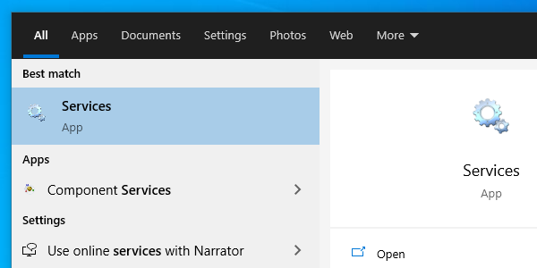

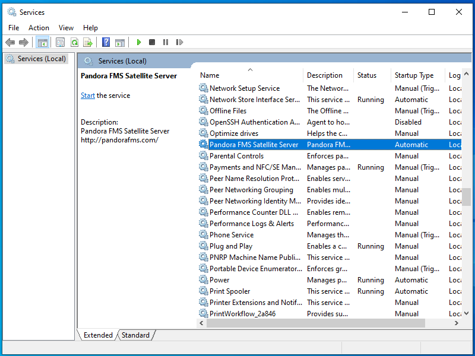

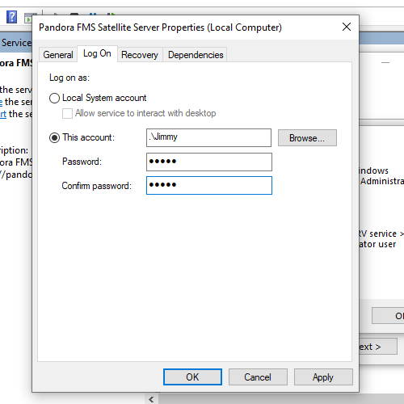

As for ARM, the online installer supports `aarch64` (ARM64) in addition to
`x86_64`: EL 8, 9 and 10, Ubuntu 22.04 and 64-bit Raspberry Pi OS / Debian 12
and 13. The ARM package is self-contained and brings its own Perl interpreter
compiled for `aarch64`. There is no support for `armv7l` (32-bit ARM): if the
system is 32-bit, the installer stops. On boards with little memory the resource
check can be skipped with `SKIP_RESOURCE_CHECKS=1`. The complete details, with
the installer variables, are in
[Installation of the satellite](../parte-1/1.1-instalacion.md#installation-of-the-satellite).

## Satellite server configuration

### The configuration file and remote configuration

The satellite configuration lives in `/etc/pandora/satellite_server.conf`, in
`token value` format, one line per token. Except for the directives that accept
several lines (host lists and credential boxes, as shown further down), each
token appears only once. Every parameter that is a time or an expiry is
expressed in seconds: the generic default value, when nothing else is indicated,
is 300 seconds.

The file can be edited by hand on the satellite machine, but the usual way is
from the Web console. In **Management → Servers → Manage servers**, the
**Remote configuration** icon opens the satellite configuration:

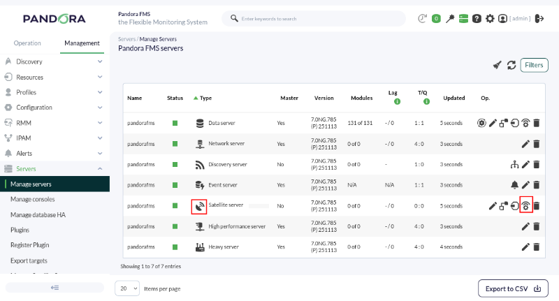

Remote configuration offers two editors. The **Advanced editor** shows the whole
text of the file, ready for editing tokens by hand and saving with the
**Update** button:

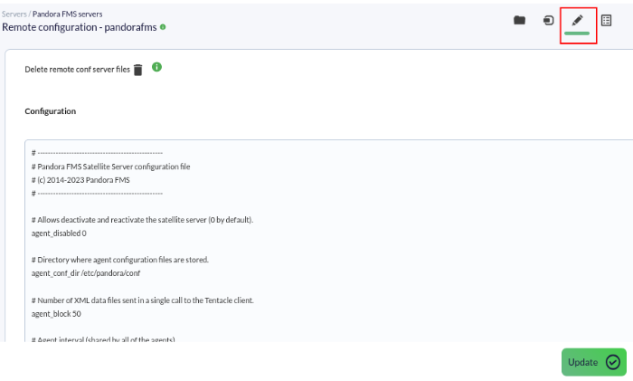

The **Standard editor**, on the left tab, presents the tokens in a guided way and
with dynamic search: one or more letters are typed and the tokens containing them
are filtered.

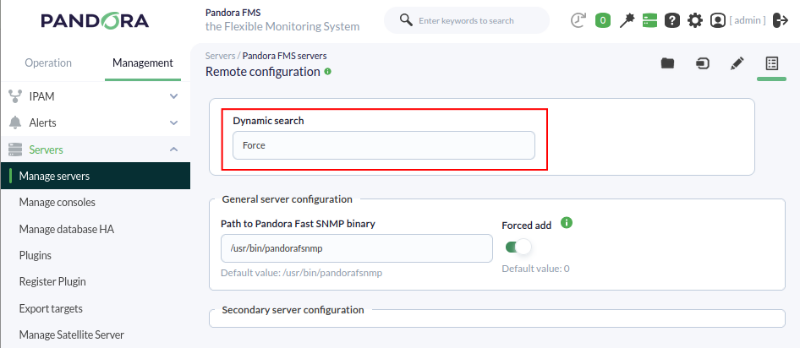

Some tokens accept only two values, ON or OFF. In the standard editor, the first
button changes that value; the second one enables or disables the token, and
disabling it makes the satellite take the default value assigned to it (1 or 0),
regardless of what the first button shows.

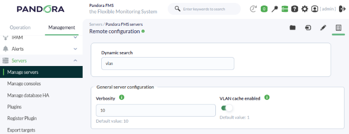

!!! note "Changes are not instant"
    Synchronisation and loading of the new tokens take a while. It is necessary
    to wait a few moments for them to propagate; the satellite collects the
    configuration in its usual cycle.

There are **two** tokens that decide when remote configuration is re-read, and
they are worth telling apart:

| Token | Default value | What it controls |
|---|---|---|
| `server_threshold` | 5 | Cadence of the satellite's common tasks: it checks **its own** remote configuration (if it has changed, it restarts to apply it) and looks for new collections. It is the one that sets how long it takes to pick up a change in its tokens |
| `conf_interval` | 300 | How often it checks the remote configuration of **each agent** it has discovered, in seconds |

`keepalive`, on the other hand, has nothing to do with reloading configuration:
it is the heartbeat with which the satellite reports its status to the server
(version, group, whether it is disabled). It is explained in the parameter
reference, further down.

A typical example: the satellite has to send data every minute and to check the
remote configuration of its agents every fifteen seconds. In the Advanced
editor, `agent_interval` is changed to `60` and `conf_interval` to `15`:

```ini
agent_interval 60
conf_interval 15
```

Save with **Update** and wait for the cycle to collect the values. Data XML
sending then happens every minute, and checking of the agent configurations,
every fifteen seconds. To make the satellite apply a change in **its own** tokens
sooner there is `server_threshold`, not `keepalive`.

### Parameter reference

This is the complete inventory of `satellite_server.conf`. Chapter 9.3 (Server
configuration reference) excludes the tokens that belong only to the satellite
and refers here, so this is the reference the other chapters hang from.

**The default values published here are the program's**, not those of the sample
template that gets installed. When the template brings another value, it is
indicated in brackets so that it does not come as a surprise when comparing with
the freshly installed file: installing leaves the template in place and its
values are the ones active until they are changed.

**General and main server**

| Parameter | Default value | What it does |
|---|---|---|
| `server_ip` | `127.0.0.1` | IP address or DNS name of the Pandora FMS server to send data to. Communication goes over Tentacle, port `41121/tcp` |
| `server_port` | `41121` | Tentacle server port |
| `server_name` | machine name (empty: the *hostname* is used) | Name of the satellite server |
| `server_path` | `/var/spool/pandora/data_in` | Directory where the XML files are copied when `transfer_mode` is `local` |
| `server_opts` | empty | Parameters passed to the Tentacle client, for example `-x password` |
| `transfer_mode` | `tentacle` | Transfer mode: `tentacle` or `local` |
| `daemon` | `1` | With value `1`, it runs the service in the background |
| `keepalive` | `30` | How often the satellite reports its status to the server, in seconds (the XML of the satellite itself). It does not check remote configuration |
| `verbosity` | `3` | Log detail level, from 0 (least) to 10 (most) |
| `server_threshold` | `5` | Cadence of the common tasks: it checks its own remote configuration (if it changes, it restarts) and looks for new collections |
| `conf_interval` | `300` | How often it checks the remote configuration of each discovered agent, in seconds |
| `log_file` | `/var/log/satellite_server.log` | Satellite log file |
| `agent_disabled` | `0` | Disables (`1`) or reactivates (`0`) the satellite |
| `remote_config` | `0` (the template brings `1`) | Enables remote configuration of the satellite itself and of its agents |

**Secondary server**

| Parameter | Default value | What it does |
|---|---|---|
| `secondary_mode` | `never` | Secondary server mode: `on_error` sends to the secondary only if the primary fails; `always` always sends; `never` disables it |
| `secondary_server_ip` | `localhost` | Secondary server address |
| `secondary_server_path` | `/var/spool/pandora/data_in` | Local directory of the secondary server, if the transfer mode is `local` |
| `secondary_server_port` | `41121` | Tentacle port of the secondary server |
| `secondary_transfer_mode` | `tentacle` | Transfer mode towards the secondary server |
| `secondary_server_opts` | empty | Additional Tentacle client parameters for the secondary |

**Discovery**

| Parameter | Default value | What it does |
|---|---|---|
| `recon_enabled` | `0` (the template brings `1`) | Enables (`1`) or disables (`0`) self-discovery of devices |
| `recon_mode` | `icmp,snmp` (the template brings `icmp`) | Discovery protocols, separated by commas: `icmp`, `snmp`, `wmi` |
| `recon_task` | empty | Networks or addresses to scan, separated by commas and in slash notation, for example `192.168.10.0/24,10.0.1.0/22` |
| `recon_community` | `public` | SNMP communities that will be tried during discovery, separated by commas |
| `recon_interval` | `604800` | Time between network scans, in seconds (seven days) |
| `recon_timing_template` | `2` (the template brings `3`) | Aggressiveness of the network scan and of `nmap`: from 1 (slower and more reliable) to 5 (faster and less reliable) |
| `ipam_task` | empty | Networks to scan by IPAM, preceded by the IPAM task identifier, for example `1,192.168.0.0/24` |
| `ipam_interval` | `300` (the template brings `604800`) | Time between IPAM scans, in seconds |
| `host_file` | empty | Alternative file with hosts to monitor, one address per line |
| `forced_add` | `0` (the template brings `1`) | With `1`, hosts added by hand (through `add_host` or `host_file`) are always created, even if they do not answer ping, with a file with no modules |
| `dynamic_inc` | `0` | With `1`, it moves the dynamic modules discovered (SNMP, WMI…) into separate files so that they do not interfere with remote configuration |
| `vlan_cache_enabled` | `1` | Enables or disables the VLAN cache of self-discovered hosts |
| `general_gis_exec` | empty | Script that provides GIS positioning to all detected agents; it must be executable and print `<longitude>,<latitude>[,<altitude>]` |
| `agents_blacklist_icmp` | empty | Subnets excluded from ICMP checks, in CIDR notation and separated by commas |
| `agents_blacklist_snmp` | empty | Subnets excluded from SNMP checks |
| `agents_blacklist_wmi` | empty | Subnets excluded from WMI checks |
| `fping` | `/usr/sbin/fping` | Path to the Fping binary |
| `fsnmp` | `/usr/bin/pandorafsnmp` | Path to the Pandora Fast SNMP binary |
| `nmap` | `/usr/bin/nmap` | Path to the Nmap binary |

The `add_host`, `ignore_host` and `delete_host` directives are not single-value
tokens: they are lists that can span several lines. `add_host <IP> [name]`
registers a monitored host; `ignore_host <agent>` takes it out of the list even
if a recon task finds it; and `delete_host <agent>` removes it permanently,
deleting its configuration file.

**Polling: ping and latency**

| Parameter | Default value | What it does |
|---|---|---|
| `ping_block` | `400` | Number of hosts processed in a single call to `nmap` for ping; 500 at most |
| `ping_interval` | `60` (the template brings `120`) | Time between ping checks, in seconds |
| `ping_packets` | `1` | Number of ICMP packets sent per ping |
| `ping_retries` | `2` | Retries of the ping modules |
| `ping_threads` | `10` (the template brings `4`) | Threads dedicated to ping checks |
| `ping_timeout` | `1` | Timeout of ping checks, in seconds |
| `latency_block` | `400` | Number of hosts processed in a single call to `nmap` for latency; 500 at most |
| `latency_interval` | `60` (the template brings `180`) | Time between latency checks, in seconds |
| `latency_packets` | `1` | Number of ICMP packets per latency request |
| `latency_retries` | `2` | Retries of the latency modules |
| `latency_threads` | `10` (the template brings `4`) | Threads dedicated to latency checks |
| `latency_timeout` | `1` | Timeout of latency checks, in seconds |

**Polling: TCP, SSH, WMI, execution and plugins**

| Parameter | Default value | What it does |
|---|---|---|
| `tcp_interval` | `300` | Time between TCP checks, in seconds |
| `tcp_threads` | `4` (the template brings `5`) | Threads dedicated to TCP checks |
| `tcp_timeout` | `1` | Timeout of TCP checks, in seconds |
| `ssh_interval` | `300` | Time between SSH checks, in seconds |
| `ssh_threads` | `1` (the template brings `5`) | Threads dedicated to SSH modules |
| `ssh_timeout` | `2` | Timeout of SSH checks, in seconds |
| `wmi_interval` | `300` | Time between WMI checks, in seconds |
| `wmi_threads` | `5` | Threads dedicated to WMI polling |
| `wmi_client` | `/usr/bin/wmic` (the template brings `/usr/bin/pandorawmic`) | Full path to the WMI client; in production PandoraWMIC is used |
| `wmi_auth` | `Administrator%password` | `user%password` pairs for WMI authentication, separated by commas |
| `wmi_ntlmv2` | `0` | Enables (`1`) or disables (`0`) NTLMv2 authentication for WMI |
| `exec_interval` | `300` | Time between execution checks, in seconds |
| `exec_threads` | `5` | Threads dedicated to execution modules; above 20 performance may get worse |
| `plugin_interval` | `300` | Time between plugin checks, in seconds |
| `plugin_threads` | `4` (the template brings `2`) | Threads dedicated to plugins |
| `plugin_timeout` | `30` (the template brings `10`) | Timeout of plugins, in seconds |

**Polling: SNMP**

| Parameter | Default value | What it does |
|---|---|---|
| `snmp_version` | `1` | Default SNMP version (`1` or `2c`); SNMPv3 modules declare their own. Changing it can break existing modules |
| `snmp_block` | `70` (the template brings `50`) | Hosts processed in a single call to `pandorafsnmp` (SNMPv1) |
| `snmp_interval` | `60` (the template brings `180`) | Time between SNMPv1 checks, in seconds |
| `snmp_retries` | `2` | Retries of the SNMPv1 modules |
| `snmp_threads` | `10` (the template brings `8`) | Threads dedicated to SNMPv1 |
| `snmp_timeout` | `4` (the template brings `5`) | SNMPv1 timeout, in seconds |
| `snmp_verify` | `0` | Verifies the SNMPv1 modules that make `pandorafsnmp` fail |
| `snmp2_block` | `70` (the template brings `50`) | Hosts processed in a call to `pandorafsnmp` (SNMPv2c) |
| `snmp2_interval` | `60` (the template brings `180`) | Time between SNMPv2c checks, in seconds |
| `snmp2_retries` | `2` | Retries of the SNMPv2c modules |
| `snmp2_threads` | `10` (the template brings `8`) | Threads dedicated to SNMPv2c |
| `snmp2_timeout` | `4` (the template brings `5`) | SNMPv2c timeout, in seconds |
| `snmp2_verify` | `0` | Verifies the problematic SNMPv2c modules |
| `snmp3_block` | `70` (the template brings `50`) | Hosts processed in a call to `pandorafsnmp` (SNMPv3) |
| `snmp3_interval` | `60` (the template brings `180`) | Time between SNMPv3 checks, in seconds |
| `snmp3_retries` | `2` | Retries of the SNMPv3 modules |
| `snmp3_threads` | `10` (the template brings `4`) | Threads dedicated to SNMPv3 |
| `snmp3_timeout` | `4` (the template brings `5`) | SNMPv3 timeout, in seconds |
| `snmp3_verify` | `0` | Verifies the problematic SNMPv3 modules |

**Credentials and encryption**

| Parameter | Default value | What it does |
|---|---|---|
| `credential_pass` | machine name | Password with which the passwords of the credential boxes are encrypted; it must match the one defined in the Web console |
| `snmp3_seclevel` | `authpriv` | SNMPv3 security level: `noauth`, `authnopriv` or `authpriv` |
| `snmp3_secname` | empty | SNMPv3 security name |
| `snmp3_authproto` | `sha` | SNMPv3 authentication protocol: `md5` or `sha` |
| `snmp3_authpass` | empty | SNMPv3 authentication password |
| `snmp3_privproto` | `des` | SNMPv3 privacy protocol: `des` or `aes` |
| `snmp3_privpass` | empty | SNMPv3 privacy password |
| `wmi_credential_encrypt` | `0` | Encrypts the passwords of the WMI modules and of the `wmi_auth` token; without `credential_pass` the satellite name is used |
| `snmp3_credential_encrypt` | `0` | Encrypts the passwords of the SNMPv3 modules and of the `snmp3_authpass` and `snmp3_privpass` tokens |

The credential boxes (`credential_box`, `ssh_credential_box`,
`wmi_credential_box` and `snmp3_credential_box`) are also list directives and
accept several lines; they are detailed in
[Credential boxes](#credential-boxes).

**Transfer and storage**

| Parameter | Default value | What it does |
|---|---|---|
| `agent_interval` | `300` | How often data is sent to the server, in seconds, regardless of the polling frequency |
| `agent_threads` | `1` (the template brings `4`) | Threads used to send the data XML files |
| `agent_block` | `50` | Number of XML files sent in a single call to the Tentacle client |
| `connection_interval` | `300` | How often the connections XML is sent to the server, in seconds (the map of links between agents), if there are changes |
| `agent_conf_dir` | `/etc/pandora/conf` (`./conf` in the internal value) | Directory where the configuration files of each agent are created and stored |
| `group` | `Servers` (empty in the internal value) | Default group of the agents created by the satellite; it must exist in the Web console |
| `xml_buffer` | `0` | With `1`, it stores the XML files that could not be sent so that they are retried later |
| `temporal` | `/tmp` | Temporary directory where the XML files are created |
| `temporal_min_size` | `1` (the template brings `1024`) | Minimum free space, in megabytes, of the temporary partition; below that value it stops generating packages |
| `startup_delay` | `30` (the template brings `60`) | Wait, in seconds, before the first data sending |
| `tentacle_client` | `/usr/bin/tentacle_client` | Full path to the Tentacle client |
| `timeout_bin` | empty | If defined, it puts the `timeout` program (usually `/usr/bin/timeout`) in front of the calls to the Tentacle client |
| `timeout_seconds` | `10` | Expiry time, in seconds, of the `timeout` program; it requires `timeout_bin` |

**Proxy**

| Parameter | Default value | What it does |
|---|---|---|
| `proxy_traps_to` | empty | Redirects the SNMP traps received to `IP[:port]`; port `162` by default |
| `proxy_traps_from` | `0.0.0.0:162` | Local address and port where the SNMP traps are received |
| `proxy_tentacle_from` | `0.0.0.0:41121` | Redirects the data received by the local Tentacle server from `IP[:port]` |
| `proxy_tentacle_to` | empty | Redirects the requests of the Tentacle clients received to `IP[:port]`; port `41121` by default |

**Reverse SSH tunnel and collections**

| Parameter | Default value | What it does |
|---|---|---|
| `reverse_ssh_config` | `/etc/pandora/reverse_ssh_config` | Directory where the satellite stores the configuration and keys of the reverse SSH tunnel |
| `reverse_ssh_interval` | `15` | How often the satellite checks the status of the reverse tunnel, in seconds |
| `collection_dir` | derived from `agent_conf_dir` | Directory where the satellite decompresses the collections the Web console assigns to it |

Besides these tokens, the program handles a handful of internal values that in
practice are not edited by hand: the automatic name of the discovered agents, the
internal sending delays, the mode used to decompress collections, the path of the
`unzip` binary and the product licence. They are managed from the installation
and from the Web console; they are not part of the configuration that is worth
touching in the file.

!!! note "The proxy does not touch agent configuration"
    `proxy_tentacle_to` is a forwarding: the satellite listens to the Tentacle
    connections that reach it and passes them to the destination address. It
    does not read or write the configuration of any agent, so it does not
    conflict with remote configuration: the satellite agent configuration lives
    in the satellite and the EndPoint one, in the EndPoint.

    Watch out for the name, though. The server identifies the agent by its name
    when processing the XML it receives, so if the machine already has a
    satellite agent and an EndPoint with the same name is created on top of it,
    two agents do not appear: it is **one only**, which receives data from both
    sides and mixes its modules. In its view the two configurations appear
    separately —the EndPoint remote configuration and the satellite remote
    configuration—, but the agent is the same.

## Creating agents on the Satellite server

A satellite agent is a configuration file in the `agent_conf_dir` directory.
There are four ways to get there, and choosing the right one saves trouble
afterwards, especially when deleting:

- **From the Web console.** The satellite creates the agent for you. It is the
  most convenient one when the satellite is already running.
- **Recon Task.** The satellite scans a network and registers what it finds.
- **Host file.** A list of addresses supplied by the user.
- **Manual registration.** Writing the `.conf` file by hand.

!!! warning "An agent with no modules is ignored"
    If an agent's configuration file contains no module, the satellite ignores it
    (except with `forced_add` at `1`, as explained below): an agent with nothing
    to check generates no XML and does not appear as monitored.

!!! note "Forced addition (`forced_add`)"
    The `forced_add` token decides how hosts are registered. With `1`, the ones
    that come from the console (`add_host`) or from the host file are always
    created, even if they do not answer ping, and agents with no modules are
    kept. With `0`, they have to answer ping to be created and an agent with no
    modules is ignored. In new installations it usually comes enabled; in an
    upgrade it may come disabled, so it is worth reviewing. It does not take
    part in Recon Task discovery: there the scan result rules. It is in the
    [parameter reference](#parameter-reference).

### From the Web console

With remote configuration enabled, the Web console creates the agent for you: no
file has to be touched. It can be done from the agent management view or from the
satellite view itself.

Whichever of the three ways is used, the mechanism underneath is the same: the
console does not create the agent file directly. It adds an
`add_host <ip> <name>` line to the satellite configuration, and it is the
satellite which, in its next cycle, creates the agent's `.conf` file in
`/etc/pandora/conf` on the satellite.

#### Agent management

The direct path is **Management → Resources → Manage agents**. In that view, the
**Create Satellite agent** button opens the **Add new agent to satellite** form,
which asks for four pieces of data: the **agent address**, its **name**, the
**group** and the **satellite server** it is assigned to.

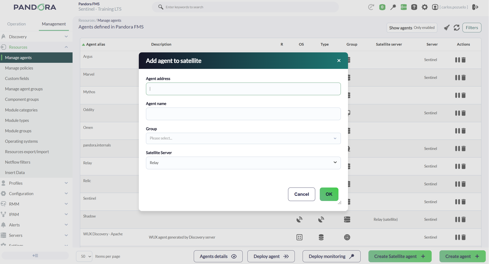

On saving, the satellite creates the agent in its next cycle and starts sending
data.

#### Satellite management

The **Management → Servers → Manage satellite servers** menu lists the
satellites and gives access, for each one, to its collections, its remote
configuration and agent management:

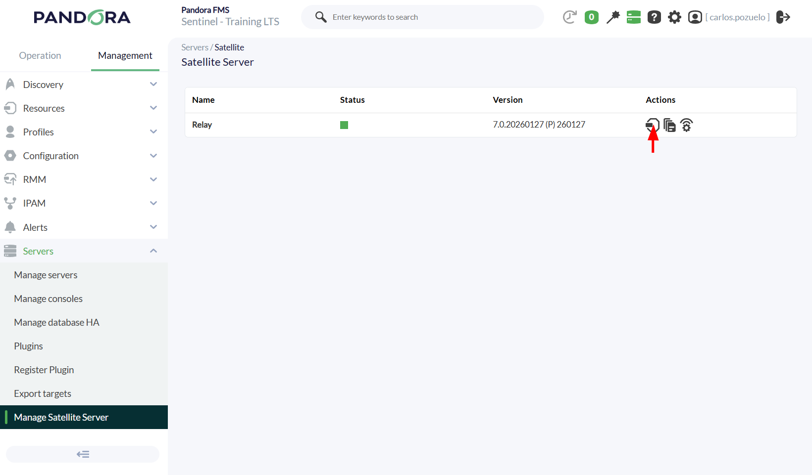

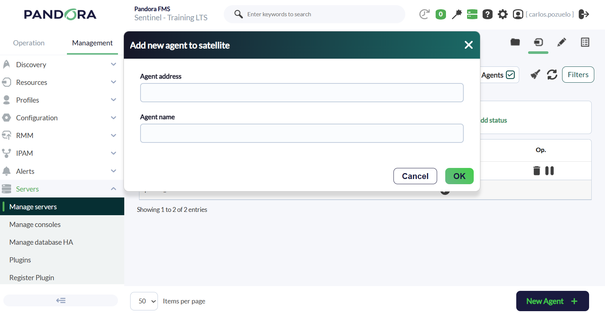

The agent management screen allows creating agents, checking their information,
deleting them and disabling them:

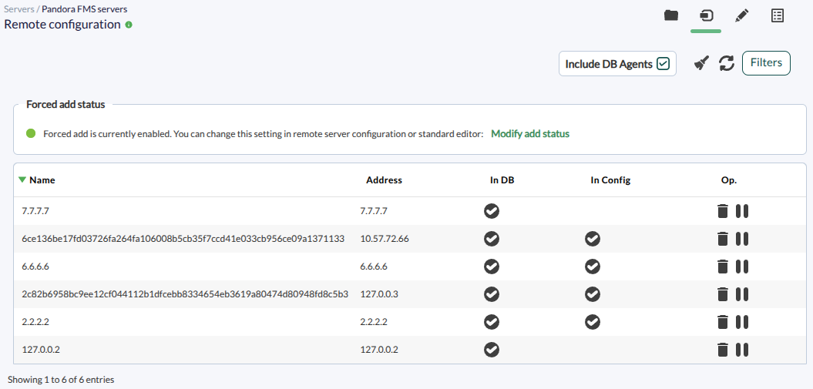

!!! tip "Names are shown, not aliases"
    The satellite agent listing uses the agent name, not its alias.

If an agent belongs to a satellite and has remote configuration enabled, a new
section appears in agent management to edit or delete its configuration file:

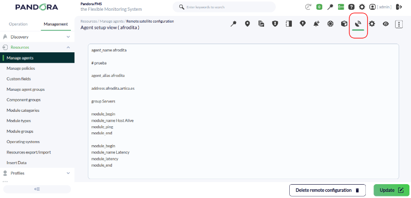

#### From an existing agent

A satellite agent can also be generated from an existing Pandora FMS agent,
remote or local, to fork monitoring and run modules from two different points. In
the edition of that agent, if it does not already have a satellite agent
assigned, the button to create its configuration appears:


The console fills in the agent data and allows choosing the satellite server to
add it to and the IP address that satellite will use. The process creates the
satellite configuration file and adds a host to its configuration; the data is
reported to the agent it was created from.

### Recon Task

It is the most used method: the satellite is told which ranges to scan and with
which protocols, and it discovers the devices and creates the agents. The
parameters involved are:

- `recon_enabled`: at `1` to enable discovery.
- `recon_mode`: protocols separated by commas (`icmp`, `snmp`, `wmi`).
- `recon_task`: networks to scan, separated by commas and in slash notation.
- `recon_community`: SNMP communities to try, separated by commas.
- `recon_interval`: how often the scan is repeated, in seconds.
- `recon_timing_template`: aggressiveness of `nmap`, from 1 to 5.

In `icmp` mode the satellite checks whether the host answers and measures
latency. In `snmp` (v1 and v2c only) it looks for the network interfaces, pulls
their traffic and operational status, and obtains the device name and location,
trying the list of communities. In `wmi` it does the same with CPU load, memory
and all available disks. For SNMPv3 discovery is not used, because it adds
nothing: credentials are configured separately, as explained in
[SNMPv3](#snmpv3).

Example of a recon task on the example network:

```ini
recon_community public
recon_enabled 1
recon_interval 604800
recon_mode icmp,snmp,wmi
recon_task 192.168.10.0/24
recon_timing_template 3
```

After saving, the satellite is started or restarted and scanning begins. The
agents it finds will appear in the agent view as soon as they send their first
XML.

### Host file

It is the complement of discovery or its alternative when the exact addresses
are already known. The `host_file` line is uncommented and points to the file:

```ini
host_file /etc/pandora/satellite_hosts.txt
```

The file holds one address per line; optionally, behind the address and
separated by a space, the name with which to create the agent. If a name is
given, the agent is created with that name and uses the address for its modules:

```text
192.168.10.5 Server5
192.168.10.6 Server6
192.168.10.7 Server7
```

Unless `forced_add` is at `1`, the addresses have to answer `fping` for the agent
to be created. The file is read every `recon_interval` seconds.

!!! note "Paths on Windows"
    On Windows, the path of the host file is written **without** quotes.

### Manual registration

It is the direct path: creating the agent's `.conf` file by hand in the
configuration directory, `/etc/pandora/conf` by default. The basic fields are:

- `agent_name`: agent name.
- `agent_alias`: agent alias.
- `address`: IP address of the element to monitor.
- `group`: group the agent is assigned to.
- `gis_exec`: positioning script, optional; if used, it overrides the location
  provided by `general_gis_exec` on the satellite.

The modules are added next. An example file:

```ini
agent_name Example
agent_alias This is an example
address 192.168.10.20
group Servers

module_begin
module_name Ping
module_ping 192.168.10.20
module_end

module_begin
module_name Latency
module_latency 192.168.10.20
module_end
```

## Removing agents

A satellite agent exists in two places at once: as a configuration file on the
satellite server and as an agent in the Pandora FMS database. To remove it
completely it has to be taken out of both. If one is left, the agent lives on
through the other side: with the file, the satellite keeps polling the device and
sending data; without the file but with the agent in the database, an orphan
agent remains in the console, with no new data. The order is always the same:
first the satellite, then the console.

!!! warning "Back up before deleting"
    Before touching anything, back up the folders and their files. Deleting an
    agent cannot be undone from the Web console.

### From the Web console

It is the recommended path. In
**Management → Servers → Manage satellite servers**, go into the agent
management of that satellite and click the agent's bin button:

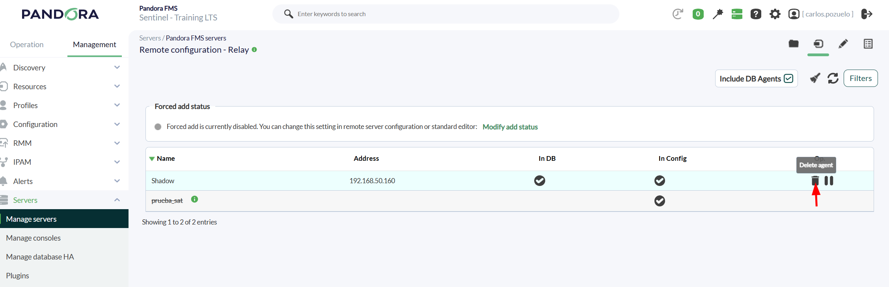

The console adds the `delete_host <agent>` directive to the satellite
configuration, and in the next interval the satellite deletes that agent's
configuration file and stops sending it. Once that is done, the agent can be
deleted from **Management → Resources → Manage agents**.

From the Web console itself, bulk deletion of agents of a satellite has its
procedure in
[Bulk operations](../parte-12/12.10-operaciones-masivas.md).

### Manual

Delete the agent's `.conf` file in `/etc/pandora/conf` on the satellite and then
remove the agent in the Web console.

### Host file

Remove from the `satellite_hosts.txt` file the lines of the addresses to be
deleted, delete their `.conf` files in `/etc/pandora/conf` on the satellite and
remove the agent in the Web console.

### Recon Task

Unconfigure the recon task in the satellite file, delete the `.conf` files
created in `/etc/pandora/conf` on the satellite and remove the agent in the Web
console. If the Recon Task is to be kept in use but that device must not be
registered again, add its address to `agents_blacklist_icmp` (CIDR notation and
several comma-separated entries are accepted): discovery stops adding the ICMP
modules to it and, if no other module is left, the satellite ignores it.

!!! example "Deleting an agent discovered in 192.168.10.0/24"
    The switch `192.168.10.2` was discovered by a recon task on
    `192.168.10.0/24`. In **Management → Servers → Manage satellite servers**, in
    the satellite agent management, the bin button of `192.168.10.2` is clicked:
    the console adds `delete_host 192.168.10.2` to the configuration, and in the
    next interval the satellite deletes its `.conf` file and stops sending it.
    Then it is deleted in **Management → Resources → Manage agents**. If it must
    not show up again either, add its address to `agents_blacklist_icmp`.

## Satellite modules

Besides the modules the satellite generates on its own when it discovers a
device, any ICMP, TCP, SNMP, WMI, SSH, execution or plugin check can be added by
hand. The syntax of the agent configuration file is practically the same as that
of an EndPoint's local modules, so anyone who has written a `module_*` before
feels at home right away.

The Web console offers specific module types when the agent belongs to a
satellite with remote configuration: **Satellite ICMP module**,
**Satellite SNMP module**, **Satellite WMI module**, **Satellite SSH module**,
**Satellite Exec module** and **Satellite TCP module**.

!!! note "Credentials"
    Unless authentication is done with a public and a private key, the SSH, WMI
    and SNMPv3 modules need a user and a password. They are registered in
    encrypted credential boxes. They are explained further down, in
    [Credential boxes](#credential-boxes).

### Creating satellite modules

There are two ways to add a module to a satellite agent: from the Web console,
which writes it for you, or directly in the agent configuration file, writing the
block by hand.

#### Satellite-type modules from the console

From the console there is no need to know the syntax: the module type is chosen
and the form is filled in. Each type asks for different data; the SNMP one, for
example, asks for the destination address, the port, the OID, the version and the
community (or the SNMPv3 credentials), whereas the TCP one is happy with the
address and the port.

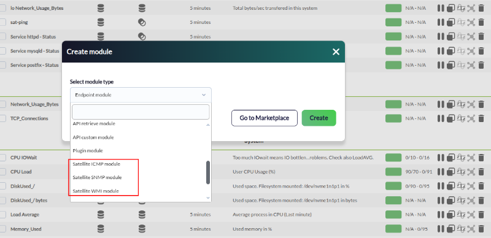

What the console does underneath is write the corresponding block into the
satellite agent configuration. It can be seen before saving with the
**Show configuration data** button of the form itself, which unfolds the block
exactly as it is going to be written.

An example: an SNMP module that checks the status of an interface on
`192.168.10.1`, with OID `.1.3.6.1.2.1.2.2.1.8.3` and community `public`. On
saving, the console writes it into the agent configuration and the satellite runs
it in its next cycle.

#### From the configuration file

The other way is writing the module block directly in the agent configuration
file, on the satellite, just like a local module. It is the path to take when
everything is preferred in the file or when the module does not fit the console
form. The following sections show how each type is written: ICMP and TCP, WMI,
SNMPv1 and SNMPv2, SNMPv3, SSH, execution and plugins, with the credential boxes
at the end.

### ICMP and TCP

Connectivity is checked with `module_ping` and latency with `module_latency`. The
TCP port is checked with `module_tcp` and `module_port`:

```ini
module_begin
module_name Ping
module_type generic_data
module_ping 192.168.10.20
module_end

module_begin
module_name Port 80
module_type generic_proc
module_tcp 192.168.10.20
module_port 80
module_end
```

### WMI

For Windows there are three modules for direct use: `module_wmicpu` for the CPU
percentage, `module_wmimem` for free memory and `module_wmi` with
`module_wmiquery` for a generic query:

```ini
module_begin
module_name CPU
module_type generic_data
module_wmicpu 192.168.10.30
module_wmiauth <user>%<password>
module_end

module_begin
module_name FreeMemory
module_type generic_data
module_wmimem 192.168.10.30
module_wmiauth <user>%<password>
module_end

module_begin
module_name GenericWMI
module_type generic_data_string
module_wmi 192.168.10.30
module_wmiquery SELECT Name FROM Win32_ComputerSystem
module_wmiauth <user>%<password>
module_end
```

The module credentials can be replaced by a WMI credential box
(`wmi_credential_box`). And for remote WMI queries to work on Windows, remember
what was said in
[Installation and start-up](#installation-and-start-up): the satellite service
must run under an administrator account.

### SNMPv1 and SNMPv2

!!! warning "OIDs start with a dot"
    Make sure the OID starts with a dot (`.1.3.6.1...`). Otherwise the SNMP
    module will not work.

An SNMP module uses `module_snmp` for the address, `module_oid` for the
identifier and `module_community` for the community. The satellite detects each
network interface on its own, and the real descriptive name appears in the module
name:

```ini
module_begin
module_name if eth1 OperStatus
module_type generic_data_string
module_snmp 192.168.10.1
module_oid .1.3.6.1.2.1.2.2.1.8.3
module_community public
module_end
```

To force SNMPv2c or SNMPv1 the corresponding line is added:

```ini
module_version 2c
```

```ini
module_version 1
```

For example, the outbound traffic of an interface, which the satellite extracts
automatically with the real interface name:

```ini
module_begin
module_name if eth0 OutOctets
module_type generic_data_inc
module_snmp 192.168.10.1
module_oid .1.3.6.1.2.1.2.2.1.16.2
module_community public
module_end
```

### SNMPv3

For an SNMPv3 module, `module_version 3` is set and the security data of the
module itself are specified:

- `module_seclevel`: security level (`noauth`, `authnopriv` or `authpriv`).
- `module_secname`: security name.
- `module_authproto`: authentication protocol (`md5` or `sha`).
- `module_authpass`: authentication key.
- `module_privproto`: privacy protocol (`des` or `aes`).
- `module_privpass`: privacy key, when the level requires it.

The three levels, from least to most:

```ini
module_begin
module_name snmp_noauth
module_type generic_data_string
module_snmp 192.168.10.1
module_version 3
module_oid .1.3.6.1.2.1.1.1.0
module_seclevel noauth
module_secname snmpuser
module_end
```

```ini
module_begin
module_name snmp_authnopriv
module_type generic_data_string
module_snmp 192.168.10.1
module_version 3
module_oid .1.3.6.1.2.1.1.2.0
module_seclevel authnopriv
module_secname snmpuser
module_authproto md5
module_authpass <password>
module_end
```

```ini
module_begin
module_name snmp_authpriv
module_type generic_data_string
module_snmp 192.168.10.1
module_version 3
module_oid .1.3.6.1.2.1.1.2.0
module_seclevel authpriv
module_secname snmpuser
module_authproto sha
module_authpass <password>
module_privproto aes
module_privpass <password>
module_end
```

If several modules share the same SNMPv3 configuration, it can be taken out of
the module declaration, to the agent itself or even to the satellite file if
several agents share it:

```ini
agent_name snmp
address 192.168.10.1

seclevel authpriv
secname snmpuser
authproto md5
authpass <password>
privproto des
privpass <password>

module_begin
module_name snmp_authpriv_1
module_type generic_data_string
module_snmp
module_version 3
module_oid .1.3.6.1.2.1.1.1.0
module_end
```

At global scale, the `snmp3_seclevel`, `snmp3_secname`, `snmp3_authproto`,
`snmp3_authpass`, `snmp3_privproto` and `snmp3_privpass` tokens of the satellite
file serve the same purpose for all agents. When an SNMPv3 module carries no
credentials of its own and its IP address matches a network of an
`snmp3_credential_box` box, the box is used; otherwise the global tokens are
used.

### SSH

The satellite connects to the remote device over SSH and runs the command there.
The destination address goes in `module_ssh` and the command in
`module_command`:

```ini
module_begin
module_name GenericSSH
module_type generic_data
module_ssh 192.168.10.40
module_command ls /tmp | wc -l
module_end
```

!!! warning "SSH on Windows satellites"
    SSH queries on satellite servers installed on Windows are still being
    implemented.

### Remote execution

Here the command or script runs **on the satellite machine itself**, not on the
remote device. It is declared with `module_exec`; the script has to be deployed
and reachable on the satellite, and if it needs to reach the remote device it
connects on its own. Abusing `module_exec` brings satellite performance down.

```ini
module_begin
module_name Sample_Remote_Exec
module_type generic_data
module_exec /usr/share/test/test.sh 192.168.10.50
module_min_warning 90
module_min_critical 95
module_end
```

!!! tip "The script can arrive in a collection"
    There is no need to copy it by hand to each satellite: it can be distributed
    from the Pandora FMS server with the **satellite server collections**. The
    satellite downloads them, decompresses them and adds their folder to the
    `PATH`, so the script is available by its name. See
    [Collections on the Satellite server](../parte-2/2.9-colecciones.md#collections-on-the-satellite-server).

### Plugins

A plugin is declared with `module_plugin` and, like the execution module, it runs
**on the satellite machine**: it is the plugin that has to connect to the remote
device. In exchange it is far more flexible than a lone command.

```ini
module_plugin /usr/share/pandora/remote_advanced_checks.sh 192.168.10.1
```

!!! tip "The plugin can arrive in a collection"
    Just like the execution script, the plugin can be distributed from the
    Pandora FMS server with the **satellite server collections**: the satellite
    decompresses them and adds their folder to the `PATH`, so it is available by
    its name. See
    [Collections on the Satellite server](../parte-2/2.9-colecciones.md#collections-on-the-satellite-server).

### Credential boxes

The SSH, WMI and SNMPv3 modules need a user and a password (unless public and
private key authentication is used). They are registered in the satellite file
through credential boxes, with these formats:

```text
network/mask,user,password
network/mask,user,[[encrypted password]]
```

For example:

```ini
credential_box 192.168.10.10/32,<user>,<password1>
credential_box 192.168.10.0/24,<user>,<password2>
```

The search in the boxes goes from the most restrictive mask to the least
restrictive, so the first one that matches wins. Passwords can be encrypted with
Blowfish in ECB mode; for that, `credential_pass` has to be defined, because
otherwise the machine name is used as the encryption password. The hexadecimal
representation of the encrypted text is surrounded by double square brackets:

```ini
credential_box 192.168.10.0/24,<user>,[[80b51b60786b3de2]]
```

There is one box per module type: `credential_box` (or `ssh_credential_box`,
which is its equivalent with a name of its own), `wmi_credential_box` and
`snmp3_credential_box`. The Web console manages them on the satellite's
**Credential boxes** screen, and the console itself does the encryption; that is
why `credential_pass` must match on both sides.

!!! warning "The satellite box is its own"
    Do not confuse the general Pandora FMS credential manager with the satellite
    server boxes. The satellite ones are its own and live in its configuration
    file. The general manager is in
    [Credentials](../parte-2/2.2-gestor-de-credenciales.md).

### Dynamic modules in the console

If the satellite configuration is correct, the Web console shows an agent view
with the ones the satellite has discovered or created. Dynamic modules (the ones
the satellite generates when it detects interfaces, disks or CPU) appear in the
agent like any other module, and can be filtered and edited just like those of a
regular agent.

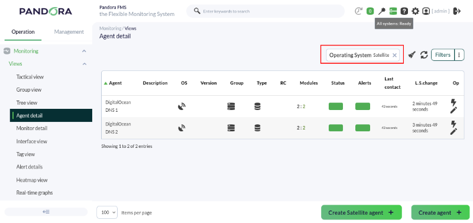

!!! example "A dynamic module in the view"
    The satellite discovers the switch `192.168.10.1`, creates its agent and adds
    a module for each interface detected, with the real interface name. In the
    agent view, that agent appears with its dynamic modules, editable like any
    other.

## Exec Server and reverse SSH tunnel

### What the Exec Server is

The **Exec Server** is used to run Web console processes from a remote server,
instead of from the console itself. The typical case: launching a scan with the
SNMP Wizard on an isolated network reached only by the satellite server. The
console has no route to that network, but the satellite does; with the Exec
Server, the wizard runs at the point that sees the network. The agent wizards
(SNMP and WMI) and the **SNMP browser** take advantage of it: their queries are
launched from the server chosen, not from the console.

It can be configured on a Pandora FMS network server and on a satellite server.
The feature uses the SSH tunnel that Pandora FMS sets up automatically; once the
tunnel is configured, the server becomes available as an Exec Server from the Web
console.

### Enabling and using it

**Enabling it on a network server.** The server view
(**Management → Servers → Manage servers**) shows the **Exec Server** switch and
a **Port** field. If the port is left blank, the default SSH port (22) is used.
With the Exec Server enabled, a **Check Exec Server** indicator also appears to
verify that it answers.

**Enabling it on a satellite.** Satellites do not set `exec_proxy`: they appear
as an Exec Server as soon as their reverse SSH tunnel is ready, that is, when the
`reverse_ssh_ready` column is active. That is why both things go hand in hand.

The console connects to the Exec Server with the **`pandora_exec_proxy`** user,
which is the one it expects to find on the other side; if the account does not
match, the check fails with a warning that the user must be
`pandora_exec_proxy`.

Wherever the Exec Server is used, the form includes a selector to choose it: in
the wizards it is called **Server to execute command** and in the SNMP browser,
**Server to execute**. In both cases the options are the same:

- **Local console**: the process runs on the console server itself.
- **Standard and satellite servers**: each one with its label, `(Standard)` or
  `(Satellite)`, to send the execution to that server.

Example: on the isolated network `192.168.10.0/24`, reachable only through the
satellite, the SNMP Wizard is launched from the Web console choosing that
satellite as the execution server. The console travels over the SSH tunnel, runs
the scan from the satellite machine, which does reach the network, and returns
the results to the wizard. Without the Exec Server and the tunnel, that scan
would have no way out. The SNMP browser works the same way: the satellite is
chosen in **Server to execute** and its queries are launched from there.

### Agent wizards

Agent wizards (the SNMP Wizard, the interface SNMP Wizard and the WMI Wizard) can
be launched from the satellite server with its own agents, to deploy monitoring
from the point where the route exists. To do so, the Exec Server must be enabled
in the satellite configuration.

### The reverse SSH tunnel

The problem is one of direction: the satellite server lives on a network the
console cannot connect to, so there is no way for the console to *enter* it. The
solution is to turn it around. The satellite itself opens an SSH connection to
the console and creates a reverse tunnel; from then on, the console can use the
Exec Server as if the satellite were next to it.

!!! info "Linux only"
    The reverse SSH tunnel is only supported on satellite servers running Linux.

This feature exists from version 785 on. If the satellite is configured with
remote configuration enabled, a new icon appears in the Web console to configure
it:

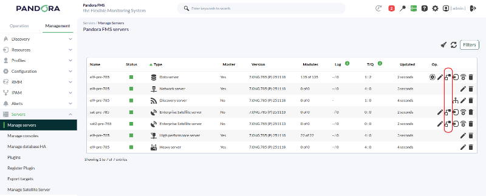

On opening it, the tunnel fields are enabled and configured:

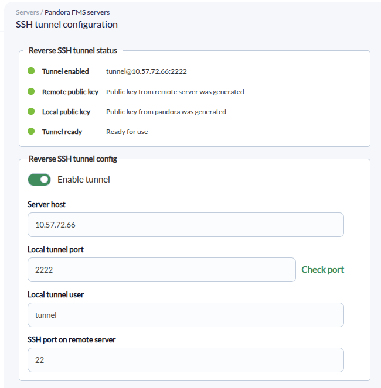

| Field | What it indicates |
|---|---|
| **Server host** | Server the satellite connects to in order to create the remote tunnel; it is the Web console of the Pandora FMS server |
| **Local tunnel port** | Port that will be used to build the tunnel; the traffic of that port is redirected to the satellite SSH port |
| **Local tunnel user** | User that builds the tunnel and the one the Web console uses to connect to the satellite with the Exec Server |
| **SSH port on remote server** | SSH port of the satellite with which the tunnel is built |

In addition, there is a general setting in the Web console for the SSH connection
port that satellites use when building the tunnel:
**SSH server port for reverse SSH tunnels**. It is documented in
[Console configuration](../parte-9/9.2-referencia-completa-de-configuracion-de-la-consola.md).

!!! example "A tunnel over 192.168.10.0/24"
    The Web console is at `192.168.10.10`. **Server host** is set to that address,
    **Local tunnel port** to `2222` and **SSH port on remote server** to `22`. The
    console generates the key, the satellite exchanges it over Tentacle and opens
    the tunnel. From then on, the console connects through `localhost:2222` and
    reaches the SSH of the satellite, which is the one that does see the network
    `192.168.10.0/24`.

**Tunnel creation process.** Key distribution and tunnel opening follow these
steps:

1. The configuration is done from the servers section, on the corresponding
   satellite.
2. The Web console generates an SSH key for the user it runs as, `apache` by
   default.
3. The satellite obtains the public key together with the defined configuration
   of the Pandora FMS server, over Tentacle.
4. The satellite reads that configuration and creates the SSH keys locally for
   the defined user.
5. The satellite sends its public key to the Pandora FMS server over Tentacle.
6. The satellite connects to the server over SSH making a remote port
   redirection: it opens the port defined in the configuration on the Pandora
   FMS server and redirects it to the satellite SSH port.
7. The Web console uses that tunnel and the public key the satellite sent to run
   actions such as the SNMP Wizard or the SNMP browser, making the connections
   from the satellite.
8. The Web console *cron* checks the status of the configured tunnel.

During these phases, the tunnel status screen shows the indicators
**Tunnel enabled**, **Remote public key**, **Local public key** and
**Tunnel ready**; the last one changes to "Ready for use" when the tunnel is
operational. In the server table, `reverse_ssh_ready` reflects whether the tunnel
is available: it is the signal that turns the satellite into an Exec Server
candidate.

!!! note "If the port check warns"
    If the port set in "SSH server port for reverse SSH tunnels" is not in use,
    the console warns that there may be no SSH service listening and links to the
    general configuration. Check it before taking the tunnel as good.

## Performance, limits and troubleshooting

Satellite performance depends on three levers: how many checks are run, with how
many threads and how often they are sent. The polling rate of ICMP, latency and
SNMP v1/v2 reaches up to 500 checks per second; SNMPv3 is slower because it
encrypts. The cost is not free: raising threads speeds the process up and loads
the machine more, and beyond a certain point it makes the result worse.

| Lever | Parameters | Note |
|---|---|---|
| Threads per protocol | `ping_threads`, `latency_threads`, `tcp_threads`, `snmp_threads`, `snmp2_threads`, `snmp3_threads`, `wmi_threads`, `ssh_threads`, `exec_threads`, `plugin_threads` | More threads, more load. `exec_threads` above 20 may worsen performance depending on the system |
| Polling blocks | `ping_block`, `latency_block`, `snmp_block`, `snmp2_block`, `snmp3_block` | More hosts per call, more capacity, but more latency; the practical maximum is 500 |
| Sending | `agent_threads`, `agent_block`, `agent_interval` | How many XML files are sent and how often |
| Execution modules | `exec_threads`, `exec_interval` | A `module_exec` runs on the satellite machine and consumes its resources |

!!! example "Sizing for 192.168.10.0/24"
    In a small network such as `192.168.10.0/24` (about 254 addresses, of which
    only a few answer) the default values are more than enough. Fine tuning
    becomes necessary when the same satellite covers several large ranges: that
    is when blocks have to be raised (`ping_block`, `snmp_block`) and threads
    reviewed, watching the CPU consumption of the satellite itself.

### SNMP exclusion list

In large networks, an SNMP module that returns invalid data can degrade satellite
performance and drag other modules into Unknown status. To avoid it, the
satellite can read an exclusion list of SNMP modules that are discarded at
start-up, before running.

The `snmp_blacklist` token points to the list file,
`/etc/pandora/satellite_server.blacklist` by default. The format is one line per
agent or OID pair:

```text
192.168.10.1:.1.3.6.1.4.1.9.9.27
192.168.10.2:.1.3.6.1.4.1.9.9.27
```

For the satellite to read that list, it has to be run in generation mode with
`-v` and the configuration file:

```bash
satellite_server -v /etc/pandora/satellite_server.conf
```

Then restart the satellite server. The list can be regenerated as many times as
needed.

For day-to-day work, the basic checks are few and cheap: looking at the log
(`/var/log/satellite_server.log`), raising `verbosity` when more detail is
needed and reviewing `snmp_verify` if there is a suspicion that an SNMP module is
bringing polling down. Problem troubleshooting, volumetrics and the complete
Pandora FMS server configuration are in their respective chapters:
[Troubleshooting](../parte-9/9.13-troubleshooting-con-pandora.md),
[Volumetrics](../parte-9/9.14-analisis-de-volumetria-y-disenos-para-alta-capacidad.md) and
[Server configuration](../parte-9/9.3-referencia-completa-de-configuracion-del-servidor.md).
