# Command Center

## Introduction: what the Command Center is and when to use it

A single Pandora FMS server only reaches so far. [1.1 ·
Installation](../parte-1/1.1-instalacion.md) places the ceiling of one node at
around 80,000 metrics: above that, the answer is not to buy a bigger machine but
to spread the work across several. The Command Center is the piece that makes
this possible without giving up a single view.

The Command Center is a web interface that presents and operates several Pandora
FMS installations, called **nodes** or instances, **as if they were one**. It
does not replace them: each node keeps its own server and its own database, and
keeps working on its own. The Command Center adds its own web console and its
own database, and coordinates the nodes from there.

{ .diagrama .diagrama-ancho }

Thanks to that layer you monitor hundreds of thousands of devices without
checking node by node. Scalability is **horizontal**: when the environment falls
short you add a node, you do not enlarge the existing one. And since the access
point is unique, the Command Center also serves to deliver **multi-tenant**
service from a single console: a company signs in there and sees its own data,
without the infrastructure being duplicated.

When does it make sense to set it up? There are three clear signals:

- **A single node falls short.** This is the case of installations that exceed
  the order of magnitude a single console can handle.
- **There are several installations and you want to see them together.** The
  Command Center presents them as one and allows you to operate on all of them.
- **Multi-tenant service is delivered.** A single access point serves several
  companies and, within each one, several users.

!!! info "Synchronization is automatic"
    Synchronization between the Command Center and the nodes happens
    automatically thanks to the **Merging tool**, which we will cover later.

Where this piece fits within the rest of the architecture is explained in
[1.2 · Introduction and architecture](../parte-1/1.2-introduccion-y-arquitectura.md).
The license, which is additional to the nodes' licenses and is counted per
active node, is explained in [1.5 · Licensing](../parte-1/1.5-licenciamiento.md).

## Architecture and synchronization

### Architecture: nodes and central node

A **node** (or instance) is a regular Pandora FMS installation: a web console as
presentation layer, a server as data access layer and its own database. The
**Command Center** is another installation, with its own server and database,
but it monitors nothing by itself: it coordinates. The architecture has two
types of piece:

- a **central node**, the Command Center, with its own server;
- as many **server nodes** as needed.

There are two services that only exist when there is a Command Center on top,
and which [1.2 · Introduction and
architecture](../parte-1/1.2-introduccion-y-arquitectura.md) already introduces:

- **Migration Server**: moves agents from one node to another, taking tasks from
  a prioritized queue.
- **Autoprovision Server**: receives agents that arrive without a destination
  and decides on which node they are registered. Its operation is developed in
  [6.6 · Autoprovisioning mechanisms](../parte-6/6.6-mecanismos-de-autoprovision.md).

Three conditions derive from the relationship between the Command Center and
each node. Sort them out before building anything:

| Condition | Detail |
|---|---|
| Bidirectional communication | The Command Center must be able to reach each node, and each node the Command Center. |
| Nodes independent from each other | The nodes **do not** need to communicate with each other at any time; only with the central node. |
| Synchronized clock | The time of the Command Center and that of the nodes must be the same. The better synchronized the clocks are, the more accurate the data seen from above will be. |

The network conditions and the ports involved are detailed in [1.1 ·
Installation](../parte-1/1.1-instalacion.md#security-and-network-requirements).

### Where each piece of data lives

Before looking for something in the wrong place, it helps to be clear about what
lives on each side. This is the table that saves you half an afternoon:

| Where it lives | What |
|---|---|
| **Only on the node** | Agents, modules and their history, alerts and policies in execution. |
| **Only on the Command Center** | The Command Center's own configuration, the components, the report templates, the network maps, the visual maps and the NetFlow filters. |
| **On both, replicated** | Users and profiles, groups, templates, alert actions and commands, tags and categories. |

Users, groups, templates and tags are on both sides because they have to be
where they are used. The Command Center's own tables (`tmetaconsole_*`) and
their synchronization are described in [10.1 · Database
schema](../parte-10/10.1-esquema-de-la-base-de-datos.md).

### How information is read and modified

The Command Center reads and modifies the information of the nodes in two
different ways, and knowing which one applies to each piece of data decides
where you look when something fails:

- **Active mode.** The Command Center itself enters the node's database or API
  and manages what corresponds to it: agents, modules, alerts and policies.

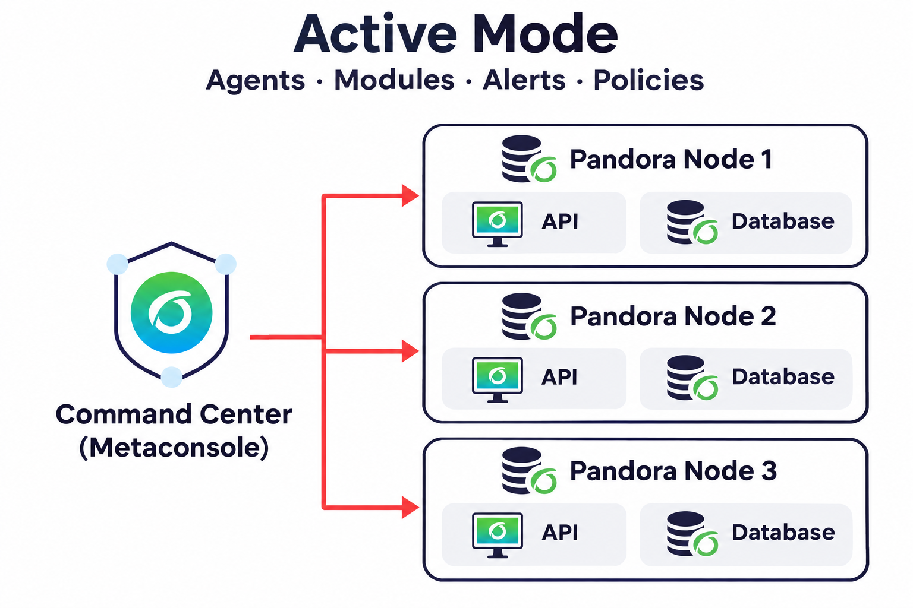{ .diagrama .diagrama-ancho }

- **Passive mode.** The node writes to the Command Center's database what is
  generated continuously. The typical case is events: the node replicates them
  and, from then on, they are managed from above.

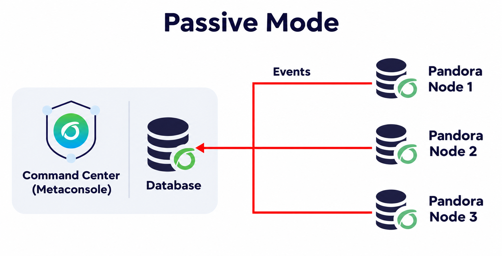{ .diagrama .diagrama-ancho }

Depending on which mode a piece of data depends on, the problem is looked for in
one place or another. If events do not arrive, the cause is usually the node's
replication configuration; if an agent cannot be managed from above, the cause
is the Command Center's connection to that node. The specific symptoms and where
to start are in [12.8 · Large environments](../parte-12/12.8-entornos-grandes.md).

## Installation and setup

### Requirements and particularities

The Command Center is not a separate product: you install the same software as
in any Pandora FMS installation —web console, server and database— and it
becomes a Command Center when you activate a **Command Center license** (the
detail, in [“License activation”](#license-activation)). Nothing else needs to
be installed.

Regular nodes are joined afterwards, from **Management → Settings → System
Settings → Command Center** (see
[“Node registration”](#node-registration)).

Compared to a node, there are three particularities: its own license, its server
up and running, and the fact that one installation cannot be a node and a
Command Center at the same time. The generic console installation procedure is
the one in [1.1 · Installation](../parte-1/1.1-instalacion.md); here is only
what is different.

| Requirement | Detail |
|---|---|
| Edition | **Pandora ONE**, **Pandora NMS** or **Pandora RMM**, plus an additional **Command Center license** (see [“License activation”](#license-activation) and [1.5 · Licensing](../parte-1/1.5-licenciamiento.md)). |
| Installation | The same software as a node (web console, server and database). There is no dedicated package: what changes the role of the installation is the license. The general procedure is in [1.1 · Installation](../parte-1/1.1-instalacion.md). |
| Pandora FMS server | The server of the installation itself must be running: agent migration, provisioning and the policy queue depend on it. |
| Communication | Bidirectional between the Command Center and each node (see [“Architecture: nodes and central node”](#architecture-nodes-and-central-node)). |
| Clock | The time of the Command Center and that of the nodes must be synchronized. |
| Ports | 80, 443 and 3306 between the Command Center and the nodes. The full table is in [1.1 · Installation](../parte-1/1.1-instalacion.md#security-and-network-requirements). |
| Operating system | RHEL, Rocky Linux and AlmaLinux 9 or 10, or Ubuntu Server 22.04 or 24.04. For the Command Center, **RHEL**, **Rocky Linux** and **AlmaLinux** are recommended. |

!!! warning "One server, one role"
    You cannot use the Pandora FMS web console and the Command Center at the
    same time. If the installation is activated as a Command Center, that
    console stops being a node.

### License activation

The license is activated from the web console itself, as in any installation.
Go to the console URL:

```text
http://<dir_IP_o_URL>/pandora_console/
```

and the welcome screen appears, where you accept the license.

The difference with a node is which license you enter. To bring up the Command
Center **a Command Center license is required**; if you activate a node license,
what appears is the regular console, not the Command Center. When you enter a
Command Center license in an installation that was a node, the console warns
that it is going to change role and, upon confirmation, the installation becomes
a Command Center without reinstalling anything. The license screen then shows
the contracted type —console or Command Center— together with the rest of the
limits. The license model and the meaning of each field are in [1.5 ·
Licensing](../parte-1/1.5-licenciamiento.md).

### Metalicense

The **metalicence** is the single license of the environment. It is entered in
the Command Center and covers all the nodes: you can create as many nodes as you
want without licensing each one again, as long as you do not exceed the total
number of contracted agents. High availability replicas do not count. For nodes
that must remain disconnected from the Command Center for long periods, you have
to talk to the Pandora FMS sales team.

**The license comes first.** Without it, the installation does not work as a
Command Center and there is nowhere to register the nodes. From then on, the
order is this:

1. **Activate the Command Center license.** This is done on the installation,
   while it is still a node: in **Management → Settings → License**. It is the
   same screen as for any node; what changes is the license you enter (see
   [“License activation”](#license-activation)).
2. **Register each node** in **Setup → Metasetup → Consoles setup**, with **its
   own license key generated and validated** in the console of the node (see
   [“Node registration”](#node-registration)).
3. **Leave the statuses green.** If any of them is not, the **Synchronize all**
   button in **Consoles setup** goes through the registered nodes and forces
   their synchronization.
   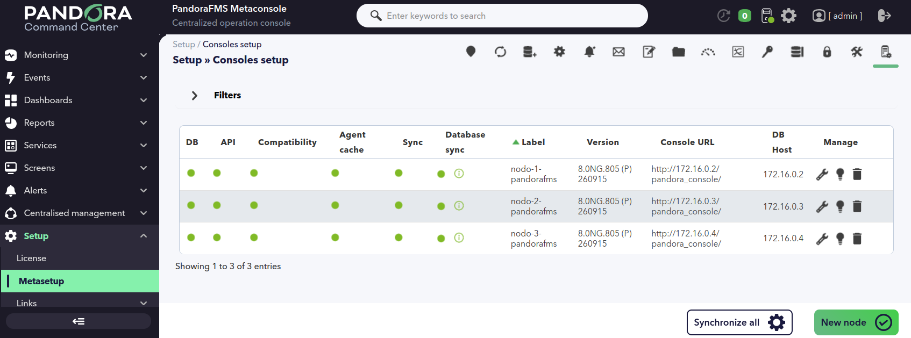{ .diagrama .diagrama-ancho }

4. **Distribute the metalicense.** With the nodes in order, go back to
   **Setup → License** —now it is the Command Center's menu— and press
   **Validate**: it saves the Command Center license and propagates it to all
   the nodes.

A node that does not validate (**Sync** indicator in red) has a key that does
not match the Command Center's or is not marked as a node
(`node_metaconsole`). The synchronization button fixes it. Once propagated, the
Command Center license activates the nodes automatically, without having to
activate them one by one.

The aggregated license adds up the consumption of all active nodes; replicas are
not counted. The details of the model are in [1.5 ·
Licensing](../parte-1/1.5-licenciamiento.md).

### Node registration

This is the procedure that leaves the Command Center with nodes to manage.
It is done in **Setup → Metasetup → Consoles setup**{ .icono-en-linea }, with the **New node**
button.

{ .diagrama .diagrama-ancho }

When registering a node you need to know a series of data from that
installation. The fields are these:

| Field | What it is | Default value |
|---|---|---|
| **Label** | Label that identifies the node in the Command Center. | No value |
| **Console URL** | Full path to the node's console, without `index.php`; it should end with a slash. | No value |
| **API password** | Password of the node's API. | No value |
| **Console user** | Console user of the node, for delegated access. | No value |
| **Console password** | Password of that user. | No value |
| **DB host** | Address of the node's database. | No value |
| **DB name** | Name of the database. | No value |
| **DB user** | Database user. | No value |
| **DB password** | Database password. | No value |
| **DB port** | Database port. | `3306` |

The API and console credentials (API password, console user and password) are
stored together as the node's authentication token. The console URL must end
with a slash: the Command Center uses it as is to build the calls.

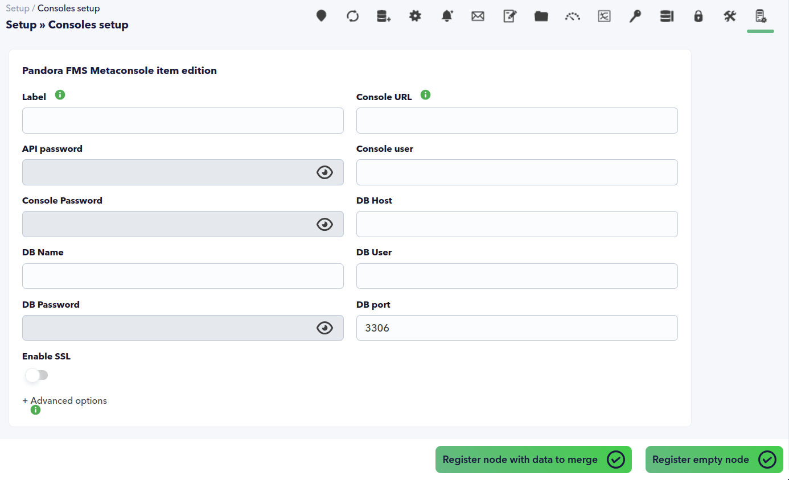{ .diagrama .diagrama-ancho }

The connection to the node's database supports SSL. When you activate **Enable
SSL**, the fields for the server key and certificate, the CA certificate and
path, and the certificate verification appear:

| Field | What it is |
|---|---|
| **SSL server key** | PEM file with the SSL key of the MySQL server. |
| **SSL server cert** | PEM file with the certificate of that key. |
| **SSL CA cert** | PEM file with the list of certificates issued by a certification authority. |
| **SSL CA path** | Directory with certificates of a certification authority, in PEM format. |
| **SSL verify server cert** | If activated, it verifies the certificate in the connection (CN); if it does not match, it does not connect. |

**Advanced fields.** The advanced options block defines the connection in the
opposite direction: the one the **node** will establish against the database of
the Command Center. Here you enter the host, the name, the user, the password
and the port of the Command Center's own database, and its SSL. If left empty,
the values of the Command Center's own configuration are taken.

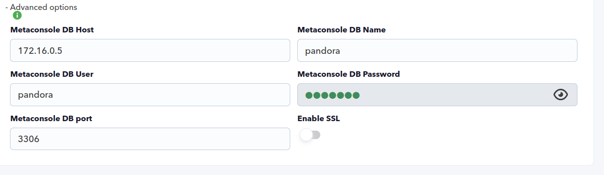{ .diagrama .diagrama-ancho }

**The two registration buttons.** When saving, the button you choose decides
what happens to the data already present in the node:

{ .diagrama .diagrama-ancho }

- **Register empty node**: the node's data is deleted and replaced with the
  Command Center's. Use it when the node has nothing to keep.
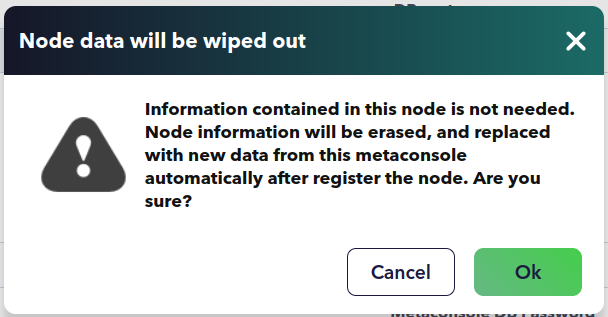{ .diagrama }

- **Register node with data to merge**: the node is registered but stays
  disabled, waiting for a merge to be launched that combines what is in the
  environment with what the node brings. Use it when the node does have data
  that matters.
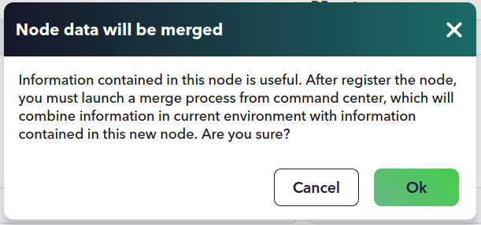{ .diagrama }

!!! info "When these buttons appear"
    The two registration buttons appear when **centralized management** is
    active. If it is not, registration is done with a single **Add** button.

**Check indicators.** In the list of configured nodes there are several
indicators that check the connection and the status of each node. The checks run
when the view loads and can also be repeated one by one by clicking on them:

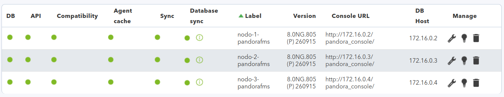{ .diagrama .diagrama-ancho }

| Indicator | What it checks |
|---|---|
| **DB** | The connection to the node's database with the given credentials. In red, it reports the problem: missing credentials, unreachable host or non-existent database. |
| **API** | A test against the node's API with the API password and the console credentials. It distinguishes between authentication error, connection error and unresolvable host. |
| **Compatibility** | Connects to the node's database and compares its *maintenance release* (`MR`) with the Command Center's. If they do not match, the node is not compatible. |
| **Agent cache** | That the latest states of the node's agents and modules are stored correctly in the Command Center's database. |
| **Sync** | That the node's license matches the Command Center's and that the node is marked as such (`node_metaconsole`). |
| **Database sync** | Only with centralized management active: it checks the synchronization queue and warns if there are pending queries to apply. |

The first three (DB, API and Compatibility) must be green for the node to be
properly linked and for its data to start being seen. The rest reports on its
own area. The **Version** column shows the version of the node's server.

!!! warning "The same encryption passphrase everywhere"
    If database encryption is enabled, **all the nodes and the Command Center
    must use the same** `encryption_passphrase`. Each node's connection data is
    stored encrypted with that passphrase; if it does not match, the Command
    Center cannot decrypt it. See [9.5 · Database
    encryption](../parte-9/9.5-cifrado-de-la-base-de-datos.md).

**Example.** To register a node at `192.168.80.37` with its database over SSL:

1. In **Consoles setup**, press **New node**.
2. Fill in **Label** with `node-37`, **Console URL** with
   `https://192.168.80.37/pandora_console/` (with trailing slash), the API and
   console credentials, and the database data: host `192.168.80.37`, name
   `pandora`, user `pandora`, port `3306`.
3. Activate **Enable SSL**, provide the MySQL server key and certificate and the
   CA certificate, and activate **SSL verify server cert**.
4. Save with **Register empty node** if the node is freshly installed, or with
   **Register node with data to merge** if it already had data.
5. Go back to the list and check that **DB**, **API** and **Compatibility** are
   green. If any stays red, click on it to see the reason.

The field reference, with its default value, lives in section 22.2 of
[9.2 · Complete console configuration
reference](../parte-9/9.2-referencia-completa-de-configuracion-de-la-consola.md);
here is the procedure.

### Command Center console tasks

There are three things worth leaving working for the rest of the chapter to
work: report scheduling, API access and auto-authentication towards the nodes.

**Report scheduling.** To run database maintenance (`pandora_db`) you need the
server packages installed on the Command Center machine, and that process
scheduled in the **cron** every hour. If you also use on-demand reports (sent by
email), you have to schedule the cron extension as in a regular console, adding
a line to the crontab that calls `cron.php`:

```text
* * * * * <usuario> wget -q -O - http://x.x.x.x/pandora_console/enterprise/extensions/cron/cron.php >> /var/www/pandora_console/log/console.log
```

Console tasks and their scheduling are explained in detail in [2.5 · Console
tasks](../parte-2/2.5-tareas-de-consola.md).

**API.** For the Command Center to be able to talk to each node's API, you need:

- a **valid user and password** on the node;
- the **API password** configured on the node;
- the **list of IP addresses with API access** on the node, where the asterisk
  (`*`) is accepted as a wildcard to grant access to all addresses or to a
  subnet.

**Auto-authentication.** The Command Center jumps to the web console of a node
in several places; for example, clicking on the agent associated with an event
opens the view of that agent in the console of the node it belongs to. So that
the jump does not ask for credentials again, **auto-authentication** is used:
the **Auto login in node** option, in **Metasetup → General setup**, which
corresponds to the `JWT_signature` token and is enabled by default.

## Merging tool: unifying the databases

Unifying is not copying. When there are several nodes, the same group, the same
tag or the same template usually exists in more than one with different
settings. The **Merging tool** decides, for each element, which version is kept,
and leaves the environment ready to be managed from the Command Center. That is
why it is launched with the servers stopped and with a backup, not on a Friday
at six in the evening.

### What it is and when it is needed

The Merging tool goes through the databases of all the nodes and of the Command
Center and unifies the elements that are managed in a centralized way. An
environment that was already centralized with the previous synchronization
system has to go through here once.

Only nodes configured in the Command Center that are **not** disabled take part
in the merge. The process establishes a **priority order** between the Command
Center itself and the nodes: those above rule over those below. That order is
what resolves conflicts when the same element exists in several places with
different configuration.

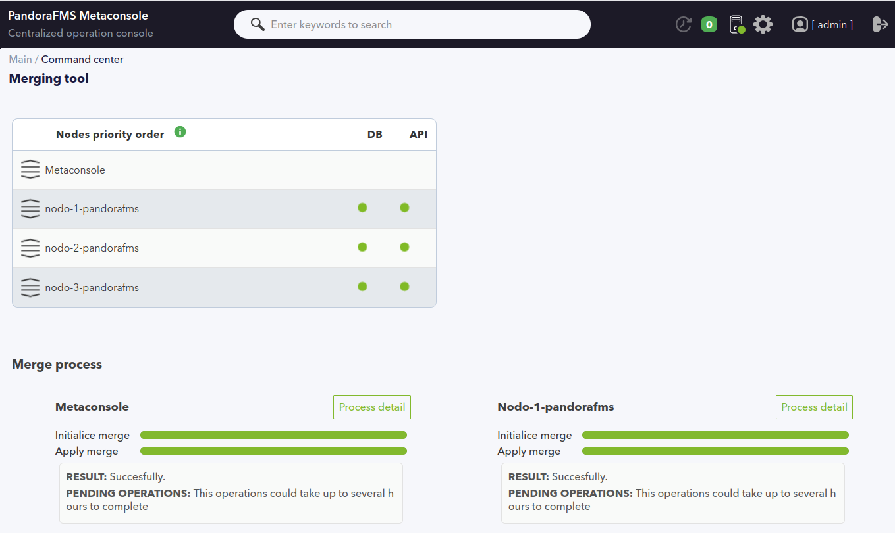{ .diagrama .diagrama-ancho }

At the top of the list is the Command Center itself and, below, each registered
node, with the **DB** and **API** columns checking the connection with each one.
The order is changed by dragging the rows by the side handle and is saved on
release.

!!! info "How it is decided which configuration wins"
    If two or more elements have the same unique field, the configuration of the
    one in the node with the **highest priority** is taken. If the same element
    appears repeated within the highest-priority node, the one with the **lowest
    ID** wins.

Monitoring policies are a separate case: their modules, alerts, collections and
other elements are considered elements independent of the policy and are merged
on their own.

When is it necessary to launch it?

- When moving an environment that already existed with several nodes to a
  Command Center.
- When adding a node that already has data to a centralized environment.
- When updating a centralized environment with the old synchronization system.

### What it centralizes

The Merging tool takes to the Command Center the elements that are afterwards
managed from it. For each one, two versions are considered “the same element”
when they match in an **identity key**. Almost everything is identified by name;
users are the exception, and a few elements carry two fields in the key.

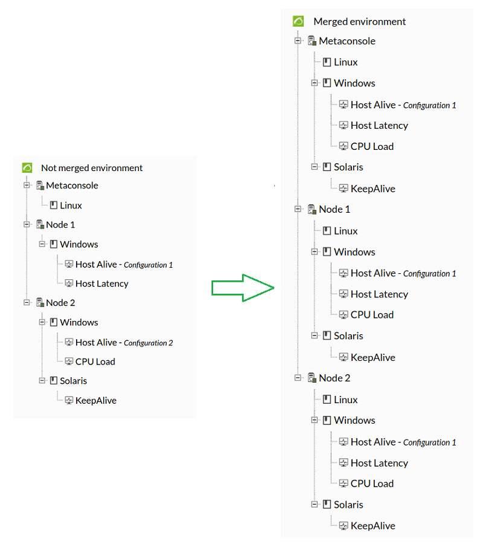{ .diagrama .diagrama-ancho }

| Element | Identity key |
|---|---|
| Users | User ID (`id_user`) |
| User profiles | Name |
| Agent groups | Name |
| File collections | Short name (`short_name`) |
| Alert templates | Name |
| Alert commands | Name |
| Alert actions | Name |
| Server plugins | Name and execution |
| Operating systems | Name |
| Module tags | Name |
| Module categories | Name |
| Module groups | Name |
| Component groups | Name |
| Network components | Name |
| Local components | Name and operating system |
| Inventory modules | Name and operating system |
| Monitoring policies | Name |
| Policy modules | Name within a policy of the same name |
| Policy inventory modules | Name and operating system within a policy of the same name |
| Policy plugins | Execution within a policy of the same name |
| Policy collections | Short name within a policy of the same name |
| Policy alerts and external alerts | Template on the same module within a policy of the same name |
| Policy alert actions and external alerts | Name on the same template and the same module within a policy of the same name |
| Agents within policies | Membership in policies of the same name; Command Center records are discarded |
| Agents | Managed on the node; deleted on the Command Center |

Once merged, the sections where these elements are managed **can only be managed
from the Command Center**. If you access them from a node, you can only list
them: the editing and creation options disappear and a warning appears that the
environment is in centralized mode, with a link to the corresponding Command
Center section.

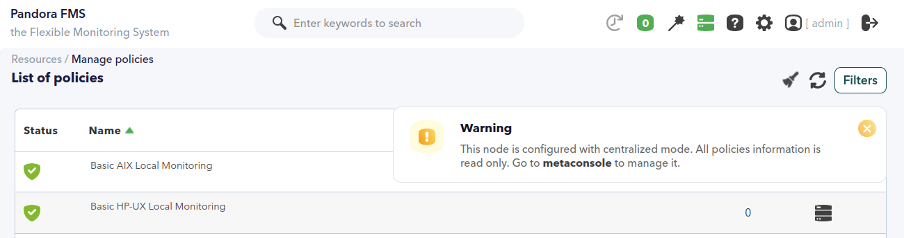{ .diagrama .diagrama-ancho }

!!! warning "Check `autocreate_group` after merging"
    The `autocreate_group` parameter of `pandora_server.conf` points to a group
    ID. If that group changes ID during the merge, new agents will end up in a
    wrong or non-existent group. Check it on all the nodes after merging.

The detail of how policies are merged is in [2.10 · Monitoring
policies](../parte-2/2.10-politicas-de-monitorizacion.md).

### Prerequisites

Before pressing **Unify databases**, the process checks a list of requirements.
If any fails, the merge does not start and the error says what is pending.

| Requirement | Detail |
|---|---|
| Command Center connection to the nodes | The Command Center must reach the database and the API of **all** the nodes. In the console configuration the indicators must be green. |
| Nodes' connection to the Command Center | The nodes' consoles must reach the Command Center's database. It is only a problem if consoles and servers live on different machines. |
| Enterprise configuration on the node | In **Management → Settings → System Settings → Command Center** of the node, the Command Center data (base URL, host, name, port, user and password of its database) must be correct. |
| Command Center API | The servers of all the nodes must reach the Command Center's API. It is recommended to configure the **Public URL** in the Command Center. |
| Node API | The servers of each node need their API configuration correct: `console_api_url` and `console_api_pass` in `pandora_server.conf`, or the **Public URL** in the console configuration. If it is not configured, the server must be on the same machine as its console. |
| History database of each node | Each node must be able to connect to its own history database. |
| Version | All the nodes and the Command Center on the **same version**. |
| Maintenance release | All on the **same MR**. |
| Collection size | All with the **same maximum collection size** configured. |
| PHP memory | `memory_limit` at `-1` (no limit) on all of them, only during the merge. |
| File upload | `post_max_size` of each node **greater than or equal to** the Command Center's and, in turn, **greater than or equal to** `upload_max_filesize` and the heaviest collection. |
| `upload_max_filesize` | On each node, **greater than or equal to** the Command Center's and the heaviest collection. |
| Disk space | Enough in the `attachment` directory of all of them for the database and collection backups. |
| Date and time | Correctly configured on all of them (NTP recommended). |
| Console cron task | Each node must have its console cron task created; if its console has never been accessed, the process asks to log in to the node first. |
| ZIP extension | The PHP `zip` extension must be loaded. |

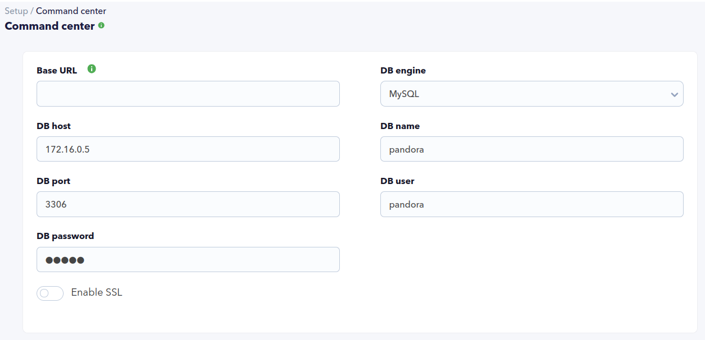{ .diagrama }


!!! warning "Put `php.ini` back in place"
    Once the merge is finished, restore the values of `php.ini`, especially
    `memory_limit`. Every time `php.ini` is touched, **Apache (`httpd`) and
    PHP-FPM must be restarted** for the changes to take effect.

### Recommendations before launching it

They are not requirements, but they save you trouble:

- **Stop the servers** of all the nodes and of the Command Center while the
  process lasts. Fundamental elements are going to be changed (for example, the
  IDs of the groups) and the server should not generate new references halfway
  through. In most cases it would not be a problem, but there is no reason to
  test it.
- **Temporarily stop `pandora_db`** from the cron, for the same reason.

!!! info "Maintenance mode during the merge"
    When the merge starts, both the nodes and the Command Center enter
    maintenance mode for standard users, not for administrators. The idea is the
    same as stopping the servers: nobody modifies an element halfway through the
    process and throws it off.

!!! warning "The process writes and deletes"
    The merge **modifies and deletes data** on the nodes. There is no way back
    beyond the backups generated by the process itself, and those backups may
    not be recoverable if the failure prevents reading them. Take a backup of
    **all** the databases before starting.

### Running the process

The merge is launched from **Centralised
management → Merging tool**, with the **Unify
databases** button. It has **two phases**, and each one is in turn divided into
two progress bars.

**Phase 1: environment synchronization.** It goes through the elements of the
nodes' databases that are managed from the Command Center. It is divided into:

- **Initialize**: it checks the requirements, generates the backups and
  calculates the merge result in memory. If it fails here, the databases have
  not been touched yet and there is nothing to restore. The backups are left in
  `attachment/merge_backups` of each node and of the Command Center, with a
  `backup_<node_id>` subfolder per node.
- **Apply**: it applies the merge, sequentially and in priority order. When it
  finishes with a node, it starts with the next one.

If something fails during the application, the process tries to restore the
backups on its own; a third red **Restore** bar then appears.

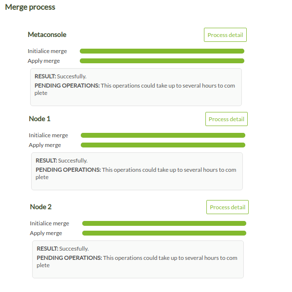{ .diagrama }

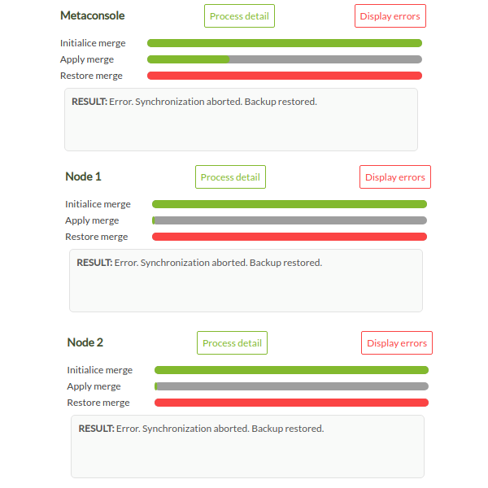{ .diagrama }

!!! warning "If the backup cannot be restored"
    If the failure prevents recovering the backups, restoration has to be done
    by hand. Some errors (a momentary loss of connection, a full disk that
    prevents creating the backup) give a generic message; if it is not resolved,
    it is time to contact Pandora FMS support.

**Phase 2: event update.** It updates the references of the events to the
elements that have just been synchronized (for example, groups). It only affects
events prior to the merge; new ones are already born with the correct
references. It is divided into two:

- **Events**: those of the main database. It is updated in parallel with normal
  operation: at this point the server and `pandora_db` can already be restarted,
  and standard users can already log in. They will see the progress bar in the
  event view and, for old events, there may still be incongruences in filters.
  Each node launches it through a **cron** task of its console, and it can take
  quite a while.
- **Events History**: the same over the history database.

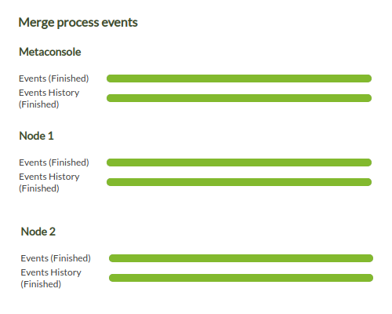{ .diagrama }

Merge errors are recorded and can be consulted from the Merging tool itself
(**Display errors**). If something is left half-done, the process can be
retried.

### Already-centralized environment

Once phase 1 is finished, the environment is considered centralized and
everything can be managed from the Command Center. Element synchronization also
changes systems: when a change is made in the Command Center (creating a user,
for example), the necessary queries (`INSERT`, `UPDATE`, etc.) are queued for
each node in the `tsync_queue` table. Each node's `pandora_ha` reads them from
the Command Center's database in order and applies them one by one. If a server
is down for a while, when it comes back it catches up.

Pending queries are seen from the Command Center in **Setup → Metasetup → Consoles
setup**, in the **Database
sync** indicator. If a query fails, the node does
not continue with the following ones and the error is visible on that same
screen; the usual fix is relaunching the merge from the Merging tool.

**Adding a new node.** It is registered in **Setup → Metasetup → Consoles
setup → New node**, as explained in
[“Node registration”](#node-registration). When saving:

- **Register empty node** if the node has nothing to
  keep: its data is deleted and replaced with the Command Center's.
- **Register node with data to
  merge** if the node already has data: the node stays disabled waiting for the
  merge to be launched.

## Centralized management

### What changes when centralized management is enabled

With centralized management active, the Command Center becomes the **source of
configuration** of the nodes for a series of sections, and those sections stop
accepting local changes: on the node they can only be listed. It is not a switch
to be flipped lightly, because what each node had can be overwritten.

Where is it enabled? The **Merging tool** itself sets it when unifying the
environment: it leaves the `centralized_management` token at `1` in the Command
Center and in all registered nodes. There is no switch in the general
configuration of the Command Center, so the way to enable it is to merge the
environment.

!!! warning "Enable it with the house in order"
    If the environment had been working separately for a long time, each node
    will probably have different things (groups, tags, policies, users). When
    centralizing, the Command Center rules and the nodes' data can be
    overwritten or thrown off. Inventory what each node has beforehand, decide
    which version is the good one and do it in a window, with a backup of all
    the databases. In [12.8 · Large
    environments](../parte-12/12.8-entornos-grandes.md) there is the warning in
    more detail.

The affected elements are the same ones the Merging tool centralizes (see “What
it centralizes”). The rest of the console behaves as in a node.

### Agents and provisioning

**Moving agents.** The **Agent management** option{ .icono-en-linea } relocates agents from one node to another. They
are located with the group or name filters (with group recursion if needed),
moved to the selected list and source and destination nodes are chosen. The
**Discard history data** checkbox deletes the
agent's history when moving it, so as not to drag data that is not needed; the
movement is confirmed with **Move**.

!!! tip "Movement log"
    At the bottom of the screen there is a log with the **last completed action
    of each agent and the pending ones after it**. Agents with synthetic modules
    are omitted from the movement, because they may depend on modules of other
    agents.

**Provisioning.** The **Provisioning management** option{ .icono-en-linea } decides on which node the new agents that arrive without a
destination are registered. There are three strategies:

- **Round robin**: it distributes the new agents in circular order
  among the servers.
- **Less loaded**: it assigns each new agent to the server with
  the least load.
- **Custom**: it applies its own rules based on the information
  reported by the agent (its alias and its IP range), with `AND` and `OR`
  operators.

For provisioning to recognize the nodes, each node must have **its own IP
address** configured in the Data server:

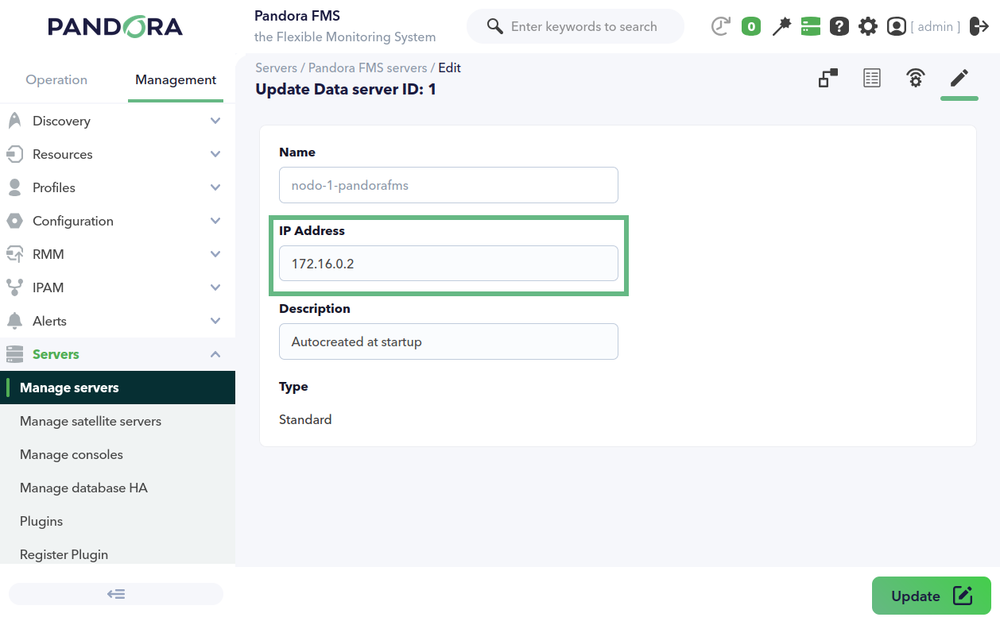{ .diagrama .diagrama-ancho }

The detail of autoprovisioning is in [6.6 · Autoprovisioning
mechanisms](../parte-6/6.6-mecanismos-de-autoprovision.md).

**Agent autoconfiguration.** The **Agent autoconfiguration** option{ .icono-en-linea } adds and edits auto-configuration rules for new
agents, such as group membership or alerts. It is explained in [6.6 ·
Autoprovisioning mechanisms](../parte-6/6.6-mecanismos-de-autoprovision.md).

**Groups.** **Group management**{ .icono-en-linea } and
**Tree group**{ .icono-en-linea } edit or delete agent groups on all the
nodes; the second is the same operation with a tree-shaped interface.

!!! warning "Editing groups touches synchronization"
    Editing or deleting groups can cause problems with synchronization. Do it
    when the environment is quiet.

### Modules and components

Components, plugins and inventory modules are administered centrally from the
Command Center:

- **Component groups**{ .icono-en-linea }: create, edit and delete component groups
  on the nodes.
- **Local components**{ .icono-en-linea }: create, edit and delete local
  components centrally.
- **Network components**{ .icono-en-linea }: add, modify or remove network
  components on the nodes.
- **Plugin management**{ .icono-en-linea }: create, edit and delete plugins for
  the nodes.
- **Inventory modules**{ .icono-en-linea }: create, modify or remove inventory
  modules on the nodes.
- **Plugin registration**{ .icono-en-linea }: add server plugins.
- **Tags management**{ .icono-en-linea }: listing of the tags used in the modules
  and their count on all the nodes. They are edited or deleted from the actions
  column and created with **Create tag**.
- **Module groups management**{ .icono-en-linea }: administration of the module
  groups. A group is edited by clicking on its name, deleted with the trash icon
  and created with **Create module group**.
- **OS Management**{ .icono-en-linea }: list of operating systems that can be assigned
  to the agents. Some are system ones and cannot be deleted, although they can
  be edited by clicking on their name; the others are added with **Create OS**.

Network and local components are presented in [2.6 · Network
monitoring](../parte-2/2.6-monitorizacion-de-redes.md); inventory modules, in
[3.1 · Inventory](../parte-3/3.1-inventario.md); creating plugins, in
[9.8 · Creating local plugins](../parte-9/9.8-creacion-de-plugins-locales.md)
and [9.9 · Creating remote
plugins](../parte-9/9.9-creacion-de-plugins-remotos.md); and tags, in
[4.1 · Groups, profiles and tags](../parte-4/4.1-grupos-perfiles-y-tags.md).

### Alerts

Alerts are managed from the Command Center with these options:

- **Templates**{ .icono-en-linea }: create, copy and delete alert templates.
  With **Show options** they are filtered by type or by name.
- **Actions**{ .icono-en-linea }: create, copy, edit and delete alert actions for
  the nodes. They are filtered by name, agent group or alert command.
- **Commands**{ .icono-en-linea }: add, copy and delete alert commands
  centrally. System commands cannot be copied or deleted.
- **Calendar**{ .icono-en-linea }: calendars mark special days and cycles in the
  templates. The default calendar is edited with the configuration icon, days
  are added with the sum icon and calendars of your own are created with
  **Create**.
- **Builder alert**{ .icono-en-linea }: create alerts on each agent of the instances, centrally.

How alerts work is in [5.5 · Alerts and
notifications](../parte-5/5.5-alertas-y-notificaciones.md).

### Users, profiles and advanced ACL

- **User management**{ .icono-en-linea }: complete listing of the users of the
  nodes. It is filtered by group or by keyword (user, full name or email). In
  each row the user can be disabled, edited or deleted; there must always be at
  least one active superuser, and that one cannot be deleted. A new one is
  registered with **Create user**; if it also has to access through the nodes,
  **Enable node access** is activated.
- **Profile management**{ .icono-en-linea }: complete administration of
  profiles.
- **Workspace → Edit my user**{ .icono-en-linea }: edit the data of the user
  signed in to the Command Center.
- **API 2.0 token management**{ .icono-en-linea }: administration of the user
  authentication tokens in the API 2.0.

**Advanced ACL.** The **Advanced ACL System** (`role/action/group/user`) allows
defining, depending on the profile, which pages each user has access to,
redefining what the classic ACL allows. Superadministrators are exempt; the
rest, even with the **Pandora Administrator** profile, are subject to the
control. The two models coexist: the classic one is evaluated first.

Users and profiles are documented in [4.1 · Groups, profiles and
tags](../parte-4/4.1-grupos-perfiles-y-tags.md); the advanced ACL, in [4.3 ·
Security and advanced visibility (Enterprise
ACL)](../parte-4/4.3-seguridad-y-visibilidad-avanzada-enterprise-acl.md).

### Policies

In a Command Center, the policy queue is different from that of a node: **it
keeps no history**. It only shows the policies not applied or in progress,
indicating which node they belong to. The history of the applied ones stays on
the node, which is the only thing that can be managed from there.

**Who applies them.** The console does not apply them: the console only records
the operation in the queue. They are executed by a thread of the Pandora FMS
server itself, the **Policy Manager** (`policy_manager`), which empties that
queue. It launches by itself, on the master server of each installation —the
same in a standalone node as in a Command Center—; if it is disabled, the queue
stops emptying and the policies do not reach the agents.

The Command Center has the **Max. number of queue operations per node** token to avoid overloading the
visualization and the operation of the queues. Its default value is **100,000
operations per node**.

**Data integrity.** The data of a policy must be the same on the nodes and in
the Command Center: modules, alerts, inventory modules, collections, etc. When
applying a policy from the Command Center, all of that is copied to the nodes
involved. If something fails when copying, the console shows the error and the
node does a **rollback** to the previous data. On new installations there is no
problem; if the nodes have policies configured by hand, it is best to delete
them and move them to the Command Center to synchronize them from there.

Policies and their queue are documented in [2.10 · Monitoring
policies](../parte-2/2.10-politicas-de-monitorizacion.md).

### Categories and servers

**Category management.** It allows administering the module categories (advanced
options) centrally. They are edited with the configuration icon, deleted with
the trash icon and created with **Create category**.

**Server management.** The **Server
management** option shows the type, the status, the version and other data of
the servers of the Command Center and of each node. The node is chosen in
**Show server status of**:

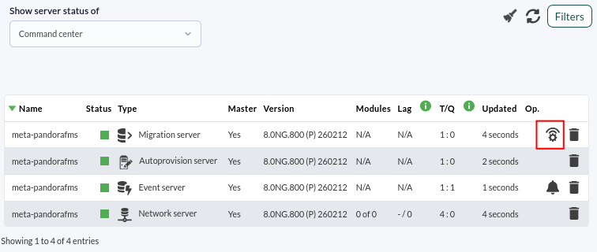{ .diagrama .diagrama-ancho }

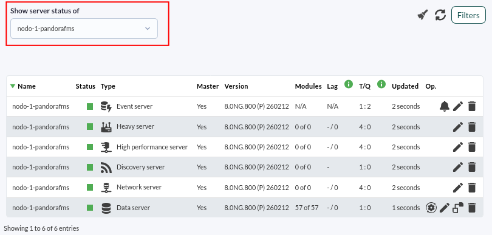{ .diagrama .diagrama-ancho }

**Which servers appear.** The list is not filled in by hand: the server itself
creates it when starting, with a row for each module it has active (they appear
with the description “Autocreated at startup”). In a Command Center the server
starts four:

- **Network server**: the only core module loaded in a Command
  Center; the Command Center's own service tasks are executed by it.
- **Events server**: the replication of events from the nodes.
- **Autoprovision server**: assigns the agents that arrive without a
  destination.
- **Migration server**: moves agents between nodes.

When choosing a node in **Show server status of**, the servers of that node are
seen.

!!! info "Remote configuration, only on the first one"
    The remote configuration option is only shown on the first server of each
    name; the repeated ones are replicas and are administered through the first
    one.

The configuration of the Pandora FMS servers is in [9.3 · Complete server
configuration
reference](../parte-9/9.3-referencia-completa-de-configuracion-del-servidor.md).

### Bulk operations

The Command Center's **Bulk operations** go in two
steps: you choose the target (agents, users, modules...) and the type of task
(edit, delete...). In the operations on agents you select the node to act on.

!!! info "Empty fields are not touched"
    When editing in bulk, the fields left at **No
    change** stay as they were.

The number of operations that can be launched at once is limited by the token
**Limit for bulk operations**: by default,
half the value of PHP's `max_input_vars`, with a configurable range from 100 to
2000.

Bulk operations are explained in [12.10 · Bulk
operations](../parte-12/12.10-operaciones-masivas.md).

### Collections

The **Collections**{ .icono-en-linea } are containers of remote and local files kept in
synchronization; they are used on agents or to deploy scripts and plugins
massively. In a Command Center they are administered centrally. They are
developed in [2.9 · Collections](../parte-2/2.9-colecciones.md).

## Interface and visualization

### The home screen

The Command Center console is organized in three areas:

1. **The header.** The logo, the global search box, the notifications, the user
   menu and the server status icon, which links to server management.
2. **The navigation menu.** The section tabs: **Monitoring**, **Events**, **Reports**,
   **Screens**, **NetFlow**, **Alerts**, **Centralised management** and **Setup**.
3. **The content area.** What opens in each section. On the home screen, the
   **Main** section shows shortcuts to the most used
   utilities: Monitoring, Events, Reports, Screens, NetFlow (if configured) and
   Setup.

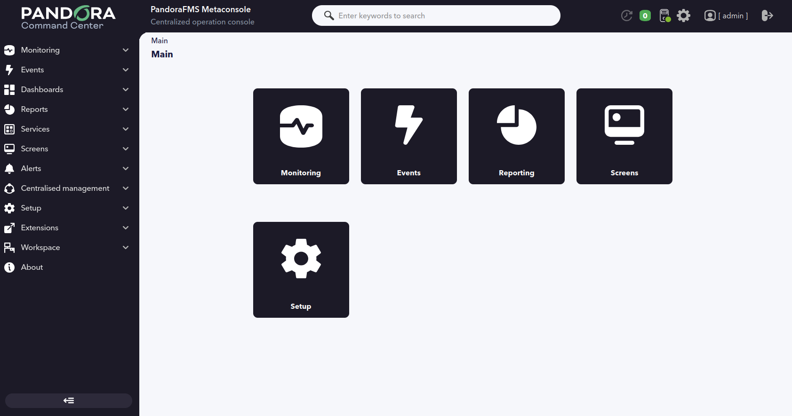{ .diagrama .diagrama-ancho }

A Command Center that has not yet been unified shows the warning that the system
is not centralized (**System is not centralised**); the link goes directly to
the Merging tool.

From the monitoring block you reach the agent views of all the nodes:

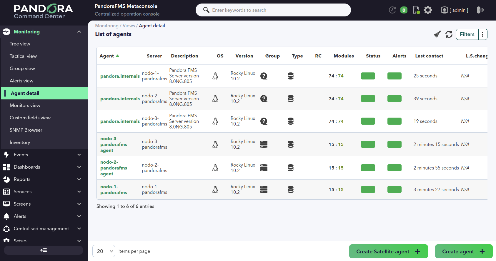{ .diagrama .diagrama-ancho }

The event list shows the events of the Command Center and of all the nodes, with
filters by node:

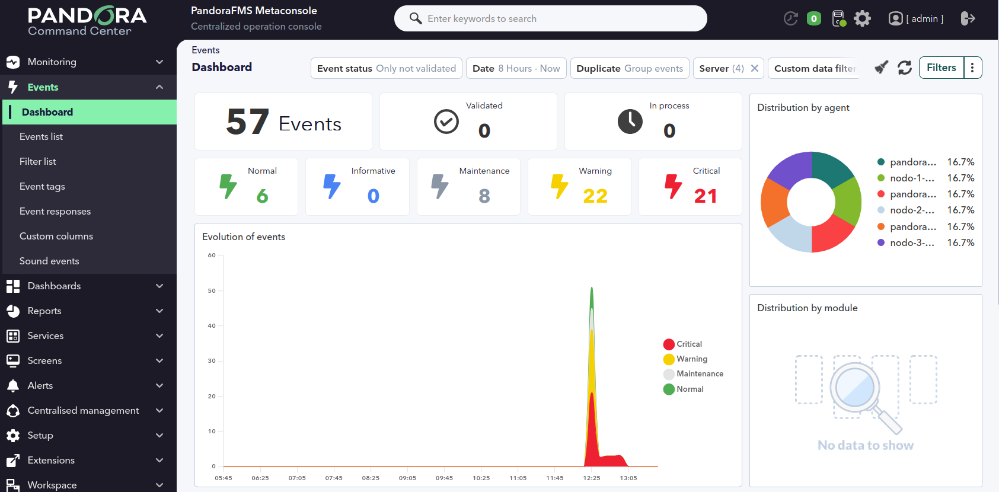{ .diagrama .diagrama-ancho }

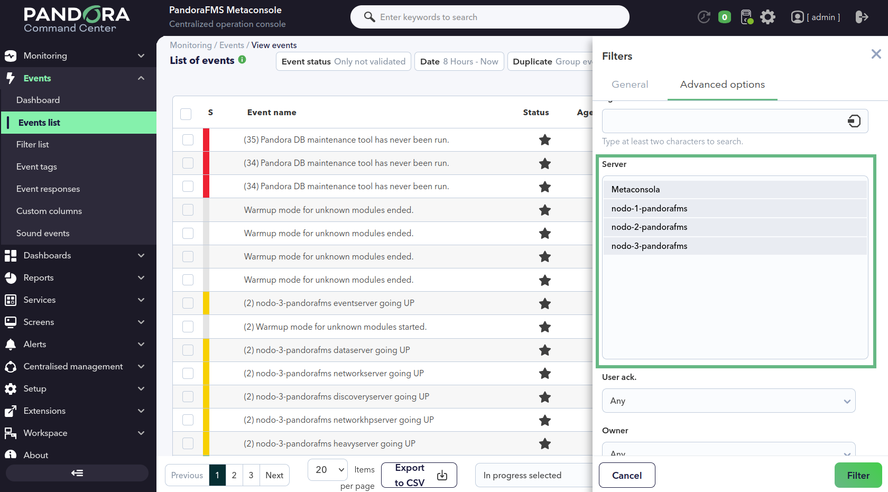{ .diagrama .diagrama-ancho }

And the alert view brings together the alerts registered on each node:

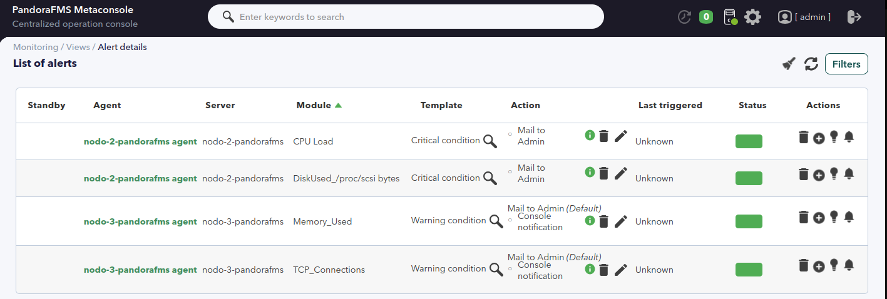{ .diagrama .diagrama-ancho }

How the event console works is in [5.4 · Centralized event
console](../parte-5/5.4-consola-de-eventos-centralizada.md), and alerts, in
[5.5 · Alerts and
notifications](../parte-5/5.5-alertas-y-notificaciones.md).

### Metasetup

**Metasetup** is the configuration tree of the Command Center itself. It lives
in **Setup → Metasetup** and gathers both pages
equivalent to those of a node and pages that only exist here.

| Page | What it is |
|---|---|
| **Consoles setup** | Registration of nodes. See “Node registration”. |
| **General setup** | Centralized equivalent of the general configuration of a node. |
| **Passwords setup** | Centralized equivalent of the password policy. |
| **Log viewer** | Centralized equivalent of the log viewer. |
| **History database** | Centralized equivalent of the history database. |
| **Authentication** | Centralized equivalent of authentication. |
| **Visual setup** | Centralized equivalent of the visual configuration. |
| **Performance setup** | Centralized equivalent of performance. |
| **File manager** | Centralized equivalent of the file manager. |
| **Strings translation** | Centralized equivalent of string translation. |
| **Mail** | Centralized equivalent of outgoing mail. |
| **Notifications** | Centralized equivalent of notifications. |
| **Relations rules** | They decide which node an element that arrives without a destination belongs to. |
| **Warp Update** | Updating of the nodes from the Command Center. |

The pages that have an equivalent on a node refer to the console configuration
reference: its section 22 of [9.2 · Complete console configuration
reference](../parte-9/9.2-referencia-completa-de-configuracion-de-la-consola.md).
The exclusive ones (relations rules and Warp Update) are developed in “Settings
exclusive to the Command Center”, in this same chapter.

### Reports, dashboards and visual consoles

**Reports.** The Command Center's reports are generated in several formats (PDF,
CSV, etc.) and are stored in the Command Center, but **the data comes from the
nodes you choose**. That is the difference with the reports of a node. They can
be created one by one or through parameterizable templates, which are applied to
a group of agents when requested. See [5.2 · Reports](../parte-5/5.2-informes.md).

**Dashboards.** They work like those of a node, with one advantage: when
searching for an agent it is enough to type at least two characters and a list
sorted by name appears, with the node in parentheses. Each widget can be shown
with the agent's name and its node, or with the description you want. Dashboards
are stored in the Command Center; when opened they connect with the nodes to
fetch the most recent information. See [5.1 · Dashboards](../parte-5/5.1-dashboards.md).

**Visual consoles.** They offer a full-screen, made-to-measure overview.
You can click on their elements to go to the agents and their modules, both with
a signed-in session and through a public link, and they are refreshed according
to the configured period. You can create consoles to represent services and
**link them to each other**, which is useful to represent countries, cities or
geographical areas. See [5.6 · Visual
consoles](../parte-5/5.6-consolas-visuales.md).

## Settings exclusive to the Command Center

Metasetup mixes two types of pages: those that replicate the configuration of a
node and those that only make sense when there is a Command Center on top. The
former are not repeated here; their reference is section 22 of [9.2 ·
Complete console configuration
reference](../parte-9/9.2-referencia-completa-de-configuracion-de-la-consola.md).
These are the exclusive ones.

### Relation rules

The **Relations rules**{ .icono-en-linea } resolve which node an element that arrives without a destination belongs to. They are designed for special devices identified by their gateway or by their IMEI and queried through an API other than the main API, the **agent API**. For them to work, **Enable Agent API** must be enabled in the general configuration.

Registering a relation has three fields: the **Type** —**IP Gateway** or **IMEI**—, the value of the **Relation** and the **Node Address**, which can be
any of the registered nodes or a **Custom** value. It is
saved with **Insert relation**.

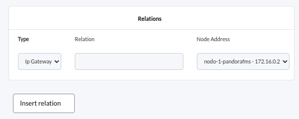{ .diagrama }

To load many at once, a CSV file is imported with one relation per line, in the
order `type,rule,node`:

```text
gateway,4,192.168.80.37
imei,123456789012345,192.168.80.38
```

With **Import file** the file is uploaded. Lines that do
not fit the format are rejected and the console reports which ones.

Saved relations are listed at the bottom, with filters by type, value or node
address. They are deleted one by one with their icon, or in bulk: the checkboxes
are marked and **Delete** is pressed.

The query is launched against the agent API with the
`get_node_addresses=1` parameter, which is **mandatory**, and it returns a JSON
array with the address or addresses of the node. For a gateway, `gateway=1`:

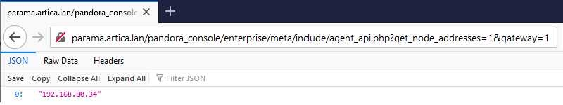{ .diagrama .diagrama-ancho }

And for an IMEI, `imei=2`:

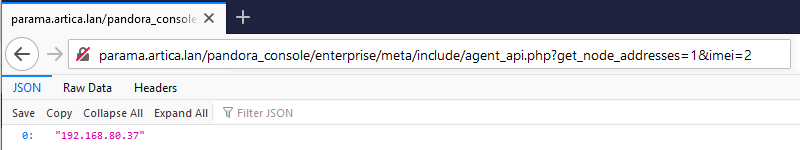{ .diagrama .diagrama-ancho }

With **Node Address Default** you set the
response returned when there is no rule or none matches the query. It can be the
address of one of the nodes or a **Custom**
value, for example a message of your own.

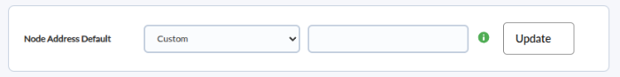{ .diagrama }

Agent provisioning that uses these rules is developed in [6.6 ·
Autoprovisioning mechanisms](../parte-6/6.6-mecanismos-de-autoprovision.md).

### Warp Update of the nodes

The Command Center is updated from its own **Warp Update** pages,
all in **Setup → Metasetup**. The four only
appear if **Enable Warp
Update** is active in the general configuration. The concept of Warp Update and
the general procedure are in [1.4 ·
Updates](../parte-1/1.4-actualizaciones.md); here is what is specific to the
Command Center.

- **Warp Update Online**{ .icono-en-linea }: with a valid Command Center license and internet access, it updates the Command Center automatically.
- **Warp Update Offline**{ .icono-en-linea }: to update or patch without internet. The files are uploaded in order up to the needed version, because they are not cumulative, and it serves for console patches, server patches or combined ones.
- **Warp Update Journal**{ .icono-en-linea }: the history of applied updates, with the version, the date and time and the user who requested them. With the **Filter** box you search within the history.
- **Warp Update Setup**{ .icono-en-linea }: it comes prepared for online updating. Before touching the **Warp Update URL**, the **Use secured Warp Update**, the **Proxy** data (server, port, user and password) or the **Allow offline patches** and **LTS updates** switches —which change which packages the offline mode accepts—, it is best to consult Pandora FMS support.

!!! warning "Offline updating: back up first"
    Applying patches or updates offline can leave the console unusable. Take a
    full backup before starting.

In the offline mode, the page shows an access code tied to the license. It is
copied with the icon{ .icono-en-linea }, the download link is opened in another tab, the code is pasted, you
sign in and the files are downloaded **one by one**. Back on the page, each file
is uploaded with **Browse it**. The size of each file must be smaller than
`post_max_size` and `upload_max_filesize` of `php.ini`, and the process is
launched with the green icon in the lower right corner.

### Notifications and outgoing mail

**Notifications.**{ .icono-en-linea } The Command Center watches its own status and that of the system, and warns the users. It is configured in **Setup → Metasetup → Notifications**. Clicking on a category adds or subscribes the users or groups that receive it; for **System status** you can also choose each technical aspect.

The categories are six: **System status**, **Message**, **Pending task**, **Advertisement**, **Official communication** and
**Sugerence**.

The **Enable user configuration**
token allows each user to enable or disable their console and email notifications
from **Operation → Workspace → Configure user notifications** on the
centralized nodes. For them to arrive by email, the user must have their address
configured and the Pandora FMS server must be able to send email.

There is one nuance that surprises: if a user belongs to a group subscribed to a
category, they receive the console notifications of that category and **cannot
disable them**, even if the previous token is active. A new user with the
profile **Pandora Management** is subscribed only to **System status** and
**Official communication**, not to all six; when the node is already
centralized, they enter the Command Center's categories, and each centralized
node manages its own separately.

**Outgoing mail.**{ .icono-en-linea } In **Setup → Metasetup → Mail** the sending is defined: the outgoing address (**From dir**), the name (**From name**), the SMTP server (**Server SMTP**), the port (**Port SMTP**), the connection encryption (**Encryption**: `SSL`, `SSLv2`, `SSLv3` or `STARTTLS`) and, if the server asks for it, user and password (**Email user** and **Email password**) and the authentication method (**SMTP authentication**: `Default`, `LOGIN`, `PLAIN`, `CRAM-MD5` or `DIGEST-MD5`). With **Email test** a test email is sent.

!!! warning "Gmail and other providers"
    Google may block the authentication of applications it considers not
    secure; access has to be enabled. Better an account created only for the
    server's notifications than a personal one.

The Pandora FMS server must be able to resolve, with its DNS, the mail server of
the domain (`nslookup -type=mx my.domain`), and the mail server must accept the
mails arriving from it. If authentication is not the default one, the
`mta_auth` token in `/etc/pandora/pandora_server.conf` is adjusted: it comes
commented out and accepts `LOGIN`, `PLAIN`, `CRAM-MD5` and `DIGEST-MD5`.

### Strings translation and file manager

**Strings translation**{ .icono-en-linea } rewrites interface strings in a customized way. It is filtered by **Language** and by the text (**Free text for search (*)**; empty, it shows them all). Three columns appear: the original string, the current translation and the customized one. The third one is filled in and saved with **Update**. Copy exactly the HTML and JavaScript that appear in the text; if they break, the string will not be displayed correctly.

**File manager**{ .icono-en-linea } uploads and deletes files from the image folder of the Command Center installation.

!!! warning "Not all images are in the manager"
    The Command Center code reuses some images from the regular console. Those
    do not appear in the manager and have to be administered by hand in the
    installation. Do not replace them lightly.

### Command Center performance and visual setup

**Performance setup**{ .icono-en-linea } shares most of its options with a node's page. Only these values exist because of having a Command Center; the default value is verified in the code:

| Setting | What it controls | Default value |
|---|---|---|
| **Migration block size** | Rows per block when moving agents between nodes, especially when transferring their history | `300` on the server; the console field starts at `0` |
| **Max. number of events per node** | Events shown per node | `100,000` |
| **Limit of events per query** | Maximum events returned by a query | `5,000` |
| **Max. days before purge** | Maximum age of the numerical data before being purged | `45` (range 7–365) |
| **Rows limit for SQL report item PDF (per node)** | Maximum rows of a SQL item when exported to PDF; `0` disables the limit | `5,000` |

**Visual setup**{ .icono-en-linea } adds, compared to a node, the number of elements each node returns in certain views: **Metaconsole elements**, by default `100`.

The rest of the visual and performance configuration is the same as a node's and
is in section 22 of [9.2 · Complete console configuration
reference](../parte-9/9.2-referencia-completa-de-configuracion-de-la-consola.md).

### Command Center general setup

**General setup**{ .icono-en-linea } is the same page as a node's —its reference is in section 22 of [9.2 · Complete console configuration reference](../parte-9/9.2-referencia-completa-de-configuracion-de-la-consola.md)— and the user authenticates against the Command Center. What is specific to the Command Center are three details: **Auto login in node** (the `JWT_signature` token, which allows jumping to a node without asking for credentials again), the maximum age of the event comments shown, and the time zone editing icon{ .icono-en-linea }.

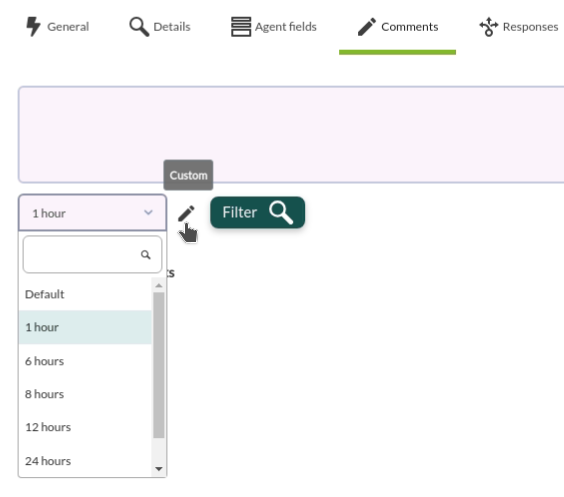{ .diagrama }

### Command Center authentication

**Authentication** supports the same methods as a node —local, Active Directory, LDAP, SAML and two-factor authentication— and each one is configured as there (see section 22 of [9.2 · Complete console configuration reference](../parte-9/9.2-referencia-completa-de-configuracion-de-la-consola.md)).

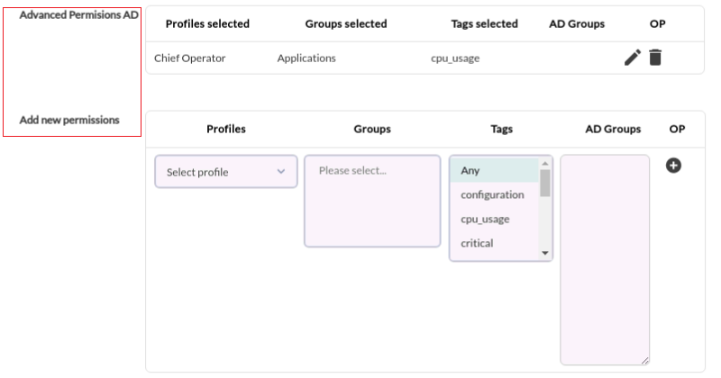{ .diagrama }

**Two-factor authentication** can be forced for all users. When it is activated,
it is worth announcing it: for example, with a message created from **Workspace
→ Messages**, announcing that it is available and how to activate it.

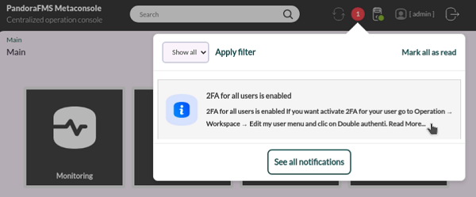{ .diagrama }

It is worth giving the second factor a name of its own, so that the user can
tell it apart from other applications:

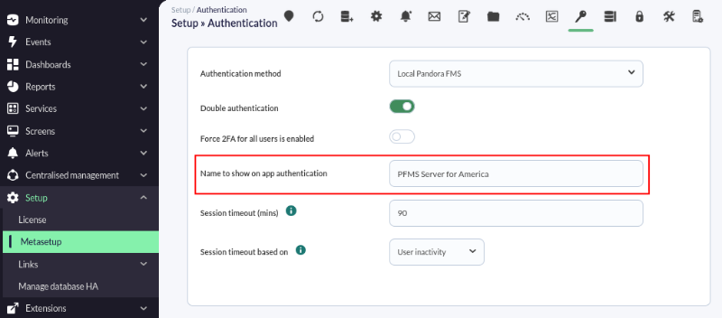{ .diagrama }

### Command Center history database

**History database**{ .icono-en-linea } stores the nodes' history and is encrypted like that of the rest of the environment: it shares the same `encryption_passphrase` as the nodes (see [9.5 · Database encryption](../parte-9/9.5-cifrado-de-la-base-de-datos.md)). What changes is that its privileges are granted **per node**: the Command Center connects to the history database of each node with the credentials that node has configured, and the permission has to be granted on the history machine (see [12.8 · Large environments](../parte-12/12.8-entornos-grandes.md)).

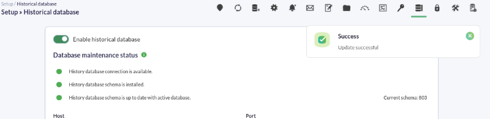{ .diagrama }

### Command Center log viewer and passwords

**Log viewer**{ .icono-en-linea } uses the same OpenSearch-based collector as a node; its setup and its options are in section 17 of [9.2 · Complete console configuration reference](../parte-9/9.2-referencia-completa-de-configuracion-de-la-consola.md).

**Passwords setup**{ .icono-en-linea } applies the same policy as a node's: minimum length, expiry, failed attempts, history and exclusion list.


## Extensions

The Command Center incorporates the same extensions as a console, with some
nuances of its own. The general concept is in [9.10 · Creating console
extensions](../parte-9/9.10-creacion-de-extensiones-de-consola.md).

**DB interface**. It allows running SQL queries and
seeing the result. It is a tool for those who know SQL and the Pandora FMS
schema; it is not for improvising. In a Command Center, moreover, you choose
which database to run it on with **Select query target**: the
Command Center's own or that of any of its nodes.

**CSV group import**. It imports groups from a
file with the fields separated by commas or by the character chosen in
**Separator**. The file is selected with **Select a file** and it is launched with **Go**. The CSV carries the
fields in this order: group name, icon, parent group id and propagation
(`1` yes, `0` no).

**Cron jobs**. They allow scheduling periodic operations in the
Command Center, such as sending logs in CSV format or executing PHP code.

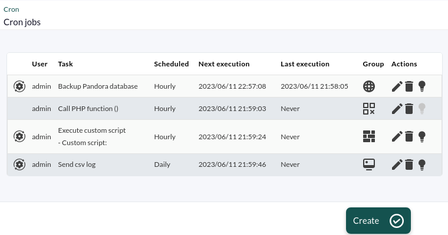{ .diagrama .diagrama-ancho }

With **Create**{ .icono-en-linea } a task is added to the list. In the actions column, each row is edited{ .icono-en-linea }, deleted{ .icono-en-linea } or enabled and disabled{ .icono-en-linea }.

**System audit log**. The Command Center keeps a
record of the operations that affect it:

- Category handling.
- User registration.
- System events (service starts, cron, etcetera) and errors of queries launched
  from the DB interface.
- Modifications of the nodes from the Command Center.
- Module management (creation, failed registrations, etcetera).
- Monitoring policy management.
- Changes in the general configuration.

Filter preferences can be saved and retrieved; they are edited{ .icono-en-linea } and deleted{ .icono-en-linea } with the corresponding icons.

## Diagnostics

This chapter has no FAQ of its own: they live in Part 12. The typical incidents
of an environment with a Command Center —a node's server not starting, the
deletion of agents in centralized mode, events not arriving, a module's history
not showing or the recovery of a node down in high availability— are in
[12.8 · Large environments](../parte-12/12.8-entornos-grandes.md). For the
general diagnosis of Pandora FMS, [9.13 · Troubleshooting with
Pandora](../parte-9/9.13-troubleshooting-con-pandora.md).

The Command Center manual's FAQ adds nothing new: the only thing of its own
(whether Discovery works in a Command Center, with its console tasks and its
cron) is moved to [12.8 · Large environments](../parte-12/12.8-entornos-grandes.md).
