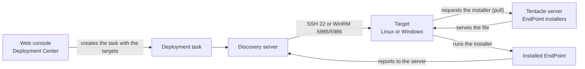
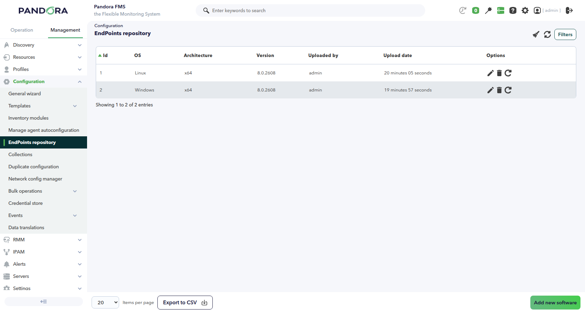
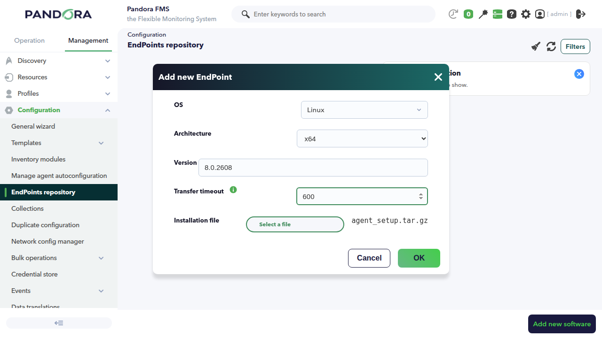
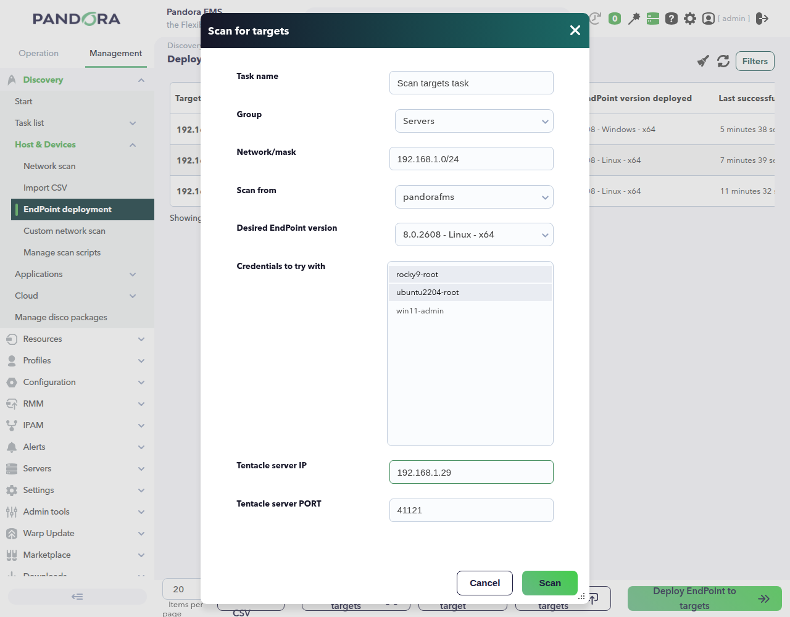
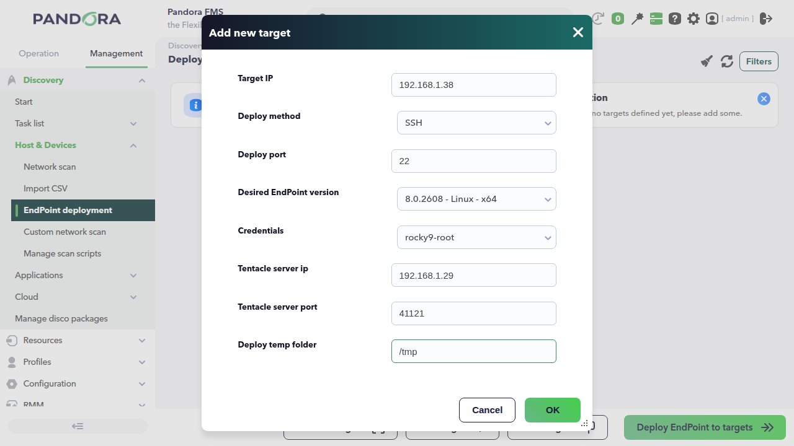
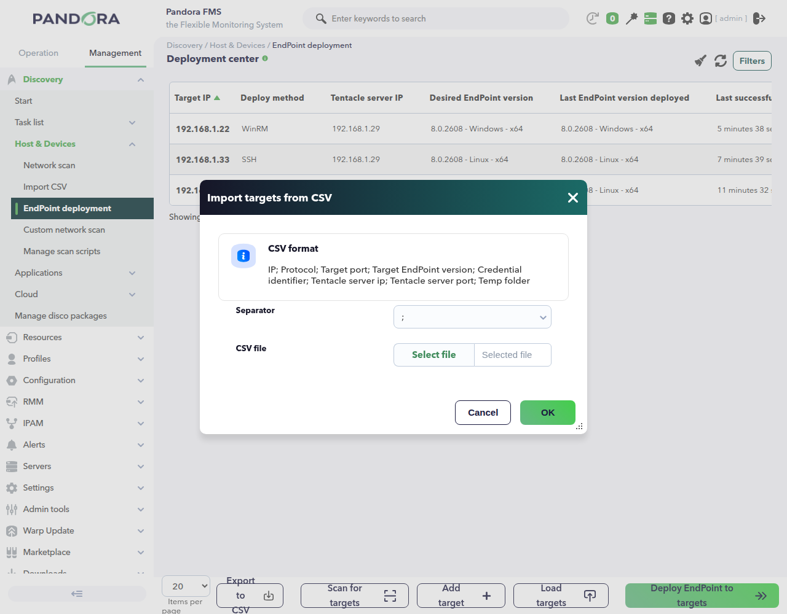
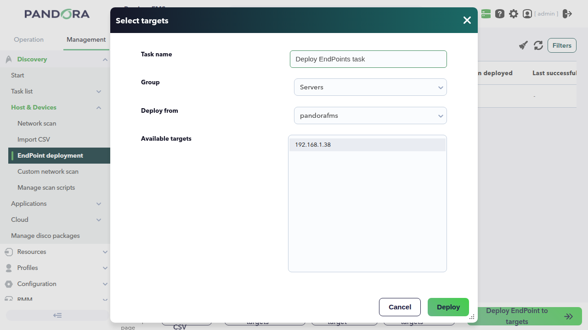
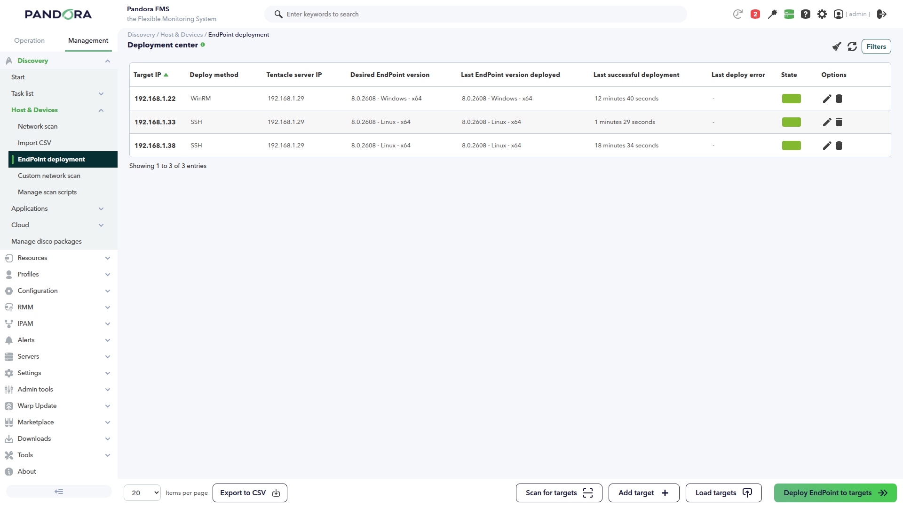
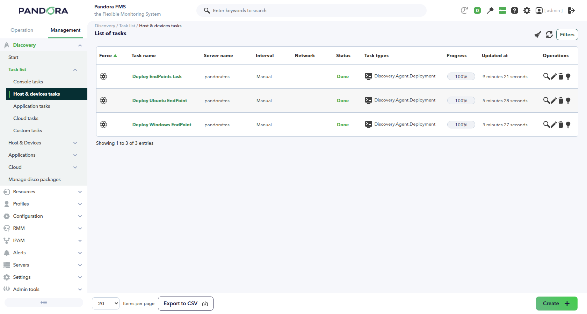

# Automatic agent distribution and installation

Installing an EndPoint on one machine is a bit of work. Installing it on fifty is an afternoon. Installing it on two hundred, across different operating systems and with passwords nobody wrote down, is one of those tasks that get postponed until there is no choice left. The **Deployment Center** in Pandora FMS exists for that: you give it a list of targets, a credential and an EndPoint version, and it makes the target connect, download the installer, run it and leave the agent reporting. No machine-by-machine sessions and no copying the same installer twenty times.

The idea makes more sense if you say it the other way round. The Deployment Center **does not push anything**: it does not launch an installer against the machine from the server. What it does is tell the target to download the installer from a Tentacle server and run it itself. That is a small difference in the explanation and a huge one in practice, because it shapes the whole network: the target must be able to reach the Tentacle, not the other way round. Everything else (the scan, the credential, the target state) revolves around that connection.

The lab behind this chapter deployed EndPoints on three real machines: Rocky Linux 9, Ubuntu 22.04 and Windows 11. All three ended up reporting to the console. The details, and a few nuances, are on the pages that follow.

## Introduction: what it solves and when to use it

The Deployment Center is the screen from which EndPoints are distributed to machines that have already been located, or can be located on the network. It brings together in one place the four pieces that used to be handled by hand: the **installer** (the EndPoints repository), the **credential** used to access the machine, the **target list** and the **task** that runs the deployment. What used to be copying the installer and logging into each machine becomes one row per machine and a button.

In the console it is under **Management → Discovery → Host & Devices → EndPoint deployment**, and the page is titled **Deployment center**. Use it when several machines meet three conditions: they can be reached over SSH or WinRM, they can reach a Pandora FMS Tentacle server, and they share an EndPoint version you want installed. That is the typical case for a group of Linux servers, a set of Windows workstations or a branch network with a nearby Discovery server. It also works to reinstall an EndPoint that was left half-done, with the precautions described in [Deploying the EndPoint](#deploying-the-endpoint).

It is not for everything. If the machine has neither SSH nor WinRM, the center cannot get in and you will have to install it by hand or with the online installer in [1.1 (Installation)](../parte-1/1.1-instalacion.md). If the network prevents the target from reaching the Tentacle, the deployment will fail even with the right credential: the problem will not be authentication, it will be the return path. And if there is only one machine, or two, going through the console may take longer than running the installer once.

Nor should it be confused with the pieces around it. The center **installs the EndPoint**; it does not configure monitoring. Modules, policies and alerts come later, through [2.1 (Monitoring with EndPoints)](../parte-2/2.1-monitorizacion-con-endpoints.md) and [2.10 (Monitoring policies)](../parte-2/2.10-politicas-de-monitorizacion.md). And it does not replace network discovery in [2.4 (Network discovery with Host & Devices)](../parte-2/2.4-descubrimiento-de-redes-con-host-y-dispositivos.md): discovery finds machines; the Deployment Center installs the EndPoint on them once you know which ones they are.

## How it works: from target to installed EndPoint

The journey has six steps, and it is worth keeping them in mind because each one leaves a different trace when something fails.

1. **The target is registered.** The console stores its address, the access method (SSH, WinRM or Secure WinRM), the port, the credential, the EndPoint version to install, the Tentacle address and port, and a temporary folder. The target knows nothing yet.
2. **A deployment task is created.** When you press the deploy button, the console creates a task with the selected target list. The task is enabled and set to a manual interval: it does not repeat on its own, it runs when its turn comes.
3. **The Discovery server runs it.** The discovery server takes the task and, for each target, launches the deployment utility. If the Discovery server is remote, it is the one that must reach the targets; the console only gives the order.
4. **The connection is opened.** The utility logs in over SSH or WinRM with the stored credential, checks that it can run a command and, if it can, moves on.
5. **The target downloads the installer.** Here is the twist: the target opens a TCP connection to the Tentacle, at the configured address and port, and requests the file by name. The Tentacle serves it from the agent directory. It is a download, not a push.
6. **It installs and starts.** The installer puts the EndPoint in place, sets the server address, enables remote configuration and starts the service. From then on, the EndPoint reports like any other agent.



The Discovery server processes targets **one at a time within the same task**. There is no parallel deployment spreading the load across ten machines: there is a queue and one target at a time. There are no automatic retries either. If a target fails, the error is recorded and the next one starts; retrying is your decision, using the task's force button or creating another task. The maximum time per target comes from the repository: the screen proposes 500 seconds and the server stops the run when it is exhausted. A target that hangs does not block the queue forever, but it can take a while to be released.

There is a consequence worth understanding from the start: **"deployed" means the installer finished, not that the EndPoint is already reporting**. The success mark is set when the deployment utility exits without error; the agent's first contact may arrive seconds or minutes later. [Tracking: targets, states and tasks](#tracking-targets-states-and-tasks) explains how to tell one from the other.

## Prerequisites

Before adding the first target, four things must be ready: access to the machines, the Tentacle server, the credential and the repository. If one is missing, the deployment either does not start or fails at the worst moment.

| Requirement | Detail |
|---|---|
| SSH access on Linux | Port `22` open and password authentication. The utility uses the credential password; it does not support private keys. The user must be able to run the installer as root, because the Linux installer requires it |
| WinRM access on Windows | WinRM or Secure WinRM enabled, PowerShell available and a local administrator account. Default ports `5985` (WinRM) and `5986` (Secure WinRM) |
| Reachable Tentacle server | The target must be able to open a TCP connection to port `41121` on the Tentacle server. The target starts the connection, not the server |
| Tentacle filters | The Tentacle must serve the repository installers. The filters for `.agent_setup.tar.gz` and `.agent_setup.exe` in the `agent` directory are required, and the service must be restarted after changing them |
| Custom credential | A credential of type *custom* with a user name and password, registered in the credential store. Its identifier is what the target stores |
| Repository with installers | At least one installer per operating system and architecture, uploaded to the EndPoints repository and synchronised with the server's agent directory |
| PM profile | The Deployment Center and its menu entry require the **PM** profile. The link to the credential store also requires **UM** |
| Network scanning utility on the Discovery server | Only for network scanning. Without it, the scan cannot discover hosts |
| Management network | The Discovery server must reach the deployment ports on the targets, and the targets must reach the Tentacle. Opening port 41121 on the server towards the target is useless: the connection goes the other way |

The Windows detail is not decoration: WinRM is disabled by default on many installations and, if the network is marked as public, the firewall blocks the port even when the service is running. The WinRM setup guide is still the starting point. In the lab, Windows 11 needed the listener enabled and a firewall rule for the management network; without that, the port appeared closed from the server.

About the **Linux user**: the installer checks that it runs as root and aborts if not. The utility does not use `sudo` and does not elevate privileges on its own, so the credential must be root, or an account that already has root privileges in the session. If the machine allows SSH but not root with a password, the Deployment Center is not the way; install by hand or change the access policy.

About **Secure WinRM**: it uses HTTPS and validates the server certificate. A self-signed or expired certificate will make the connection fail; for a lab it is usually faster to start with WinRM on `5985` and leave Secure WinRM for when the certificate is in order.

!!! warning "Tentacle is not optional"
    The Deployment Center does not carry the installer inside the SSH or WinRM connection. The target downloads it from the Tentacle. If the target cannot reach the Tentacle, the deployment fails with a connection error even when the credential is correct. This is the most common failure the first time it is tried on a segmented network.

## The EndPoints repository

The repository is the pantry of the deployment. It is under **Configuration → EndPoints repository** and stores the installers that are later served to the targets. Each entry is a combination of operating system, architecture and version; there is no "generic" entry that works for everything.

| Field | What goes in it |
|---|---|
| OS | `Linux` or `Windows`. These are the two systems the Deployment Center can install |
| Architecture | `x64` or `x86` |
| Version | The EndPoint version, up to 10 characters. It is the one shown in the target list and stored as the installed version |
| Transfer timeout | Maximum time, in seconds, allowed for downloading and installing that installer. The screen proposes 500 |
| Installation file | The EndPoint package. For Linux, a `.tar.gz`; for Windows, an `.exe` |

On save, the console copies the file to its store and synchronises it with the server's agent directory, which is where the installer is served from. Do not rename files by hand or move them around.



The upload has three decisions that matter:

- **The version cannot be repeated for the same system and architecture.** If an entry with that combination already exists, the console rejects the upload. To change it, edit the existing entry (only the transfer timeout) or delete it and upload again.
- **The file type is checked on upload.** The console only accepts a `.tar.gz` for Linux and an `.exe` for Windows; anything else gets an invalid installation file error.
- **Synchronisation is part of the upload.** It is not enough for the file to be in the repository: it must be in the Tentacle's agent directory. The upload does it for you; the refresh icon in the list synchronises an existing entry again if the copy in the agent directory was lost or updated.



Installers come from the same sources described in [1.1 (Installation)](../parte-1/1.1-instalacion.md). The online installer and the repository are not the same thing: the former downloads the package from Pandora FMS servers and installs it on the machine; the latter stores the package you upload so the Deployment Center can serve it over Tentacle. If you upgrade the EndPoint version, upload the new installer to the repository before changing the desired version of the targets.

## Credentials and permissions

The Deployment Center does not store user names or passwords on the target. It stores the **identifier** of a credential in the store and retrieves it at deployment time. That indirection has an obvious advantage: when the password for the machines changes, you update it once in the store and the targets use the new one on the next deployment. It also has a consequence: if you delete the credential, the targets that used it can no longer deploy and you must assign another one.

The credential this chapter needs is of type **custom**: an identifier, a user name and a password. The identifier is what you choose in the target form and what you write in the CSV; the user name and password are not copied to the target. In the store, the credential belongs to a group, and that group decides who can see it. The details of types, groups and encryption are in [2.2 (Credential store)](../parte-2/2.2-gestor-de-credenciales.md).

!!! warning "Credential encryption"
    If encryption is not enabled, the credential store screen warns that credentials are stored unencrypted. A plaintext password store is a gift to anyone who gets a copy of the data.

As for permissions, the Deployment Center is an administration screen: the menu entry and the page require the **PM** profile. The link to the credential store only appears with **UM**; without it, you can use an existing credential but cannot create a new one from there. The group chosen when creating the deployment task decides its visibility in the task list, as with any other Discovery task.

## Finding targets

There are three ways to fill the target list: scan a network, add one by hand or load a CSV. All three end up in the same place, the target list, and all three store the same information. The difference is how much work you want to do and how much you want the console to do.

Before deploying, it helps to know which targets are **valid**. The console only offers those with a credential and an EndPoint version in **Available targets**. A target without a credential, or with a version that no longer exists in the repository, does not appear. It is not a whim: without those two pieces the deployment cannot start.

### Scanning one or more networks

Scanning is the convenient route when you do not know exactly what is on the network. You give it one or more networks with their mask, a Discovery server, a desired version and one or more credentials, and it does the dirty work: it runs a network sweep, keeps the live hosts and, for each one that is not already a target, tries to connect.

The connection test walks three methods in this order: **SSH on 22**, **WinRM on 5985** and **Secure WinRM on 5986**. For each method it tries every selected credential. The first combination that manages to run a command is the one stored: the target is added with that method, that port and the corresponding temporary folder. If none works, the host is discarded and the next one starts.



Three details save trouble:

- **The scan does not deploy.** It only adds targets to the list. When it finishes, you still have to select them and start the deployment. The scan task appears in the task list with its progress and a summary of live and connected hosts.
- **The scan does not touch existing targets.** If a host is already in the list, it skips it. That avoids duplicates, but it also means a target with the wrong credential is not fixed by itself: edit it or delete it and scan again.
- **The first method that works wins.** A Windows machine with OpenSSH enabled may accept SSH and end up with the SSH method; the deployment will then use the Linux procedure, which does not work on a Windows machine. If the machines run different systems, check the method the scan chose before deploying.

The scan can take a while. The sweep walks the network, and for each live host it tries three methods per credential; on a large network with several credentials, the task can spend minutes working. Progress is shown in the task list, and the final summary says how many hosts were found and how many accepted the connection.

### Adding a target manually

Manual entry is for when you already know the address, the method and the credential. It is faster than a scan and more precise: there is no interpretation involved.

| Field | Meaning |
|---|---|
| Target IP | Address of the machine that will receive the EndPoint |
| Deploy method | `SSH`, `WinRM` or `Secure WinRM`. When you change the method, the console adjusts the port and the temporary folder to the method's values |
| Deploy port | Connection port. `22` for SSH, `5985` for WinRM, `5986` for Secure WinRM. It can be changed if the service listens elsewhere |
| Desired EndPoint version | Repository version to install |
| Credentials | Custom credential used to access the machine |
| Tentacle server IP | Address of the Tentacle server the target will use to download the installer and, later, to report |
| Tentacle server PORT | Tentacle port. Defaults to `41121` |
| Deploy temp folder | Temporary folder where the installer is downloaded and extracted. `/tmp` on Linux, `C:\Windows\Temp` on Windows |



The field most often got wrong is **Tentacle server IP**. The console proposes the address it sees itself, which in a normal installation is the server's address, but in a container or NAT environment it may be an internal address the target cannot reach. Put the address the target can reach, not the one the console thinks it has. If the target is on another network, that address will be the server's interface on that network, not `localhost`.

The other decision is the **temporary folder**. On Linux, `/tmp` usually works; on Windows, `C:\Windows\Temp` is the default. The installer is downloaded there, run and deleted; if the user cannot write to that folder, the deployment fails before it starts.

The console validates the minimum: that there is an IP, a credential, a version and a protocol. It does not check the IP format or the port range. If the IP already exists, it returns a target-already-defined notice and does not create a duplicate; to change it, edit the existing target.

### Loading targets from CSV

The CSV is the way to add many targets at once. The format is the one shown on the screen itself:

```text
IP; Protocol; Target port; Target EndPoint version; Credential identifier; Tentacle server ip; Tentacle server port; Temp folder
```

The separator is chosen in the form: `,`, `;`, `:`, `.` or `#`; the default is `;`. The first line **is not a header**: every line is processed as a target. If you copy the header above into the file, the console will try to add a target called "IP" and will fail.



Two values are written differently from what they look like:

- **Target EndPoint version** is the repository's **numeric identifier**, not the version string. If the target list shows `8.0.2608 - Linux - x64`, the CSV must contain the identifier of that entry (for example, `1`), not the text. The console checks that the identifier exists and rejects the line if it does not.
- **Protocol** accepts `SSH`, `HTTP` or `HTTPS`. `HTTP` is WinRM and `HTTPS` is Secure WinRM; do not write "WinRM" or "Secure WinRM" in the CSV, because the console does not recognise them as protocols.

If the IP already exists, the line **updates** the target; if it does not, it **inserts** it. Empty fields are filled from the target's previous value, if it exists, or from the defaults: the deployment port for the protocol, the console server address for the Tentacle, `41121` for the port and `/tmp` or `C:\Windows\Temp` for the temporary folder. The final report says how many lines were processed, how many were added and what errors occurred; errors are counted per line, and the whole file is not aborted.

!!! tip "A small CSV first"
    Before uploading two hundred targets, upload two. Check that the version identifier and the credential identifier are correct and that the separator is the one you chose. A badly separated CSV does not fail in an obvious way: it produces a list of per-line errors that must be read one by one.

## Deploying the EndPoint

With the targets in the list, deployment is the short step. Press **Deploy EndPoint to targets**, choose a task name, a group, the Discovery server that will run it and the targets. The console only offers targets with a credential and a version; the rest do not appear in **Available targets**.



On accept, the console creates a deployment task, enabled, with a manual interval and the chosen group. The task runs in the background. You do not have to watch the screen: you can close it and come back later; progress and results remain in the task list and the target list.

For each target, the utility does the following:

1. Checks that the target is not already being deployed. If it is, it skips it.
2. Marks the target as "deploying".
3. Retrieves the credential.
4. Finds the installer in the repository.
5. Prepares the deployment order and launches it with a maximum time.
6. If the utility exits successfully, marks the target as deployed, stores the installed version and clears the previous error. If it fails, marks the target as not deployed and stores the error output. If time runs out, it stores `Deployment timeout after N seconds`.

On Linux, the utility downloads the `.tar.gz` to the temporary folder, extracts it, adjusts the EndPoint configuration and runs the installer unattended. If the machine already had an EndPoint, it **keeps its existing configuration** and does not rewrite the server address or port. On Windows, it downloads the `.exe`, stops the service if it already exists, runs it silently with the server address and remote configuration enabled, adds the port if it is not the default and starts the service. If a configuration already exists, it is **preserved**: a reinstall does not rewrite the server address or the remote-configuration state, and only adds the port if it is not the default. The server address and remote configuration given at deployment time are applied when the EndPoint is installed for the first time.

!!! warning "What “deployed” exactly means"
    The center marks the target as deployed when the deployment utility exits, not when the EndPoint has already contacted the server. The agent's first contact may arrive seconds or minutes later. If the agent does not appear in the console, check connectivity and the EndPoint log.

In the console, what you see is the agent alias, which defaults to the machine's hostname. If you want to change how it appears, edit the alias.

A reinstall is not a wipe and a clean install. On Linux, if the machine already had an EndPoint, the installer keeps its configuration and does not apply the new Tentacle address. That is good for not losing modules or settings, but it is a trap if you wanted to move the agent to another server: the target will keep pointing to the previous server. To change servers, edit the EndPoint configuration on the machine or uninstall it before deploying again.

## Tracking: targets, states and tasks

The target list is the deployment dashboard. Each row is a machine, and each entry tells part of its story.

| Field | What it shows |
|---|---|
| Target IP | Target address. If the agent already exists in the console, the IP links to its page |
| Deploy method | SSH, WinRM or Secure WinRM |
| Tentacle server IP | Address of the Tentacle the target uses |
| Desired EndPoint version | Version to install |
| Last EndPoint version deployed | Last version installed successfully, with its system and architecture |
| Last successful deployment | How long ago the last successful deployment was |
| Last deploy error | Output of the last error, if any |
| State | Colour indicator with its tooltip |
| Options | Edit or delete the target |



The state is read by colour and tooltip, not by a label written in the cell. A **not deployed** target appears in blue; a **successfully deployed** one in green; a **failed** one in red. While it is deploying, the last-deployment field shows the text "Deploying" and an unlock icon, and the state stays blue. That icon is the emergency exit: if the process hung, unlocking releases the mark, leaves a note that it was manually unlocked in the error and lets you try again; the row appears as failed until the next successful deployment. It does not cancel the process running on the server; it only releases the mark.

The filters at the top let you search by IP, method, version, Tentacle IP and state. They are useful as the list grows, although the "Deployed" state filter is not reliable on this screen. To know whether a specific target is fine, the state and the last-error fields are more reliable than that filter.

Tasks live in **Discovery → Task list → Host & devices tasks**. Each deployment appears as a deployment task, with its status, progress and update time.



The task operations are the usual Discovery ones, with nuances:

- **Force** runs the task again with the same targets. It is the way to retry a failed deployment without creating a new task.
- **Edit** opens the deployment form if the task has targets, or the scan form if it is a network task. It lets you change the name, group, server and targets.
- **Enable/Disable** turns the task on or off. A disabled task does not run, but it is not deleted.
- **Delete** removes the task. It does not uninstall the EndPoint from the targets or delete the targets from the list; it only removes the task.

If you used the scan to fill the list, the scan task and the deployment task are different. The first only adds targets; the second installs them. Do not mix their results: a successful scan does not mean the EndPoint is installed.

## Diagnosis and common problems

When a deployment fails, there are three places to look, in this order: the target's **last error** in the list, the **server log** and the **EndPoint log** on the machine itself. The last error usually gives the clue; the server log adds the task context; the EndPoint log says whether the EndPoint managed to start.

| Symptom | Probable cause | What to do |
|---|---|---|
| The target does not appear in **Available targets** | It is missing the credential or the version; or the credential or version was deleted | Edit the target and assign both; check that the version is still in the repository |
| Authentication fails or the connection is refused | Wrong user or password, or the method is not the one the machine expects | Test the credential by hand over SSH or WinRM; check the method and port |
| `No route to host` when connecting to the Tentacle | The target cannot reach the configured IP or port | Fix the Tentacle IP on the target; check port `41121` and the firewall |
| A warning that it could not connect to the Tentacle | The Tentacle is down, not listening on that address, or the filter does not serve the file | Check the Tentacle service, the address and the installer filters |
| The scan finds the host but does not add it | No credential works, or the host already exists with another credential | Test the credentials by hand; delete the old target if you want the scan to create it again |
| The CSV rejects a line because the version does not exist | The version string was used instead of the repository identifier | Use the numeric identifier of the repository entry |
| The CSV rejects a line because the credential does not exist | The credential identifier does not match exactly | Copy the identifier from the store, with no spaces or case changes |
| The target stays in "Deploying" | The process was interrupted or the server did not release the mark | Use the target's unlock action and start the deployment again |
| The installation runs out of time | The download or installation took longer than the transfer timeout | Increase the time in the repository or check the network and the installer size |
| The agent does not appear in the console | The EndPoint did not start, cannot reach the server, or the name changed | Check the service, the server address and port configured on the EndPoint, connectivity and the EndPoint log |

The Tentacle error is the easiest to diagnose and the easiest to avoid. In the lab, a target whose Tentacle IP had been changed to a non-existent address failed with a connection error (`No route to host`) and a warning that it could not connect to the Tentacle. The credential was correct and the SSH connection worked; what did not work was the return path to the Tentacle. If the error mentions the Tentacle, do not waste time on the password: the problem is the network or the address.

On Linux, the target needs a shell with the usual compression and service-management utilities; on a minimal system the download may fail even when SSH works. On Windows, it needs PowerShell and the EndPoint service; the installer is a silent `.exe`.

For general server and agent diagnosis, [9.13 (Troubleshooting with Pandora)](../parte-9/9.13-troubleshooting-con-pandora.md) covers the checks that go beyond this chapter.

## Security and best practices

The Deployment Center moves credentials, installs software and starts services. It is not a screen to leave open to anyone, and the network it runs on should be treated as a management network.

On the connection side, it helps to know what the Deployment Center does and does not do:

- **SSH** accepts whatever host key it finds and does not verify it against a trust list. It uses password authentication, not private keys. On a controlled management network that is acceptable; on an open network, it is a man-in-the-middle risk.
- **WinRM** uses NTLM. **Secure WinRM** adds TLS and validates the server certificate; if the certificate is not trusted, the connection fails. For production, Secure WinRM with a proper certificate is the sensible choice.
- **Tentacle** serves installers without a password or encryption by default. Traffic is plaintext. If the network is not trusted, configure the Tentacle security options described in [9.4 (Tentacle reference)](../parte-9/9.4-referencia-completa-de-tentacle.md).
- **Credentials** are stored encrypted if encryption is enabled; if not, they are stored in plaintext and the screen warns about it.
- **The temporary folder** is used to download and run the installer. The utility deletes the installer when it finishes, but while the deployment lasts the file is there. On a shared machine, use a folder with restricted permissions.

The best practices are those of any mass deployment: test on a pilot target first, do not launch two hundred without having seen one work, keep the repository at the version you want to install, check the method the scan chose and avoid using the same root credential for every machine if you can. The Deployment Center does not force any of that; it only makes it easier if you do it.

## Relationship with other installation methods

The Deployment Center is one more piece of the puzzle. The choice depends on how many machines there are, whether they have internet access and whether they have already been located.

| Method | When to use it | Where it is explained |
|---|---|---|
| Online installer | One or a few machines with internet access and a known server IP | [1.1 (Installation)](../parte-1/1.1-instalacion.md) |
| Manual installation | Machines without a management network, without SSH/WinRM or with special requirements | [1.1 (Installation)](../parte-1/1.1-instalacion.md) |
| Deployment Center | Several machines reachable over SSH/WinRM and a shared Tentacle | This chapter |
| Autoprovisioning | Machines that register themselves with a predefined configuration | [6.6 (Autoprovisioning mechanisms)](6.6-mecanismos-de-autoprovision.md) |
| Discovery with policies | Already monitored machines that receive configuration in bulk | [2.3 (Monitoring and automatic discovery with Discovery)](../parte-2/2.3-monitorizacion-y-descubrimiento-automatico-con-discovery.md) and [2.10 (Monitoring policies)](../parte-2/2.10-politicas-de-monitorizacion.md) |

The Deployment Center leaves the EndPoint installed. What it reports, with which modules and which alerts, is another conversation: it starts in [2.1 (Monitoring with EndPoints)](../parte-2/2.1-monitorizacion-con-endpoints.md). Installing the agent is the beginning, not the end.
