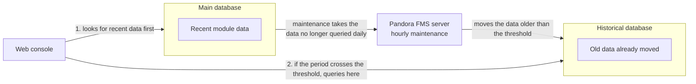
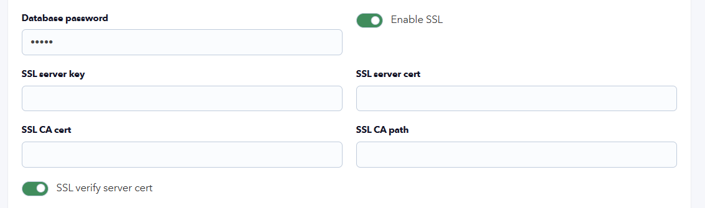
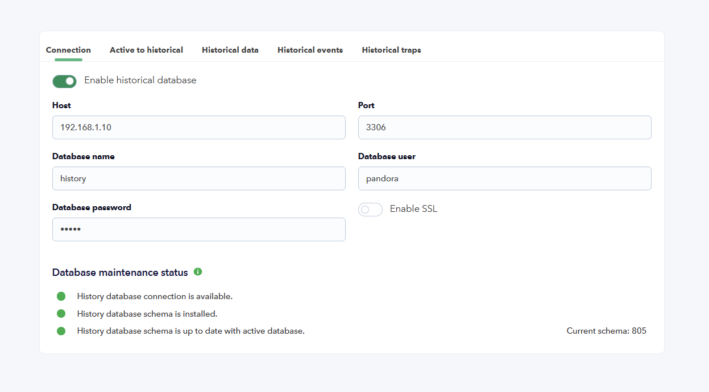
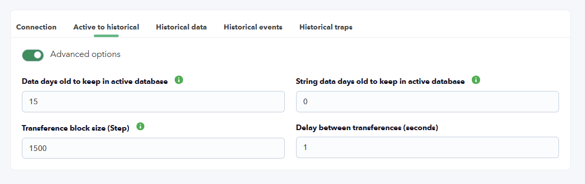
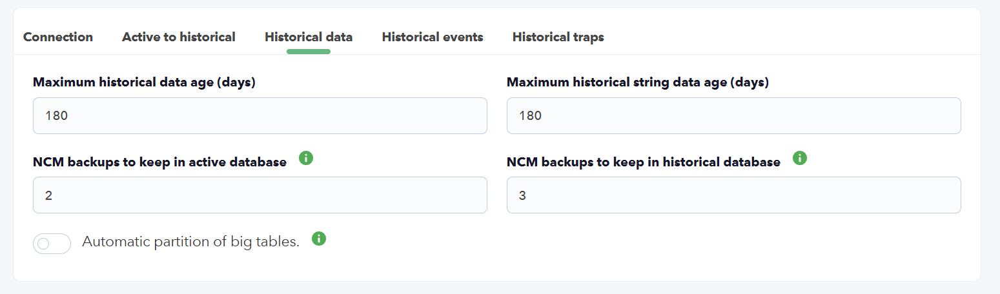
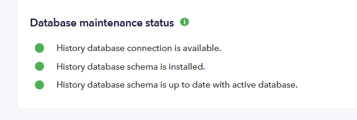
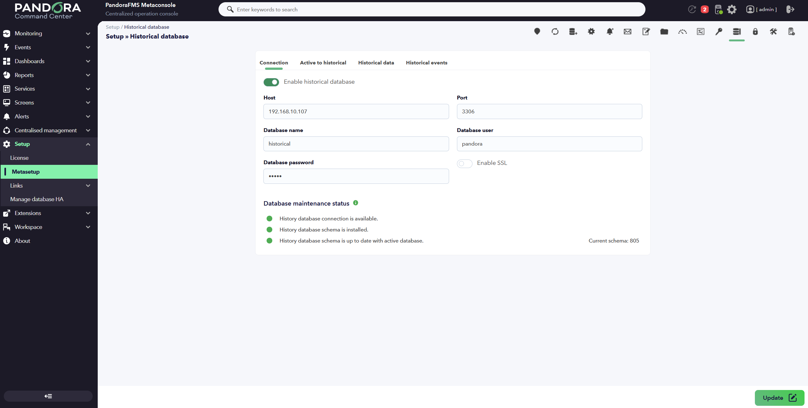

# Historical database

A Pandora FMS installation keeps track of everything: the value of each module,
each event, each trap. Over time that database becomes a huge archive, and the
part consulted every day is a thin strip, the last few days. The **historical
database** exists for exactly that: old data moves to another database and the
main one breathes. The information is not thrown away or locked in a drawer: it
stays available, and the console queries it transparently when you ask for a
graph or a report that goes back further than the active database keeps.

## Introduction: what it is and when to use it

The historical database is a second database, with the same engine and the same
schema as the main one, to which the server transfers the old data of the
modules. The goal is twofold: to lighten the active database, which is the one
that supports constant writing and day-to-day queries, and to keep long time
series without them taking up the same room as recent data. What is gained is
headroom: an installation with a lot of volume can keep storing months of data
without the active database degrading. What is paid is one more piece to
administer, with its own database server, its own backup and its own maintenance.

It is worth it when there is a high volume of time series and a long history is
wanted without sacrificing the response of the main database. The historical
database keeps the data as it is, only somewhere else: it does not summarise or
lose resolution, and that is why it also serves to look again at the exact minute
in which something happened.

It is not a backup either, and it is worth not confusing them. The historical
database does not protect against accidental deletion or against a server crash:
it is one more production database, alive, with its own purge cycle. That is
what the backup is for, and it is covered in
[6.8 (Backup y restore)](6.8-backup-y-restore.md).

The historical database is **optional** and comes disabled from the factory. It
is not an installation requirement or a performance lever to be switched on
without thinking: it is a piece that gets assembled when the volume justifies
it. Enabling it on a small installation adds work in exchange for little. The
reasonable decision is to enable it when the active database starts to fall
short and the retention needed far exceeds what is convenient to keep in the
main database.

If you want to place the historical database within the whole platform before
going into detail, [1.2 (Introduction and
architecture)](../parte-1/1.2-introduccion-y-arquitectura.md) describes the
components and the topologies, and [10.1 (Database
schema)](../parte-10/10.1-esquema-de-la-base-de-datos.md) shows the real schema,
with the table names that are not used here.

## How it fits into the architecture

The historical database uses the same engine as the main one, MySQL 8 or Percona
Server for MySQL 8. It is not a different store with another format: it is the
same structure, with the same data tables, on another server. That is why the
server can move rows from one place to another without odd conversions, and why
the console can switch sources without the query noticing.

The movement is run by the **server's periodic maintenance**, not by the Web
console. The console only configures the connection and the thresholds; the one
that transfers the data is the database maintenance tool, which runs every hour
through cron. This has a practical consequence that is sometimes overlooked:
configuring the historical database moves nothing instantly. Data starts to
travel on the next maintenance pass.

The console, for its part, keeps its own connection to the historical database
and decides on each query which database to pull from. When you ask for a graph
or a report, the console looks at the age of the requested period and, if it
crosses the configured threshold, switches databases. It is the **transparent
query**: you do not choose the database, the console chooses it for you. The
detail of that mechanism is in [Query from the
console](#query-from-the-console).



The historical database coexists with the rest of the architecture without
asking permission. In a **Command Center** it has its own screen in the
Metasetup, as explained in [Operation in complex
environments](#operation-in-complex-environments); in a **high availability**
topology it is part of the framework that maintenance coordinates, as seen in
[6.9 (Alta disponibilidad)](6.9-alta-disponibilidad-ha.md). And although
habit and old documentation present it as mandatory, the truth is that the code
does not require the historical database to live on a server different from the
main database one: it is a **recommendation**, and a good one, because separating
the disk and the CPU of the two databases keeps the maintenance of one from
drowning the other.

## Requirements and preparation of the historical server

Before touching the console, the server that will host the second database has to
be ready. The requirements are the same as those of any Pandora FMS database, with
the exception that here the product does not have to be installed: the engine and
a dedicated database are enough.

| Requirement | Detail |
|---|---|
| Database engine | MySQL 8 or Percona Server for MySQL 8, the same as the main database. The complete requirements table is in [1.1 (Installation)](../parte-1/1.1-instalacion.md) |
| Dedicated database | A database of its own for the historical one, different from the main one, with its own user and password |
| Privileges | The user needs privileges on that database, including those to create and modify structure, because the schema is installed on the first connection |
| Connectivity | Access from the Pandora FMS server and from the Web console to the host and port of the engine. The default port is `3306` |
| Separate server | Hosting the historical database on a server separate from the main database one is **recommended**, not required. It separates disk and CPU, and keeps the maintenance of one database from penalising the other |
| Secure connection (SSL) | Optional since version 782. It is configured with the **Enable SSL** switch and the key, certificate, CA, CA path and server certificate verification fields |

The engine administrator prepares the database and the user. On the command line
of the MySQL server that will host the historical database, a set of statements
like this one leaves the ground ready:

```sql
CREATE USER '<pfms_user_name>' IDENTIFIED BY '<pfms_user_password>';

ALTER USER '<pfms_user_name>'
  IDENTIFIED WITH mysql_native_password BY '<pfms_user_password>';

CREATE DATABASE <historical_database_name>;

GRANT ALL PRIVILEGES
  ON `<historical_database_name>`.*
  TO '<pfms_user_name>'@'<pfms_server_ip_address>';

FLUSH PRIVILEGES;
```

The database name, the user and the password are the ones written later on the
console screen. The schema is not created by hand: the console itself installs it
on the first connection, as explained in the following section.

About **SSL**, it is worth being clear on what each field is. **SSL server key**
is the path to the PEM file with the MySQL server key; **SSL server cert**, the
path to the certificate for that key; **SSL CA cert**, the list of certificates
issued by a certification authority; **SSL CA path**, the directory that hosts
those certificates, also in PEM format. With **SSL verify server cert** enabled,
the connection checks the CN of the certificate and, if it does not match, does
not connect. It is the recommended option when the engine exposes a TLS
connection, and the explanation of the secure configuration of the main database,
which shares criteria, is in
[9.5 (Database encryption)](../parte-9/9.5-cifrado-de-la-base-de-datos.md).



## Enabling and connecting from the console

The screen lives in **Settings → System settings → Historical database**.
Everything starts with a general switch, **Enable historical database**, and a
connection form that appears when it is enabled.

The connection fields are those of any MySQL client: **Host**, **Port**,
**Database name**, **Database user** and **Database password**. The port comes
with `3306`, the standard one. The password is stored encrypted, like the rest of
the product credentials. Below is the SSL block described in the previous
section.



On saving, the console runs two checks that are worth knowing because they
explain half of the scares:

- If the historical database you have typed is **the same** as the active one
  (same host, same port, same name), the console rejects the save with a clear
  warning: the active database and the historical one cannot be the same. It is
  a configuration error, not a failure.
- If the destination database does not exist, does not respond or the user has no
  permissions, the creation of the structure fails and the **Enable historical
  database** switch is left disabled. The console does not leave a
  historical database enabled that it cannot write to.

When the connection is fine, the first time the **schema is installed** in the
destination database. From then on, the console compares the schema version of
the historical database with that of the active database and offers two actions
depending on the state: **Install database schema**, if it does not exist yet,
and **Upgrade database schema**, which schedules the update when the historical
database has fallen behind the main one. Both actions are the same machinery that
keeps the schema of the main database up to date, applied to the historical
connection.

The status indicators of the **Connection** tab are not decorative: they can be
clicked to force a check. If you doubt whether the database responds, clicking
the connection indicator launches a check right away, without waiting for the
next cycle. The installed schema indicator is the one that triggers the
installation when it is missing, and the updated schema one the one that
schedules the upgrade when there is a mismatch.

The screen is organised into five tabs, each with its own purpose:

| Tab | What it configures |
|---|---|
| **Connection** | The general switch, the connection data, the SSL block and the status of maintenance and of the schema |
| **Active to historical** | What data leaves the active database and with what age, the block size, the pause and the advanced options |
| **Historical data** | The retention of the data already moved and the automatic partitioning of large tables |
| **Historical events** | The transfer of events and their retention in the historical database |
| **Historical traps** | The transfer of traps and their retention in the historical database. It does not appear in the Command Center |

The complete inventory of options, with their default value and their effect,
lives in [9.2 (Full console configuration
reference)](../parte-9/9.2-referencia-completa-de-configuracion-de-la-consola.md#31-historical-database).
Here the chapter covers what each thing does and how it is operated.

## What moves and when

The first thing the historical database moves is the **numeric series** of the
modules. From a threshold of age, **15 days** by default, the data stops being in
the active database and goes to the historical one. The threshold is set in **Data
days old to keep in active database** and cannot reach the purge limit of the main
database: if the active database deletes at 45 days, the historical database makes
no sense configured at 45, because it would arrive late to collect what has
already been purged.

**Text series** are another story. By default they are **not transferred**: they
stay in the active database and are purged with it. They only leave for the
historical database if the **Advanced options** are enabled, which enable the
field **String data days old to keep in active database**, with **0 days** by
default: strings do not wait in the active database and start travelling to the
historical one as soon as they are enabled. It is a decision with consequences,
because text strings take up much more than a number and, if they are enabled,
their purging has to be configured in the historical database or it will grow
unchecked. That point is covered in
[Retention and purging](#retention-and-purging).

**Events** and **traps** are optional and travel through switches of their own:
**Enable historical events** and **Enable historical traps**. Each one has its
own age threshold in the active database. The events one, **Events days old to
keep in active database**, has **6 days** by default, one day below the event
purging of the main database (**7**). The traps one, in its tab, is **6 days** by
default. Besides, events are queried only when generating reports, never in the
live event view, so taking them to the historical database fattens the second
database without speeding up the screen that is watched the most: including
events **notably increases** the growth rate of the historical database, and it
is a space decision, not a performance one.

There is a separate case that explains more than one surprise: **short-interval
modules**. Those that run with an interval under 300 seconds live in the active
database for a maximum of **one week**, and that term is fixed: it is hard-coded
and is not configured from the console. After the week, their data move to the
historical database. The reason is common sense: a module that measures every few
seconds generates a huge volume, and leaving it in the active database for months
is the fastest way to bring it down. This behaviour coexists with the general
threshold of 15 days, which applies to normal-interval modules.

The transfer is not done all at once. Maintenance sends the data in **blocks**
whose size is set by **Transference block size (Step)**, **1500** rows by default,
and waits **Delay between transferences (seconds)**, **1** second by default,
between one block and the next. The idea is not to eat the active database while
it is being emptied: small blocks and generous pauses disturb less, at the cost of
taking longer to complete the transfer. If maintenance gives problems, the help of
the field itself recommends lowering the block size. The recommended values are
revisited in [Options reference and
sizing](#options-reference-and-sizing).



All this coming and going is done by the periodic maintenance. If you want to
understand which modules generate what volume before deciding the thresholds,
[2.1 (Monitoring with EndPoints)](../parte-2/2.1-monitorizacion-con-endpoints.md)
covers the module intervals, and [10.1 (Database
schema)](../parte-10/10.1-esquema-de-la-base-de-datos.md) shows the detail of
what moves at table level.

## Retention and purging

The historical database has its **own purge cycle**, with its own limits. It does
not inherit those of the main database: the fact that the active database keeps 45
days of numeric data means nothing for the historical database, which decides on
its own how much it keeps. The default limits are **180 days** for numeric data,
**180** for text strings, **180** for events and **180** for traps. They are set
in the data, events and traps tabs of the historical database.



Meanwhile, the main database purges at the same time on its own, with much
shorter limits: **45 days** of numeric data, **7** of strings, **7** of events and
**7** of traps. Order matters. On each pass, maintenance **first purges** from the
active database what exceeds its retention limit and **then moves** to the
historical database what exceeds the transfer threshold. That is why the transfer
threshold should always stay below the purge limit: if the active database deletes
before the historical one collects, the data is lost. And if the historical
database is not available, the active database keeps purging all the same: there
is no waiting queue. That is why the status of the historical database, seen on
the **Connection** tab, deserves a look from time to time.

The serious warning is the one about **text series**. If the advanced options are
enabled to transfer them, their retention in the historical database has to be
configured too. If that is not done, strings pile up in the second database
indefinitely and end up taking space nobody had foreseen. Old documentation
proposed solving it with a direct SQL query on the database; here the
recommendation is to do it from the screen itself, which is what it is for, and
to leave the detail of tables and columns to
[10.1 (Database schema)](../parte-10/10.1-esquema-de-la-base-de-datos.md).

## Automatic partitioning of large tables

With the historical database full of series, the largest tables become slow to
query and heavy to purge. **Automatic partitioning of large tables** spreads
those tables into **monthly partitions**, so that a query for a graph or a report
touches only the pieces of the period it is interested in and purging works on
smaller row sets instead of on the whole table.

The switch is on the **Historical data** tab, under the name **Automatic
partition of big tables.**, and it comes disabled by default. When it is enabled,
maintenance creates the missing partitions and adds a new one at the start of each
month. It covers **three families of data**: numeric series, text series and
traps. The rest of the database is not partitioned. The detail of the schema and
of the table names involved is in
[10.1 (Database schema)](../parte-10/10.1-esquema-de-la-base-de-datos.md) and in
[10.2 (Table reference)](../parte-10/10.2-referencia-de-tablas.md).

There is also **manual partitioning**, for those who prefer to control the
process or do not want to depend on the automation. The operation is done with an
`ALTER TABLE` on the series table, declaring partitions by range on the timestamp,
with a final partition that collects everything above the last limit:

```sql
ALTER TABLE <series_table>
  PARTITION BY RANGE (<timestamp>) (
    PARTITION <month_1> VALUES LESS THAN (UNIX_TIMESTAMP('<start_of_month_2>')),
    PARTITION <month_2> VALUES LESS THAN (UNIX_TIMESTAMP('<start_of_month_3>')),
    /* ... one stretch per month ... */
    PARTITION pActual VALUES LESS THAN (MAXVALUE)
  );
```

Every month the open partition has to be reorganised to close the month that ends
and open the next one, with an equivalent `REORGANIZE PARTITION`. Two warnings
from experience: the operation needs **plenty of free space** on disk, because
MySQL rewrites the table while it partitions it, and it can take **hours** on
large tables; in a real case, partitioning a table with tens of millions of rows
took about an hour and a half. The way to follow the progress is to look at the
partition files the engine creates in the data directory. Manual partitioning
rests on the same optimisation ideas covered in
[6.7 (Database optimization)](6.7-optimizacion-de-la-base-de-datos.md).

## Status, maintenance and diagnosis

The **Connection** tab is the control panel of the historical database, and it is
worth reading in order. First, the **connection availability**: a green indicator
with "History database connection is available" or a red one with the specific
error. Second, the **installed schema**: whether it exists, or whether it is
missing and has to be installed. Third, the **schema up to date**: whether the
version of the historical database matches that of the active database or has
fallen behind. And finally, the **current schema version** of the historical
database, to compare it at a glance with that of the main database.



The maintenance status of each database, active and historical, is followed from
the **Performance** page of the console, in its maintenance block. Each row says
when maintenance last ran and shows a warning if too much time has passed. In
practice, the reference is **12 hours**: if maintenance has not run within that
term, the indicator goes to a problematic state. Since maintenance is scheduled
every hour, twelve hours without running mean something is wrong.

On top of that come the **warnings of the console supervisor**, which appear in
the notification system and cover three cases:

- **Historical database not available.** The historical database is enabled but
  the console cannot connect with the current configuration.
- **Historical database maintenance problem.** Maintenance does not go through
  the database in **48 hours**. It is the threshold of the supervisor, more
  lenient than the indicator on the screen, and it warns of sustained neglect.
- **Historical database MR mismatch.** The historical database does not use the
  same schema as the main database, something that can produce anomalies when
  storing data.

When maintenance has to be checked by hand, the tool is launched from the command
line:

```bash
/usr/bin/pandora_db /etc/pandora/pandora_server.conf
```

A correct run should report no errors. The process leaves its trace in the server
error file, which by default is `/var/log/pandora/pandora_server.error` and is
configured in the server file itself.

If something still does not add up, the general diagnosis of the product is in
[9.13 (Troubleshooting)](../parte-9/9.13-troubleshooting-con-pandora.md) and the
server and database frequently asked questions, in [12.2 (Servidor y base de
datos)](../parte-12/12.2-servidor-y-base-de-datos.md) and [12.8 (Entornos
grandes)](../parte-12/12.8-entornos-grandes.md).

## Query from the console

The beauty of the historical database is that there is no need to remember it.
When you ask for a graph or a report with old data, the console **looks first in
the main database** and, as soon as the requested period crosses the configured
age threshold, **switches to the historical database** and keeps pulling from
there. The query is split between the two databases without the user noticing,
and the result appears as a continuous series. That threshold is the same 15 days
by default that decides what moves, so that what is no longer in the active
database is looked for where it is.

Reports benefit from the transparency in the same way, as described in
[5.2 (Informes)](../parte-5/5.2-informes.md), and business and service views, in
[5.3 (Monitorización de negocio y
servicios)](../parte-5/5.3-monitorizacion-de-negocio-y-servicios.md).

It is also worth knowing **what the historical database does not cover**. The
**live event view does not query the historical database**: the events moved only
feed report generation. If you transfer events, you gain history for reports, but
you will not see the old events on the events screen. Something similar happens
with traps, whose treatment is documented in [2.7 (SNMP trap
monitoring)](../parte-2/2.7-monitorizacion-de-traps-snmp.md). And there is data
that never travels to the historical database: configuration, agents, alerts and
everything that is not a time series stay in the main database.

## Operation in complex environments

In a **Command Center**, the historical database has its own screen in **Setup →
Metasetup → Historical database**: it is the same configuration as that of a
console, applied to the database of the Command Center itself, and each instance
also keeps its own in its console. A practical detail: the connection data can be
filled in even if the server is not up yet, and the **data movement only starts
when the connection succeeds**. However, if on saving the connection does not
respond, the console **disables the switch** of the historical database: it has to
be enabled again when the destination is available. The traps tab does not appear
in the Command Center.



The Command Center as a whole, with its nodes and its management model, is
developed in [6.3 (Command Center)](6.3-command-center.md). Here it is enough to
remember that the historical database of the Command Center is configured in its own
Metasetup.

In **high availability**, the historical database is part of the topology and
maintenance is coordinated between nodes so that they do not step on each other.
The complete scenario, with its precautions, is in [6.9 (Alta
disponibilidad)](6.9-alta-disponibilidad-ha.md).

In a **node migration** there is a step that is easily forgotten: repointing the
historical connection to the new server. The main database moves with its
procedure, but the historical one has its own connection configuration and it has
to be updated so that the node keeps finding it.

And in the **backup** it is worth being clear: the copy of the main database
**does not include** the historical database. They are two different databases on
two different servers, and each one needs its own backup. The Pandora FMS copy and
restore procedure is documented in [6.8 (Backup y
restore)](6.8-backup-y-restore.md).

## Options reference and sizing

This chapter does not repeat the inventory of options or the sizing table, and it
does so on purpose. The complete listing of each field of the screen, with its
default value and its effect, is in
[9.2 (Full console configuration
reference)](../parte-9/9.2-referencia-completa-de-configuracion-de-la-consola.md#31-historical-database).
The calculation of how much the database will grow according to agents and
modules, and how to distribute storage, is in
[9.14 (Análisis de volumetría y diseños para alta
capacidad)](../parte-9/9.14-analisis-de-volumetria-y-disenos-para-alta-capacidad.md).
Here only the operating criteria remain.

About **how many days to keep in the active database**, the short answer is the
fewest that allow working comfortably with day-to-day data. The default value, 15
days, is a good starting point: it gives margin to look at the current month
without dragging an unnecessary volume. Lowering it too much forces the console to
jump to the historical database too early; raising it too much fattens the
database that is written the most.

About the **block size and the pause**, the code brings **1500** rows and **1**
second by default, but the operating recommendation is more conservative: **1000**
rows per block and **2** seconds of pause. Smaller blocks and longer pauses spread
the load better and keep the transfer from competing with the normal work of the
active database. On installations with fast disks the block can go up; on tight
installations, lowering it is the first lever when maintenance is rushed.

And about the **retention of the historical database**, the decision is set by how
far back you really need to query. The 180 days by default cover half a year,
which is more than most reports require. Extending it has a direct cost in space
and in purge time; shortening it frees room. If you enable text series, remember
that their retention has to be configured explicitly or they will grow without
control, as warned in [Retention and
purging](#retention-and-purging). To adjust the number with the real growth of the
database, the reference is [9.14 (Análisis de volumetría y diseños para alta
capacidad)](../parte-9/9.14-analisis-de-volumetria-y-disenos-para-alta-capacidad.md),
and for the rest of the optimisation techniques,
[6.7 (Database optimization)](6.7-optimizacion-de-la-base-de-datos.md).
