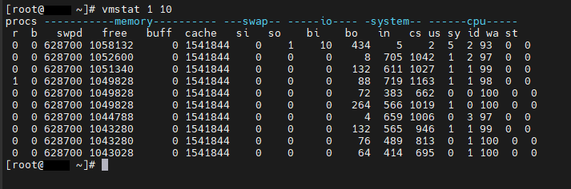

# Database optimization

## Introduction: why the database degrades

In a Pandora FMS installation writing never stops: modules deliver their data,
events pile up and traps keep arriving. The time series tables grow without
pause, periodic maintenance purges the old data, and the space it frees is not
always reused well. The result, after a few months, is a database full of holes
inside. Graph and report queries, the ones that read the most, slow down, and
one day the screen takes a while to paint what it used to paint on its own.

That is degradation, and it is worth being clear from the start about what can
be done and what cannot. Pandora FMS **does not optimize the database for you**.
Its periodic maintenance, which runs every hour through cron, does four things:
it purges the data that exceeds its retention, it checks the consistency of the
database, it reviews its referential integrity and, if a historical database is
configured, it moves the old data there. When it finishes, it stamps the time of
its last pass. What it **does not** do is defragment or rebuild anything: there
is no hidden `OPTIMIZE TABLE` in maintenance, and the Web console has no
"Optimize" button. If you came here looking for that button, I will save you the
search: it does not exist.

Hence the approach of this chapter. What is explained here is not a feature of
the product, but the administration of the engine, MySQL or Percona Server for
MySQL. You tune the engine, you measure fragmentation, you decide when to
optimize and when to rebuild. Pandora FMS gives you the diagnosis and the
documentation to do it with judgement.

The rest of the pieces of the puzzle live in other chapters and are not repeated
here. The historical database, its retention and the automatic partitioning of
its tables are in [6.5 (Historical database)](6.5-base-de-datos-de-historico.md).
The backup and the restore, which is where the rebuild ends up, in
[6.8 (Backup y restore)](6.8-backup-y-restore.md). And the sizing of the system,
with how much memory and how much CPU each scenario asks for, in
[9.14 (Análisis de volumetría y diseños para alta capacidad)](../parte-9/9.14-analisis-de-volumetria-y-disenos-para-alta-capacidad.md).

## What engine configuration Pandora FMS ships with

Pandora FMS runs on MySQL 8 and its recommended variant, Percona Server for
MySQL 8. Both are compatible with each other and, for convenience, this chapter
says "MySQL" plainly; wherever a test or a recommended value is mentioned, it
was done on Percona.

The first thing worth knowing is that you do not start from scratch. The
Pandora FMS installer does not limit itself to leaving the engine with the
factory values: it writes a `my.cnf` with a block of parameters already designed
for the product. That block sets, among others, these values:

| Parameter | Value | Parameter | Value |
|---|---|---|---|
| `max_allowed_packet` | `64M` | `innodb_lock_wait_timeout` | `90` |
| `innodb_file_per_table` | Enabled | `innodb_flush_log_at_trx_commit` | `0` |
| `innodb_flush_method` | `O_DIRECT` | `innodb_log_buffer_size` | `16M` |
| `innodb_log_file_size` | `512M` | `innodb_io_capacity` | `1000` |
| `thread_cache_size` | `32` | `thread_stack` | `256K` |
| `max_connections` | `300` | `key_buffer_size` | `4M` |
| `sql_mode` | Empty | `character-set-server` | `utf8mb4` |
| `read_buffer_size` | `128K` | `read_rnd_buffer_size` | `128K` |
| `sort_buffer_size` | `1M` | `join_buffer_size` | `4M` |

The last two rows are per-session buffers, not global ones: they are reserved
for each connection. The engine uses `utf8mb4` on all systems, because it is the
default value of MySQL 8, and the dedicated database installer for Ubuntu 22.04
also sets it explicitly in the file. And the block disables binary logs with
`skip-log-bin`, something that is only correct on a single server, as seen in
[Disk, binary logs and system load](#disk-binary-logs-and-system-load).

Four of those values are not fixed. The installer adapts them to the system and
to whether the database runs on the same server or on a dedicated one, and they
move between two profiles: `innodb_log_file_size` between `64M` and `512M`,
`innodb_io_capacity` between `100` and `1000`, `thread_cache_size` between `8`
and `32`, and `max_connections` between `100` and `300`. On the most recent
systems, and above all when the engine is MySQL 8.4, the installer also adds two
parameters that do not appear on the others: `innodb_change_buffering = ALL` and
`performance_schema = OFF`. As the exact value depends on your case, do not trust
the table: check the one the running engine has, which is exactly what is
explained a little further down.

The InnoDB buffer is the only one without a fixed value: the installer
calculates it from the memory of the server. The general rule is **40 % of the
RAM**, and in several combinations of system and installer it drops to **25 %**
when the server has less than 7.5 GB. The idea is that it eats a generous
portion of the memory and leaves the rest for the system and for the Pandora FMS
server. It is the most important decision of the whole engine configuration and
it is explained in detail in
[Fine tuning of the engine parameters](#fine-tuning-of-the-engine-parameters).

**How to know which configuration is active.**

The configuration file is not always where you believe it is, so the fastest way
is to ask the engine itself. The server binary prints, with `--verbose`, the list
of files it reads and in what order:

```bash
mysqld --help --verbose | head -40
```

With that you locate the `my.cnf` that is really being applied (on Ubuntu it is
usually `/etc/mysql/my.cnf`; on the distributions of the RHEL family,
`/etc/my.cnf`). To see the values hot, without opening the file, the engine
variables are queried:

```sql
SHOW VARIABLES LIKE 'innodb%';
```

And for a specific parameter, the same query narrowed to the name:

```sql
SHOW VARIABLES LIKE 'innodb_buffer_pool_size';
```

!!! warning "Parameters must be inside their section"
    A parameter written outside the `[mysqld]` section of `my.cnf` is not applied,
    and the engine starts up quite happily with the previous value. It is the most
    common mistake and the hardest one to see, because it gives no warning at all:
    the value simply does not change. Always check the hot value with
    `SHOW VARIABLES`, do not trust the file.

The requirements of the database server, with the operating system and the
versions admitted, are in [1.1 (Installation)](../parte-1/1.1-instalacion.md).
The `my.cnf` used by a high availability environment is not this one, but the
replication one, which is described in
[6.9 (Alta Disponibilidad (HA))](6.9-alta-disponibilidad-ha.md). And if what
you are looking for is how much machine is needed for a specific volume, that is
[9.14 (Análisis de volumetría y diseños para alta capacidad)](../parte-9/9.14-analisis-de-volumetria-y-disenos-para-alta-capacidad.md).

## Fine tuning of the engine parameters

Here is the bulk of the administration work. The following table gathers the
parameters that matter, with the value Pandora FMS applies and what each one is
for. Those with a fixed value are the ones the installer writes; those that
depend on the system are marked as such.

| Parameter | Value Pandora FMS applies | What it is for |
|---|---|---|
| `innodb_buffer_pool_size` | Computed: 25 % or 40 % of the RAM, depending on the system | In-memory cache of InnoDB data and indexes. It is, by far, the parameter that weighs the most on performance |
| `innodb_log_file_size` | `64M` or `512M`, depending on the system | Size of each InnoDB log file |
| `innodb_log_buffer_size` | `16M` | In-memory buffer where InnoDB accumulates writes to the log before flushing them to disk |
| `innodb_io_capacity` | `100`, `300` or `1000`, depending on the system | Input/output capacity InnoDB can request from the disk |
| `innodb_file_per_table` | Enabled | One tablespace per table, instead of a shared one |
| `innodb_flush_log_at_trx_commit` | `0` | Write policy on committing each transaction |
| `innodb_flush_method` | `O_DIRECT` | How InnoDB writes to disk, without going through the operating system cache |
| `innodb_lock_wait_timeout` | `90` | Seconds a transaction waits for a lock before giving up |
| `innodb_thread_concurrency` | `0` (engine default value) | Limit of concurrent InnoDB threads; `0` means "no limit" |
| `max_allowed_packet` | `64M` | Maximum size of a data packet between client and engine |
| `max_connections` | `100` or `300`, depending on the system | Simultaneous connections admitted |
| `thread_cache_size` | `8` or `32`, depending on the system | Threads the engine keeps in reserve to reuse them |
| `thread_stack` | `256K` | Memory stack assigned to each thread |
| `key_buffer_size` | `4M` | Key buffer, specific to MyISAM. It does not speed up InnoDB |
| `read_buffer_size` | `128K` | Per-session buffer for sequential reads |
| `read_rnd_buffer_size` | `128K` | Per-session buffer for reads in scattered order |
| `sort_buffer_size` | `1M` | Per-session buffer for sorts |
| `join_buffer_size` | `4M` | Per-session buffer for joins that do not use an index |
| `sql_mode` | Empty | Strict SQL mode disabled |

**The InnoDB buffer: more memory before more CPU.**

If you can only touch one parameter, touch this one. `innodb_buffer_pool_size` is
the memory where InnoDB caches the data and index pages it reads, and the bigger
it is, the fewer times it has to go to disk. In a monitoring database, where the
pattern is to read a lot and write constantly, this marks the difference between
a Web console that responds and one that crawls.

Experience with the product always points in the same direction: **more memory
delivers more than more CPU**. A business system starts fine with 4 GB of RAM;
for a large environment, 16 GB is a reasonable starting point. The installer
already calculates the value from the available memory, but on large machines it
is worth reviewing it, because percentages are an approximation and the number
that really matters is how much space the active data and indexes take up. If
the buffer fits entirely in memory, the disk stops being the bottleneck for
reads.

**InnoDB logs and disk capacity.**

InnoDB writes its changes to a log before consolidating them in the tables. The
installer sets each log file to `64M` or `512M`, depending on the system, and its
buffer to `16M`. A small log forces the engine to flush it to disk more often,
and that is where performance is lost; a large one lengthens recovery after a
crash, because there is more to redo. The Pandora FMS values are a compromise
designed for production with a high volume of transactions.

`innodb_io_capacity` says how much input/output InnoDB can request from the disk.
The installer leaves it at a prudent value (between `100` and `1000`, depending
on the system) that assumes a capable disk. If the disk is different, the number
is adjusted to what it can take. The reference is the IOPS of the disk:

| Disk type | Approximate IOPS |
|---|---|
| Mechanical disk at 7,500 RPM | 100 |
| Mechanical disk at 15,000 RPM | 190 |
| SSD | 1,500 |

An SSD is not a luxury on a monitoring database server: it is the difference
between a maintenance that finishes on time and one that overlaps with the next.

`innodb_file_per_table` deserves a paragraph of its own because it conditions
everything else. With the tablespace per table enabled, each table lives in its
own file. That allows moving a specific table to another disk, restoring it
without touching the others and, above all, keeping the fragmentation of one
table from dragging the others along. If the parameter is not enabled, all
tables share a single tablespace and fragmentation is common, so performance
degrades sooner. The installer enables it by default, and the manual
partitioning of large tables requires it.

**The write policy on commit.**

`innodb_flush_log_at_trx_commit` decides how much the engine risks in order to go
faster. With the value `0`, InnoDB groups the writes and flushes them
approximately once per second, instead of going to disk on every transaction.
The trade-off is clear: in the event of a crash, the last second of data can be
lost. In a monitoring database that second is a handful of module values, and
the exchange pays off. Pandora FMS applies `0` in the installer; a high
availability environment uses another value, because there replication changes
the rules of the game and the `my.cnf` is another one.

Closely related is `innodb_flush_method = O_DIRECT`, which keeps the writes from
going through the operating system cache. In a database that already has a large
buffer of its own, duplicating the cache in the system does not help, it gets in
the way.

**Locks, packets and concurrency.**

`innodb_lock_wait_timeout` sets at `90` seconds the maximum wait of a transaction
for a lock. If that time runs out, the operation fails and the client receives
the classic **"MySQL has gone away"**. The 90 seconds give margin for an
occasional jam to clear itself, without the engine giving up at the first
attempt. A wait time that runs out regularly is not a missing setting: it is a
symptom that something else is wrong.

`max_allowed_packet` at `64M` allows moving large packets, such as the bulk data
sends of the EndPoints or a restore. `max_connections` (at `100` or `300`,
depending on the system) covers with room to spare the connections of the
console, the server and maintenance, each one with its small group of
connections. `thread_cache_size` and `thread_stack` complete the thread section:
the engine keeps threads in reserve (`8` or `32`, depending on the system) so as
not to create and destroy them on every connection, and assigns 256K of stack to
each one.

About `innodb_thread_concurrency`, the default value `0` lets InnoDB open as many
threads as it can. It is an advanced parameter and, badly adjusted, it goes
slower than leaving it alone. If it has to be fine-tuned on a system with a lot
of concurrency, the recommended formula is the number of physical processors
multiplied by two, plus the number of disks where InnoDB lives. When in doubt,
it is left at `0`.

**The per-session buffers.**

The four per-session buffers (`read_buffer_size`, `read_rnd_buffer_size`,
`sort_buffer_size` and `join_buffer_size`) are reserved per connection, not once.
They are multiplied by the number of simultaneous connections, so raising them
cheerfully fattens the memory consumption. The Pandora FMS values are restrained
and sufficient for the queries of the product. `key_buffer_size`, at `4M`, is a
MyISAM buffer and does not speed up InnoDB; it is kept at its low value because
it adds nothing to the engine the product uses.

**What no longer exists: the query cache.**

MySQL 8 removed the query cache that previous versions brought. The parameters
that governed it (`query_cache_size`, `query_cache_limit`, `query_cache_type`) no
longer exist, and the Pandora FMS `my.cnf` does not define them. There is nothing
to configure here: if you come from an old installation and those parameters are
still in the file, remove them, because the current engine does not recognise
them and may refuse to start. They are taken out of `my.cnf` and you move on.

!!! warning "Every change requires a restart and a check"
    Engine parameters are not applied hot: the service has to be restarted and you
    have to verify that it starts without errors and that the Web console and the
    server still connect to the database. A `my.cnf` with a syntax error or an
    out-of-range value can leave the engine down. Change one block, restart,
    check, and only then move on to the next one.

## Disk, binary logs and system load

The usual bottleneck of a database is not the CPU or the memory: it is the disk.
Three golden rules, and none of them is negotiable when the volume presses. The
first, separate the operating system, the database data and the replication logs
on different disks, so that they do not compete for the same head or the same
controller. The second, use SSD. The third, when the client and the engine are on
the same machine, connect through a socket instead of TCP/IP, which translates
into an improvement of around 7.5 % without touching anything else: it is enough
not to indicate a host name when connecting, instead of forcing `localhost`.

**Binary logs** are the other piece of the disk. If you have a single Pandora FMS
server, you do not need them and the installer already disables them with
`skip-log-bin`. If you have high availability, they are **mandatory**, because
replication rests on them, and the `my.cnf` is another one: it carries a block of
replication parameters and, besides, a different value for the write policy
(`innodb_flush_log_at_trx_commit = 2`) and a connection limit of its own (`200`).
That file, with its nodes and its precautions, is documented in
[6.9 (Alta Disponibilidad (HA))](6.9-alta-disponibilidad-ha.md).

**How to know if the system is suffering.**

Before touching the database it is worth checking that the problem is where you
think it is. The operating system brings the tool that is needed:

```bash
vmstat 1 10
```

It returns ten samples, one per second. What to watch is in the last columns. An
output from a healthy system looks like this:

```text
procs -----------memory---------- ---swap-- -----io---- --system-- -----cpu------
 r  b   swpd   free   buff  cache   si   so    bi    bo   in   cs us sy id wa st
 0  0  46248  78664 154644 576800    0    0     2   147    0    9  7 10 83  0  0
 2  0  46248  78904 154648 576740    0    0     0   184  728 2484 63  6 31  0  0
 0  0  46248  79028 154648 576736    0    0     0    20   35   37  0  1 98  1  0
 1  0  46248  79028 154648 576736    0    0     0     0   28   22  0  0 100  0  0
```

The reading is direct. The `wa` column (input/output wait) above 10 points to a
disk problem that has to be solved. The `sy` column (system time) should not
exceed 10 or 15. And `si` and `so` (swap memory) should be at 0: if they are not,
the system is using swap, which is a performance killer, plain and simple. The
solution, then, is not in the database: memory has to be increased or what
consumes it has to be reduced, starting with the server threads and the engine
buffers.



## Diagnosing the health of the database

Before optimizing anything, measure. The Web console offers no optimize action,
but it does offer a complete diagnosis of the database, and it is worth knowing
because it is the gateway to everything else.


The main tool is in **Admin tools → Diagnostic info**. It gathers, on a single
screen, the size of the database, its health status, engine information and two
blocks that are the ones of interest here:

- The **engine variables compared with the recommended values**. The diagnosis
  goes through the MySQL variables and marks in red those that do not reach the
  advised minimum, with their current value and the value they should have. The
  following table gathers those minimums.

| Variable | Value recommended by the diagnosis |
|---|---|
| `innodb_buffer_pool_size` | 250 MB or more (the warning itself mentions 40 % of the server memory) |
| `innodb_file_per_table` | Enabled |
| `innodb_lock_wait_timeout` | 90 seconds or more |
| `innodb_log_buffer_size` | 16M or more |
| `innodb_log_file_size` | 64M or more |
| `max_allowed_packet` | 32M or more |
| `max_connections` | 90 or more |
| `read_buffer_size` | 32K or more |
| `read_rnd_buffer_size` | 32K or more |
| `sort_buffer_size` | 32K or more |
| `thread_cache_size` | 8 or more |
| `thread_stack` | 256K or more |
| `sql_mode` | Empty |


Besides those minimums, the diagnosis compares each variable with the value it
expects to find, including the write policy of InnoDB. If a variable appears in
red, review the `my.cnf`: the usual thing is that the parameter has not been
applied because it is outside its section, or that someone changed it later.

There is one row that can come out red and that **must not be touched**: the one
of the **InnoDB write policy**. The diagnosis expects the conservative value, and
the installer of a single server applies the fast one, so in a freshly made
installation that row appears in red even though nothing is wrong. Leave it as it
is, with the value the installer put. In a high availability environment you will
not see it that way: there the `my.cnf` uses the conservative value and the row
comes out green, as told in
[Disk, binary logs and system load](#disk-binary-logs-and-system-load).

- The **fragmentation of the numeric series table**. When it exceeds **10 %**,
  the diagnosis warns that the table is fragmented and should be defragmented. It
  is measured on the same panel and it is explained in
  [Fragmentation: measure it before touching
  anything](#fragmentation-measure-it-before-touching-anything).


The other two tools in the menu have a different role. **Admin tools → DB Schema
Check** verifies that the database is correct: it detects tables or fields that
are missing after a migration or an update. To run it, the database user needs
query, delete, create and references privileges. And **Admin tools → DB
interface** allows launching queries directly against the database from the
console, useful for a one-off check without opening a separate client. The
general diagnosis of the product, beyond the database, is covered in
[9.13 (Troubleshooting con Pandora)](../parte-9/9.13-troubleshooting-con-pandora.md).

**The server diagnostic script.**

When an incident has to be opened, the console is not enough: a snapshot of the
server is needed. That is what the diagnostic script is for, and it is run by
hand on the machine:

```bash
./pandora_diagnostic.sh
```

It gathers, in a single file in `/tmp/pandora_diag.<date>.data`, processor and
memory information, uptime, the Pandora FMS processes running, the contents of
the engine `my.cnf`, the server configuration (without passwords), the listing of
its logs, disk usage and a sample of `vmstat` and of the system log. It is the
first piece requested when opening a ticket, because it saves twenty questions.
It runs on the server, not from the console, and its result is not read on
screen: it is a file that gets attached.

**The status of periodic maintenance.**

Finally, the status of the database maintenance is monitored from **Settings →
System settings → Performance**, on the database maintenance tab. That screen
closes the diagnosis at the bottom: each row says when it last ran and shows a
traffic light, so at a glance you know whether the database is being purged and
checked at the expected rate or whether maintenance has stopped. The detail of
the indicator and of its threshold is in
[6.5 (Historical database)](6.5-base-de-datos-de-historico.md), and the complete
inventory of options of that screen, with their default value, in
[9.2 (Full console configuration reference)](../parte-9/9.2-referencia-completa-de-configuracion-de-la-consola.md).


## Fragmentation: measure it before touching anything

A database fragments the way a disk fragments: between one insert and the next
there are deletes, and the space left free is spread out in holes. In Pandora FMS
the pattern is clear: the time series tables receive constant inserts and the
purge deletes old series continuously, so those tables are the first to
accumulate unused free space. Over time, reading a graph forces the engine to
jump between holes and everything goes slower.

Measuring fragmentation is cheap and changes nothing, so it is always done before
deciding. The query goes to the catalogue of the engine itself, not to the tables
of the product, and that is why it can be published in full:

```sql
SELECT ENGINE,
       TABLE_NAME,
       ROUND(DATA_LENGTH/1024/1024)  AS data_length,
       ROUND(INDEX_LENGTH/1024/1024) AS index_length,
       ROUND(DATA_FREE/1024/1024)    AS data_free,
       (DATA_FREE/(INDEX_LENGTH+DATA_LENGTH)) AS frag_ratio
  FROM information_schema.tables
 WHERE TABLE_TYPE = 'BASE TABLE'
   AND DATA_FREE > 0
 ORDER BY frag_ratio DESC;
```

Each row is a table with free space and each column measures one thing: the
engine (`ENGINE`), the name of the table (`TABLE_NAME`), the megabytes of data
(`data_length`), those of indexes (`index_length`), those of free space
(`data_free`) and the quotient between the free space and the occupied one
(`frag_ratio`). The result comes sorted from most to least fragmented, so the
first rows are the candidates.

Two warnings to read it well. The first, that the quotient deceives on small
tables: a tiny table with a few free megabytes can give a very high `frag_ratio`
without it mattering to anyone. The quotient **and** the absolute sizes always
have to be looked at, and keep the large tables that also have a high quotient.
The second, that the 10 % does not come from the query: it is the threshold the
Web console diagnosis applies to the numeric series table, as seen in
[Diagnosing the health of the
database](#diagnosing-the-health-of-the-database). The query gives you the map;
the threshold is set by judgement.

!!! warning "Measuring is only measuring"
    The query does not touch the data, but on a loaded server and with huge tables
    it can take a while, because it forces the engine catalogue to be read. Launch
    it at a quiet moment. And do not expect measuring to fix anything: the
    fragmentation is still there until the table is optimized.

The detail of which tables are in the schema and what they are called is in
[10.1 (Database schema)](../parte-10/10.1-esquema-de-la-base-de-datos.md)
and in [10.2 (Table reference)](../parte-10/10.2-referencia-de-tablas.md).
Here, and throughout the chapter, tables are described by their role, not by
their name.

## Table optimization

The operation that recovers the space is `OPTIMIZE TABLE`. It is run on the
tables that need it, and the command, with the table name referred to the
reference of Part 10, is this one:

```sql
OPTIMIZE TABLE <table>;
```

It is worth optimizing the tables that grow and are purged without pause: the
**time series tables** (the numeric ones and the text series one), the **events
table**, the **module inventory table** and those of **agents**, **modules** and
**module status**. The concrete list of names, with their content and their
usual size, is in
[10.2 (Table reference)](../parte-10/10.2-referencia-de-tablas.md). When you
finish the batch, it is worth refreshing the engine with:

```sql
FLUSH TABLES;
```

In InnoDB, `OPTIMIZE TABLE` is not a magic operation: the engine translates it
into a rebuild of the table, which updates the index statistics and frees the
unused space of the clustered index. That is what the MySQL manual itself says,
and it explains both its usefulness and its cost. The engine usually answers
with a message that confirms the translation: **"Table does not support optimize,
doing recreate + analyze instead"**. It is not an error; it is the way InnoDB has
of saying that it is going to rebuild.


And there is the problem. Rebuilding a table means **rewriting it entirely**, so
the operation locks the table and needs, besides, enough free space on disk to
host the copy while it is done. If the disk is full, the command fails and does
not run. If the table is very large, the rebuild can take hours and get stuck;
at that point it stops being an alternative and the right move is rebuilding the
database, as explained in
[Rebuilding the database](#rebuilding-the-database).

The cadence is not set by the product, it is set by judgement. A normal
environment is optimized **once a year**; a large one, **every six months**. And
always in a maintenance window, because during the operation the table is not
available. For the backup and restore procedure, in case something goes wrong,
go to [6.8 (Backup y restore)](6.8-backup-y-restore.md).

## Indexes

The queries a Pandora FMS installation suffers the most are those of graphs and
reports, and almost all of them filter by a module and by a time range. So that
those queries do not walk the whole table, the **time series tables** carry two
indexes: one composed of the module and the timestamp, and another one by the
timestamp alone. The first resolves the typical query of a module graph; the
second covers the sweeps by period.

For years the documentation presented these indexes as "optional", something
that had to be added by hand after installing. That is no longer true: the
current schema brings them from the factory. If you come across an old
installation where they are missing, it is not that they are disabled: it is that
the schema is incomplete, and they have to be added.

To check that they are there, there are two paths. The first, the schema check of
the Web console, **Admin tools → DB Schema Check**, which warns of what is
missing.


The second, ask the engine for the indexes of a specific table:

```sql
SHOW INDEX FROM <table>;
```

The output returns one row for each column that makes up each index, with its
name, its position inside the index and its uniqueness. It is enough to check
that the two expected indexes appear: the composite one and the timestamp one.
The name of the specific table to query is in
[10.2 (Table reference)](../parte-10/10.2-referencia-de-tablas.md).

If they are missing, they are added with a statement like this one, replacing the
placeholders with the real name of the table and of its columns, which are also
in the reference:

```sql
ALTER TABLE <table>
  ADD INDEX <index_name> (<module_column>, <timestamp_column>);
```

!!! warning "An index added on a live system does not go unnoticed"
    Creating an index on a large table locks and consumes resources, and on a
    production installation it is felt. Do it in a maintenance window, with a
    recent backup, and check afterwards with `SHOW INDEX` that the index was
    created. For the general diagnosis of incidents,
    [9.13 (Troubleshooting con Pandora)](../parte-9/9.13-troubleshooting-con-pandora.md).

## Slow queries

The engine can log the queries that take longer than a threshold, and that log is
an excellent diagnostic tool. It is also a tool you pay for, because every query
that gets recorded writes to disk and competes with the normal work. The Pandora
FMS recommendation is blunt: **do not leave it enabled permanently**. It is
switched on when there is a problem, you look at what you need and it is switched
off.

It is enabled in the `my.cnf`, adding these lines:

```ini
slow_query_log = 1
long_query_time = 2
slow_query_log_file = /var/log/mysql_slow.log
```

The `long_query_time` threshold is in seconds: with `2`, every query that takes
more than two seconds is logged. Before starting, the file has to be created and
given the right permissions, because the engine writes to it with its own user:

```bash
touch /var/log/mysql_slow.log
chown mysql:mysql /var/log/mysql_slow.log
chmod 640 /var/log/mysql_slow.log
```

Afterwards, MySQL is restarted and left to work for a while. When you have
gathered enough samples, the file is read and the patterns are looked for:
queries that repeat, filters that do not make use of an index, sorts that could
be avoided. From there come two possible actions, adding an index that is missing
(as seen in [Indexes](#indexes)) or correcting the specific query. Once the
analysis is finished, the lines added in `my.cnf` are commented out and the
service is restarted to return to normality. The diagnosis of the queries that
appear, together with the rest of incidents, is in
[9.13 (Troubleshooting con Pandora)](../parte-9/9.13-troubleshooting-con-pandora.md).

## Rebuilding the database

There is a point where optimizing stops being useful. When a table is so large
that `OPTIMIZE TABLE` does not finish, gets stuck or demands free space there is
not, the alternative is to rebuild. And it is worth understanding well what that
means, because it is not an engine setting: it is a restore.

Rebuilding involves stopping the service, making a complete and consistent dump
of the database, emptying it and loading the dump again. The effect is the same
as that of an optimization taken to the extreme: the database is left compact and
with fresh statistics. The price is a service stop that can last around an hour,
plus the dump and reload time, which on large databases is measured in hours.
That is why the rebuild is treated as a restore operation, with its backup, its
window and its subsequent check, and not as a setting that is made on a Tuesday
afternoon.

The decision criterion is simple: if the table fits in a maintenance window and
there is space for the rebuild, it is optimized; if it does not fit, it is
rebuilt. The complete procedure, with the partial rebuild of a database and the
full rebuild, the service stop, the consistent dump and the reload, lives in
[6.8 (Backup y restore)](6.8-backup-y-restore.md). Here only the border between
the two operations remains. If the rebuild comes preceded by a performance
problem that is not understood, the general diagnosis is in
[9.13 (Troubleshooting con Pandora)](../parte-9/9.13-troubleshooting-con-pandora.md).

## Manual partitioning of large tables

Spreading a huge table into smaller pieces has two advantages that are felt every
day. The first, that a query by date range touches only the partition that
corresponds to it, instead of walking the whole table. The second, that purging
old data stops being a massive delete and becomes something much cheaper, because
a whole partition can be discarded. On installations with a lot of volume, it is
one of the most appreciated optimizations.

The prerequisite is the tablespace per table, that is, `innodb_file_per_table`
enabled. Without it, partitioning makes no sense. The operation is done with an
`ALTER TABLE` that declares the partitions by range on the timestamp of the data;
the complete procedure and syntax are in
[6.5 (Historical database)](6.5-base-de-datos-de-historico.md). There is also the
**automatic** partitioning of the historical database, which is the recommended
path when the process does not need to be controlled by hand: it is configured
from the Web console and it does not require writing SQL. Manual partitioning is
for those who prefer that control or want to partition the active database, which
the automatic one does not cover.

It is worth treating it, though, as an administration operation and not as a
quick setting: it has to be planned with a maintenance window and a recent
backup, and 6.5 holds the cost warnings that accompany the procedure. The schema
on which it is applied and the specific table and column names are in
[10.1 (Database schema)](../parte-10/10.1-esquema-de-la-base-de-datos.md)
and [10.2 (Table reference)](../parte-10/10.2-referencia-de-tablas.md).

## Quick reference and division of labour with other chapters

To close, the cheat sheet. First, the engine parameters and the value Pandora FMS
applies, to have them at hand:

| Parameter | Value | Parameter | Value |
|---|---|---|---|
| `innodb_buffer_pool_size` | 25 % or 40 % of the RAM, depending on the system | `max_allowed_packet` | `64M` |
| `innodb_lock_wait_timeout` | `90` | `innodb_file_per_table` | Enabled |
| `innodb_flush_log_at_trx_commit` | `0` (in high availability, `2`) | `innodb_flush_method` | `O_DIRECT` |
| `innodb_log_file_size` | `64M` or `512M`, depending on the system | `innodb_log_buffer_size` | `16M` |
| `innodb_io_capacity` | `100`, `300` or `1000`, depending on the system | `thread_cache_size` | `8` or `32`, depending on the system |
| `thread_stack` | `256K` | `max_connections` | `100` or `300`, depending on the system |
| `key_buffer_size` | `4M` | `sql_mode` | Empty |
| `read_buffer_size` | `128K` | `read_rnd_buffer_size` | `128K` |
| `sort_buffer_size` | `1M` | `join_buffer_size` | `4M` |

And the commands of this chapter, in a short list to copy:

```bash
# Locate the configuration file the engine applies
mysqld --help --verbose | head -40

# Measure the system load
vmstat 1 10
```

```sql
-- See the engine values hot
SHOW VARIABLES LIKE 'innodb%';

-- Measure the fragmentation of the tables
SELECT ENGINE, TABLE_NAME,
       ROUND(DATA_LENGTH/1024/1024)  AS data_length,
       ROUND(INDEX_LENGTH/1024/1024) AS index_length,
       ROUND(DATA_FREE/1024/1024)    AS data_free,
       (DATA_FREE/(INDEX_LENGTH+DATA_LENGTH)) AS frag_ratio
  FROM information_schema.tables
 WHERE TABLE_TYPE = 'BASE TABLE'
   AND DATA_FREE > 0
 ORDER BY frag_ratio DESC;

-- Optimize the tables that need it and refresh the engine
OPTIMIZE TABLE <table>;
FLUSH TABLES;

-- Check the indexes of a table
SHOW INDEX FROM <table>;
```

The division with other chapters, so that you do not look where it is not:

| Topic | Chapter |
|---|---|
| Historical database, retention, purging and automatic partitioning | [6.5 (Historical database)](6.5-base-de-datos-de-historico.md) |
| Backup, restore and rebuild of the database | [6.8 (Backup y restore)](6.8-backup-y-restore.md) |
| High availability, binary logs and their `my.cnf` | [6.9 (Alta Disponibilidad (HA))](6.9-alta-disponibilidad-ha.md) |
| Inventory of Web console options | [9.2 (Full console configuration reference)](../parte-9/9.2-referencia-completa-de-configuracion-de-la-consola.md) |
| Server configuration reference | [9.3 (Full server configuration reference)](../parte-9/9.3-referencia-completa-de-configuracion-del-servidor.md) |
| General diagnosis and incidents | [9.13 (Troubleshooting con Pandora)](../parte-9/9.13-troubleshooting-con-pandora.md) |
| Sizing and capacity tools | [9.14 (Análisis de volumetría y diseños para alta capacidad)](../parte-9/9.14-analisis-de-volumetria-y-disenos-para-alta-capacidad.md) |
| Schema and table reference | [10.1 (Database schema)](../parte-10/10.1-esquema-de-la-base-de-datos.md) and [10.2 (Table reference)](../parte-10/10.2-referencia-de-tablas.md) |
| Server and database frequently asked questions | [12.2 (Servidor y base de datos)](../parte-12/12.2-servidor-y-base-de-datos.md) and [12.8 (Entornos grandes)](../parte-12/12.8-entornos-grandes.md) |

The idea that sums up the chapter is the one it opened with: Pandora FMS does not
optimize the database for you. It gives you the diagnosis, the maintenance that
purges and checks, and the documentation so that you keep it healthy. The rest is
the administrator's craft: measure before touching, understand what each
parameter does, do not trust a button that does not exist and know when the table
is already too large to optimize it and it has to be rebuilt.
