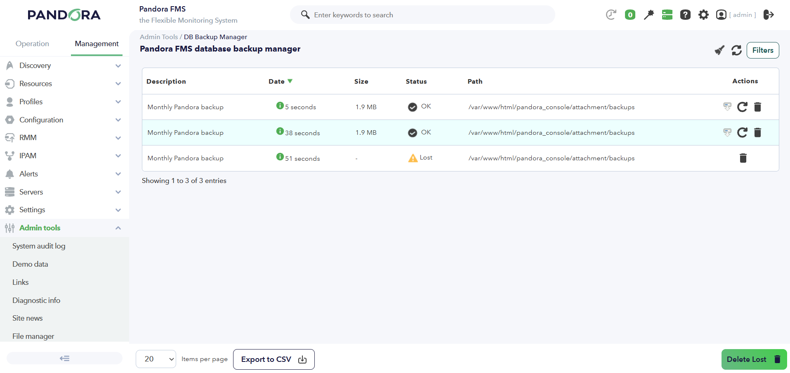
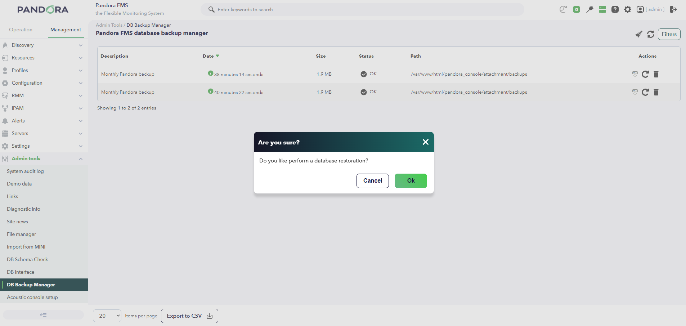

# Backup and restore

## Introduction: what a backup protects (and what it does not)

A backup goes unnoticed the day it is made. It is noticed the day it is needed. And that day never looks like the day it was scheduled: the server will not start, someone has deleted what they should not have, the disk has given up. This chapter is about making that day a bad time with a solution and not a permanent loss. What decides the difference is everything that is done beforehand: what gets copied, with which command and whether anyone ever tested that the backup can be restored.

What is at stake is everything the installation has accumulated: the metrics history, the events, the alerts and the configuration that sustains the monitoring. An accidental deletion, a disk that dies or an update gone wrong can sweep it away in a moment.

Before going into the matter, it is worth clearing up three confusions that claim whole installations.

**High availability is not a backup**. A high availability environment replicates the database hot so that the service does not go down, but it replicates the error too. If someone deletes a table on the master node, the deletion reaches the secondary node. Resynchronization between nodes in an HA environment uses a physical copy of the data, not a logical dump, and it is documented in [6.9 (Alta Disponibilidad (HA))](6.9-alta-disponibilidad-ha.md).

**Migrating is not copying.** Changing architecture, server or engine version is a move with its own procedures, and this chapter does not touch them: the migration to the new server architecture is in [A3 (Compatibility and migration to the new server architecture)](../anexos/a3-compatibilidad-y-migracion-a-la-nueva-arquitectura-de-servidores.md) and the updates in [1.4 (Updates)](../parte-1/1.4-actualizaciones.md). This is about keeping what exists and returning it to its place.

And the third: **a backup without a tested restore is a promise, not a safety net**. A compressed file nobody has ever opened protects nothing. The only proof that a backup is worth anything is restoring it, even if it is on a test machine and with a toy database.

With that clear, this is what Pandora FMS offers and what it does not. It offers the **scheduled console task**, which dumps the main database as often as you schedule it; the **DB Backup Manager**, which administers those backups from the Web console; the **full backup from the command line** utility, which adds the files to the dump; and, of course, the **manual commands** of `mysqldump` and `tar`, which is where you always end up when something has to be done by hand.

What it does not offer, and it is worth knowing before trusting it: there is no automatic backup of the files (the scheduled task only dumps the main database) and no integrated backup of the historical database, which lives on another server and is copied separately, as explained in [6.5 (Historical database)](6.5-base-de-datos-de-historico.md). The creation and scheduling of the task, with its parameters and its permissions, are documented in [2.5 (Console tasks)](../parte-2/2.5-tareas-de-consola.md). Here it is explained what that task produces, what it leaves out and how everything is restored.

The chapter follows the natural order of a real operation: first the inventory of what has to be copied, then each backup path (the manual dump, the scheduled task, the manager, the command line utility and the files) and, at the end, the restore and the rebuild of the database. The rebuild, which is the last resort when the engine no longer starts, is referenced from [6.7 (Database optimization)](6.7-optimizacion-de-la-base-de-datos.md): the criterion for when to rebuild instead of optimizing is there, and the procedures are here. The database encryption, which conditions what can be decrypted on restoring, is covered in [9.5 (Database encryption)](../parte-9/9.5-cifrado-de-la-base-de-datos.md).

## What to back up in a Pandora FMS installation

A Pandora FMS installation is not a single thing. It is a database, some configuration files, the server programs, the Web console and, on every monitored machine, an EndPoint. The backup has to cover what cannot be rebuilt on its own:

| Component | Where it lives | How it is copied |
|---|---|---|
| Main database | The MySQL engine, usually on the same machine as the console | Dump with `mysqldump` ([by hand](#the-database-dump-by-hand)) or the [scheduled task](#the-scheduled-backup-from-the-console) |
| Historical database | Another MySQL server, if it is configured | Its own dump: explained in [6.5 (Historical database)](6.5-base-de-datos-de-historico.md) |
| Server and EndPoints configuration | `/etc/pandora` | `tar` ([The backup of the files](#the-backup-of-the-files)) |
| Server programs and plugins | `/usr/share/pandora_server` | `tar` |
| Server data (remote configuration and collections) | `/var/spool/pandora/data_in` | `tar` |
| Web console | `/var/www/html/pandora_console` | `tar`, or the [full backup](#the-full-backup-from-the-command-line) |
| EndPoint | Its installation directory (on Linux, `/usr/share/pandora_agent`) and its configuration (`/etc/pandora`) | `tar` |
| Tentacle | `/etc/tentacle` | `tar` |

**The database and the files go together.** It is the rule that gets broken the most and the one that hurts the most. Restoring a database without the files leaves an installation that starts up halfway: the console opens, but the remote configuration of the EndPoints is not there, or the server plugins have disappeared. And the other way round: files without the database are a shell with no data. A truly complete backup has both halves.

**Keep the backup off the server being copied.** A backup that lives on the same disk as the original data protects you from an accidental deletion, but not from a disk failure, a fire or a `rm` with too much imagination. Take it out of the machine, to another server or to external storage, and do not leave it on the same file system.

**Each piece is copied where it lives.** In a distributed installation, with the database on one server, the console on another and the EndPoints spread out, there is no single machine from which to copy everything at once. The database is dumped where the engine is and the files of each server are packed on their server. The full backup in a single file, the one in [the full backup from the command line](#the-full-backup-from-the-command-line), is only good when everything lives on the same machine.

!!! warning "Space and permissions"
    A dump takes up as much as the data it contains, and the files of a console with images and extensions can be quite large. Before launching a backup, check that the destination has more than enough free space: falling short halfway because the disk is full is the dumbest way to lose a backup. And save the files with restricted permissions: a database dump contains users, configuration and monitoring data that should not be accessible to just anyone.

## The database dump by hand

This is the basic tool, the one that works whenever the engine is running. The command is a `mysqldump` with the same two flags the product's scheduled task uses, and with placeholders so that you adapt it to your installation:

```bash
mysqldump '<database>' -h '<host>' -u '<user>' -p'<password>' --single-transaction --max_allowed_packet=512M | gzip > pandoradb.sql.gz
```

Each piece of the command has its reason:

- **`<database>`**: the name of the database. In a fresh installation, it is `pandora`.
- **`-h '<host>'`**: the host of the engine. Use `127.0.0.1` if the database lives on the same machine, or its address if it is remote.
- **`-u '<user>'` and `-p'<password>'`**: the credentials to access the database. In a freshly made installation, the user is `pandora`. The `-p` goes attached to the password, with no space. If you leave it on its own, the client will prompt you for it and it will not be written in the terminal history.
- **`--single-transaction`**: the dump is made inside a transaction, consistently, without blocking writes.
- **`--max_allowed_packet=512M`**: the maximum packet size the client accepts when dumping. It is the value the scheduled task uses, and without it a large row or packet can abort the dump halfway.
- **`| gzip > pandoradb.sql.gz`**: the dump is compressed on the fly. The resulting file is the one that is kept and the one that will be restored later.

There is no need to add flags for routines, triggers or events. The product schema defines none of the three, and the product's internal dumps do not use them. Adding them only adds noise to the command.

**The historical database goes separately.** If you have the historical database configured, it is not copied with this command. It lives on another server and needs its own dump, with the same flags and pointing at its host and its name. The detail of that database, its retention and its partitioning are in [6.5 (Historical database)](6.5-base-de-datos-de-historico.md), and its backup is made with the same pattern:

```bash
mysqldump '<history_database>' -h '<history_host>' -u '<user>' -p'<password>' --single-transaction --max_allowed_packet=512M | gzip > pandoradb_history.sql.gz
```

!!! warning "With encryption on, the backup does not decrypt anything by itself"
    If the database uses column encryption, the backup carries the encrypted fields as they are and does not include the encryption passphrase, which is stored separately. Without that passphrase, there is nothing to decrypt on restoring and the encrypted data is left unreadable. The encryption procedure and where the passphrase lives are in [9.5 (Database encryption)](../parte-9/9.5-cifrado-de-la-base-de-datos.md).

**Do the services have to be stopped to copy?** No. With `--single-transaction` the dump is consistent even if monitoring keeps writing, so stopping is not a requirement of the backup. Stopping is a matter of the restore and of the rebuild, which is when the order of operations does matter. To copy, it is enough that the engine is running and there is space at the destination.

**Check the file when it finishes.** A dump that is cut short halfway leaves a file that looks like a backup and is not one. Before accepting it as good, verify that the compressed file is complete:

```bash
gzip -t pandoradb.sql.gz
```

If the command returns nothing, the file is intact. And if the dump was cut short halfway, this is the time to repeat it, not three months from now.

## The scheduled backup from the console

Scheduling a backup so that you do not have to remember it is the most sensible thing you can do in this matter. The **database backup task** is created and scheduled in the Web console, in **Discovery → Task list**, on the **Console tasks** tab. Its creation, its parameters and its permissions are documented in [2.5 (Console tasks)](../parte-2/2.5-tareas-de-consola.md). Here it is time to explain what it leaves on the disk and what it does not.

**What it produces.** Each run creates two files in the configured path:

- A **compressed dump** of the main database, with a name that carries the date.
- A **text summary** of the same name, with the product version, the date and the PHP and MySQL versions of the server. It is the file you look at to know what each backup contains without opening it.

Both are left with **0600** permissions: only the user who created them can read them. The default path is the console's attachments folder, `attachment/backups`, and it can be changed to any directory with read and write permissions. The default retention is the **last three backups** of that task: when the number is exceeded, the oldest ones are deleted on their own.

When creating it, the task checks that `mysqldump` exists and that the connection to the database works, and validates that the save path exists and can be written to. If something fails, the task is not created. It is a check that avoids the classic backup that never ran because the path no longer existed.

!!! warning "What the task does not copy"
    The scheduled task dumps **only the main database**. It does not include the historical database (which is another database, on another server), nor the configuration files, nor the Web console, nor the EndPoints. Do not let anyone mistake it for a full backup. For that there is the utility of [the full backup from the command line](#the-full-backup-from-the-command-line) or the combination of the dump with the `tar` files of [the backup of the files](#the-backup-of-the-files).

**How it is restored.** Just like a manual dump: the compressed file the task leaves is imported with `gunzip -c … | mysql …`, as explained in [the restore](#the-restore). There is no automatic restore from the console: the restore is done by hand.

## The DB Backup Manager

The **DB Backup Manager** is the backup administration screen, in **Admin tools → DB Backup Manager**, and only the administrators of the Web console can enter it. It works on the same listing that the scheduled task feeds: the backups the task registers appear here, with the same folder and the same record.

At the top there is a filter by **path of the backups**, with the list of paths of the registered backups, and a search button to refresh the listing. Each backup shows its date, its size and a status:

- **OK**: the file is in its place and can be downloaded and restored.
- **Lost**: the record says it exists, but the file is not on the disk.
- **In Progress**: there is a dump running at that moment.



With each OK backup there are three actions: download it to the local machine, delete it or restore it. The lost ones and those in progress can only be deleted. The manager's restore **is not automatic**: when you press the button, the console asks for confirmation and the restore is done by hand. The complete procedure, with the current syntax, is in [the restore](#the-restore).



When there are lost backups, the **Delete Lost** button appears, which cleans all of those in that state at once.

!!! note "A file deleted by hand does not disappear from the list"
    The manager does not walk the disk to build the listing: it trusts its record. If someone deletes a backup file outside the console, the backup does not disappear from the listing: it becomes **lost**, and it stays there until you use **Delete Lost**. It is the expected behaviour, and the reason the list can show backups that no longer exist.

## The full backup from the command line

So far, everything copied the database or the files separately. What remains is the only utility of the product that makes a full backup in a single step, and it does it from the command line: `pandora_backup.sh`. It is intended for installations where the server and the console share a machine, and it leaves a single compressed file with:

- The dump of the database.
- The complete Web console directory.
- The configuration of `/etc/pandora`.
- The server data of `/var/spool/pandora/data_in`.

The script is at `/usr/share/pandora_server/util/pandora_backup.sh`, it is run as **root** and it needs `mysqldump` available. With no parameter it shows its help, and these are its real options:

| Option | What it is for |
|---|---|
| `-c <path>` | Path of the Web console (for example, `/var/www/html/pandora_console`). From its configuration it takes the database credentials. |
| `-d <path>` | Directory where the backup file is left. |
| `-s <file>` | Backup file that is going to be restored. |
| `-f` | On restoring, it also restores the files, not only the database. |
| `-q` | Quiet mode, without messages. To launch it from cron. |
| `-b` | It does not copy or restore the database: only the files. |
| `-h` | Shows the help. |

A backup is launched like this:

```bash
/usr/share/pandora_server/util/pandora_backup.sh -c /var/www/html/pandora_console -d /backup
```

The result is a `pandorafms_backup_<date>.tar.gz` file in the destination directory.

!!! warning "The restore is destructive"
    Restoring with `-s` merges nothing: the script **deletes the current database** and creates it again before importing the backup. With `-f`, it also overwrites the installation files. If the backup is old or half done, the result is worse than the problem you were going to solve. Before restoring, make sure you have a recent backup and that the file you pass is the right one:

    ```bash
    /usr/share/pandora_server/util/pandora_backup.sh -c /var/www/html/pandora_console -s /backup/pandorafms_backup_2026-10-21-03-00-00.tar.gz -f
    ```

**When to use it and when not to.** It is the convenient option for a small server with everything on the same machine. In a distributed environment, with the database on one server, the console on another and the EndPoints spread out, it is no use. There, the dump of the database goes on one side and the `tar` files per component of the next section on the other.

## The backup of the files

The backup of the files is made with `tar`, component by component, with the real paths of the installation. The pattern is always the same:

```bash
tar -pcvzf pandora_configuration.tar.gz /etc/pandora
tar -pcvzf pandora_server.tar.gz /usr/share/pandora_server
tar -pcvzf pandora_console.tar.gz /var/www/html/pandora_console
tar -pcvzf pandora_data_in.tar.gz /var/spool/pandora/data_in
tar -pcvzf agent.tar.gz /usr/share/pandora_agent
tar -pcvzf tentacle.tar.gz /etc/tentacle
```

Each command packs and compresses (`-z`) one component, preserving permissions and owners (`-p`), which is what is needed for the restore to return the files exactly as they were. The Web console one preserves the images, the extensions and the customisations. The server data one includes the remote configuration of the EndPoints, the collections and the control files. On Linux EndPoints, the installation directory is `/usr/share/pandora_agent`. On other platforms it changes, and its configuration lives in `/etc/pandora`, which already goes in the first `tar`.

Three warnings so that the file backup does not fall short:

- **The server plugins can live outside** `/usr/share/pandora_server`. If you have plugins or scripts of your own in other directories, add one `tar` for each.
- **The backup goes off the server.** As with the dump: a `tar` that sleeps on the same disk does not protect you from a disk failure.
- **The server data carries more than it seems.** Losing `/var/spool/pandora/data_in` is losing the configuration the EndPoints already had applied, and that is not recovered by reinstalling.

And the restore of these files, which is as simple as decompressing them in place, is covered in [the restore](#the-restore).

## The restore

Restoring is not decompressing and hoping for the best. There is an order, and the order matters because each step writes in places the next one needs untouched.

**1. Stop everything that writes.** Stop the Pandora FMS server (`systemctl stop pandora_server`) and the local EndPoint if it is on the same machine (`systemctl stop pandora_agent_daemon`). The Web console must not be in use while the import runs. The Tentacle server can keep working: it will keep receiving data from the EndPoints and will process it when the server is back.

**2. Restore the database.** With the engine running, create the database if it does not exist:

```sql
CREATE DATABASE <database>;
```

And import the backup into it:

```bash
gunzip -c pandoradb.sql.gz | mysql -h '<host>' -u root -p <database>
```

!!! warning "The database name has to be the same"
    The backup was made on a database with a name, and restoring it on a different one forces you to adjust the configuration of the console and of the server afterwards. And if the database already has data, the import will replace it without warning: the dump drops and recreates every table. If you want to keep it, the alternative is in step 4.

**3. Users and permissions.** If the database user of the console and the server already exists and the restored database keeps its permissions, there is nothing to do. If you have created a new database, give the user access to it. And if the user has been lost (for example, after rebuilding the data directory of the engine), recreate it with the same syntax the product installers apply. It is the syntax current in MySQL 8:

```sql
CREATE USER '<user>'@'%' IDENTIFIED BY '<password>';
ALTER USER '<user>'@'%' IDENTIFIED WITH caching_sha2_password BY '<password>';
GRANT ALL PRIVILEGES ON <database>.* TO '<user>'@'%';
```

The old single-statement form, `GRANT … IDENTIFIED BY …`, is retired in MySQL 8 and fails: if you see it in an old recipe, replace it with these three.

**4. Recommended alternative: the path that does not overwrite.** If the current database has data you want to keep, do not import over it as in step 2. The steps, in short:

1. Create the new database and give permissions to the console user:

    ```sql
    CREATE DATABASE <new_database>;
    GRANT ALL PRIVILEGES ON <new_database>.* TO '<user>'@'%';
    ```

2. Import the backup into it:

    ```bash
    gunzip -c pandoradb.sql.gz | mysql -h '<host>' -u root -p <new_database>
    ```

3. Point the console to the new database: in `include/config.php` of the Web console, change `$config["dbname"]="<database>";` to `$config["dbname"]="<new_database>";`.
4. Point the server: in `/etc/pandora/pandora_server.conf`, change `dbname <database>` to `dbname <new_database>`.
5. Restart the server and log in to the console again.

**5. Restore the files.** Each `tar` is decompressed in place with `-C /`, because the paths inside the file are absolute:

```bash
tar -xzf pandora_configuration.tar.gz -C /
tar -xzf pandora_server.tar.gz -C /
tar -xzf pandora_console.tar.gz -C /
tar -xzf pandora_data_in.tar.gz -C /
```

Doing it as root, permissions and owners are returned exactly as they were. If the console is left with the wrong owner, the web server will not be able to write in its folders and you will notice as soon as you try to upload an image.

**6. The "reinstall and restore" case.** When the original machine no longer exists, the order is the other way round: first a clean installation is made, with the same version, following [1.1 (Installation)](../parte-1/1.1-instalacion.md). Then the restore goes on top: the database and the files. This is not a migration (that one is in [A3](../anexos/a3-compatibilidad-y-migracion-a-la-nueva-arquitectura-de-servidores.md)): it is putting back in place what was there.

**7. Check.** A restore does not end when the last command ends, but when everything works again:

- The Web console opens and shows the agents, the modules and the data from before.
- The server starts and processes: `systemctl start pandora_server` and a look at its log.
- The console cron is still in place: the entry in `/etc/crontab` that calls the console cron every minute is the one that drives events, alerts and maintenance.
- The EndPoints report again. If any of them does not, its local configuration or its access key did not come back well.

And start in order: first the engine (already running), then the server and finally the EndPoints.

## Rebuilding the database

The rebuild is the last resort, and it is a restore, not a tune-up. [6.7 (Database optimization)](6.7-optimizacion-de-la-base-de-datos.md) explains when it is due: when optimizing a table no longer finishes, when the engine does not start after a configuration change or when the database needs to be rebuilt from scratch. Here are the procedures.

**Partial rebuild.** It is about returning a database to a compact and healthy state, with the service stopped. The process: stop the server and leave the Web console out of use; then dump the database, delete it, recreate it and import the dump.

```bash
systemctl stop pandora_server
mysqldump '<database>' -h '<host>' -u '<user>' -p'<password>' --single-transaction --max_allowed_packet=512M | gzip > /tmp/pandoradb.sql.gz
```

Then, in the MySQL client:

```sql
DROP DATABASE <database>;
CREATE DATABASE <database>;
```

And the import and the start:

```bash
gunzip -c /tmp/pandoradb.sql.gz | mysql -h '<host>' -u root -p <database>
systemctl start pandora_server
```

The dump can take minutes or hours, depending on the size. The import takes just as long. It is a maintenance window operation, not something for a spare moment between tasks. In a large installation, the service stop alone is planned around an hour, and to that the dump and the reload are added. The process can be automated, but for its delicate nature it is better done by hand, with the window reserved and a recent backup already made.

**Full rebuild.** When the engine does not start or the data directory has to be rebuilt (for example, after a change in `my.cnf` that prevents it from starting), the rebuild goes one step further. It rebuilds the data directory of the engine. First, if the engine does not start, return to the previous configuration so that it can come up, and take the chance to get the dump out:

```bash
mysqldump '<database>' -h '<host>' -u '<user>' -p'<password>' --single-transaction --max_allowed_packet=512M | gzip > /home/pandora/pandoradb.sql.gz
```

With the backup safe, and with the Pandora FMS server stopped (as in the partial rebuild), stop the engine and rebuild its data directory:

```bash
systemctl stop mysql
mv /var/lib/mysql /var/lib/mysql.bak
mkdir /var/lib/mysql
mysqld --initialize --datadir /var/lib/mysql
```

`mysqld --initialize` generates a temporary password for the root user. Write it down, because you are going to need it in the next step. Then adjust permissions and start:

```bash
chown -R mysql:mysql /var/lib/mysql
chcon -R system_u:object_r:mysqld_db_t:s0 /var/lib/mysql
systemctl start mysql
```

The `chcon` command is for systems with SELinux (the RHEL family). On Ubuntu it is not needed. And in the distributions of the RHEL family, the service is called `mysqld` instead of `mysql`.

Enter with the temporary password, change it and get the database ready:

```sql
ALTER USER 'root'@'localhost' IDENTIFIED BY '<password>';
CREATE DATABASE <database>;
```

Import the dump and recreate the database user used by the console and the server with the current syntax (the same as in [the restore](#the-restore)):

```bash
gunzip -c /home/pandora/pandoradb.sql.gz | mysql -u root -p <database>
```

```sql
CREATE USER '<user>'@'%' IDENTIFIED BY '<password>';
ALTER USER '<user>'@'%' IDENTIFIED WITH caching_sha2_password BY '<password>';
GRANT ALL PRIVILEGES ON <database>.* TO '<user>'@'%';
```

!!! warning "There are no binary logs to delete anymore"
    The old full rebuild recipes deleted by hand the binary log files of the data directory. That step no longer applies: on a single server, the standard Pandora FMS installers and deployments disable the binary logs (`skip-log-bin`); if you set up the engine by hand, confirm the line is in `my.cnf`. In a high availability environment the binary logs are mandatory, but there the rebuild is another story and it is covered in [6.9 (Alta Disponibilidad (HA))](6.9-alta-disponibilidad-ha.md).

Finally, check that the engine is running with the parameters you expect, that the Web console and the server connect to the database and that everything works. The variables query confirms that the applied configuration is what you think it is:

```sql
SHOW VARIABLES LIKE 'innodb%';
```

When you have it confirmed, delete the old directory:

```bash
rm -rf /var/lib/mysql.bak
```

If this is a high availability server, the services are different (`pandora_ha` instead of `pandora_server`), and the start, the stop and the resynchronization of an HA environment are documented in [6.9 (Alta Disponibilidad (HA))](6.9-alta-disponibilidad-ha.md).

## Quick reference and division of labour with other chapters

To close, the cheat sheet. The commands of the chapter, in a table to copy:

| For | Command |
|---|---|
| Dump the main database | `mysqldump '<database>' -h '<host>' -u '<user>' -p'<password>' --single-transaction --max_allowed_packet=512M`\|`gzip > pandoradb.sql.gz` |
| Dump the historical database | `mysqldump '<history_database>' -h '<history_host>' -u '<user>' -p'<password>' --single-transaction --max_allowed_packet=512M`\|`gzip > pandoradb_history.sql.gz` |
| Restore a dump | `gunzip -c pandoradb.sql.gz`\|`mysql -h '<host>' -u root -p <database>` |
| Check that a dump is complete | `gzip -t pandoradb.sql.gz` |
| Full backup (database and files) | `/usr/share/pandora_server/util/pandora_backup.sh -c /var/www/html/pandora_console -d /backup` |
| Restore with the full backup | `/usr/share/pandora_server/util/pandora_backup.sh -c /var/www/html/pandora_console -s <file> -f` |
| Copy a component | `tar -pcvzf <file>.tar.gz <path>` |

And the division with other chapters, so you do not look in the wrong place:

| Topic | Chapter |
|---|---|
| Create and schedule the backup task, with its parameters and permissions | [2.5 (Console tasks)](../parte-2/2.5-tareas-de-consola.md) |
| Historical database, its retention and its partitioning | [6.5 (Historical database)](6.5-base-de-datos-de-historico.md) |
| When to rebuild instead of optimizing | [6.7 (Database optimization)](6.7-optimizacion-de-la-base-de-datos.md) |
| High availability and its resynchronization between nodes | [6.9 (Alta Disponibilidad (HA))](6.9-alta-disponibilidad-ha.md) |
| Database encryption and encryption passphrase | [9.5 (Database encryption)](../parte-9/9.5-cifrado-de-la-base-de-datos.md) |
| Installation and reinstallation | [1.1 (Installation)](../parte-1/1.1-instalacion.md) |
| Updates | [1.4 (Updates)](../parte-1/1.4-actualizaciones.md) |
| Migration to the new server architecture | [A3 (Compatibility and migration to the new server architecture)](../anexos/a3-compatibilidad-y-migracion-a-la-nueva-arquitectura-de-servidores.md) |

And the idea that sums up the chapter, the same one it opened with: a backup is only worth anything if it has been restored at least once. Schedule it, keep it off the server and, from time to time, restore it in a test environment. The day it is really needed, there will be no time to find out it did not work.
