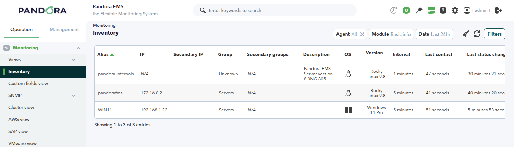
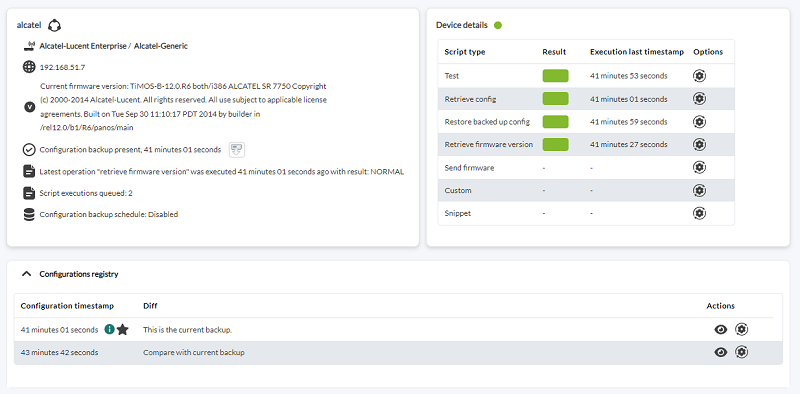
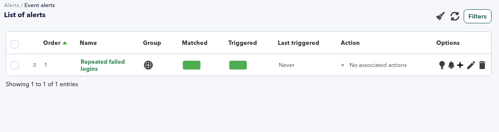

# Compliance: NIS2, ISO 27001 and ENS

A green dashboard is not a declaration of conformity. It may mean that monitoring
works, that agents are reporting and that nobody has touched what they should not
have; or it may mean that the dashboard has been looking the other way for six
months. The difference between the two is not the colour of the widgets, but the
ability to answer an uncomfortable question: **"show me that this is met"**.

Pandora FMS does not sign policies, train staff or answer to a certification
body. What it does do is produce data, detections and evidence that an
organisation can use to support its compliance programme. This chapter is about
that: which capability serves which article, control or measure, and how to turn
that relationship into evidence that survives an audit.

It is not a summary of NIS2, ISO/IEC 27001:2022 or ENS. It is a **mapping table**.
Only the regulatory points with an associated capability appear; the rest of the
regulation is left out because it cannot be resolved with a monitoring tool.

## Capability, standard and evidence

The first column is the Pandora FMS capability. The next three are compact
references to ISO/IEC 27001:2022, ENS and NIS2. The last two say what can be met or
monitored and what is exported as evidence.

| Pandora FMS capability | ISO/IEC 27001:2022 | ENS (RD 311/2022) | NIS2 | What can be met or monitored | Evidence |
|---|---|---|---|---|---|
| **[Asset inventory and discovery](../parte-3/3.1-inventario.md)** | A.5.9, A.8.1 | op.exp.1 | 21.2.i | Hardware, software, user, service and patch inventory; network discovery; IPAM; inventory changes. Covers inventory; asset classification and ownership are organisational decisions. | Inventory CSV and report; change report |
| **[Availability, service and SLA monitoring](../parte-5/5.3-monitorizacion-de-negocio-y-servicios.md)** | A.5.29, A.5.30, A.8.6, A.8.16 | op.cont.1–op.cont.4, op.mon.2, op.mon.3 | 21.2.c, 21.2.f | System and service availability, SLA, scheduled downtime, capacity and technical continuity. Covers the technical side of availability and SLA; the continuity plan and crisis exercises are organisational. | Availability and SLA reports; status history |
| **[Logs and collection](../parte-2/2.19-recoleccion-y-monitorizacion-de-logs.md)** | A.8.15, A.8.16 | op.exp.8, op.mon.3 | 21.2.b, 21.2.f | Log collection, storage, search and retention in OpenSearch. Covers collection and retention; retention policy and external storage are organisational. | Log queries and exports |
| **[Pandora FMS SIEM](7.2-siem.md)** | A.5.7, A.5.24–A.5.28, A.8.15, A.8.16 | op.exp.7, op.exp.8, op.exp.9, op.mon.1, op.mon.3 | 21.2.b, 23 | Normalisation, decoders, rules, correlation, SIEM events, MITRE ATT&CK, alerts and timeline for incident response. It can act as a corporate SIEM if it covers sources, retention and correlation; the decision, notification and final response are human. | SIEM events, alerts, tickets and exports |
| **[Vulnerabilities and CVEs](7.4-analisis-de-vulnerabilidades.md)** | A.8.8 | op.exp.4 | 21.2.e | Local and remote detection, CVE, severity, risk per system and evolution over time. Covers detection; prioritisation, patching and risk acceptance are human. | Vulnerability report and risk evolution |
| **[Hardening and CIS](7.5-hardening.md)** | A.8.9 | op.exp.2, op.exp.3, op.exp.4 | 21.2.e, 21.2.g | CIS checks, security index, deviations and configuration evolution. Covers checking; remediation and exceptions are human. | CIS report; hardening dashboard |
| **[FIM (file integrity monitoring)](7.6-fim.md)** | A.8.15, A.8.16, A.8.32 | op.exp.5, op.exp.8 | 21.2.b, 21.2.e | Creation, deletion and modification of critical files and directories; SIEM integration. Covers detection; investigation and response are human. | FIM events and change history |
| **[Security monitoring](7.7-monitorizacion-de-seguridad.md)** | A.8.1, A.8.7 | op.exp.6, mp.eq.2 | 21.2.b, 21.2.g, 21.2.i | Weak passwords, SELinux, remote root, listening ports, antivirus, firewall, patches and screen lock. Covers technical checks; remediation and security policy are human. | Security modules and events |
| **[IoC/MISP and custom rules](7.9-integraciones-dinamicas-de-ioc-misp-y-creacion-de-reglas-propias.md)** | A.5.7, A.8.16 | op.exp.7, op.mon.1 | 21.2.b, 21.2.e | Indicators of compromise, custom rules, correlation and false-positive analysis. Provides indicators and rules; source quality and the response decision are external. | Versioned rules and generated events |
| **[Events, alerts, response and ITSM](../parte-5/5.4-consola-de-eventos-centralizada.md)** | A.5.24–A.5.28, A.8.16 | op.exp.7, op.exp.9, op.mon.3 | 21.2.b, 23 | Detection, logging, ticket, escalation, timeline, acknowledgements and response. Covers detection, logging and ticketing; the notification decision and CSIRT communication are human. | Events, tickets and executed actions |
| **[Internal audit](7.8-auditoria-interna.md)** | A.5.33, A.8.15, A.8.16 | op.exp.8, op.exp.9 | 21.2.b, 21.2.f | User actions, changes, filters, export and forwarding to an external collector. Covers logging and export; review and evidence sign-off are human. | CSV, `audit.log` and collector record |
| **[Identities and access](../parte-4/4.1-grupos-perfiles-y-tags.md)** | A.5.15–A.5.18, A.8.2, A.8.3, A.8.5 | op.acc.1–op.acc.6 | 21.2.i, 21.2.j | Users, groups, profiles, tags, ACL, LDAP/AD/SAML, 2FA and password policy. Covers authentication and permissions; access review and employee offboarding are human processes. | Permission report; configuration; audit |
| **[Encryption and transport](7.11-configuracion-segura.md)** | A.8.24 | mp.com.2, mp.com.3, mp.si.2, op.exp.10 | 21.2.h | HTTPS, TLS, Tentacle SSL/TLS, password encryption and database encryption. Covers technical encryption; cryptographic policy and key custody are organisational. | Configuration, certificates and key custody |
| **[Backup, high availability and continuity](../parte-6/6.8-backup-y-restore.md)** | A.5.29, A.5.30, A.8.13, A.8.14 | op.cont.1–op.cont.4, mp.info.6 | 21.2.c | Backups, restore, HA, satellite servers, Command Center and historical database. Covers backup, restore and HA; the continuity plan and formal testing are organisational. | Backup history; restore test; HA status |
| **[Reports, dashboards and SLA](../parte-5/5.2-informes.md)** | 9.1, 9.2, 9.3, A.5.36 | op.mon.2 | 20, 21.2.a, 21.2.f | KPIs, scheduled reports, management view, effectiveness and policy tracking. Provides KPIs and reports; management review and the conclusion are human. | Reports, dashboards and historical series |
| **[Change and configuration management](../parte-3/3.6-gestion-de-configuracion-de-equipos-de-red-ncm.md)** | A.8.9, A.8.32 | op.exp.2, op.exp.3, op.exp.5 | 21.2.e | Configuration changes, NCM, inventory changes, FIM and ticket traceability. Provides change evidence; change approval is external. | NCM comparison; events; change tickets |
| **[Automation and operations](../parte-3/3.4-ejecucion-remota-de-scripts-y-comandos.md)** | A.8.18, A.8.19 | op.exp.5 | 21.2.b, 21.2.e | Remote script and command execution, software deployment, scheduled downtime and controlled actions. Runs controlled actions; authorisation and change approval remain human. | Executed tasks, events and tickets |
| **[External services and suppliers](../parte-2/2.15-monitorizacion-entornos-cloud.md)** | A.5.19–A.5.22, A.5.23 | op.ext.1–op.ext.3, op.nub.1 | 21.2.d | Availability and SLA of supplier and cloud services, and external asset inventory. Provides availability and SLA; it does not cover due diligence, contracts or supplier assessment. | SLA, availability and alert reports |
| **API and integrations** | A.8.16 | op.exp.7, op.mon.3 | 21.2.b, 21.2.f | Data export, webhooks, ITSM/SIEM integration and evidence automation. Automates export and integration; design, authorisation and control of the integration are external. | Calls, logs and exported data |
| **[Secure configuration (7.11)](7.11-configuracion-segura.md)** | A.8.9, A.8.24 | op.exp.2, op.acc.6, mp.com.2, mp.com.3 | 21.2.g, 21.2.h, 21.2.i, 21.2.j | Exposed surface, accounts, HTTPS/TLS, 2FA, audit, password policy and account lockout. Covers technical configuration; policy and periodic review are organisational. | Configuration checklist; screenshots; audit |
| **[Criticality prioritisation and risk analysis](../parte-4/4.4-buenas-practicas-de-etiquetado-naming-tags.md)** | 6.1, A.5.9 | op.pl.1 | 21.1, 21.2.a | Inventory, criticality by group/tag, vulnerabilities, hardening and data for risk analysis. Provides inventory and risk data; analysis, acceptance and risk approval are human. | Prioritised inventory; risk matrix; reports |

- **The capability comes first.** The first column says what Pandora FMS does; the
  next three only identify the regulatory point with a compact reference.
- **What can be met is the second important column.** It explains what the tool
  covers and what remains outside: policy, decision, training, supplier or
  signature.
- **Evidence is what gets exported.** If it cannot be repeated, dated and
  retained, it is not useful in an audit.
- **References are deliberately brief.** The article or control is not
  transcribed: it is only identified. The detail lives in the standard.
- **The same point can repeat.** The same obligation is covered by several
  capabilities and evidence items.

The table does not include articles without an associated capability. Nor does it
include ENS measures that are purely organisational or ISO 27001 clauses that are
resolved with documents, minutes or management decisions. If a requirement is not
there, it is not an oversight: it cannot be met or tracked with Pandora FMS.

## The standards in one line

### ISO/IEC 27001:2022

ISO/IEC 27001:2022 is a management system standard, not a product catalogue. The
table keeps clauses 9.1, 9.2 and 9.3 —monitoring, internal audit and management
review— and the Annex A controls with an associated capability. The real control
selection comes from the risk analysis and is justified in the statement of
applicability; Pandora FMS helps feed and demonstrate it, not decide it.

### ENS

The Spanish National Security Framework is regulated by Royal Decree 311/2022.
The table covers the Annex II measures that can be met or tracked with Pandora
FMS, especially those in the operational framework and those protecting
communications, information and services. Organisational measures (`org.*`),
people measures (`mp.per.*`), facilities measures (`mp.if.*`) and secure
development measures (`mp.sw.*`) are left out: they are documented and evidenced
elsewhere.

### NIS2

Directive (EU) 2022/2555 requires essential and important entities to manage risk,
involve their management body and report significant incidents. Only three
articles make it into the table: 20 (governance and oversight), 21 (cybersecurity
risk-management measures) and 23 (reporting). Article 23 sets an early warning
within 24 hours, a notification within 72 hours and a final report within one
month of that notification.

!!! warning "NIS2 transposition is not the same in every country"
    NIS2 is a directive and each Member State incorporates it into its own legal
    system. In Spain, at the time of this edition (November 2026), the
    transposition process is still pending and the NIS1 framework remains in
    force. Before using this table in an audit, confirm the applicable national
    law.

## Four use cases

### A sample for ISO 27001

The auditor asks for a sample of controls. The answer should not be a ZIP full of
screenshots. It should be a package with inventory, permission report,
vulnerability evolution, hardening index, backup history, restore test, audit
events and change tickets. Each piece with its date, filter and owner.

The table says which capability feeds each control. The audit work starts
afterwards: checking that the sample is representative, that the period is right
and that exceptions are justified.

### An ENS audit

For ENS, the table is read by measure. `op.exp.1` is evidenced with the inventory;
`op.exp.8`, with the audit log and logs; `op.exp.2`, `op.exp.3` and `op.exp.5`,
with NCM and the change inventory; `op.mon.2`, with reports and dashboards;
`mp.info.6`, with backups and their restore. Organisational measures do not come
out of the console and should not be presented as if they did.

### A NIS2 incident against the clock

A Pandora FMS SIEM rule or a FIM event detects something that does not add up. The
SIEM normalises and correlates the logs; Pandora FMS opens the event with its
severity, rule and MITRE reference, tags it, assigns it and can create an ITSM
ticket. From there, the timeline is rebuilt with events, OpenSearch logs, the
audit log and ticket comments.

That is what the first 24 hours need: what happened, when and with what impact.
For the 72 hours, the initial assessment and indicators of compromise. For the
final report, root cause, applied measures and impact. Pandora FMS helps detect,
log and export; **it does not send the notification to the CSIRT or decide whether
the incident is significant**. That decision remains human.

### Pandora FMS SIEM and incident response

Pandora FMS SIEM is the piece that turns log noise into something you can
investigate. The collector stores the text; the SIEM normalises it, decodes it,
applies rules and generates security events. Without that layer, incident response
is done with `grep` and memory; with it, there is a timeline and a list of
indicators you can show.

It is not a decorative add-on: **it can act as a corporate SIEM** if it covers the
sources, retention and correlation the organisation needs. What it does not
replace is the team that operates it or the rest of the compliance programme.

The SIEM relies on log collection in OpenSearch, requires the corresponding
licence and is configured with decoders and rules. Each event can carry severity,
group, rule, MITRE ATT&CK and the fields from the original log. From there you can
alert, open an ITSM ticket and reconstruct what happened.

#### What it contributes at each stage

| Response stage | What Pandora FMS SIEM does | Evidence |
|---|---|---|
| **Preparation** | Defines log sources, decoders, rules, severities, retention and ITSM integration | Versioned rules, connected sources and event-generation tests |
| **Detection** | Normalises and correlates logs; generates SIEM events and triggers alerts | SIEM events, alerts and timestamps |
| **Analysis and triage** | Supports searching, filtering, contextualising and grouping events; adds MITRE, severity and log fields | Queries, detailed events, comments and dashboards |
| **Containment and response** | Launches event responses, alert commands, scripts, tickets and escalation | Tickets, executed actions and acknowledgements |
| **Recovery and learning** | Closes the incident, preserves evidence, reviews rules and tunes detections | Post-incident report, rule changes and KPIs |

#### How it fits the standards

- **NIS2, Article 21.2.b.** Covers detection and incident handling: collection,
  correlation, event generation and response.
- **NIS2, Article 23.** Provides the timeline, indicators of compromise and evidence
  for the 24-hour early warning, the 72-hour notification and the final report. It
  does not send the notification to the CSIRT or decide whether the incident is
  significant.
- **ISO/IEC 27001:2022.** Feeds A.5.7 (threat intelligence), A.5.24–A.5.28
  (incident management), A.8.15 (logging) and A.8.16 (monitoring).
- **ENS.** Covers `op.exp.7` (incident management), `op.exp.8` (activity logging),
  `op.exp.9` (incident management logging), `op.mon.1` (intrusion detection) and
  `op.mon.3` (surveillance).

## What Pandora FMS does not do

- It does not replace a GRC, an EDR, an IAM or a CMDB.
- Pandora FMS SIEM **can replace a corporate SIEM** when it covers the required
  sources, retention and correlation; what it does not replace is the team that
  operates it or the rest of the compliance programme.
- It does not write policies, approve risks or sign declarations.
- It does not train staff or manage supplier contracts.
- It does not notify incidents to the competent authority.
- It does not by itself guarantee compliance with NIS2, ISO 27001 or ENS.
- It does not cover ENS organisational measures or ISO 27001 leadership,
  planning and improvement clauses.

Confusing these things is the quickest way to turn a useful tool into a broken
promise. The table tells you what can be demonstrated with Pandora FMS and what
has to be resolved elsewhere.
