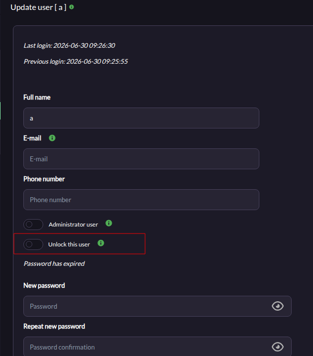

# Secure configuration

Pandora FMS is installed with a few security decisions already made, but leaving
it "ready for production" is another matter. This chapter gathers what has to be
touched so that an installation survives an audit: what is exposed, how it is
encrypted, what is hardened in the base system and what is enabled on the
platform itself.

The underlying idea is simple: **the less you expose and the more you log, the
less you will have to fix later**. Everything that follows is concrete measures,
not theory.

## Exposed surface

The first thing is to know what listens. And here there is a detail that
surprises anyone coming from other tools: **the Pandora FMS server does not listen
on any port**. The one that listens is the **Tentacle** server, which receives
data from the EndPoints; the Pandora FMS server only reads the files Tentacle
leaves on disk. And the **EndPoint** does not listen either: it is the one that
starts the connection to the server.

The ports that matter:

| Component | Port | Is it published? |
|---|---|---|
| Web console | 80 (HTTP) and 443 (HTTPS) | Yes, 443; 80 only if you redirect |
| API | Console HTTP/HTTPS | Only if you use it from outside |
| Tentacle | 41121/TCP | Only towards the machines that report |
| Tentacle RMM | 41123/TCP | Only if you use RMM over Tentacle |
| Database (MySQL) | 3306/TCP | **No**, unless it is remote by design |
| SNMP trap console | 162/UDP | Only from the devices that send traps |

The practical rule: expose only what is essential and leave the rest listening on
`127.0.0.1`. If the database only serves the machine itself, there is no point in
it being reachable from the network, and that is fixed in a minute (see the MySQL
hardening below).

## Accounts and credentials

- **Named users.** Each person, their own account. No shared accounts: if you do
  not know who did what, the audit log is useless.
- **No excess privileges.** Each user with the profile they need and nothing
  more. Group permissions and advanced ACL fit here.
- **Double authentication** on accounts with console access, and especially on
  administrators.
- **Application users without remote access.** If you create users to run
  services, disable their *shell* so they cannot log in over SSH.
- **The superuser, with `sudo`.** For anything that requires privileges, `sudo`,
  not an open `root` session.
- **Complex database passwords**, and not the factory ones. The MySQL password is
  the key to everything else.
- **Sensitive data encrypted.** The credentials the product stores (credential
  store, module passwords) can be encrypted in the database (see below).

## Encryption and transport

Everything that travels over the network should be encrypted, and Pandora FMS
allows it at every leg:

- **Web console over HTTPS.** The console supports HTTPS with a web server
  certificate, and there is a setting to **force** everyone to use HTTPS.
- **Session cookies over SSL only.** In sensitive environments, in `php.ini`:
  ```
  session.cookie_httponly = 1
  session.cookie_secure = 1
  ```
  Note: with this, the console stops working over HTTP. That is exactly the
  point, but you need to know it before enabling it.
- **Database over TLS.** The connection between the server (and the console) and
  MySQL can be encrypted with SSL/TLS.
- **Tentacle with SSL/TLS.** Tentacle has four levels: no encryption (default),
  basic SSL/TLS, SSL/TLS with a certificate at both ends and SSL/TLS with CA
  validation, which is **the recommended one**.

### Password encryption

Pandora FMS can **encrypt the passwords stored in the database**. The key is
generated from a passphrase you provide, and it **is not stored** in the
database: passwords cannot be recovered from a dump.

The passphrase is set in two places, `encryption_passphrase`, both in
`/etc/pandora/pandora_server.conf` and in the console's `config.php`, and then the
encryption script is run:

```bash
/usr/bin/pandora_encrypt_db /etc/pandora/pandora_server.conf
```

!!! warning "If you lose the passphrase, you lose the passwords"
    The encryption passphrase cannot be recovered. Keep it in a safe place or back
    up `config.php` and `pandora_server.conf`. To decrypt (for example, before
    changing the passphrase), use the same script with `-d`.

## Base system hardening

The product is as secure as the machine that hosts it. These are the minimums
expected from the operating system:

- **System up to date.** Update before going into production, and then
  periodically. Pandora FMS's package inventory helps you locate vulnerable
  versions.
- **Access audit active.** The system security log (`/var/log/secure`) must be
  active and monitored.
- **SSH hardened.** It is the most critical point of any Linux server. In
  `/etc/ssh/sshd_config`: change the default port, set `PermitRootLogin no`,
  disable `AllowTcpForwarding` and `PermitTunnel`, review (and delete if
  unnecessary) `root`'s remote access keys, and set a warning with `Banner`.
- **MySQL local only.** If the database is internal, make it listen only on
  `127.0.0.1` with `bind-address = 127.0.0.1` in `[mysqld]` of `/etc/my.cnf`.
  Check with `netstat` that it is not still listening on `0.0.0.0`.
- **Apache not giving away its version.** Add `ServerTokens Prod` so the headers
  do not reveal the web server version.
- **Fewer services.** Check with `netstat -tulpn` (and `lsof`) what is listening
  and why. What you do not need, out; what listens on `0.0.0.0` for no reason, to
  `localhost`.
- **Synchronized time.** NTP on the server. Besides the logs, double
  authentication depends on the time matching.

## Secure configuration of the console and the server

Once in the platform itself, what is worth tying down:

- **Force HTTPS** in the console.
- **Protected API**: a list of allowed IP addresses and a **strong password** for
  the API. The `*` wildcard leaves the API open to anyone: do not use it in
  production.
- **Advanced ACL** to restrict which sections each profile sees.
- **Audit log enabled and exported** (see the next section).
- **Read-only mode** on the most sensitive EndPoints: if they do not need remote
  configuration changes, they should not accept them.
- **Limit who uploads executables** (plugins, collections) with the corresponding
  permissions.
- **Permissions of the server configuration file.** Check that
  `pandora_server.conf` is not readable by everyone.
- **Change the administrator password after the first start.** Do not leave the
  administration account with the first-boot password.

## Enabling 2FA

Double authentication is the measure with the best effort-to-result ratio: even
if someone steals your password, without the second factor they do not get in. It
is enabled in the global authentication configuration (**Double authentication**)
and each user turns it on in **Operation → Workspace → Edit my user**. **Force 2FA
for all users** makes it mandatory for everyone.

It needs a **code-generating app** on the user's phone and the server and the
phone to have **synchronized time**. To disable it for a specific user without
going through the console, there is the CLI (`--disable_double_auth`). The details
of the fields are in Part 04 · External authentication.

## Audit

Pandora FMS keeps an **audit log** with the important changes and actions in the
console: which user, which action, when and a description. It is queried in
**Management → Admin tools → System audit log**, with filters by action, user, IP
address, text and time range, and it can be exported to CSV.

!!! warning "It comes disabled"
    The audit log **is not active by default**. It is enabled in **Management →
    Settings → System Settings → General setup → Security**, with the **Enable
    audit log** option, and saved. A log that is not turned on does not audit
    anything.

What is truly useful is not looking at it by hand, but **centralizing it in an
external system in real time**, so that a local administrator cannot erase their
tracks. The clean way is **Rsyslog**, which already comes installed with the
server:

- In the console, the log is written to
  `/var/www/html/pandora_console/log/audit.log`.
- An Rsyslog `imfile` tails that file and forwards it over TCP to an external
  receiver. A dedicated *ruleset* is used to send **only** the audit and not the
  whole system *journal*.
- On the receiver, another *ruleset* stores the lines in its own file.

The technical annex on centralizing the audit log with Rsyslog has the full
configuration, end to end, with the sender and the receiver. With that, the trail
leaves the machine in seconds and stays where no one inside can touch it.

## Password policy

Enterprise installations have a **password policy** in **Configuration → Password
policy**. It is what turns "set a password" into "set a password that holds up".
Among other things, it controls:

| Setting | What it does |
|---|---|
| **Enable password policy** | Activates the whole mechanism |
| **Minimum length** | How many characters at least |
| **Password expiration** | Days of validity; `0` = never expires |
| **Must have numbers** and **symbols** | Requires character types |
| **History** and **compare with the previous one** | Prevents reusing passwords |
| **Apply to administrators** | The policy also applies to them |
| **Force change on first start** | Forces a change on first login (generates a new token for the API) |
| **User locked if login fails** | Duration of the temporary lockout |
| **Number of failed attempts** | How many failures are allowed (minimum two) |
| **Maximum temporary lockouts** | With `0`, there is never a permanent lockout; with a number, the user is **permanently locked** until unlocked |
| **Password reset** and **excluded words** | Enables "I forgot my password" and blocks specific words |

## Account lockout and unlock

With the policy active, a user who accumulates failures is **locked**, and if they
exceed the maximum number of temporary lockouts, **permanently locked**. In both
cases an administrator unlocks them from the user record, in the Users section
(not from "Edit my user").



And since version 805, also from the CLI:

```bash
pandora_manage /etc/pandora/pandora_server.conf --unlock_user <user>
```

That command is the safety net for the awkward case: the locked user is the
administrator.
