# SIEM

A single *log* line does not say much. One "Failed password for invalid user
oracle" on an SSH server is noise; forty of them in two minutes from the same
address are a brute force attack, and you want to know before attempt forty-one
gets lucky. That is the difference between storing *logs* and having a **SIEM**
(*Security Information and Event Management*): the SIEM reads what you have
already collected, understands it, correlates it and tells you when something
smells wrong.

A SIEM does two jobs. **Security information management** (SIM) collects and
normalizes the data; **security event management** (SEM) correlates it and
turns it into events. The data can come from an ordinary *log* (an Apache access
log), from the *log* of a security tool (a firewall, an IDS, a *honeypot*, an
EDR) or from events already enriched by another SIEM.

Pandora SIEM does not build a second pipeline for this. It reuses
[log collection](../parte-2/2.19-recoleccion-y-monitorizacion-de-logs.md) and
the same OpenSearch where those *logs* already live, and it accepts Wazuh®
*decoder* and *rule* files as they are. Within this part, the overall
architecture is in
[Security architecture](7.1-arquitectura-de-seguridad-de-pandora.md),
day-to-day watching in
[Security monitoring](7.7-monitorizacion-de-seguridad.md) and automated
response in [SOAR](7.3-soar.md).

!!! info "A SIEM event, a Pandora FMS event and an alert are not the same thing"
    A **SIEM event** is a document the SIEM stores in OpenSearch when a *rule*
    matches; you look at it in **Operation → SIEM**. A **Pandora FMS event** is
    the one in the [event console](../parte-5/5.4-consola-de-eventos-centralizada.md),
    which lives in the database. And an **alert** is what fires actions (email,
    Slack, a *script*). A SIEM alert can create a Pandora FMS event, but these
    are three different things, each with its own view.

To get every SIEM feature, EndPoints should run version **783 or later**.

## How it works

The SIEM works in two steps, and each step is done by a different server:

1. **Normalization.** The `siemserver` server reads the *logs* stored by log
   collection, runs the ***decoders*** on them and writes normalized *logs*,
   with their fields already split out (user, source IP, port, action…). These
   normalized *logs* are temporary.
2. **Event generation.** The `siemevents` server evaluates the ***rules***
   against the normalized *logs*. When one matches, it writes a **SIEM event**
   with the information from the *rule* and from the *log* that triggered it.

The full chain:

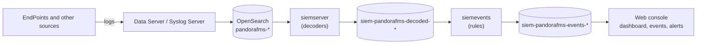

Everything ends up in OpenSearch, in **daily** indices per instance:

| Index | Contents | Default retention |
|---|---|---|
| `pandorafms-<identifier>-<date>` | Raw *logs* from log collection | The log collection retention |
| `siem-pandorafms-decoded-<identifier>-<date>` | *Logs* normalized by the *decoders* | 2 days |
| `siem-pandorafms-events-<identifier>-<date>` | SIEM events | 180 days |

The `<identifier>` is the unique identifier of the Pandora FMS server. Each
index type has its own retention (see
[Enabling SIEM in the web console](#enabling-siem-in-the-web-console)).

The `siemserver` depends on log collection: if the collector is off, it does
nothing, because it has nothing to work with. It does not look back forever
either: on each pass it only picks up the *logs* that arrived within the
`siem_max_timeframe` window (30 days by default) and that it has not processed
yet.

!!! warning "Whatever falls outside the window is never analyzed"
    If `siemserver` stays down longer than `siem_max_timeframe`, the *logs*
    that arrived during that gap are no longer inside the window and never get
    normalized. And if the retention of decoded *logs* is longer than that
    window, you are keeping days nobody will ever query.

With several servers, the **master** splits the work: it detects how many
`siemserver` instances are running and, if the number changes, it stops them,
synchronizes them and starts them again.

## Prerequisites

| Requirement | Detail |
|---|---|
| Pandora SIEM license | Installed on the server. Without it, the settings tab warns that the license does not allow SIEM and the server does not start `siemserver`. |
| OpenSearch | Installed and reachable from the server and the console, with a user and password if it uses basic authentication. It is the same engine used by [log collection](../parte-2/2.19-recoleccion-y-monitorizacion-de-logs.md). |
| Log collector enabled | Without it no *logs* arrive to analyze. The SIEM form warns you if it is off. |
| Experimental features | **Show experimental features** enabled in the general settings. Without it neither the SIEM menu nor the SIEM tab appears. |
| `siemserver` and `siemevents` | Enabled in `pandora_server.conf` on the servers that will do the processing. |
| EndPoints | Version 783 or later (recommended). |
| Ports | The OpenSearch port (`9200` by default) and the log collection ports (`514` if you use the Syslog Server). |
| Permissions | Administrator to configure the SIEM and manage *decoders* and *rules* (see [Access and permissions](#access-and-permissions)). |

## Enabling SIEM in the web console

### Showing experimental features

The SIEM sits behind a switch that has nothing to do with the SIEM. As long as
**Show experimental features** is off, neither the **Operation → SIEM** menu nor
the settings tab appears, and there is no way to find them.

Go to **Management → Settings → System Settings → General Setup**, **Features**
tab, turn on **Show experimental features** and click **Update**.

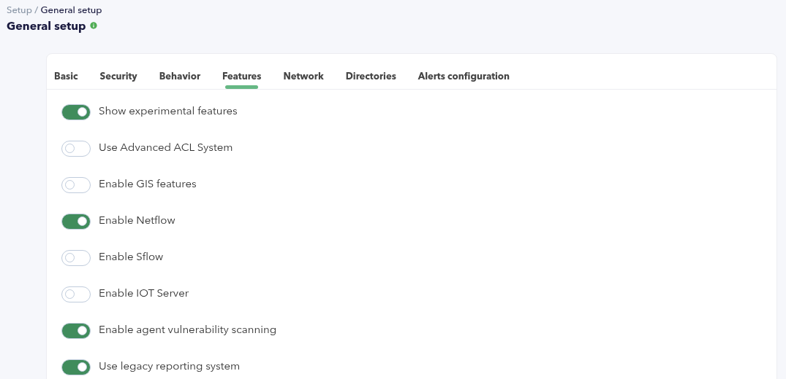{ .captura }

### The SIEM form

With the switch on, **Management → Settings → System Settings → SIEM**
appears. Turn on **Activate SIEM**, fill in the OpenSearch connection and click
**Update**. Next to the switch, an indicator checks the connection (**OpenSearch
is running** when it answers).

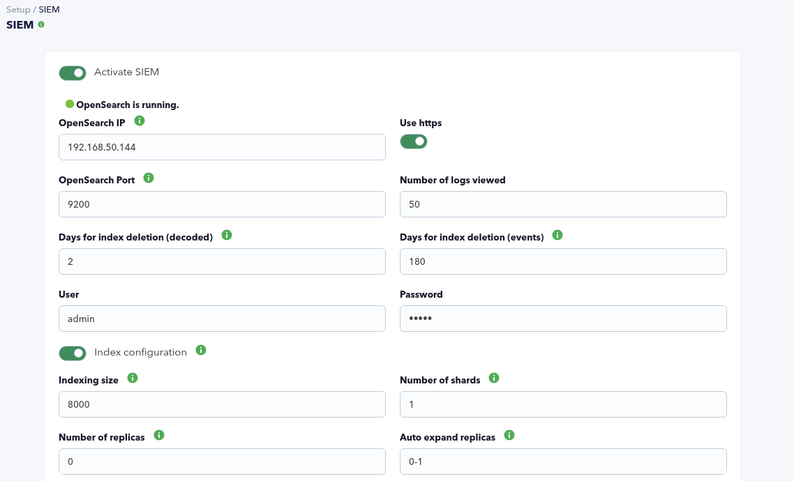{ .captura }

| Field | Default | What it does |
|---|---|---|
| **Activate SIEM** | Off | Enables the SIEM in the console. Without it, the views show "SIEM disabled" with a button that brings you here. |
| **OpenSearch IP** | (empty) | Address of the OpenSearch server that stores decoded *logs* and events. |
| **Use https** | Off | Connects to OpenSearch over HTTPS. |
| **OpenSearch Port** | `9200` | OpenSearch port. |
| **Number of logs viewed** | `50` | How many *logs* the OpenSearch search view loads each time. |
| **Days for index deletion (decoded)** | `2` | Days normalized *logs* are kept. `0` disables the purge. It must be less than or equal to `siem_max_timeframe`. |
| **Days for index deletion (events)** | `180` | Days SIEM events are kept. `0` keeps them forever. |
| **User** / **Password** | (empty) | OpenSearch credentials, if it uses basic authentication. |
| **Index configuration** | Collapsed | Advanced index settings (next table). |

The advanced **Index configuration** settings:

| Field | Default | What it does |
|---|---|---|
| **Indexing size** | `8000` | Used as the `ignore_above` value of the *log* text in OpenSearch: longer texts are not indexed as a keyword. |
| **Number of shards** | `1` | Primary shards per index. Only set when the index is created. |
| **Number of replicas** | `0` | Replicas per shard. |
| **Auto expand replicas** | `0-1` | Adjusts replicas to the number of data nodes in the cluster (for example, `0-5` or `0-all`). |

!!! warning "Indices without replicas"
    With **Number of replicas** at `0`, restarting an OpenSearch node leaves the
    data unavailable for a while, and corruption can lose it. Only change these
    settings if you know OpenSearch: a wrong configuration can destabilize the
    system.

!!! info "What Update does and what it does not do"
    When you click **Update**, the console creates in OpenSearch the templates
    for the `siem-pandorafms-decoded-*` and `siem-pandorafms-events-*` indices.
    Template changes apply **to the next index**, that is, the next day's.
    What it does **not** do is start the servers: that is enabled on the server
    (next section).

!!! warning "With the log collector off, the SIEM has nothing to analyze"
    If the log collector is disabled, the form shows a warning and
    `siemserver` processes nothing. Enable it first, as explained in
    [Log collection and monitoring](../parte-2/2.19-recoleccion-y-monitorizacion-de-logs.md).

With [Command Center](../parte-6/6.3-command-center.md), the SIEM is configured
and queried on each node: the Command Center console has no SIEM section.

## Enabling SIEM on the server

Both SIEM servers ship disabled. Enable them in
`/etc/pandora/pandora_server.conf` on every server that will do the processing:

```text
siemserver 1
siemserver_threads 4
siemserver_threshold 5
siemevents 1
siemevents_threads 2
siemevents_threshold 5
siem_max_timeframe 2592000
siem_decoders /usr/share/pandora_server/util/siem/decoders
siem_events_rules /usr/share/pandora_server/util/siem/rules
siem_max_hits_logs -1
```

| Token | Default | What it does |
|---|---|---|
| `siemserver` | `0` | Enables the normalization server. |
| `siemserver_threads` | `4` | Threads of the normalization server. |
| `siemserver_threshold` | `5` | Seconds between passes of the normalization server. |
| `siemevents` | `0` | Enables the event server. |
| `siemevents_threads` | `2` | Threads of the event server. |
| `siemevents_threshold` | `5` | Seconds between passes of the event server. |
| `siem_max_timeframe` | `2592000` | Window, in seconds (30 days), of *logs* that get analyzed. |
| `siem_decoders` | `/usr/share/pandora_server/util/siem/decoders` | Folder with the *decoder* XML files. |
| `siem_events_rules` | `/usr/share/pandora_server/util/siem/rules` | Folder with the *rule* XML files. |
| `siem_max_hits_logs` | `-1` | Maximum *logs* per request of the event server. `-1` means no limit. |

Changes take effect when the server restarts:

```bash
systemctl restart pandora_server
```

On startup, the **master** server loads the *decoder* and *rule* XML files into
the database; the other servers read them from there. The full token reference
is in
[Server configuration reference](../parte-9/9.3-referencia-completa-de-configuracion-del-servidor.md).

!!! warning "`siem_rules` does not exist"
    The *rules* token is `siem_events_rules`. If you find `siem_rules` in old
    documentation, do not use it: the server does not recognize it and keeps
    reading the default folder.

## Log collection for SIEM

The bridge between [log collection](../parte-2/2.19-recoleccion-y-monitorizacion-de-logs.md)
and the SIEM is a single token: `module_source_type`. It is the **type** of the
*log*, and it is what the *decoders* look at to decide whether a *log* is theirs.
If you leave it out, the *log* stays as `syslog`.

The types declared by the bundled *decoders*:

| Type | Out of the box | Used for |
|---|---|---|
| `syslog` | Active | *Syslog* from Unix systems and most network devices (FortiGate included). |
| `web-log` | Active | Web server access *logs*. |
| `ids` | Active | Intrusion detection systems. |
| `firewall` | Active | Firewalls with their own format. |
| `ossec` | Active | MS Windows events (event channel). |
| `squid` | In `disabled/` | Squid proxy. |
| `windows` | In `disabled/` | Old Windows event format. |

Disabled *decoders* sit in the `disabled/` subfolder of `siem_decoders` (more
than ninety files inherited from Wazuh). The `host-information` type, which
shows up in old documentation, is not declared by any *decoder*.

!!! warning "The type is compared as a regular expression, and it is not always needed"
    A *decoder*'s `type` is compared with the *log* type as a regular
    expression, case-insensitively. And a *decoder* **without** `<type>` (the
    CEF one, the JSON one and others) applies to any *log*, whatever its type.
    So a made-up type only gets normalized if there is a *decoder* for that
    type or a typeless one that picks it up. Watch out with FortiGate: its
    *decoders* declare `syslog`, so those *logs* must arrive as `syslog`, not
    as `firewall`.

In the console, when you add a *log* module from the agent view, **Source
type** is a free text field: nobody warns you if you type a type that does not
exist.

!!! note "Multiline log entries"
    If the collection sends an entry with the `{{\n}}` marker, the server
    decodes it before indexing: SIEM receives **a single event** with its line
    breaks and applies the *decoders* and *rules* to the whole block, not to
    each line. The mechanism is explained in [Multiline log
    entries](../parte-2/2.19-recoleccion-y-monitorizacion-de-logs.md#multiline-log-entries).

### Linux EndPoint: a log file

The whole access *log* of an Apache server:

```text
module_begin
module_name apache
module_type log
module_regexp /var/log/httpd/access_log
module_pattern .*
module_source_type web-log
module_end
```

Those *logs* are normalized by, among others, the `web-accesslog`,
`web-accesslog-ip` and `web-accesslog-domain` *decoders*, and they can end up as
events such as **Common web attack**, **XSS (Cross Site Scripting) attempt** or
**SQL injection attempt**.

### MS Windows EndPoint: the event log

For the **Application**, **System** or **Security** channels, the channel name
goes in `module_source`. For any other channel, the full path. This example
collects the security channel and the Windows Defender channel:

```text
module_begin
module_name Windows_LogEvents_Security
module_type log
module_logchannel
module_source Security
module_source_type ossec
module_end

module_begin
module_name Windows_LogchannelEvents_WindowsDefender
module_type log
module_logchannel
module_source Microsoft-Windows-Windows Defender/Operational
module_source_type ossec
module_end
```

They are normalized by the `windows_eventchannel` *decoder*, and they can
produce events such as **Windows error event**, **Short-time multiple Windows
Defender warning events** or **Multiple Windows Defender error events**.

### MS Windows EndPoint: a log file with its own type

A text file on Windows is collected the same way as on Linux. Here, the *log*
of an application with a made-up type:

```text
module_begin
module_name xserver
module_type log
module_regexp C:\server\logs\xserver.log
module_pattern .*
module_source_type xserver
module_end
```

With `xserver` as its type, that *log* will only be normalized by a *decoder*
that declares `<type>xserver</type>` (or a typeless one). If you do not write
it, the SIEM will store the *log* and do nothing with it.

Every directive of the *log* modules is explained in
[Log collection and monitoring](../parte-2/2.19-recoleccion-y-monitorizacion-de-logs.md)
and in the
[EndPoint configuration reference](../parte-9/9.1-referencia-completa-de-configuracion-del-endpoint.md).

## Access and permissions

The **Operation → SIEM** menu shows up for administrators and for users with
**PM** or **ER** permission, and each entry has its own check:

- **Dashboard** and **Events**: **ER** permission. Validating events also
  requires **EW**.
- **Alerts** (the operation list of SIEM alerts): **LM** permission or
  administrator.
- **Decoders** and **Rules**: administrators only.
- **Search** (search over decoded *logs*): **PM** permission.
- **Index Interface** and **Opensearch interface**: administrators only.

Alert management, in **Management → Alerts → SIEM Alerts**, requires **LW**
permission or administrator, and it also depends on the experimental features.

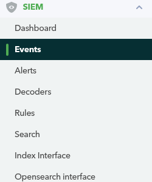{ .captura }

## Dashboard and events

### Dashboard

**Operation → SIEM → Dashboard** sums up the state at a glance: total events
by severity, the evolution of the ten levels with the most events, the alert
evolution of the ten busiest agents, the ten most frequent source IP addresses
(SRCIP), the ten most seen MITRE ATT&CK® techniques, the ten agents with the
most events and a table with the latest events. By default it shows the last
24 hours.

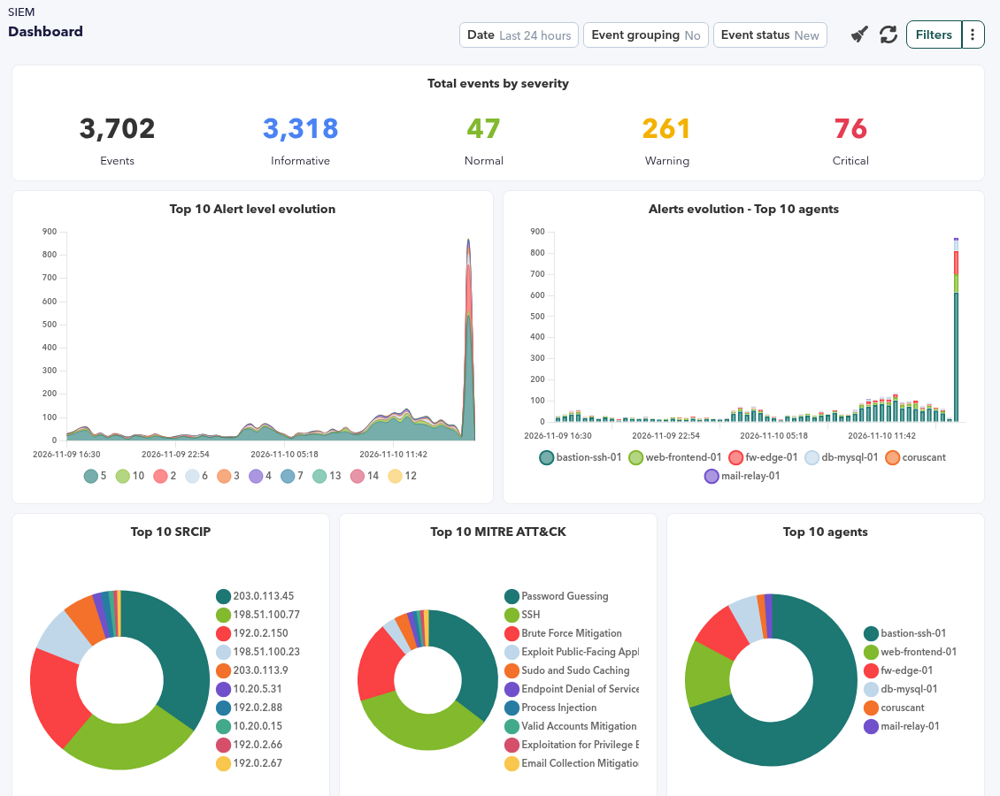{ .captura }

You can take the same information to [dashboards](../parte-5/5.1-dashboards.md)
with the SIEM *widgets* (see [Reports and dashboards](#reports-and-dashboards)).

### Event list

**Operation → SIEM → Events** is the full table: severity, description, status,
agent, level, the *decoders* that normalized the *log*, *rule* ID, type and
date. From here you export events with **Export to CSV** and validate them with
**Validate events** (or one by one with the icon on each row).

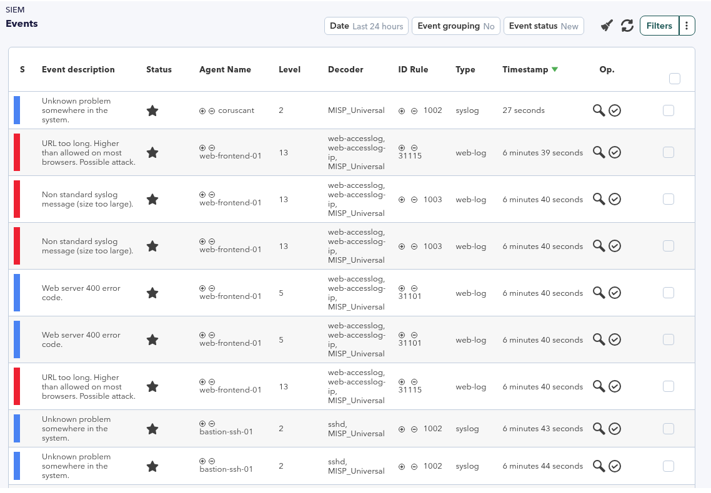{ .captura }

An event starts as **New** and becomes **Validated** when someone validates it.
By default the table shows new events from the last 24 hours.

### Filters

The **Filters** button opens a panel with three tabs:

- **General**: free search (in the description, agent alias, *decoder* and
  type), event ID, group (with **Group recursion** to include child groups),
  SIEM group, description, date, **Event grouping** (groups by description,
  agent, *rule* and *decoder*), severity, level, *rule* ID, type, MITRE
  technique, agent and status.
- **Decoder**: the *decoder* and the dynamic fields it extracted, with the
  **is like** (regular expression) and **is equal to** (exact match)
  operators.
- **Exclusion filters**: agents and *rules* you do not want to see.

Filters are saved with **Save filter** and loaded with **Load filter**.

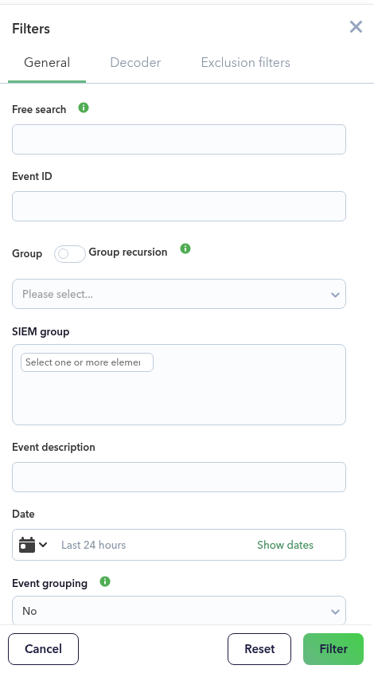{ .captura }

!!! warning "Grouping is expensive"
    **Event grouping** aggregates on OpenSearch and, with many events, it can
    slow the query down.

### Event details

The magnifying glass on each row opens the details, with tabs that only appear
when there is something to show:

- **General**: the event basics (ID, description, agent, group, level,
  severity, status, *decoders*, *rule*, *log* text, type, source, program and
  dates). You can validate it here with **Validate event**.
- **Dynamic fields**: the fields extracted by the *decoders* (`srcip`,
  `srcuser`, `srcport`…). They come from the *decoder*.
- **MITRE ATT&CK**: the related techniques, with a link to each one. They come
  from the *rule*.
- **SIEM groups**: the *rule* groups, which include regulatory compliance
  references (PCI DSS, GDPR, HIPAA, NIST 800-53…). They come from the *rule*.
- **ITSM tickets**: the related tickets, only when the ITSM integration is
  enabled.
- **Responses**: actions on the event. **Ping to host** pings one of the
  addresses in the event; with ITSM enabled, you also get **Create a ticket in
  Pandora ITSM** and **Add a ticket to the event**.

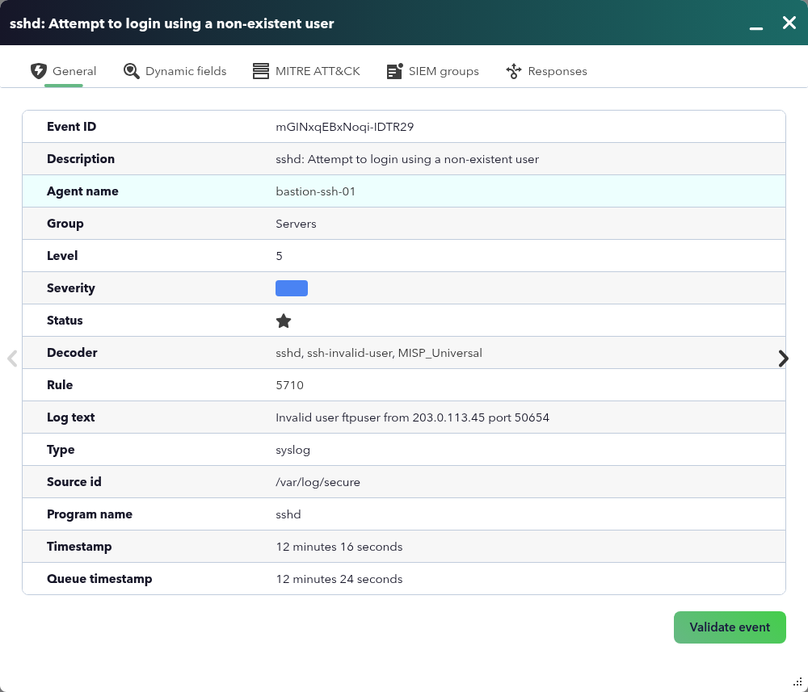{ .captura }

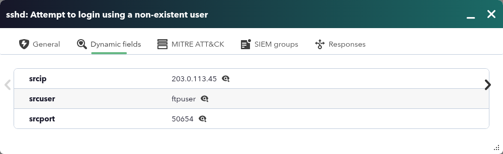{ .captura }

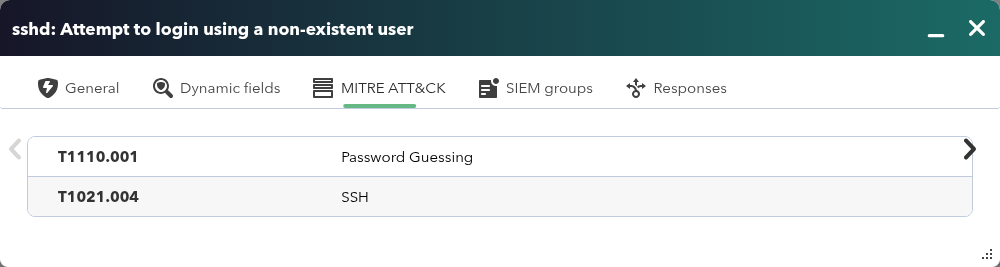{ .captura }

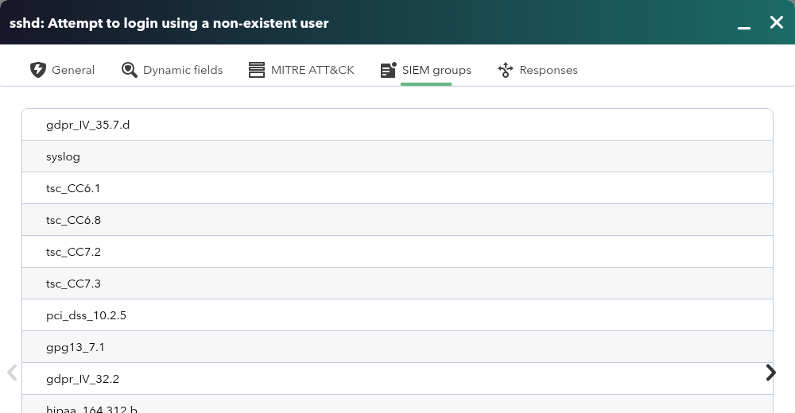{ .captura }

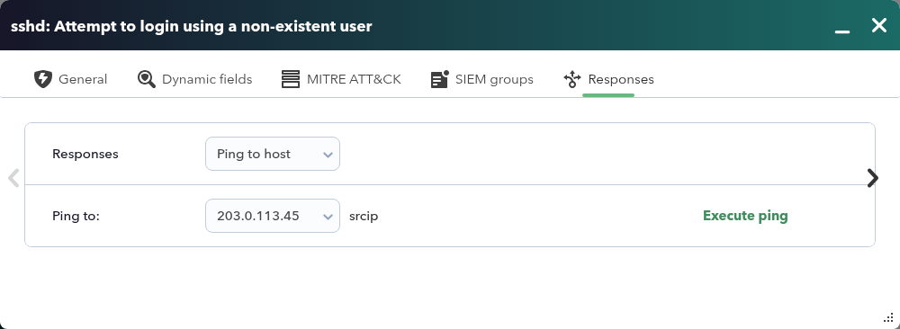{ .captura }

## Decoders

A *decoder* knows how to read one kind of *log*: it recognizes it and splits it
into named fields. Pandora FMS ships hundreds of them (most inherited from
Wazuh), and you can add your own.

### Management

There are two ways, and you should know which one you are using:

1. **XML files** in the `siem_decoders` folder. The master loads them into the
   database on startup. In the console they show as **Server managed** and can
   only be enabled or disabled: they cannot be edited or deleted there.
2. **Console**: **Operation → SIEM → Decoders**. **New decoder** creates one
   from a form, **Upload XML** uploads a file with one or more, and each row
   has view, edit, delete and disable. The ones you create here live in the
   database, do not depend on any file and can be edited.

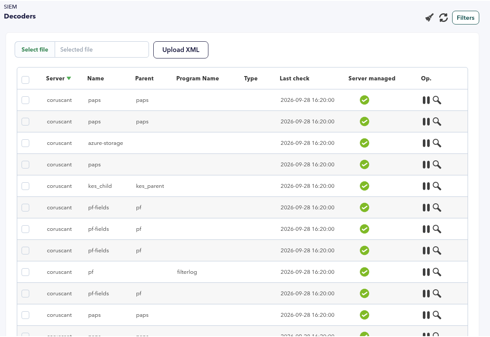{ .captura }

The list columns are **Server**, **Name**, **Parent**, **Program Name**,
**Type**, **Last check**, **Server managed** and **Op.** The enabled/disabled
state is filtered from **Filters** (**Enabled**), and **Enable/Disable selected
items** changes several at once.

The **New decoder** form covers the essentials: **Name**, **Parent**, **Program
name**, **Type**, **Discard**, one or more **Prematch** and **Regex** (each with
its expression type, **OS Regex** or **PCRE2**, and its **Offset**) and
**Order**. For `var`, `json_null_field`, `fts` or `plugin_decoder`, write the XML
and upload it with **Upload XML**.

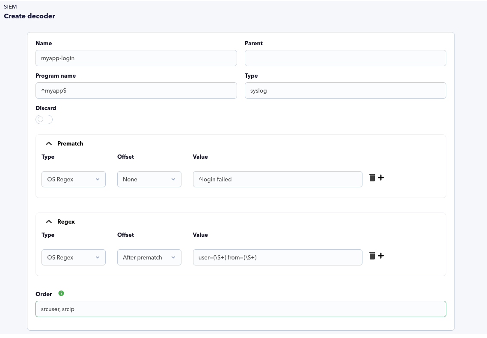{ .captura }

!!! info "What happens to decoders on restart"
    On every startup, the master deletes the file-based *decoders* and loads
    them again. Consequences: the ones that cannot be read disappear (even if
    they used to work), and **the ones you disabled from the console are
    enabled again**. If you want to switch off a file-based one for good, move
    it out of the folder (for example, to `disabled/`). The ones created from
    the console are left alone.

### Syntax

A *decoder* file can hold as many *decoders* as you want. The full syntax:

```xml
<var name="VarName">VarValue</var>

<decoder name="DecoderName" discard="yes|no">
    <parent>DecoderName</parent>
    <program_name type="pcre2">REGEXP</program_name>
    <type>EventType</type>
    <prematch type="pcre2">REGEXP</prematch>
    <prematch offset="after_parent">REGEXP</prematch>
    <prematch offset="after_prematch">REGEXP</prematch>
    <regex type="pcre2">REGEXP</regex>
    <regex offset="after_parent">REGEXP</regex>
    <regex offset="after_regex">REGEXP</regex>
    <order>Field1, Field2.Sub1, Field2.Sub2</order>
    <json_null_field>string|discard</json_null_field>
    <fts>Field1, Field2</fts>
    <plugin_decoder offset="after_parent">JSON_Decoder|KVP_Decoder</plugin_decoder>
</decoder>
```

| Element | What it does |
|---|---|
| `var` | Defines a variable used later in the XML as `$VarName`. |
| `decoder` | The *decoder*. `name` is its name: several can share it, and then all of them are evaluated. `discard` (`yes` or `no`) drops from evaluation the *logs* that match it; *decoders* with `discard="yes"` are evaluated before the rest, unless they have a parent. |
| `parent` | Parent *decoder*, to build hierarchies. The child is only evaluated if the parent matches. |
| `program_name` | Name of the program that must appear in the *log* header or in its `source_id`. With `type="pcre2"` it uses PCRE2; otherwise, OS Regex. |
| `type` | *Log* type it applies to. Compared with the *log* type as a regular expression, case-insensitively. Without `type`, the *decoder* applies to any type. |
| `prematch` | If the *log* content matches, a normalized *log* is generated. Accepts `type` and `offset`. |
| `regex` | The groups captured by this expression are the normalized information. Accepts `type` and `offset`. |
| `order` | Names of the fields where the groups captured by `regex` are stored, in order. |
| `json_null_field` | What to do with empty groups: store them as an empty string (`string`) or drop them (`discard`). |
| `fts` | Fields that identify a "first time seen" combination. Used by the `if_fts` condition in *rules*. |
| `plugin_decoder` | Hands the parsing over to a *plugin*: `JSON_Decoder` (JSON *logs*) or `KVP_Decoder` (`key=value` pairs). Accepts `offset`. |

`program_name`, with PCRE2:

```xml
<program_name type="pcre2">^myapp$</program_name>
```

`fts`, as the bundled arpwatch *decoder* uses it: a *log* with that combination
of agent, IP and extra data is "new" if it has not been seen before. In `fts`,
`name` refers to the agent name and `location` to the *log* type.

```xml
<fts>name, srcip, extra_data</fts>
```

`plugin_decoder`, as the FortiGate *decoders* use it (`key=value` pairs) and
the ESET one (JSON starting where the parent ends):

```xml
<decoder name="fortigate-firewall-v6-fields">
  <parent>fortigate-firewall-v6</parent>
  <plugin_decoder>KVP_Decoder</plugin_decoder>
</decoder>
```

```xml
<plugin_decoder offset="after_parent">JSON_Decoder</plugin_decoder>
```

!!! warning "`ftscomment` is accepted and ignored"
    Some XML files inherited from Wazuh include `<ftscomment>`. The server does
    not read it: you can leave it there, but it does nothing.

### offset

`offset` decides where an expression is evaluated from and removes, for the
following checks, the text that has already matched. Values: `after_parent`,
`after_prematch` and `after_regex`.

```xml
<decoder name="my_decoder">
  <prematch type="pcre2">^\d\d\d\d/\d\d/\d\d \d\d:\d\d:\d\d </prematch>
  <regex type="pcre2" offset="after_prematch">(\w):(\d+)</regex>
  <order>srcip,srcport</order>
</decoder>
```

The `prematch` checks that the *log* starts with a date, the `regex` is
evaluated on what is left **after** that date, and the two groups end up in
`srcip` and `srcport`. Removing the date keeps the capture groups simple.

### Decoders for generic formats

Besides the product *decoders*, there are two format *decoders* worth knowing,
because they are the way in for any source that does not speak the Wazuh
format. Neither declares `<type>`, so they apply to any *log*.

- **CEF** (`0002-pfms_cef_decoder.xml`): recognizes *logs* in *Common Event
  Format* and splits their header into fields.

  ```xml
  <decoder name="cef">
    <prematch type="pcre2">^CEF:</prematch>
    <regex offset="after_prematch" type="pcre2">^(\d+)\|([^|]*)\|([^|]*)\|([^|]*)\|([^|]*)\|([^|]*)\|([^|]*)\|(.*)$</regex>
    <order>cef_version, cef_device_vendor, cef_device_product, cef_device_version, cef_signature_id, cef_name, cef_severity, cef_extension</order>
  </decoder>
  ```

- **JSON** (`0006-json_decoders.xml`): passes JSON *logs* through the
  `JSON_Decoder` *plugin*, which turns each key into a field.

These two normalize, but they do not generate events on their own: for that you
need a *rule* that looks at their fields (for example, with `decoded_as` and
`field`).

## Rules

A *rule* says when a normalized *log* becomes an event. Pandora FMS ships
thousands (again, mostly from Wazuh), and you can add your own.

### Management

*Rules* are managed the same way as *decoders*: XML files in the
`siem_events_rules` folder, which the master loads on startup (**Server
managed**, only enabled or disabled), or the console, in **Operation → SIEM →
Rules**, with **New rule**, **Upload XML**, edit, delete and **Enable/Disable
selected items**.

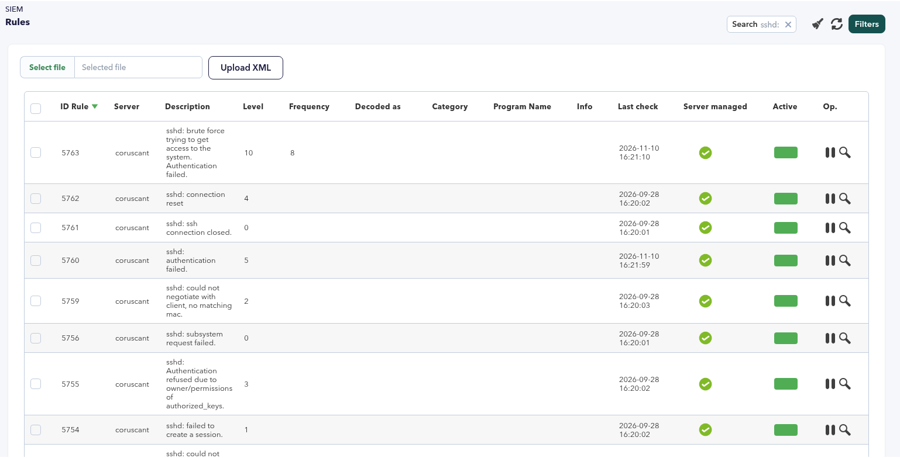{ .captura }

The columns are **ID Rule**, **Server**, **Description**, **Level**,
**Frequency**, **Decoded as**, **Category**, **Program Name**, **Info**, **Last
check**, **Server managed**, **Active** and **Op.**

There are two differences with *decoders*:

- *Rules* have an **ID**, so they **keep their disabled state** across
  restarts.
- They tell **Active** apart from **Enabled**. *Active* is decided by the
  server: the *rule* could be read from the XML on the last startup. *Enabled*
  is decided by you. **For a *rule* to be evaluated it must be both active and
  enabled.**

The **New rule** form takes the ID, description, level, **Overwrite**,
**Decoded as**, **Category**, **Program name**, **Regex** conditions (with
**Negate**) and **Field** conditions, **Frequency**, **Timeframe**, **Ignore**,
**If matched SID**, **If matched group**, **If SID**, **If group**, **If
level**, **Same ID**, **Different ID**, **Same field** and **Different field**.
For `time`, `weekday`, `info`, `mitre`, `group`, `maxsize` or `if_fts`, write the
XML and upload it with **Upload XML**.

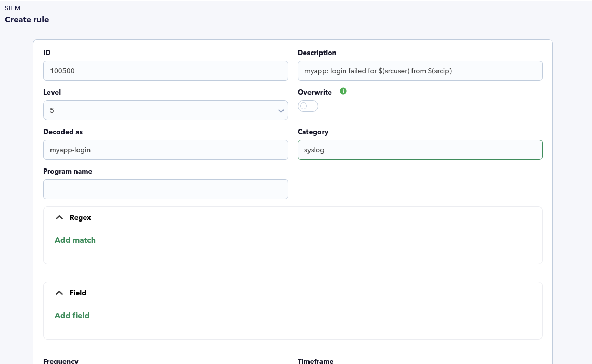{ .captura }

!!! info "A console rule beats a file rule with the same ID"
    If you create a *rule* from the console with the same ID as a file-based
    one, on the next startup the master keeps yours and drops the one from the
    file. It is a way to replace a bundled *rule* without touching its files.

!!! warning "ID order matters"
    *Rules* are evaluated in **ascending numeric order**. If one depends on the
    result of another (with `if_sid`, for example), the one it depends on must
    have a **lower ID**. Otherwise, when the dependent *rule* asks, the other one
    has not been evaluated yet. See [Evaluation order](#evaluation-order).

### Classification

Every *rule* has a level from `0` to `15`:

| Level | Title | Description |
|---|---|---|
| 0 | Ignored | Generates no event. Used to avoid false positives and to group *rules*: these are evaluated before all the others. |
| 1 | Unclassified | Generates an informational event. Mostly used by grouping *rules* that should not stand out. |
| 2 | Low priority system notification | System notifications or status messages with no security relevance. |
| 3 | Successful or authorized events | Successful logins, traffic allowed by the firewall and the like. |
| 4 | Low priority system error | Misconfigurations or unused devices and applications. No security relevance; usually caused by default installations or software tests. |
| 5 | User generated error | Forgotten passwords, denied actions. On their own, no security relevance. |
| 6 | Low relevance attack | Worms or viruses with no effect on the system, frequent IDS events and frequent errors. |
| 7 | "Bad word" match | Words such as "error" or "bad". Mostly unclassified; they can have some relevance. |
| 8 | First time seen | The first time an IDS event fires or a user logs in. Also sensitive actions, such as starting a *sniffer*. |
| 9 | Error from invalid source | Login attempts with an unknown user or from an invalid source, and errors with the administration account (*root*). Relevant if it repeats. |
| 10 | Multiple user generated errors | Several wrong passwords, several failed logins. Could be an attack or someone who forgot the password. |
| 11 | Integrity checking warning | Modified binaries or detected *rootkits*. May indicate a successful attack. Also IDS events that will be ignored because they repeat. |
| 12 | High importance event | Errors or warnings from the system, the *kernel*… May indicate an attack against a specific application. |
| 13 | Unusual error (high importance) | Matches a common attack pattern most of the time. |
| 14 | High importance security event | Usually raised by correlation and indicates an attack. |
| 15 | Severe attack | No chance of a false positive. Needs immediate attention. |

The level sets the **severity** the event shows in the console:

| Severity | Levels |
|---|---|
| **Informational** | 0 to 6 |
| **Normal** | 7 and 8 |
| **Warning** | 9 to 11 |
| **Critical** | 12 to 15 |

### Syntax

```xml
<var name="VarName">VarValue</var>

<group name="GROUP1,GROUP2,">
    <rule id="N" level="N" frequency="N" timeframe="N" ignore="N" overwrite="yes|no" maxsize="N">
        <if_matched_sid>N</if_matched_sid>
        <if_matched_group>GROUP</if_matched_group>
        <same_id />
        <different_id />
        <same_field>Field1</same_field>
        <same_field>Field2.Sub1</same_field>
        <different_field>Field1</different_field>
        <different_field>Field2.Sub1</different_field>
        <description>TEXT</description>
        <match type="pcre2">REGEXP</match>
        <match negate="yes|no">REGEXP</match>
        <regex type="pcre2">REGEXP</regex>
        <regex negate="yes|no">REGEXP</regex>
        <decoded_as>DecoderName</decoded_as>
        <category>EventType</category>
        <field name="Field1">REGEXP</field>
        <field name="Field2.Sub1" negate="yes|no">REGEXP</field>
        <program_name negate="yes|no">REGEXP</program_name>
        <time>TIME-RANGE</time>
        <weekday>DAYS</weekday>
        <if_sid>PARENT1, PARENT2</if_sid>
        <if_group>GROUP</if_group>
        <if_level>N</if_level>
        <if_fts />
        <info type="text|link|cve">TEXT|LINK|CVE</info>
        <group>GROUP1,GROUP2,</group>
        <mitre>
            <id>MITRE_ID</id>
            <id>MITRE_ID</id>
        </mitre>
    </rule>
</group>
```

`rule` attributes:

| Attribute | What it does |
|---|---|
| `id` | Identifier. Must be unique, unless another *rule* is being overwritten. |
| `level` | Event level (`0` to `15`). With `0` no event is generated, although the *rule* still counts for the ones that depend on it. |
| `frequency` | Times the match must happen to generate the event. Counted per agent, not across all *logs*. |
| `timeframe` | Window, in seconds, in which those matches must happen. |
| `ignore` | Seconds after which the *rule* resets its `frequency` counters. |
| `overwrite` | With `yes`, overwrites the configuration of the *rule* with the same ID. With `overwrite="yes"` and `level="0"`, the *rule* is evaluated before any other and, if it matches, drops the *log* for all the others. |
| `maxsize` | The *rule* only matches if the *log* is longer than this number of characters. Useful to catch messages that are abnormal because of their size. |
| `noalert` | Accepted for Wazuh compatibility and has no effect: the *rule* generates its event anyway. |

Elements:

| Element | The *rule* matches if… |
|---|---|
| `var` | (Defines a variable, as in *decoders*.) |
| `group` | (Groups *rules*; the group name is also used as a condition in other *rules*.) |
| `if_matched_sid` | The *rule* with that ID has matched `frequency` times within `timeframe`. |
| `if_matched_group` | Same as `if_matched_sid`, but for a group. |
| `same_id` / `different_id` | The matches have the same ID / a different ID. |
| `same_field` / `different_field` | The matches have the same value / a different value in that field. |
| `description` | (Event text. Accepts placeholders with the *log* fields; see the warning below.) |
| `match` / `regex` | The *log* content matches the expression. `type="pcre2"` uses PCRE2 (OS Regex by default) and `negate="yes"` negates the match. |
| `decoded_as` | The *log* was normalized by the given *decoder*. |
| `category` | The *decoder* type matches. |
| `field` | The given field matches the expression. Accepts `negate`. |
| `program_name` | The *log* source matches. Accepts `negate`. |
| `time` | The event happens within that time range. |
| `weekday` | The event happens on those days: `monday` to `sunday`, `weekdays` or `weekends`. |
| `if_sid` | Any of the parent *rules* in the list matches. |
| `if_group` | The *log* matches some other *rule* in the given group. |
| `if_level` | Another *rule* with that same level has matched. |
| `if_fts` | The combination of fields in the *decoder*'s `fts` had not been seen before (*first time seen*). |
| `info` | (Extra information for the event. `type` is `text`, `link` or `cve`.) |
| `group` | (List of the *rule*'s groups; they show in the **SIEM groups** tab.) |
| `mitre` | (List of MITRE ATT&CK® techniques, one per `<id>`.) |

!!! warning "`$(Field)` placeholders: only in description and only with simple names"
    In `description` you can use the fields of the normalized *log*, such as
    `$(srcuser)` or `$(object_target)`. Two limits: the name only accepts
    letters, digits and underscore, so a nested field such as `$(Field2.Sub1)`
    comes out literally; and nothing is replaced in `info`.

### Case study: SELinux and PHP

This *rule*, bundled with Pandora FMS, generates an event when SELinux stops
PHP from opening a connection to a port that is not one of the usual ones on a
web server:

```xml
<rule id="100201" level="6">
    <decoded_as>setroubleshoot_program</decoded_as>
    <match>/usr/sbin/php-fpm</match>
    <field name="object_target" type="pcre2">^(?!.*\b(9200|3306|80|443)$).*$</field>
    <field name="object_target" type="pcre2">^(?!.*(directory|file) (conf|data_in|cron.lock)).*$</field>
    <description>SELinux prevented /usr/sbin/php-fpm execution on: $(action) access on the $(object_target)</description>
    <mitre>
        <id>T1071.002</id>
    </mitre>
    <group>exec,threat,PHP</group>
</rule>
```

Connections to ports `9200`, `3306`, `80` and `443` generate no event. Neither
do accesses to configuration files or directories, `data_in` and `cron.lock`.
And the description uses two fields extracted by the *decoder*.

The *decoders* that feed it:

```xml
<decoder name="setroubleshoot">
    <program_name>^setroubleshoot$</program_name>
</decoder>

<decoder name="setroubleshoot_program">
    <parent>setroubleshoot</parent>
    <prematch type="pcre2">(SELinux is preventing|SELinux está negando a)</prematch>
    <regex type="pcre2">(\S+) (?:from|de) (\S+) (?:access on the|el acceso a) (.+?)\. (?:For complete SELinux messages run: sealert -l|Si quiere los mensajes de SELinux completos, ejecute sealert -l) (\S+)$</regex>
    <order>binary,action,object_target,sealert_id</order>
</decoder>

<decoder name="setroubleshoot_program">
    <parent>setroubleshoot</parent>
    <prematch type="pcre2">failed to retrieve rpm info for path</prematch>
    <regex type="pcre2">failed to retrieve rpm info for path (\S+)</regex>
    <order>path</order>
</decoder>
```

Notice there are two *decoders* with the same name: both are evaluated, and each
one recognizes a different `setroubleshoot` message.

### Evaluation order

Now the opposite case: a chain of *rules* that does not work, and why. The
*rules* in this example detect failed logins on a FortiGate firewall. They are
illustrative: the FortiGate *rules* bundled with Pandora FMS today are numbered
differently.

```xml
<rule id="81641" level="1">
    <decoded_as>fortigate-firewall-v6</decoded_as>
    <description>Fortigate v6 messages grouped.</description>
</rule>
```

Rule 81641 matches the decoded *log* and starts the chain.

```xml
<rule id="81603" level="0">
    <if_sid>81600,81601,81602,81641</if_sid>
    <description>Fortigate messages grouped.</description>
</rule>
```

Rule 81603 depends on several *rules*, including 81641. But 81641 is **greater**
than 81603: when 81603 is evaluated, 81641 has not been evaluated yet, so **81603
never matches**.

```xml
<rule id="81614" level="4">
    <if_sid>81603</if_sid>
    <match>ssl-login-fail</match>
    <description>Fortigate: SSL VPN user failed login attempt.</description>
    <group>authentication_failed,gdpr_IV_32.2,gdpr_IV_35.7.d,gpg13_7.1,hipaa_164.312.b,invalid_login,nist_800_53_AC.7,nist_800_53_AU.14,pci_dss_10.2.4,pci_dss_10.2.5,tsc_CC6.1,tsc_CC6.8,tsc_CC7.2,tsc_CC7.3,</group>
</rule>
```

Rule 81614 depends on 81603. Its ID is greater, so it is evaluated afterwards,
as it should be. And a custom *rule*, 100700, depends in turn on 81614.

The result: 100700 never matches. It is not its fault, nor 81614's: the chain
broke at 81603, which never got to match because of the ID order. The fix is to
renumber so that every *rule* has a greater ID than all the *rules* it depends
on.

## Regular expressions

*Decoders* and *rules* accept two engines: **OS Regex**, the default, and
**PCRE2**, enabled with `type="pcre2"`. The rule of thumb: use OS Regex for
simple things, since it is quicker to write, and move to PCRE2 as soon as you
need alternation inside a group, lookahead or lookbehind, or lazy quantifiers.

### OS Regex

A simple engine, written in C, designed to cover the most common expressions.

| Expression | Matches |
|---|---|
| `\w` | `A-Z`, `a-z`, `0-9`, `-`, `@` and `_` |
| `\d` | `0-9` |
| `\s` | ASCII space (code 32) |
| `\t` | Tab |
| `\p` | ``()*+,-.:;<=>?[]!"'#$%&|{}`` |
| `\W` | Anything that is not `\w` |
| `\D` | Anything that is not `\d` |
| `\S` | Anything that is not `\s` |
| `\.` | Any character |

| Modifier | Behavior |
|---|---|
| `+` | One or more times |
| `*` | Zero or more times |

| Special character | Behavior |
|---|---|
| `^` | Start of the text |
| `$` | End of the text |
| `|` | Logical "or" between several patterns |

To use these characters literally, escape them with `\`:

| Character | `$` | `(` | `)` | `\` | `|` | `<` |
|---|---|---|---|---|---|---|
| Escaped | `\$` | `\(` | `\)` | `\\` | `\|` | `\<` |

!!! warning "OS Regex limitations"
    - `*` and `+` only apply to backslash expressions: `\d+` works, `0+` does
      not.
    - No alternation inside a group: `(foo|bar)` is not allowed.
    - No complex backtracking: `\p*\d*\s*\w*:` does not match a lone colon,
      because `\p*` eats it.
    - `.` matches a literal dot, and `\.` matches any character (the other way
      round from what you are used to).
    - `\s` only matches the ASCII space (32), not tabs or other whitespace.
    - There is no syntax to match a literal caret, asterisk or plus sign
      (although `\p` matches the asterisk and the plus sign, among others).

### PCRE2

*Perl Compatible Regular Expressions* (PCRE2) adds recursive patterns,
lookahead and lookbehind assertions, non-capturing groups, lazy quantifiers and
extended character classes, among other things. The full reference is in the
[PCRE2 syntax documentation](https://www.pcre.org/current/doc/html/pcre2syntax.html).

| Expression | Matches |
|---|---|
| `.` | Any character except newline |
| `\d` | Any decimal digit (`[0-9]`) |
| `\D` | Any character that is not a decimal digit (`[^0-9]`) |
| `\h` | Any horizontal whitespace character |
| `\H` | Any character that is not horizontal whitespace |
| `\s` | Any whitespace character (`[\t\r\n\f]`) |
| `\S` | Any character that is not whitespace (`[^\t\r\n\f]`) |
| `\w` | Any "word" character |
| `\W` | Any "non-word" character |

| Modifier | Behavior |
|---|---|
| `?` | 0 or 1, greedy |
| `?+` | 0 or 1, possessive |
| `??` | 0 or 1, lazy |
| `*` | 0 or more, greedy |
| `*+` | 0 or more, possessive |
| `*?` | 0 or more, lazy |
| `+` | 1 or more, greedy |
| `++` | 1 or more, possessive |
| `+?` | 1 or more, lazy |
| `{n}` | Exactly n |
| `{n,m}` | At least n, no more than m, greedy |
| `{n,m}+` | At least n, no more than m, possessive |
| `{n,m}?` | At least n, no more than m, lazy |
| `{n,}` | n or more, greedy |
| `{n,}+` | n or more, possessive |
| `{n,}?` | n or more, lazy |

| Escape | Character |
|---|---|
| `\f` | Form feed (hex `0C`) |
| `\n` | Newline (hex `0A`) |
| `\r` | Carriage return (hex `0D`) |
| `\t` | Tab (hex `09`) |
| `\0dd` | Character with octal code `0dd` |
| `\o{ddd..}` | Character with octal code `ddd..` |
| `\xhh` | Character with hex code `hh` |
| `\x{hhh..}` | Character with hex code `hhh..` |

## SIEM alerts

SIEM events do not fire the module alerts or the event alerts from
[Part 5](../parte-5/5.5-alertas-y-notificaciones.md): they have their own. They
are managed in **Management → Alerts → SIEM Alerts** (administrator or **LW**
permission) and reuse the same **actions** as every other alert: email, Slack,
Teams, Telegram, a command…

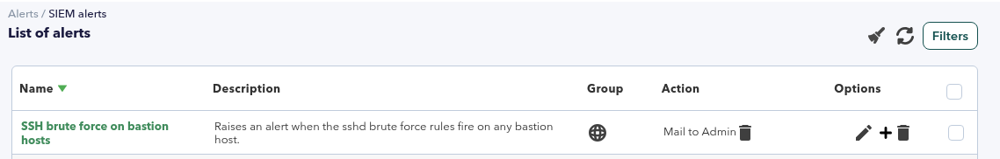{ .captura }

**Create** opens a five-step wizard. The alert is saved once you get past the
first step, and you can go back with **Back**:

1. **Configure**: **Alert name**, **Group**, **Description** and **Severity**.
   The severity is the priority of the Pandora FMS alert (the one carried by
   the event and the macros it generates), not that of the SIEM event.
2. **Conditions**: starting template (**Load from template**), schedule (**Use
   special days list** and the **Simple** or **Detailed** view by days and
   hours), minimum and maximum number of alerts (**From** / **To**), time
   threshold (**Threshold**) and **Disable event** to avoid creating a Pandora
   FMS event when it fires.
3. **Filters**: which SIEM events count. **Free search**, **Group** (with
   **Group recursion**), **SIEM group**, **Event description**, **Severity**,
   **Level**, **ID Rule**, **Type**, **Mitre**, **Agent**, **Decoder**, and the
   **Excluded agents** and **Exclude Rules** exclusions.
4. **Fields**: fields **Field 1** to **Field 10** passed to the actions, in
   **Basic** or **Advanced** mode, or loaded from a template.
5. **Triggering**: summary of the firing condition and the actions. Each action
   is added with **Add**, with its own **From** / **To** range and its
   **Threshold**. **Finish** ends the wizard.

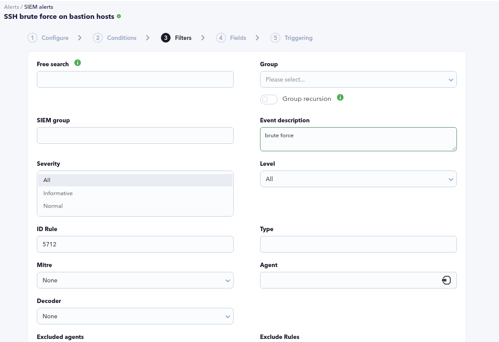{ .captura }

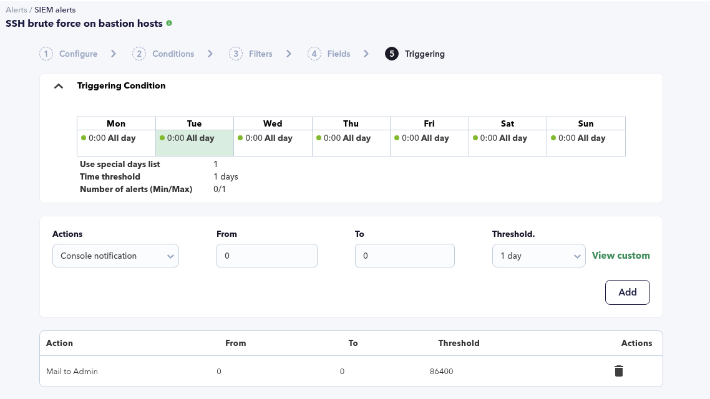{ .captura }

In the fields and actions, besides the usual macros, there are four SIEM
macros:

| Macro | Value |
|---|---|
| `_event_description_` | Description of the SIEM event. |
| `_siem_event_level_` | Level (`0` to `15`) of the SIEM event. |
| `_event_text_severity_` | Event severity, as text. |
| `_group_contact_` | Contact of the event's group. |

In **Operation → SIEM → Alerts**, the operation list shows how many times each
alert has matched (**Matched**) and how many times it has fired
(**Triggered**), and lets you put it on standby, enable or disable it, run its
action by hand and validate it. The alert engine and the actions are explained
in [Alerts and notifications](../parte-5/5.5-alertas-y-notificaciones.md).

## Reports and dashboards

For [reports](../parte-5/5.2-informes.md) there are three items, in the
**SIEM** group of the report editor:

| Item | What it shows |
|---|---|
| **Events list** | The list of SIEM events in the last hours (24 by default), with its own filter. |
| **Events graph** | A graph of events by groups and agents, grouped by the field you choose, in simple or evolution mode. |
| **Statistics** | SIEM event statistics by groups and agents. |

For [dashboards](../parte-5/5.1-dashboards.md) there are three *widgets*:

| *Widget* | What it shows |
|---|---|
| **SIEM metrics** | Engine figures: processed *logs*, *logs* per second (last hour and last day), processed events, events per second (8 hours and last day), active *decoders* and active *rules*. |
| **SIEM statistics** | Event statistics for the last hours (24 by default). |
| **SIEM Top N Events** | The N most frequent events (10 by default), in simple mode (pie, bars or table) or evolution mode (lines, areas or stacked bars). |

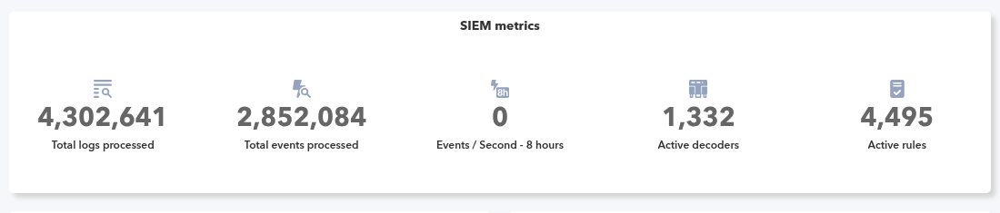{ .captura }

A *widget* is for watching in real time; a report is for telling what happened
(and emailing it every Monday).

## Operation and troubleshooting

When no events show up, the quickest way is to walk the chain in order, from
the license to the clock. It almost always breaks in the first three steps.

1. **License and experimental features.** No Pandora SIEM license, no server; no
   **Show experimental features**, no menu.
2. **SIEM enabled and OpenSearch reachable.** **Activate SIEM** on and the form
   indicator on **OpenSearch is running**.
3. **Log collector enabled.** Without it there is nothing to analyze. Also
   check that *logs* reach the log viewer of
   [log collection](../parte-2/2.19-recoleccion-y-monitorizacion-de-logs.md).
4. **`siemserver` and `siemevents` running.** With their tokens set to `1` and
   the server restarted. Errors go to `/var/log/pandora/pandora_server.log`.
5. **Log type.** *Decoders* with `<type>` only apply if their expression
   matches the *log*'s `module_source_type`. If none matches and no typeless
   *decoder* picks it up either, the *log* is stored but not normalized. If the
   problem is in OpenSearch, also check the collector template
   (`pandorafms*`): `siemserver` itself maintains it, adding the `processed`
   and `metadata` fields and the `add_queue_timestamp` *pipeline*.
6. ***Decoder* or *rule* switched off.** A disabled *decoder*, or a *rule* that
   is not **Active** (it could not be read) or not **Enabled**.
7. **Retention and window.** A `siem_max_timeframe` shorter than the gap during
   which the server was down, or an index that has already been purged.
8. **Clock.** Indices are daily and `frequency` and `timeframe` are measured in
   seconds. A server with the wrong time skews the correlation.

!!! tip "Test with a log you know must fire"
    An SSH login attempt with a user that does not exist generates, as soon as
    it is normalized, an **sshd: Attempt to login using a non-existent user**
    event (*rule* 5710, level 5) with its MITRE ATT&CK® techniques. If that event
    shows up in **Operation → SIEM → Events**, the chain works and the problem
    is in your *decoder* or your *rule*.

To watch the SIEM itself, the **SIEM metrics** *widget* is the thermometer: if
processed *logs* do not grow, `siemserver` is down or nothing reaches it; if
*logs* grow but events do not, look at the *rules*.
