# SOAR

Detecting an attack at three in the morning does little good if nobody reads it
until nine. The [SIEM](7.2-siem.md) already turns forty failed password attempts
into an event that says "brute force from 198.51.100.77"; what is missing is
someone doing something about it, and that someone not having to be awake. That
is **SOAR** (*Security Orchestration, Automation and Response*): **orchestrate**
the tools you already have, **automate** the repetitive response tasks and
**respond** to an incident in seconds, not whenever someone opens their email.

Within this part, the SIEM detects and this chapter responds. The technical side
of alerts (commands, actions, templates, escalation and macros) is in
[Alerts and notifications](../parte-5/5.5-alertas-y-notificaciones.md); here you
will see how they chain together to respond to a security incident, with three
complete examples tested end to end.

!!! warning "There is no SOAR module in Pandora FMS"
    Do not look for a SOAR menu: there is none, neither in the console nor in
    the code. In Pandora FMS, SOAR is a chain of pieces that are already there: a
    **SIEM event** fires a **SIEM alert**, and the alert runs **actions** (an RMM
    *script* on the attacked EndPoint, a command against a firewall API, a
    ticket in Pandora ITSM, a Telegram notice). The good news is that there is
    nothing new to install; the bad news is that you design the *playbook*.

## What it is for

With a well-built automatic response you can:

- **Contain**: block the IP of a brute force attack on the EndPoint itself or on
  the perimeter firewall, with an expiry so the block does not stay forever.
- **Remediate on the EndPoint**: stop a service, kill a process or collect
  evidence with an RMM *script*.
- **Record and follow up**: open a ticket in Pandora ITSM with the event context,
  so the incident has an owner and does not end up as an email someone read.
- **Tell the right people**: Telegram, email, Microsoft Teams or a console
  notification, depending on severity and schedule.

And you should know from the start what it does **not** do, because it changes
the design:

- There is no visual *playbook* editor and no human approval step inside the
  alert. You decide what is automated and what is not when you configure it.
- SIEM alerts have **no recovery**. If an action blocks an IP, nothing unblocks
  it when the attack ends: the way back is designed into the action itself (a
  block with an expiry).
- The fields the *decoder* extracts (`srcip`, `srcuser`, `dstport`…) **do not
  reach the action as macros**. There is a clean way to pass them, explained in
  [Event data in the response](#event-data-in-the-response).

## How it works

The whole chain, from *log* to response:

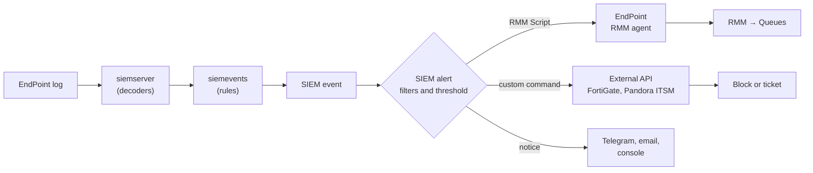

Three details of the path matter when you design the response:

1. **SIEM alerts are evaluated with every SIEM event**, the moment the server
   generates it, not on a timer. If the event matches the alert filters and the
   maximum number of firings has not been reached, the actions run right then.
2. **The event is tied to a Pandora FMS agent by its name.** The server looks
   for the agent whose name matches the one in the event. That agent is the
   "where" of the response: the agent macros (`_agent_`, `_address_`) come from
   it, and the **RMM Script** action is aimed at its RMM agent.
3. **Each action runs in a different place.** Alert commands run on the
   **Pandora FMS server**; the **RMM Script** action runs nothing on the
   server: it **queues** the *script* for the EndPoint's RMM agent, which picks
   it up and runs it there.

## Prerequisites

Each flow only needs the rows for the actions it uses:

| Requirement | Detail |
|---|---|
| Pandora SIEM working | Pandora SIEM license, the SIEM enabled in the web console and on the server, and the *rules* that generate the events you care about. See [SIEM](7.2-siem.md). |
| Experimental features | The SIEM alerts menu only appears with **Show experimental features** enabled, like the rest of the SIEM. |
| Permissions | **LW**, **LM** or **AD** to manage SIEM alerts; **LM** to create actions. See [SIEM alerts](../parte-5/5.5-alertas-y-notificaciones.md#siem-alerts). |
| For **RMM Script** | A **Pandora RMM** license; the **RMM server enabled** on the Pandora FMS server (`rmmserver 1`; it defaults to `0`); the RMM agent enabled on the EndPoint, with the **same name** as its Pandora FMS agent; and the *script* registered in **RMM → Scripts**. |
| For a **Pandora ITSM** ticket | The integration enabled in **Settings → System Settings → ITSM** (API URL and *token*) and the Pandora ITSM API *token* for the command that creates the ticket. |
| For **Pandora Telegram** | The bot *token* in the console general setup (used by the `_telegramtoken_` macro) and the target chat ID. |
| To block on **FortiGate** | HTTPS access from the Pandora FMS server to the FortiGate and a *token* for its REST API, stored in a file on the server. |

The RMM server is enabled in `/etc/pandora/pandora_server.conf`; the default
working directory already exists in a normal installation:

```ini
rmmserver 1
rmmdir /var/spool/pandora/rmm_server
```

And the RMM agent, in the EndPoint's `pandora_agent.conf` (Linux, MS Windows or
the Go EndPoint), pointing to the Pandora FMS server:

```ini
rmm_enabled 1
rmm_server 192.168.50.10
rmm_port 41123
```

Then restart both services.

## The pieces

### Detection: rules and SIEM events

The response starts at the *rule*. If the *rule* is noisy, the automatic
response multiplies the noise: before automating anything, check in
**Operation → SIEM → Events** that the event fires when it should and only when
it should. Level, groups, MITRE techniques and *decoders* are explained in
[Rules](7.2-siem.md#rules).

There is a trick worth learning early: a **child *rule*** of the one that
already detects the attack, with the data you need in its description. The
`$(Field)` placeholders in the description are replaced with the value of the
decoded field, so a description such as `sshd: brute force from $(srcip)`
reaches the alert as `sshd: brute force from 198.51.100.77`. That is how the IP
gets to the action.

### Decision: SIEM alerts

The SIEM alert is the "if this happens, do that". Its filters are the same as in
the SIEM events view (free search, group, SIEM group, description, severity,
level, *rule* ID, type, MITRE, *decoder* and agent, plus the agent and *rule*
exclusions), and its conditions set the schedule, the threshold and the minimum
and maximum number of firings. All the details are in
[SIEM alerts](../parte-5/5.5-alertas-y-notificaciones.md#siem-alerts).

To respond, the most useful filter is **ID Rule**: one *rule*, one response.

!!! info "Threshold and maximum count per alert, not per IP"
    The time threshold and the maximum number of firings belong to the whole
    alert. If a blocking alert has a maximum of 1 in 24 hours, it blocks the
    first attacker of the day and lets the second one through. In containment
    alerts use a short threshold (5 minutes) and a high maximum (10, for
    instance); in notice alerts, the other way round, so you do not flood the
    channel.

### Response actions

The alert commands most useful as a response, grouped by what they do:

| Purpose | Commands | Notes |
|---|---|---|
| Notify | eMail, Pandora Telegram, Pandora MS Teams, Pandora Slack, Pandora Google chat, Console notification, Generate Notification | The message carries the event data through [the macros](#event-data-in-the-response). |
| Record | Monitoring Event, Internal Audit | **Monitoring Event** creates a Pandora FMS event from the SIEM event. |
| Open a ticket | Custom command against the Pandora ITSM API | See [example 2](#example-2-successful-web-attack-ticket-in-pandora-itsm). |
| Act on the EndPoint | RMM Script | Needs the RMM server enabled. |
| Act on the EndPoint | Remote agent control | Sends an order over UDP to the EndPoint (port 41122), which must have its UDP server enabled. |
| Act outside Pandora FMS | Custom commands | A *script* or program on the server, with macros in its fields. See [example 3](#example-3-block-on-the-fortigate-perimeter-firewall). |

A **custom command** is one you create in **Management → Alerts → Commands**: a
server command line with the fields `_field1_` to `_field10_`, which the action
fills in. It is the most flexible piece of all: it opens tickets in Pandora
ITSM and calls any external API, as examples
[2](#example-2-successful-web-attack-ticket-in-pandora-itsm) and
[3](#example-3-block-on-the-fortigate-perimeter-firewall) do.

### Event data in the response

The action receives the event data as macros. These are the ones specific to
SIEM alerts:

| Macro | What it holds |
|---|---|
| `_event_description_` | The event description, with the *rule*'s `$(Field)` placeholders already replaced. |
| `_siem_event_level_` | The level of the *rule* that fired the event (0 to 15). |
| `_event_text_severity_` | The event severity as text, for example *Informational*. |
| `_eventTimestamp_` | The event date in UTC, such as `2026-11-12T08:38:43Z`. |
| `_logSource_` | The *log* source, for example `/var/log/httpd/access_log`. |
| `_logTimestamp_` | The *log* date, in the server's local time (`2026-11-12 09:38:43`). |
| `_group_contact_` | The contact of the event's group, as written in the group settings. |

Also, since the event is tied to an agent, the agent macros work (`_agent_`,
`_address_`, `_id_agent_`…), and so does `_data_`, which carries the text of the
original *log*. The rest of the alert macros are in
[Alert macros](../parte-5/5.5-alertas-y-notificaciones.md#alert-macros).

!!! info "Decoded fields are not macros: use the description"
    There is no `_srcip_` or anything like it. For the action to receive the
    source IP, create a child *rule* with `$(srcip)` in its description, as
    explained in [Detection](#detection-rules-and-siem-events), and have the
    *script* extract the IP from `_event_description_`. All three examples in
    this chapter do it that way.

!!! warning "A macro is text written by the attacker: validate it"
    Macros are inserted as they are into the command line. A *log* can bring
    quotes, semicolons or anything the attacker cares to write into it, so do
    not pass free-form fields (`_data_`, a user name, a URL) to a command
    without validating them. The example *scripts* only accept an IPv4 address
    and discard everything else.

### Manual response

Not everything deserves an automatic response. For what needs a human in front
of it there is the **Responses** tab of the
[SIEM event details](7.2-siem.md#event-details) (**Ping to host** and, with the
Pandora ITSM integration enabled, **Create a ticket in Pandora ITSM** and **Add
a ticket to the event**) and, if you brought the event to the event console with
**Monitoring Event**, the
[event responses](../parte-5/5.4-consola-de-eventos-centralizada.md#event-responses).

## Building a response flow

All three examples follow the same procedure, best done in this order:

1. **Choose the *rule*** and check in **Operation → SIEM → Events** that the
   event arrives, with the data you need in its description.
2. **Prepare the action**: the RMM *script*, the custom command or the notice
   command, and the action that uses it in **Management → Alerts → Actions**.
3. **Create the SIEM alert** in **Management → Alerts → SIEM Alerts**, with
   narrow filters (preferably by **ID Rule**), the threshold and the maximum
   number of firings.
4. **Test with a sample *log*** that you know fires the *rule*, rather than
   waiting for the real attack.
5. **Check the result**: the fired alert, the RMM queue, the ticket or the block,
   and `pandora_server.log` if something does not show up.

## Examples

The three examples were tested in the lab and go from narrower to wider reach:
the first acts on the attacked machine, the second leaves a record in Pandora
ITSM and the third shuts the door for the whole network.

### Example 1: SSH brute force, block on the EndPoint and notify on Telegram

**Goal:** when a server suffers an SSH brute force attack, block the source IP
for one hour in the server's own firewall and tell the SOC on Telegram.

**1. The *rule* that carries the IP.** *Rule* 5712 already detects the brute
force, but its description does not include the IP. Create a child *rule* that
fires when 5712 does and puts it in the description. Use an ID that does not
exist yet; in the example, `100100`:

```xml
<group name="local,sshd,">
  <rule id="100100" level="12">
    <if_sid>5712</if_sid>
    <description>sshd: brute force from $(srcip)</description>
    <mitre>
      <id>T1110</id>
    </mitre>
  </rule>
</group>
```

Create it from **Operation → SIEM → Rules** or upload it as a file, as explained
in [Rules](7.2-siem.md#rules). With it, the event arrives as
`sshd: brute force from 198.51.100.77`.

**2. The RMM *script*.** In **RMM → Scripts**, create a Linux *script* with one
`string` input (in the example, **Event description**, with the `_event_text_`
macro). That macro is what the action will fill with the event description:

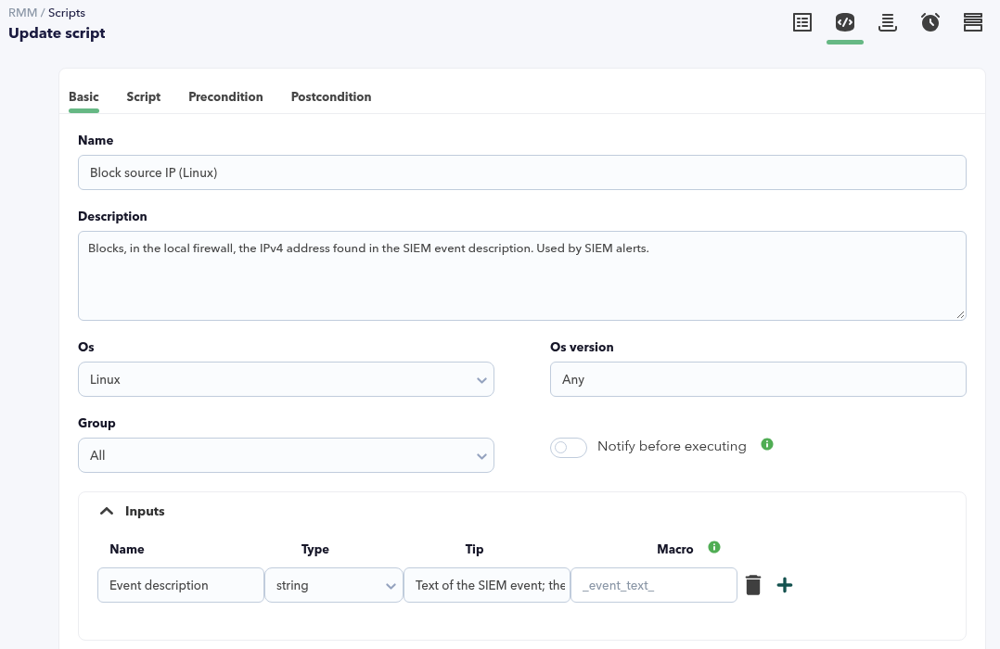{ .captura }

In the **Script** tab, the parameters are `_event_text_`, the interpreter `bash`,
the extension `sh` and this code, which takes the first IPv4 address from the
description and blocks it for one hour with `firewalld` (or with `iptables`, if
there is no `firewalld`):

```bash
#!/bin/bash
# Blocks, in the local firewall, the IPv4 address found in the SIEM event description.
DESC="$*"
IP=$(printf '%s\n' "$DESC" | grep -oE '([0-9]{1,3}\.){3}[0-9]{1,3}' | head -n1)
if [ -z "$IP" ]; then
    echo "No IPv4 address found in: $DESC"
    exit 1
fi
if command -v firewall-cmd >/dev/null 2>&1; then
    firewall-cmd --add-rich-rule="rule family=ipv4 source address=$IP reject" --timeout=1h
else
    iptables -I INPUT -s "$IP" -j DROP
fi
echo "Blocked $IP"
```

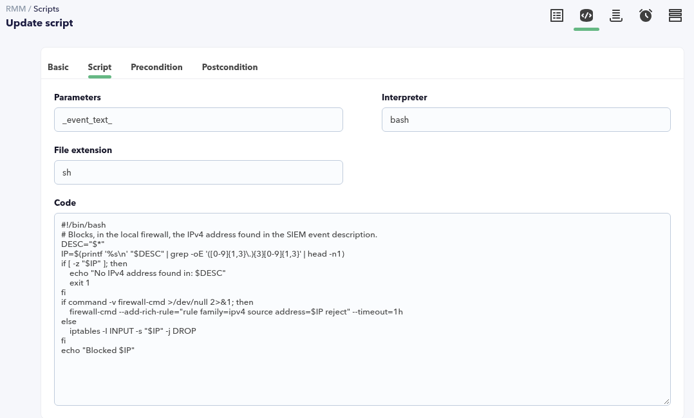{ .captura }

In the **Precondition** tab, enable the precondition with the same parameters
and this code, which refuses to block internal addresses. If the precondition
exits with a code other than 0, the run ends with an error and the *script*
never runs:

```bash
#!/bin/bash
# Never block internal or loopback addresses.
IP=$(printf '%s\n' "$*" | grep -oE '([0-9]{1,3}\.){3}[0-9]{1,3}' | head -n1)
case "$IP" in
    10.*|192.168.*|127.*) echo "Refusing to block internal address $IP"; exit 1 ;;
esac
exit 0
```

!!! warning "The `iptables` rule does not expire"
    `firewall-cmd --timeout=1h` adds a temporary rule that goes away by itself
    after an hour. The `iptables` fallback does not expire: the IP stays blocked
    until someone removes it or the machine restarts. If your servers do not use
    `firewalld`, schedule the cleanup separately or use `ipset` with a timeout.

**3. The actions.** In **Management → Alerts → Actions**, create an action with
the **RMM Script** command. In **Script**, choose the *script* you just created;
under **Fields** its input appears, **Event description**, and it takes
`_event_description_`:

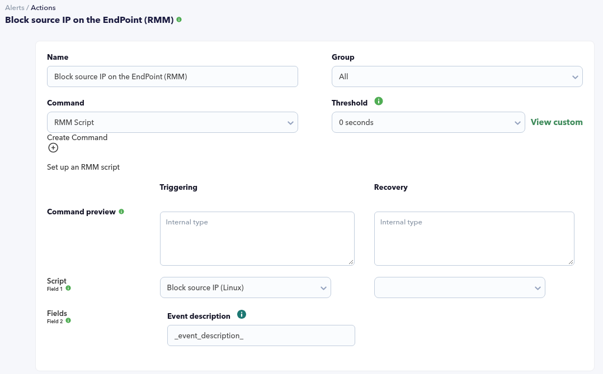{ .captura }

Create another action with the **Pandora Telegram** command: in **Chat ID**, the
SOC chat ID, and in **Message**, something like:

```text
[SIEM] _event_text_severity_ on _agent_: _event_description_. The source IP has been blocked for 1 hour.
```

**4. The SIEM alert.** In **Management → Alerts → SIEM Alerts**, create the
alert. In **Conditions**, a time threshold of 5 minutes and a maximum of 10
firings; in **Filters**, only **ID Rule** with `100100`:

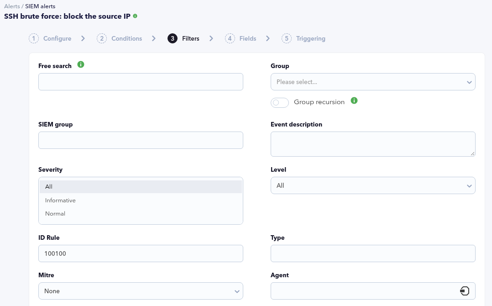{ .captura }

In **Triggering**, add both actions:

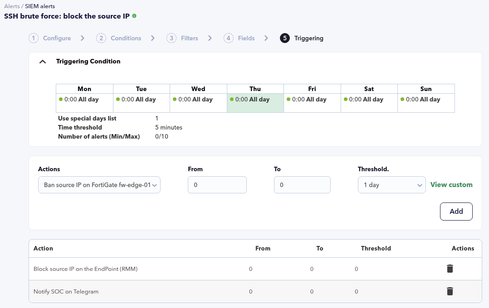{ .captura }

**5. Check the result.** When the alert fires, the task shows up in
**RMM → Queues**, with the agent, the *script*, the status and the *script*
output once the RMM agent sends it back:

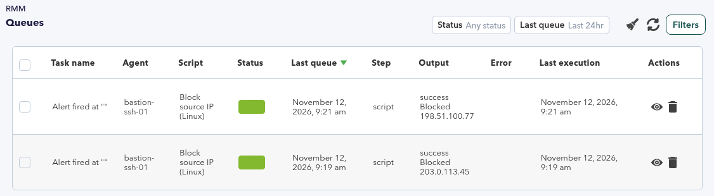{ .captura }

In the queue, the task shows up as `Alert fired at ""`, because SIEM alerts are
not tied to a module. If the task does not appear, look in `pandora_server.log` for
messages starting with `RMM alert action` (see
[Operation and troubleshooting](#operation-and-troubleshooting)).

### Example 2: successful web attack, ticket in Pandora ITSM

**Goal:** when a web attack gets a 200 answer (*rule* 31106, *A web attack
returned code 200 (success)*), open a ticket in Pandora ITSM with the event
context and email the group contact. Nothing is blocked here: an attack that
succeeded needs someone to investigate it, and the ticket is how it gets an
owner.

**1. The Pandora ITSM integration.** In **Management → Settings → System
Settings → ITSM**, enable **Enable Pandora ITSM**, enter the API URL (`…/api/v2`)
and the *token*, and click **Test** before saving with **Update**:

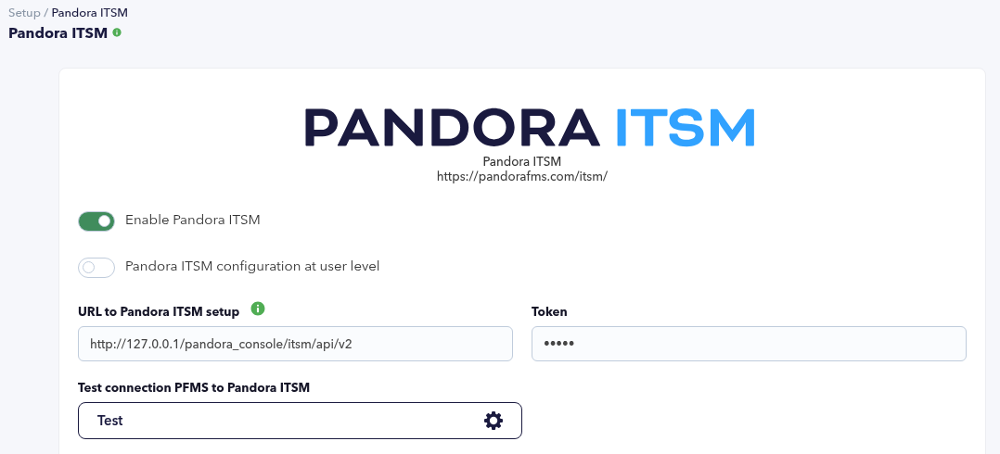{ .captura }

**2. The custom command.** The ticket is created with a custom command that
calls the Pandora ITSM API through `pandora_api_requests`, the program for API
calls that ships with the Pandora FMS server. In **Management → Alerts → Commands**, create the command
with this line:

```bash
/usr/share/pandora_server/util/plugin/pandora_api_requests --url '_field1_' --method 'post' --headers '_field2_' --data '_field3_' --ssl 'false' -md 'requests'
```

And three fields: **ITSM API URL**, **Headers** and **Ticket JSON**:

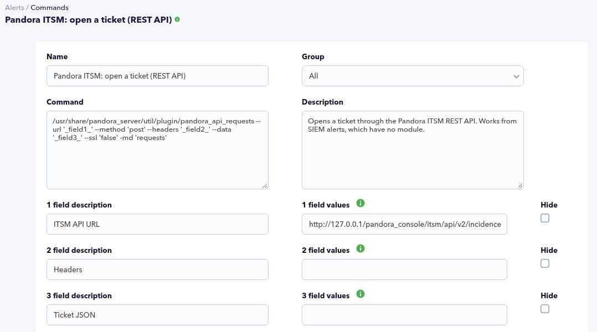{ .captura }

**3. The action.** Create an action with that command. In the first field, the
integration API URL ending in `/incidence`. With the Pandora ITSM built into the
console, for example:

```text
http://127.0.0.1/pandora_console/itsm/api/v2/incidence
```

In the second, the headers, separated by semicolons:

```text
Authorization: Bearer <Pandora ITSM API token>; Content-Type: application/json
```

And in the third, the ticket body in JSON. `idGroup` and `idIncidenceType` are
the IDs of the group and the ticket type in your Pandora ITSM; `priority` accepts
`MAINTENANCE`, `INFORMATIVE`, `LOW`, `MEDIUM`, `SERIOUS` and `VERY_SERIOUS`:

```json
{"title": "[SIEM] _event_text_severity_ on _agent_: _event_description_", "description": "SIEM event level _siem_event_level_ at _eventTimestamp_. Log source: _logSource_. Group contact: _group_contact_.", "idGroup": 4, "priority": "SERIOUS", "status": "NEW", "idIncidenceType": 1}
```

!!! warning "The JSON is not escaped"
    Macros are inserted into the JSON as they are. A double quote inside the
    description breaks it, and Pandora ITSM rejects the ticket. That is why the
    example does not use `_data_` (the original *log*, which can bring anything)
    and sticks to macros with controlled content. And that is also why the
    *token* is visible to anyone who can edit actions: give that *token* only the
    permissions it needs.

Create another action with the **eMail** command: `_group_contact_` as the
recipient and, in the text, the description, the level and the *log* source.
The contact comes from the agent's group settings, so each group notifies its
own people.

**4. The SIEM alert.** Create the alert with **ID Rule** `31106` in **Filters**,
a time threshold of one hour and a maximum of 5 firings in **Conditions**, and
both actions in **Triggering**.

**5. Check the result.** With the integration enabled, the ticket shows up in
**Operation → ITSM → Tickets list**:

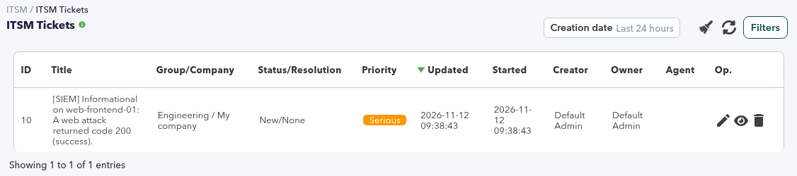{ .captura }

And in its details, the description with the event data:

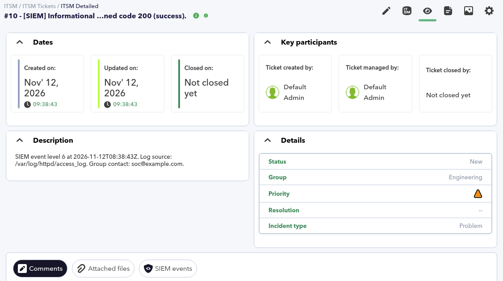{ .captura }

### Example 3: block on the FortiGate perimeter firewall

**Goal:** example 1 protects the attacked server; this one protects all of them.
With the same *rule* `100100`, the source IP is blocked for one hour on the
perimeter FortiGate, so the attacker cannot try their luck with the server next
door.

The FortiGate has a REST API *endpoint* for this:
`POST /api/v2/monitor/user/banned/add_users`, with the list of IPs in
`ip_addresses` and the duration in seconds in `expiry` (`0` means no expiry).
Since the IP has to be taken from the event description, a custom command does it by calling a *script* on the server.

**1. The *script*.** Create your own *script* on the Pandora FMS server (in the
example, `/usr/share/pandora_server/util/fortigate_ban_ip.sh`) that takes three
arguments (the FortiGate address, the block duration in seconds and the event
text) and that:

- takes the first IPv4 address from the text and exits with an error if there
  is none;
- calls `POST /api/v2/monitor/user/banned/add_users` on the FortiGate with
  `ip_addresses` and `expiry`, authenticating with a REST API *token*;
- reads that *token* from a file on the server that only the `pandora` user can
  read (`600` permissions), so it is not written in any action in the console;
- checks the FortiGate certificate instead of turning verification off.

The *token* is generated on the FortiGate when you create a REST API
administrator. Test the *script* by hand from the server, as the `pandora` user,
before wiring it to the alert.

**2. The command and the action.** In **Management → Alerts → Commands**, create
the command with this line and three fields (**FortiGate address**, **Ban time
(seconds)**, defaulting to `3600`, and **Event text**, defaulting to
`_event_description_`):

```bash
/usr/share/pandora_server/util/fortigate_ban_ip.sh '_field1_' '_field2_' '_field3_'
```

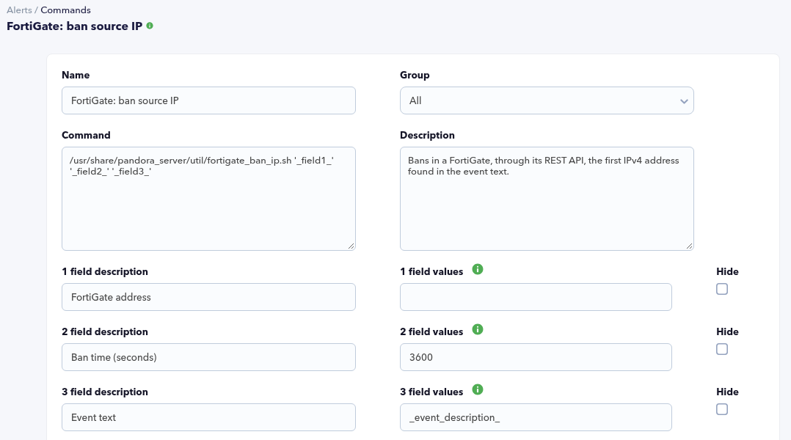{ .captura }

Then create the action with that command: the FortiGate address in the first
field; the other two keep their default values.

**3. The SIEM alert.** Same as in example 1: **ID Rule** `100100`, a 5-minute
threshold, a maximum of 10 firings and the FortiGate action in **Triggering**.
It can be a separate alert or one more action in the example 1 alert.

**4. Check the result.** When the alert fires, the IP shows up in the
FortiGate's list of banned IPs (on the CLI, `diagnose user banned-ip list`) and
goes away by itself when it expires. If it does not show up, run the *script* by
hand with the same arguments and check what it returns.

## Automating without losing control

A badly filtered automatic response is one more attacker, only with
credentials. A few habits prevent almost every scare:

- **Start by notifying.** Build the alert with a notice or a ticket first, leave
  it running for a few days and look at what it would have blocked. Once the
  *rule* is tuned, add the containment action.
- **Exclude what must not be touched**: your internal networks in the *script*
  precondition, and the agents and *rules* that must not trigger a response in
  the alert exclusion filters.
- **Give every block an expiry.** SIEM alerts have no recovery; the way back is
  the expiry of the block itself (`--timeout` in `firewalld`, `expiry` on the
  FortiGate).
- **Tune threshold and maximum to each kind of alert**: short and high for
  containment, long and low for notices.
- **Validate the *script* input**: accept only what is expected (an IPv4
  address) and exit with an error on anything else.
- **Use the RMM tools**: the precondition to rule out what must not be touched
  and the postcondition to check that the change was made. **Notify before
  executing** does not notify anyone: it makes the RMM agent report success
  before running, and it is only useful for *scripts* that can stop the agent
  itself (a restart, for instance).
- **Pause without deleting**: the **standby** state of an alert stops it without
  losing its configuration. See
  [Alert states](../parte-5/5.5-alertas-y-notificaciones.md#alert-states-active-disabled-and-standby).
- **Keep *tokens* out of the actions** when you can, as in example 3: in a file
  on the server, with `600` permissions.

## Operation and troubleshooting

When the response does not arrive, there are three places to look: the SIEM
alerts list (**Operation → SIEM → Alerts**, which tells you whether the alert
has fired), the RMM queue (**RMM → Queues**) and
`/var/log/pandora/pandora_server.log`. The most common failures:

| Symptom | Cause and fix |
|---|---|
| `RMM alert action can't queue script, RMM agent not found` | There is no RMM agent with the same name as the event agent. Check the name of the EndPoint's RMM agent. |
| `RMM alert action can't queue script, RMM script not found` | The action's *script* has been deleted. Choose it again in the action. |
| The ticket is not created and there is no error | The Pandora ITSM integration is not enabled, or the command JSON is broken (a quote in a macro). |
| The alert does not fire | The filters do not match the event, the *rule* does not generate it, experimental features are disabled or the alert already reached its maximum number of firings within the threshold. |
| A macro arrives empty | The data is not in the event, or it is a decoded field without a `$(Field)` placeholder in the *rule* description. |

!!! tip "Test with a log you know has to fire"
    Do not wait for an attack to find out whether the chain works. Generate a
    *log* that fires the *rule* (a few failed SSH attempts against a test server
    are enough for 5712), look at the event in **Operation → SIEM → Events** and
    follow the trail to the RMM queue, the ticket or the block.
