# Vulnerability analysis

A server running a three-year-old `openssl` gives no warning. It boots,
answers, passes its availability checks in green and stays that way until the
day someone uses that package as a way in. The problem is not that nobody knows
that version is vulnerable: it is published, with its identifier and its
severity. The problem is that nobody has matched that list against what is
installed on each machine.

That is what Pandora FMS vulnerability analysis does. The EndPoint already
sends its system's software inventory (the name and version of each package);
the server compares it against a database of known vulnerabilities (the
**CVEs**) and returns, per system and for the whole installation, which packages
are vulnerable, how severe they are and how much risk each system carries. On MS
Windows it also checks Microsoft products and the patches (KBs) they are
missing, and lets you install them with the RMM.

It lives in the **Security** menu, next to [hardening](7.5-hardening.md) and
[file integrity monitoring (FIM)](7.6-fim.md). The [SIEM](7.2-siem.md) watches
what happens; this watches what is there.

!!! info "It does not scan the network or attack the system"
    The analysis runs no penetration tests and probes no ports: it works only
    with the inventory the EndPoint already sends. It generates no traffic
    against the analysed system and needs no new credentials. The flip side is
    that it only sees what the inventory declares: a program the inventory does
    not collect is not analysed.

With it you get:

- **The list of vulnerable packages on each system**, with the CVE that affects
  them, its severity, its score and the detection date.
- **A risk indicator** per system and one for the whole set, from 0 to 10, that
  tells you where to look first.
- **On MS Windows**, the vulnerabilities of Microsoft products according to the
  missing KBs, the list of installed KBs and the option to install the pending
  ones with the RMM.
- **Monitoring modules** with the number of vulnerabilities on each system, to
  alert when it goes up, plus report items and a *dashboard* widget.

## CVE and CVSS

You need two acronyms to read the view.

A **CVE** (*Common Vulnerabilities and Exposures*) is the unique identifier of a
specific vulnerability, in the format `CVE-year-number` (for example,
`CVE-2024-6387`). Each CVE comes with a description, references to vendor
advisories and databases such as NIST's NVD, and its publication date. It is the
common name vendors, researchers and administrators use to talk about the same
thing.

**CVSS** (*Common Vulnerability Scoring System*) is the standard way to measure
how serious it is. It gives a **score** from 0 to 10 and a **vector** that
describes how it is exploited. The console filters and groups by these vector
metrics:

| Metric | Values | What it means |
|---|---|---|
| **Attack Vector** | Network, Adjacent Network, Local, Physical | Where it can be exploited from: any network, the local network, a session on the system or physical access. |
| **Attack Complexity** | Low, High | Whether the attack can be repeated without special conditions (*Low*) or depends on circumstances the attacker does not control (*High*). |
| **Privileges Required** | None, Low, High | Which privileges the attacker needs on the system before starting. |
| **User Interaction** | None, Required | Whether a user has to do something (open a file, click a link). |
| Confidentiality, integrity, availability | None, Low, High | What is lost if the attack succeeds. |

The **severity** comes from the score, using the CVSS scale:

| CVSS score | Severity |
|---|---|
| 0.0 | None |
| 0.1-3.9 | Low |
| 4.0-6.9 | Medium |
| 7.0-8.9 | High |
| 9.0-10.0 | Critical |

If a CVE has no score, the severity is worked out from its impact on
confidentiality, integrity and availability.

## How it works

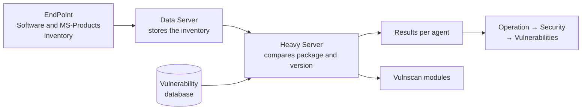

1. The EndPoint sends the software inventory (the **Software** inventory module)
   and, on MS Windows, the Microsoft products and KBs inventory (the
   **MS-Products** module).
2. The **Data Server** stores the inventory and, if the analysis is active for
   that agent, flags it for analysis.
3. The **Heavy Server** picks up the flagged inventories, compares each package
   and its version against the vulnerability database (taking the agent's
   operating system into account) and stores the result.
4. The console shows the results and the server updates the agent's
   **Vulnscan** modules.

What matters to understand what you see:

- **The analysis runs again every time the inventory arrives**, not on its own
  timer. EndPoints send the inventory every 7 days by default, so the results
  refresh once a week. If you update a package, the vulnerability disappears
  from the view with the next inventory.
- **Each analysis replaces the previous one** for that agent: the view shows the
  current state, not a history.
- **On MS Windows there are two analyses.** The **Software** one compares the
  installed programs against the database, which identifies software by its
  package name, like the ones in Linux distributions (`openssl`, `firefox`): a
  Windows program is analysed when its name matches a package in the database.
  The **MS-Products** one matches Microsoft products against Microsoft's
  security bulletins (MSRC) and counts the missing KBs as pending, leaving out
  the ones already installed and the ones a later KB supersedes. On MS Windows,
  therefore, most results come from **MS-Products**: enable both inventories.
- **The risk is the average CVSS score** of the vulnerabilities of the system or
  the filter, capped at 10. Below 5 it is **Low risk**, from 5 to 7.5 **Medium
  risk** and above 7.5 **High risk**. It is an average, not a sum: a system with
  three critical vulnerabilities can come out riskier than one with forty
  low-severity ones.

## Prerequisites

| Requirement | Detail |
|---|---|
| Enterprise version | Vulnerability analysis, its view and its settings are part of the Enterprise version. |
| Data Server and Heavy Server | Enabled in `pandora_server.conf` (`dataserver 1` and `heavyserver 1`; both are enabled by default). |
| EndPoint | Linux or MS Windows, version **774 or later**. To change the analysis setting of a specific agent, it also needs **remote configuration** enabled. |
| Software inventory | Enabled on the EndPoint: the `inventory` plugin with `software` on Linux; `software_installed.vbs` on MS Windows and, for Microsoft products, `ms_products.exe`. They come commented out. |
| Vulnerability database | Installed with the server in `/usr/lib/perl5/PandoraFMS/Vulnerabilities`. |
| Permissions | **AR** on the agent's group to see the view. **AW** to install KBs. |
| To install KBs | A **Pandora RMM** licence and the RMM agent on the system, with the same name as its Pandora FMS agent. See [Remote script and command execution](../parte-3/3.4-ejecucion-remota-de-scripts-y-comandos.md). |

## The vulnerability database

Pandora FMS does not query external services during the analysis: the database
ships with the server. It is built from two sources:

- **CVE-Search**, which gathers data from NIST's NVD, MITRE and Red Hat.
- **The vendors' repositories**: Canonical, Red Hat, Debian, Arch Linux, NVD and
  Microsoft Security Updates.

It is stored in `/usr/lib/perl5/PandoraFMS/Vulnerabilities`, split into files
per package, per CVE and per Microsoft product. The Heavy Server reads them again
on every analysis, so **updating the database does not require restarting the
server**: the next inventory that arrives is already compared with the new data.

The packages are downloaded from
<https://packages.pandorafms.com/09fee0f1c66c203ff8a2feffbb619f18/>:

| Package | Content |
|---|---|
| `package_edge.vdb` | Vulnerabilities from the last 2 years. The lightest one. |
| `package_lite.vdb` | Vulnerabilities from the last 5 years. **It is the one version 805 comes with.** |
| `package_full.vdb` | The full database. |
| `BUILDS/package_build_YYYYMMDD.vdb` | Incremental packages: each one completes the files of the previous one. They are applied in chronological order. |

To update it: `.vdb` files are ZIP files. Unzip them over the database
directory, overwriting what is there, as a user with permissions on it:

```bash
unzip -q -o "package_lite.vdb" -d "/usr/lib/perl5/PandoraFMS/Vulnerabilities"
```

Replace the file name with the package you downloaded (`package_edge.vdb`,
`package_full.vdb`). With incremental packages, one at a time and from the
oldest to the newest:

```bash
unzip -q -o "package_build_YYYYMMDD.vdb" -d "/usr/lib/perl5/PandoraFMS/Vulnerabilities"
```

If you have several Pandora FMS servers, update it on every server that runs the
Heavy Server: each one analyses with its own copy.

To find out how many CVEs the installed database knows, count its CVE files:

```bash
ls /usr/lib/perl5/PandoraFMS/Vulnerabilities/CVE | wc -l
```

## Enabling the analysis

You need three things: the global switch, the agent not having it disabled and
the EndPoint sending the software inventory.

### In the general settings

In **Management → Settings → System Settings → General Setup**, **Features**
tab, the **Enable agent vulnerability scanning** switch enables the analysis for
every agent that uses the global setting. It is enabled by default.

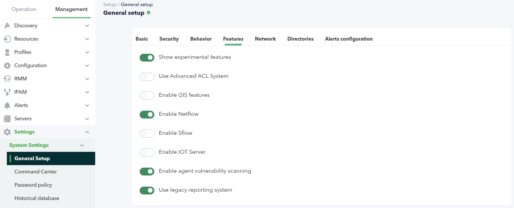

### On each agent

In the agent's edit page, **Security** tab, the **Vulnerability scanning** field
decides what that agent does:

- **Use global settings** (default): follows the global switch.
- **Enabled**: analysed even if the global switch is off.
- **Disabled**: never analysed.

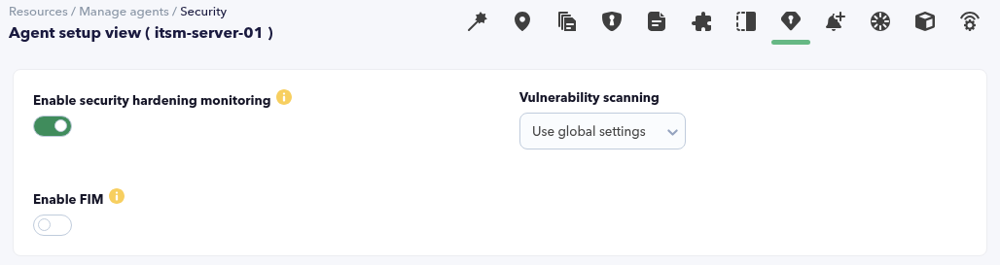

| Agent setting | Global switch on | Global switch off |
|---|---|---|
| **Use global settings** | Analysed | Not analysed |
| **Enabled** | Analysed | Analysed |
| **Disabled** | Not analysed | Not analysed |

This setting is only saved if the agent has **remote configuration** enabled and
an EndPoint **774 or later**. The same tab holds hardening and FIM.

### Software inventory on the EndPoint

The analysis works with the inventory, so without it there are no results. In
the EndPoint configuration file (or from the console, if it has remote
configuration enabled):

On **Linux**, the inventory plugin with at least `software`. The first number is
the interval in days:

```text
module_plugin inventory 7 software
```

The line that comes commented out in the configuration file includes the rest
of the inventory (`cpu ram video nic hd cdrom software init_services filesystem
users route`); either one works as long as it includes `software`.

On **MS Windows**, uncomment these two blocks. The first one sends the installed
software and the second one the Microsoft products and their KBs:

```text
module_begin
module_plugin cscript.exe //B //t:20 "%PROGRAMFILES%\Pandora_Agent\util\software_installed.vbs"
module_absoluteinterval 7d
module_end

module_begin
module_plugin "%PROGRAMFILES%\Pandora_Agent\util\ms_products.exe"
module_absoluteinterval 7d
module_end
```

Restart the EndPoint service. Results show up when the first inventory arrives.
The full inventory is explained in [Inventory](../parte-3/3.1-inventario.md).

## Viewing the results

### The general view

**Operation → Security → Vulnerabilities** gathers the results of every agent
you can see (those in the groups where you have **AR**). It has four tabs:
**Summary**, **Software vulnerabilities**, **Microsoft products
vulnerabilities** and **Windows installed KBs**.

The filter menu is shared by all four and has two tabs:

- **Global**: **Group** (with **Recursion** to include subgroups) and **Agent
  search**, which searches the agent alias.
- **Vulnerabilities**: **Search** (searches the package name, the CVE and the
  version), **Severity**, **Attack Complexity**, **Privileges Required**, **User
  Interaction** and **Attack Vector**.

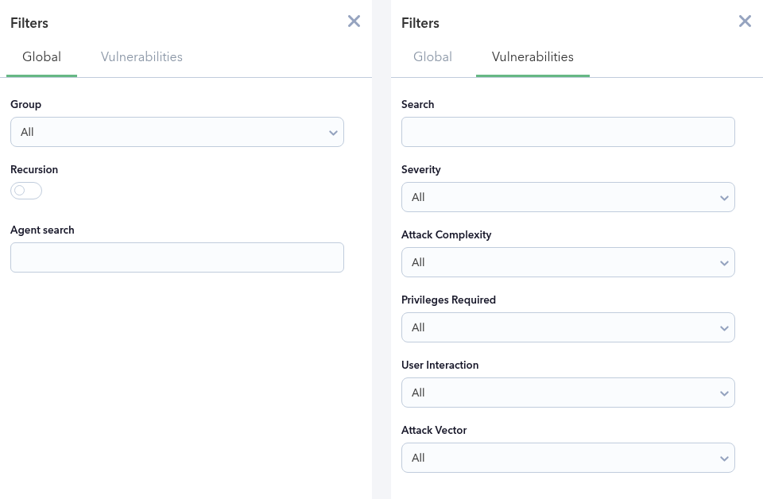

### Summary

The big picture, meant to decide where to start:

- **System risk**: the risk score of the filter, its level (**Low**, **Medium**
  or **High risk**), how many agents and vulnerabilities make it up and the date
  of the last scan.
- **Severity**: how many vulnerabilities have no (*None*), low (*Low*) or high
  (*High*) impact on confidentiality, integrity and availability.
- **Attack Complexity** and **Vulnerabilities by package**: the breakdown by
  attack complexity and by package.
- **Total summary**: how many software vulnerabilities, Microsoft product
  vulnerabilities and installed KBs the filter contains.
- **Privileges Required**, **User Interaction** and **Attack Vector** tables,
  with the number of vulnerabilities for each value.
- **Top vulnerabilities Agents**: the agents with the most vulnerabilities, with
  their number and their risk.
- **Top vulnerabilities Packages**: the packages and CVEs that appear most often
  in the installation.

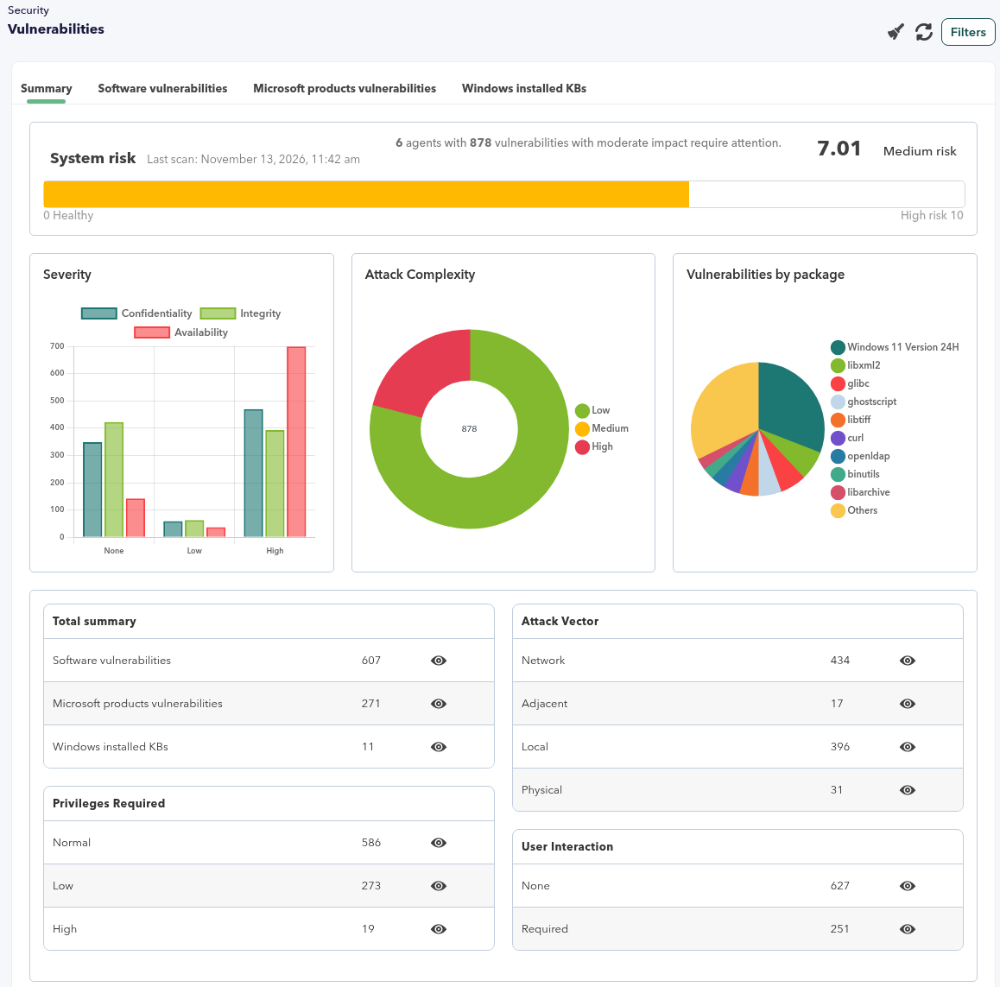

The last two tables answer two different questions. The agents table tells you
which system to deal with first; the packages table, which update fixes the most
things at once.

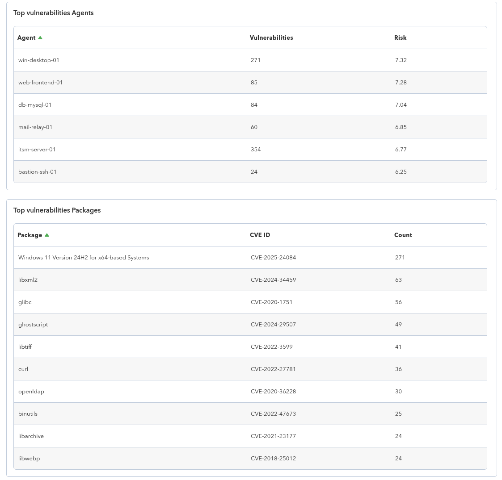

### Software vulnerabilities

One row per vulnerability: **Agent**, **Name** (the package), **Version** (the
installed one), **CVE**, **Severity**, **Score**, **Detection Time** and
**Details**.

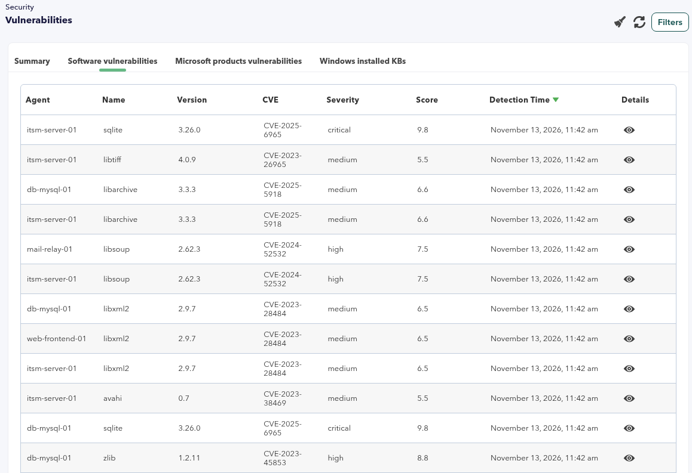

The eye icon in **Details** opens the vulnerability record: package, version,
CVE, CVSS score, severity and the broken-down vector (**Attack Vector**,
**Attack Complexity**, **Privileges Required**, **User interaction**, **Scope**
and the impact on confidentiality, integrity and availability).

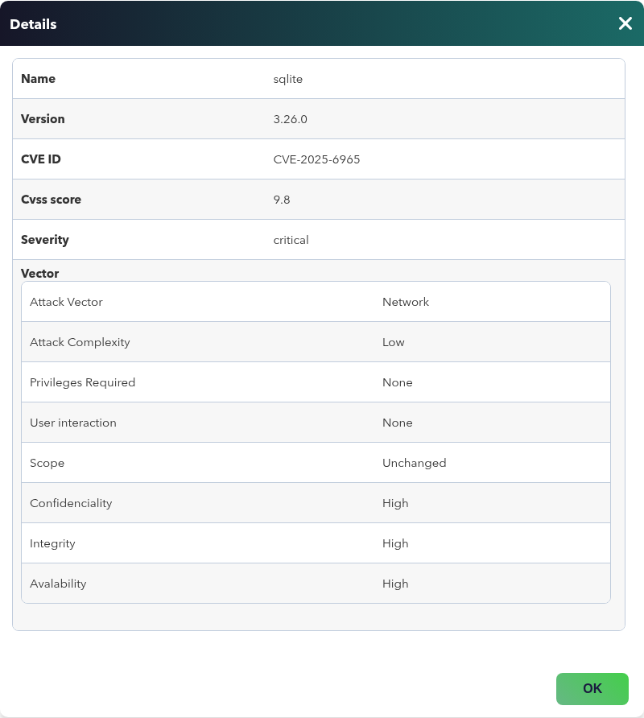

### Microsoft products vulnerabilities and Windows installed KBs

Only MS Windows EndPoints that send the **MS-Products** inventory have data
here.

**Microsoft products vulnerabilities** lists the vulnerabilities per bulletin:
**MSRC Document**, **Product**, **KB** (the patch that fixes it, linked to its
Microsoft page), **Title**, **CVE**, **Severity**, **Score**, **Detection Time**
and **Details**. Only pending KBs appear: installed ones and ones superseded by a
later KB do not count.

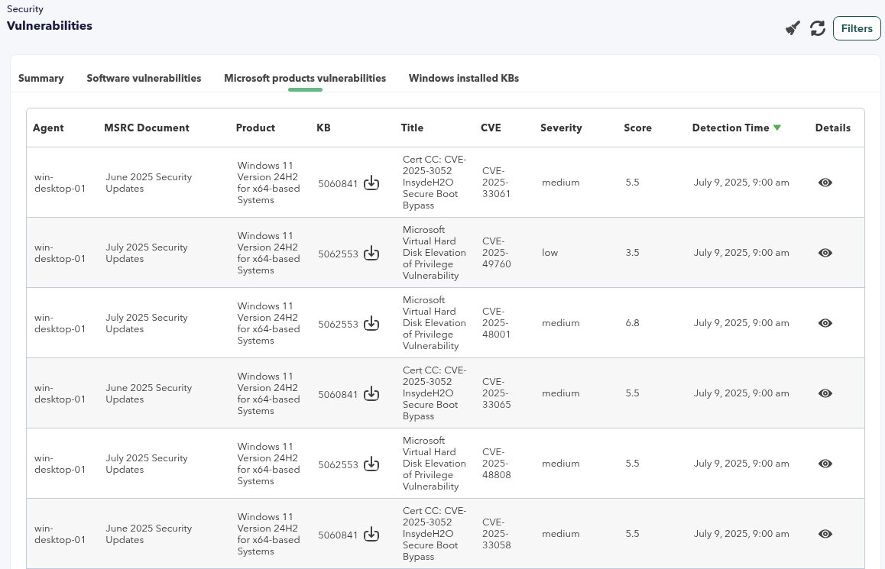

**Windows installed KBs** lists the KBs installed on the system, with their
description and the agents that have them.

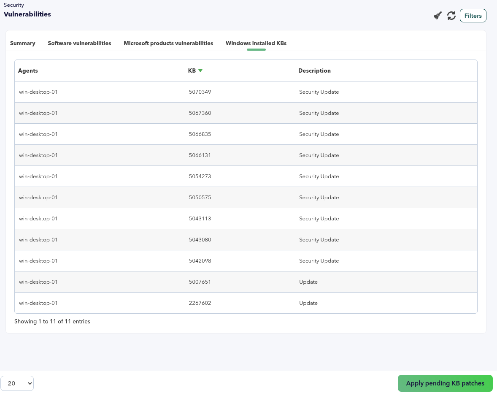

### Agent view

In the agent view, the **Vulnerabilities** tab has the same four tabs filtered
for that system. It appears when the analysis is active for the agent and there
are already results.

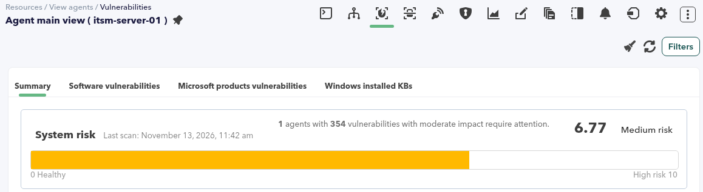

In the agent's main view, the **Security** panel has a **Vulnerability**
indicator in the colour of its risk: green up to 5, yellow up to 7.5 and red
above.

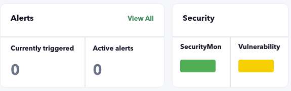

## Applying Microsoft patches

You can install the pending KBs with the RMM without leaving the view:

- **Install KB**: the download icon next to the KB number, on each row of
  **Microsoft products vulnerabilities**, installs that KB on that system.
- **Apply pending KB patches**: the button at the bottom of the **Windows
  installed KBs** tab installs all pending KBs at once. In the general view it covers **every system you can see** (those in your groups with
  **AR**) that has an RMM agent; in an agent's **Vulnerabilities** tab, only
  that system's KBs.

Both run a one-off execution of the RMM rule **Install Windows patch from KB
(online)** on the system's RMM agent, and you follow it in **RMM → Queues**.
They need the **AW** permission, the Pandora RMM licence and an RMM agent with
the same name as the Pandora FMS agent; if the system has no RMM agent,
**Install KB** does not appear. The rule installs the `PSWindowsUpdate`
PowerShell module on the system and downloads the KB from Microsoft Update, so
the system needs internet access.

The installation changes the system's inventory, but the view does not reflect
it until the next **MS-Products** inventory arrives. The RMM, its queues and
its rules are explained in
[Remote script and command execution](../parte-3/3.4-ejecucion-remota-de-scripts-y-comandos.md),
and the patching strategy in [System patching](../parte-3/3.5-parcheado-de-sistemas.md).

!!! warning "Plan the installation"
    Many Microsoft KBs do not complete until the system restarts. To patch a
    specific server, use **Install KB** on its row or its agent's
    **Vulnerabilities** tab, and do it within a maintenance window: running
    **Apply pending KB patches** from the general view, which covers every
    system you see, on production servers in the middle of the morning is the
    fastest way to turn a security report into an availability incident.

## Alerts, reports and dashboards

Each analysis creates or updates three modules on the agent, in the **Security**
module group:

| Module | What it measures |
|---|---|
| **Vulnscan - Number of vulnerabilities** | Software vulnerabilities found. |
| **Vulnscan - Number of MS vulnerabilities** | Microsoft product vulnerabilities (MS Windows with **MS-Products** only). |
| **Vulnscan - Number of pending KBs** | Pending KBs (MS Windows with **MS-Products** only). |

They are regular modules, so they support thresholds and alerts: a threshold on
**Vulnscan - Number of vulnerabilities** warns you when something new shows up
after an inventory. How to configure alerts is in
[Alerts and notifications](../parte-5/5.5-alertas-y-notificaciones.md).

[Reports](../parte-5/5.2-informes.md) have a **Vulnerabilities** group of items:
**Severity graph bar**, **Attack complexity doughnut chart**, **By packages in
pie chart**, **Detailed security report**, **Vulnerabilities of agent**,
**Top-N agents with more risk**, **Top-N common vulnerabilities** and **Top N
agents pending Microsoft patches**. In [dashboards](../parte-5/5.1-dashboards.md),
the **Top N agents pending Microsoft patches** widget.

## Operation and troubleshooting

| Symptom | What to check |
|---|---|
| The agent has no **Vulnerabilities** tab | The analysis is disabled for the agent (**Disabled**, or **Use global settings** with the global switch off) or there are no results yet. |
| No results after enabling the analysis | The software inventory is commented out on the EndPoint, the next inventory has not arrived yet or the Heavy Server is disabled. |
| The agent's **Vulnerability scanning** field does not save the change | The agent needs remote configuration enabled and an EndPoint 774 or later. |
| An MS Windows system has few or no software vulnerabilities | This is expected: the database identifies software by package name and many Windows programs are registered under a different name. Its results come from **MS-Products**. |
| The Microsoft tabs are empty | The MS Windows EndPoint does not send **MS-Products**: the `ms_products.exe` block is missing. |
| The **Install KB** icon does not appear | The system has no RMM agent with the same name as its Pandora FMS agent, or your user does not have **AW**. |
| A fixed vulnerability is still in the view | The view changes with the next inventory; if the inventory runs every 7 days, the fix takes until then to show. |

To check by hand whether a specific version of a package has known
vulnerabilities, without waiting for the next inventory, use `pandora_manage` on
the server. It takes the package name and version as they appear in the
inventory and, optionally, the operating system as the agent reports it, to
apply the same operating system filter as the analysis:

```bash
pandora_manage /etc/pandora/pandora_server.conf --check_vulnerabilities <software> <version> [<operating_system>]
```

It returns a JSON list with one entry per CVE that affects that version, with
the same data the console shows (severity, score, CVSS vector, description and
references). An empty list (`[]`) means the database knows no vulnerabilities
for that version. For example, for `openssl` 3.0.7 (output trimmed to one entry
and its main fields):

```bash
pandora_manage /etc/pandora/pandora_server.conf --check_vulnerabilities openssl 3.0.7
```

```json
[
  {
    "product": "openssl",
    "version": "3.0.7",
    "cve": "CVE-2024-5535",
    "severity": "critical",
    "score": 9.1,
    "vector": "CVSS:3.1/AV:N/AC:L/PR:N/UI:N/S:U/C:H/I:N/A:H",
    …
  },
  …
]
```

To follow an analysis on the server, raise the log level to `verbosity 10` in
`pandora_server.conf`. `pandora_server.log` then shows the start and end of
each analysis and every vulnerability found:

```text
Started Software vulnerabilities scan for agent [agent-name]
Found vulnerability CVE-2024-6387 on agent [agent-name] for product: openssh-server
Finished Software vulnerabilities scan for agent [agent-name]
```

Set the log level back when you are done: with `verbosity 10` the log grows
fast.
