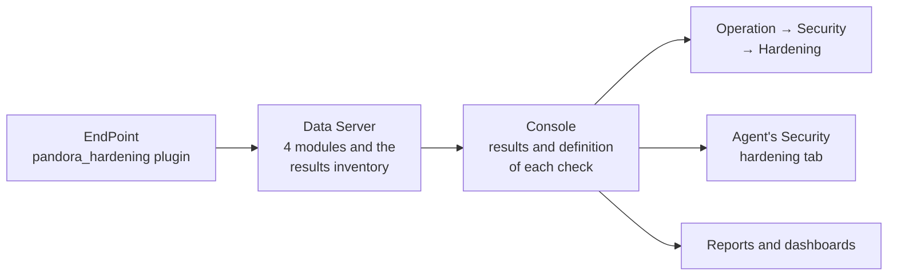
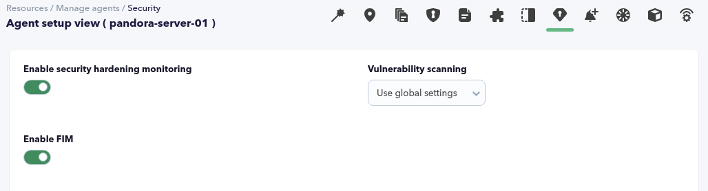
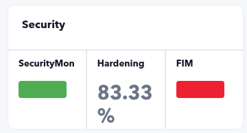
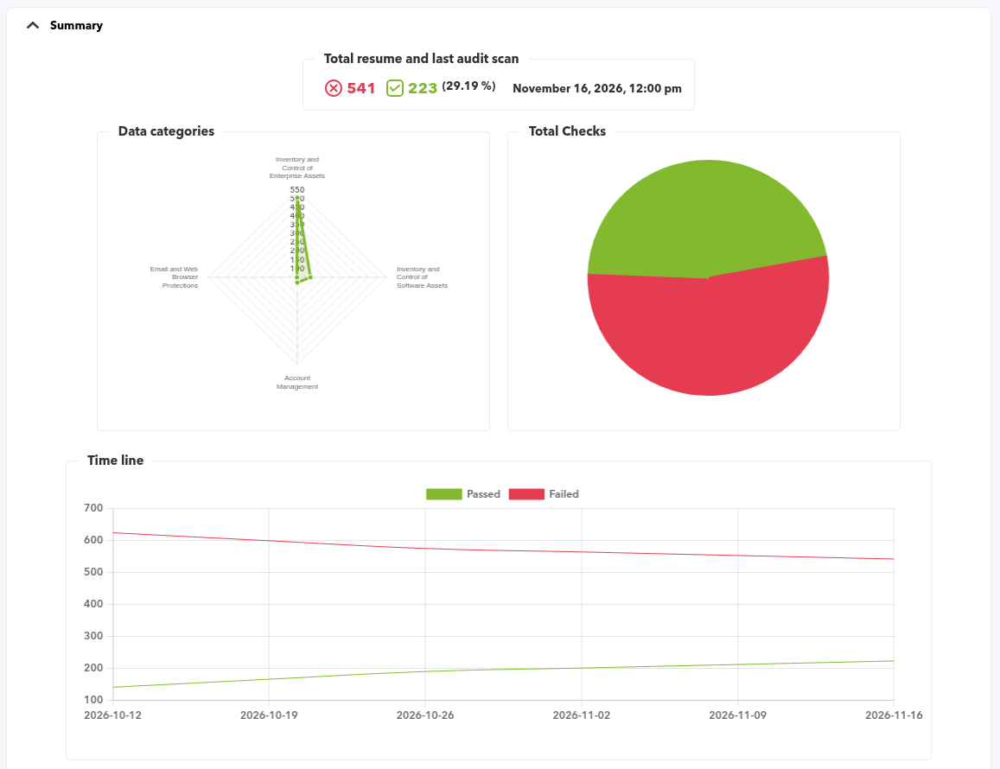
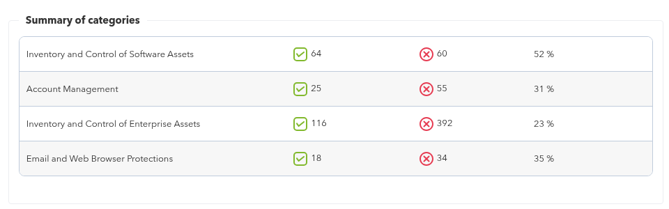
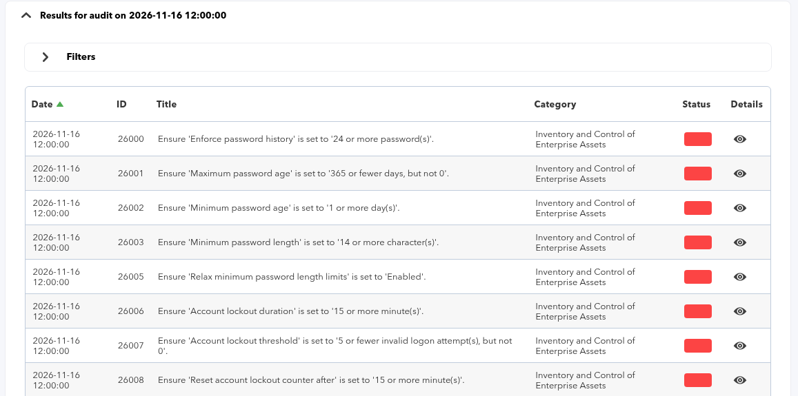
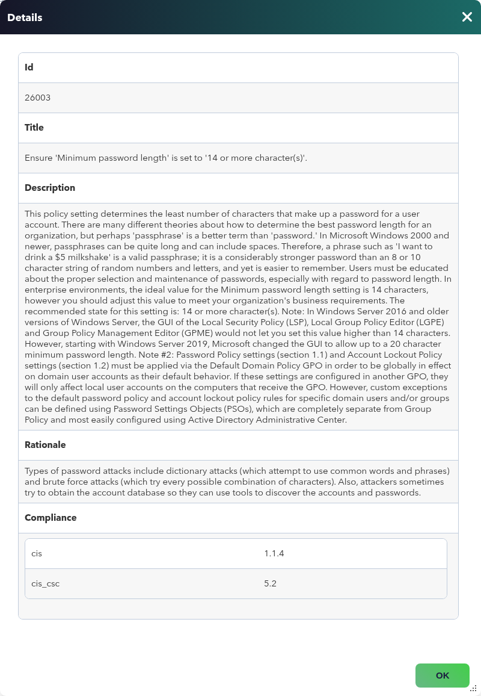
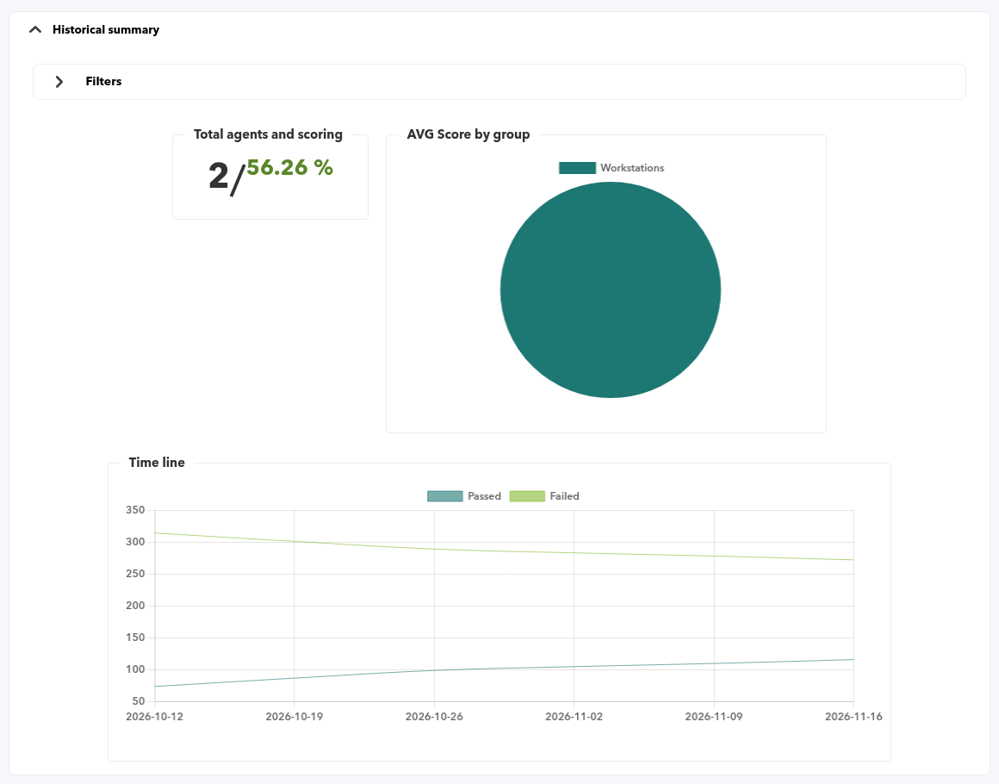
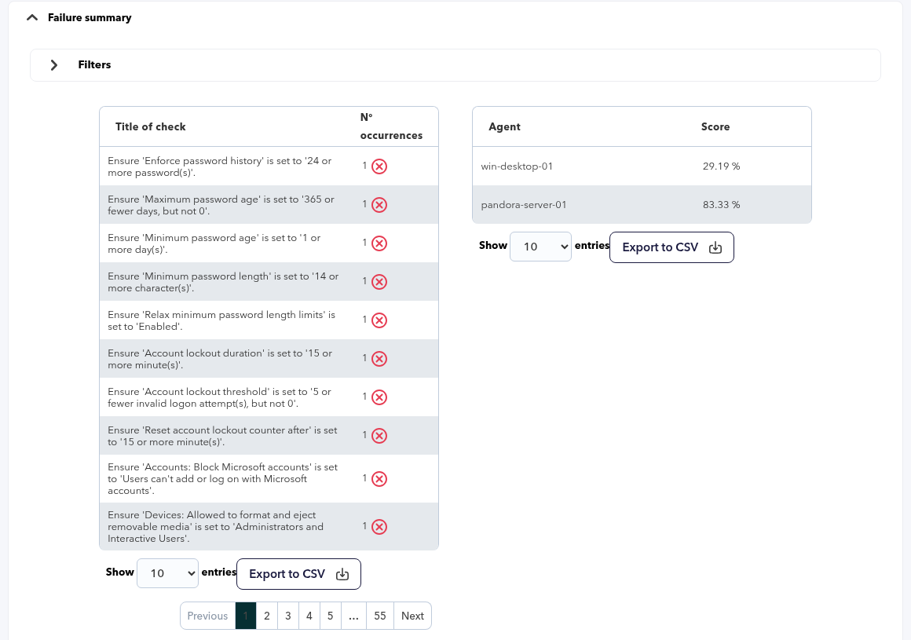
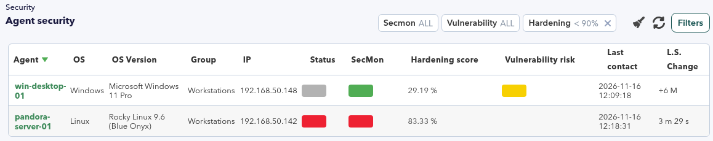

# Hardening

A freshly installed server ships with the guest account, six-character
passwords that never expire and a dozen services nobody asked for. It works,
which is all anyone expects of it on day one. The trouble comes later, when that
default configuration stays as it is for years and someone from outside knows it
better than the person who runs it.

*Hardening* means closing those doors: removing what is not needed, tightening
what remains and checking that it stays that way. That last part is the one
people forget, because a secure configuration decays on its own: an update that
changes a value, a technician in a hurry, a service switched on "just to test".
That is why it is not a one-off job but an audit you repeat.

Pandora FMS runs that audit from the EndPoint. It checks each system against
the recommendations of the **CIS Benchmarks** (the secure configuration guides
of the *Center for Internet Security*), scores it and keeps the history so you
can see whether it gets better or worse. [Vulnerability analysis](7.4-analisis-de-vulnerabilidades.md)
tells you which installed packages have known flaws; hardening tells you how
what you have is configured. They are two different questions and it pays to
ask both.

!!! info "It audits, it does not fix"
    The audit only measures: it changes no system configuration. It tells you
    which checks fail and why they matter; you decide on the fix and apply it.

With it you get:

- **A score per system**, from 0 to 100, with the percentage of checks it
  passes.
- **The result of each check**, with its description, its rationale and its
  references in compliance frameworks (CIS, PCI DSS, NIST, ISO 27001…).
- **The evolution over time**, per system and for the whole installation.
- **Monitoring modules** with the score and the number of checks, to alert when
  it drops, plus report items and a *dashboard* widget.

## How it works



1. The `pandora_hardening` *plugin* runs on the EndPoint and launches the checks
   that apply to its operating system.
2. It sends the result with the EndPoint's data: four modules with the totals
   and the score, and an inventory with the result of each check.
3. The console matches that inventory with the definition of each check (title,
   description, rationale and references) and shows it in the views, reports
   and widgets.

What you need to know to understand what you see:

- **The EndPoint runs the audit**, with its own commands and locally. The
  server does not connect to the system and needs no credentials.
- **It repeats every 7 days** (`module_absoluteinterval 7d`). If you fix
  something, the change shows up in the next audit.
- **Each check ends in one of three states:** **Passed**, **Failed** or
  **Skipped** (not applicable: it belongs to another version of the operating
  system or looks for a component that is not installed).
- **The score is passed / (passed + failed) × 100.** Skipped checks do not
  count: a server without a web server neither passes nor fails the Apache
  checks.
- **Each operating system has its own checks.** An MS Windows desktop can go
  past a thousand results and a minimal Linux distribution can end up with a
  few dozen applicable ones. Compare each system's evolution with itself rather
  than the scores of two different systems.

## Prerequisites

| Requirement | Detail |
|---|---|
| Enterprise version | The hardening audit, its views and its reports are part of the Enterprise version. |
| EndPoint | Linux or MS Windows, version **774 or later**. The `pandora_hardening` *plugin* is installed with the EndPoint (`/usr/share/pandora_agent/plugins/` on Linux, `%PROGRAMFILES%\Pandora_Agent\util\` on MS Windows). |
| Remote configuration | Enabled on the EndPoint to turn the audit on from the console. Without it, you turn it on in the EndPoint configuration file. |
| Permissions | **AR** on the agent's group to see the results. To turn it on from the console, permission to edit the agent. |

## Enabling the audit

### From the console

In the agent's edit page, **Security** tab, turn on **Enable security hardening
monitoring** and click **Update**. The console adds the *plugin* block to the
EndPoint's remote configuration, which picks it up at its next interval and
runs the first audit.



The switch can only be used if the agent has remote configuration enabled and
an EndPoint 774 or later; otherwise it is disabled and a notice tells you which
of the two is missing. The same tab holds the
[vulnerability analysis](7.4-analisis-de-vulnerabilidades.md) setting and
[FIM](7.6-fim.md).

### In the EndPoint configuration file

The EndPoint configuration file ships with the block commented out. Uncomment it
or add it:

On **Linux**:

```text
module_begin
module_plugin /usr/share/pandora_agent/plugins/pandora_hardening -t 150
module_absoluteinterval 7d
module_end
```

On **MS Windows**:

```text
module_begin
module_plugin "%PROGRAMFILES%\Pandora_Agent\util\pandora_hardening.exe" -t 150
module_absoluteinterval 7d
module_end
```

- `-t` is the maximum time, in seconds, for each command the audit runs.
  Without it, it is 60 seconds.
- `module_absoluteinterval 7d` makes the audit run once every 7 days, even if
  the EndPoint sends data every few minutes.

!!! info "How often to audit"
    Seven days is a good balance. You can stretch it to 30, but do not shorten
    it: a daily audit tells you nothing new and fills the database with
    repeated results.

To turn it on for many machines at once, add the block to a
[monitoring policy](../parte-2/2.10-politicas-de-monitorizacion.md) and apply
it to the group. On MS Windows, the EndPoint installer also offers the
**Enable Hardening monitoring** checkbox, which leaves the block enabled from
installation.

### Custom policies

The *plugin* comes with its own built-in set of policies, YAML files with the
definition of each check. To adapt them (disable a check that does not apply in
your organisation or change an expected value):

1. Download the default policies from the
   [Pandora FMS Marketplace](https://marketplace.pandorafms.com/entries/hardening-default-policies)
   and unpack them.
2. Edit the `.yml` files you need.
3. Copy the whole directory, with its subdirectories, to a path the EndPoint
   on each system can read.
4. Add `--policy-dir` and that path to the *plugin* line:

```text
module_plugin /usr/share/pandora_agent/plugins/pandora_hardening -t 150 --policy-dir /path/to/the/policies
```

The *plugin* reads every `.yml` file in that directory. If the path does not
exist or is not a directory, it does not run the audit.

## Check categories

The console groups the checks into categories named after the **CIS
Controls**, the CIS catalogue of security controls:

- **Inventory and Control of Enterprise Assets**
- **Inventory and Control of Software Assets**
- **Data Protection**
- **Secure Configuration of Enterprise Assets and Software**
- **Account Management**
- **Access Control Management**
- **Continuous Vulnerability Management**
- **Audit Log Management**
- **Email and Web Browser Protections**

Each system shows only the categories it has checks in, and the hardening
views, filters and reports use these same categories.

## Viewing the results

### Agent view

In the agent's main view, the **Security** panel sums up its security:
**SecurityMon** (the worst status among the modules in the **Security**
group), **Hardening** (its score) and, if they are enabled, **Vulnerability**
and **FIM**.



The detail is in the **Security hardening** tab of the agent view. Its
**Summary** block brings together:

- **Total resume and last audit scan:** failed and passed checks, the score and
  the date of the last audit.
- **Data categories** and **Total Checks:** the split by category and between
  passed and failed.
- **Time line:** the evolution of passed and failed checks in each audit.



- **Summary of categories:** for each category, the passed and failed checks
  and the percentage passed. This is where you decide where to start.



Below it, **Results for audit on** lists the checks of the last audit: date,
identifier, title, category and status. Its **Filters** narrow it down by
category and status (**Passed**, **Fail** or **Skipped**), and **Export to
CSV** downloads the list. **History data** shows the results of earlier audits
between the dates you choose.



The **Details** eye opens the check's record: its identifier, title,
description, rationale (**Rationale**) and its references in compliance
frameworks (**Compliance**), such as the CIS Benchmark section.



### General view

**Operation → Security → Hardening** brings together every agent that runs the
audit and that you can see. It has three blocks, each with its own
**Filters**:

- **Historical summary:** the number of agents and their average score
  (**Total agents and scoring**), the average per group (**AVG Score by
  group**) and the evolution of passed and failed checks (**Time line**). It is
  filtered by group and dates.



- **Category summary:** for the category you choose in its filters, the split
  of checks (**Vulnerabilities**) and the failed checks of each agent (**Checks
  failed by agent**).
- **Failure summary:** the checks that fail most across the installation, with
  the number of agents they fail on (**Nº occurrences**), each agent's score
  and the split of failed checks by category (**Data category failed**).



The two **Failure summary** tables answer different questions. The checks table
tells you which fix repairs the most systems at once; the agents table, which
system is worst off.

### Agent security

**Operation → Security → Agent security** puts each agent in a row with its
security status: **SecMon**, **Hardening score** and **Vulnerability risk**. It
is filtered by group, by alias and by hardening score (**All**, or below a
percentage, from **< 90%** to **< 10%**), as well as by **Secmon** and
**Vulnerability**.



## Fixing and auditing again

The audit gives you the list of what fails; fixing it is your job. A sensible
cycle:

1. Start with **Summary of categories** on the agent or **Failure summary** in
   the general view, to choose what to tackle first.
2. Open the check's **Details**. The title already states the expected value
   (for example, *Ensure 'Minimum password length' is set to '14 or more
   character(s)'*); the description and the rationale explain why, and the CIS
   Benchmark reference takes you to the full remediation procedure.
3. Apply the change on the system, or on all of them at once with a group
   policy or your configuration management tool.
4. Wait for the next audit: the check moves to **Passed** and the score goes up
   in **Time line**.

If a check makes no sense in your organisation, adapt the policy (see
[Custom policies](#custom-policies)) instead of living with a permanent failure
that nobody ends up reading.

!!! warning "Test before fixing in production"
    The checks apply the general CIS recommendation, not the needs of your
    service. Disabling an old protocol or tightening the password policy can
    lock out an application that depended on it. Test each change on a test
    system and apply it in a maintenance window: the only thing worse than an
    audit in red is a server in green that no longer serves anything.

## Alerts, reports and dashboards

Each audit creates or updates four modules on the agent, in the **Security**
module group:

| Module | What it measures |
|---|---|
| **Hardening - Passed checks** | Passed checks. |
| **Hardening - Failed checks** | Failed checks. |
| **Hardening - Not applied checks** | Checks that do not apply to that system. |
| **Hardening - Score** | Percentage of passed checks, from 0 to 100. |

They are ordinary modules and accept thresholds and alerts. With thresholds on
**Hardening - Score** (for example, **Critical** from 0 to 50 and **Warning**
from 50 to 70) the module changes status when the score drops, and an alert
lets you know someone has undone the work. How to set them up is in
[Alerts and notifications](../parte-5/5.5-alertas-y-notificaciones.md).

[Reports](../parte-5/5.2-informes.md) have the **Security hardening** group of
items:

| Item | What it shows |
|---|---|
| **Top-N agents with the worst score** | The agents with the lowest score, filtered by group. |
| **Top-N most frequent failed checks** | The checks that fail on the most agents. |
| **Top-N checks failed by category** | The categories with the most failed checks. |
| **Vulnerabilities by category** | Passed, failed and, if you want, skipped checks in a category. |
| **List of checks** | The detailed list of an agent's latest checks, by category and status. |
| **Scoring by date** | Each agent's latest score within the report period. |
| **Evolution** | The daily evolution of the average passed and failed checks. |

In [dashboards](../parte-5/5.1-dashboards.md), the **Security Hardening**
widget shows any of those seven types, chosen in its **Data type** option.

## Operation and troubleshooting

| Symptom | What to check |
|---|---|
| The **Enable security hardening monitoring** switch is disabled | The agent does not have remote configuration enabled or its EndPoint is older than 774. The notice next to the switch says which. |
| No data arrives after turning it on | The EndPoint has not picked up the configuration yet (wait for its next interval) or the block is still commented out in its configuration file. |
| Many checks in **Skipped** | That is expected: they are checks for another version of the system or for components that are not installed, and they do not count towards the score. |
| The audit cuts commands short | Raise the `-t` value on the *plugin* line. |
| The score does not change after a fix | The view changes with the next audit, every 7 days. |
| The *plugin* with `--policy-dir` sends no results | The path does not exist or is not a directory the EndPoint can access. |

To see what the *plugin* has done on a Linux EndPoint, run it by hand as
`root` and check its output, which is the same one the server receives:

```bash
/usr/share/pandora_agent/plugins/pandora_hardening -t 150
```
