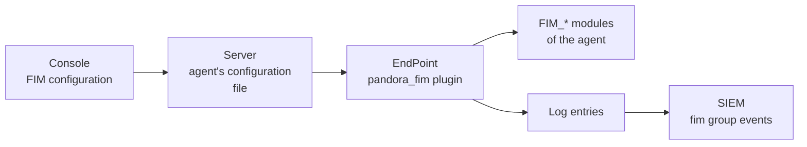
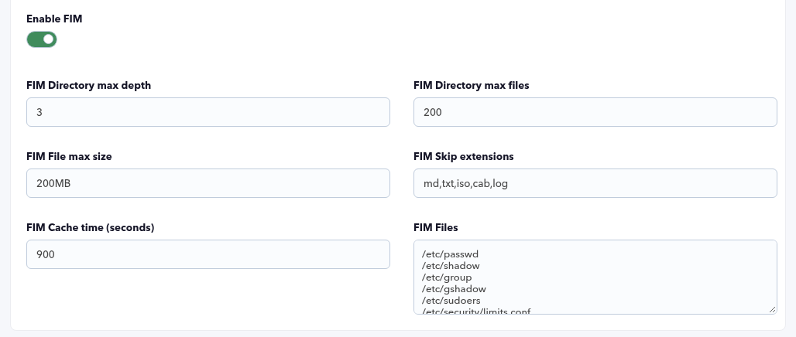
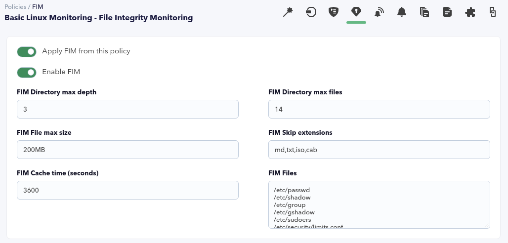
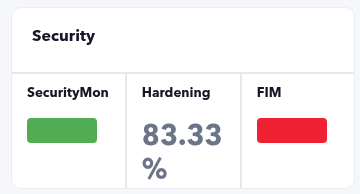
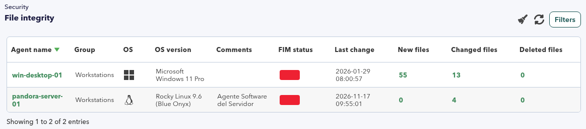
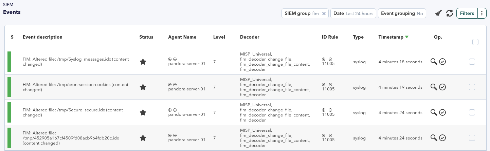

# FIM

Whoever gets into a system without permission rarely leaves a note. They leave
a new line in `/etc/passwd`, one more user in `sudoers`, an entry in `hosts`
that sends the update traffic somewhere else, or an `svchost.exe` that is no
longer the one Microsoft installed. They are small changes in files almost
nobody opens, and that is exactly why they work: the server still boots, the
services answer and the usual monitoring shows everything in green.

**FIM** (*File Integrity Monitoring*) watches those files and tells you when
someone creates, changes or deletes them. It does not tell you whether the
change is good or bad, because only the person who runs the system knows that;
it tells you that it happened, when and in which file.
[Hardening](7.5-hardening.md) checks that the configuration is secure; FIM,
that nobody has touched it since.

Pandora FMS does it from the EndPoint, on Linux and MS Windows. With it you
get:

- **Modules on each agent** with the integrity status and the number of new,
  changed and deleted files, which accept alerts like any other module.
- **An overall view** with the status of every agent that watches files.
- **A [SIEM](7.2-siem.md) event for each affected file**, with the path and
  what changed: size, permissions, owner or content.

## How it works



1. You configure FIM in the console, on the agent or in a policy. The console
   stores that configuration on the server, in a file of its own for each
   agent.
2. At each interval, the EndPoint checks whether its FIM configuration has
   changed and, if so, downloads it.
3. If FIM is enabled, the EndPoint runs the `pandora_fim` *plugin*, which goes
   through the files and directories on the list and compares them with what it
   saw last time.
4. The *plugin* sends the FIM modules and one log entry for each new, changed
   or deleted file. The SIEM turns those entries into events.

What you need to know to understand what you see:

- **For each file it compares** its existence, its size, its permissions and
  owner, and its content (with a *hash*).
- **The check repeats at each EndPoint interval.** Anything changed and undone
  between two checks is not seen.
- **A file is considered deleted** when it has gone unseen for longer than
  **FIM Cache time (seconds)**.
- **Remote configuration is not needed.** The EndPoint downloads the FIM
  configuration separately, even without remote configuration enabled.

## Prerequisites

| Requirement | Detail |
|---|---|
| Enterprise version | FIM, its configuration and its view are part of the Enterprise version. |
| EndPoint | Linux or MS Windows, version **784 or later**. The `pandora_fim` *plugin* is installed with the EndPoint. |
| Permissions | **AR** on the agent's group to see the results. To configure it, permission to edit the agent or the policy. |
| SIEM | To see the detail of each changed file. See [SIEM](7.2-siem.md). |

## Enabling FIM on an agent

In **Management → Resources → Manage agents**, edit the agent and open the
**Security** tab. Turn on **Enable FIM**, adjust the fields and click
**Update**.



| Field | Default | What it does |
|---|---|---|
| **FIM Directory max depth** | `3` | Levels of subdirectories it goes through inside each directory on the list. |
| **FIM Directory max files** | `14` | Maximum number of files it watches in each directory. |
| **FIM File max size** | `200MB` | Maximum size of the files it watches inside directories. Given as a value and a unit. |
| **FIM Skip extensions** | `md,txt,iso,cab` | Extensions it ignores inside directories, separated by commas. |
| **FIM Cache time (seconds)** | `3600` | Seconds a file can go unseen before it is considered deleted. |
| **FIM Files** | Depends on the operating system | Files and directories it watches, one per line (see the next section). |

The first four limits only affect directories. They exist so that a directory
that is too generic (`C:\Windows\System32`, for example) does not eat up the
system's resources: better to watch a few well-chosen files than to go through
half the drive at every interval.

The switch can only be used with an EndPoint 784 or later and if the agent
does not get FIM from a policy; otherwise it is disabled and a notice tells you
why. The configuration reaches the EndPoint at its next interval.

### Files and directories to watch

**FIM Files** takes one path per line. It can be a file or a directory, and it
accepts three more things:

- **Wildcards** (`*`, `?` and `[…]`) for paths that change from one system to
  another. For example, every MS Windows user's startup folder:

    ```text
    C:\Users\*\AppData\Roaming\Microsoft\Windows\Start Menu\Programs\Startup\
    ```

- **Exclusions**: a line that starts with `exclude` removes a path or a pattern
  from what the other lines watch:

    ```text
    /opt/myapp
    exclude /opt/myapp/*.tmp
    ```

- **Comments**: lines that start with `#` are ignored. They are useful for
  leaving a path ready and enabling it when needed:

    ```text
    #exclude /opt/myapp/*.tmp
    ```

When you enable FIM, the console suggests a list based on the agent's
operating system. On **Linux**:

```text
/etc/passwd
/etc/shadow
/etc/group
/etc/gshadow
/etc/sudoers
/etc/security/limits.conf
/etc/hosts
/etc/hostname
/etc/resolv.conf
/etc/ssh/sshd_config
/etc/fstab
/etc/crontab
```

On **MS Windows**, the system registry hives, the binaries that are usually
impersonated and the `hosts` file:

```text
C:\Windows\System32\config\SAM
C:\Windows\System32\config\SYSTEM
C:\Windows\System32\config\SECURITY
C:\Windows\System32\config\SOFTWARE
C:\Windows\System32\config\DEFAULT
C:\Windows\System32\winlogon.exe
C:\Windows\System32\lsass.exe
C:\Windows\System32\services.exe
C:\Windows\System32\smss.exe
C:\Windows\System32\svchost.exe
C:\Windows\System32\csrss.exe
C:\Windows\System32\winload.exe
C:\Windows\System32\ntoskrnl.exe
C:\Windows\System32\drivers\etc\hosts
C:\Windows\explorer.exe
C:\Windows\System32\cmd.exe
C:\Windows\system32\WindowsPowerShell\v1.0\powershell.exe
C:\Windows\System32\wscript.exe
C:\Windows\System32\cscript.exe
C:\Windows\System32\taskmgr.exe
C:\Windows\SysWOW64\kernel32.dll
C:\Windows\SysWOW64\user32.dll
C:\Windows\SysWOW64\advapi32.dll
C:\Windows\SysWOW64\gdi32.dll
C:\Windows\SysWOW64\ntdll.dll
C:\Windows\SysWOW64\ole32.dll
C:\Windows\SysWOW64\shell32.dll
C:\Windows\SysWOW64\ws2_32.dll
C:\Windows\SysWOW64\cmd.exe
C:\Windows\SysWOW64\WindowsPowerShell\v1.0\powershell.exe
C:\Windows\SysWOW64\wscript.exe
C:\Windows\SysWOW64\regsvr32.exe
C:\Windows\SysWOW64\mshta.exe
```

Add the configuration files of your services (the web server, the database,
your own applications) and remove whatever does not apply.

!!! tip "Leave out directories that change on their own"
    A directory of temporary files, logs or caches changes at every interval,
    and FIM will warn you about every change. Exclude it with `exclude` or with
    **FIM Skip extensions**: if the warning always fires, you will ignore it on
    the day it matters too.

## Enabling FIM with policies

To configure FIM on many agents at once, use a
[monitoring policy](../parte-2/2.10-politicas-de-monitorizacion.md). In
**Management → Resources → Manage policies**, edit the policy and open the
**File Integrity Monitoring** tab. It has the same fields as the agent and two
switches:



| Apply FIM from this policy | Enable FIM | What happens on the policy's agents |
|---|---|---|
| Off | Either | The policy does not touch FIM: each agent keeps its own. |
| On | On | The policy configures FIM with its values and enables the FIM modules. |
| On | Off | The policy disables FIM and its modules. |

The third combination is for switching FIM off on a whole group of agents at
once. The changes reach the agents when the policy is applied.

While an agent gets FIM from a policy, its **Security** tab shows the fields
locked and the notice **This agent has a FIM policy**, with a link to the
policy. Changes are made in the policy.

!!! warning "Policies for MS Windows"
    The policy tab always suggests the Linux file list. In a policy for MS
    Windows agents, replace it with the MS Windows list from the previous
    section.

## Viewing the results

### Agent modules

Each agent with FIM enabled has five modules:

| Module | What it measures |
|---|---|
| `FIM_status` | Integrity status of the watched files. It goes critical when FIM detects changes. |
| `FIM_status_last_change` | Date and time of the last status change of `FIM_status`. |
| `FIM_new` | New files detected in the last check. |
| `FIM_changed` | Files changed in the last check. |
| `FIM_deleted` | Deleted files detected in the last check. |

When you disable FIM, the console disables these modules; when you enable it
again, it enables them again.

In the agent's main view, the **Security** panel shows **FIM** with the
integrity status. One click takes you to that agent's SIEM events.



### File integrity view

**Operation → Security → File integrity** brings together every agent with FIM
enabled: its group, its operating system, the status (**FIM status**), the
date of the last change (**Last change**) and the new, changed and deleted
files. Its **Filters** narrow it down by agent and by status: **Fired** (with
changes) or **Not fired** (without them).



Each agent's name takes you to its FIM configuration, and the counters, to its
SIEM events.

### SIEM events

The detail of each change is in the SIEM. The rules of the `fim` group ship
by default and generate a level 7 event for each file:

| Event | When |
|---|---|
| `FIM: New file: <path>` | A new file appears. |
| `FIM: Altered file: <path> new size <bytes>` | The size changes. |
| `FIM: Altered file: <path> new access <owner>(<permissions>)` | The permissions or the owner change. |
| `FIM: Altered file: <path> (content changed)` | The content changes. |
| `FIM: Deleted file: <path>` | A file disappears. |

To see them all, in **Operation → SIEM → Events** filter by **SIEM group**
`fim`.



## Alerts

FIM modules accept alerts like any other. The most direct one is an alert on
`FIM_status` when it goes critical: it warns you as soon as FIM detects a
change on the agent. How to set them up is in
[Alerts and notifications](../parte-5/5.5-alertas-y-notificaciones.md).

If you want warnings per file (for example, only when `sudoers` changes), use
[SIEM](7.2-siem.md) alerts on the events of the `fim` group.

## Operation and troubleshooting

| Symptom | What to check |
|---|---|
| **Enable FIM** is disabled | The EndPoint is older than 784 or the agent gets FIM from a policy. The notice next to the switch says which. |
| The FIM modules do not appear after enabling it | The EndPoint has not downloaded the configuration yet: wait for its next interval. On Linux, its log records `FIM configuration updated` when it receives it. |
| There are changes at every interval without anyone touching anything | The list includes directories that change on their own (temporary files, logs, caches). Exclude them with `exclude` or with **FIM Skip extensions**. |
| The EndPoint uses too many resources | Lower **FIM Directory max depth**, **FIM Directory max files** or **FIM File max size**, or replace generic directories with specific files. |
| The counters change, but there are no events in the SIEM | The SIEM is not receiving that agent's logs. See [SIEM](7.2-siem.md). |
| Changes on the agent are not saved | The agent gets FIM from a policy: change it in the policy. |
