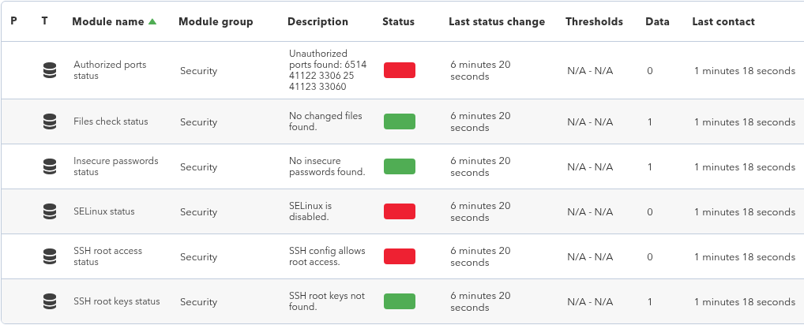
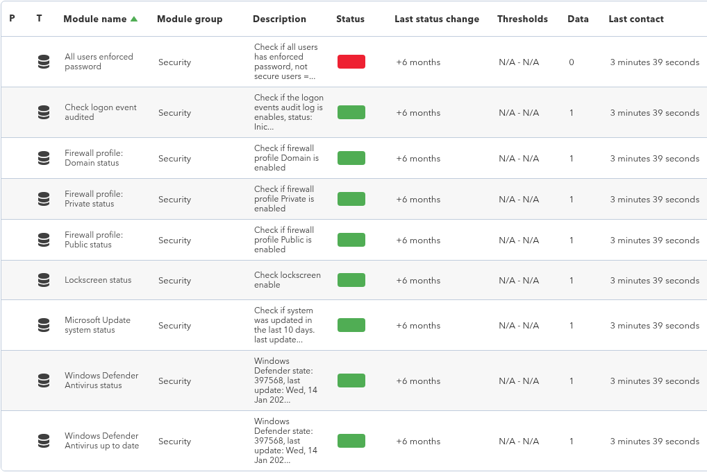
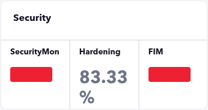

# Security monitoring

Serious incidents rarely start with a brilliant attack. They start with an
`admin` user whose password is `admin`, with a test server that lets root in
over SSH, or with a port someone opened for a demo two years ago and nobody
ever closed. They are small oversights, on machines nobody watches because
"they are only for testing", and that is why they work: the attacker is not
looking for the armoured door, but for the window that was left open.

Pandora FMS works on security on three fronts:

- **It monitors the security infrastructure** like any other: backups,
  antivirus, VPN, firewalls, IDS/IPS, SIEM, honeypots, authentication systems,
  storage or log collection. In the end they are services, processes, ports
  and logs, and they are watched with the same tools as everything else.
- **It protects itself**, with two-factor authentication (2FA), encrypted
  passwords in the database and its own audit log
  ([Secure configuration](7.11-configuracion-segura.md)),
  [external authentication](../parte-4/4.2-autenticacion-externa-y-centralizacion-de-accesos.md)
  and data sent encrypted with SSL/TLS in
  [Tentacle](../parte-9/9.4-referencia-completa-de-tentacle.md).
- **It ships its own security features**:

| Feature | What it does |
|---|---|
| [SIEM](7.2-siem.md) | Collects and correlates security logs and events. |
| [SOAR](7.3-soar.md) | Automates the response when the SIEM detects something. |
| [Vulnerability analysis](7.4-analisis-de-vulnerabilidades.md) | Looks for known vulnerabilities in the software of Linux, MS Windows and remote systems. |
| [Hardening](7.5-hardening.md) | Assesses over time how secure the configuration of Linux and MS Windows systems is. |
| [FIM](7.6-fim.md) | Warns you when someone creates, changes or deletes critical files on Linux or MS Windows. |
| **Security plugins** | Check the basics at every EndPoint interval, on Linux and MS Windows. They are the subject of this chapter. |

The company behind Pandora FMS holds the ISO 27001 certification and is a
MITRE CNA (*CVE Numbering Authority*), so it registers the CVEs of its own
vulnerabilities. Its [security policy](https://pandorafms.com/en/security/) is
public and open to independent auditors.

The security plugins are two lightweight programs, one for Linux and one for
MS Windows, that the EndPoint runs at every interval (five minutes by
default). Each check becomes a module that is normal when everything is in
order and critical when it finds something. They do not replace hardening or
FIM, but they keep a constant eye on what should never fail.

## Prerequisites

| Requirement | Detail |
|---|---|
| EndPoint for Linux | Version **774 or later**, which installs the `pandora_security_check` plugin. It needs Perl on the system and the EndPoint running as root (it does by default) to read `/etc/shadow`. |
| EndPoint for MS Windows | Version **775 or later**, which installs `pandora_security_win.exe`. The `--metrics` and `--verbose` options arrive with **805**. |
| EndPoint configuration | Access to its `pandora_agent.conf`, on the system itself or from the Web console with [remote configuration](../parte-2/2.1-monitorizacion-con-endpoints.md#remote-configuration-from-the-web-console). |

## Security plugin for Linux

The EndPoint for Linux comes with the plugin installed but disabled. To
enable it, edit `/etc/pandora/pandora_agent.conf`, find this line and remove
the `#` at the start:

```text
module_plugin perl /usr/share/pandora_agent/plugins/pandora_security_check --conf /usr/share/pandora_agent/plugins/pandora_security_check.conf
```

The plugin and its configuration file live in
`/usr/share/pandora_agent/plugins/`, the same folder `/etc/pandora/plugins`
points to. Restart the EndPoint and the modules show up in the console after
the first run.

If the agent has remote configuration enabled, make the change from the Web
console: the EndPoint replaces its local file with the server's copy. To
enable it on many systems at once, add the same line as an
[EndPoint plugin in a policy](../parte-2/2.10-politicas-de-monitorizacion.md#2108-endpoint-plugins-in-a-policy).

### Checks and modules

Each check creates a *generic_proc* module in the **Security** group: it is
`1` (normal) when everything is in order and `0` (critical) when it finds
something. The module description tells you what it found.

| Module | What it checks | It goes critical when… |
|---|---|---|
| `SELinux status` | The SELinux status, with `sestatus`. | SELinux is disabled or its status cannot be determined (`sestatus` does not exist). |
| `SSH root access status` | The `PermitRootLogin` directive in `/etc/ssh/sshd_config`. | It has any value other than `no` (including `prohibit-password`) or the file cannot be read. |
| `SSH root keys status` | RSA SSH keys in `/root/.ssh` and its subfolders, not counting `authorized_keys` or `known_hosts`. | It finds any. The description lists the files. |
| `Authorized ports status` | The TCP ports in listening state, on IPv4 and IPv6, except those that only listen on `127.0.0.1` or `::1`. | Any of them is not on the list of allowed ports. The description says which. |
| `Files check status` | The MD5 fingerprint of each file on the list, compared with the one from the previous run. | A file has changed since the previous run. The description says which. |
| `Insecure passwords status` | The passwords in `/etc/shadow`, against the dictionary and against each user's name. | A user has a password from the dictionary or the same as their name. The description says who. |

Three of them deserve an explanation:

- **Root keys.** It does not look for who can log in as root on this system
  (that is in `authorized_keys`), but for the keys root can use to log in to
  **other** machines without a password. Whoever takes over this system gets
  them for free.
- **Files.** The plugin keeps the fingerprints from one run to the next; the
  first run only takes the baseline. The critical status lasts **one run**:
  in the next one, the new fingerprint becomes the baseline and the module
  goes back to normal. That is why this module calls for an
  [alert](#alerts). If you need to know what changed in each file, use
  [FIM](7.6-fim.md).
- **Passwords.** The dictionary contains 100 of the most used passwords in
  the world. Add the ones going around your organisation: the company name
  followed by the year is more popular than you would think. Accounts without
  a usable password (`*`, `!!`, `!locked` or `!*` in `/etc/shadow`) are not
  checked.

!!! tip "No SELinux, no module"
    On distributions that do not use SELinux (Debian and Ubuntu, for example,
    use AppArmor), `SELinux status` will always be critical. Disable that
    check with `--check_selinux 0`.

### Customising the lists

The allowed ports, the watched files and the dictionary passwords come from
two places that add up: the plugin's internal lists and its configuration
file, `pandora_security_check.conf`. The file has three blocks, `[PORTS]`,
`[FILES]` and `[PASSWORDS]`, with one entry per line. This is how it ships:

```text
[PORTS]
22
80
443
41121
8080

[FILES]
/etc/httpd/httpd.conf
/etc/my.cnf
/etc/sudoers
/etc/passwd
/etc/hosts

[PASSWORDS]
pandora
PANDORA
P4nd0r4
password
root
linux
admin
```

| List | Internal lists | The shipped file adds |
|---|---|---|
| Allowed ports | `22`, `80` | `443`, `41121` (Tentacle), `8080` |
| Watched files | `/etc/shadow`, `/etc/passwd`, `/etc/hosts`, `/etc/resolv.conf`, `/etc/ssh/sshd_config`, `/etc/rsyslog.conf` | `/etc/httpd/httpd.conf`, `/etc/my.cnf`, `/etc/sudoers` |
| Passwords | 100 common passwords | `pandora`, `PANDORA`, `P4nd0r4`, `root`, `linux`, `admin` |

Add the ports of the services the system must offer, the configuration files
of your applications and the passwords that should be banished. Files that do
not exist are simply skipped. If you want only your file to count, without
the internal lists, add `--include_defaults 0` to the plugin line.

### Plugin options

| Option | What it does |
|---|---|
| `--conf <file>` | Configuration file with the `[PORTS]`, `[FILES]` and `[PASSWORDS]` blocks. |
| `--check_selinux {0,1}` | Enables (`1`) or disables (`0`) the SELinux check. |
| `--check_ssh_root_access {0,1}` | Enables or disables the check of root access over SSH. |
| `--check_ssh_root_keys {0,1}` | Enables or disables the search for root's SSH keys. |
| `--check_ports {0,1}` | Enables or disables the port check. |
| `--check_files {0,1}` | Enables or disables the file check. |
| `--check_passwords {0,1}` | Enables or disables the password check. |
| `--include_defaults {0,1}` | With `0`, it discards the internal lists and uses only those in the configuration file. |
| `--integrity_file <file>` | File where the fingerprints of the watched files are kept. By default, one in `/tmp`. |

All checks are enabled by default. For example, on Ubuntu, without SELinux and
with the fingerprints outside `/tmp`:

```text
module_plugin perl /usr/share/pandora_agent/plugins/pandora_security_check --conf /usr/share/pandora_agent/plugins/pandora_security_check.conf --check_selinux 0 --integrity_file /var/lib/pandora_security_check.integrity
```

## Security plugin for MS Windows

The EndPoint for MS Windows comes with `pandora_security_win.exe` in the
`util` folder of its installation, also disabled. To enable it, edit its
`pandora_agent.conf`, find the **Pandora basic security check plugin for
windows** block and remove the `#` from the three lines of the module:

```text
# Pandora basic security check plugin for windows.
module_begin
module_plugin "%PROGRAMFILES%\Pandora_Agent\util\pandora_security_win.exe" --conf "%PROGRAMFILES%\Pandora_Agent\util\pandora_security_win.conf" 2> nul
module_end
```

Restart the EndPoint service (`PandoraFMSAgent`) and the modules show up after
the first run. What was said for Linux about remote configuration and
policies applies here too.

### Checks and modules

All modules are *generic_proc* in the **Security** group, as on Linux.

| Module | What it checks | It goes critical when… |
|---|---|---|
| `<antivirus> Antivirus status` | Each antivirus registered in Windows Security Center, from Microsoft or third parties. For example, `Windows Defender Antivirus status`. | The antivirus is not active. |
| `<antivirus> Antivirus up to date` | The signatures of that same antivirus. | The signatures are not up to date. |
| `Lockscreen status` | That no policy disables the lock screen (registry values `DisableLockScreen` and `NoLockScreen`). | Either of them disables it. |
| `Microsoft Update system status` | The date of the last update installed with Windows Update. | 10 days or more have passed. |
| `Firewall profile: Domain status`, `Firewall profile: Private status` and `Firewall profile: Public status` | Each of the three Windows Firewall profiles. | That profile is disabled. |
| `All users enforced password` | That every user account requires a password. | One does not. The description says how many. |
| `Check logon event audited` | That logon auditing records both successes and failures, with `auditpol`. | It does not record both (successes alone are not enough). |

MS Windows Server has no Windows Security Center: the antivirus modules are
not created, and that is expected.

### Systems in other languages

`auditpol` answers in the system language, so the plugin needs to know what
the logon subcategory is called and which texts mean "success and failure"
and "no auditing". That is in `pandora_security_win.conf`, in the same `util`
folder. It ships in English, with the Spanish texts commented out next to
them:

```text
auditpol_logon_category = Logon
#auditpol_logon_category = Inicio de sesión

auditpol_logon_success_conf = Success and Failure
#auditpol_logon_success_conf = Aciertos y errores

auditpol_logon_noaudit_conf = No Auditing
#auditpol_logon_noaudit_conf = Sin auditoría
```

On MS Windows in Spanish, comment out the three English lines and remove the
`#` from the three Spanish ones. In any other language, write the texts
exactly as `auditpol /get /category:*` shows them on that system.

### Plugin options

| Option | What it does |
|---|---|
| `--conf <file>` | Configuration file with the `auditpol` texts. |
| `-m`, `--metrics` | Checks to run: `all` (default), `Antivirus`, `Lockscreen`, `Windows_update`, `Firewall`, `Password` and `Logon`. It accepts several, separated by spaces. Since 805. |
| `-v`, `--verbose` | Writes errors to standard error. Useful to run the plugin by hand and see what fails. Since 805. |

For example, to keep only the firewall, the passwords and auditing:

```text
module_plugin "%PROGRAMFILES%\Pandora_Agent\util\pandora_security_win.exe" --conf "%PROGRAMFILES%\Pandora_Agent\util\pandora_security_win.conf" --metrics Firewall Password Logon 2> nul
```

## Viewing the results

The modules show up in the agent view, in the **Security** group, next to
those of hardening, vulnerability analysis and FIM if they are enabled. To see
only that group, open **Filters** on the module list and choose **Security**
in **Module group**. The **Description** column tells you what each check
found: which ports, which files, which users.





In the same view, the **Security** panel sums up the group in
**SecurityMon**: critical if any module in the **Security** group is
critical, warning if any is in warning and normal if they are all fine. Since
the group also includes the hardening, vulnerability and FIM modules,
**SecurityMon** is the security traffic light of the whole agent.



## Alerts

As they are *generic_proc* modules, any alert template for critical modules
works for them. How to set them up is in
[Alerts and notifications](../parte-5/5.5-alertas-y-notificaciones.md).

Give `Files check status` one no matter what. Its critical status lasts one
run: in the next one it goes back to normal, and although the event remains,
if nobody looks at it, the change goes by unnoticed. The other modules stay
critical as long as the problem is there.

## Operation and troubleshooting

| Symptom | What to check |
|---|---|
| The modules do not appear | The plugin line is still commented out or the EndPoint has not been restarted. With remote configuration enabled, the change has to be made from the Web console. |
| The modules do not appear on Linux, with the line enabled | That Perl is installed: the plugin is a Perl script. |
| `SELinux status` always critical | The distribution does not use SELinux: add `--check_selinux 0`. |
| `Authorized ports status` critical because of a legitimate service | Add its port to the `[PORTS]` block of `pandora_security_check.conf`. |
| `Insecure passwords status` critical with "Can not read /etc/shadow" | The EndPoint is not running as root. |
| `Files check status` normal even though a file changed | The critical status lasts one run. Check the module events or give it an alert. |
| The antivirus modules are missing on MS Windows | They are not created on MS Windows Server: there is no Windows Security Center. |
| `Check logon event audited` does not appear or is always critical | The system is in another language: adjust `pandora_security_win.conf`. If it stays the same, check with `auditpol` that successes and failures are audited. |
| `Microsoft Update system status` critical | The system has gone 10 days or more without installing Windows Update updates. |
