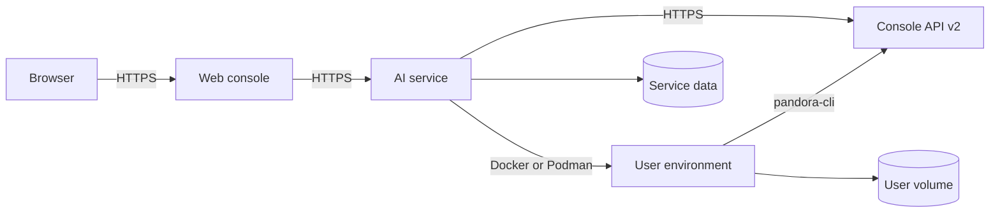
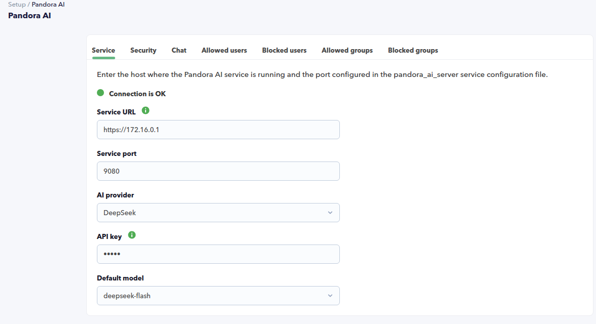
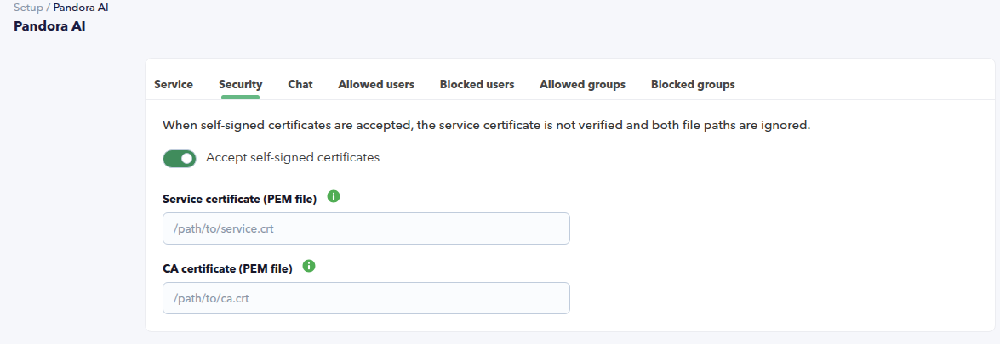
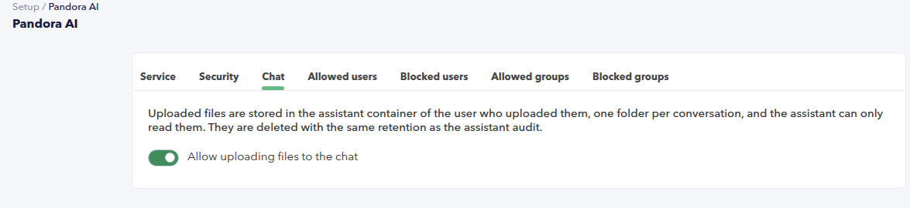
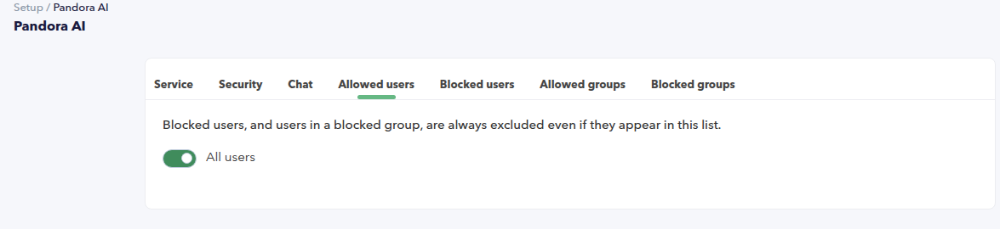
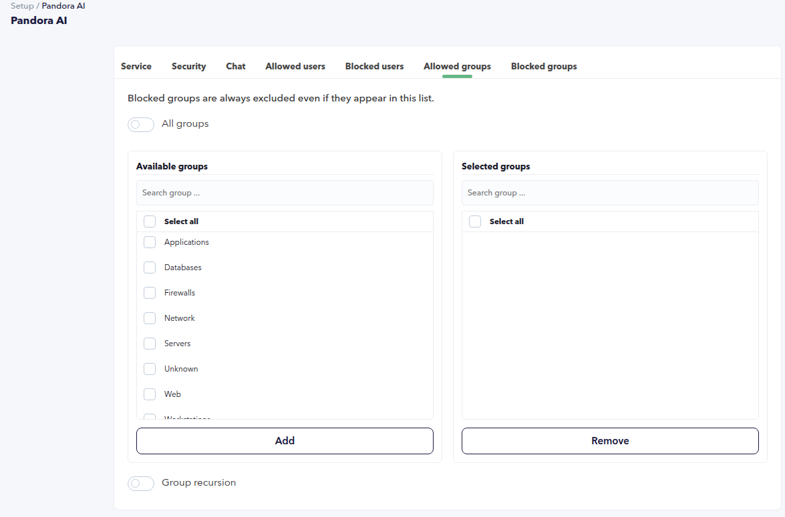

# Introduction and installation

Pandora AI is an artificial intelligence assistant built into the web console.
Each user talks to it to check the state of the platform (agents, modules,
events, alerts, servers, inventory and audit) and to run actions with the same
permissions they have in the console. It is not an isolated generic chat: it
knows the product because it works against the console API through
`pandora-cli`, and every user does so in a separate environment.

The assistant is not enabled by default. The service is installed with the
Pandora FMS server, but it does not start on its own and the feature is off in
the console until an administrator turns it on and configures it. This page
covers installation, configuration and first start; daily use is explained in
[Using the chat](8.2-uso-del-chat.md), scheduled tasks in
[Task automation](8.3-automatizacion-de-tareas.md), and permissions and the
security model in [Security](8.4-seguridad.md).

## Architecture

The assistant relies on four pieces. The console never talks to the AI provider:
it talks to its own service, and that service prepares an isolated environment
for each user.

| Piece | Where it lives | What it does |
|---|---|---|
| Web console | Pandora FMS server | Chat interface, permissions and configuration |
| AI service | Pandora FMS server or another machine | Single exit to the provider and to user environments |
| User environment | Docker or Podman engine of the service | Runs the assistant and `pandora-cli` |
| User volume | Data folder of the service | Stores sessions and attachments |

Each user environment is **ephemeral**: it is created when the assistant is used
and removed after inactivity or when the service stops. What persists is its
volume, so the conversation and the files are still there the next time.



The assistant has fixed rules: it can only write to Pandora FMS through
`pandora-cli`, it cannot access the database or the system files, and it can only
read the files the user uploads to their session. Details are in
[Security](8.4-seguridad.md).

## Prerequisites

| Requirement | Detail |
|---|---|
| Version | Pandora FMS Enterprise 8.0NG.806 or later |
| Container engine | Docker or Podman on the service machine, reachable by the service |
| Assistant image | `pandorafms/pandorafms-pi-runner:latest` available in the engine; downloaded automatically if the registry is reachable |
| Console API | Reachable over HTTPS from the service |
| API access list | The service IP must be in **IP list with API access** |
| AI provider | Contracted provider, its key and a model |
| Disk | Room for each user's data and for the audit |
| Resources | CPU and memory for one environment per active user and up to four concurrent scheduled tasks |
| Network | Port 9080 between console and service; outbound access to the AI provider |
| Permissions | A console administrator to enable and configure it |

There is no “Pandora AI” licence to activate: the feature is governed by the
**Enable Pandora AI** switch in the general settings.

!!! warning "The provider key is stored in the database"
    If the console database has no `encryption_passphrase` configured, the
    provider key is stored unencrypted and the configuration page warns about it.
    Configure encryption before saving the key; the procedure is in
    [Database encryption](../parte-9/9.5-cifrado-de-la-base-de-datos.md).

## Installation

The service can be installed in two ways: with the Pandora FMS server or from a
standalone package, which is useful to place it on another machine. In both
cases the binary, the *skills* and the configuration file are the same.

### With the Pandora FMS server

The server installer copies the service and creates its systemd unit:

| Item | Path |
|---|---|
| Service binary | `/usr/bin/pandora_ai_server` |
| CLI used by the assistant | `/usr/bin/pandora-cli` |
| Configuration | `/opt/pandorafms/pandora_ai/pandora_ai_server.conf` |
| Assistant *skills* | `/opt/pandorafms/pandora_ai/skills` |
| Data | `/opt/pandorafms/pandora_ai` |
| Unit | `/etc/systemd/system/pandora_ai_server.service` |

If the configuration file already exists, the installer does not overwrite it: it
leaves the new one as `pandora_ai_server.conf.new` so the two can be merged by
hand.

!!! warning "The service is installed, but it does not start"
    The installer says so when it finishes: `pandora_ai_server` does **not**
    start by itself. Until it is started, the console connection test fails and
    the assistant does not answer.

```sh
systemctl daemon-reload
systemctl start pandora_ai_server
systemctl status pandora_ai_server
```

### On a separate machine

The `pandorafms_ai_server.tar.gz` package contains the binary, `pandora-cli`,
the *skills*, the configuration file and an installer:

```sh
tar xzf pandorafms_ai_server.tar.gz
cd pandora_ai_server
./pandora_ai_server_installer --install
```

The installer uses the same paths, accepts `--destdir` to install under a
different directory and leaves any existing configuration untouched (it writes a
`.new` file). The machine needs the container engine, HTTPS connectivity to the
console API and outbound access to the AI provider. To uninstall it:

```sh
./pandora_ai_server_installer --uninstall
```

Uninstalling removes the binary and the unit, but **keeps** the configuration,
the *skills* and the data.

### Checking that the service answers

`GET /health` requires no authentication and tells a stopped service apart from
a misconfigured console:

```sh
curl -k https://127.0.0.1:9080/health
# {"status":"ok"}
```

If it answers, the service is alive. If it does not, the problem is not in the
console configuration: check `journalctl -u pandora_ai_server`.

## Service configuration

The service is configured **only through its file**: the console stores the
connection, the provider and the permissions, but paths, container engine,
limits and retention live in `pandora_ai_server.conf`.

| Block | Keys | Default | When to change it |
|---|---|---|---|
| Server | `listen_host`, `listen_port` | `127.0.0.1`, `9080` | Console on another machine: listen on the network IP and open the port only to the console |
| TLS | `tls_auto_generate`, `tls_cert`, `tls_key` | `1`, empty, empty | Custom certificate: `tls_auto_generate = 0` and both paths |
| Console API | `pandora_api_url`, `pandora_api_accept_self_signed`, `pandora_api_cert`, `pandora_api_ca` | `https://127.0.0.1/pandora_console/api/v2/`, `1` | Another URL, or verify the console certificate |
| Container | `container_image`, `container_bin`, `container_user`, `cli_bin`, `skills_path`, `container_cpus`, `container_memory_mb` | `pandorafms/pandorafms-pi-runner:latest`, `docker`, `1001:1001`, `/usr/bin/pandora-cli`, `/opt/pandorafms/pandora_ai/skills`, `1`, `2048` | Podman, different paths or more resources |
| Agent | `agent_prompt` | empty | Extra customer instructions: they complement behaviour, never replace it |
| Storage | `storage_path` | `/opt/pandorafms/pandora_ai` | Another disk or path |
| Scheduled tasks | `scheduled_max_containers` | `4` | More concurrency, with more resources |
| Diagnostics | `debug`, `debug_path` | `0`, `/opt/pandorafms/pandora_ai/debug/` | Investigating a failure; traces may contain the conversation |
| Timeouts | `request_timeout` | `60` | Slow models |
| Cleanup | `cleanup_interval_seconds`, `container_expiration_seconds`, `session_expiration_seconds`, `audit_expiration_seconds`, `uploaded_files_expiration_seconds` | `3600`, `604800`, `604800`, `2592000`, `2592000` | Different retention; see [Audit](8.5-auditoria.md) |
| Shutdown | `stop_containers_on_shutdown` | `1` | Keep environments when stopping; volumes are kept anyway |

Two warnings that save an afternoon of troubleshooting:

- With `tls_auto_generate = 1` the certificate is generated **on every start**.
  If the console does not accept self-signed certificates, use a custom
  certificate; pinning the self-signed one stops working after a service
  restart.
- The data folder (`storage_path`) must be writable by the service so each user
  can store their sessions and attachments.

When the console and the service are on different machines, both directions must
be reachable: console → service and service → console API. Open only the service
port and restrict the source to the console.

## Console configuration

Configuration lives in **Management → Settings → System Settings → Pandora AI**,
and only an administrator can see it.

Before entering, enable **Enable Pandora AI** in **General Setup**. Without that
switch neither the section nor the user menu appears, and the chat icon warns
that the feature is disabled.

### Service

The **Service** tab connects the console to the service and selects the
provider.

{ .captura }

| Field | Default | What it does |
|---|---|---|
| **Service URL** | `https://127.0.0.1` | Service address; only HTTPS is accepted |
| **Service port** | `9080` | Service port |
| **AI provider** | — | Provider; the list comes from the service itself |
| **API key** | (empty) | Global provider key; empty keeps the current one |
| **Default model** | (empty) | Default model; the list comes from the service |

**Test connection** tests the values in the form, not the saved ones, so it can
be checked before pressing **Update**. The status is also checked when the page
loads. If it fails, the message reminds you to start the service.

The provider and model list comes from the service. If you add a new provider, it
appears without updating the console.

### Security

The **Security** tab decides whether the console accepts the service
certificate.

{ .captura }

| Field | Default | What it does |
|---|---|---|
| **Accept self-signed certificates** | Enabled | Accepts the service certificate without verifying it; the two paths below are ignored |
| **Service certificate (PEM file)** | (empty) | Service certificate, when verification is enabled |
| **CA certificate (PEM file)** | (empty) | CA that signed the service certificate |

While self-signed certificates are accepted, the paths are not used. It is
convenient for a test and reasonable if the service keeps its default
certificate; for production, a custom certificate and the CA are the stable
option.

### Chat

The **Chat** tab has a single setting: **Allow uploading files to the chat**, enabled by default.

{ .captura }

Files uploaded by a user are stored in their space and the assistant can only
read them. They are deleted with the same retention as the audit.

### Users and groups

The remaining four tabs decide who can use the assistant. **Allowed users** and
**Blocked users** work with users; **Allowed groups** and **Blocked groups** work
with groups and, if enabled, their subgroups.

{ .captura }

{ .captura }

The rule that settles most doubts: **blocking always wins**. A blocked user, or a
user in a blocked group, cannot use Pandora AI even if they are in the allowed
list or **All users** is on. The full precedence and the effect of each list are
in [Security](8.4-seguridad.md).

## Assistant skills

*Skills* are the instructions that teach the assistant to perform a task in a
specific way. The product installs three by default:

| *Skill* | Purpose |
|---|---|
| `default-pandora-create-agent` | Create or register an agent |
| `default-pandora-create-module` | Create a module on an agent |
| `default-pandora-create-report` | Create a report |

You can add your own *skills* in the service `skills_path` folder. Customer
*skills* are preserved on upgrade; `default-*` skills are replaced on every
upgrade. A custom *skill* only needs a name that does not start with `default-`:
the installer replaces only those.

## First start

Order matters: each step checks the previous one.

1. Install the server, or the standalone service package.
2. Check the container engine with `docker info` or `podman info`, and that the
   assistant image is available.
3. Adjust `pandora_ai_server.conf`: listen address, API URL, paths and resources.
4. Start the service and check `/health` and the log.
5. Put the console on HTTPS and add the service IP to **IP list with API
   access**.
6. Enable **Enable Pandora AI**.
7. Fill in **Service** and press **Test connection** until the status is green.
8. Settle the certificates in **Security**.
9. Decide who can use it in the user and group tabs.
10. If you want attachments, enable them in **Chat**; if you want scheduled
    tasks, create them as explained in [Task automation](8.3-automatizacion-de-tareas.md).
11. Open the assistant icon, send a simple request and check that the
    conversation appears in [Audit](8.5-auditoria.md).

## Operation and maintenance

- **User environments**: removed after inactivity (one week by default) and when
  the service stops if `stop_containers_on_shutdown = 1`. Volume data is
  untouched.
- **Cleanup**: one pass per hour applies the retention for environments,
  sessions, audit and attachments.
- **Diagnostics**: with `debug = 1`, each turn writes a log with the tools used,
  timings and errors, plus a review by the model itself when the turn used tools,
  was slow or failed. It may contain the conversation: treat it as sensitive
  information.
- **Upgrade**: the installer replaces the binary, the unit and the `default-*`
  *skills*. Customer *skills* are preserved. If the configuration changed, a
  `.new` file appears and must be merged by hand.
- **Backup**: the service data folder (sessions, attachments and audit) and the
  configuration file. Environments are not backed up: they are recreated.
- **Resources**: each active user may have one environment with its limits, and
  scheduled tasks add environments up to `scheduled_max_containers`. Watch disk
  and memory.
- **Command Center**: each console talks to its own service. There is no
  centralised view of the audit across nodes; in a Command Center, each node is
  configured and audited separately.

## Troubleshooting

| Symptom | Likely cause | What to check |
|---|---|---|
| **Test connection** in red | Service stopped | `systemctl status pandora_ai_server` and `journalctl` |
| | Wrong URL or port | `listen_host` and `listen_port` against the form values |
| | Certificate not accepted | **Security**: accept self-signed or install certificate and CA |
| | Firewall | Port 9080 between console and service |
| Console returns 401 or 403 | Service IP outside the list | **IP list with API access** |
| | User without permission | User and group lists; blocking wins |
| User environment does not start | Docker or Podman unreachable | `docker info` or `podman info` |
| | Image unavailable | `docker images` and registry access |
| | Data folder permissions | The service must be able to write to `storage_path` |
| | Resource limits | `container_cpus` and `container_memory_mb` |
| Assistant says it cannot | `pandora-cli` unavailable | `cli_bin` in the service configuration |
| Answers are slow or fail | Model or provider | Key, default model and `request_timeout` |
| No notifications | Console cron stopped or source not configured | Cron and user notification preferences |
| Audit is empty | Retention or permissions | Retention and profile |
| Disk fills up | Sessions, attachments or audit | Retention and `storage_path` size |

The order of discard is always the same: `/health` rules out the service,
**Test connection** rules out the console, the service log rules out the user
environment and the audit rules out the user.
