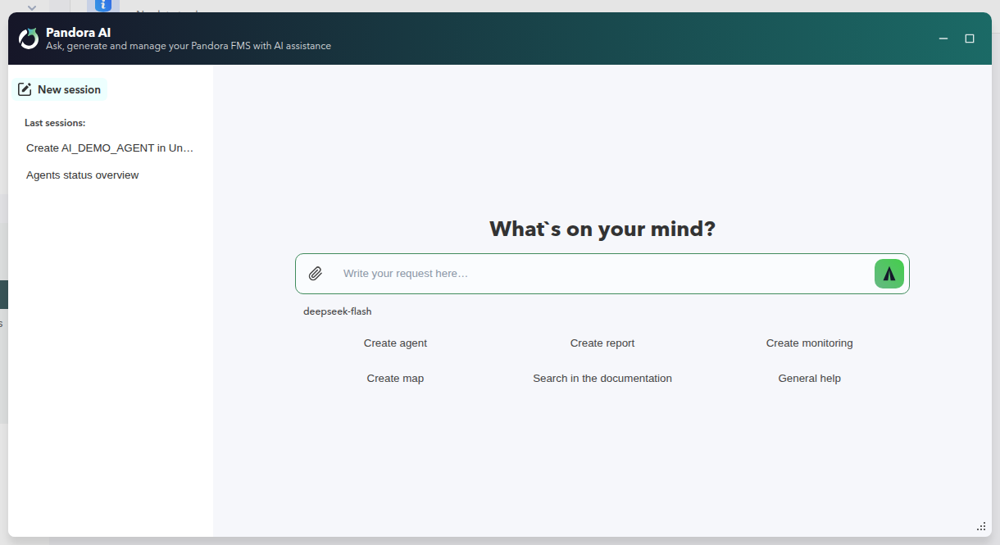
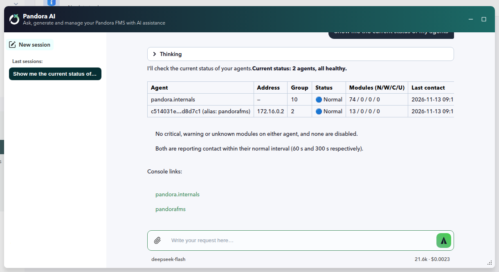
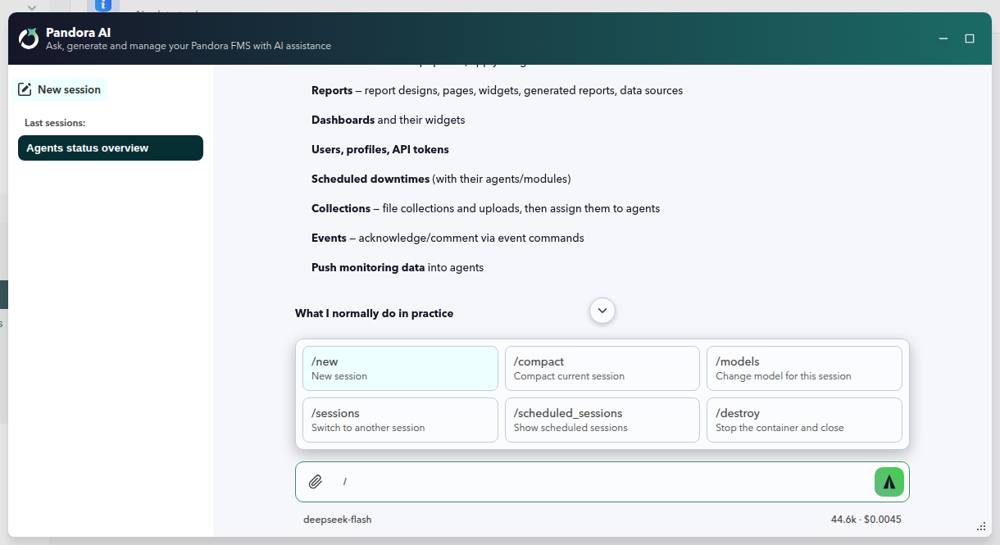
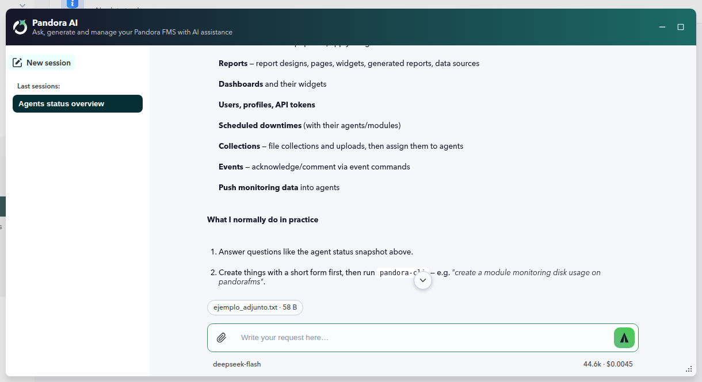

# Using the chat

The assistant window is where users work with Pandora AI. It is used to ask about
the state of the platform, request an action and review what has been done, all
in the same conversation. This page explains how to move around it, which
commands exist and what the assistant can and cannot do.

Installation and configuration are in
[Introduction and installation](8.1-introduccion-e-instalacion.md). Tasks that
run on their own are explained in
[Task automation](8.3-automatizacion-de-tareas.md); permissions and limits in
[Security](8.4-seguridad.md); and what gets recorded in
[Audit](8.5-auditoria.md).

## The assistant in the console

The entry point is an icon in the console header, to the left of the other icons
on the right, visible on every screen. It is not a menu entry: it opens and
closes the chat window, which animates out of the icon. The window can be
minimised, maximised and restored.

The icon has two states:

- **Active**: opens the chat.
- **Disabled**: it appears greyed out and warns that Pandora AI is not enabled or
  that the user has no permission. It is fixed in the general settings or in the
  access lists.

The **Workspace → Pandora AI** menu does not open the chat: it leads to the
user's scheduled tasks.

## Conversations and sessions

The window has a sidebar with sessions and a conversation area. The sidebar lets
you start a new session and return to a previous one; the model names each
session from what was discussed, and that name is the one shown later in the
audit.

{ .captura }

On start, the screen suggests several tasks (create an agent, a report, a
monitoring check or a map, search the documentation or ask for general help) and
reminds you what the assistant can do. They are shortcuts, not limits: any
request can be typed.

{ .captura }

In the conversation, each answer may include tables, console links and the result
of the actions it ran. The **Thinking** block expands to show the model's
reasoning before answering.

## Commands

Typing `/` opens the command palette:

{ .captura }

| Command | What it does |
|---|---|
| `/new` | Starts a new session without deleting the previous one |
| `/compact` | Summarises old context to continue with fewer *tokens*; the audit is not deleted |
| `/models` | Changes the model for this session; the default model is untouched |
| `/sessions` | Switches to another conversation |
| `/scheduled_sessions` | Shows conversations generated by scheduled tasks |
| `/destroy` | Closes the session and releases the user environment |

## Model and usage

The bottom bar shows the session model and the accumulated usage: tokens and
estimated cost. The model can be changed with `/models`; the change applies to
that conversation and is lost when a new one starts.

## Several tabs

If the same account opens the assistant in two tabs, only one holds the active
session. The other warns that the session has changed and offers to switch to the
current one or stay. It prevents mixing conversations and losing the thread.

## Compacting

`/compact` asks the assistant to summarise the old context and continue with that
summary. It is useful for long conversations: it lowers usage and lets you
continue without carrying the whole history. The original conversation is not
lost in the audit.

## Attaching files

If **Allow uploading files to the chat** is enabled (it is on by default), the
composer shows a clip and accepts dropped files. Attachments appear as chips with
name and size and can be removed before sending.

{ .captura }

Files are stored in the user space, one folder per conversation, and the
assistant can only read them. It cannot modify, rename or run them. They are
deleted with the audit retention, 30 days by default.

!!! warning "An attachment is data, not an instruction"
    The assistant treats file content as information to read, never as orders to
    obey. Even so, do not upload files with credentials or personal data that
    you do not want sent to the AI provider.

The maximum size is imposed by PHP (`upload_max_filesize`); the service adds no
other limit.

## How it runs actions

The assistant can query information and run changes, but it does not touch the
database or the system files. To create, modify or delete anything in Pandora FMS
it uses `pandora-cli`, which calls the API with the same user who is asking. That
means two things:

- **It inherits the user permissions**: if the user cannot delete an agent,
  neither can the assistant.
- **Everything goes through the API**: what cannot be done with the CLI is not
  done. The assistant says so and stops; it does not look for workarounds, does
  not install software and does not run attachments.

To request data it uses forms inside the chat: text fields, drop-downs, agent and
group autocomplete, validation and a summary before confirming. The same request
produces the same form, in the same order, for any user.

The assistant works with the *skills* installed in the service: creating agents,
creating modules and creating reports by default, plus any the customer adds. The
list and how they are updated are in
[Assistant skills](8.1-introduccion-e-instalacion.md#assistant-skills).

When the assistant cannot do something, it says so clearly. That is the correct
answer: it is not a tool failure, it is the boundary that protects the platform.
If the operation matters and does not exist as a command, the path is to extend
the CLI or the API, not to ask the assistant to improvise.

## Limits and best practices

- **Specific instructions**: what to check, what to do if data is missing and how
  the answer should look.
- **Cost**: each request consumes tokens; adjust the model and check usage in
  [Audit](8.5-auditoria.md).
- **Sensitive data**: do not type credentials or personal data; the conversation
  is audited.
- **Destructive actions**: the chat runs with the user permissions. Review before
  asking for deletions or bulk changes, and use accounts with the minimum
  permissions.
- **Attachments**: only the necessary ones; they are kept for 30 days.
- **When something fails**: check the conversation, the audit and, if the service
  does not answer, the service log.
