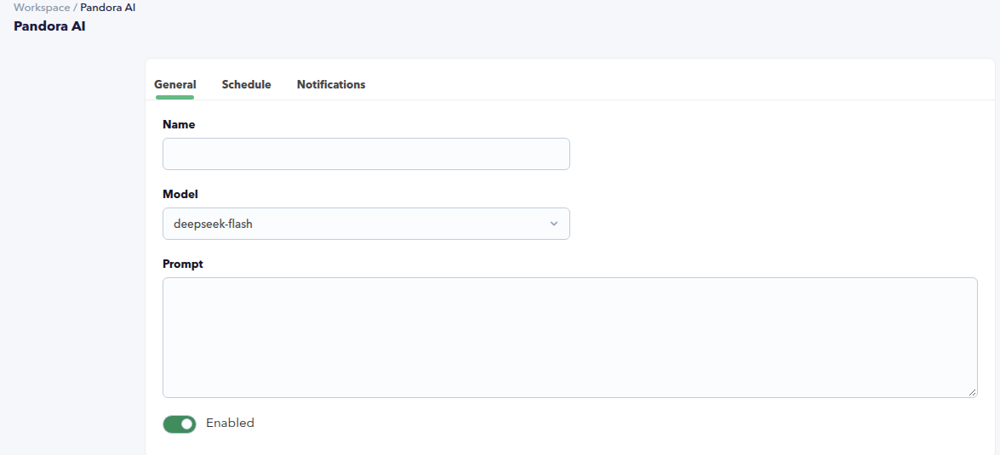
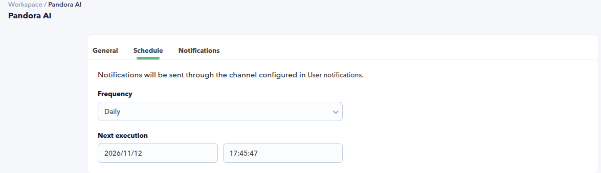
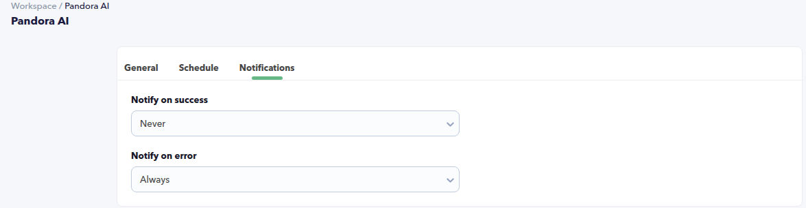
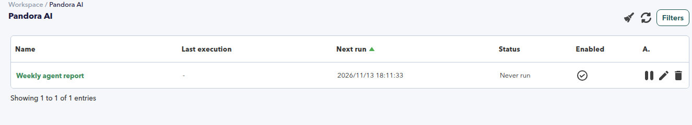

# Task automation

A scheduled task is an instruction that runs with nobody in front of it, in its
own environment, at the chosen frequency, and reports the result. It is meant for
what you already know how to do and must be repeated: a weekly report, an agent
review, an event summary.

This page covers scheduled tasks only. Chat usage is in
[Using the chat](8.2-uso-del-chat.md); installation in
[Introduction and installation](8.1-introduccion-e-instalacion.md); permissions
in [Security](8.4-seguridad.md); and the record of each run in
[Audit](8.5-auditoria.md).

## Where they are managed

- **Workspace → Pandora AI**: the user sees and manages **their** tasks. It only
  appears if they can use Pandora AI.
- **Management → Settings → System Settings → Pandora AI → Scheduled tasks**: the
  administrator sees every user's tasks and can edit them. They cannot create a
  task on behalf of another user from here.

## Creating a task

The form has three tabs.

{ .captura }

**General**:

| Field | What it does |
|---|---|
| **Name** | Task name; used in the list and in notifications |
| **Model** | Model for the run; if empty, the default one is used |
| **Prompt** | The full instruction. It is the only guide for the assistant: the more specific, the better |
| **Enabled** | Turns the task on or off without deleting it |

{ .captura }

**Schedule**:

| Field | What it does |
|---|---|
| **Frequency** | `Hourly`, `Daily`, `Weekly`, `Monthly` or `Yearly` |
| **Next execution** | Date and time of the first run; the next one is calculated from there |

{ .captura }

**Notifications**:

| Field | Values | What it does |
|---|---|---|
| **Notify on success** | `Never`, `Only if the user asks in the prompt`, `Always` | Notifies when the task finishes successfully |
| **Notify on error** | Same | Notifies when the task fails |

!!! note "About “Only if the user asks in the prompt”"
    In this version only **Always** generates a notification. If you choose
    “Only if the user asks in the prompt”, the task runs but does not notify.

## Notifications

Notifications are sent through the **Pandora AI** source and use the channels the
user has configured in **User notifications** (console and email). If none is
active, nothing is sent.

The notice includes the task name and the result, with a link to the task list.
Failures are also recorded in the system audit.

## Execution

Tasks are launched by the **console cron**. If the cron is not active, tasks do
not run even if they are enabled and their time has come.

Each task runs in its own environment and the concurrent number is limited by
`scheduled_max_containers` (four by default). A user does not run two tasks at
once: the second waits for the next pass.

Execution is **non-interactive**:

- It cannot ask questions or use forms.
- If a piece of data, a permission or an action is missing, it ends with a clear
  error.
- The answer is delivered in HTML, not Markdown, because it is sent by email and
  through the console.

If the user lost permission or Pandora AI is disabled, the task fails with an
explicit error. It is not retried in a loop.

Each run leaves a **scheduled session**, which can be opened from the chat
sidebar with `/scheduled_sessions`. The task history is not deleted when the task
is deleted: the conversation remains in the audit.

## The list

{ .captura }

| Column | What it shows |
|---|---|
| **Name** | Task name |
| **User** | Task owner; only shown in the administration view |
| **Last run** | When it last ran |
| **Next run** | When it is due next |
| **Status** | `Never run`, `Running`, `Success` or `Error` |
| **Enabled** | Whether it is active |
| **A.** | Run now, edit, delete and enable or disable |

**Run now** queues the task for the next pass. Deleting the task does not delete
the audited conversation.

## Limits and best practices

- **Specific instructions**: what to check, what to do if data is missing and how
  the answer should look. Scheduled tasks cannot ask questions.
- **Cost**: each run consumes tokens; adjust frequency and model, and check usage
  in [Audit](8.5-auditoria.md).
- **Sensitive data**: do not put credentials or personal data in the prompt; it
  is audited.
- **Destructive actions**: the task runs with its owner's permissions. Review the
  instruction and use accounts with the minimum permissions.
- **Chat or task**: the chat to explore and decide; the task for what you already
  know how to do and must be repeated.
- **When something fails**: check the task status, the last error and the audit;
  then the service log.
