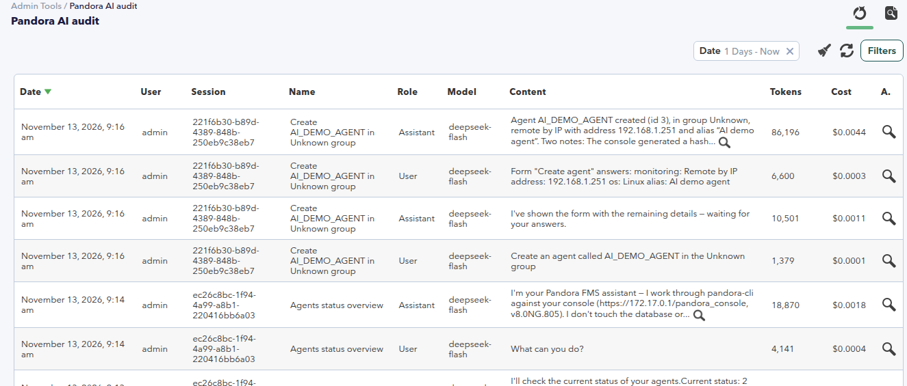
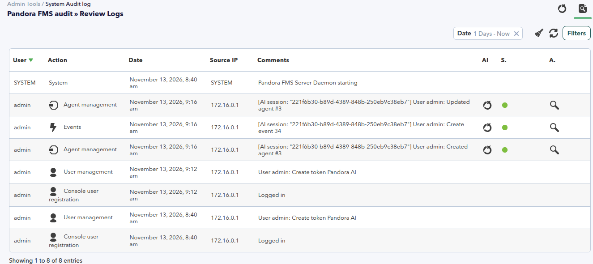

# Audit

Pandora AI leaves two different, complementary trails: what was said in the chat
and what was done in the console. The first is kept by the AI service; the
second, by the Pandora FMS system audit. Knowing which one to look at, and how to
move from one to the other, is half the job when an action has to be
reconstructed.

This page covers both views, retention and backup. Installation is in
[Introduction and installation](8.1-introduccion-e-instalacion.md); usage is in
[Using the chat](8.2-uso-del-chat.md); scheduled tasks are in
[Task automation](8.3-automatizacion-de-tareas.md); and permissions are in
[Security](8.4-seguridad.md).

## Two records

| Record | Where it is viewed | What it stores | What it is for |
|---|---|---|---|
| Pandora AI audit | **Admin tools → System audit log → Pandora AI** | Users, sessions, messages, session events and compactions | Knowing what was asked, what the model answered and what it cost |
| System audit | **Admin tools → System audit log** | Console actions, tagged with the AI session that started them | Knowing what was done and linking it to the conversation |

The Pandora AI audit is kept even if the task is deleted or the user environment
is recycled. What expires is the session file and the attachments, not the record
of what was said.

It does not store the attachments themselves (they live in the user space and
expire with their own retention), nor credentials, nor diagnostic traces (only if
`debug` is on).

## Pandora AI audit

Path: **Admin tools → System audit log**, **Pandora AI** tab. It requires the
**PM** profile or console administrator rights. It only appears if **Enable
Pandora AI** is on.

{ .captura }

The table has one row **per message**, not per conversation:

| Column | Content |
|---|---|
| **Date** | Message date and time, in the console format |
| **User** | User who made the request |
| **Session** | Session identifier; the same one that links the system audit |
| **Name** | Conversation name, set by the model |
| **Role** | `User` or `Assistant` |
| **Model** | Model that answered |
| **Content** | Message excerpt; the magnifier opens the full text |
| **Tokens** | Tokens consumed by that message |
| **Cost** | Estimated cost of that message |
| **A.** | Opens the session detail |

Available filters:

- **Date**: date range; the last day by default.
- **Free search**: free text in the content and the session name.
- **User**, **AI session**, **Role** and **Model**.

The **AI session** filter is the same identifier used by the system audit, and it
takes you here from a specific action.

Opening a session detail (**A.**) shows the full conversation and, if present, the
session **events** (model changes, compactions and other actions) and the
**compactions** with their summary and the token counts before and after. Content
is displayed with formatting.

The table can be exported to CSV with the button at the bottom, like the rest of
the console lists.

## System audit with AI session

Every action run by the assistant is recorded like any other user action, but with
an extra piece of data: the **AI session** that started it.

{ .captura }

In **Admin tools → System audit log**:

- The **AI** column shows an icon on rows that came from a conversation.
- The **AI session** filter searches by session identifier.
- Clicking the icon opens the **Pandora AI audit filtered by that session**. If
  there was no date range, the view widens it so the conversation appears even if
  it is old.

The conceptual difference:

- **Message** is what was said in the chat and lives in the AI audit.
- **Action** is what was executed in the console and lives in the system audit.
- A conversation may have messages without actions (queries), and an action may
  have several messages behind it (asking for data, correcting it, executing).

The system audit also keeps **scheduled task failures**, with their identifier and
error, and access attempts denied by permissions.

## Retention and backup

There are four different clocks, all in the service configuration:

| What | Key | Default | What happens when it expires |
|---|---|---|---|
| Idle environment | `container_expiration_seconds` | 604800 (7 days) | The environment is removed; the data is kept |
| Session without messages | `session_expiration_seconds` | 604800 (7 days) | The session file is deleted; the audit is kept |
| Audit | `audit_expiration_seconds` | 2592000 (30 days) | Messages are deleted; users are kept |
| Attachments | `uploaded_files_expiration_seconds` | 2592000 (30 days) | The volume file is deleted |

Cleanup runs every `cleanup_interval_seconds` (3600 by default); `0` disables it.
When the service stops, `stop_containers_on_shutdown = 1` removes the
environments, but not the volumes or the audit.

Practical consequences:

- The conversation can be read even after the environment has been recycled; what
  expires is the session file, not the audit.
- An attachment is deleted after 30 days even if the conversation mentioning it
  remains in the audit: the message stays, the file does not.
- **Backup** includes the service data folder (sessions, attachments and audit)
  and the configuration file. Environments are not backed up: they are recreated.
- To **restore**, stop the service, restore the data folder and the
  configuration, and start it. Environments are created the next time the chat is
  used.
- On **upgrade**, the installer keeps the configuration and data. If there is a
  new version of the file, it leaves a `.new` file that must be merged by hand.

## Practical use and privacy

What it is for day to day:

- **Support**: reconstruct what a user asked, what the assistant answered and
  what action was executed, with conversation and trail linked.
- **Cost**: see usage by user, session and model, and spot scheduled tasks that
  spend more than expected.
- **Compliance**: show who requested a change and when, with the content of the
  request.
- **Quality**: spot instructions the assistant could not resolve and turn them
  into improvements to the *skills* or the CLI.

Limits and warnings:

- The audit stores **the text of prompts and answers**. It may contain personal
  data or secrets the user typed: treat it as sensitive information and apply the
  company retention policy.
- For compliance, the system audit remains the reference.
- The CSV export extracts the table content; check where it is stored.
- The external provider has its own retention; the local audit does not control
  it.
- It does not replace the internal system audit: they complement each other.

The recommendation is the reverse of the usual one: when a system action is not
understood, open the conversation from the **AI** icon; when a conversation is
not understood, look at the actions it generated.
