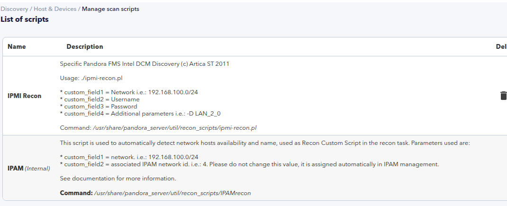
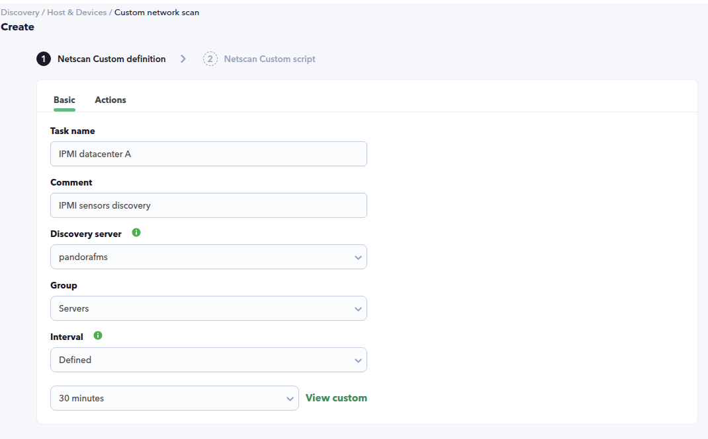
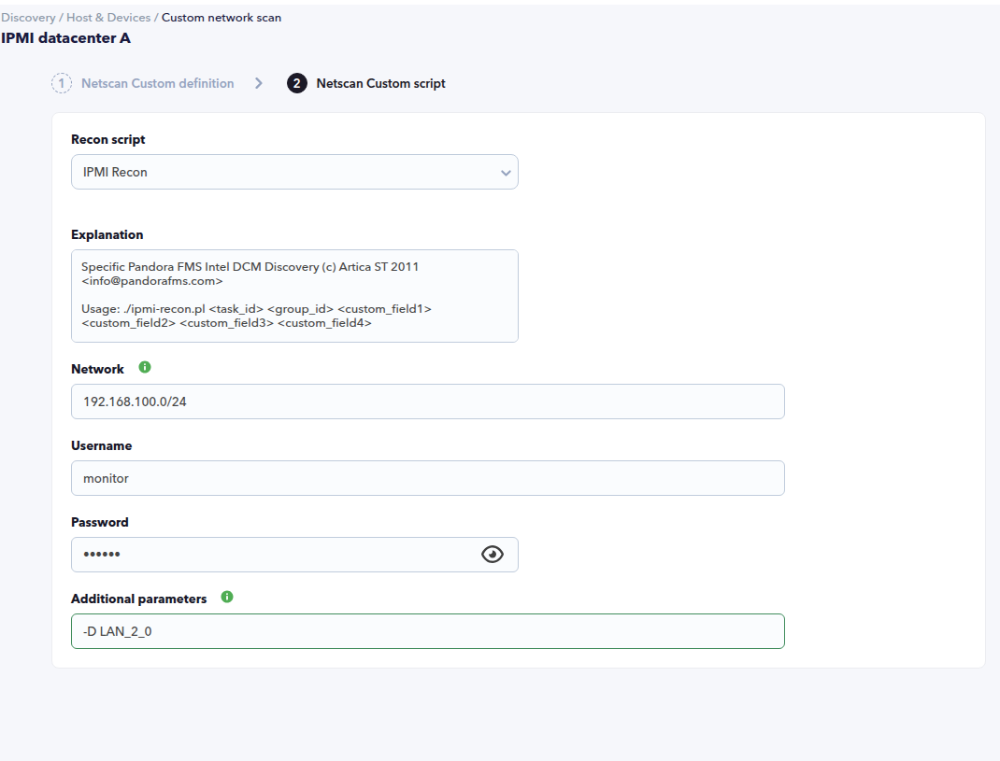

# Advanced automatic discovery: IPMI and custom recon tasks

Discovery's network scan covers most cases, but not all of them. When an asset
speaks a protocol the scan does not understand, or when agents and modules must
be created with your own logic, Discovery can run a script. This chapter
explains that mechanism and walks through it end to end with IPMI, the example
that ships with the product.

## What advanced discovery is

Pandora FMS discovers assets in three ways. Pick the right one before writing
anything:

| Route | What runs | When to use it | Where it is explained |
|---|---|---|---|
| Network scan | Discovery's heuristic engine, with SNMP, WMI and remote commands | General-purpose networks and devices that speak SNMP or WMI | 2.4 |
| Custom recon task (Custom network scan) | A script registered by the user | Protocols or inventories the scan does not cover, or provisioning with your own rules | This chapter |
| `.disco` package (Applications, Cloud and Custom) | A Discovery plugin with its own steps | Vendor or cloud integrations that are already packaged | 2.3 and 9.7 |

The first two are created from **Discovery → Host & Devices**. The third is
installed as a package and adds its own sections to the Discovery menu. They are
not interchangeable: a `.disco` package brings the logic ready-made; a custom
task makes you write it, but it does not impose a data model. Network scan is
explained in [2.4](../parte-2/2.4-descubrimiento-de-redes-con-host-y-dispositivos.md);
`.disco` packages, in [2.3](../parte-2/2.3-monitorizacion-y-descubrimiento-automatico-con-discovery.md)
and [9.7](../parte-9/9.7-creacion-de-plugins-de-discovery.md).

Creating or editing tasks requires the **AW** permission. Registering scripts
requires **PM**, because the script runs on the Discovery server with that
service's privileges.

## Custom recon tasks

### Register the script

Register the script before creating the task, in **Management → Discovery →
Host & Devices → Manage scan scripts**. Each script declares where it lives and
which data it needs:

| Field | What it means |
|---|---|
| Name | Name shown in the script selector. |
| Script full path | Absolute path to the executable on the Discovery server. |
| Description | Text shown as "Explanation" when the task is created. |
| Macro | Each piece of data the script needs: description, default value, help and, for credentials, "Hide value". |

Macros are numbered automatically (`_field1_`, `_field2_`…) and passed to the
script in that order. "Hide value" turns the field into a password when the task
is created; it does not encrypt the value, it only hides it on screen. The
description accepts several lines and is shown as the general explanation. Each
macro also shows its own help text as a tooltip in the second step, so split the
information: the common format in the description and each value's format in its
help.

A custom script must be executable on the Discovery server: absolute path,
execute permission and, for an interpreted script, the right *shebang* on the
first line. Internal scripts such as IPAM cannot be edited from this screen. The
IPMI Recon script can be edited, although there is no need to touch it. The
internal IPAM script is explained in [3.7](../parte-3/3.7-gestion-de-ip-ipam.md).



### Create the task

Create the task in **Management → Discovery → Host & Devices → Custom network
scan**. The wizard has two steps. The first one defines the common data:

| Field | What to enter |
|---|---|
| Task name | Task name. It must be unique. |
| Comment | Free-text description to identify the task in the list. |
| Discovery server | Server that will run the script. It must be a Discovery server and it must be active; if none is selected, the task never runs. |
| Group | Group assigned to the agents the script creates. |
| Interval | `Defined` for a fixed schedule or `Manual` to run it only on demand. The console recommends not going below 5 minutes. |
| Generate event on error | Generates an event if the task ends in error. |
| Execute alert action on error | Runs one or more alert actions in that same case. |

The last two fields are on the **Actions** tab. They are saved with the task,
but the error is not inferred from the script's exit code: the script itself
sets the status (see "What the script receives and what it must do").

The example in this chapter uses a task named "IPMI datacenter A", in the
"Servers" group, with a 30-minute interval.



The second step selects the script and fills in its macros:



When you finish, the task appears in **Discovery → Task list**, on the **Host &
devices tasks** tab. It does not appear in **Custom tasks**: that tab is for
tasks from a Custom `.disco` package, which are a different thing.

### What the script receives and what it must do

The server runs the registered path with three groups of arguments, in this
order:

1. The task identifier.
2. The group identifier.
3. The value of each macro, in the order they were defined.

For the example task, the command line looks like this:

```text
/usr/bin/perl /usr/share/pandora_server/util/recon_scripts/ipmi-recon.pl "12" "2" "192.168.100.0/24" "monitor" "s3cret" "-D LAN_2_0"
```

The built-in script is registered to use the server's Perl interpreter, so the
server prepends `/usr/bin/perl` (or the one set in `PERL5BIN_PERL`, with the
options in `PERL5_OPT`). A custom executable script runs without an added
interpreter.

The server **does not interpret the script's output**. It does not create agents
or modules from what the script writes to standard output: the script must
create its own findings through the API v2 (see [13.1](../parte-13/13.1-primeros-pasos-y-autenticacion.md) and the [endpoint reference](../parte-13/13.4-referencia-de-endpoints/index.md))
or by sending its own data XML. The output is kept for troubleshooting only,
and only when the server runs with `verbosity 10`: the command goes to
`<log directory>/discovery/task.<id>.cmd` and the output to `task.<id>.out`,
next to the server logs.

!!! warning "The password is kept in the command log"
    With `verbosity 10`, the server writes the full command line to
    `discovery/task.<id>.cmd`, including the macro values and therefore the
    password. The `.out` file contains only the script output. Protect the log
    directory and do not leave `verbosity 10` enabled permanently in production.

The task status is not inferred from the exit code either. `exit 1` does not
mark the task as failed and does not by itself trigger the error actions: the
script leaves the status it considers appropriate. Make the script log its own
errors and check the task by its result, not only by the status shown in the
list.

## IPMI discovery

IPMI (**Intelligent Platform Management Interface**) is the interface through
which baseboards and management controllers expose temperature, voltage, fans,
power and other sensors, even when the operating system is not running. Pandora
FMS monitors it with a plugin and discovers it with a recon script that is
registered at install time.

### Requirements

| Requirement | Detail |
|---|---|
| FreeIPMI | The plugin uses `ipmi-sensors`; the discovery script uses `ipmiping` and `ipmi-sensors`. On RHEL, Rocky Linux and derivatives, install it with `dnf install freeipmi`; on Debian and Ubuntu, with `apt install freeipmi-tools`. |
| Network | The Discovery server must reach the controller over RMCP, UDP 623. Open the port on the server firewall and on the device network. |
| Credentials | IPMI user and password with permission to read sensors. The vendor's default credentials do not always work. |
| Discovery server | The task runs on a Discovery server with `reconserver` or `discoveryserver` enabled (see [9.3](../parte-9/9.3-referencia-completa-de-configuracion-del-servidor.md)). |
| IPMI Plugin | It must exist with that exact name. It is registered at install time and cannot be deleted; if it is renamed, the script can no longer find the plugin it uses to create modules. |
| Permissions | AW to create the task; PM to register or edit scripts. |

### The plugin and the built-in script

There are two pieces, and they should not be confused:

- **IPMI Plugin** reads one sensor. It is the plugin run by the modules created
  later.
- **IPMI Recon** scans a network, detects the controllers and creates the agents
  and modules. It is the script selected in the task.

The plugin declares five macros:

| Macro | Content |
|---|---|
| Target IP | Address of the IPMI controller. |
| Username | IPMI user. |
| Password | Password; stored hidden. |
| Sensor | Identifier of the sensor to read. |
| Additional Options | Extra options for `ipmi-sensors`, for example `-D LAN_2_0`. |

The IPMI Recon script declares four:

| Macro | Content |
|---|---|
| Network | Network to scan, for example `192.168.100.0/24`. |
| Username | IPMI user used on every device found. |
| Password | IPMI password; stored hidden. |
| Additional parameters | Extra options for `ipmi-sensors`, for example `-D LAN_2_0` to force IPMI 2.0. |

The `-D LAN_2_0` option changes the driver used by `ipmi-sensors`; it does not
change the network sweep, which uses `ipmiping` (IPMI 1.5). If the controller
only answers over IPMI 2.0, the device may not appear in the sweep even though
the read works when you run it by hand.

The plugin runs `ipmi-sensors` for the selected sensor and returns the value. If
the sensor has no numeric value, it returns the *event bitmask* converted to
decimal, which is how IPMI represents discrete states. The discovery script runs
`ipmi-sensors` with thresholds and full units so it can create modules with
their limits.

The built-in script is registered to run with the server's Perl
(`use_server_perl`), so the server launches it with `/usr/bin/perl` and does not
require execute permission on the file.

### Create the IPMI task

The procedure is the same as for any custom task:

1. Open **Management → Discovery → Host & Devices → Custom network scan**.
2. Fill in the name, comment, Discovery server, group and interval. In the
   example: "IPMI datacenter A", "Servers" group, 30 minutes.
3. Move to the second step and select **IPMI Recon**. Do not select a plugin:
   the script uses it underneath.
4. Fill in the network, user and password of the controllers. Add `-D LAN_2_0`
   under "Additional parameters" only if your devices need it.
5. Click **Finish**.

The task is now scheduled. With a manual interval, run it on demand from the
task list with the force-run action.

### What agents and modules it creates

The script sweeps the network with `ipmiping`. For every address that answers:

1. It resolves the name through reverse DNS. If there is no name, it uses the IP
   address.
2. It looks for an agent with that name. If it does not exist, it creates one
   with the task's group, the **Network** operating system and a 300-second
   interval.
3. It generates a detection event with the text
   `[RECON] New Intel DCM host [name] detected on network [network]`.
4. It runs `ipmi-sensors` against the controller and creates one module for each
   sensor the tool returns, named "Type: Sensor" (for example, "Temperature:
   CPU Temp") with the corresponding unit.

The modules are plugin modules and use **IPMI Plugin**, so each one reads its
sensor again on every agent interval. The module type and thresholds depend on
the sensor type:

| Family | Examples | Module | Thresholds |
|---|---|---|---|
| Numeric | Temperature, voltage, current, fan, cooling | Numeric (`generic_data`) | Copies the sensor thresholds: warning and critical, inverted to alert when the value leaves the range. |
| Flag | Physical security, violation attempt, firmware, critical interrupt, boot error | Numeric (`generic_data`) | Critical threshold prepared for the alert value. |
| Composite | Processor, power supply, memory, watchdog, LAN, battery | Numeric (`generic_data`) | No thresholds. |
| Text | Slot, board, chassis, FRU, session, version change, `OEM Reserved` | Text (`generic_data_string`) | No thresholds. |

A type that does not appear in the table is not discarded: the script creates the
module with the corresponding generic branch, and it is worth checking the result
on the agent.

While it sweeps the network, the script updates the task status with the
progress percentage. When it finishes, it leaves the internal status as finished
(-1), but it does not write the execution summary; the list may still show
"Pending" even though the run has ended. It only shows "Done" when the summary is
not empty.

One important detail: the script only creates modules when it creates the agent.
If the agent already exists, it does not add the missing sensors. To add new
sensors, add them by hand or delete the agent and run the task again.

### OEM sensors and limits

OEM sensors do not have a standard type in `ipmi-sensors`, but discovery does
not discard them: it creates one module for every sensor the tool returns. `OEM
Reserved` is handled as text (`generic_data_string`); a type that is not in the
table is created with the generic module the script applies. If the value needs
a specific OEM command (`ipmi-oem`), add it by hand as a plugin module; the
procedure is in [9.9](../parte-9/9.9-creacion-de-plugins-remotos.md).

Before scheduling the task, check these limits:

- The sweep uses `ipmiping` (IPMI 1.5). Additional options only affect
  `ipmi-sensors`; a device that only answers over IPMI 2.0 may not be detected.
- If the credentials are invalid, the device is still detected because it
  answers the IPMI ping, but the agent is created without modules. Test the read
  by hand before creating the task.
- Running the task again on an existing agent does not add new modules.
- Only the sensors returned by `ipmi-sensors` are created; the event log (SEL),
  the FRU inventory and other IPMI data are not part of discovery.

For remote monitoring in general, and for the rest of the network checks, see
[2.6](../parte-2/2.6-monitorizacion-de-redes.md). To troubleshoot a task that
does not produce the expected result, continue with the next section or with
[9.13](../parte-9/9.13-troubleshooting-con-pandora.md).

## Write your own recon script

A custom script can be written in any language the server can run. What matters
is the contract:

- **Executable**: absolute path, execute permission and a *shebang* if it is an
  interpreted script. The server runs it as is, unless it is registered to use
  the server's Perl, like IPMI Recon, in which case it prepends `/usr/bin/perl`.
- **Arguments in order**: task identifier, group identifier and macro values.
  Values may arrive empty; validate them before use.
- **Do not rely on output**: the server does not read what you print. Create
  agents and modules through the API ([13.4](../parte-13/13.4-referencia-de-endpoints/index.md))
  or by sending your own XML.
- **Idempotent**: before creating an agent, check whether it already exists;
  before creating a module, check whether it is already there. That way you can
  run the task again without duplicating anything.
- **With its own status**: leave the task in the appropriate state. The exit
  code is not enough for the list to mark it as failed.
- **No secrets in the output**: credentials arrive as arguments; do not print
  them or write them to files. Keep in mind that the command line is written to
  the `.cmd` file with `verbosity 10` (see the warning above).

A minimal Bash skeleton:

```bash
#!/bin/bash
set -euo pipefail

task_id="$1"
group_id="$2"
network="$3"
username="$4"
password="$5"
extra="${6:-}"

# 1. Discover the devices in $network.
# 2. For each device, check whether the agent exists and create it if missing.
# 3. Create or update its modules.
# 4. Log errors and leave the task in the right state.
```

Agents and modules are created through the API; the endpoints and
authentication are described in [13.1](../parte-13/13.1-primeros-pasos-y-autenticacion.md).
This form has no credential selector for the
[2.2](../parte-2/2.2-gestor-de-credenciales.md) credential store: credentials
the script needs are passed as macros. If the script wants to query the store on
its own, it would have to do so from its own code, which is outside the scope of
this chapter.

## Troubleshooting

When the task finishes but there are no agents, or the agents have no modules,
the problem is usually in one of these checks:

| Symptom | What to check |
|---|---|
| The task creates no agents | The Discovery server exists and is active; the script has execute permission; the network is reachable from that server. |
| The device does not appear in the sweep | `ipmiping` against the address; UDP 623; the controller is not IPMI 2.0 only. |
| The agent appears without modules | IPMI credentials; `ipmi-sensors` returns sensors by hand; the plugin still has the exact name "IPMI Plugin". |
| The task still shows "Pending" after it has finished | The built-in script does not write the execution summary; without a summary, the list does not show "Done". Check the update time and the agents created. |
| The script does not run | Full path, execute permission and *shebang*; check the server log. |
| There is no trace of the run | Set `verbosity` to 10 temporarily and look for `task.<id>.cmd` and `task.<id>.out` in the `discovery/` log directory; the `.cmd` file will contain the credentials. |

Two manual checks save half the troubleshooting:

```sh
ipmiping 192.168.100.10 -c 2 -t 1
ipmi-sensors -h 192.168.100.10 -u monitor -p 'password' -D LAN_2_0 \
  --ignore-not-available-sensors
```

The first tells you whether the device answers discovery. The second tells you
whether the credentials and driver are correct and which sensors will be
created. If the second fails, the task will create the agent but not the
modules.

For general remote monitoring troubleshooting, continue with
[9.13](../parte-9/9.13-troubleshooting-con-pandora.md).
